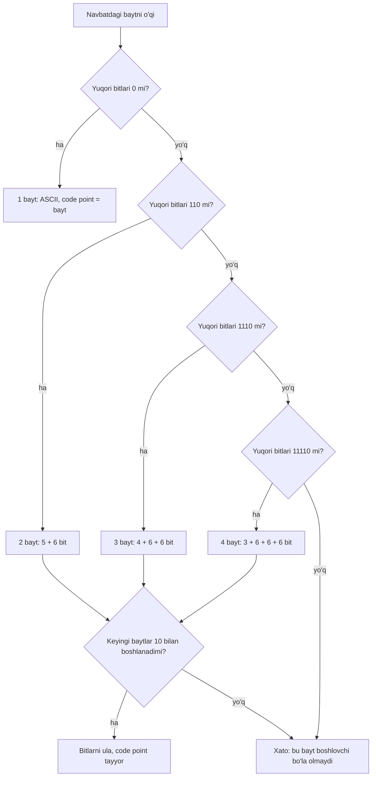

## Bu dars nima uchun kerak

1-darsda butun computer science bitta sxemaga keltirildi: input -> algoritm -> output. O'shanda birinchi ochiq savol qolgan edi: input va output kompyuter ichida **qanday ifodalanadi**? Kompyuter son, harf yoki emoji ni "bilmaydi". U faqat ikki holatni ajrata oladi: tok bor yoki yo'q, zaryad bor yoki yo'q. Matn, son, rasm, ovoz - hammasi oxir-oqibat shu ikki holatlar ketma-ketligiga aylantiriladi.

Bu mavzu nazariy ko'rinadi, lekin amalda har kuni uchraydi: "Салом" ko'rinishidagi buzilgan matn, bazadagi `VARCHAR(10)` ga 10 ta kirill harfi sig'masligi, JavaScript da `"😀".length` ning 2 chiqishi, CSS dagi `#FF8800`, xotira manzillaridagi `0x7ffd...`. Bularning hammasi bitta savolga borib taqaladi: qaysi bitlar qaysi ma'noni bildiradi va bu kelishuvni kim belgilaydi.

Bu darsdan keyin siz:

- bit, bayt va n bitda nechta qiymat sig'ishini formula bilan hisoblay olasiz;
- sonni o'nlik, ikkilik va o'n oltilik tizimlar orasida qo'lda va kod bilan o'gira olasiz;
- nega dasturchilar hex ni yaxshi ko'rishini (bitta raqam = 4 bit) tushunasiz;
- ASCII jadvalining tuzilishini va undagi qonuniyatlarni ('A' va 'a' farqi, raqamlar) bilasiz;
- Unicode code point, belgi (character) va glyph ni ajrata olasiz;
- UTF-8 qoidalari bo'yicha istalgan code point ni baytlarga qo'lda kodlay olasiz;
- "satr uzunligi" nega C, Python va JavaScript da har xil chiqishini tushuntira olasiz;
- buzilgan matn (mojibake) qanday paydo bo'lishini va uni qanday tiklashni bilasiz.

## Bit, bayt va sanoq tizimlari

### Unary dan o'nlikka

Eng sodda hisoblash usuli - barmoq bilan sanash. Har bir barmoq "bitta" ni bildiradi, besh barmoq ko'tarilgan bo'lsa - besh. Bu **unary** (birlik) tizim: n sonini yozish uchun n ta belgi kerak. Bir qo'lda faqat 0 dan 5 gacha sanash mumkin.

Lekin barmoqlarning **qaysilari** ko'tarilganini ham ma'lumot deb hisoblasak, imkoniyat keskin oshadi. Har bir barmoq ikki holatda bo'ladi, beshta barmoq esa 2 · 2 · 2 · 2 · 2 = 2⁵ = 32 xil holat beradi. Bir qo'lda 0 dan 31 gacha. G'oya shu: belgining **o'rni** ham ma'no tashiydi. Bu - pozitsion sanoq tizimi.

Biz kundalik ishlatadigan **o'nlik** (decimal, base-10) tizim ham pozitsion. 2026 sonida har bir raqam o'z ustunining "og'irligi" ga ko'paytiriladi:

2026 = 2 · 10³ + 0 · 10² + 2 · 10¹ + 6 · 10⁰ = 2000 + 0 + 20 + 6

O'nta raqam (0-9) bor, ustun og'irliklari 10 ning darajalari. Bu tanlov tasodifiy: odamda o'nta barmoq bor. Mashina uchun boshqa asos qulayroq.

### Ikkilik tizim

Kompyuter ichidagi tranzistor - kalit: yoqilgan yoki o'chirilgan. Ikki holatni ishonchli ajratish o'nta kuchlanish darajasini ajratishdan ancha oson va shovqinga chidamli. Shuning uchun kompyuter **ikkilik** (binary, base-2) tizimda ishlaydi: faqat ikkita raqam, 0 va 1. Bitta ikkilik raqam - **bit** (binary digit).

Ustun og'irliklari endi 2 ning darajalari: ..., 128, 64, 32, 16, 8, 4, 2, 1. Masalan, 01001000 ni o'nlikka o'girish:

0·128 + 1·64 + 0·32 + 0·16 + 1·8 + 0·4 + 0·2 + 0·1 = 64 + 8 = 72

Teskari yo'nalish - o'nlikdan ikkilikka - ketma-ket 2 ga bo'lish bilan: qoldiqlar pastdan yuqoriga o'qiladi.

| Qadam | Bo'linuvchi | Butun qism | Qoldiq |
|---|---|---|---|
| 1 | 72 / 2 | 36 | 0 |
| 2 | 36 / 2 | 18 | 0 |
| 3 | 18 / 2 | 9 | 0 |
| 4 | 9 / 2 | 4 | 1 |
| 5 | 4 / 2 | 2 | 0 |
| 6 | 2 / 2 | 1 | 0 |
| 7 | 1 / 2 | 0 | 1 |

Qoldiqlarni oxiridan boshiga o'qiymiz: 1001000. 8 bitga to'ldirsak, 01001000. Nega bu ishlaydi: har bir bo'lishning qoldig'i - sonning eng o'ngdagi biti, bo'lish esa barcha bitlarni bitta o'ngga suradi.

### n bitda nechta qiymat

Har bir bit 2 ta holat beradi va bitlar mustaqil, shuning uchun n bit **2ⁿ** xil kombinatsiya beradi. Agar biz faqat manfiy bo'lmagan butun sonlarni yozsak, ular 0 dan **2ⁿ - 1** gacha. Nega -1: 0 ham kombinatsiyalardan biri.

| Bitlar (n) | Kombinatsiyalar (2ⁿ) | Eng katta qiymat (2ⁿ - 1) | Qayerda uchraydi |
|---|---|---|---|
| 1 | 2 | 1 | rost / yolg'on |
| 4 | 16 | 15 | bitta hex raqam |
| 7 | 128 | 127 | ASCII belgilari |
| 8 | 256 | 255 | bitta bayt, RGB ning bitta kanali (3-dars) |
| 16 | 65 536 | 65 535 | Unicode ning bitta "tekisligi" |
| 21 | 2 097 152 | 2 097 151 | Unicode code point lari uchun yetarli bitlar |
| 32 | 4 294 967 296 | 4 294 967 295 | C dagi `unsigned int` (6-dars) |

Bu jadvaldan ikkita amaliy qoida chiqadi. Birinchidan, **bitta bit qo'shish sig'imni ikki baravar oshiradi**: 1-darsdagi binary search ga o'xshash qonuniyat. Ikkinchidan, k ta turli qiymatni yozish uchun kamida ⌈log₂ k⌉ bit kerak. Masalan, 26 ta lotin harfi uchun ⌈log₂ 26⌉ = ⌈4.70⌉ = 5 bit yetadi, katta va kichik harflar (52 ta) uchun esa 6 bit.

Manfiy sonlar va kasr sonlar ham shu bitlardan quriladi, lekin boshqa kelishuv bilan (two's complement, floating-point). Ular 6 va 7-darslarda chuqur ko'riladi. Bu darsda faqat manfiy bo'lmagan butun sonlar.

### Bayt va o'lchov birliklari

**Bayt** (byte) - 8 bit. Zamonaviy kompyuterlarda xotira baytlab manzillanadi: har bir bayt o'z manziliga ega (21-darsda ko'riladi). Bitta baytga 2⁸ = 256 xil qiymat sig'adi, ya'ni 0-255.

Kattaroq birliklarda chalkashlik bor. SI tizimida "kilo" doim 1000 degani. Kompyuterda esa 2 ning darajalari qulay, shuning uchun uzoq vaqt "kilobayt" deb 1024 baytni ham atashgan. IEC 1998 yil dekabrida bu chalkashlikni yo'qotish uchun alohida ikkilik prefikslarni qabul qilgan: **KiB** (kibibayt) = 2¹⁰ = 1024 bayt, **MiB** = 2²⁰ = 1 048 576 bayt, **GiB** = 2³⁰ = 1 073 741 824 bayt. kB, MB, GB esa 1000 ning darajalari.

Farq kattalashgan sari o'sadi: 1 GiB / 1 GB = 1 073 741 824 / 1 000 000 000 ≈ 1.074, ya'ni 7.4%. 1 TB disk operatsion tizimda "931 GiB" ko'rinishi shundan: 10¹² / 2³⁰ ≈ 931.3.

Tarmoq tezligi esa odatda **bit** larda o'lchanadi (Mbit/s), fayl hajmi **bayt** larda. 100 Mbit/s kanal soniyasiga eng ko'pi bilan 100 / 8 = 12.5 MB uzatadi.

## Hexadecimal: bitlarni o'qishning qulay usuli

Ikkilik yozuv mashina uchun tabiiy, lekin odam uchun noqulay: 32 bitli son 32 ta belgidan iborat va 0 bilan 1 ni sanashda xato qilish oson. O'nlik yozuv qisqaroq, lekin o'nlik raqamlar bitlar bilan to'g'ridan-to'g'ri bog'lanmaydi: 255 ni ko'rib, uning bitlarini darhol ayta olmaysiz.

**O'n oltilik** (hexadecimal, hex, base-16) tizim ikkala muammoni hal qiladi. Unda 16 ta raqam bor: 0-9 va A-F (A = 10, B = 11, ..., F = 15). Asosiy xususiyat: 16 = 2⁴, shuning uchun **bitta hex raqam aynan 4 bitga** mos keladi. 4 bitlik guruh **nibble** deb ataladi. Bayt = 2 nibble = 2 hex raqam.

O'girish shunchaki guruhlash bilan bajariladi, hech qanday bo'lish kerak emas:

```text
2026 (o'nlik) = 0111 1110 1010 (ikkilik)
                  7    E    A    -> 0x7EA
Tekshirish: 7·16² + 14·16 + 10 = 1792 + 224 + 10 = 2026
```

Hex sonlar odatda `0x` prefiksi bilan yoziladi (C, JavaScript, Python da bir xil): `0x48` - bu 72, `48` esa qirq sakkiz. Bitta baytning eng katta qiymati `0xFF` = 15 · 16 + 15 = 255. CSS da rang `#` bilan boshlanadi (`#FF0000`), Unicode da `U+` bilan (`U+0041`). Bular bir xil hex, faqat prefiks boshqa.

Hex qayerda uchraydi:

- **Xotira manzillari** (21-dars): `0x7ffd5e8c` 32 bitni 8 ta belgida ko'rsatadi.
- **Ranglar** (3-dars): `#RRGGBB` - uchta bayt, har biri ikki hex raqam.
- **Bayt dumplari**: fayl yoki tarmoq paketi ichini ko'rish uchun `xxd`, `hexdump` kabi vositalar har baytni ikki hex raqam bilan chiqaradi. Pastda UTF-8 baytlarini aynan shunday ko'ramiz.
- **Hash va identifikatorlar**: SHA-256 natijasi 256 bit = 64 hex belgi (52-dars).

| O'nlik | Ikkilik | Hex | Izoh |
|---|---|---|---|
| 0 | 0000 0000 | 0x00 | barcha bitlar o'chiq |
| 9 | 0000 1001 | 0x09 | o'nlik va hex bir xil ko'rinadi |
| 10 | 0000 1010 | 0x0A | hex da birinchi harf |
| 15 | 0000 1111 | 0x0F | bitta to'la nibble |
| 16 | 0001 0000 | 0x10 | hex da "10" = o'n olti |
| 72 | 0100 1000 | 0x48 | ASCII da 'H' |
| 127 | 0111 1111 | 0x7F | ASCII ning oxirgi kodi |
| 128 | 1000 0000 | 0x80 | eng katta bit yoqilgan |
| 255 | 1111 1111 | 0xFF | bitta baytning maksimumi |
| 256 | 0001 0000 0000 | 0x100 | 9-bit kerak bo'ladi |

### O'zingiz sinab ko'ring: son, uning bitlari va hex

Quyidagi dastur "Kirish" maydonidagi har bir sonni o'nlik, hex va 16 bitli ikkilik ko'rinishda chiqaradi. Ikkita yangi operator ishlatilgan: `n >> i` sonning bitlarini i ta o'ngga suradi, `& 1` esa eng o'ngdagi bitni ajratib oladi. Shu ikkisi bilan i-bitni o'qish mumkin. C sintaksisi 5-darsdan boshlab tizimli o'rganiladi, hozir dastur nima chiqarishiga e'tibor bering. Kirishga o'z sonlaringizni qo'shing (65 535 dan katta bo'lmasin, chunki faqat 16 bit chiqariladi).

```c run
#include <stdio.h>

// n ning pastki 16 bitini chapdan o'ngga, 4 tadan guruhlab chiqaradi
void print_binary16(unsigned int n)
{
    for (int i = 15; i >= 0; i--)
    {
        printf("%u", (n >> i) & 1);
        if (i % 4 == 0 && i != 0)
        {
            printf(" ");
        }
    }
}

int main(void)
{
    unsigned int n;
    while (scanf("%u", &n) == 1)
    {
        printf("%6u  0x%04X  ", n, n);
        print_binary16(n);
        printf("\n");
    }
    return 0;
}
```

```text stdin
5
72
255
256
2026
65535
```

Natija:

```text
     5  0x0005  0000 0000 0000 0101
    72  0x0048  0000 0000 0100 1000
   255  0x00FF  0000 0000 1111 1111
   256  0x0100  0000 0001 0000 0000
  2026  0x07EA  0000 0111 1110 1010
 65535  0xFFFF  1111 1111 1111 1111
```

Har bir 4 bitlik guruh tepadagi hex raqamga aniq mos kelishiga qarang: `0111 1110 1010` va `7EA`. 255 dan 256 ga o'tishda barcha sakkizta bit nolga qaytib, to'qqizinchi bit yoqiladi. Agar son bitta baytda saqlansa, to'qqizinchi bitga joy yo'q: 255 + 1 natijasi 0 bo'lib qoladi. Bu - overflow, 7-darsda batafsil.

## ASCII: harflarni songa aylantirish

Bitlar faqat son. Harfni saqlash uchun **kelishuv** kerak: qaysi son qaysi harfni bildiradi. Agar ikki kompyuter bu kelishuvda farq qilsa, birining "A" si ikkinchisida boshqa belgi bo'lib chiqadi.

Shunday kelishuvlardan eng mashhuri - **ASCII** (American Standard Code for Information Interchange). 1969 yildagi RFC 20 uni tarmoq almashinuvi uchun standart sifatida belgilagan: ASCII **7 bitli** kod, ya'ni 2⁷ = 128 ta belgi, 0 dan 127 gacha. Baytga joylanganda eng katta (8-) bit doim 0.

128 ta kod ichida tuzilma bor:

- **0-31 va 127**: boshqaruv belgilari (control characters). Ular ekranga chiqmaydi, ma'no tashiydi: 10 - yangi qator (LF, C da `\n`), 13 - karetkani qaytarish (CR, `\r`), 9 - tab (`\t`), 0 - NUL. NUL C satrlarida satr oxirini bildiradi (12-dars).
- **32**: probel.
- **48-57**: raqamlar '0'-'9'.
- **65-90**: katta harflar 'A'-'Z'.
- **97-122**: kichik harflar 'a'-'z'.
- qolganlari: tinish belgilari va maxsus belgilar (`!` = 33, `'` = 39 va h.k.).

Demak "HI!" xabari kompyuterda uchta son: 72, 73, 33. Ikkilikda: 01001000 01001001 00100001. Hex da: 48 49 21.

### Jadvaldagi qonuniyatlar

ASCII tasodifiy tartibda tuzilmagan, va bu qonuniyatlar kodda foydalidir:

| Belgi | O'nlik | Hex | Ikkilik | Kuzatish |
|---|---|---|---|---|
| '0' | 48 | 0x30 | 0011 0000 | raqam qiymati = kod - 48 |
| '9' | 57 | 0x39 | 0011 1001 | pastki nibble = raqamning o'zi |
| 'A' | 65 | 0x41 | 0100 0001 | harf tartibi = pastki 5 bit |
| 'Z' | 90 | 0x5A | 0101 1010 | 'A' + 25 |
| 'a' | 97 | 0x61 | 0110 0001 | 'A' + 32 |
| 'z' | 122 | 0x7A | 0111 1010 | 'Z' + 32 |

1. **Raqam belgisi raqam emas.** '7' belgisining kodi 55, 7 emas. Belgini songa aylantirish uchun `c - '0'` qilinadi: 55 - 48 = 7. Klaviaturadan kiritilgan "42" - ikki bayt, 52 va 50, va undan 42 sonini olish uchun aynan shu amal ishlatiladi.
2. **Katta va kichik harf farqi aniq 32**, ya'ni bitta bit (0x20, 5-bit). 'A' = 0100 0001, 'a' = 0110 0001. Shuning uchun harf registrini o'zgartirish bitta bit amali bilan bajariladi. 14-darsda Caesar shifrida harfni alifbodagi o'rniga aylantirish uchun `c - 'A'` ishlatiladi: shu qonuniyat tufayli.
3. **Harflar ketma-ket.** 'A' < 'B' < ... < 'Z', shuning uchun ASCII satrlarni sonlar kabi solishtirib, alifbo tartibida saralash mumkin (faqat lotin harflari va bir xil registrda).

C da `char` - shunchaki kichik butun son. `printf("%c", 72)` "H" chiqaradi, `printf("%d", 'H')` esa 72. JavaScript da ham xuddi shu: `"H".charCodeAt(0)` 72 qaytaradi, `String.fromCharCode(72)` "H".

### ASCII ning chegarasi

128 ta kod ingliz tili uchun yetarli, lekin o'zbek kirill alifbosi, rus, arab, xitoy yozuvlari va emoji uchun joy yo'q. Uzoq vaqt bu muammo "8-bitni ishlatish" bilan hal qilingan: 128-255 kodlarga har bir mintaqa o'z harflarini joylagan. Natijada bitta 0xC6 bayti bir kodlashda bir harf, boshqasida butunlay boshqa harf bo'lib chiqdi. Masalan, Windows-1251 kodlashida 0xC6 - kirill "Ж", Latin-1 (ISO-8859-1) da esa "Æ". Fayl bilan birga uning kodlashi yuborilmasa, qabul qiluvchi taxmin qilishi kerak edi, va taxmin ko'pincha xato bo'lardi. Bitta matnda ikki xil yozuvni aralashtirish esa umuman mumkin emas edi.

## Unicode: barcha yozuvlar uchun bitta jadval

**Unicode** standarti yondashuvni o'zgartirdi: dunyodagi har bir belgiga bitta umumiy raqam beriladi, mintaqa yoki shriftdan qat'i nazar. Bu raqam **code point** deb ataladi va `U+` prefiksi bilan hex da yoziladi:

- `U+0041` - lotin "A" (ASCII dagi 65 bilan bir xil: Unicode ning birinchi 128 ta code point i ASCII ning aynan nusxasi);
- `U+045E` - kirill kichik "ў" (Unicode nomi: CYRILLIC SMALL LETTER SHORT U);
- `U+02BB` - "ʻ" (MODIFIER LETTER TURNED COMMA), tashqi ko'rinishi apostrofga o'xshash, lekin oddiy `'` (`U+0027`) dan boshqa belgi;
- `U+20AC` - "€";
- `U+1F600` - 😀.

Unicode ning **codespace** i (mumkin bo'lgan code point lar oralig'i) `U+0000` dan `U+10FFFF` gacha. Bu 0x10FFFF + 1 = 1 114 112 ta code point. Ular 17 ta **tekislik** (plane) ga bo'lingan, har birida 2¹⁶ = 65 536 ta: 17 · 65 536 = 1 114 112. Birinchi tekislik (`U+0000`-`U+FFFF`) **BMP** (Basic Multilingual Plane) deyiladi: unda ko'pchilik zamonaviy yozuvlar, jumladan lotin va kirill bor. Emoji lar asosan undan tashqarida, 1-tekislikda.

Joylarning hammasi to'ldirilmagan. Unicode 17.0 (2025 yil sentyabr) 4 803 ta yangi belgi qo'shib, kodlangan belgilar sonini 159 801 ga yetkazgan. Ya'ni codespace ning 15% dan kamrog'i band: 159 801 / 1 114 112 ≈ 0.143.

### Belgi, code point va glyph

Uchta tushunchani ajratish kerak:

- **Belgi (character)** - abstrakt yozuv birligi: "kichik lotin a harfi".
- **Code point** - unga berilgan raqam: `U+0061`.
- **Glyph** - ekranda chizilgan shakl. Uni shrift belgilaydi.

Unicode faqat dastlabki ikkitasini standartlashtiradi. Shuning uchun bitta emoji (bir xil code point) turli telefonlarda turlicha chiziladi: raqam bir xil, rasmni har bir ishlab chiqaruvchi o'zi chizadi. Shriftda belgi uchun glyph bo'lmasa, ekranda bo'sh to'rtburchak chiqadi, lekin ma'lumot buzilmagan.

Ba'zi "harflar" bir nechta code point dan iborat. "é" ni bitta `U+00E9` bilan ham, "e" + `U+0301` (ustiga qo'yiladigan urg'u belgisi) bilan ham yozish mumkin. Ekranda bir xil, lekin baytlari har xil va oddiy solishtirishda `==` yolg'on beradi. Bunday satrlarni solishtirishdan oldin **normalizatsiya** qilinadi (masalan, NFC shakli ikkala variantni `U+00E9` ga keltiradi). Emoji larda ham shunday: 👍🏽 - ikkita code point (`U+1F44D` qo'l va `U+1F3FD` teri rangi). Foydalanuvchi bitta belgi deb qabul qiladigan birlik **grapheme cluster** deb ataladi.

Unicode faqat raqam beradi. Bu raqamni baytlarga qanday yozish - alohida savol. Bunga javob - **kodlash** (encoding).

## UTF-8: code point dan baytlarga

Eng to'g'ridan-to'g'ri yo'l - har bir code point ni 4 baytlik songa yozish. Bu **UTF-32**: sodda, har bir belgi bir xil o'lchamda, lekin isrofgar. Ingliz matni 4 baravar kattalashadi va eski ASCII dasturlar uni o'qiy olmaydi, chunki "A" endi `00 00 00 41`, uning ichida esa nol baytlar bor.

**UTF-16** har code point ni bitta yoki ikkita 16-bitli birlikda (2 yoki 4 bayt) yozadi. BMP dagi belgilar 2 bayt, qolganlari **surrogate pair** deb ataladigan ikki birlik bilan: 😀 `D83D DE00` bo'lib yoziladi. Surrogate lar uchun `U+D800`-`U+DFFF` oralig'i ajratilgan va bu code point lar hech qachon belgi sifatida ishlatilmaydi. JavaScript satrlari ichkarida UTF-16 da saqlanadi, va bu pastda muhim bo'ladi.

**UTF-8** o'zgaruvchan uzunlikdagi kodlash: code point qanchalik kichik bo'lsa, shuncha kam bayt. Qoidalari RFC 3629 da (2003) belgilangan va bitta jadvalga sig'adi:

| Code point oralig'i | Bayt soni | Bit shabloni | Ma'lumot bitlari |
|---|---|---|---|
| U+0000 - U+007F | 1 | 0xxxxxxx | 7 |
| U+0080 - U+07FF | 2 | 110xxxxx 10xxxxxx | 5 + 6 = 11 |
| U+0800 - U+FFFF | 3 | 1110xxxx 10xxxxxx 10xxxxxx | 4 + 6 + 6 = 16 |
| U+10000 - U+10FFFF | 4 | 11110xxx 10xxxxxx 10xxxxxx 10xxxxxx | 3 + 6 + 6 + 6 = 21 |

`x` o'rniga code point ning bitlari chapdan o'ngga joylanadi. Oxirgi ustun bilan oraliqlar mos kelishini tekshiring: 7 bit - 2⁷ = 128 qiymat (0x7F gacha), 11 bit - 2¹¹ = 2048 (0x7FF gacha), 16 bit - 0xFFFF gacha, 21 bit esa 0x10FFFF ni sig'diradi. RFC 3629 kodlashni aynan `U+10FFFF` bilan cheklaydi, garchi 21 bit 0x1FFFFF gacha yetsa ham.

### Qo'lda kodlash: "ў" va 😀

**"ў" = U+045E.** 0x045E 0x0080-0x07FF oralig'ida, demak 2 bayt va 11 bit kerak.

```text
0x045E = 100 0101 1110         (11 bit: 10001 011110)
shablon: 110xxxxx 10xxxxxx
         110 10001 10 011110
       = 1101 0001 1001 1110
       = D1 9E
```

**😀 = U+1F600.** 0x10000 dan katta, demak 4 bayt va 21 bit.

```text
0x1F600 = 0 0001 1111 0110 0000 0000   (21 bit: 000 011111 011000 000000)
shablon: 11110xxx 10xxxxxx 10xxxxxx 10xxxxxx
         11110 000 10 011111 10 011000 10 000000
       = F0 9F 98 80
```

Dekodlash teskari yo'nalishda: birinchi baytning yuqori bitlari nechta bayt kelishini aytadi, keyingi baytlardan `10` prefiksi olib tashlanadi va qolgan bitlar ulanadi.



### Nega UTF-8 shunday loyihalangan

Jadval tasodifiy emas, har bir tanlov aniq muammoni hal qiladi:

1. **ASCII bilan to'liq moslik.** `U+0000`-`U+007F` bitta baytda, ASCII bilan bir xil qiymatda. Har qanday ASCII fayl avtomatik ravishda to'g'ri UTF-8 fayl. Ko'p baytli belgilarning barcha baytlari esa 0x80 dan katta, shuning uchun ular hech qachon ASCII belgisi bilan adashtirilmaydi. Masalan, `/` ni qidiradigan eski kod ko'p baytli harf ichida soxta `/` topmaydi.
2. **Nol bayt yo'q.** NUL (`U+0000`) dan boshqa hech bir belgi 0x00 baytini o'z ichiga olmaydi. C satrlari NUL bilan tugaydi (12-dars), shuning uchun `strlen`, `printf`, `strcpy` UTF-8 matn bilan ishlay oladi. UTF-16 va UTF-32 da esa "A" ichida nol baytlar bor.
3. **O'z-o'zini sinxronlash.** Davom baytlari doim `10xxxxxx`, boshlovchi baytlar esa hech qachon. Fayl o'rtasidan o'qishni boshlasangiz yoki bitta bayt yo'qolsa, eng ko'pi bilan 3 ta baytni o'tkazib, keyingi belgi boshini topasiz. Belgilarni sanash ham oson: `10xxxxxx` bo'lmagan baytlarni sanash yetarli.
4. **Saralash saqlanadi.** UTF-8 baytlarini bayt-bayt solishtirish code point larni solishtirish bilan bir xil tartib beradi.
5. **Bayt tartibi muammosi yo'q.** UTF-8 birligi bitta bayt, shuning uchun UTF-16 dagi kabi "qaysi bayt oldin" savoli yo'q. `U+FEFF` (BOM) UTF-8 boshida faqat imzo sifatida uchraydi (`EF BB BF`). Unicode FAQ ogohlantiradi: ba'zi qabul qiluvchilar UTF-8 da BOM ni kutmaydi, va u fayl boshida aniq ASCII belgilarni kutadigan formatlarni buzadi, masalan `#!` bilan boshlanishi kerak bo'lgan Unix skriptini.

### Noto'g'ri UTF-8

Har qanday baytlar ketma-ketligi to'g'ri UTF-8 emas. RFC 3629 bo'yicha 0xC0, 0xC1 va 0xF5-0xFF baytlari UTF-8 da umuman uchramaydi. Kichik code point ni keragidan ko'p bayt bilan yozish (**overlong**) taqiqlangan: `C0 80` ni `U+0000` deb o'qish mumkin emas. Surrogate oralig'idagi `U+D800`-`U+DFFF` ni kodlash ham taqiqlangan. RFC bu qoidalarning xavfsizlik sababini alohida ta'kidlaydi: agar filtr NUL ni faqat `00` bayti ko'rinishida qidirsa, dekoder esa `C0 80` ni ham NUL deb o'qisa, taqiqlangan belgi filtrdan o'tib ketadi. Shuning uchun dekoder noto'g'ri ketma-ketlikni rad etishi yoki `U+FFFD` (�) bilan almashtirishi kerak.

### O'zingiz sinab ko'ring: satr baytlari

Quyidagi dastur bir nechta satrning UTF-8 baytlarini hex da chiqaradi va code point larni sanaydi (davom baytlari `10xxxxxx` ni o'tkazib). `b & 0xC0` baytning yuqori ikki bitini ajratadi; natija `0x80` (ikkilikda `10`) bo'lsa, bu davom bayti.

```c run
#include <stdio.h>
#include <string.h>

void dump(const char *s)
{
    int bytes = (int) strlen(s);
    int code_points = 0;
    printf("bayt=%2d  ", bytes);
    for (int i = 0; i < bytes; i++)
    {
        unsigned char b = (unsigned char) s[i];
        if ((b & 0xC0) != 0x80)
        {
            code_points++;
        }
        printf("%02X ", b);
    }
    printf(" code point=%d  %s\n", code_points, s);
}

int main(void)
{
    dump("o'zbek");
    dump("oʻzbek");
    dump("ўзбек");
    dump("€");
    dump("😀");
    return 0;
}
```

Natija:

```text
bayt= 6  6F 27 7A 62 65 6B  code point=6  o'zbek
bayt= 7  6F CA BB 7A 62 65 6B  code point=6  oʻzbek
bayt=10  D1 9E D0 B7 D0 B1 D0 B5 D0 BA  code point=5  ўзбек
bayt= 3  E2 82 AC  code point=1  €
bayt= 4  F0 9F 98 80  code point=1  😀
```

Kuzatishlar:

- `"o'zbek"` va `"oʻzbek"` ekranda deyarli bir xil, lekin ikkinchisida apostrof o'rnida `U+02BB` turibdi va u 2 bayt (`CA BB`). Bunday satrlar `==` bilan solishtirilganda teng chiqmaydi, qidiruvda bir-birini topmaydi.
- Har bir kirill harfi 2 bayt: "ўзбек" 5 harf, 10 bayt. Bazada `VARCHAR(10)` baytlarda o'lchansa, 10 ta kirill harfi sig'maydi.
- `strlen` **baytlarni** sanaydi, harflarni emas. C da satr - shunchaki baytlar massivi (12-dars).
- Kodda `(unsigned char)` ga aylantirish shart. Ko'p platformalarda, jumladan brauzerdagi wasm32 muhitida, `char` ishorali (signed) tip: 0xD1 bayti `char` sifatida -47 bo'lib o'qiladi va `%02X` bilan `FFFFFFD1` chiqadi. Bu tiplar 6-darsda ko'riladi.

## "Satr uzunligi" - qaysi uzunlik?

Endi bitta satr uchun kamida to'rt xil "uzunlik" borligi ko'rinadi: baytlar soni (kodlashga bog'liq), UTF-16 birliklari soni, code point lar soni va foydalanuvchi ko'radigan belgilar (grapheme cluster) soni. Har bir til o'zining ichki ko'rinishiga mos birini qaytaradi:

| Satr | C `strlen` (UTF-8 bayt) | Python `len` (code point) | JavaScript `.length` (UTF-16 birlik) | Ko'rinadigan belgi |
|---|---|---|---|---|
| `"o'zbek"` | 6 | 6 | 6 | 6 |
| `"ўзбек"` | 10 | 5 | 5 | 5 |
| `"😀"` | 4 | 1 | 2 | 1 |
| `"👍🏽"` | 8 | 2 | 4 | 1 |

MDN hujjatida aniq yozilgan: JavaScript ning `length` xususiyati UTF-16 birliklarini sanaydi, shuning uchun BMP dan tashqaridagi belgi 2 hisoblanadi. Code point bo'yicha sanash uchun `[...s].length`, grapheme bo'yicha sanash uchun `Intl.Segmenter` ishlatiladi. Amaliy oqibat: "ism 20 belgidan oshmasin" degan tekshiruv frontend da `.length` bilan, backend da baytlar bilan, bazada esa boshqa birlikda bajarilsa, bitta satr bir joyda o'tadi, boshqasida rad etiladi. Emoji ni o'rtasidan kesish esa yarim surrogate pair qoldiradi va ekranda � chiqadi.

## Mojibake: buzilgan matn qanday paydo bo'ladi

Matn baytlari bir kodlashda yozilib, boshqasida o'qilsa, **mojibake** paydo bo'ladi: ma'nosiz belgilar to'plami. Baytlar buzilmagan, faqat noto'g'ri jadval bilan talqin qilingan. Shuning uchun ko'p hollarda matnni tiklash mumkin: baytlarni noto'g'ri kodlash bilan qaytarib olib, to'g'ri kodlash bilan o'qish kerak.

Quyidagi Python blokida (Python 31-darsdan tizimli o'rganiladi) ikkita narsa ko'rsatiladi: turli satrlarning uzunligi va baytlari, hamda "Салом" so'zi UTF-8 da yozilib, Windows-1251 deb o'qilganda nima bo'lishi.

```python run
for s in ["o'zbek", "ўзбек", "€", "😀"]:
    b = s.encode("utf-8")
    print(f"{s!r:9} len={len(s)}  bayt={len(b):2}  {b.hex(' ').upper()}")

print(hex(ord("ў")), chr(0x1F600), chr(72) + chr(73) + chr(33))

buzilgan = "Салом".encode("utf-8").decode("cp1251")
print("noto'g'ri o'qildi:", buzilgan)
print("tiklandi:         ", buzilgan.encode("cp1251").decode("utf-8"))
```

Natija:

```text
"o'zbek"  len=6  bayt= 6  6F 27 7A 62 65 6B
'ўзбек'   len=5  bayt=10  D1 9E D0 B7 D0 B1 D0 B5 D0 BA
'€'       len=1  bayt= 3  E2 82 AC
'😀'       len=1  bayt= 4  F0 9F 98 80
0x45e 😀 HI!
noto'g'ri o'qildi: Салом
tiklandi:          Салом
```

"С" ning UTF-8 baytlari `D0 A1`. Windows-1251 da `D0` - "Р", `A1` - "Ў". Shuning uchun har bir kirill harfi ikkita boshqa harfga aylandi va so'z 5 harfdan 10 harfga cho'zildi. Bu belgi - "Р" bilan boshlanadigan juftliklar takrorlanishi - UTF-8 kirill matni Windows-1251 deb o'qilganining tipik izi.

Mojibake ning asosiy manbalari: HTTP javobida `Content-Type` dagi `charset` yo'q yoki noto'g'ri; ma'lumotlar bazasi ulanishining kodlashi jadval kodlashidan farq qiladi; fayl bir dasturda bir kodlashda saqlanib, boshqasida "standart" kodlashda ochiladi. Yechim bitta qoidada: **tizim chegarasida (fayl, tarmoq, baza) kodlash doim aniq ko'rsatilsin, ichkarida esa matn bitta kodlashda (amalda UTF-8) saqlansin**.

Bitta muhim nuqta: agar mojibake qilingan matn yana UTF-8 da saqlansa va bu ikki-uch marta takrorlansa, uni tiklash qiyinlashadi. Agar dekodlash vaqtida noto'g'ri baytlar `U+FFFD` ga almashtirilgan bo'lsa, asl baytlar butunlay yo'qoladi.

## Ko'p uchraydigan xatolar

1. **Raqam belgisini son deb hisoblash.** `'7'` ning kodi 55. Kiritilgan matndan son olish uchun `c - '0'` yoki tilning parse funksiyasi kerak; aks holda hisob 48 ga siljiydi.
2. **KB va KiB ni aralashtirish.** 1 KB = 1000 bayt, 1 KiB = 1024 bayt. Gigabayt darajasida farq 7.4%, terabaytda 10% ga yaqin; disk hajmi yoki limit hisoblarida bu sezilarli xato beradi.
3. **Bit va baytni aralashtirish.** Tarmoq tezligi Mbit/s da, fayl hajmi MB da. 8 ga bo'lishni unutish yuklab olish vaqtini 8 baravar noto'g'ri baholaydi.
4. **`strlen` yoki `.length` ni "harflar soni" deb hisoblash.** C da bu baytlar, JavaScript da UTF-16 birliklari. Kirill matn 2 baravar, emoji 4 baravar "uzun" chiqadi. Limitni qaysi birlikda tekshirayotganingizni aniq yozing.
5. **Satrni bayt indeksi bo'yicha kesish.** UTF-8 satrni ixtiyoriy baytda kesish ko'p baytli belgini ikkiga bo'ladi va noto'g'ri UTF-8 hosil qiladi. Kesishni code point (yoki grapheme) chegarasida bajaring.
6. **Kodlashni ko'rsatmaslik.** Fayl, HTTP javob yoki baza ulanishida kodlash aytilmasa, qabul qiluvchi taxmin qiladi va mojibake chiqadi. UTF-8 ni har doim aniq yozing.
7. **C da baytni `char` sifatida chiqarish.** `char` ishorali bo'lsa, 0x80 dan katta baytlar manfiy bo'ladi. Baytlar bilan ishlaganda `unsigned char` ishlating.
8. **Ko'rinishi bir xil satrlarni teng deb hisoblash.** `'` va `ʻ`, yoki "é" ning ikki shakli ekranda bir xil, baytlari har xil. Qidiruv va solishtirishdan oldin normalizatsiya va belgilar to'plamini kelishib oling.

## Xulosa

- Kompyuter faqat bitlar bilan ishlaydi; son, harf, emoji - bularning hammasi bitlarga qo'yilgan kelishuv.
- n bit 2ⁿ ta qiymat beradi, manfiy bo'lmagan butun sonlar uchun 0 dan 2ⁿ - 1 gacha. Bayt = 8 bit = 256 qiymat.
- Hex da bitta raqam aynan 4 bit, shuning uchun bayt ikki hex raqam bilan yoziladi va ikkilik bilan o'girish shunchaki guruhlash.
- ASCII 7 bitli, 128 belgili jadval; raqamlar 48 dan, katta harflar 65 dan, kichiklari 97 dan boshlanadi, registr farqi bitta bit (32).
- Unicode har bir belgiga code point beradi: `U+0000`-`U+10FFFF`, 1 114 112 ta joy, 17 tekislik; Unicode 17.0 da 159 801 ta belgi kodlangan.
- UTF-8 code point ni 1-4 baytga yozadi; u ASCII bilan mos, nol baytsiz, o'z-o'zini sinxronlaydi, va noto'g'ri ketma-ketliklar rad etilishi kerak.
- "Uzunlik" kamida to'rt xil: bayt (C), UTF-16 birlik (JavaScript), code point (Python), grapheme (foydalanuvchi ko'zi).
- Mojibake - to'g'ri baytlarni noto'g'ri jadval bilan o'qish; kodlashni chegaralarda aniq ko'rsatish uni oldini oladi.

## Amaliy topshiriq

UTF-8 dekoderining kichik versiyasini C da yozing. Dastur bitta qatorni o'qiydi (`get_string`) va har bir belgi uchun uning code point ini, baytlar sonini va baytlarini chiqaradi. Noto'g'ri baytlarga duch kelsa, xabar beradi.

Topshiriq qadamlari:

1. **Muammoni aniq yozing.** Input (baytlar ketma-ketligi), output (code point lar ro'yxati yoki xato) va precondition ni yozing. Qaysi holatlar "noto'g'ri UTF-8" hisoblanishini RFC 3629 jadvali bo'yicha sanab chiqing: noto'g'ri boshlovchi bayt, yetishmayotgan yoki noto'g'ri davom bayti, overlong, surrogate, `U+10FFFF` dan katta qiymat.
2. **Pseudocode yozing.** Birinchi baytdan bayt sonini aniqlash, keyingi baytlarni tekshirish va bitlarni ulash qadamlarini yozing. Yuqoridagi mermaid diagramma yordam beradi.
3. **Kodga o'giring.** Baytlarni `unsigned char` sifatida o'qing. Bitlarni ajratish uchun `&` (niqob) va ulash uchun `<<` (chapga surish) dan foydalaning: masalan, 2 baytli holatda `cp = ((b0 & 0x1F) << 6) | (b1 & 0x3F)`. Natijani `U+%04X` formatida chiqaring.
4. **Sinang.** Kamida: `HI!`, `o'zbek`, `ўзбек`, `€`, `😀` va ularning aralashmasi. Har biri uchun kutilgan code point va baytlarni darsdagi qiymatlar bilan solishtiring.
5. **Noto'g'ri kirishni sinang.** Brauzerda klaviaturadan noto'g'ri bayt kiritib bo'lmaydi, shuning uchun dasturga `main` ichida qo'lda yozilgan massivlar bilan ham ishlaydigan funksiya qo'shing: `{0xC0, 0x80}`, `{0xD1}`, `{0xED, 0xA0, 0x80}`, `{0xF4, 0x90, 0x80, 0x80}`. Har biri nega noto'g'ri ekanini izohlang.
6. **Hisob-kitob.** 1000 ta belgidan iborat matn uchun uchta holatda UTF-8, UTF-16 va UTF-32 hajmini formula bilan hisoblang: faqat lotin harflari; faqat kirill harflari; faqat BMP dan tashqaridagi emoji. Qaysi holatda UTF-8 eng ixcham emas?

Yaxshi javobda bo'lishi kerak bo'lgan narsalar:

- bayt soni birinchi baytning yuqori bitlaridan to'g'ri aniqlangan, davom baytlari `(b & 0xC0) == 0x80` bilan tekshirilgan;
- overlong (masalan, `C0 80`), surrogate (`ED A0 80` = `U+D800`) va `U+10FFFF` dan katta qiymat (`F4 90 80 80`) rad etilgan, yarim qolgan belgi (`D1` yolg'iz) ham ushlangan;
- baytlar `unsigned char` bilan o'qilgan va bu nega kerakligi izohlangan;
- darsdagi barcha misollar uchun code point lar to'g'ri: `U+045E`, `U+20AC`, `U+1F600` va boshqalar;
- hajm hisobi: lotin 1000 / 2000 / 4000 bayt, kirill 2000 / 2000 / 4000 bayt, emoji 4000 / 4000 / 4000 bayt; `U+0800`-`U+FFFF` oralig'idagi belgilar (masalan, xitoy ierogliflari) uchun UTF-8 3 bayt, UTF-16 esa 2 bayt olishi qayd etilgan.

Javobingizni pastdagi maydonga yozing va yuqoridagi mezonlar bilan solishtiring.

## Manbalar

- CS50x. [Lecture 0 notes](https://cs50.harvard.edu/x/notes/0/) - "Computer Science and Problem Solving" (binary, bit, bayt), "ASCII" ("HI!" = 72 73 33, 'A' = 65) va "Unicode" (emoji turli qurilmalarda turlicha chizilishi) bo'limlari.
- CS50x. [Lecture 4 notes](https://cs50.harvard.edu/x/notes/4/) - "Hexadecimal" (base-16, 0-9 va A-F, FF = 255) va "Memory" (`0x` prefiksi) bo'limlari.
- [RFC 20: ASCII format for Network Interchange](https://datatracker.ietf.org/doc/html/rfc20), 1969 yil oktyabr - 7 bitli kod, 8-bit doim 0, boshqaruv belgilari jadvali.
- F. Yergeau. [RFC 3629: UTF-8, a transformation format of ISO 10646](https://datatracker.ietf.org/doc/html/rfc3629), 2003 yil noyabr - 3-bo'lim (bayt ketma-ketliklari jadvali, `U+10FFFF` cheklovi, C0, C1, F5-FF), 6-bo'lim (BOM), 10-bo'lim (overlong va xavfsizlik).
- Unicode Consortium. [FAQ: UTF-8, UTF-16, UTF-32 and BOM](https://www.unicode.org/faq/utf_bom.html) - codespace `U+0000`-`U+10FFFF` (21 bitlik), surrogate lar, UTF larning bayt o'lchamlari, UTF-8 da BOM faqat imzo ekani va `#!` skriptlarini buzishi.
- Unicode Consortium. [Unicode 17.0 Release Announcement](https://blog.unicode.org/2025/09/unicode-170-release-announcement.html), 2025 yil 9 sentyabr - 4 803 ta yangi belgi, jami 159 801.
- NIST. [Prefixes for binary multiples](https://physics.nist.gov/cuu/Units/binary.html) - IEC 1998 yil dekabr, Ki, Mi, Gi prefikslari va SI "kilo" farqi.
- MDN. [String: length](https://developer.mozilla.org/en-US/docs/Web/JavaScript/Reference/Global_Objects/String/length) - `length` UTF-16 birliklarini sanashi, `[...s].length` va `Intl.Segmenter`.
