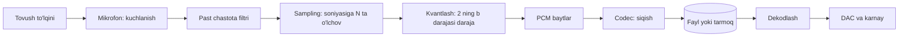

## Bu dars nima uchun kerak

2-darsda matn bitlarga qanday aylanishini ko'rdik: har bir belgiga raqam (code point), raqamga esa baytlar (UTF-8). Matn **diskret**: harflar soni cheklangan va ularni sanab chiqish mumkin. Rang, ovoz va harakat esa tabiatda uzluksiz. Rang tuslari cheksiz, ovoz to'lqini har lahzada o'zgaradi, harakat oniy kadrlarga bo'linmaydi. Kompyuter esa faqat cheklangan miqdordagi bitlarni saqlay oladi.

Bu dars shu ziddiyatni qanday hal qilishni ko'rsatadi: uzluksiz narsani **qayerda** va **qanchalik aniq** o'lchashni tanlash. Rasm uchun bu - piksellar va har bir rang kanaliga ajratilgan bitlar. Ovoz uchun - soniyasiga nechta o'lchov (sampling) va har o'lchovga nechta bit. Video uchun - kadrlar soni. Har bir tanlov sifat va hajm o'rtasidagi kelishuv, va hisoblar tezda shuni ko'rsatadi: siqishsiz media saqlab ham, uzatib ham bo'lmaydigan darajada katta. Shuning uchun darsning ikkinchi yarmi siqishga bag'ishlangan.

Bu darsdan keyin siz:

- RGB modelida rangni uchta bayt bilan ifodalay olasiz va CSS dagi `#RRGGBB` yozuvini o'qiy olasiz;
- rasm hajmini kenglik, balandlik va rang chuqurligi orqali formula bilan hisoblay olasiz;
- ovozni raqamlashtirishning uch parametri (sample rate, bit depth, kanallar) va Nyquist shartini bilasiz;
- aliasing nima ekanini va uni kod bilan ko'rsatishni bilasiz;
- siqishsiz video oqimining bitrate ini hisoblab, nega siqish majburiy ekanini asoslay olasiz;
- lossless va lossy siqishni farqlay olasiz va oddiy run-length encoding ni yoza olasiz;
- nega hech qanday lossless algoritm har qanday faylni kichraytira olmasligini isbotlay olasiz.

## Rang: RGB modeli

Ekrandagi har bir nuqta uchta kichik yorug'lik manbaidan iborat: qizil (red), yashil (green) va ko'k (blue). Ularning har birining yorqinligini o'zgartirib, ko'z ko'radigan ranglarning katta qismini hosil qilish mumkin. Bu **RGB** modeli. Yorug'lik qo'shiladi: uchala kanal to'liq yoqilsa - oq, hammasi o'chiq bo'lsa - qora, qizil va yashil teng bo'lsa - sariq. Bu bo'yoqlarni aralashtirishdan farq qiladi: bo'yoqda ranglar qo'shilgan sari qoraga yaqinlashadi.

Eng keng tarqalgan kelishuv: har bir kanal uchun bitta bayt, ya'ni 0 dan 255 gacha 256 ta daraja. Bitta rang - uchta bayt, 24 bit. Mumkin bo'lgan ranglar soni:

256 · 256 · 256 = 2²⁴ = 16 777 216

CS50 ning birinchi ma'ruzasida yaxshi kuzatish bor: 2-darsdagi 72, 73, 33 baytlari matn sifatida o'qilsa "HI!", rang sifatida o'qilsa esa sariq tusli rang (CS50 notes uni "och sariq" deb ataydi; lekin kanallar 255 dan ancha kichik bo'lgani uchun ekranda u qoramtir, zaytun rangiga yaqin sariq-yashil ko'rinadi). Baytlarning o'zida ma'no yo'q, ma'noni ularni o'qiydigan dastur va kelishuv beradi. Fayl formatlari (BMP, PNG, JPEG) aynan shu kelishuvni yozib qo'yadi; ularning ichki tuzilishi 26-darsda ko'riladi.

### Hex yozuvda rang

2-darsdan bilamiz: bitta bayt ikki hex raqam bilan yoziladi. Shuning uchun RGB rangi qulay tarzda olti hex raqam bo'lib yoziladi: `#RRGGBB`. CSS da bu sintaksis rasmiy `<hex-color>` turi sifatida belgilangan va to'rt shakli bor: `#RGB`, `#RGBA`, `#RRGGBB`, `#RRGGBBAA`. Qisqa shaklda har raqam ikki marta takrorlanadi: `#f09` = `#ff0099`. Katta-kichik harf farqi yo'q.

| Rang | O'nlik (R, G, B) | Hex | Izoh |
|---|---|---|---|
| Qora | 0, 0, 0 | `#000000` | hamma kanal o'chiq |
| Oq | 255, 255, 255 | `#FFFFFF` | hamma kanal to'la |
| Qizil | 255, 0, 0 | `#FF0000` | faqat R |
| Sariq | 255, 255, 0 | `#FFFF00` | R + G |
| Kulrang | 128, 128, 128 | `#808080` | uchala kanal teng - rangsiz tus |
| "HI!" baytlari | 72, 73, 33 | `#484921` | xira sariq-yashil |

Kulrang qatori muhim qonuniyatni ko'rsatadi: R = G = B bo'lsa, rang kulrang tus bo'ladi. Shuning uchun faqat kulrang rasm uchun bitta kanal, ya'ni pikselga bitta bayt yetadi (256 tus).

### To'rtinchi kanal: alpha

Ko'p formatlar RGB ga **alpha** kanalini qo'shadi: shaffoflik darajasi, 0 - to'liq shaffof, 255 - to'liq noshaffof. RGBA piksel 4 bayt, 32 bit. MDN video hujjati ham butun sonli RGB ni "har kanalga 8 bit, ixtiyoriy ravishda yana 8 bit alpha" deb ta'riflaydi. CSS dagi `#RRGGBBAA` shakli aynan shu.

## Piksel va rasm hajmi

Raster rasm - **piksel**lar (picture element) to'ri. Har bir piksel bitta rang, ya'ni RGB da 3 bayt. Kompyuter rasmni qatorma-qator saqlaydi: avval yuqori qatorning chapdan o'ngga barcha piksellari, keyin ikkinchi qator va hokazo. Shuning uchun (x, y) koordinatadagi pikselning birinchi bayti:

offset = (y · kenglik + x) · 3

Masalan, 1920 kenglikdagi rasmda (10, 2) pikselning offset i = (2 · 1920 + 10) · 3 = 11 550. Massivlar 11-darsda, ikki o'lchovli joylashuv esa fayl formatlari bilan 26-darsda chuqur ko'riladi.

Rasm hajmi formulasi:

hajm (bayt) = kenglik · balandlik · bir piksel uchun bayt

| Rasm | Hisob | Siqishsiz hajm |
|---|---|---|
| 640 × 480, RGB | 640 · 480 · 3 | 921 600 bayt ≈ 0.92 MB |
| 1920 × 1080 (Full HD), RGB | 1920 · 1080 · 3 | 6 220 800 bayt ≈ 6.2 MB |
| 1920 × 1080, RGBA | 1920 · 1080 · 4 | 8 294 400 bayt ≈ 8.3 MB |
| 4000 × 3000 (12 megapiksel), RGB | 4000 · 3000 · 3 | 36 000 000 bayt = 36 MB |
| 4000 × 3000, kulrang | 4000 · 3000 · 1 | 12 000 000 bayt = 12 MB |

**Rang chuqurligi** (color depth) - bitta pikselga ajratilgan bitlar soni. 1 bit - faqat oq va qora; 8 bit - 256 ta rang yoki tus; 24 bit - 16.7 million rang. Bitlarni kamaytirish hajmni chiziqli kamaytiradi, lekin tuslar orasida sakrashlar paydo bo'ladi: osmon kabi silliq gradient "pog'onali" ko'rinadi.

O'rta yo'l - **palitra** (indexed color): rasmda ishlatilgan ranglar alohida jadvalga yoziladi, piksel esa rangning o'zini emas, jadvaldagi indeksini saqlaydi. GIF formati shunday ishlaydi: MDN bo'yicha uning palitrasida 2 dan 256 gacha 24-bitli rang bo'ladi, piksel esa 8 bitli indeks. 256 rangli rasm uchun hajm: 256 · 3 bayt palitra + har pikselga 1 bayt, ya'ni RGB dagidan qariyb 3 baravar kam. Lekin fotosuratda minglab tuslar bor, va ularni 256 ga keltirish sifatni sezilarli buzadi.

### Piksel chegarasi: qo'shimcha ma'lumot yo'q

Rasmni kattalashtirish yangi ma'lumot qo'shmaydi. 100 × 100 rasmni 400 × 400 qilganda har bir asl piksel o'rniga 16 ta piksel hosil bo'ladi, ularning ranglari esa qo'shni piksellardan **taxmin qilinadi** (interpolatsiya). Suratga olishda yozilmagan tafsilot (masalan, uzoqdagi avtomobil raqami bitta piksel bo'lib qolgan bo'lsa) hech qanday algoritm bilan aniq tiklanmaydi: uni yozish uchun kerakli bitlar umuman saqlanmagan.

Raster rasmning alternativasi - **vektor** grafika (masalan, SVG): unda piksellar emas, shakllar ta'rifi saqlanadi ("markazi shu yerda, radiusi shuncha bo'lgan aylana"). Vektor rasm har qanday o'lchamda aniq chiziladi, lekin fotosurat uchun yaramaydi.

## Ovoz: sampling va kvantlash

Ovoz - havo bosimining vaqt bo'yicha o'zgarishi, to'lqin. Mikrofon uni kuchlanishning uzluksiz o'zgarishiga aylantiradi. Kompyuterga yozish uchun bu uzluksiz signal ikki o'q bo'yicha diskretlashtiriladi:

1. **Vaqt bo'yicha - sampling.** Signal teng vaqt oralig'ida o'lchanadi. Soniyadagi o'lchovlar (namunalar, samples) soni - **sample rate**, gerts (Hz) da. 44 100 Hz soniyasiga 44 100 ta o'lchov degani.
2. **Qiymat bo'yicha - kvantlash** (quantization). Har bir o'lchov cheklangan darajalardan eng yaqiniga yaxlitlanadi. Darajalar soni **bit depth** (namuna o'lchami) bilan belgilanadi: 8 bit - 2⁸ = 256 daraja, 16 bit - 2¹⁶ = 65 536 daraja.

Bunga uchinchi parametr qo'shiladi - **kanallar** soni: mono 1, stereo 2, 5.1 surround 6. MDN terminologiyasida bir lahzadagi barcha kanallar namunalari birgalikda **audio frame** deyiladi.



Siqilmagan namunalar ketma-ketligi **PCM** (pulse-code modulation) deyiladi. Diagrammadagi "past chastota filtri" bosqichi nega kerakligi pastda, aliasing bo'limida ochiladi.

### Nyquist sharti: qanchalik tez o'lchash kerak

Qancha tez-tez o'lchash yetarli? Javob signalning eng yuqori chastotasiga bog'liq. MDN bayon qilgan qoida: komponentlari f chastotagacha bo'lgan signalni to'g'ri tiklash uchun sample rate **2f dan katta** bo'lishi kerak. Sample rate ning yarmi **Nyquist chastotasi** deyiladi: shu tizim yozib ola oladigan eng yuqori chastota.

Inson eshitishining yuqori chegarasi taxminan 20 000 Hz (MDN), va yuqori chastotalarga sezgirlik yosh bilan pasayadi. Demak butun eshitiladigan diapazon uchun sample rate 2 · 20 000 = 40 000 Hz dan katta bo'lishi kerak. Audio CD ning 44 100 Hz i shu shartni qanoatlantiradi: Nyquist chastotasi 44 100 / 2 = 22 050 Hz > 20 000 Hz. Oradagi 2 050 Hz past chastota filtri to'liq o'chishi uchun joy qoldiradi.

### Aliasing

Agar signalda Nyquist chastotasidan yuqori komponent bo'lsa, u yo'qolib qolmaydi, balki **boshqa, pastroq chastotaga niqoblanib** yoziladi. Bu **aliasing**. Sabab oddiy: diskret nuqtalar orqali bir nechta turli to'lqin o'tishi mumkin va o'lchovlardan qaysi biri bo'lganini ajratib bo'lmaydi.

44 100 Hz da 30 000 Hz tovush olinsa, namunalar 44 100 - 30 000 = 14 100 Hz tovush namunalari bilan aynan bir xil chiqadi. Matematik sababi: cos(2π · f · n / fs) da f ni fs - f ga almashtirsak, cos(2πn - 2π · f · n / fs) = cos(2π · f · n / fs), chunki n butun son va kosinus 2π davriy, juft funksiya. Yozuvni eshitganda 30 kHz (eshitilmaydigan) tovush o'rniga aniq eshitiladigan 14.1 kHz shovqin chiqadi. Shuning uchun sampling dan **oldin** past chastota filtri Nyquist chastotasidan yuqorisini kesib tashlaydi.

Video da ham aliasing bor: aylanayotgan g'ildirak kadr tezligiga yaqin chastotada aylansa, filmda u sekin yoki orqaga aylanayotgandek ko'rinadi. MDN video codec qo'llanmasi buni "wagon-wheel effect" deb aliasing turlari qatorida sanaydi.

### O'zingiz sinab ko'ring: aliasing va kvantlash xatosi

Quyidagi blok ikki narsani hisoblaydi. Birinchisi - 44 100 Hz da 30 000 Hz va 14 100 Hz kosinuslarning dastlabki oltita namunasi. Ikkinchisi - [-1, 1] oralig'idagi 440 Hz sinusni 3, 8 va 16 bitga kvantlaganda eng katta xato. `fs` ni yoki chastotalarni o'zgartirib, qaysi chastotalar bir-biriga niqoblanishini tekshiring.

```python run
import math

fs = 44100  # sample rate, Hz

# 1) Aliasing: 30 000 Hz va 14 100 Hz tovushdan olingan namunalar
for f in (30000, 14100):
    samples = [math.cos(2 * math.pi * f * n / fs) for n in range(6)]
    print(f"{f:5} Hz:", " ".join(f"{x:+.4f}" for x in samples))

# 2) Kvantlash: [-1, 1] oralig'idagi sinusni b bitga yaxlitlash
def max_error(bits, f=440, count=1000):
    levels = 2 ** bits
    step = 2 / (levels - 1)
    worst = 0
    for n in range(count):
        x = math.sin(2 * math.pi * f * n / fs)
        q = round((x + 1) / step) * step - 1
        worst = max(worst, abs(x - q))
    return levels, step, worst

for bits in (3, 8, 16):
    levels, step, worst = max_error(bits)
    print(f"{bits:2} bit: {levels:6} daraja, qadam {step:.6f}, eng katta xato {worst:.6f}")
```

Natija:

```text
30000 Hz: +1.0000 -0.4242 -0.6401 +0.9673 -0.1807 -0.8140
14100 Hz: +1.0000 -0.4242 -0.6401 +0.9673 -0.1807 -0.8140
 3 bit:      8 daraja, qadam 0.285714, eng katta xato 0.142857
 8 bit:    256 daraja, qadam 0.007843, eng katta xato 0.003922
16 bit:  65536 daraja, qadam 0.000031, eng katta xato 0.000015
```

Ikki qator namunalar raqamma-raqam bir xil: o'lchovlardan qaysi tovush bo'lganini aniqlab bo'lmaydi. Kvantlash xatosi esa doim qadamning yarmidan oshmaydi (qadam = 2 / (2ᵇ - 1)), va har bir qo'shimcha bit uni ikki baravar kamaytiradi. 3 bitda xato signal amplitudasining 14% iga yetadi va qulog'ga kuchli shovqin bo'lib eshitiladi, 16 bitda esa taxminan 0.0015%.

### Ovoz hajmi

Siqilmagan ovozning bitrate i uchala parametrning ko'paytmasi:

bitrate (bit/s) = sample rate · bit depth · kanallar

MDN bo'yicha audio CD 44.1 kHz, 16 bit, stereo siqilmagan ovoz beradi. Hisob:

- 44 100 · 16 · 2 = 1 411 200 bit/s ≈ 1.41 Mbit/s
- baytlarda: 1 411 200 / 8 = 176 400 bayt/s
- 3 daqiqalik qo'shiq: 176 400 · 180 = 31 752 000 bayt ≈ 31.8 MB

MDN ning o'z misoli 48 kHz, 16 bit stereo uchun: 2 · 2 · 48 000 = 192 000 bayt/s, 3 daqiqa = 192 000 · 180 = 34.56 MB.

| Parametr | Oshirilsa nima yaxshilanadi | Hajmga ta'siri | Yetarli emasligining belgisi |
|---|---|---|---|
| Sample rate | yozib olinadigan eng yuqori chastota (fs / 2) | chiziqli | yuqori tovushlar yo'qoladi yoki aliasing |
| Bit depth | darajalar soni 2ᵇ, kvantlash xatosi kamayadi | chiziqli | shovqin, sokin joylarda "xirillash" |
| Kanallar | fazoviy tasvir (stereo, surround) | chiziqli | ovoz "bir nuqtadan" chiqadi |

Uchala parametr ham hajmga chiziqli ta'sir qiladi, sifatga ta'siri esa chiziqli emas: 16 dan 24 bitga o'tish hajmni 1.5 baravar oshiradi, kvantlash xatosini esa 2⁸ = 256 baravar kamaytiradi, lekin bu xato allaqachon juda kichik edi. Muhandislik qarori - talab qilingan sifatga yetadigan nuqtada to'xtash.

## Video: kadrlar ketma-ketligi

Video - tez almashinadigan rasmlar (kadrlar, frames), xuddi varaqlanadigan rasmli daftar kabi. Soniyadagi kadrlar soni - **frame rate** (fps). MDN bo'yicha harakat sezilishi uchun eng kamida taxminan 12 fps kerak, kino odatda 24 fps, HD televideniye 24 dan 60 gacha; 24 fps va undan yuqorisi odatda silliq qabul qilinadi.

Siqishsiz video oqimi:

bitrate = kenglik · balandlik · bir piksel uchun bayt · 8 · fps

Full HD, RGB, 30 fps uchun: 1920 · 1080 · 3 · 8 · 30 = 1 492 992 000 bit/s ≈ 1.49 Gbit/s. MDN hujjati xuddi shu hisobni pikselga 4 bayt bilan beradi: kadr 8 294 400 bayt, soniyasiga 248 832 000 bayt (taxminan 249 MB), bir daqiqa 14.93 GB, ikki soatlik film qariyb 1.79 TB.

Bu raqamlarni oddiy tarmoq bilan solishtirish yetarli: 100 Mbit/s kanal siqishsiz Full HD oqimining 100 / 1493 ≈ 6.7% ini ham o'tkaza olmaydi. Demak video siqishsiz amalda mavjud emas.

### O'zingiz sinab ko'ring: hajm kalkulyatori

Quyidagi dastur avval CD ovozi hajmini, keyin "Kirish" dagi har bir qator (kenglik, balandlik, fps, soniya) uchun siqishsiz video hajmini hisoblaydi. O'z qiymatlaringizni qo'shing.

Bitta texnik nuqta: brauzerdagi C muhiti 32-bitli (wasm32), unda `long` atigi 4 bayt va eng katta qiymati 2 147 483 647. Bir daqiqalik Full HD video 11 197 440 000 bayt, bu `long` ga ham, `int` ga ham sig'maydi. Shuning uchun dasturda `long long` (har doim kamida 8 bayt) ishlatilgan. 64-bitli Linux yoki macOS da `long` 8 bayt bo'lardi, lekin bunga tayanib bo'lmaydi. Tiplar chegarasi 6-darsda, overflow 7-darsda batafsil.

```c run
#include <stdio.h>

int main(void)
{
    // Ovoz: sample rate x bit depth x kanallar
    long long rate = 44100, bits = 16, channels = 2, seconds = 180;
    long long audio_bps = rate * bits * channels;
    printf("Ovoz %lld Hz, %lld bit, %lld kanal: %lld bit/s, %lld s = %lld bayt\n",
           rate, bits, channels, audio_bps, seconds, audio_bps / 8 * seconds);

    // Video: har qatorda kenglik, balandlik, fps, soniya (RGB, piksel = 3 bayt)
    long long w, h, fps, sec;
    while (scanf("%lld %lld %lld %lld", &w, &h, &fps, &sec) == 4)
    {
        long long frame = w * h * 3;
        long long per_second = frame * fps;
        long long total = per_second * sec;
        printf("%lldx%lld, %lld fps, %lld s: kadr = %lld B, %.1f Mbit/s, jami = %.2f GB\n",
               w, h, fps, sec, frame, per_second * 8 / 1e6, total / 1e9);
    }
    return 0;
}
```

```text stdin
640 480 30 60
1920 1080 30 60
3840 2160 60 60
```

Natija:

```text
Ovoz 44100 Hz, 16 bit, 2 kanal: 1411200 bit/s, 180 s = 31752000 bayt
640x480, 30 fps, 60 s: kadr = 921600 B, 221.2 Mbit/s, jami = 1.66 GB
1920x1080, 30 fps, 60 s: kadr = 6220800 B, 1493.0 Mbit/s, jami = 11.20 GB
3840x2160, 60 fps, 60 s: kadr = 24883200 B, 11943.9 Mbit/s, jami = 89.58 GB
```

4K (3840 × 2160) va 60 fps da bir daqiqa siqishsiz 89.58 GB. O'lcham 2 · 2 = 4 baravar, kadr tezligi 2 baravar oshdi, demak hajm 8 baravar: 11.20 · 8 = 89.6 GB. Barcha parametrlar ko'paytma ichida turgani uchun ular bir-birini kuchaytiradi.

## Siqish: lossless va lossy

**Siqish** (compression) - ma'lumotni kamroq bit bilan ifodalash. U ikki turga bo'linadi:

- **Lossless** (yo'qotishsiz): dekodlangandan keyin asl baytlar bitma-bit aynan tiklanadi. Matn, dastur kodi, arxivlar, tibbiy tasvirlar, ovoz yozish studiyasidagi master nusxa uchun majburiy.
- **Lossy** (yo'qotishli): inson sezmaydigan yoki kam sezadigan ma'lumot ataylab tashlab yuboriladi. Natija aslidan farq qiladi, lekin ancha kichik. Fotosurat, musiqa va video uchun standart yondashuv.

### Lossless: ortiqchalikni topish

Lossless siqish ma'lumotdagi **ortiqchalikni** (takrorlanish, bashorat qilinadigan qismlar) qisqaroq yozuvga almashtiradi. Eng sodda misol - **run-length encoding** (RLE): bir xil qiymatlar ketma-ketligi "soni + qiymat" juftligi bilan yoziladi. Oq fonda qora chiziq bo'lgan rasm qatori `WWWWWWWWWWWWBBBWWWWWWWWWWWW` (27 piksel) `12W3B12W` ga aylanadi.

```python run
def rle_encode(row):
    out = []
    i = 0
    while i < len(row):
        j = i
        while j < len(row) and row[j] == row[i]:
            j += 1
        out.append((j - i, row[i]))
        i = j
    return out


def rle_decode(pairs):
    return "".join(ch * count for count, ch in pairs)


for row in ["WWWWWWWWWWWWBBBWWWWWWWWWWWW", "WBWBWBWBWB"]:
    pairs = rle_encode(row)
    text = "".join(f"{c}{ch}" for c, ch in pairs)
    assert rle_decode(pairs) == row  # lossless: aynan tiklanadi
    # har juftlik 2 bayt: 1 bayt soni + 1 bayt rang
    print(f"{row}: {len(row)} bayt -> {text}: {2 * len(pairs)} bayt")
```

Natija:

```text
WWWWWWWWWWWWBBBWWWWWWWWWWWW: 27 bayt -> 12W3B12W: 6 bayt
WBWBWBWBWB: 10 bayt -> 1W1B1W1B1W1B1W1B1W1B: 20 bayt
```

Birinchi qator 27 baytdan 6 baytga (4.5 baravar) qisqardi. Ikkinchisi esa **ikki baravar kattalashdi**: takrorlanish yo'q, har bir piksel uchun "soni" bayti ortiqcha yuk bo'ldi. Bu tasodif emas, balki umumiy qonun.

### Nega hech bir lossless algoritm hamma narsani kichraytira olmaydi

Faraz: biror lossless algoritm n bitli **har qanday** kirishni qat'iy qisqaroq natijaga aylantiradi. n bitli turli satrlar 2ⁿ ta. n dan qisqa satrlar esa jami 2⁰ + 2¹ + ... + 2ⁿ⁻¹ = 2ⁿ - 1 ta. 2ⁿ ta kirishni 2ⁿ - 1 ta chiqishga joylasak, kamida ikkita turli kirish bir xil chiqishga tushadi (kaptarlar va uyalar prinsipi). Unda dekoder qaysi kirish bo'lganini aniqlay olmaydi, ya'ni algoritm lossless emas. Qarama-qarshilik.

Xulosa: lossless siqish faqat **ortiqchaligi bor** ma'lumotni kichraytiradi, va buning evaziga boshqa ba'zi kirishlarni kattalashtiradi. Tasodifiy baytlar yoki allaqachon siqilgan fayl (JPEG, MP3, ZIP) qayta siqilganda deyarli kichraymaydi. Amaliy formatlar (PNG, ZIP, FLAC) RLE dan ancha murakkab usullar ishlatadi, lekin bu chegaradan qochib qutula olmaydi. MDN bo'yicha lossless audio siqish odatda asl hajmning 40-50% iga tushiradi.

### Lossy: inson sezgisidan foydalanish

Lossy siqish boshqa savol beradi: qaysi ma'lumotni tashlab yuborsak, inson **sezmaydi**? Javob inson sezgisi modeliga tayanadi:

- **Ovoz** (MP3, AAC, Opus): psixoakustika - inson tovushni qanday idrok etishi haqidagi fan. MDN bo'yicha kodek eshitish diapazonini, chastota o'zgarishini sezish qobiliyatini va amplituda kontrastini hisobga oladi: masalan, eshitish diapazonidan yuqori chastotalar umuman olib tashlanadi. Amalda sezilmaydigan qismlar kamroq bit bilan yoki umuman yozilmaydi. MDN bo'yicha lossy audio natijasi asl hajmning 5-20% i, audio murakkabligiga qarab.
- **Rasm** (JPEG): MDN bo'yicha JPEG discrete cosine transform ga asoslangan lossy siqish, fotosuratlar uchun ayniqsa qulay, lekin chizma va diagramma kabi keskin chegarali tasvirlarda yomon natija beradi.
- **Rang**: ko'z yorqinlik o'zgarishiga rang o'zgarishidan sezgirroq. Video kodeklar shundan foydalanib, rangni RGB o'rniga yorqinlik (Y) va ikki rang farqi (U, V yoki Cb, Cr) ko'rinishiga o'tkazadi va rang komponentlarini pastroq aniqlikda saqlaydi. Bu **chroma subsampling**. MDN dagi 4:2:0 sxemasida 4 × 2 piksellik blokda 8 ta yorqinlik namunasi va har rang komponentidan 2 tadan namuna qoladi: 8 + 2 + 2 = 12 namuna 8 piksel uchun, ya'ni pikselga 1.5 qiymat, RGB dagi 3 o'rniga. Faqat shu qadam hajmni ikki baravar kamaytiradi.

Lossy siqishning narxi - **artefaktlar**: blok chegaralari ko'rinishi, keskin qirralar atrofida "chivin shovqini" (mosquito noise), silliq gradientda pog'onalar (posterizing). Siqish darajasi qancha yuqori bo'lsa, artefaktlar shuncha sezilarli. Lossy faylni qayta-qayta saqlash ham xavfli: har safar yana yo'qotish qo'shiladi.

| Format | Siqish turi | Rang | Alpha | Qachon mos |
|---|---|---|---|---|
| PNG | lossless | true color (kanalga 16 bitgacha) yoki palitra | to'liq | skrinshot, diagramma, logotip, matnli rasm |
| JPEG | lossy (DCT) | kanalga 8 bit | yo'q | fotosurat |
| GIF | lossless (LZW), lekin 256 rang | palitra, 2-256 rang | faqat bitta shaffof rang | oddiy animatsiya, kam rangli grafika |
| WebP | lossless ham, lossy ham | lossy: Y'CbCr 4:2:0; lossless: ARGB | bor | veb uchun universal |

Jadval MDN ning rasm formatlari qo'llanmasiga tayanadi. U yerda yana bir raqam bor: lossy WebP o'xshash vizual sifatdagi JPEG dan o'rtacha 25-35% kichik, lossless WebP esa xuddi shu rasmning PNG nusxasidan odatda 26% kichik.

E'tibor bering: GIF siqish algoritmi lossless bo'lsa ham, fotosuratni GIF ga o'tkazish lossy jarayon. Yo'qotish siqishda emas, 16.7 million rangni 256 ta palitraga keltirishda sodir bo'ladi.

### Video: kadrlar orasidagi o'xshashlik

Video siqishning asosiy manbai - qo'shni kadrlarning deyarli bir xilligi. Har kadrni alohida rasm sifatida siqish o'rniga kodek kadrlar orasidagi **farqni** yozadi. MDN bu jarayonning uch qismini ta'riflaydi:

- **Keyframe** (key frame, intra-frame, I-frame): to'liq kadr, o'zidan oldingi kadrlarga tayanmaydi. Videoni o'rtasidan ochish (seek) va to'plangan artefaktlarni "tozalash" uchun vaqti-vaqti bilan qo'yiladi.
- **Farq kadrlar**: oldingi kadrga nisbatan nima o'zgargani yoziladi.
- **Motion compensation**: kamera yoki obyekt harakatlansa, kodek "bu blok shuncha pikselga siljidi" deb yozadi va faqat qolgan farqni (residual frame) saqlaydi.

Natijada qimirlamaydigan fon (masalan, statik kamera tasviri) deyarli bepul, tez harakatli sahna esa qimmat. Shuning uchun bir xil bitrate da sport translyatsiyasi suhbat videosidan yomonroq ko'rinadi.

Siqish koeffitsiyentini hisoblaymiz. Masala sharti: Full HD, 30 fps, siqilgan oqim 5 Mbit/s. Siqishsiz oqim 1 492 992 000 bit/s. Koeffitsiyent: 1 492 992 000 / 5 000 000 ≈ 298.6, ya'ni siqilgan oqim aslidan qariyb 300 baravar kichik. Bunday darajaga faqat lossy siqish, chroma subsampling va kadrlar orasidagi bashoratni birga ishlatib erishiladi. MDN ham lossless video kodeklar asosan arxiv va lokal saqlash uchun ishlatilishini, tarmoq uchun esa juda katta bo'lib qolishini yozadi.

**Codec** (coder-decoder) - shu siqish va ochish qoidalarining nomi (H.264, VP9, AV1, AAC, Opus). **Konteyner** (MP4, WebM, Ogg) esa bir yoki bir nechta siqilgan oqimni (video, ovoz, subtitr) bitta faylga joylaydigan format. "MP4 fayl" deyish qaysi kodek ishlatilganini aytmaydi.

## Ko'p uchraydigan xatolar

1. **Bit va baytni aralashtirish.** Bitrate odatda bit/s da (5 Mbit/s), fayl hajmi baytlarda. 5 Mbit/s oqim bir soatda 5 · 3600 / 8 = 2250 MB yozadi, 18 000 MB emas.
2. **Hajmni hisoblashda bitta ko'paytuvchini unutish.** Video uchun kenglik, balandlik, bayt/piksel, fps va vaqt; ovoz uchun sample rate, bit depth, kanallar va vaqt. Stereo da 2 ni yoki RGB da 3 ni tashlab yuborish natijani 2-3 baravar kamaytiradi.
3. **Hisobni 32-bitli tipda bajarish.** Media hajmlari tezda milliardlarga yetadi. Brauzerdagi wasm32 da `long` ham 4 bayt; `long long` yoki `double` ishlating, aks holda overflow (7-dars).
4. **Sample rate ni "sifat foizi" deb tushunish.** Sample rate faqat yozib olinadigan eng yuqori chastotani belgilaydi (fs / 2). 20 kHz dan yuqori tovushlarni eshitmaydigan quloq uchun 96 kHz ning 44.1 kHz dan afzalligi yo'q, hajmi esa 2 baravardan ko'p.
5. **Sampling dan oldin filtrni unutish.** Nyquist chastotasidan yuqori komponentlar yo'qolmaydi, aliasing bilan eshitiladigan diapazonga tushadi.
6. **Lossy faylni qayta-qayta tahrirlab saqlash.** Har saqlashda yangi yo'qotish qo'shiladi. Tahrir uchun asl yoki lossless nusxa bilan ishlang, lossy ga faqat oxirida o'tkazing.
7. **Fotosuratni PNG ga, diagrammani JPEG ga saqlash.** Birinchisi keraksiz katta fayl beradi, ikkinchisi keskin chiziqlar atrofida artefaktlar.
8. **Siqilgan faylni yana siqishdan foyda kutish.** Ortiqchalik allaqachon olib tashlangan; lossless qayta siqish deyarli hech narsa bermaydi, ba'zan esa faylni kattalashtiradi.

## Xulosa

- RGB rang - uchta bayt, 2²⁴ = 16 777 216 rang; CSS da `#RRGGBB`. Alpha qo'shilsa RGBA, 4 bayt.
- Raster rasm hajmi = kenglik · balandlik · bayt/piksel; Full HD RGB kadr 6 220 800 bayt. Kattalashtirish yangi ma'lumot qo'shmaydi.
- Ovoz ikki o'q bo'yicha diskretlanadi: sampling (sample rate) va kvantlash (bit depth, 2ᵇ daraja); bitrate = sample rate · bit depth · kanallar.
- Nyquist: f gacha chastotani yozish uchun sample rate 2f dan katta bo'lishi kerak; CD ning 44.1 kHz i 22.05 kHz gacha yozadi. Yuqori chastotalar aliasing bilan pastga niqoblanadi.
- Video - kadrlar ketma-ketligi; siqishsiz Full HD 30 fps qariyb 1.49 Gbit/s, shuning uchun siqish majburiy.
- Lossless siqish ortiqchalikni olib tashlaydi va asl baytlarni aynan tiklaydi; kaptarlar va uyalar prinsipi bo'yicha u hamma kirishni kichraytira olmaydi.
- Lossy siqish inson sezgisidan foydalanadi: psixoakustika, DCT, chroma subsampling, kadrlar orasidagi farq va motion compensation.
- Har bir parametr sifat va hajm o'rtasidagi kelishuv; to'g'ri tanlov - talab qilingan sifatga yetadigan eng kichik qiymat.

## Amaliy topshiriq

Ikki qismli topshiriq: RLE ni C da yozish va media saqlash hisob-kitobi.

Topshiriq qadamlari:

1. **RLE kodlovchini C da yozing.** Dastur "Kirish" dan bitta qator oladi (`get_string`, masalan `WWWWWBBBWW`) va `5W3B2W` ko'rinishida chiqaradi. Bir xil belgilar 9 tadan ko'p bo'lishi mumkin: `12W` to'g'ri natija bo'lsin.
2. **Dekodlovchi yozing.** `5W3B2W` dan asl qatorni tiklang. Kodlash va dekodlashni ketma-ket bajarib, natija kirish bilan bir xil ekanini dasturda tekshiring (`strcmp`, 12-dars; hozircha qo'lda solishtirsangiz ham bo'ladi).
3. **Eng yomon holatni toping.** Qaysi kirishda kodlangan natija eng uzun bo'ladi? n uzunlikdagi qator uchun natija uzunligini formula bilan yozing va kirish raqam belgilarini o'z ichiga olsa (`"11122"`) sizning formatingiz nega buziladi, buni qanday tuzatish mumkinligini tushuntiring.
4. **Rasm hisobi.** 1000 × 1000 piksellik qora-oq (1 bit/piksel) skanerlangan hujjat siqishsiz qancha bayt oladi? Xuddi shu rasm RGB da-chi? Har qatorda o'rtacha 20 ta bir xil rangli bo'lak bo'lsa va har bo'lak 2 bayt bilan yozilsa, RLE natijasi qancha?
5. **Ovoz va video hisobi.** Masala sharti: 1 soatlik ma'ruza yozuvi, ovoz 48 kHz, 16 bit, mono; video 1280 × 720, 25 fps, RGB. Siqishsiz ovoz va video hajmini alohida hisoblang. Video 2.5 Mbit/s, ovoz 96 kbit/s ga siqilsa, fayl hajmi va siqish koeffitsiyentlari qancha?
6. **Format tanlash.** Shu ma'ruzadagi uch xil material uchun format tanlang va asoslang: doskadagi formula skrinshoti, ma'ruzachining fotosurati, ma'ruza ovozining arxiv nusxasi.

Yaxshi javobda bo'lishi kerak bo'lgan narsalar:

- RLE kodlovchi ko'p xonali sonlarni (`12W`) to'g'ri yozadi va dekodlovchi ularni to'g'ri o'qiydi, kodlash-dekodlash aylanasi kirishni aynan tiklaydi;
- eng yomon holat (qo'shni belgilar hammasi har xil) aniqlangan va natija uzunligi 2n ekani ko'rsatilgan; raqamli kirish muammosi (soni va qiymatni ajratib bo'lmasligi) va yechimi (masalan, soni bitta baytda, yoki ajratuvchi belgi) izohlangan;
- qora-oq rasm: 1000 · 1000 / 8 = 125 000 bayt; RGB: 3 000 000 bayt; RLE: 1000 · 20 · 2 = 40 000 bayt;
- ovoz: 48 000 · 16 · 1 · 3600 / 8 = 345 600 000 bayt; video: 1280 · 720 · 3 · 25 · 3600 = 248 832 000 000 bayt; siqilgan: (2 500 000 + 96 000) · 3600 / 8 = 1 168 200 000 bayt, koeffitsiyentlar formula bilan;
- format tanlovi lossless/lossy farqi va rasm turiga (keskin chiziqlar yoki fotosurat) tayangan;
- hisob kodda bajarilgan bo'lsa, `long long` yoki `double` ishlatilgan.

Javobingizni pastdagi maydonga yozing va yuqoridagi mezonlar bilan solishtiring.

## Manbalar

- CS50x. [Lecture 0 notes](https://cs50.harvard.edu/x/notes/0/) - "RGB" bo'limi (rang - har biri bir bayt bo'lgan uchta son, 72 73 33 sariq tus sifatida, piksel, rasm, video va musiqa ham baytlar ko'rinishida).
- CS50x. [Lecture 4 notes](https://cs50.harvard.edu/x/notes/4/) - "Pixel Art" va "Hexadecimal" bo'limlari (rasm piksellar to'ri sifatida, ranglarni hex da yozish).
- MDN. [Digital audio concepts](https://developer.mozilla.org/en-US/docs/Web/Media/Guides/Formats/Audio_concepts) - "Sampling audio", "Audio data format and structure" (kanallar, frame, sample rate, Nyquist, CD 44.1 kHz 16-bit stereo, hajm formulasi, 34.56 MB misoli), "Audio compression basics" (lossless 40-50%, lossy 5-20%), "Psychoacoustics 101" (eshitish diapazoni, amplituda kontrasti, 20 000 Hz chegarasi); kodek nomlari (MP3, AAC, Opus) uchun [Web audio codec guide](https://developer.mozilla.org/en-US/docs/Web/Media/Guides/Formats/Audio_codecs).
- MDN. [Web video codec guide](https://developer.mozilla.org/en-US/docs/Web/Media/Guides/Formats/Video_codecs) - siqishsiz HD hisobi (8 294 400 bayt kadr, 249 MB/s, 14.93 GB/daqiqa), "Compression artifacts" (key frame, motion compensation, residual frame, aliasing turlari), "Reduced frame rate" (12, 24, 30, 60 fps), "Common codecs" jadvali (AV1, AVC/H.264, VP9 va ularning konteynerlari MP4, WebM, Ogg).
- MDN. [Digital video concepts](https://developer.mozilla.org/en-US/docs/Web/Media/Guides/Formats/Video_concepts) - "RGB" (kanalga 8 bit va alpha), "YUV" va "Chroma subsampling" (4:2:0, 4:2:2, 4:4:4).
- MDN. [Image file type and format guide](https://developer.mozilla.org/en-US/docs/Web/Media/Guides/Formats/Image_types) - PNG, JPEG, GIF va WebP xususiyatlari, WebP ning JPEG va PNG ga nisbatan o'lchami.
- MDN. [`<hex-color>`](https://developer.mozilla.org/en-US/docs/Web/CSS/hex-color) - `#RGB`, `#RGBA`, `#RRGGBB`, `#RRGGBBAA` sintaksisi va qisqa shaklning kengayishi.
- W3C. [Portable Network Graphics (PNG) Specification, 3-nashr](https://www.w3.org/TR/png-3/) - 3-bo'lim (lossless ta'rifi: asl ma'lumot bitma-bit tiklanadi), 4.6.3 (filtrlash qaytariladigan va lossless).
