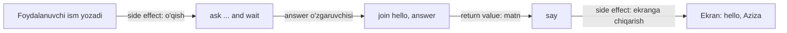
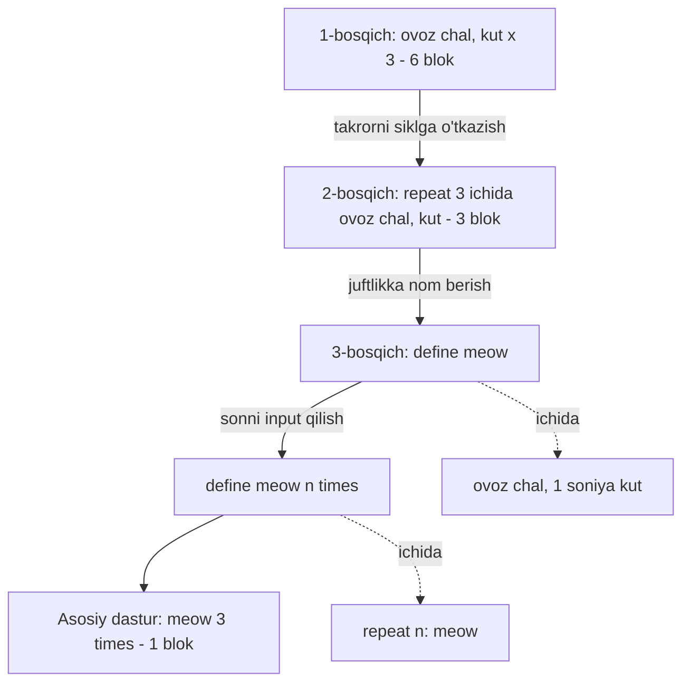

## Bu dars nima uchun kerak

1-darsda telefon kitobi algoritmini pseudocode bilan yozdik va unda to'rtta qurilish blokini ajratdik: funksiya, shart, mantiqiy ifoda va sikl. Beshinchi tushuncha, o'zgaruvchi, u yerda yashirin edi. 2 va 3-darslarda esa ma'lumot ko'rinishini o'rgandik: son, matn, rang va ovoz oxir-oqibat bitlar ketma-ketligi. Endi savol: shu bitlar ustida ishlaydigan dasturni nimadan quramiz?

Javob kutilmagan darajada qisqa. Deyarli har bir dasturlash tili, Scratch'dan C gacha, Python'dan JavaScript gacha, bir xil oz sonli bloklardan quriladi. Tillar sintaksis bilan farq qiladi: qavslar, nuqtali vergul, chekinish. G'oyalar esa bir xil. Shuning uchun bu dars ataylab "til yengil": avval g'oyani sintaksissiz tushunib olamiz, keyingi darsdan boshlab (5-dars) uni C da yozamiz.

Darsning ikkinchi mavzusi - **abstraction**. Bu so'z kursda yuzlab marta uchraydi. Uning ma'nosi: murakkab narsaga nom berib, keyin uni ichini o'ylamasdan, bitta butun sifatida ishlatish. Har bir funksiya, har bir kutubxona, operatsion tizim va hatto "bit" tushunchasining o'zi abstraction.

Bu darsdan keyin siz:

- funksiyaning uch qismini (input, return value, side effect) ajrata olasiz va ular orasidagi farqni misol bilan ko'rsata olasiz;
- shart (conditional) va boolean expression ni yozib, truth table orqali tekshira olasiz, short-circuit hisoblash nima ekanini bilasiz;
- sikl necha marta aylanishini oldindan formula bilan hisoblay olasiz, ichma-ich sikl uchun ham;
- o'zgaruvchi holatini qadamma-qadam kuzatish jadvali (trace table) bilan kuzata olasiz;
- takrorlanuvchi kodni sikl va funksiya orqali abstraction ga aylantira olasiz va bu qachon foydali, qachon zararli ekanini ayta olasiz;
- bitta g'oyani Scratch, pseudocode, Python va C da qanday yozilishini taqqoslay olasiz.

## Scratch: sintaksissiz dasturlash

CS50 birinchi haftada matnli tilga o'tishdan oldin **Scratch** dan foydalanadi. Scratch - MIT da yaratilgan vizual dasturlash tili: kod yozish o'rniga rangli bloklarni sichqoncha bilan sudrab, bir-biriga ulaysiz. Matnli tillarda yangi o'quvchini to'xtatib qo'yadigan narsalar (unutilgan qavs, nuqtali vergul, noto'g'ri chekinish) Scratch'da umuman yo'q: bloklar faqat to'g'ri joyga "kiradi".

Lekin Scratch o'yinchoq emas. Undagi bloklar aynan matnli tillardagi tushunchalar:

- `say` (gapirish), `play sound` (ovoz chalish), `wait 1 seconds` (kutish) - bular **funksiya**;
- `ask ... and wait` foydalanuvchidan javob so'raydi va uni `answer` nomli **o'zgaruvchi** ga yozadi;
- `join` ikki matnni birlashtirib, natijani **qaytaradi**;
- `repeat 3` ichidagi bloklarni uch marta bajaradi, `forever` esa cheksiz takrorlaydi - bular **sikl**;
- `if ... then` va `if ... then ... else` - **shart**, ularning ichiga qo'yiladigan `touching mouse-pointer?` kabi savollar - **boolean expression**;
- `define` bloki bilan o'z blokingizni yaratasiz - bu **abstraction**.

Bitta jadvalda bir xil g'oyaning to'rt xil yozilishi:

| Blok | Scratch | Pseudocode | Python | C |
|---|---|---|---|---|
| Funksiya chaqirish | `say hello, world` | "salom de" | `print("hello, world")` | `printf("hello, world\n");` |
| O'zgaruvchi | `ask` dan keyingi `answer` | "javobni eslab qol" | `answer = input()` | `string answer = get_string("");` |
| Shart | `if ... then ... else` | "agar ..., aks holda ..." | `if x < y: ... else: ...` | `if (x < y) { ... } else { ... }` |
| Boolean expression | `touching mouse-pointer?` | "odam shu sahifada" | `x < y`, `a and b` | `x < y`, `a && b` |
| Sikl (n marta) | `repeat 3` | "3 marta takrorla" | `for i in range(3):` | `for (int i = 0; i < 3; i++)` |
| Sikl (cheksiz) | `forever` | "doim takrorla" | `while True:` | `while (true)` |
| O'z funksiyangiz | `define meow` | "meow degani - ..." | `def meow():` | `void meow(void) { ... }` |

Jadvalni yodlash shart emas. Undan bitta xulosa chiqaring: tilni o'rganish deganda asosan **chap ustundagi** g'oyalarni o'rganish tushuniladi. Ular bir marta tushunilsa, yangi til - faqat yangi yozuv qoidalari. C dagi sintaksis 5 va 8-darslarda batafsil ko'riladi, Python - 31-darsdan boshlab.

## Funksiya: input, return value, side effect

**Funksiya** - nomlangan amal. Uni chaqirasiz, u ishini bajaradi. Funksiya bilan ishlashda uchta savolni aniq ajratish kerak:

1. **Input (argument)** - funksiyaga nima beriladi? `say` ga matn, `wait` ga soniyalar soni, `join` ga ikki matn.
2. **Return value (qaytariladigan qiymat)** - funksiya chaqiruvchiga nima qaytaradi? `join("salom, ", "Aziza")` yangi matn `"salom, Aziza"` ni qaytaradi. Bu qiymatni o'zgaruvchiga saqlash yoki boshqa funksiyaga berish mumkin.
3. **Side effect (yon ta'sir)** - funksiya tashqi dunyoda nimani o'zgartiradi? `say` ekranda pufakcha chiqaradi, `play sound` karnaydan ovoz chiqaradi, faylga yozish diskni o'zgartiradi. Side effect qiymat sifatida qaytmaydi, u "dunyoda" qoladi.

CS50 ning Scratch'dagi "Hello, You" misoli shu uchalasini bitta zanjirda ko'rsatadi: `ask` foydalanuvchi ismini `answer` ga yozadi, `join` "hello, " va `answer` ni birlashtirib qaytaradi, `say` esa shu qaytarilgan matnni oladi va side effect sifatida ekranga chiqaradi. Bir funksiyaning return value si keyingisining input iga aylandi.



Nega bu farq muhim? Ikki sababga ko'ra.

**Birinchidan, qaytarish va chiqarish bir narsa emas.** Boshlovchilarning eng ko'p uchraydigan xatosi: funksiya natijani ekranga chiqaradi, va o'quvchi "u natijani qaytardi" deb o'ylaydi. Ekrandagi yozuv faqat odam uchun. Dasturning keyingi qatori uni ko'rmaydi va ishlata olmaydi. Natijani keyin ishlatish kerak bo'lsa, funksiya uni **qaytarishi** shart.

**Ikkinchidan, side effect siz funksiyani tekshirish oson.** `join("2", "3")` har doim `"23"` qaytaradi: kirish bir xil bo'lsa, natija ham bir xil. Bunday funksiyani bir qatorli test bilan tekshirish mumkin. Ekranga yozadigan, faylni o'zgartiradigan yoki tarmoqqa so'rov yuboradigan funksiyani tekshirish uchun esa o'sha "dunyo"ni ham kuzatish kerak.

Quyidagi blokda ikkala turdagi funksiya bor. Ishga tushiring va oxirgi ikki qatorga e'tibor bering.

```python run
def join(a, b):
    # Faqat qiymat qaytaradi: hech narsa chiqarmaydi, hech narsani o'zgartirmaydi
    return a + b


def say(text):
    # Side effect: ekranga yozadi. Qaytaradigan qiymati yo'q (None)
    print(text)


answer = "Aziza"                      # o'zgaruvchi: ask bloki qaytargan javob o'rnida
greeting = join("salom, ", answer)    # return value o'zgaruvchiga saqlandi
say(greeting)

natija = say("yana bir marta")
print("say qaytargan qiymat:", natija)
print("join qaytargan qiymat:", join("2", "3"), "| sonlar uchun:", join(2, 3))
```

Natija:

```text
salom, Aziza
yana bir marta
say qaytargan qiymat: None
join qaytargan qiymat: 23 | sonlar uchun: 5
```

Uchta kuzatish. `say` ekranga yozdi, lekin uning return value si `None` (Python'da "qiymat yo'q" degani). `join("2", "3")` matnlarni yopishtirib `"23"` berdi, `join(2, 3)` esa sonlarni qo'shib `5` berdi: bir xil `+` belgisi tipga qarab boshqa ish qiladi. 2-darsda ko'rganimizdek, `"2"` va `2` xotirada butunlay boshqa bitlar. C da bu farq yanada qattiq: u yerda har bir o'zgaruvchining tipi oldindan e'lon qilinadi (6-dars).

Scratch'da bitta qiziq cheklov bor: `define` bilan yaratilgan o'z bloklaringiz qiymat qaytara olmaydi. Natijani qaytarish kerak bo'lsa, uni o'zgaruvchiga yozib, keyin o'sha o'zgaruvchini o'qiysiz. Matnli tillarda bu cheklov yo'q: `return` istalgan funksiyada ishlaydi.

## Shartlar va boolean expression

**Shart (conditional)** - dasturdagi yo'l ayrilishi: savolga javobga qarab bu yoki u qadamlar bajariladi. Savolning o'zi **boolean expression** (mantiqiy ifoda) - natijasi faqat ikki qiymatdan biri bo'lgan ifoda: rost (true) yoki yolg'on (false).

Boolean expression lar uch turdan quriladi:

- **Taqqoslash:** `x < y`, `x == y`, `x != y`, `x >= y`. Natija - rost yoki yolg'on.
- **Savol-funksiya:** Scratch'dagi `touching mouse-pointer?`, Python'dagi `"a" in matn`. Bular boolean qaytaradigan funksiyalar.
- **Mantiqiy operatorlar:** `and` (va), `or` (yoki), `not` (emas). Ular kichik boolean ifodalardan kattasini yasaydi. C va JavaScript da ular `&&`, `||`, `!` deb yoziladi.

### Truth table

Mantiqiy operatorning ma'nosi to'liq **truth table** (rostlik jadvali) bilan beriladi: har bir kirish kombinatsiyasi uchun natija. Ikkita boolean kirishda kombinatsiyalar soni 2 · 2 = 4, umumiy holda k ta boolean kirishda 2ᵏ ta qator bo'ladi. Uch kirishli shart uchun 2³ = 8 qator, besh kirishli uchun 2⁵ = 32. Bu raqam muhim: murakkab shartni to'liq tekshirish uchun shuncha holat kerak, va har bir yangi kirish ish hajmini ikki baravar oshiradi.

### Short-circuit

`and` va `or` ning bitta nozik xususiyati bor: ular **chapdan o'ngga** hisoblanadi va natija ma'lum bo'lishi bilan to'xtaydi. Bu **short-circuit** hisoblash deyiladi.

- `A and B`: agar A yolg'on bo'lsa, B nima bo'lishidan qat'i nazar natija yolg'on. Shuning uchun B umuman hisoblanmaydi.
- `A or B`: agar A rost bo'lsa, natija rost. B hisoblanmaydi.

Python hujjati buni aniq yozadi: `x and y` avval x ni hisoblaydi, x yolg'on bo'lsa, uning qiymatini qaytaradi; aks holda y ni hisoblaydi. C va JavaScript ning `&&` va `||` operatorlari ham xuddi shunday ishlaydi.

Quyidagi blok avval truth table ni chop etadi, keyin short-circuit ni ko'rsatadi: `tekshir` funksiyasi chaqirilganini ekranga yozadi, shuning uchun qaysi tomon hisoblanganini ko'ramiz.

```python run
def tekshir(nom, qiymat):
    print(f"  {nom} hisoblandi")
    return qiymat


print(f"{'a':5} {'b':5} | a and b | a or b | not a")
for a in [False, True]:
    for b in [False, True]:
        print(f"{a!s:5} {b!s:5} | {a and b!s:7} | {a or b!s:6} | {not a}")

print("\nFalse and ...:")
r = tekshir("chap", False) and tekshir("o'ng", True)
print("  natija:", r)
print("True or ...:")
r = tekshir("chap", True) or tekshir("o'ng", False)
print("  natija:", r)
```

Natija:

```text
a     b     | a and b | a or b | not a
False False | False   | False  | True
False True  | False   | True   | True
True  False | False   | True   | False
True  True  | True    | True   | False

False and ...:
  chap hisoblandi
  natija: False
True or ...:
  chap hisoblandi
  natija: True
```

Ikkala holatda ham "o'ng hisoblandi" yozuvi chiqmadi: o'ng tomon chaqirilmadi. Amaliy foydasi: `i < n and a[i] == x` ifodasida birinchi shart yolg'on bo'lsa, ikkinchisi hisoblanmaydi va massiv chegarasidan tashqariga chiqilmaydi. Shartlar tartibini almashtirsangiz (`a[i] == x and i < n`), avval chegaradan tashqaridagi element o'qiladi. Python'da bu `IndexError` beradi, C da esa xotiradan tasodifiy qiymat o'qiladi (bu 24-darsda chuqur ko'riladi).

### Shartlar zanjiri

Ko'pincha ikki emas, bir nechta yo'l bo'ladi. 1-darsdagi telefon kitobi pseudocode ida uchta holat bor edi: odam shu sahifada; oldinroqda; keyinroqda. Ikki son x va y ni solishtirishda ham xuddi shunday: x < y, x > y yoki x == y.

```text
agar x < y bo'lsa
    "x kichik" de
aks holda, agar x > y bo'lsa
    "x katta" de
aks holda
    "teng" de
```

Bu zanjirning ikki xususiyati bor. Birinchisi: shartlar **yuqoridan pastga** tekshiriladi va birinchi rost shartdagi qism bajariladi, qolganlari o'tkazib yuboriladi. Ikkinchisi: oxirgi `aks holda` qolgan **barcha** holatlarni ushlaydi. Bu yerda x < y va x > y yolg'on bo'lsa, faqat x == y qoladi, shuning uchun uchinchi taqqoslash ortiqcha.

Taqqoslashlar sonini hisoblaymiz. Zanjir eng yomon holatda 2 ta taqqoslash qiladi. Agar uchta alohida `agar` yozsangiz (zanjirsiz), har doim 3 ta taqqoslash bajariladi. Bir marta uchun farq kichik, lekin 10⁹ marta bajariladigan siklda bu 10⁹ ta ortiqcha amal. Muhimroq farq - to'g'rilik: alohida `agar` lar bir-birini istisno qilmaydi, ikkitasi bir vaqtda rost bo'lsa, ikkala qism ham bajariladi.

## Sikllar: takrorlash va uning narxi

**Sikl (loop)** - bir qism kodni bir necha marta bajarish. Uch asosiy turi bor:

| Tur | Qachon to'xtaydi | Scratch | Python | C |
|---|---|---|---|---|
| Hisoblagichli | Aniq n marta | `repeat n` | `for i in range(n):` | `for (int i = 0; i < n; i++)` |
| Shartli | Shart yolg'on bo'lganda | (shartli takrorlash bloki) | `while shart:` | `while (shart)` |
| Cheksiz | Hech qachon (yoki ichidan chiqiladi) | `forever` | `while True:` | `while (true)` |

Hisoblagichli sikl ham ichida aslida shartli sikl: C dagi `for (int i = 0; i < n; i++)` - bu "i ni 0 qil; i < n rost ekan, tanani bajar va i ni bittaga oshir" degani. 8-darsda C dagi uchala shakl va `do ... while` batafsil ko'riladi.

### Sikl necha marta aylanadi

Sikl bilan ishlashning birinchi qoidasi: tana necha marta bajarilishini **oldindan** ayta olish. Asosiy formulalar:

- `for i in range(n)`: i = 0, 1, ..., n - 1, ya'ni **n** marta.
- `for i in range(a, b)`: i = a, a + 1, ..., b - 1, ya'ni **b - a** marta (b > a bo'lsa, aks holda 0).
- C dagi `for (int i = 0; i <= n; i++)`: i = 0 dan n gacha, ya'ni **n + 1** marta. `<` o'rniga `<=` bitta ortiqcha aylanish qo'shadi.

Oxirgi farq **off-by-one** xatosining manbai: sikl bir marta ko'p yoki kam aylanadi. Tekshirishning oddiy usuli - eng kichik holatni qo'lda sanash. n = 1 uchun `range(n)` bir marta aylanadi (i = 0), `i <= n` esa ikki marta (i = 0 va i = 1).

### Ichma-ich sikl

Sikl ichida yana sikl bo'lsa, ichki tana tashqi va ichki aylanishlar sonining **ko'paytmasi** qadar bajariladi: 3 qator va 4 ustunli jadval uchun 3 · 4 = 12 marta. Agar ichki sikl tashqi hisoblagichga bog'liq bo'lsa (i-qatorda i ta element), yig'indi kerak bo'ladi: 1 + 2 + ... + n = n(n + 1) / 2. n = 5 da 5 · 6 / 2 = 15, n = 1000 da 1000 · 1001 / 2 = 500 500.

Bu formula 17-darsda (selection sort, bubble sort) qayta paydo bo'ladi: ichma-ich sikl odatda n² ga proporsional ish degani. Quyidagi blokda ikkala holat sanaladi. `n` ni o'zgartirib, formulaga mosligini tekshiring.

```python run
n = 5

# 1) Bitta sikl: 1 dan n gacha yig'indi, har aylanishni sanaymiz
total = 0
steps = 0
for i in range(1, n + 1):
    total = total + i
    steps = steps + 1
print(f"yig'indi = {total}, aylanishlar = {steps}, formula n(n+1)/2 = {n * (n + 1) // 2}")

# 2) Ichma-ich sikl: n qator, i-qatorda i ta belgi
inner = 0
for row in range(1, n + 1):
    line = ""
    for col in range(row):
        line = line + "*"
        inner = inner + 1
    print(line)
print(f"ichki sikl tanasi {inner} marta bajarildi")
```

Natija:

```text
yig'indi = 15, aylanishlar = 5, formula n(n+1)/2 = 15
*
**
***
****
*****
ichki sikl tanasi 15 marta bajarildi
```

E'tibor bering: birinchi qism 1 + 2 + ... + 5 yig'indisini 5 ta aylanishda hisobladi, formula esa bitta amalda. n = 10⁹ da sikl 10⁹ aylanish, formula yana bitta amal. Bu 1-darsdagi saboqning yana bir ko'rinishi: to'g'ri yechimlar orasida ham ish hajmi keskin farq qilishi mumkin.

### Sikl to'xtaydimi

`forever` va `while True` ataylab cheksiz. O'yinlarda (CS50 dagi Scratch o'yinlari kabi) bu to'g'ri: o'yin oynasi yopilguncha ishlaydi. Lekin shartli siklda shart **hech qachon** yolg'on bo'lmasa, bu xato. 1-darsdagi termination qoidasi shu yerda ham ishlaydi: har aylanishda biror manfiy bo'lmagan butun miqdor qat'iy kamayishi kerak. `while i < n` siklida bu miqdor n - i; agar tanada `i` oshirilmasa, n - i o'zgarmaydi va dastur qotib qoladi.

## O'zgaruvchi: dastur holati

**O'zgaruvchi (variable)** - qiymatga berilgan nom. Kompyuter nuqtai nazaridan bu xotiradagi joy, unga nom qo'yilgan (xotira manzillari 21-darsda). Scratch'da `answer` foydalanuvchi javobini saqlaydi; o'yinlarda hisob (score) o'zgaruvchisi har to'g'ri harakatda oshadi.

Uchta amal bor:

- **E'lon va boshlang'ich qiymat:** `total = 0`. C da tip ham yoziladi: `int total = 0;`.
- **O'qish:** `print(total)`, `total < 10`.
- **Yozish (assignment):** `total = total + i`. Bu matematik tenglik emas. U "o'ng tomonni hisobla, natijani chap tomondagi nomga yoz" degani. Matematikada `x = x + 1` yechimsiz tenglama, dasturda esa oddiy buyruq: x ni bittaga oshir.

Shu sabab ko'p tillarda tenglikni **tekshirish** boshqa belgi bilan yoziladi: `==`. `x = 5` - yozish, `x == 5` - savol (boolean expression). JavaScript da qat'iy taqqoslash uchun `===` ham bor.

### Trace table: holatni kuzatish

Dastur nima qilayotganini tushunishning eng ishonchli usuli - har qadamdan keyin o'zgaruvchilar qiymatini jadvalga yozish. Yuqoridagi yig'indi sikli uchun n = 4:

| Qadam | i | total (oldin) | total (keyin) | steps |
|---|---|---|---|---|
| Boshlanish | - | - | 0 | 0 |
| 1-aylanish | 1 | 0 | 1 | 1 |
| 2-aylanish | 2 | 1 | 3 | 2 |
| 3-aylanish | 3 | 3 | 6 | 3 |
| 4-aylanish | 4 | 6 | 10 | 4 |

Yakun: total = 10 = 4 · 5 / 2. Jadvalning har qatori 1-darsdagi loop invariant ni ham ko'rsatadi: k-aylanishdan keyin total = 1 + 2 + ... + k = k(k + 1) / 2. Debugger (10-dars) aslida shu jadvalni siz uchun avtomatik to'ldiradi.

### Boshlang'ich qiymat va nom

O'zgaruvchi bilan ikki narsa ko'p xato beradi. Birinchisi - **boshlang'ich qiymat**: `total = 0` yozilmasa, Python `NameError` beradi, C esa e'lon qilingan, lekin qiymat berilmagan o'zgaruvchida xotirada avvaldan qolgan tasodifiy qiymatni (garbage value, 24-dars) ishlatadi. Ikkinchisi - **nom**: `t`, `x2`, `data` kabi nomlar o'quvchiga hech narsa demaydi; `total`, `steps`, `row` esa o'zgaruvchi nima saqlashini aytadi. Kod sifati (correctness, design, style) 10-darsda alohida ko'riladi.

## Abstraction: murakkablikni nom ortiga yashirish

Endi hamma bloklarni birlashtiruvchi g'oyaga o'tamiz. CS50 Scratch'dagi mushuk misolida abstraction ni uch qadamda ko'rsatadi. Biz ham shu yo'ldan o'z so'zlarimiz bilan yuramiz.

**1-bosqich: takrorlash.** Mushuk uch marta miyovlashi kerak. Eng to'g'ridan-to'g'ri yechim: "ovoz chal, 1 soniya kut" juftligini uch marta yozish. Bu 3 · 2 = 6 ta blok. Ishlaydi, lekin 10 marta miyovlash uchun 20 ta blok, 100 marta uchun 200 ta. Umumiy formula: n marta uchun 2n blok. Bundan tashqari, kutish vaqtini 1 soniyadan 0.5 ga o'zgartirmoqchi bo'lsangiz, n ta joyni topib o'zgartirish kerak va bittasini unutish oson.

**2-bosqich: sikl.** Juftlikni `repeat 3` ichiga qo'yamiz. Endi bloklar soni n ga bog'liq emas: sikl bloki va ichidagi ikki blok, jami 3 ta. 100 marta uchun ham 3 ta, faqat sikldagi son o'zgaradi. Kutish vaqti bitta joyda.

**3-bosqich: funksiya.** "Ovoz chal, kut" juftligiga `meow` deb nom beramiz (`define meow`). Endi asosiy dastur `repeat 3` ichida faqat `meow` ni chaqiradi. Keyin yana bir qadam: `meow n times` blokini yaratamiz, u n ni input sifatida oladi va ichida siklni bajaradi. Asosiy dastur bitta blokka aylanadi: `meow 3 times`.



Asosiy dasturni o'qigan odam endi "meow 3 times" ni ko'radi va nima bo'lishini darhol tushunadi. Mushuk qanday miyovlashi (qaysi ovoz, qancha kutish) - ichki tafsilot. Uni bilish kerak bo'lsa, `define` ga qaraydi; bilish kerak bo'lmasa, qaramaydi. Abstraction ning mazmuni shu: **nimani** qilishni **qanday** qilishdan ajratish.

### Qora quti

"Structure and Interpretation of Computer Programs" (SICP) kitobi 1.1-bo'limda har qanday kuchli dasturlash tilida uchta mexanizm bo'lishini yozadi: eng oddiy ifodalar (primitive), ulardan murakkabini yasash usullari (combination) va murakkab narsaga nom berib, uni bir butun sifatida ishlatish (abstraction). Kitob funksiyani "qora quti" deb ham tasvirlaydi: kvadratga ko'taradigan funksiyani ishlatayotgan odam uchun u qanday hisoblashi ahamiyatsiz, faqat to'g'ri natija qaytarishi muhim. Ikki xil ichki tuzilishli, lekin bir xil natija beradigan funksiya tashqaridan bir-biridan farq qilmaydi.

Bu fikr amaliy natija beradi: qora qutining ichini **almashtirish** mumkin, uni chaqirayotgan kodni o'zgartirmasdan. Masalan, `search(a, x)` degan funksiya ichida 1-darsdagi linear search ni binary search ga almashtirsangiz (va saralanganlik precondition i bajarilsa), chaqiruvchi kod o'zgarmaydi, faqat tezlashadi.

### Abstraction qatlamlari

Siz yozgan har bir qator aslida o'nlab abstraction qatlamlari ustida turadi:

| Qatlam | Nima yashirilgan | Kursda qayerda |
|---|---|---|
| `meow 3 times` | Sikl va ovoz bloklari | Shu dars |
| `printf("salom\n")` | Belgilarni terminalga yozish mexanikasi | 5-dars |
| C dasturi | Mashina kodi va protsessor ko'rsatmalari | 9 va 56-darslar |
| Matn | ASCII va UTF-8 baytlari | 2-dars |
| Bayt | 8 ta bit, tranzistor holatlari | 2-dars |

Har qatlam pastdagisini ishlatadi va yuqoridagiga oddiyroq "tutqich" beradi. CS50 ning maqsadlaridan biri shu qatlamlarni birma-bir ochish: avval yuqoridan ishlatamiz, keyin ichiga qaraymiz.

### Abstraction ning narxi

Abstraction bepul emas, va buni bilish dizaynning bir qismi.

- **Yashirilgan narx.** `meow 3 times` bitta blok, lekin har miyovlashdan keyin 1 soniya kutilgani uchun u kamida 3 · 1 = 3 soniya davom etadi. Bitta qatorli chaqiruv ichida million aylanishli sikl bo'lishi mumkin. Funksiyani ishlatayotganda uning ish hajmini bilish kerak (Big O, 16-dars).
- **Noto'g'ri chegara.** Ikki o'xshash, lekin aslida har xil vazifani bitta funksiyaga majburan birlashtirish uni parametrlar va shartlar bilan to'ldirib yuboradi. Yaxshi abstraction bitta aniq vazifani bajaradi va nomi shu vazifani aytadi.
- **Teshik (leak).** Ba'zan ichki tafsilot tashqariga chiqadi: 1-darsdagi `(lo + hi) / 2` overflow i "son" abstraction i ostidagi 32-bitli cheklovning yuzaga chiqishi edi. 7-darsda bunday holatlar ko'p bo'ladi.

## Ko'p uchraydigan xatolar

1. **Chop etishni qaytarish deb o'ylash.** Funksiya natijani `print` qiladi, lekin `return` qilmaydi; chaqiruvchi kod `None` (Python) yoki kompilyatsiya xatosi (C) oladi. Natija keyin kerak bo'lsa, uni qaytaring; chop etishni chaqiruvchiga qoldiring.
2. **`=` va `==` ni aralashtirish.** `if x = 5` Python'da `SyntaxError`, C da esa `if (x = 5)` kompilyatsiya bo'ladi: clang faqat `-Wparentheses` ogohlantirishini beradi, dastur x ga 5 ni yozadi va shartni doim rost deb hisoblaydi (5 nol emas). Yozish - `=`, tekshirish - `==`.
3. **Shartlar tartibini e'tiborsiz qoldirish.** `a[i] == x and i < n` da chegara tekshiruvi kech keladi. Short-circuit dan foydalanish uchun xavfsizlik sharti birinchi yozilishi kerak.
4. **Off-by-one.** `range(1, n)` 1 dan n - 1 gacha, `i <= n` esa n + 1 marta. Har siklni eng kichik holat (n = 0, n = 1) uchun qo'lda sanang.
5. **Zanjir o'rniga alohida shartlar.** Bir-birini istisno qilishi kerak bo'lgan holatlar alohida `agar` bilan yozilsa, ikkitasi bir vaqtda bajarilishi va ortiqcha taqqoslash bo'lishi mumkin. `aks holda, agar` zanjirini ishlating.
6. **To'xtamaydigan shartli sikl.** `while i < n` tanasida i o'zgarmasa, sikl cheksiz. Har aylanishda qaysi miqdor kamayayotganini ayta olishingiz kerak.
7. **Boshlang'ich qiymatsiz o'zgaruvchi.** Hisoblagich yoki yig'indini siklgacha nolga tenglashtirish unutiladi. C da bu xato jim o'tadi va tasodifiy natija beradi.
8. **Hamma narsani funksiyaga ajratish yoki hech narsani ajratmaslik.** Bir marta ishlatiladigan bir qatorni funksiyaga o'rash o'qishni qiyinlashtiradi; o'n joyda takrorlangan kod esa o'zgartirishni xavfli qiladi. Takror va aniq nom berish mumkinligi - ajratish uchun yaxshi signal.

## Xulosa

- Deyarli har bir dasturlash tili bir xil bloklardan quriladi: funksiya, shart, boolean expression, sikl va o'zgaruvchi. Til o'zgarsa, faqat yozuv o'zgaradi.
- Funksiyada uch narsani ajrating: input, return value va side effect. Qaytarilgan qiymatni dastur ishlatadi, side effect esa tashqi dunyoda qoladi.
- Boolean expression rost yoki yolg'on beradi; k ta kirishli truth table 2ᵏ qatordan iborat. `and`/`or` short-circuit bilan hisoblanadi: o'ng tomon faqat kerak bo'lsa hisoblanadi.
- Sikl aylanishlar sonini oldindan hisoblang: `range(a, b)` b - a marta, ichma-ich sikl ko'paytma yoki 1 + 2 + ... + n = n(n + 1) / 2 marta.
- O'zgaruvchi - qiymatga berilgan nom; `x = x + 1` buyruq, tenglama emas. Trace table holatni qadamma-qadam ko'rsatadi.
- Abstraction - nimani qilishni qanday qilishdan ajratish: takror siklga, sikl funksiyaga, funksiya kirishli funksiyaga aylanadi (6 blok -> 1 blok).
- Abstraction ning narxi bor: yashirilgan ish hajmi, noto'g'ri chegara va pastki qatlam tafsilotlarining yuzaga chiqishi.

## Amaliy topshiriq

Uchta musbat son berilgan: kesmalar uzunligi. Ulardan uchburchak yasash mumkinmi, mumkin bo'lsa qanday uchburchak? Topshiriq shu darsdagi barcha bloklarni ishlatadi: funksiya, shartlar zanjiri, boolean expression, sikl va o'zgaruvchi.

Masala sharti: a, b, c tomonlardan uchburchak yasash mumkin, agar har bir tomon musbat va istalgan ikki tomon yig'indisi uchinchisidan qat'iy katta bo'lsa. Uchala tomon teng bo'lsa - "teng tomonli", aynan ikkitasi teng bo'lsa - "teng yonli", hammasi har xil bo'lsa - "turli tomonli".

1. **Pseudocode yozing.** `uchburchak_turi(a, b, c)` funksiyasi uchun shartlar zanjirini yozing. Qaysi shart birinchi tekshirilishi kerakligini va nima uchun ekanini izohlang (masalan, 0, 0, 0 kirishda nima bo'lishi kerak?).
2. **Truth table tuzing.** "Uchburchak mumkin" shartida nechta oddiy taqqoslash bor? Ularni boolean o'zgaruvchilar deb qarasak, truth table da nechta qator bo'ladi (2ᵏ formulasi bilan)? Short-circuit tufayli eng yaxshi holatda nechta taqqoslash bajariladi?
3. **Kodga o'giring.** Pastdagi muharrirda Python'da yozing. Funksiya natijani qaytarsin (`return`), chop etmasin.
4. **Sikl qo'shing.** `sanash(n)` funksiyasini yozing: 1 ≤ a ≤ b ≤ c ≤ n shartini qanoatlantiruvchi butun tomonli nechta uchburchak borligini sanasin. `uchburchak_turi` ni qayta ishlating (abstraction), shartni qayta yozmang.
5. **Aylanishlarni hisoblang.** `sanash(n)` ichidagi eng ichki tana necha marta bajariladi? n = 3 uchun qo'lda sanang, keyin umumiy formulani toping (yordam: a ≤ b ≤ c bo'lgan uchliklar soni n(n + 1)(n + 2) / 6) va n = 10 uchun hisoblang.
6. **Trace table.** `sanash(3)` uchun a, b, c va hisoblagich qiymatlari jadvalini tuzing va javob 7 ekanini ko'rsating.

### Brauzerda tekshiring

```python run
def uchburchak_turi(a, b, c):
    """'uchburchak emas', 'teng tomonli', 'teng yonli' yoki 'turli tomonli' qaytaradi."""
    # Yechimingizni shu yerga yozing
    return ""


def sanash(n):
    """1 <= a <= b <= c <= n bo'lgan butun tomonli uchburchaklar soni."""
    # Yechimingizni shu yerga yozing
    return 0


print(uchburchak_turi(3, 4, 5))  # turli tomonli
print(sanash(3))                 # 7
```

```python test
check("3, 4, 5 -> turli tomonli", lambda: uchburchak_turi(3, 4, 5) == "turli tomonli")
check("2, 2, 2 -> teng tomonli", lambda: uchburchak_turi(2, 2, 2) == "teng tomonli")
check("5, 5, 8 -> teng yonli", lambda: uchburchak_turi(5, 5, 8) == "teng yonli")
check("8, 5, 5 -> teng yonli (tartib muhim emas)", lambda: uchburchak_turi(8, 5, 5) == "teng yonli")
check("1, 2, 3 -> uchburchak emas (1 + 2 = 3, qat'iy katta emas)", lambda: uchburchak_turi(1, 2, 3) == "uchburchak emas")
check("0, 0, 0 -> uchburchak emas (teng tomonli emas!)", lambda: uchburchak_turi(0, 0, 0) == "uchburchak emas")
check("-3, 4, 5 -> uchburchak emas", lambda: uchburchak_turi(-3, 4, 5) == "uchburchak emas")
check("10, 1, 1 -> uchburchak emas", lambda: uchburchak_turi(10, 1, 1) == "uchburchak emas")


def _brute(n):
    k = 0
    for a in range(1, n + 1):
        for b in range(a, n + 1):
            for c in range(b, n + 1):
                if a + b > c:
                    k += 1
    return k


check("sanash(3) == 7", lambda: sanash(3) == 7)
check("sanash(1) == 1", lambda: sanash(1) == 1)
check("sanash(10) to'g'ri", lambda: sanash(10) == _brute(10))
check("sanash(0) == 0", lambda: sanash(0) == 0)
```

Yaxshi javobda bo'lishi kerak bo'lgan narsalar:

- "uchburchak emas" sharti birinchi tekshirilgan, shuning uchun 0, 0, 0 "teng tomonli" bo'lib qolmaydi;
- uchburchak sharti barcha uch juftlikni (a + b > c, a + c > b, b + c > a) va musbatlikni o'z ichiga oladi, a ≤ b ≤ c tartibi kafolatlanmagan funksiyada ham to'g'ri ishlaydi;
- truth table qatorlari soni formula bilan berilgan (masalan, 6 ta taqqoslash uchun 2⁶ = 64) va short-circuit dagi eng yaxshi holat (1 ta taqqoslash) tushuntirilgan;
- funksiya natijani qaytaradi, `sanash` uni qayta ishlatadi;
- eng ichki tana aylanishlari n(n + 1)(n + 2) / 6 formulasi bilan hisoblangan: n = 3 da 10, n = 10 da 220;
- `sanash(3)` uchun trace table to'liq va javob 7.

Javobingizni pastdagi maydonga yozing va yuqoridagi mezonlar bilan solishtiring.

## Manbalar

- CS50x. [Lecture 0 notes](https://cs50.harvard.edu/x/notes/0/) - "Pseudocode" (funksiya, shart, boolean expression, sikl), "Scratch", "Hello, You" (input, return value, side effect), "Meow, Loops, and Abstraction" va "Conditionals" bo'limlari.
- Scratch Wiki. [My Blocks](https://en.scratch-wiki.info/wiki/My_Blocks) - Scratch 3.0 da `define` bilan o'z bloklarini yaratish, input lar va o'z bloklari qiymat qaytara olmasligi.
- Python documentation. [The Python Language Reference, 6.11 Boolean operations](https://docs.python.org/3/reference/expressions.html#boolean-operations) - `and`, `or`, `not` qoidalari, chapdan o'ngga hisoblash va qaysi qiymatlar yolg'on hisoblanishi; 6.10 bo'limi: taqqoslashlar.
- Harold Abelson, Gerald Jay Sussman. [Structure and Interpretation of Computer Programs, 1.1 The Elements of Programming](https://mitp-content-server.mit.edu/books/content/sectbyfn/books_pres_0/6515/sicp.zip/full-text/book/book-Z-H-10.html), MIT Press - primitive, combination va abstraction mexanizmlari; 1.1.8 "Procedures as Black-Box Abstractions".
- CS50x. [Lecture 1 notes](https://cs50.harvard.edu/x/notes/1/) - "From Scratch to C" bo'limi: Scratch bloklarining C dagi ko'rinishi (5-darsga ko'prik).
