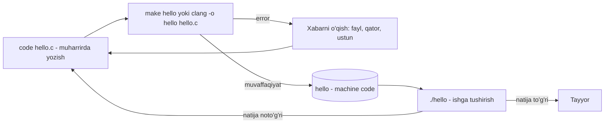

## Bu dars nima uchun kerak

4-darsda dasturning qurilish bloklarini (funksiya, shart, sikl, o'zgaruvchi) sintaksissiz, Scratch va pseudocode orqali ko'rdik. Endi ularni haqiqiy, matnli tilda yozish vaqti keldi. CS50 bu uchun **C** ni tanlaydi. C da yozish Python yoki JavaScript ga qaraganda ko'proq mehnat talab qiladi, lekin aynan shu "qo'shimcha mehnat" kompyuter ichida nima bo'layotganini ko'rsatadi: dastur faylda qanday saqlanadi, protsessor tushunadigan ko'rinishga qanday aylanadi, matn ekranga qanday chiqadi.

Bu dars C dagi birinchi dastur atrofidagi hamma narsani yopadi: dastur matni (source code) nima, uni kim va qanday qilib mashina kodiga aylantiradi, `main` nima uchun kerak, `printf` qatorlarni qanday formatlaydi, foydalanuvchidan matnni qanday olamiz va bularning hammasini **terminal** orqali qanday boshqaramiz. Tiplar va ularning chegaralari 6-darsda, shartlar va sikllarning C dagi sintaksisi 8-darsda, kompilyatsiyaning ichki bosqichlari 9-darsda ko'riladi. Bu darsda faqat birinchi dasturni yozib, ishga tushirish uchun kerak bo'lgan narsalar.

Bu darsdan keyin siz:

- source code va machine code farqini baytlar darajasida ko'rsata olasiz;
- `hello.c` dasturining har bir qatori nima qilishini va qaysi biri tushib qolsa qanday xato chiqishini bilasiz;
- terminalda papka yaratish, unga o'tish, fayllarni ko'chirish, nomini o'zgartirish va o'chirishni bajara olasiz va har buyruqning xavfli tomonini bilasiz;
- dasturni `clang` va `make` bilan kompilyatsiya qilib, kompilyator xabarini (fayl:qator:ustun) o'qiy olasiz;
- `printf` ning format specifier lari, kenglik va aniqlik sozlamalari bilan ishlay olasiz va `printf` qaytaradigan sonni oldindan hisoblay olasiz;
- `cs50.h` dagi `get_string` bilan foydalanuvchidan matn olib, uni chiqara olasiz.

## Source code va machine code

Siz yozadigan matn - **source code** (manba kod). U inson o'qishi uchun: `printf`, `main`, qavslar, izohlar. Protsessor esa bu matnni tushunmaydi. U faqat **machine code** (mashina kodi) ni bajaradi: protsessor ko'rsatmalarini ifodalovchi bitlar ketma-ketligi. Source code ni machine code ga aylantiradigan dastur - **compiler** (kompilyator). CS50 da compiler sifatida **clang** ishlatiladi.

Farqni o'z ko'zimiz bilan ko'ramiz. Quyidagi `hello.c` faylini oling:

```c
#include <stdio.h>

int main(void)
{
    printf("salom, dunyo\n");
}
```

Bu fayl 69 bayt (`wc -c hello.c` ham shuni ko'rsatadi, pastda). Hisob: har bir belgi ASCII da bitta bayt (2-dars), qator oxiridagi yangi qator belgisi ham bitta bayt. Qatorlar bo'yicha: `#include <stdio.h>` 18 + 1 = 19; bo'sh qator 1; `int main(void)` 14 + 1 = 15; `{` 1 + 1 = 2; `printf` qatori 4 ta bo'sh joy + 25 belgi + 1 = 30; `}` 1 + 1 = 2. Jami 19 + 1 + 15 + 2 + 30 + 2 = 69. E'tibor bering: source code dagi `\n` ikki belgi (teskari chiziq va `n`), ya'ni ikki bayt. U bitta "yangi qator" baytiga faqat kompilyatsiyada aylanadi.

Faylning birinchi baytlarini `od` (octal dump) buyrug'i bilan hex ko'rinishda ko'rish mumkin:

```text
$ od -A d -t x1 -N 16 hello.c
0000000 23 69 6e 63 6c 75 64 65 20 3c 73 74 64 69 6f 2e
0000016
```

Bu oddiy ASCII: 0x23 - `#`, 0x69 - `i`, 0x6e - `n` va hokazo. Endi kompilyatsiya qilingan faylni ko'ramiz (Ubuntu, x86-64, clang 18 bilan yig'ilgan):

```text
$ clang -o hello hello.c
$ od -A d -t x1 -N 16 hello
0000000 7f 45 4c 46 02 01 01 00 00 00 00 00 00 00 00 00
0000016
$ wc -c hello.c hello
   69 hello.c
16008 hello
16077 total
```

Bu fayl matn emas. Birinchi to'rt bayt `7f 45 4c 46` - Linux dagi bajariladigan fayl formati (ELF) belgisi, oxirgi uchtasi ASCII da `E`, `L`, `F`. Fayl hajmi 69 baytdan 16 008 baytga oshdi: 16 008 / 69 ≈ 232 baravar. Ichida faqat bizning bitta qatorimiz emas, dasturni ishga tushirish va `printf` ni operatsion tizimdagi kutubxonaga ulash uchun kerak bo'lgan qo'shimcha ma'lumotlar bor. Bu raqam tizim, compiler versiyasi va sozlamalarga bog'liq; boshqa mashinada boshqacha chiqadi. Ichki tuzilish 9 va 56-darslarda ochiladi.

Muhim xulosa: machine code **protsessor turiga** bog'liq. x86-64 uchun yig'ilgan `hello` ARM protsessorli mashinada ishlamaydi, `hello.c` esa ikkala mashinada ham qayta kompilyatsiya qilinishi mumkin. C ning "ko'chma til" deyilishi shundan: ko'chma - source code, binary emas. Shu sababli bu saytdagi C bloklari ham brauzerda alohida clang bilan WebAssembly (wasm32) uchun kompilyatsiya qilinadi.

JavaScript bilan taqqoslasangiz: `node app.js` da siz source code ni to'g'ridan-to'g'ri runtime ga berasiz va u ichida o'zi tarjima qiladi. C da tarjima alohida, ishga tushirishdan **oldin** bajariladi va natija alohida fayl sifatida qoladi. Bu farqning ikki oqibati bor: xatolarning katta qismi dastur ishga tushmasdan topiladi, va tayyor binary ni compiler o'rnatilmagan mashinada ham (bir xil tizim va protsessor bo'lsa) ishlatish mumkin.

## Birinchi dastur qatorma-qator

`hello.c` dagi har bir qator kerakli, va har biri tushib qolsa compiler boshqacha xato beradi.

**`#include <stdio.h>`.** `printf` funksiyasini biz yozmaganmiz. U C ning standart kutubxonasida (standard library) bor. `stdio.h` - **header file** (sarlavha fayli): unda `printf` va boshqa kiritish-chiqarish (standard input/output) funksiyalarining **e'lonlari** turadi: nomi, qanday argumentlar olishi, nima qaytarishi. `#include` compiler ga "bu faylni shu yerga qo'shib qo'y" deydi. Header faqat va'da beradi ("printf degan funksiya bor va u shunday chaqiriladi"), funksiyaning o'zi (machine code i) kutubxona faylida turadi va oxirgi bosqichda ulanadi (linking, 9-dars).

**`int main(void)`.** Har bir C dasturi `main` nomli funksiyadan boshlanadi: operatsion tizim dasturni ishga tushirganda aynan uni chaqiradi. Scratch'dagi "yashil bayroq bosilganda" blokining vazifasi shu. `void` - "bu funksiya argument olmaydi" degani; `int` - "u butun son qaytaradi". Qaytarilgan son dasturning **exit status** i bo'ladi: 0 - muvaffaqiyat, boshqa son - xato (13-darsda batafsil). C99 standartidan boshlab `main` oxiridagi `}` ga yetib kelinsa, bu `return 0;` bilan bir xil. Shuning uchun `hello.c` da `return` yo'q, lekin dastur 0 bilan tugaydi.

**`{` va `}`.** Jingalak qavslar funksiya tanasini o'raydi. Scratch'da bloklar "og'iz" ichiga joylashardi, C da o'sha og'iz - qavslar.

**`printf("salom, dunyo\n");`.** `printf` ni chaqiramiz va unga bitta argument - qo'shtirnoq ichidagi matnni beramiz. Oxiridagi `;` - "bu buyruq tugadi" belgisi. `\n` - **escape sequence**: teskari chiziq compiler ga "keyingi belgi oddiy belgi emas" deydi. `\n` yangi qatorga o'tishni bildiradi. `\n` yozilmasa, dastur chiqishi va terminalning keyingi taklif belgisi (`$`) bir qatorda qoladi.

Asosiy escape sequence lar:

| Yozilishi | Ma'nosi | Nima uchun kerak |
|---|---|---|
| `\n` | Yangi qator | Qatorni tugatish |
| `\t` | Tab | Ustunlarni tekislash |
| `\"` | Qo'shtirnoq | Matn ichida `"` yozish (aks holda u matnni tugatadi) |
| `\'` | Apostrof | `char` qiymati sifatida `'\''` |
| `\\` | Teskari chiziq | Teskari chiziqning o'zini yozish |
| `\r` | Qator boshiga qaytish | Terminal qatorini qayta yozish |

### Bitta belgi xato bo'lsa

C har bir belgiga sezgir. Uchta tipik xatoni haqiqiy clang 18 xabarlari bilan ko'ramiz.

`;` unutilgan:

```text
$ clang -o bad bad.c
bad.c:5:29: error: expected ';' after expression
    5 |     printf("salom, dunyo\n")
      |                             ^
      |                             ;
1 error generated.
```

`#include <stdio.h>` unutilgan:

```text
$ clang -o noinc noinc.c
noinc.c:3:5: error: call to undeclared library function 'printf' with type 'int (const char *, ...)'; ISO C99 and later do not support implicit function declarations [-Wimplicit-function-declaration]
    3 |     printf("salom\n");
      |     ^
noinc.c:3:5: note: include the header <stdio.h> or explicitly provide a declaration for 'printf'
1 error generated.
```

Xabarni o'qish tartibi doim bir xil: `fayl:qator:ustun: turi: matn`. `bad.c:5:29` - 5-qator, 29-ustun. Pastda xato qatori, `^` belgisi aniq joyni ko'rsatadi, uning ostida esa clang taklif qilgan tuzatish (fix-it): `;`. Ikkinchi misolda clang hatto qaysi header ni qo'shish kerakligini aytdi. Qoidalar: birinchi xatodan boshlang (keyingilari ko'pincha birinchisining oqibati), va xabarni o'qimasdan kodni tasodifiy o'zgartirmang.

## Terminal: buyruqlar bilan ishlash

**Terminal** (command-line interface, CLI) - kompyuterni matnli buyruqlar bilan boshqarish oynasi. Grafik interfeysda papkani sichqoncha bilan ochasiz, terminalda `cd papka` deb yozasiz. CS50 kursi uchun cs50.dev da brauzerdagi Visual Studio Code taklif qilinadi: chapda fayllar, o'rtada muharrir, pastda terminal. U yerda compiler va CS50 kutubxonasi oldindan o'rnatilgan. Quyidagi buyruqlar har qanday Linux yoki macOS terminalida bir xil ishlaydi.

Terminal doim qaysidir **joriy papka** (working directory) da turadi. Fayl nomini yozganingizda, u shu papkada qidiriladi. `pwd` joriy papkaning to'liq yo'lini chiqaradi.

| Buyruq | Nima qiladi | Muhim tafsilot |
|---|---|---|
| `pwd` | Joriy papka yo'lini ko'rsatadi | Adashganda birinchi buyruq |
| `ls` | Papkadagi fayllarni ro'yxatlaydi | `ls -F` papkalar oxiriga `/` qo'yadi |
| `cd papka` | Papkaga o'tadi | `cd ..` - bir daraja yuqoriga, argumentsiz `cd` - uy papkasiga, `cd -` - oldingi papkaga |
| `mkdir papka` | Yangi papka yaratadi | |
| `cp a b` | a faylidan b nusxasini yaratadi | Papkani nusxalash uchun `cp -r` |
| `mv a b` | a ni b ga ko'chiradi yoki nomini o'zgartiradi | b mavjud bo'lsa, so'ramasdan ustidan yozadi; `mv -i` so'raydi |
| `rm fayl` | Faylni o'chiradi | Korzina yo'q. Papkani standart holatda o'chirmaydi |
| `rmdir papka` | Bo'sh papkani o'chiradi | Ichida fayl bo'lsa, xato beradi |
| `code fayl.c` | Faylni muharrirda ochadi (yo'q bo'lsa, saqlanganda yaratiladi) | VS Code buyrug'i, cs50.dev da bor |

Quyidagi sessiya haqiqiy terminalda yozib olingan (uy papkasi `/home/talaba` ko'rinishida berilgan). Unda `hello.c` ni yangi papkaga ko'chiramiz, kompilyatsiya qilamiz, nusxa olamiz va tozalaymiz:

```text
$ mkdir dars5
$ cd dars5
$ pwd
/home/talaba/dars5
$ mv ../hello.c .
$ ls
hello.c
$ make hello
cc     hello.c   -o hello
$ ls
hello  hello.c
$ ./hello
salom, dunyo
$ cp hello.c salom.c
$ mv salom.c salom2.c
$ ls
hello  hello.c  salom2.c
$ rm salom2.c
$ ls
hello  hello.c
$ cd ..
$ rm dars5
rm: cannot remove 'dars5': Is a directory
$ rmdir dars5
rmdir: failed to remove 'dars5': Directory not empty
```

Bir nechta tafsilot:

- `..` - "ota papka", `.` - "joriy papka". `mv ../hello.c .` - "bir daraja yuqoridagi hello.c ni shu yerga ko'chir".
- `mv salom.c salom2.c` faylni ko'chirmadi, faqat nomini o'zgartirdi: manba va manzil bitta papkada. Terminalda alohida "rename" buyrug'i shart emas.
- `rm` papkani o'chirishdan bosh tortdi, `rmdir` esa papka bo'sh emasligi uchun. Bu ikki to'siq ataylab qo'yilgan. `rm -r dars5` papkani ichidagi hamma narsa bilan o'chiradi va **qaytarib bo'lmaydi**: grafik interfeysdagi kabi korzina yo'q. `rm -rf` ni nusxa-ko'chirish bilan ishlatishdan oldin joriy papkani `pwd` bilan tekshiring.
- `./hello` dagi `./` shart. Terminal buyruq nomini faqat maxsus papkalar ro'yxatida (PATH) qidiradi, joriy papkani esa standart holatda qidirmaydi. Shuning uchun faqat `hello` deb yozsangiz, bash `bash: hello: command not found` xabarini chiqaradi va buyruq 127 kodi bilan tugaydi. (Ba'zi tizimlarda, masalan `command-not-found` paketi o'rnatilgan Ubuntu'da, xabar matni boshqacha bo'ladi: u buyruqni qaysi paketdan o'rnatish mumkinligini taklif qiladi. Mohiyat bir xil: buyruq topilmadi.) `./hello` - "joriy papkadagi hello faylini ishga tushir".

## Kompilyatsiya: clang va make

### clang to'g'ridan-to'g'ri

```text
$ clang -o hello hello.c
$ ./hello
salom, dunyo
```

`-o hello` - natija faylining nomi ("output"). Uni yozmasangiz, clang natijani `a.out` nomli faylga yozadi: `clang hello.c` dan keyin papkada `a.out` paydo bo'ladi va uni `./a.out` bilan ishga tushirasiz. Bir nechta dasturda hammasi `a.out` ga yozilib, bir-birining ustidan yozilmasligi uchun `-o` ni doim yozing.

Foydali qo'shimcha bayroqlar (flag): `-Wall` va `-Wextra` qo'shimcha ogohlantirishlarni yoqadi, `-Werror` ogohlantirishni xatoga aylantiradi (binary yaratilmaydi), `-std=c11` C11 standartiga muvofiq kompilyatsiya qiladi. Clang hujjatiga ko'ra C uchun standart til rejimi `gnu17`.

### make

`make hello` qisqaroq: u `hello.c` faylini topadi va o'zining ichki qoidasi bo'yicha compiler ni chaqiradi. Yuqoridagi sessiyada GNU Make 4.3 `cc     hello.c   -o hello` ni bajardi (bu tizimda `cc` - tizimning standart C compiler i). `CC=clang` muhit o'zgaruvchisi o'rnatilgan tizimda xuddi shu qoida `clang     hello.c   -o hello` ni bajaradi. CS50 kutubxonasi hujjati "Visual Studio Code for CS50" (cs50.dev) bilan bir xil natija olish uchun muhit o'zgaruvchilarini beradi: `CC="clang"`, `CFLAGS` ichida `-std=c11`, `-Wall`, `-Werror`, `-Wextra` (hamda ba'zi ogohlantirishlarni o'chiruvchi `-Wno-unused-variable` kabi bayroqlar), `LDLIBS` ichida `-lcs50`. Demak cs50.dev da `make` yoqilgan ogohlantirishlarni ham xato sifatida qabul qiladi.

`make` ning ikkinchi foydasi - u keraksiz ishni qilmaydi:

```text
$ make hello
make: 'hello' is up to date.
```

`hello` fayli `hello.c` dan yangiroq bo'lgani uchun make qayta kompilyatsiya qilmadi. `hello.c` ni o'zgartirib saqlasangiz, make yana compiler ni chaqiradi. Ikkita keng tarqalgan xato:

```text
$ make hello.c
make: Nothing to be done for 'hello.c'.
$ make salom
make: *** No rule to make target 'salom'.  Stop.
```

Birinchisida make ga natija emas, manba nomi berildi; ikkinchisida `salom.c` fayli yo'q. `make` ga doim **natija** nomini bering, `.c` siz.

### Edit, compile, run sikli



E'tibor bering: kodni o'zgartirgandan keyin qayta **kompilyatsiya qilish** shart. `hello.c` ni tahrirlab, darhol `./hello` ni ishga tushirsangiz, eski binary ishlaydi va o'zgarish ko'rinmaydi. Bu boshlovchilarning eng ko'p savollaridan biri.

## printf va format specifier lar

`printf` ning birinchi argumenti - **format satri**. Unda oddiy belgilar o'zgarishsiz chiqadi, `%` bilan boshlanadigan qismlar esa **format specifier**: "shu yerga keyingi argumentning qiymatini shunday ko'rinishda qo'y". Argumentlar format satridagi specifier lar tartibida olinadi.

| Specifier | Kutilgan argument tipi | Misol | Natija |
|---|---|---|---|
| `%d` yoki `%i` | `int` | `printf("%i", 42)` | `42` |
| `%s` | satr (`string`, ya'ni `char *`) | `printf("%s", "Toshkent")` | `Toshkent` |
| `%c` | bitta belgi (`char`) | `printf("%c", 'C')` | `C` |
| `%f` | `double` (va `float`) | `printf("%f", 3.14159)` | `3.141590` |
| `%li` | `long` | `printf("%li", 2000000000L)` | `2000000000` |
| `%%` | argument yo'q | `printf("15%%")` | `15%` |

Specifier ning to'liq shakli: `%[bayroqlar][kenglik][.aniqlik][uzunlik]tur`. Eng ko'p ishlatiladiganlari:

- **Kenglik:** `%5d` sonni kamida 5 belgilik maydonga o'ngdan tekislab yozadi. Qiymat uzunroq bo'lsa, kesilmaydi.
- **`-` bayrog'i:** `%-5d` chapdan tekislaydi. Jadval ustunlari uchun qulay.
- **`0` bayrog'i:** `%05d` bo'sh joy o'rniga nollar qo'yadi.
- **Aniqlik:** `%.2f` - verguldan keyin 2 xona (yaxlitlab). `%f` ning standart aniqligi 6 xona. Satrlar uchun `%.3s` - eng ko'pi bilan 3 bayt.

`printf` yana bir narsa qiladi: u **chiqarilgan belgilar sonini qaytaradi** (xato bo'lsa, manfiy son). Bu 4-darsdagi return value va side effect farqining yaxshi misoli: ekranga yozish - side effect, belgilar soni - return value.

Quyidagi blokni ishga tushiring, keyin kenglik va aniqlikni o'zgartirib ko'ring:

```c run
#include <stdio.h>

int main(void)
{
    int n = printf("salom\n");
    printf("oldingi printf %d ta belgi chiqardi\n", n);

    printf("[%d] [%i]\n", 42, 42);
    printf("[%5d] [%-5d] [%05d]\n", 42, 42, 42);
    printf("[%c%c%c]\n", 'C', '5', '0');
    printf("[%s]\n", "Toshkent");
    printf("[%f] [%.2f] [%8.3f]\n", 3.14159, 3.14159, 3.14159);
    printf("chegirma: 15%%\n");
}
```

Natija:

```text
salom
oldingi printf 6 ta belgi chiqardi
[42] [42]
[   42] [42   ] [00042]
[C50]
[Toshkent]
[3.141590] [3.14] [   3.142]
chegirma: 15%
```

Hisoblarni tekshiramiz. `"salom\n"` - 5 ta harf + 1 ta yangi qator belgisi = 6, `printf` aynan 6 qaytardi. `%5d` da 42 ikki belgi, demak chapda 5 - 2 = 3 ta bo'sh joy. `%8.3f` da `3.142` besh belgi (3.14159 uch xonaga yaxlitlandi), maydon 8, demak 8 - 5 = 3 ta bo'sh joy. `%f` olti xona berdi: `3.141590`.

### Specifier va argument mos kelmasa

C standarti bo'yicha argument tipi specifier ga mos kelmasa yoki argumentlar specifier lardan kam bo'lsa, natija **undefined behavior**: dastur istalgan narsani chiqarishi yoki qulashi mumkin. Clang buni ko'p hollarda kompilyatsiya vaqtida ushlaydi:

```text
$ clang -o fmt fmt.c
fmt.c:6:29: warning: format specifies type 'char *' but the argument has type 'int' [-Wformat]
    6 |     printf("%s yoshi %d\n", age);
      |             ~~              ^~~
      |             %d
fmt.c:6:23: warning: more '%' conversions than data arguments [-Wformat-insufficient-args]
    6 |     printf("%s yoshi %d\n", age);
      |                      ~^
2 warnings generated.
```

Bu **warning**, error emas: clang `fmt` faylini baribir yaratdi va uni ishga tushirish mumkin, lekin natija aniqlanmagan. Xuddi shu kod `-Werror` bilan (cs50.dev dagi `make` kabi) kompilyatsiya qilinsa, ikkala ogohlantirish `error` ga aylanadi va binary yaratilmaydi. Shuning uchun ogohlantirishlarni hech qachon e'tiborsiz qoldirmang.

JavaScript dagi template literal (`` `salom, ${name}` ``) qiymatning tipini o'zi aniqlaydi. C da esa `printf` qiymat tipini bilmaydi: uni siz specifier orqali aytasiz. Noto'g'ri aytsangiz, xotiradagi baytlar boshqa tip sifatida o'qiladi. Nima uchun aynan shunday ekani 6-darsda (tiplar xotirada) aniq bo'ladi.

## Foydalanuvchidan input: cs50.h va get_string

Standart C da klaviaturadan bitta qator matnni xavfsiz o'qish boshlovchi uchun murakkab: xotira, bufer o'lchami va tugash holatlarini o'zingiz boshqarishingiz kerak (`scanf` va uning xavflari 25-darsda). CS50 shu murakkablikni o'z kutubxonasi orqali vaqtincha yashiradi: bu 4-darsdagi abstraction ning aniq misoli. `cs50.h` header i quyidagi funksiyalarni e'lon qiladi: `get_char`, `get_double`, `get_float`, `get_int`, `get_long`, `get_string`, va `string` tipini.

`get_string` argument sifatida taklif matnini oladi (u `printf` kabi formatlanadi), uni chiqaradi, foydalanuvchi kiritgan qatorni o'qiydi va qator oxiridagi yangi qator belgisini olib tashlab, matnni qaytaradi. Bo'sh qator kiritilsa, bo'sh satr `""` qaytadi; kirish umuman tugagan bo'lsa (EOF), `NULL` qaytadi.

```c run
#include <cs50.h>
#include <stdio.h>

int main(void)
{
    string name = get_string("Ismingiz: ");
    string city = get_string("Shahringiz: ");
    printf("salom, %s! %s qanday?\n", name, city);
}
```

```text stdin
Aziza
Samarqand
```

Brauzerda "Kirish" maydonidagi har bir qator bitta `get_string` ga javob bo'ladi. Natija:

```text
Ismingiz: Shahringiz: salom, Aziza! Samarqand qanday?
```

Taklif matnlari bir qatorda chiqdi, chunki kirish oldindan berilgan va ekranda takrorlanmaydi. Haqiqiy terminalda siz yozgan "Aziza" va Enter taklifdan keyin ko'rinadi, shuning uchun har bir taklif alohida qatorda bo'ladi.

Qatorma-qator:

- `string name` - `name` nomli o'zgaruvchi e'lon qilinadi, tipi `string`. Bu tip standart C da yo'q: CS50 uni `char *` uchun qisqa nom sifatida kiritgan. `char *` aslida nima ekani 12 va 21-darslarda ochiladi. Hozircha: `string` - matn saqlaydigan o'zgaruvchi.
- `= get_string(...)` - `get_string` ning return value si o'zgaruvchiga yoziladi. 4-darsdagi Scratch misolida `ask` bloki javobni `answer` ga yozardi; bu yerda nomni o'zimiz tanladik.
- `printf("salom, %s! ...", name, city)` - birinchi `%s` o'rniga `name`, ikkinchisi o'rniga `city`.

### cs50.h ni ulash: header va kutubxona

`#include <cs50.h>` tushib qolsa, compiler `string` nimaligini bilmaydi:

```text
$ clang -o hi2 hi2.c
hi2.c:5:5: error: use of undeclared identifier 'string'; did you mean 'stdin'?
    5 |     string name = get_string("Ismingiz: ");
      |     ^~~~~~
      |     stdin
```

Bu clang 18 chiqargan birinchi xato. Uning ortidan shu qatordan kelib chiqqan yana bir nechta xato keladi (`get_string` va `name` ham noma'lum), lekin hammasi bitta sababdan: birinchisini tuzatish yetarli.

Header bor, lekin kutubxona ulanmagan bo'lsa, xato boshqa bosqichda chiqadi - compiler emas, **linker** dan:

```text
$ clang -o hi hi.c
/usr/bin/ld: /tmp/hi-db6951.o: in function `main':
hi.c:(.text+0x12): undefined reference to `get_string'
clang: error: linker command failed with exit code 1 (use -v to see invocation)
```

(Vaqtinchalik fayl nomi `/tmp/hi-...o` har safar boshqacha bo'ladi.) Bu ikki xatoning farqi `#include` haqidagi yuqoridagi gapni tasdiqlaydi: header faqat e'lon (va'da) beradi, funksiyaning o'zi alohida kutubxonada. CS50 kutubxonasi o'rnatilgan tizimda yechim - `-lcs50` bayrog'i: `clang -o hi hi.c -lcs50`. cs50.dev dagi `make` uni avtomatik qo'shadi. Bu saytdagi brauzer muhitida esa `cs50.h` funksiyalari oldindan ulangan.

## Ko'p uchraydigan xatolar

1. **Kompilyatsiyasiz ishga tushirish.** `hello.c` o'zgartirildi, lekin `make hello` qilinmadi: `./hello` eski versiyani ishlatadi. Har o'zgarishdan keyin edit, compile, run siklini to'liq bajaring.
2. **`make hello.c` deb yozish.** make ga manba emas, natija nomi beriladi: `make hello`. Aks holda "Nothing to be done" chiqadi va hech narsa kompilyatsiya qilinmaydi.
3. **`./` siz ishga tushirish.** `hello` deb yozilsa, terminal joriy papkani qidirmaydi va `command not found` beradi. To'g'risi: `./hello`.
4. **Ogohlantirishni e'tiborsiz qoldirish.** `%s` ga `int` berish kabi warning lar binary yaratilishiga to'sqinlik qilmasligi mumkin, lekin natija undefined behavior. `-Wall -Werror` bilan ishlash bunday xatolarni majburan tuzattiradi.
5. **`\n` ni unutish.** Chiqish terminal taklifi bilan bir qatorga yopishadi. Har bir to'liq qator `\n` bilan tugashi kerak.
6. **Header va kutubxonani aralashtirish.** `#include <cs50.h>` compiler xatosini tuzatadi, `undefined reference` esa linker xatosi va `-lcs50` bilan tuzatiladi. Xabarda `ld` yoki `linker` so'zi bo'lsa, muammo kodda emas, ulashda.
7. **`rm -r` ni tekshirmasdan ishlatish.** Terminalda korzina yo'q. O'chirishdan oldin `pwd` va `ls` bilan qayerda turganingizni va nimani o'chirayotganingizni tekshiring.
8. **Compiler xabarining oxirgi qatoridan boshlash.** Birinchi xato ko'pincha keyingilarini keltirib chiqaradi. Xabarlarni yuqoridan, birinchi `error` dan o'qing va `fayl:qator:ustun` ga boring.

## Xulosa

- Source code - inson uchun matn (`hello.c` 69 bayt ASCII), machine code - protsessor uchun bitlar (`hello` 16 008 bayt ELF fayli bu tizimda). Ularni compiler (clang) bog'laydi, va machine code protsessor turiga bog'liq.
- `#include` header file ni qo'shadi: header funksiya e'lonini beradi, funksiyaning o'zi kutubxonada va linking da ulanadi.
- Dastur `int main(void)` dan boshlanadi; C99 dan boshlab `main` oxiriga yetish `return 0` bilan bir xil, 0 - muvaffaqiyatli exit status.
- Terminalda `pwd`, `ls`, `cd`, `mkdir`, `cp`, `mv`, `rm`, `rmdir` asosiy buyruqlar; `mv` ustidan yozadi, `rm` qaytarib bo'lmaydi, `./` joriy papkadagi dasturni ishga tushiradi.
- `clang -o nom nom.c` yoki `make nom`; xabar formati `fayl:qator:ustun: error|warning: matn`, birinchi xatodan boshlang.
- `printf` format specifier lari (`%i`, `%s`, `%c`, `%f`, `%li`, `%%`) kenglik va aniqlik bilan; specifier tipi argumentga mos kelmasa, undefined behavior. `printf` chiqargan belgilar sonini qaytaradi.
- `get_string` taklif chiqarib, bir qator matnni `string` sifatida qaytaradi, EOF da `NULL`. U `cs50.h` dagi abstraction, ichi keyingi darslarda ochiladi.

## Amaliy topshiriq

Terminal va `printf` bilan "tashrif kartasi" dasturini yozing. Dastur foydalanuvchidan ism, kasb va shaharni so'raydi va ularni tekislangan jadval ko'rinishida chiqaradi:

```text
+--------------------------+
| Ism    | Aziza           |
| Kasb   | dasturchi       |
| Shahar | Samarqand       |
+--------------------------+
```

1. **Terminal.** `karta` nomli papka yarating, unga o'ting, `karta.c` faylini yarating. Har bir buyruqni va `ls` natijasini javobingizga yozing. Kompilyatsiyadan oldin va keyin `ls` qanday farq qilishini ko'rsating.
2. **Kod.** `get_string` bilan uch qiymatni oling. Har bir qatorni bitta `printf` bilan, kenglik specifier i yordamida chiqaring: yorliq ustuni 6 belgi, qiymat ustuni 15 belgi, ikkalasi ham chapdan tekislangan.
3. **Hisob.** Har bir jadval qatori (masalan, `| Ism    | Aziza           |` va yangi qator belgisi) necha belgidan iborat? Formulani yozing (chegaralar va bo'sh joylar + 6 + 15 + `\n`) va `printf` qaytargan qiymatni ekranga chiqarib, hisobingizni tekshiring.
4. **Chegaraviy holat.** 15 belgidan uzun qiymat kiritilsa nima bo'ladi? `%-15s` va `%-15.15s` natijalarini solishtiring va qaysi biri jadvalni buzmasligini tushuntiring.
5. **Xatolar.** Ataylab uchta xato kiriting (bitta `;` ni o'chiring; `#include <cs50.h>` ni o'chiring; bitta `%s` o'rniga `%i` yozing) va har birida compiler qaysi `fayl:qator:ustun` ni ko'rsatganini, error yoki warning ekanini yozing.
6. **make va clang.** Dasturni `make karta` va `clang -o karta karta.c -lcs50` bilan kompilyatsiya qiling (yoki shu saytda ishga tushiring). `make karta` ni ikki marta ketma-ket bajarganda ikkinchi marta nima chiqishini va nima uchun ekanini yozing.

```c run
#include <cs50.h>
#include <stdio.h>

int main(void)
{
    string name = get_string("Ism: ");
    string job = get_string("Kasb: ");
    string city = get_string("Shahar: ");
    printf("\n");

    // Yechimingizni shu yerga yozing: chegara qatorlarini qo'shing,
    // qiymat ustunini 15 belgilik maydonga tekislang.
    int n = printf("| %-6s | %s |\n", "Ism", name);
    printf("| %-6s | %s |\n", "Kasb", job);
    printf("| %-6s | %s |\n", "Shahar", city);
    printf("birinchi qator %d belgi\n", n);
}
```

```text stdin
Aziza
dasturchi
Samarqand
```

Yaxshi javobda bo'lishi kerak bo'lgan narsalar:

- terminal buyruqlari to'g'ri ketma-ketlikda (`mkdir`, `cd`, `code` yoki fayl yaratish, `make`, `./karta`) va `ls` natijalari bilan;
- jadval qatorlari `%-6s` va `%-15s` bilan chiqarilgan, qo'lda bo'sh joy sanalmagan;
- qator uzunligi formula bilan: 2 + 6 + 3 + 15 + 2 + 1 = 29 belgi (`"| "`, yorliq, `" | "`, qiymat, `" |"`, `\n`) va `printf` qaytargan 29 bilan tasdiqlangan;
- uzun qiymat holatida kenglik kesmasligi, aniqlik (`.15`) esa kesishi tushuntirilgan;
- uchala xato uchun compiler xabari, joyi va turi (error yoki warning) yozilgan;
- `make` ning ikkinchi chaqiruvida "is up to date" chiqishi fayllar vaqtiga qarab tushuntirilgan.

Javobingizni pastdagi maydonga yozing va yuqoridagi mezonlar bilan solishtiring.

## Manbalar

- CS50x. [Lecture 1 notes](https://cs50.harvard.edu/x/notes/1/) - "Source Code" (source code, machine code, compiler), "Visual Studio Code for CS50", "Hello World", "Header Files and CS50 Manual Pages", "Hello, You" (get_string), "Linux" (cd, cp, ls, mkdir, mv, rm, rmdir) va "Format Codes" bo'limlari.
- CS50 Manual. [get_string](https://manual.cs50.io/3/get_string) - imzo, taklifning printf kabi formatlanishi, qator oxirini olib tashlash, bo'sh qator va EOF da `NULL`.
- CS50 Docs. [CS50 Library for C](https://cs50.readthedocs.io/libraries/cs50/c/) - kutubxona funksiyalari, `string` tipi, `-lcs50` bilan ulash, "Environment Variables" bo'limi: Visual Studio Code for CS50 bilan bir xil `CC="clang"`, `CFLAGS` (`-std=c11 -Wall -Werror -Wextra` va boshq.), `LDLIBS` (`-lcs50`).
- cppreference. [printf, fprintf, sprintf, snprintf](https://en.cppreference.com/w/c/io/fprintf) - format specifier tuzilishi, bayroqlar, kenglik va aniqlik, `%f` ning standart aniqligi 6, qaytariladigan qiymat va mos kelmaydigan argumentlarda undefined behavior.
- cppreference. [Main function](https://en.cppreference.com/w/c/language/main_function) - `main` ning ruxsat etilgan shakllari va C99 dan boshlab `}` ga yetish `return 0` ga tengligi (C11 standartining 5.1.2.2 bo'limlariga havola bilan).
- Clang documentation. [clang - the Clang C, C++, and Objective-C compiler](https://clang.llvm.org/docs/CommandGuide/clang.html) - `-o`, `-std` (C uchun standart `gnu17`) va kompilyatsiya bosqichlari; diagnostika formati uchun [Clang Compiler User's Manual](https://clang.llvm.org/docs/UsersManual.html), "Formatting of Diagnostics" bo'limi.
- GNU Coreutils. [mv invocation](https://www.gnu.org/software/coreutils/manual/html_node/mv-invocation.html) - standart holatda mavjud faylni so'ramasdan almashtirish, `-i` va `-n`; Linux man-pages. [rm(1)](https://man7.org/linux/man-pages/man1/rm.1.html) - papkalarni standart holatda o'chirmaslik, `-r`, `-i`, `-f`.
- GNU Bash manual. [Bourne Shell Builtins](https://www.gnu.org/software/bash/manual/html_node/Bourne-Shell-Builtins.html) - `cd` (argumentsiz HOME ga, `cd -` oldingi papkaga) va `pwd`.
