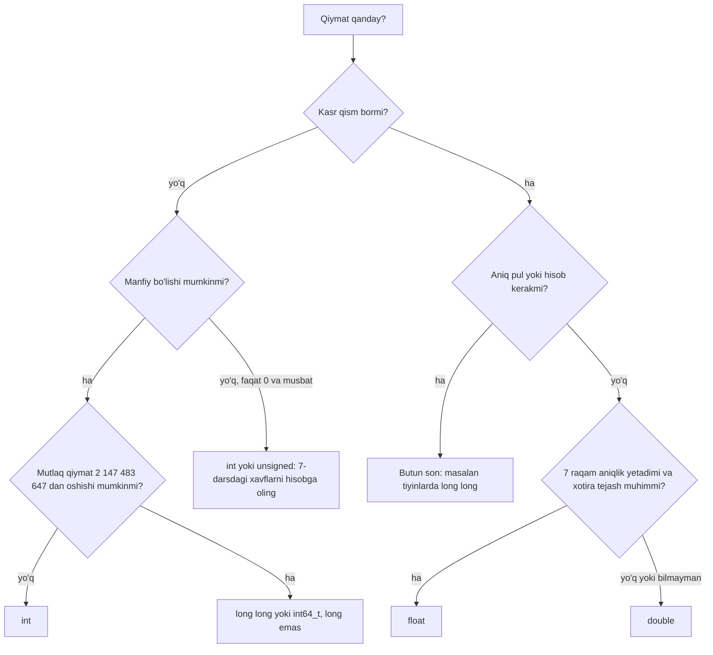

## Bu dars nima uchun kerak

5-darsda birinchi C dasturlarini yozdik: `int` e'lon qildik, `printf` bilan chiqardik, `clang` bilan kompilyatsiya qildik. Lekin bitta savol ochiq qoldi: `int x = 5;` deganda kompyuter xotirasida aynan nima paydo bo'ladi? Nechta bayt? Bu baytlar qaysi qoida bo'yicha songa aylanadi? Va eng muhimi: shu o'zgaruvchiga qanday sonlarni **sig'dirib bo'lmaydi**?

JavaScript yoki Python da bu savollar deyarli ko'rinmaydi. JavaScript da har bir `number` bir xil 64-bitli floating-point qiymat, Python da butun sonlar chegarasiz. C esa sizdan har bir o'zgaruvchi uchun tip tanlashni talab qiladi, va tip bilan birga uning chegarasini ham tanlaysiz. Noto'g'ri tanlangan tip kompilyatsiya xatosi bermaydi: dastur ishlaydi, faqat ba'zi kirishlarda noto'g'ri javob beradi. 2-darsda ko'rgan binary va hex aynan shu yerda amaliy ahamiyatga ega bo'ladi.

Bu dars C ning asosiy son tiplarini ichidan ochadi. Keyingi dars (7-dars) shu chegaralar buzilganda nima bo'lishini, ya'ni integer overflow va floating-point imprecision ni ko'radi.

Bu darsdan keyin siz:

- tip nima ekanini "bitlar soni + ularni o'qish qoidasi" sifatida tushuntira olasiz;
- N bitli unsigned va signed (two's complement) sonlarning chegarasini formula bilan hisoblay olasiz va manfiy sonning bitlarini qo'lda topa olasiz;
- C standarti `char`, `short`, `int`, `long`, `long long` uchun nimani kafolatlashini va nimani platformaga qoldirishini bilasiz;
- `sizeof` va `<limits.h>`, `<float.h>` yordamida o'z mashinangizdagi haqiqiy o'lchamlarni tekshira olasiz va nega brauzerdagi muharrir boshqa javob berishini tushunasiz;
- `float` va `double` ning IEEE 754 dagi bit tuzilmasini, aniqligini va epsilonini hisoblay olasiz;
- butun bo'lish, `%` amali, type casting va implicit conversion natijasini oldindan ayta olasiz;
- vazifaga mos tipni asosli tanlay olasiz.

## Tip nima: bitlar va ularni o'qish qoidasi

Xotira - baytlar ketma-ketligi, har bir bayt 8 bit (C da baytdagi bitlar soni `CHAR_BIT` makrosida turadi va deyarli barcha zamonaviy tizimlarda 8 ga teng). Xotiraning o'zi hech narsani "bilmaydi": `01000001` bitlari son ham, harf ham, rangning bir qismi ham bo'lishi mumkin. Bu bitlarga ma'no beradigan narsa - **tip**.

Tip ikki narsani belgilaydi:

1. **O'lcham**: qiymat nechta bayt egallaydi. N bit bilan jami 2ᴺ xil bit kombinatsiyasi bor, demak tip ko'pi bilan 2ᴺ xil qiymatni ifodalay oladi. Bu - har bir tipning eng asosiy cheklovi.
2. **Talqin**: shu bitlar qanday qoida bilan qiymatga aylanadi. Bir xil 32 bitni manfiy bo'lmagan butun son, ishorali butun son yoki kasr son sifatida o'qish mumkin, va natijalar butunlay boshqacha bo'ladi.

Misol: 32 bitli `0x40B80000` bit qatorini `unsigned int` sifatida o'qisak 1 085 800 448 chiqadi, `float` sifatida o'qisak 5.75 chiqadi. Bitlar bir xil, tip boshqa. Bu dars davomida ikkala talqinni ham qo'lda hisoblaymiz.

Kompilyator tipni faqat kompilyatsiya vaqtida biladi. Ishga tushgan dasturda o'zgaruvchi yonida "men int man" degan belgi saqlanmaydi: mashina kodi shunchaki "shu manzildan 4 bayt o'qi va butun son sifatida qo'sh" deydi. Shuning uchun C da tipni noto'g'ri ko'rsatish (masalan, `printf` da noto'g'ri format kodi) kompilyator ogohlantirmasa, jimgina noto'g'ri natija beradi.

## Butun sonlar: unsigned va two's complement

### Unsigned: oddiy ikkilik son

`unsigned` tipda barcha N bit sonning og'irligi sifatida o'qiladi, 2-darsdagi kabi: eng o'ngdagi bit 2⁰, keyingisi 2¹ va hokazo, eng chapdagisi 2ᴺ⁻¹. Eng kichik qiymat - hamma bit 0, ya'ni 0. Eng kattasi - hamma bit 1:

2ᴺ⁻¹ + 2ᴺ⁻² + ... + 2¹ + 2⁰ = 2ᴺ - 1.

8 bitda bu 255, 16 bitda 65 535, 32 bitda 4 294 967 295.

### Signed: two's complement

Manfiy sonlarni ifodalashning bir necha usuli tarixda ishlatilgan (sign-magnitude, ones' complement), lekin bugun deyarli hamma joyda **two's complement** ishlatiladi. Uning g'oyasi bitta jumla: eng chapdagi bitning og'irligi musbat 2ᴺ⁻¹ emas, **manfiy** -2ᴺ⁻¹. Qolgan bitlar odatdagidek.

8 bitli misol:

- `00000101` = 4 + 1 = 5;
- `11111011` = -128 + 64 + 32 + 16 + 8 + 2 + 1 = -128 + 123 = -5;
- `10000000` = -128 (eng kichik qiymat);
- `01111111` = 64 + 32 + 16 + 8 + 4 + 2 + 1 = 127 (eng katta qiymat);
- `11111111` = -128 + 127 = -1.

Bundan umumiy formula chiqadi. Eng kichik qiymat - faqat eng chap bit 1: -2ᴺ⁻¹. Eng kattasi - eng chap bit 0, qolganlari 1: 2ᴺ⁻¹ - 1. Demak N bitli signed tipning oralig'i:

-2ᴺ⁻¹ ... 2ᴺ⁻¹ - 1.

E'tibor bering: manfiy tomonda bitta qiymat ko'p. 8 bitda -128 bor, +128 yo'q. Bu nosimmetriya 7-darsda muhim bo'ladi: `-INT_MIN` ni hisoblash ham overflow.

**Sonni manfiyga aylantirish qoidasi**: barcha bitlarni teskari qiling va 1 qo'shing. 5 = `00000101`, teskarisi `11111010`, ortiga 1 qo'shsak `11111011`, ya'ni -5. Tekshiruv: 5 + (-5) bitlarda `00000101` + `11111011` = `1 00000000`. To'qqizinchi bit sig'maydi va tashlanadi, 8 bitda `00000000` qoladi. Two's complement ning asosiy afzalligi shu: qo'shish va ayirish uchun protsessorga signed va unsigned uchun alohida sxema kerak emas, bir xil qo'shish amali ikkalasida ham to'g'ri natija beradi.

Qisqacha tarix: C23 standartigacha C manfiy sonlar uchun boshqa ko'rinishlarga ham ruxsat bergan va shuning uchun kafolatlangan minimal oraliq simmetrik edi (8 bit uchun -127 ... 127). C23 dan boshlab two's complement yagona ruxsat etilgan ko'rinish, va cppreference ga ko'ra keng tarqalgan barcha data model'lar va deyarli barcha kompilyatorlar undan oldin ham shuni ishlatgan.

### Oraliqlar jadvali

| Bitlar (N) | Unsigned: 0 ... 2ᴺ - 1 | Signed: -2ᴺ⁻¹ ... 2ᴺ⁻¹ - 1 | C dagi odatiy tip |
|---|---|---|---|
| 8 | 0 ... 255 | -128 ... 127 | `char`, `signed char`, `unsigned char` |
| 16 | 0 ... 65 535 | -32 768 ... 32 767 | `short` |
| 32 | 0 ... 4 294 967 295 | -2 147 483 648 ... 2 147 483 647 | `int` |
| 64 | 0 ... 18 446 744 073 709 551 615 | -9 223 372 036 854 775 808 ... 9 223 372 036 854 775 807 | `long long` (va 64-bit Linux da `long`) |

Tez hisoblash uchun foydali yaqinlashish: 2¹⁰ = 1024 ≈ 10³. Demak 2³¹ = 2·2³⁰ ≈ 2·10⁹, ya'ni `int` ning chegarasi taxminan ±2.1 milliard. 2⁶³ ≈ 8·10¹⁸, ya'ni 64-bitli signed son taxminan ±9.2 kvintillion.

Bu raqamlarning amaliy ma'nosi: dunyo aholisi (8 milliarddan ko'p) `int` ga sig'maydi, `long long` ga esa bemalol sig'adi. 32-bitli `int` da millisekundlarni sanasak, 2 147 483 647 ms / 1000 / 86 400 ≈ 24.86 kun o'tganda chegaraga yetamiz. Bunday hisob har safar tip tanlashdan oldin qilinishi kerak.

## C dagi butun son tiplari: standart nimani kafolatlaydi

Ko'pchilik "`int` 4 bayt, `long` 8 bayt" deb yodlaydi. Bu ba'zi tizimlarda to'g'ri, boshqalarida noto'g'ri. C standarti aniq o'lchamni emas, faqat **minimal kenglikni** va **tartibni** belgilaydi.

| Tip | Standart bo'yicha minimal kenglik |
|---|---|
| `char` | 8 bit |
| `short` | 16 bit |
| `int` | 16 bit |
| `long` | 32 bit |
| `long long` | 64 bit (C99 dan) |

Bundan tashqari standart tartibni kafolatlaydi: `1 == sizeof(char) <= sizeof(short) <= sizeof(int) <= sizeof(long) <= sizeof(long long)`. `sizeof(char)` ta'rif bo'yicha 1, ya'ni `sizeof` natijasi "nechta `char` sig'adi" degan o'lchov birligida.

Qolgan hamma narsa - aniq o'lchamlar - **implementation** (kompilyator va platforma) tomonidan tanlanadi. Bu tanlovlar to'plami **data model** deb ataladi. cppreference to'rtta keng tarqalgan modelni sanaydi (raqamlar `int`/`long`/pointer bitlarida):

| Data model | `int` | `long` | pointer | Qayerda |
|---|---|---|---|---|
| LP32 | 16 | 32 | 32 | Win16 API |
| ILP32 | 32 | 32 | 32 | Win32 API, 32-bitli Unix va Unix-ga o'xshash tizimlar |
| LLP64 | 32 | 32 | 64 | Win64 API |
| LP64 | 32 | 64 | 64 | 64-bitli Unix va Unix-ga o'xshash tizimlar (Linux, macOS) |

Nomlardagi harflar qaysi tiplar 32 yoki 64 bit ekanini bildiradi: LP64 - "Long va Pointer 64 bit", ILP32 - "Int, Long va Pointer 32 bit", LLP64 - "Long Long va Pointer 64 bit".

Natija: bir xil `long` tipi 64-bitli Linux da 8 bayt, 64-bitli Windows da 4 bayt. Agar dasturingiz `long` ga 3 milliardni yozsa, u Linux da ishlaydi va Windows da buziladi.

### Bizning brauzerdagi muharrir: wasm32

Shu kursdagi `c run` bloklari brauzerda WebAssembly ga kompilyatsiya qilinadi, aniqrog'i `wasm32-wasip1` platformasiga. WebAssembly ning C ABI hujjatiga ko'ra wasm32 da `int`, `long` va pointer 4 baytdan, `long long` 8 bayt, `size_t` 4 bayt, `long double` 16 bayt. Ya'ni bu - ILP32 model. Ko'pchilik shaxsiy kompyuter va serverlardagi 64-bit Linux esa LP64.

Pastdagi dasturni ishga tushiring. U har bir tipning o'lchamini va chegarasini `<limits.h>` va `<float.h>` dagi makrolardan oladi.

```c run
#include <float.h>
#include <limits.h>
#include <stdio.h>

int main(void)
{
    printf("char:      %zu bayt, %d .. %d\n", sizeof(char), CHAR_MIN, CHAR_MAX);
    printf("short:     %zu bayt, %d .. %d\n", sizeof(short), SHRT_MIN, SHRT_MAX);
    printf("int:       %zu bayt, %d .. %d\n", sizeof(int), INT_MIN, INT_MAX);
    printf("long:      %zu bayt, %ld .. %ld\n", sizeof(long), LONG_MIN, LONG_MAX);
    printf("long long: %zu bayt, %lld .. %lld\n", sizeof(long long), LLONG_MIN, LLONG_MAX);
    printf("unsigned:  %zu bayt, 0 .. %u\n", sizeof(unsigned int), UINT_MAX);
    printf("float:     %zu bayt, eng katta %e, epsilon %e\n", sizeof(float), FLT_MAX, FLT_EPSILON);
    printf("double:    %zu bayt, eng katta %e, epsilon %e\n", sizeof(double), DBL_MAX, DBL_EPSILON);
    printf("pointer:   %zu bayt\n", sizeof(int *));
}
```

64-bitli Linux kompyuterda (`clang -o sizes sizes.c && ./sizes`, x86-64, clang 18) natija:

```text
char:      1 bayt, -128 .. 127
short:     2 bayt, -32768 .. 32767
int:       4 bayt, -2147483648 .. 2147483647
long:      8 bayt, -9223372036854775808 .. 9223372036854775807
long long: 8 bayt, -9223372036854775808 .. 9223372036854775807
unsigned:  4 bayt, 0 .. 4294967295
float:     4 bayt, eng katta 3.402823e+38, epsilon 1.192093e-07
double:    8 bayt, eng katta 1.797693e+308, epsilon 2.220446e-16
pointer:   8 bayt
```

Brauzerdagi muharrirda ikkita qator farq qiladi:

```text
long:      4 bayt, -2147483648 .. 2147483647
pointer:   4 bayt
```

Qolgan qatorlar bir xil. Bu farq amaliy oqibatga ega: CS50 kutubxonasidagi `get_long` ham `long` qaytaradi, shuning uchun brauzerda u faqat 32-bitli `long` oralig'idagi (taxminan ±2.1·10⁹) qiymatni qabul qiladi, 64-bit Linux da esa taxminan ±9.2·10¹⁸ gacha. Agar sizga har qanday platformada kamida 64 bit kerak bo'lsa, `long long` ishlating (standart uni kamida 64 bit deb kafolatlaydi) yoki C99 dagi `<stdint.h>` sarlavhasidagi aniq kenglikli `int64_t` tipini oling.

Format kodlariga e'tibor bering: `%zu` - `sizeof` qaytaradigan `size_t` uchun, `%ld` - `long`, `%lld` - `long long`, `%u` - `unsigned int`. Format kodi tipga mos kelmasa, `printf` stekdan yoki registrdan noto'g'ri sondagi baytlarni o'qiydi. `clang -Wall` bunday nomuvofiqlikni odatda ogohlantirish bilan ko'rsatadi, shuning uchun ogohlantirishlarni hech qachon e'tiborsiz qoldirmang.

### char: kichik butun son

`char` - aslida 1 baytli butun son. `'A'` yozuvi kompilyator uchun shunchaki 65 soni (2-darsdagi ASCII jadvali). Shuning uchun `'A' + 2` ifodasi 67 ni beradi, va uni `%c` bilan chiqarsak `C` harfi ko'rinadi.

Nozik joy: oddiy `char` signed yoki unsigned ekanini standart belgilamaydi, bu implementation tanlovi. Lekin `char` har doim `signed char` dan ham, `unsigned char` dan ham alohida tip. x86-64 Linux dagi clang da ham, wasm32 da ham oddiy `char` signed: yuqoridagi natijada `CHAR_MIN = -128`, WebAssembly C ABI jadvalida esa `char` va `signed char` bitta qatorda turadi. Agar baytni 0 ... 255 son sifatida ishlatmoqchi bo'lsangiz (masalan, rasm piksellari, 26-dars), `unsigned char` deb aniq yozing.

### bool va string

CS50 kutubxonasi bilan ishlaganda yana ikkita "tip" uchraydi. `bool` - C99 dan beri `<stdbool.h>` orqali mavjud, `true` va `false` qiymatlari bilan; xotirada odatda 1 bayt. `string` esa CS50 ning `cs50.h` faylidagi taxallus: aslida bu `char *`, ya'ni belgilar ketma-ketligining manzili. Uning ichki tuzilishi 12 va 22-darslarda ochiladi; hozircha muhim narsa shuki, `string` C tilining o'zida yo'q.

## Haqiqiy sonlar: float va double

Kasr sonlarni butun son kabi "har bir bit - 2 ning darajasi" usulida saqlab bo'lmaydi: juda katta (10³⁰⁸) va juda kichik (10⁻³⁰⁸) qiymatlarni ham ifodalash kerak. Yechim - **floating-point** ko'rinishi, ya'ni ilmiy yozuvning ikkilik varianti. O'nlik ilmiy yozuvda 5 750 = 5.75 × 10³; ikkilikda xuddi shunday: son = mantissa × 2^daraja.

Deyarli barcha zamonaviy kompyuterlar **IEEE 754** standartidagi formatlardan foydalanadi. cppreference ga ko'ra C dagi `float` (agar platforma qo'llasa) IEEE 754 binary32 ga, `double` binary64 ga mos keladi.

### Bit tuzilmasi

| Maydon | `float` (binary32) | `double` (binary64) |
|---|---|---|
| Ishora (sign) | 1 bit | 1 bit |
| Daraja (exponent) | 8 bit, bias 127 | 11 bit, bias 1023 |
| Kasr qismi (fraction) | 23 bit | 52 bit |
| Aniqlik p (yashirin bit bilan) | 24 bit | 53 bit |
| Jami | 32 bit, 4 bayt | 64 bit, 8 bayt |

Normal sonlar uchun qiymat formulasi (`float` uchun):

qiymat = (-1)^s × (1 + f / 2²³) × 2^(e - 127)

Bu yerda s - ishora biti, e - 8 bitli daraja maydoni unsigned son sifatida, f - 23 bitli kasr maydoni unsigned son sifatida. "1 +" qismi - **yashirin bit**: normal sonda ikkilik mantissa doim `1.` bilan boshlanadi, shuning uchun bu 1 saqlanmaydi va 23 bitli maydon amalda 24 bitli aniqlik beradi. Daraja manfiy ham bo'lishi kerak, shuning uchun u to'g'ridan-to'g'ri emas, 127 qo'shilgan ("bias") holda saqlanadi.

### Misol: 5.75 ni qo'lda kodlash

1. Butun qism: 5 = 101₂. Kasr qism: 0.75 = 0.5 + 0.25 = 0.11₂. Demak 5.75 = 101.11₂.
2. Normallashtiramiz: 101.11₂ = 1.0111₂ × 2². Demak haqiqiy daraja 2.
3. Ishora: son musbat, s = 0.
4. Daraja maydoni: 2 + 127 = 129 = `10000001`.
5. Kasr maydoni: nuqtadan keyingi bitlar `0111`, qolgan 19 bit nol: `01110000000000000000000`.
6. Hammasini yonma-yon qo'yamiz: `0 10000001 01110000000000000000000`. To'rt bitdan guruhlasak: `0100 0000 1011 1000 0000 ...` = `0x40B80000`.

Teskari tekshiruv formula bilan: s = 0, e = 129, f = `0111` va 19 ta nol = 0b0111 × 2¹⁹ = 3 670 016. Qiymat = (1 + 3 670 016 / 8 388 608) × 2^(129 - 127) = (1 + 0.4375) × 4 = 5.75. Bu - dars boshida aytilgan `0x40B80000` ning `float` talqini.

5.75 aniq saqlandi, chunki 0.75 ikkining manfiy darajalari yig'indisi. 0.1 esa bunday emas: ikkilikda u cheksiz takrorlanuvchi kasr 0.000110011001100..., va 24 bitda qirqib yaxlitlanadi. Natijada `float` da saqlangan 0.1 aslida 0.100000001490116... ga teng. Bu 7-darsning asosiy mavzusi.

### Aniqlik, epsilon va chegaralar

Uchta raqam `float` va `double` ning xatti-harakatini to'liq tavsiflaydi.

**Aniqlik (o'nlik raqamlarda).** 24 bitli mantissa 2²⁴ xil qiymatni ajratadi. O'nlik raqamlarga o'tkazish: 24 × log₁₀ 2 ≈ 24 × 0.30103 ≈ 7.22. Ya'ni `float` taxminan 7 ta ma'noli o'nlik raqamni saqlaydi. `double` uchun 53 × 0.30103 ≈ 15.95, ya'ni taxminan 16 raqam. `<float.h>` dagi `FLT_DIG` (6) va `DBL_DIG` (15) esa kafolatlangan qiymat: shuncha raqamli o'nlik sonni matndan tipga va qaytib matnga o'tkazsak, u o'zgarmaydi.

**Epsilon.** `FLT_EPSILON` - 1.0 bilan undan keyingi eng yaqin ifodalanadigan `float` orasidagi farq. 1.0 dan keyingi son mantissaning eng kichik bitini o'zgartiradi: 1 + 2⁻²³. Demak FLT_EPSILON = 2⁻²³ ≈ 1.192093·10⁻⁷, `double` uchun DBL_EPSILON = 2⁻⁵² ≈ 2.220446·10⁻¹⁶. Yuqoridagi dastur aynan shu qiymatlarni chiqardi. Epsilon nisbiy o'lchov: son 2 baravar kattalashsa, qo'shni qiymatlar orasidagi masofa ham 2 baravar oshadi. Masalan, 512 ... 1024 oralig'idagi qo'shni `float` lar orasidagi masofa 2⁹ × 2⁻²³ = 2⁻¹⁴ ≈ 0.000061.

**Butun sonlarning aniq chegarasi.** 2²⁴ = 16 777 216 dan keyin qo'shni `float` lar orasidagi masofa 2 ga teng bo'ladi, ya'ni 16 777 217 ni `float` da saqlab bo'lmaydi. `double` uchun bu chegara 2⁵³ = 9 007 199 254 740 992. JavaScript dagi `Number.MAX_SAFE_INTEGER` (2⁵³ - 1 = 9 007 199 254 740 991) aynan shu sababdan kelib chiqqan: JavaScript `number` i - IEEE 754 binary64, ya'ni C dagi `double`.

**Eng katta qiymat.** Eng katta normal `float`: mantissa hamma bitlari 1 (1 + (2²³ - 1)/2²³ = 2 - 2⁻²³), daraja maydoni 254 (255 cheksizlik va NaN uchun band), ya'ni 2^(254 - 127) = 2¹²⁷. FLT_MAX = (2 - 2⁻²³) × 2¹²⁷ ≈ 3.402823·10³⁸.

| Xususiyat | `float` | `double` |
|---|---|---|
| Hajm | 4 bayt | 8 bayt |
| Ma'noli o'nlik raqamlar | ~7.2 (FLT_DIG = 6) | ~15.9 (DBL_DIG = 15) |
| Epsilon | 2⁻²³ ≈ 1.19·10⁻⁷ | 2⁻⁵² ≈ 2.22·10⁻¹⁶ |
| Aniq ifodalanadigan butun sonlar | ±2²⁴ = ±16 777 216 gacha | ±2⁵³ ≈ ±9.0·10¹⁵ gacha |
| Eng katta qiymat | ≈ 3.40·10³⁸ | ≈ 1.80·10³⁰⁸ |
| Literal | `3.14f` | `3.14` |
| `printf` format | `%f` (`double` ga ko'tariladi) | `%f` |

Literal'ga e'tibor bering: C da `3.14` yozuvi `double`, `float` literal uchun oxiriga `f` qo'shiladi. `printf` ga berilgan `float` avtomatik `double` ga ko'tariladi, shuning uchun ikkalasi uchun ham `%f` ishlaydi.

## Tiplar o'rtasida o'tish: butun bo'lish, cast va implicit conversion

Tiplar faqat saqlashni emas, **amallarni** ham belgilaydi. Bir xil `/` belgisi `int` lar orasida bitta ishni, `double` lar orasida boshqa ishni bajaradi.

**Butun bo'lish.** Ikkala operand ham butun bo'lsa, `/` butun bo'lishni bajaradi va kasr qismi tashlab yuboriladi. C99 dan boshlab bu qoida aniq: natija nol tomonga qirqiladi (truncation toward zero). Demak `7 / 2` = 3, `-7 / 2` = -3 (yaxlitlash emas va -4 ham emas). `%` amali qoldiqni beradi va (a / b) * b + a % b == a tengligi doim bajariladi: `7 % 2` = 1, `-7 % 2` = -1.

**Type casting.** `(float) a` yozuvi `a` ning qiymatini `float` ga aylantiradi. Agar bo'lishdan oldin bitta operand kasr tipga o'tkazilsa, butun ifoda kasr arifmetikada hisoblanadi. Qavslar joyi hal qiluvchi: `(float) a / b` avval `a` ni o'tkazadi, keyin bo'ladi; `(float) (a / b)` avval butun bo'ladi, kasr qismi yo'qoladi, keyin o'tkazadi.

**Implicit conversion.** Ko'p hollarda C tiplarni o'zi o'tkazadi. Ifodada `int` va `double` aralashsa, `int` `double` ga ko'tariladi (bu xavfsiz yo'nalish, chunki 32-bitli `int` ning har bir qiymati 53-bitli mantissaga sig'adi). Teskari yo'nalish xavfli: `int n = 3.99;` qatori ham qirqadi va `n` 3 bo'ladi, kompilyatsiya xatosi chiqmaydi. clang literal uchun faqat `-Wliteral-conversion` ogohlantirishini beradi, `int n = d;` kabi o'zgaruvchidan o'tkazishda esa (`-Wall` bilan ham) ogohlantirish chiqmaydi. Kasrdan butunga o'tishda qirqish ham nol tomonga: `(int) -3.99` = -3.

Barchasini sinab ko'ring. Kirish maydonida `a` va `b` qiymatlari bor; ularni o'zgartirib, masalan `-7` va `2` qilib ko'ring.

```c run
#include <cs50.h>
#include <stdio.h>

int main(void)
{
    int a = get_int("a: ");
    int b = get_int("b: ");

    printf("a / b           = %d\n", a / b);
    printf("a %% b           = %d\n", a % b);
    printf("(float) a / b   = %f\n", (float) a / b);
    printf("(float) (a / b) = %f\n", (float) (a / b));

    double d = 3.99;
    int n = (int) d;
    printf("(int) 3.99      = %d\n", n);
    printf("(int) -3.99     = %d\n", (int) -3.99);

    char c = 'A';
    printf("'A' = %d, 'A' + 2 = %c\n", c, c + 2);
}
```

```text stdin
7
2
```

Kirish 7 va 2 bo'lganda natija (brauzerda ham, 64-bit Linux da ham bir xil):

```text
a: b: a / b           = 3
a % b           = 1
(float) a / b   = 3.500000
(float) (a / b) = 3.000000
(int) 3.99      = 3
(int) -3.99     = -3
'A' = 65, 'A' + 2 = C
```

`printf` dagi `%%` - foiz belgisining o'zini chiqarish usuli, chunki yolg'iz `%` format kodining boshi hisoblanadi.

JavaScript bilan farq: JavaScript da `7 / 2` 3.5 beradi, chunki u yerda butun son tipi yo'q, hamma son `double`. Butun bo'lish kerak bo'lsa `Math.trunc(7 / 2)` yoziladi. C da esa aksincha: kasr natija kerak bo'lsa, buni cast bilan aniq so'rash kerak.

### Butun songa o'tkazishda chegara

Kasrdan butunga o'tkazishning yana bir xavfi bor: agar qiymat butun tipga sig'masa (masalan, `(int) 3e9`, chunki 3·10⁹ > INT_MAX), C standartida natija aniqlanmagan. Buni 7-darsda Ariane 5 raketasi misolida ko'ramiz: u yerda aynan 64-bitli kasr sonni 16-bitli signed butun songa o'tkazish halokatga sabab bo'lgan.

## Qaysi tipni tanlash kerak

Tip tanlash uchun ikki savol yetarli: qiymat butunmi yoki kasrmi, va eng yomon holatda u qanchalik katta bo'lishi mumkin. Ikkinchi savolga javobni tasavvur bilan emas, hisob bilan bering: masalan, "foydalanuvchilar soni" uchun kelajakdagi maksimumni, "baytlar soni" uchun eng katta faylni.



Diagrammaning ikki nozik joyi:

- **`long` emas, `long long`.** Yuqorida ko'rdik: `long` LLP64 (Windows) va ILP32 (shu jumladan bizning brauzer) da 32 bit. Ko'chma kod uchun 64 bit kerak bo'lsa, `long long` yoki `int64_t`.
- **Pul uchun kasr tip emas.** 0.1 ikkilikda aniq ifodalanmaydi, shuning uchun so'mni tiyinlarda (butun son sifatida) saqlash xatoni butunlay yo'q qiladi. Sabablari 7-darsda batafsil.

Ko'pincha `double` standart tanlov hisoblanadi: `float` dan ikki baravar ko'p xotira oladi, lekin 7 o'rniga 15-16 raqam aniqlik beradi. `float` asosan xotira yoki tezlik hal qiluvchi bo'lgan katta massivlarda (grafika, ovoz namunalari, neyron tarmoq og'irliklari) ishlatiladi.

## Ko'p uchraydigan xatolar

1. **"`long` doim 8 bayt" deb hisoblash.** Bu faqat LP64 tizimlarda to'g'ri. Windows 64-bit (LLP64) va brauzerdagi wasm32 da `long` 4 bayt. Kafolat kerak bo'lsa, `long long` yoki `int64_t`.
2. **Butun bo'lishni kasr bo'lish deb kutish.** `int average = sum / count;` yoki `float half = 1 / 2;` (natija 0.0). Kasr natija kerak bo'lsa, bo'lishdan **oldin** bitta operandni `double` ga o'tkazing.
3. **Cast'ni noto'g'ri joyga qo'yish.** `(float) (a / b)` butun bo'lgandan keyin o'tkazadi, kasr qism allaqachon yo'qolgan. To'g'risi `(float) a / b`.
4. **Format kodini tipga moslamaslik.** `long long` ni `%d` bilan, `size_t` ni `%d` bilan, `double` ni `%d` bilan chiqarish natijani buzadi. `-Wall` ogohlantirishlarini o'qing.
5. **Oddiy `char` ni bayt soni sifatida ishlatish.** 200 qiymatli bayt signed `char` da -56 bo'lib ko'rinadi. 0 ... 255 kerak bo'lsa, `unsigned char`.
6. **Kasrdan butunga o'tkazish yaxlitlaydi deb o'ylash.** `(int) 2.9` 2 beradi, 3 emas; `(int) -2.9` -2 beradi. Yaxlitlash kerak bo'lsa, `<math.h>` dagi `round` funksiyasidan keyin o'tkazing.
7. **`float` ni katta butun sonlar uchun ishlatish.** 16 777 216 dan katta toq sonlar `float` da saqlanmaydi. ID, hisoblagich va pul uchun butun son tiplari.

## Xulosa

- Tip - bitlar soni va ularni o'qish qoidasi. N bit ko'pi bilan 2ᴺ xil qiymat beradi; bir xil bitlar turli tiplarda turli qiymat bo'ladi.
- Unsigned oraliq 0 ... 2ᴺ - 1, two's complement signed oraliq -2ᴺ⁻¹ ... 2ᴺ⁻¹ - 1. Manfiyga aylantirish: bitlarni teskari qilib 1 qo'shish. C23 dan two's complement yagona ruxsat etilgan ko'rinish.
- C standarti faqat minimal kenglik va tartibni kafolatlaydi; aniq o'lchamlar data model ga bog'liq. 64-bit Linux - LP64 (`long` 8 bayt), Windows 64 - LLP64 va bizning brauzerdagi wasm32 - ILP32 (`long` 4 bayt).
- `sizeof`, `<limits.h>` va `<float.h>` o'lchamlarni taxmin qilish o'rniga tekshirish imkonini beradi.
- `float` va `double` - IEEE 754 binary32 va binary64: 1 + 8 + 23 va 1 + 11 + 52 bit. Aniqlik ~7 va ~16 o'nlik raqam, epsilon 2⁻²³ va 2⁻⁵².
- Butun bo'lish nol tomonga qirqadi; kasrdan butunga o'tkazish ham qirqadi. Kasr natija uchun cast bo'lishdan oldin bo'lishi kerak.
- Tip tanlash - eng yomon holatdagi qiymatni hisoblashdan boshlanadi; pul uchun butun son, umumiy kasr hisoblar uchun `double`.

## Amaliy topshiriq

O'z "bit inspektoringiz"ni yozing: dastur bitta butun sonni o'qiydi va uning xotiradagi ko'rinishini turli tiplar nuqtai nazaridan ko'rsatadi.

Topshiriq qadamlari:

1. **Bitlarni chiqarish.** `get_int` bilan son o'qing va uning 32 bitini chapdan o'ngga chop eting (`(n >> i) & 1` ifodasidan foydalaning, `i` 31 dan 0 gacha). Siljitishni `unsigned int` ga o'tkazilgan qiymat ustida bajaring, chunki manfiy sonni o'ngga siljitish natijasi standartda implementation tanlovi.
2. **Ikki talqin.** Xuddi shu bitlarni `int` sifatida (`%d`) va `unsigned int` sifatida (`%u`) chiqaring. -1, -5, 0, 2147483647 va -2147483648 uchun natijalarni jadvalga yozing va har birini qo'lda two's complement formulasi bilan tekshiring.
3. **Oraliq jadvali.** N = 8, 16, 32 uchun unsigned va signed oraliqlarni formula bilan hisoblaydigan funksiya yozing (`long long` da, `1LL << (N - 1)` dan foydalanib). Natijani `<limits.h>` dagi `UCHAR_MAX`, `SCHAR_MIN`, `SHRT_MAX`, `INT_MIN`, `UINT_MAX` bilan solishtiring.
4. **Platforma farqi.** Dasturingiz `sizeof(long)` va `sizeof(int *)` ni ham chiqarsin. Uni brauzerda va (imkoni bo'lsa) o'z kompyuteringizda ishga tushiring, natijalar farqini data model nomi bilan izohlang.
5. **float kodlash.** 5.75 ni qo'lda kodlaganimiz kabi -2.5 va 0.15625 ni IEEE 754 binary32 ga kodlang: ishora, daraja maydoni, kasr maydoni va hex ko'rinishi. Qaysi biri aniq saqlanadi va nega?

Boshlash uchun shablon (bitlarni chiqaradigan qism sizning vazifangiz):

```c run
#include <cs50.h>
#include <limits.h>
#include <stdio.h>

int main(void)
{
    int n = get_int("n: ");
    unsigned int u = (unsigned int) n;

    // 1-qadam: u ning 32 bitini chapdan o'ngga chiqaring
    printf("bitlar:   (shu yerga yozing)\n");

    printf("int:      %d\n", n);
    printf("unsigned: %u\n", u);
    printf("sizeof(long) = %zu, sizeof(int *) = %zu\n", sizeof(long), sizeof(int *));
}
```

```text stdin
-5
```

Eslatma: `get_int` 2147483647 ning o'zini qabul qilmaydi va qayta so'raydi, chunki bu qiymat funksiyada "kirish tugadi yoki xato" belgisi sifatida band. 2-qadamdagi INT_MAX holatini `get_int` o'rniga `int n = INT_MAX;` deb yozib sinang.

Yaxshi javobda bo'lishi kerak bo'lgan narsalar:

- -5 uchun bitlar `11111111111111111111111111111011` va unsigned talqin 4 294 967 291 (2³² - 5) ekanligi ko'rsatilgan va formula bilan tekshirilgan;
- -2147483648 ning bitlari `1` va 31 ta `0` ekanligi, unsigned talqini 2 147 483 648 ekanligi tushuntirilgan;
- oraliqlar 2ᴺ - 1 va -2ᴺ⁻¹ ... 2ᴺ⁻¹ - 1 formulalari bilan hisoblangan va `<limits.h>` bilan mos kelgan;
- brauzerda `sizeof(long)` 4, 64-bit Linux da 8 ekanligi ILP32 va LP64 orqali izohlangan;
- -2.5 = `0xC0200000` va 0.15625 = 1.01₂ × 2⁻³ = `0x3E200000` hisoblari bosqichma-bosqich berilgan, ikkalasi ham aniq saqlanishi (ikkining darajalari yig'indisi) asoslangan;
- siljitish `unsigned` qiymat ustida bajarilgan.

Javobingizni pastdagi maydonga yozing va yuqoridagi mezonlar bilan solishtiring.

## Manbalar

- CS50x. [Lecture 1 notes](https://cs50.harvard.edu/x/notes/1/) - "Types" (C dagi asosiy tiplar ro'yxati), "Format Codes", "Operators" (bitlar soni oraliqni belgilashi, butun bo'lishda qirqish va `(float)` cast) bo'limlari.
- cppreference. [Arithmetic types](https://en.cppreference.com/w/c/language/arithmetic_types) - "Integer types" (minimal kengliklar, `sizeof` tartibi), "Character types" (`char` ning signedness i), "Boolean type", "Data models" (LP32, ILP32, LLP64, LP64), two's complement va C23, "Real floating types" (IEEE 754 binary32/binary64).
- cppreference. [Numeric limits](https://en.cppreference.com/w/c/types/limits) - `<limits.h>` va `<float.h>` makrolari: `CHAR_BIT`, `INT_MAX`, `FLT_EPSILON`, `FLT_DIG`, `FLT_MANT_DIG`, `FLT_MAX`.
- cppreference. [Arithmetic operators](https://en.cppreference.com/w/c/language/operator_arithmetic) - "Division" (C99 dan boshlab nol tomonga qirqish), "Remainder" va "Shift operators" (manfiy sonni o'ngga siljitish natijasi implementation-defined) bo'limlari.
- cppreference. [Fixed width integer types](https://en.cppreference.com/w/c/types/integer) - `<stdint.h>` va `int64_t` (C99 dan).
- WebAssembly tool-conventions. [Basic C ABI](https://github.com/WebAssembly/tool-conventions/blob/main/BasicCABI.md) - "Data Representation": wasm32 ILP32 model, C tiplarining o'lchami va tekislanishi (`long`, pointer, `size_t` 4 bayt, `long double` 16 bayt, `char` signed).
- David Goldberg. [What Every Computer Scientist Should Know About Floating-Point Arithmetic](https://docs.oracle.com/cd/E19957-01/806-3568/ncg_goldberg.html), ACM Computing Surveys, 1991 (Oracle Numerical Computation Guide, D ilova) - "Floating-point Formats" va "Formats and Operations": IEEE single va double formatlari, yashirin bit, bias.
