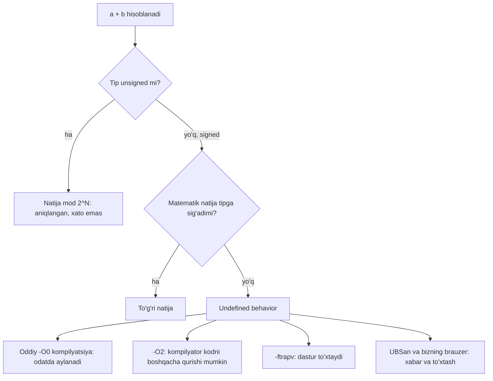

## Bu dars nima uchun kerak

6-darsda har bir C tipi cheklangan bitlardan iborat ekanini ko'rdik: `int` 32 bit, `float` 32 bit, `double` 64 bit. Cheklangan bitlar ikki xil muammoni keltirib chiqaradi.

1. **Integer overflow**: butun son natijasi tipga sig'maydi. Hisoblagich "aylanib" nolga qaytadi yoki musbat son birdan manfiy bo'lib qoladi.
2. **Floating-point imprecision**: kasr son aniq saqlanmaydi. `0.1 + 0.2` hech qachon aniq `0.3` ga teng bo'lmaydi, va bu xato hisob davomida yig'ilib boradi.

Ikkala muammo ham kompilyatsiya xatosi bermaydi. Dastur oddiy testlarda to'g'ri ishlaydi va faqat katta qiymatlarda, uzoq ishlaganda yoki noodatiy kirishda noto'g'ri natija beradi. 1-darsda Joshua Bloch tasvirlagan binary search bugini ko'rgan edik: `(low + high) / 2` yillar davomida sezilmagan, chunki u faqat milliardlab elementli massivlarda chiqadi. Bu dars shunday xatolarning mexanikasini ochadi va ulardan himoyalanishni o'rgatadi.

Bu darsdan keyin siz:

- unsigned overflow natijasini modul 2ᴺ arifmetikasi bilan oldindan hisoblay olasiz;
- signed overflow nima uchun undefined behavior ekanini va bu amalda nimani anglatishini (wrap, to'xtash, optimizatsiya) bilasiz;
- qo'shishdan oldin overflow bo'lishini tekshiradigan kod yoza olasiz;
- 0.1 nega ikkilikda aniq saqlanmasligini va saqlangan qiymat qancha farq qilishini hisoblay olasiz;
- kasr sonlarni `==` o'rniga nisbiy epsilon bilan solishtira olasiz va bu usulning chegaralarini bilasiz;
- ikkita tarixiy hodisa (Ariane 5 va Patriot) qaysi mexanizm tufayli sodir bo'lganini aniq ayta olasiz.

## Unsigned overflow: modul arifmetika

Avtomobil odometrini tasavvur qiling: oltita raqamli hisoblagich 999 999 dan keyin 000 000 ni ko'rsatadi. Yettinchi raqam uchun joy yo'q, va u shunchaki yo'qoladi. Unsigned butun sonlar aynan shunday ishlaydi, faqat ikkilikda.

C standarti unsigned arifmetika uchun aniq qoida beradi: natija **modul 2ᴺ** bo'yicha olinadi, bu yerda N - tipdagi bitlar soni. cppreference buni shunday misol bilan ko'rsatadi: `UINT_MAX` ga 1 qo'shilsa 0 chiqadi, 0 dan 1 ayrilsa `UINT_MAX` chiqadi. Bu xato emas va undefined ham emas: bu - aniqlangan xatti-harakat. Shuning uchun natijani doim oldindan hisoblash mumkin:

- 32-bitli `unsigned int`: 4 294 967 295 + 1 = 4 294 967 296 mod 2³² = 0;
- 0 - 1 = -1 mod 2³² = 2³² - 1 = 4 294 967 295;
- 8-bitli `unsigned char`: 250 + 10 = 260 mod 256 = 4.

Bitlar darajasida bu oddiy: 32 bitli registrda `11...1` (32 ta bir) ga 1 qo'shilsa, ko'chirish (carry) eng chapga qadar boradi va 33-bitga chiqadi, u esa saqlanmaydi. Qolgan 32 bit - nollar.

## Signed overflow: undefined behavior

Signed tiplarda vaziyat boshqacha va ancha xavfli. 6-darsdan eslaymiz: 32-bitli `int` ning oralig'i -2 147 483 648 ... 2 147 483 647. `INT_MAX + 1` ning matematik natijasi 2 147 483 648 bu oraliqqa sig'maydi.

Apparat darajasida nima bo'lishini hisoblash oson. `INT_MAX` bitlari `0111...1` (bitta nol va 31 ta bir), hex da `0x7FFFFFFF`. Unga 1 qo'shsak `1000...0` = `0x80000000` chiqadi. Two's complement da eng chap bitning og'irligi -2³¹, demak bu -2 147 483 648. Ya'ni protsessor "eng katta musbat son + 1 = eng kichik manfiy son" deb hisoblaydi.

Lekin C standarti protsessor nima qilishini emas, **dastur nima qilishi kerakligini** belgilaydi. Signed overflow uchun javob: **undefined behavior** (UB). Standart bunday dastur qanday ishlashi haqida hech qanday talab qo'ymaydi. cppreference uchta real oqibatni sanaydi:

- natija two's complement qoidasi bo'yicha "aylanishi" (wrap) mumkin, ko'pincha shunday bo'ladi;
- ba'zi platformalarda yoki kompilyator flaglari bilan (masalan, GCC va Clang dagi `-ftrapv`) dastur to'xtashi (trap) mumkin;
- kompilyator overflow hech qachon bo'lmaydi deb hisoblab, kodni butunlay olib tashlashi mumkin.

Uchinchi holat eng kutilmagani. Kompilyator "UB hech qachon sodir bo'lmaydi" degan farazga tayanib optimizatsiya qilishga haqli. Masalan, quyidagi funksiyani ko'ring:

```c
#include <limits.h>
#include <stdio.h>

int bigger(int x)
{
    return x + 1 > x;
}

int main(void)
{
    int m = INT_MAX;
    printf("bigger(INT_MAX) = %d\n", bigger(m));
}
```

```text
$ clang -O0 -o opt opt.c && ./opt
bigger(INT_MAX) = 0
$ clang -O2 -o opt opt.c && ./opt
bigger(INT_MAX) = 1
```

Bir xil kod, bir xil kompilyator (clang 18, x86-64), faqat optimizatsiya darajasi boshqa. `-O0` da qo'shish haqiqatan bajariladi, natija aylanib -2 147 483 648 bo'ladi va u `x` dan kichik, shuning uchun 0. `-O2` da kompilyator mulohaza qiladi: "signed overflow mumkin emas, demak `x + 1` doim `x` dan katta", va butun funksiyani "1 qaytar" ga almashtiradi (`clang -O2 -S` chiqargan assembly da `bigger` funksiyasi faqat `movl $1, %eax` va `retq` dan iborat). Ikkala natija ham standart bo'yicha "to'g'ri", chunki UB bo'lgan dasturda to'g'ri natija tushunchasi yo'q.

Saboq: "mening kompyuterimda signed overflow aylanadi, men bunga tayanaman" degan yondashuv ishlamaydi. Bugun ishlagan kod ertaga boshqa flag yoki kompilyatorning yangi versiyasi bilan boshqacha ishlashi mumkin.

### Kompilyator yordamchisi: UBSan

Clang va GCC da **UBSan** (UndefinedBehaviorSanitizer) bor: `-fsanitize=undefined` bilan kompilyatsiya qilinsa, kompilyator har bir xavfli amal yoniga tekshiruv qo'shadi va UB ish vaqtida sodir bo'lganda xabar beradi. Clang hujjatiga ko'ra `-fsanitize=signed-integer-overflow` tekshiruvi signed hisob natijasi tipga sig'magan holatlarni ushlaydi, `INT_MIN / -1` bo'lishini ham. Standart xabar shunga o'xshaydi: `test.cc:3:5: runtime error: signed integer overflow: 2147483647 + 1 cannot be represented in type 'int'`. Odatda dastur xabar berib ishlashda davom etadi; `-fno-sanitize-recover` flagi bilan esa birinchi xatoda to'xtaydi.

Muhim nozik joy: unsigned overflow uchun alohida `-fsanitize=unsigned-integer-overflow` tekshiruvi bor, lekin u `-fsanitize=undefined` guruhiga kirmaydi, chunki Clang hujjati ta'kidlaganidek, bu UB emas (garchi ko'pincha bexosdan bo'lsa ham).

Shu kursdagi brauzer muharriri C kodini aynan shunday kompilyatsiya qiladi: `-fsanitize=address,undefined` va `-fno-sanitize-recover=undefined` bilan. Demak brauzerda signed overflow dasturni darhol to'xtatadi, unsigned aylanish esa odatdagidek ishlaydi.

### Sinab ko'ring

Dastur avval unsigned chegaralarni sinaydi, keyin `INT_MAX` ga 1 qo'shadi.

```c run
#include <limits.h>
#include <stdio.h>

int main(void)
{
    unsigned int u = UINT_MAX;
    printf("UINT_MAX     = %u\n", u);
    u = u + 1;
    printf("UINT_MAX + 1 = %u\n", u);
    u = 0;
    u = u - 1;
    printf("0 - 1        = %u\n", u);

    unsigned char byte = 250;
    for (int i = 0; i < 8; i++)
    {
        printf("%d ", byte);
        byte++;
    }
    printf("\n");

    int x = INT_MAX;
    printf("INT_MAX      = %d\n", x);
    x = x + 1;
    printf("INT_MAX + 1  = %d\n", x);
}
```

Brauzerda natija shunday bo'ladi: birinchi besh qator chiqadi, keyin dastur 24-qatordagi `x = x + 1;` da to'xtaydi:

```text
UINT_MAX     = 4294967295
UINT_MAX + 1 = 0
0 - 1        = 4294967295
250 251 252 253 254 255 0 1 
INT_MAX      = 2147483647

UNDEFINED BEHAVIOR: signed integer overflow (+): natija tip sig'imidan chiqdi
```

Xabardan keyin muharrir `main.c` dagi qator raqamini va manba qatorining o'zini ko'rsatadi. Oxirgi `printf` hech qachon bajarilmaydi.

Oddiy kompyuterda sanitizer'siz (`clang -O0 -o wrap wrap.c && ./wrap`, x86-64) xuddi shu dastur xabarsiz tugaydi va oxirgi qatorda aylangan qiymatni chiqaradi:

```text
INT_MAX + 1  = -2147483648
```

Bu farq darsning asosiy g'oyasini ko'rsatadi: -2147483648 - bu "C ning javobi" emas, balki shu kompilyator va shu flaglar bilan tasodifan chiqqan natija. Brauzerdagi tekshiruv xatoni u sodir bo'lgan joyda ushlaydi, oddiy kompilyatsiya esa noto'g'ri qiymatni jimgina keyingi hisobga uzatadi. Tajriba qilib ko'ring: `x = x + 1;` ni `x = x - 1;` ga, `x` ning boshlang'ich qiymatini `INT_MIN` ga o'zgartiring. Yoki `x` ni `unsigned int` qilib, nima o'zgarishini kuzating.

### Overflow qachon va qanday sodir bo'ladi



## Overflowdan himoyalanish

### 1. Hisoblashdan oldin tekshirish

Overflow sodir bo'lgandan keyin uni aniqlash signed tiplarda kech: UB allaqachon yuz bergan. Shuning uchun tekshiruv **amaldan oldin**, overflow bo'lmaydigan ifoda bilan yoziladi. `a + b` uchun:

- agar b > 0 va a > INT_MAX - b bo'lsa, yig'indi INT_MAX dan oshadi;
- agar b < 0 va a < INT_MIN - b bo'lsa, yig'indi INT_MIN dan kichik bo'ladi.

Nega `INT_MAX - b` xavfsiz? Chunki b > 0 bo'lganda INT_MAX - b oraliqdan pastga chiqa olmaydi (u 0 ... INT_MAX - 1 orasida). Aksincha, `a + b > INT_MAX` deb yozish befoyda: `int` qiymat hech qachon INT_MAX dan katta bo'lmaydi, kompilyator bu shartni doim yolg'on deb olib tashlashga haqli.

### 2. Kengroq tipda hisoblash

Agar natija `int` ga sig'masligi mumkin bo'lsa, operandlardan birini kengroq tipga o'tkazib hisoblang: `(long long) a + b`. 64-bitli `long long` ikki 32-bitli son yig'indisini bemalol saqlaydi (eng ko'pi 2 × 2 147 483 647 ≈ 4.3·10⁹, chegara esa ≈ 9.2·10¹⁸). Bu yerda `long` ishlatmang: 6-darsda ko'rdik, brauzerdagi wasm32 da `long` ham 32 bit, va `(long) a + b` u yerda xuddi shunday overflow beradi.

```c run
#include <cs50.h>
#include <limits.h>
#include <stdio.h>

int main(void)
{
    int a = get_int("a: ");
    int b = get_int("b: ");

    if (b > 0 && a > INT_MAX - b)
    {
        printf("overflow bo'lardi: %d + %d > INT_MAX\n", a, b);
    }
    else if (b < 0 && a < INT_MIN - b)
    {
        printf("overflow bo'lardi: %d + %d < INT_MIN\n", a, b);
    }
    else
    {
        printf("%d + %d = %d\n", a, b, a + b);
    }

    long long wide = (long long) a + b;
    printf("long long da: %lld\n", wide);
}
```

```text stdin
2000000000
2000000000
```

Natija (brauzerda ham, 64-bit Linux da ham bir xil):

```text
a: b: overflow bo'lardi: 2000000000 + 2000000000 > INT_MAX
long long da: 4000000000
```

Kirishni `-2000000000` va `-2000000000` ga, keyin `5` va `7` ga o'zgartirib ko'ring. Tekshiruvni olib tashlab, to'g'ridan-to'g'ri `a + b` ni chiqarsangiz, brauzer dasturni UB xabari bilan to'xtatadi.

### 3. Chegarani oldindan hisoblash

Eng yaxshi himoya - tipni tanlashdan oldin eng yomon holatni hisoblash. Bir nechta odatiy hisob:

| Hisoblagich | Tip | Chegaraga yetish vaqti |
|---|---|---|
| Millisekundlar | `int` (2³¹ - 1) | 2 147 483 647 / 1000 / 86 400 ≈ 24.86 kun |
| Millisekundlar | `unsigned int` (2³² - 1) | 4 294 967 295 / 1000 / 86 400 ≈ 49.71 kun |
| 1970-01-01 dan beri soniyalar | 32-bitli signed | 2³¹ - 1 soniya: 2038-01-19 03:14:07 UTC |
| 1970-01-01 dan beri soniyalar | 64-bitli signed | 2⁶³ - 1 soniya ≈ 2.9·10¹¹ yil |

Uchinchi qator - 1970 yildan beri soniyalarni 32-bitli signed sonda saqlaydigan tizimlar uchun mashhur "2038 muammosi"ning hisobi. 64 bitda esa (2⁶³ - 1) / (365.25 × 86 400) ≈ 2.92·10¹¹ yil, ya'ni amalda cheksiz.

### Tarixiy hodisa: Ariane 5 (1996)

1996 yil 4 iyunda Yevropaning yangi Ariane 5 raketasi birinchi parvozida, uchishdan taxminan 40 soniya o'tib, kursdan chiqib yo'q qilindi. Professor Jacques-Louis Lions boshchiligidagi tergov komissiyasi 1996 yil 19 iyuldagi hisobotida texnik sababni shunday tasvirlaydi: inertial navigatsiya tizimining dasturida 64-bitli floating-point qiymatni 16-bitli signed butun songa o'tkazish bajarilgan, qiymat esa 16-bitli signed son ifodalay oladiganidan katta bo'lgan. Bu Operand Error ga olib keldi va tizim to'xtadi; zaxira tizim ham xuddi shu sababdan bir sikl oldin to'xtagan edi.

Hisobot yana uchta muhim tafsilotni qayd etadi: bu konversiya himoyalanmagan edi, garchi kodning shu joyidagi o'xshash boshqa o'zgaruvchilar himoyalangan bo'lsa ham; xato chiqqan funksiya Ariane 4 dan qolgan va Ariane 5 da hech qanday vazifa bajarmagan; Ariane 5 trayektoriyasining boshlang'ich qismi Ariane 4 nikidan farq qilgan va gorizontal tezlik qiymatlari ancha yuqori bo'lgan.

6-darsdagi formula bilan: 16-bitli signed sonning oralig'i -2¹⁵ ... 2¹⁵ - 1, ya'ni -32 768 ... 32 767. Ariane 4 ning trayektoriyasida qiymat bu oraliqda qolgan, Ariane 5 da esa undan chiqib ketgan. Bu - "kod eski tizimda ishlagan, demak to'g'ri" degan faraz qanchalik xavfli ekanining klassik misoli: chegara kodning o'zida emas, kirish ma'lumotlarida yashirin edi. C da shunday konversiya (sig'maydigan `double` ni `short` ga o'tkazish) UB. Clang hujjatiga ko'ra uni ushlaydigan `float-cast-overflow` tekshiruvi `-fsanitize=undefined` guruhiga kiradi, shuning uchun brauzerdagi muharrir uni "float'dan butun songa o'tkazishda sig'imdan chiqish" xabari bilan to'xtatadi.

## Floating-point imprecision: 0.1 nega aniq emas

Endi kasr sonlarga o'tamiz. Bu yerda muammo boshqacha: qiymat sig'adi, lekin **aniq** emas.

### Cheksiz ikkilik kasr

O'nlik tizimda 1/3 = 0.333... cheksiz takrorlanadi, chunki 3 o'nlikning asosi 10 ning bo'luvchisi emas. Ikkilik tizimda shu muammo 1/10 bilan sodir bo'ladi: 10 = 2 × 5, va 5 omili ikkining darajalari bilan yo'qotilmaydi. Natijada:

0.1₁₀ = 0.000110011001100110011...₂ (`0011` guruhi cheksiz takrorlanadi).

`double` da 53 bit aniqlik bor, shuning uchun bu cheksiz kasr 53 ta ma'noli bitda yaxlitlanadi. Python hujjati aniq qiymatni keltiradi: `double` dagi 0.1 aslida 3602879701896397 / 2⁵⁵ kasriga teng, o'nlik ko'rinishda:

0.1000000000000000055511151231257827021181583404541015625

Ya'ni saqlangan qiymat 0.1 dan taxminan 5.55·10⁻¹⁸ ga katta. `float` da 24 bit aniqlik bor, xato kattaroq: saqlangan qiymat 0.100000001490116119384765625 (bitlar `0x3DCCCCCD`).

Nisbiy xato chegarasi. Goldberg maqolasi buni **machine epsilon** orqali ifodalaydi: eng yaqin qiymatga yaxlitlashda nisbiy xato ko'pi bilan ε = (β/2)·β⁻ᵖ, bu yerda β - asos, p - aniqlik. Ikkilik `double` uchun β = 2, p = 53: ε = 2⁻⁵³ ≈ 1.11·10⁻¹⁶. Bu `DBL_EPSILON` (2⁻⁵² ≈ 2.22·10⁻¹⁶) ning yarmi, chunki `DBL_EPSILON` - 1.0 dan keyingi qo'shni songacha bo'lgan to'liq masofa, yaxlitlash xatosi esa bu masofaning ko'pi bilan yarmi. 0.1 uchun tekshiramiz: 5.55·10⁻¹⁸ / 0.1 = 5.55·10⁻¹⁷ < 1.11·10⁻¹⁶. Formula ishlaydi.

Xatoni "oxirgi o'rindagi birliklar"da ham o'lchash mumkin: **ulp** (units in the last place). Eng yaqin qiymatga yaxlitlash har doim ko'pi bilan 0.5 ulp xato beradi. Har bir amal yangi yaxlitlash qo'shadi, shuning uchun uzun hisoblarda xato yig'iladi.

### Sinab ko'ring

```c run
#include <float.h>
#include <math.h>
#include <stdio.h>

int main(void)
{
    double a = 0.1 + 0.2;
    printf("0.1 + 0.2        = %.20f\n", a);
    printf("0.3              = %.20f\n", 0.3);
    printf("0.1 + 0.2 == 0.3 ? %s\n", a == 0.3 ? "ha" : "yo'q");

    float f = 0.1f;
    printf("float  0.1       = %.20f\n", f);
    printf("double 0.1       = %.20f\n", 0.1);

    double sum = 0.0;
    for (int i = 0; i < 10; i++)
    {
        sum += 0.1;
    }
    printf("10 marta 0.1     = %.17f\n", sum);

    float big = 16777216.0f;
    printf("16777216f + 1    = %.1f\n", big + 1.0f);

    double diff = fabs(a - 0.3);
    printf("farq             = %e\n", diff);
    printf("epsilon bilan    : %s\n", diff <= 4 * DBL_EPSILON * 0.3 ? "teng" : "teng emas");
}
```

Natija (brauzerda ham, 64-bit Linux da ham bir xil, chunki ikkalasi IEEE 754 binary32 va binary64 dan foydalanadi):

```text
0.1 + 0.2        = 0.30000000000000004441
0.3              = 0.29999999999999998890
0.1 + 0.2 == 0.3 ? yo'q
float  0.1       = 0.10000000149011611938
double 0.1       = 0.10000000000000000555
10 marta 0.1     = 0.99999999999999989
16777216f + 1    = 16777216.0
farq             = 5.551115e-17
epsilon bilan    : teng
```

Har bir qatorni tahlil qilamiz:

1. **`0.1 + 0.2`**. Ikkala qo'shiluvchi ham yaxlitlangan, yig'indi yana yaxlitlanadi. Natija 0.3 ga eng yaqin `double` emas, undan keyingi qo'shni son bo'lib chiqadi. `%.20f` yashirin raqamlarni ko'rsatadi; oddiy `%f` (6 raqam) ikkalasini ham `0.300000` deb chiqarib, farqni yashirardi.
2. **`== 0.3`** yolg'on, chunki ikki xil bit qatori solishtirilmoqda. Farq 5.55·10⁻¹⁷, ya'ni 0.3 atrofidagi bitta ulp (0.25 ... 0.5 oralig'ida qo'shni `double` lar orasidagi masofa 2⁻² × 2⁻⁵² = 2⁻⁵⁴ ≈ 5.55·10⁻¹⁷).
3. **`float` va `double` dagi 0.1** farqi: birinchisi 8-raqamda, ikkinchisi 18-raqamda buziladi. Bu 6-darsdagi ~7 va ~16 raqam aniqlikka mos.
4. **O'n marta 0.1 qo'shish** 1.0 bermaydi: o'nta yaxlitlash xatosi yig'ildi. Pul yoki vaqtni shu tarzda yig'ish aynan shu sabab bilan xavfli.
5. **`16777216f + 1`** o'zgarmaydi: 6-darsda hisoblaganimizdek, 2²⁴ dan keyin qo'shni `float` lar orasidagi masofa 2, va 16 777 217 yaqinroq juft qiymatga yaxlitlanadi. Katta songa kichik sonni qo'shish natijasi "yutilishi" mumkin.
6. **Epsilon bilan solishtirish** "teng" dedi. Qanday tolerance tanlash kerakligi pastda.

JavaScript da ham xuddi shunday: `node` da `0.1 + 0.2` ifodasi `0.30000000000000004` beradi va `0.1 + 0.2 === 0.3` - `false`. Bu JavaScript ning xatosi emas, IEEE 754 binary64 ning xususiyati, va C, Python, Java ham shunday ishlaydi.

### Tarixiy hodisa: Patriot (1991)

AQSh Hukumat Hisobot Idorasi (GAO) 1992 yil fevraldagi IMTEC-92-26 hisobotida Saudiya Arabistonining Dhahran shahrida 1991 yil 25 fevralda Patriot raketaga qarshi tizimi Scud raketasini ushlay olmaganini tahlil qiladi. Raketa armiya kazarmasiga tushib, 28 amerikalik askar halok bo'lgan.

Hisobotga ko'ra tizim vaqtni soniyaning o'ndan bir ulushlarida butun son sifatida sanagan va uni kasr songa aylantirgan, tizim registrlari esa 24 bitli bo'lgani uchun bu aylantirish 24 bitdan aniqroq bo'la olmagan. Hisobotga ko'ra bu aniqlik yo'qolishining ta'siri tizim qancha uzoq ishlagan bo'lsa, shuncha katta: GAO jadvaliga ko'ra 100 soat uzluksiz ishlagandan keyin vaqt xatosi 0.3433 soniyaga (taxminan 0.34) yetgan va raketani kuzatish oynasi (range gate) 687 metrga siljigan. Dhahran batareyasi o'sha paytda 100 soatdan ortiq uzluksiz ishlab turgan edi. Tuzatilgan dastur Dhahran ga hujumdan bir kun keyin, 26 fevralda yetib kelgan.

GAO hisoboti bitta tikdagi xatoni va uning ikkilik sababini ko'rsatmaydi. Quyidagi hisob - GAO jadvalidagi raqamlardan **bizning hisobimiz**. 100 soat = 360 000 soniya = 3 600 000 ta o'ndan bir soniyalik tik. Jadvaldagi xatoni tiklar soniga bo'lsak: 0.3433 / 3 600 000 ≈ 9.54·10⁻⁸ soniya har tikda.

Bu raqam darsdagi mexanizm bilan mos keladi. Tiklar sonini soniyaga aylantirish 1/10 ga ko'paytirishni talab qiladi, 1/10 esa ikkilikda cheksiz kasr. Agar 1/10 verguldan keyin 23 bitda qirqilsa: 0.1 × 2²³ = 838 860.8, tashlab yuborilgan qism 0.8 × 2⁻²³ ≈ 9.54·10⁻⁸, va 3 600 000 tikdan keyin 9.54·10⁻⁸ × 3 600 000 ≈ 0.3433 soniya, ya'ni GAO jadvalidagi qiymatning aynan o'zi. Bu tushuntirish GAO matnida yo'q; u Arnold sahifasidagi keng tarqalgan tahlilga mos (u yerda ham har tikdagi xato ≈ 9.5·10⁻⁸ deb keltiriladi). Bitta tikda arzimas, lekin 3.6 million marta takrorlansa, tez uchayotgan nishonni kuzatish uchun hal qiluvchi.

## Kasr sonlarni to'g'ri solishtirish va hisoblash

### `==` o'rniga tolerance

Kasr sonlarni hisob natijasida `==` bilan solishtirish deyarli har doim xato. Uchta usul bor:

| Usul | Shart | Afzalligi | Kamchiligi |
|---|---|---|---|
| Aniq tenglik | `a == b` | Oddiy | Har qanday yaxlitlash xatosi "teng emas" beradi |
| Absolyut tolerance | `fabs(a - b) <= 1e-9` | Nol atrofida ishlaydi | Katta sonlarda juda qattiq (10¹² atrofida qo'shni `double` lar orasidagi masofa ≈ 1.2·10⁻⁴), juda kichik sonlarda juda yumshoq |
| Nisbiy tolerance | `fabs(a - b) <= k * DBL_EPSILON * fmax(fabs(a), fabs(b))` | Har qanday kattalikda bir xil "raqamlar soni"ni talab qiladi | Ikkala son ham nolga yaqin bo'lsa ishlamaydi: o'ng tomon ham nolga intiladi |

Amalda ko'pincha ikkalasi birlashtiriladi: avval absolyut tolerance (nol atrofi uchun), keyin nisbiy. k koeffitsiyenti nechta amal bajarilganiga bog'liq: har bir amal ko'pi bilan 0.5 ulp qo'shadi, shuning uchun 10 ta amaldan keyin bir necha ulp farq normal. Yuqoridagi dasturda k = 4 tanlangan; 0.1 + 0.2 da farq 1 ulp, ya'ni chegaradan ancha past.

Bitta universal "to'g'ri epsilon" yo'q. Tolerance ma'lumotning ma'nosidan kelib chiqib tanlanadi: GPS koordinatalari uchun 10⁻⁷ gradus (taxminan 1 sm), haroratga 0.01 daraja va hokazo.

### Catastrophic cancellation

Yana bir xavfli holat: ikki yaqin sonni ayirish. Goldberg buni **catastrophic cancellation** deb ataydi. Ayirishning o'zi aniq bajariladi, lekin operandlardagi oldingi yaxlitlash xatolari natijaning asosiy qismiga aylanadi. Goldberg ning misolida (o'nlik, 3 raqamli aniqlik) b² - 4ac ning aniq qiymati 0.0292, hisoblangani esa 0.1 chiqadi: 11.2 - 11.1 ayirmasi o'zi aniq, lekin 11.2 va 11.1 avvalgi ko'paytirishlarda yaxlitlangan edi. Natija 70 ulp ga xato.

Amaliy qoida: katta va yaqin sonlarni ayirib, kichik natijaga tayanadigan formuladan qoching. Masalan, ikki GPS nuqtasi orasidagi kichik masofani `float` dagi katta absolyut koordinatalar ayirmasidan emas, `double` dan yoki nisbiy koordinatalardan hisoblang.

### Pul uchun butun son

Pul hisobida xato umuman qabul qilinmaydi: 0.1 + 0.2 ning 0.30000000000000004 bo'lishi buxgalteriyada tushunarsiz farqqa aylanadi. Yechim oddiy: summani eng kichik birlikda butun son sifatida saqlash. 125 so'm 50 tiyin - `long long` dagi 12 550 tiyin. Qo'shish va ayirish butunlay aniq; foiz hisoblashda esa yaxlitlash qoidasi biznes talabi sifatida aniq yoziladi va bir joyda qo'llanadi. `long long` ning chegarasi ≈ 9.2·10¹⁸ tiyin, ya'ni ≈ 9.2·10¹⁶ so'm, har qanday real summa uchun yetarli.

## Ko'p uchraydigan xatolar

1. **Signed overflow aylanadi deb hisoblash.** Bu UB; `-O0` da aylansa ham `-O2` da kod butunlay boshqacha bo'lishi mumkin. Overflow mumkin bo'lsa - oldindan tekshiring yoki kengroq tip ishlating.
2. **Overflowni amaldan keyin tekshirish.** `if (a + b > INT_MAX)` hech qachon rost bo'lmaydi va `if (a + b < a)` signed tiplarda UB ga tayanadi. Shart amaldan oldin, `a > INT_MAX - b` shaklida yozilsin.
3. **Kengroq tip deb `long` ni tanlash.** wasm32 va Windows 64 da `long` 32 bit. 64 bit kerak bo'lsa, `long long`. Va o'tkazishni yig'indidan oldin qiling: `(long long) (a + b)` allaqachon overflow bo'lgan natijani o'tkazadi.
4. **Unsigned bilan "manfiy bo'lmaydi" deb xotirjam bo'lish.** `unsigned` da 0 - 1 = 4 294 967 295. `for (unsigned i = n - 1; i >= 0; i--)` sikli hech qachon tugamaydi, chunki `i >= 0` doim rost.
5. **Kasr sonlarni `==` bilan solishtirish.** 0.1 + 0.2 != 0.3. Nisbiy va absolyut tolerance dan foydalaning.
6. **`%f` ning 6 raqamiga ishonish.** `printf("%f")` xatoni yashiradi. Tekshirishda `%.17g` yoki `%.20f` ishlating.
7. **Pulni `float` yoki `double` da saqlash.** Butun son tiyinlarda saqlang.
8. **Katta `double` ni tekshirmasdan butun songa o'tkazish.** Qiymat oraliqdan chiqsa UB; Ariane 5 dagi xato aynan shu turdagi konversiya edi. O'tkazishdan oldin chegarani solishtiring.

## Xulosa

- Unsigned arifmetika modul 2ᴺ bo'yicha bajariladi: UINT_MAX + 1 = 0, 0 - 1 = UINT_MAX. Bu aniqlangan xatti-harakat.
- Signed overflow - undefined behavior. Apparat odatda aylantiradi, lekin kompilyator overflow yo'q deb optimizatsiya qilishga haqli (`x + 1 > x` `-O2` da doim 1).
- UBSan (`-fsanitize=undefined`) signed overflow ni ish vaqtida ushlaydi; brauzerdagi muharrir uni ishlatadi va dasturni xato qatorida to'xtatadi.
- Himoya: amaldan oldin `a > INT_MAX - b` kabi tekshiruv, kengroq tip (`long long`, `long` emas), va chegarani oldindan hisoblash.
- 0.1 ikkilikda cheksiz kasr, shuning uchun yaxlitlanadi; `double` da nisbiy xato ko'pi bilan 2⁻⁵³ ≈ 1.11·10⁻¹⁶, va xatolar har amalda yig'iladi.
- Kasr sonlar `==` bilan emas, ma'noga mos absolyut va nisbiy tolerance bilan solishtiriladi; yaqin sonlarni ayirish xatoni kuchaytiradi.
- Ariane 5 (64-bitli kasrdan 16-bitli butun songa o'tkazish) va Patriot (1/10 ning 24 bitli registrdagi qirqilgan ko'rinishidagi xatoning 100 soat davomida yig'ilishi) - aynan shu ikki mexanizmning real oqibatlari.

## Amaliy topshiriq

Xavfsiz hisoblash kutubxonasining kichik qismini yozing: overflowni oldindan aniqlaydigan butun son amallari va kasr sonlarni solishtiradigan funksiya.

Topshiriq qadamlari:

1. **Xavfsiz qo'shish.** `bool safe_add(int a, int b, int *result)` funksiyasini yozing: overflow bo'lmasa natijani `*result` ga yozib `true`, aks holda `false` qaytarsin. Funksiya ichida signed overflow hech qachon sodir bo'lmasin (brauzerda tekshiring: UB xabari chiqmasligi kerak).
2. **Xavfsiz ko'paytirish.** `safe_mul` ni xuddi shunday yozing. Ikki yo'lni solishtiring: `long long` da ko'paytirib chegarani tekshirish va bo'lish orqali tekshirish (`a > INT_MAX / b`, ishoralarni alohida ko'rib). Qaysi biri qaysi holatda ishlamaydi?
3. **Chegaraviy holatlar.** Kamida quyidagilarni sinang va natijalar jadvalini bering: INT_MAX + 1, INT_MIN + (-1), INT_MAX + INT_MIN, 46341 × 46341, -1 × INT_MIN, 0 × INT_MIN.
4. **Kasr solishtirish.** `bool nearly_equal(double a, double b, double abs_tol, double rel_tol)` funksiyasini yozing. Uni (0.1 + 0.2, 0.3), (1e-20, 0.0), (1e15 + 0.1, 1e15) juftlarida sinang va abs_tol va rel_tol qiymatlarini tanlovingizni izohlang.
5. **Hisob.** `unsigned int` millisekund hisoblagichi necha kunda aylanadi? Signed 32-bitli soniya hisoblagichi 1970-01-01 dan boshlansa qachon to'ladi? Formulalarni ko'rsating.

Boshlash uchun shablon:

```c run
#include <cs50.h>
#include <limits.h>
#include <stdio.h>

bool safe_add(int a, int b, int *result)
{
    // Yechimingizni shu yerga yozing: overflow bo'lsa false qaytaring
    *result = 0;
    return false;
}

int main(void)
{
    int a = get_int("a: ");
    int b = get_int("b: ");
    int r;
    if (safe_add(a, b, &r))
    {
        printf("%d + %d = %d\n", a, b, r);
    }
    else
    {
        printf("%d + %d: overflow\n", a, b);
    }
}
```

```text stdin
2147483000
1000
```

Eslatma: `get_int` 2147483647 ning o'zini qabul qilmaydi va qayta so'raydi, chunki bu qiymat funksiyada "kirish tugadi yoki xato" belgisi sifatida band. Shuning uchun INT_MAX bilan bog'liq holatlarni `main` ichida to'g'ridan-to'g'ri `safe_add(INT_MAX, 1, &r)` chaqiruvi bilan sinang.

Yaxshi javobda bo'lishi kerak bo'lgan narsalar:

- `safe_add` tekshiruvi amaldan oldin, overflow siz ifoda bilan yozilgan (`b > 0 && a > INT_MAX - b` va `b < 0 && a < INT_MIN - b`);
- `safe_mul` da 46341 × 46341 = 2 147 488 281 > INT_MAX ekanligi va -1 × INT_MIN ham overflow ekanligi (chunki -INT_MIN = 2³¹ sig'maydi) aniqlangan;
- `long long` ga o'tkazish ko'paytirishdan oldin bajarilgan va nega `long` yetarli emasligi (wasm32 va LLP64) aytilgan;
- `nearly_equal` nol atrofi uchun absolyut, katta sonlar uchun nisbiy tolerance ishlatadi va 1e15 atrofida qo'shni `double` lar orasidagi masofa 0.125 ekanligi (2⁴⁹ ... 2⁵⁰ oralig'ida 2⁴⁹ × 2⁻⁵² = 2⁻³) hisobga olingan;
- 49.71 kun va 2038-01-19 03:14:07 UTC hisoblari formula bilan berilgan.

Javobingizni pastdagi maydonga yozing va yuqoridagi mezonlar bilan solishtiring.

## Manbalar

- CS50x. [Lecture 1 notes](https://cs50.harvard.edu/x/notes/1/) - "Operators" bo'limi: integer overflow, bitlar soni oraliqni cheklashi, floating-point imprecision va `printf` da `%.50f` bilan ko'p raqam chiqarish.
- cppreference. [Arithmetic operators](https://en.cppreference.com/w/c/language/operator_arithmetic) - "Overflows" bo'limi: unsigned arifmetika modul 2ᴺ, signed overflow undefined behavior (wrap, `-ftrapv`, optimizatsiya); "Division" bo'limi: kasr sonni nolga bo'lish.
- Clang. [UndefinedBehaviorSanitizer](https://clang.llvm.org/docs/UndefinedBehaviorSanitizer.html) - "Available checks" (`signed-integer-overflow`, `unsigned-integer-overflow` UB emasligi, `float-cast-overflow`), "Usage" (xabar formati), `-fno-sanitize-recover`.
- David Goldberg. [What Every Computer Scientist Should Know About Floating-Point Arithmetic](https://docs.oracle.com/cd/E19957-01/806-3568/ncg_goldberg.html), ACM Computing Surveys, 1991 - "Relative Error and Ulps" (machine epsilon, ulp), "Cancellation" (catastrophic va benign cancellation, b² - 4ac misoli).
- Python documentation. [Floating-Point Arithmetic: Issues and Limitations](https://docs.python.org/3/tutorial/floatingpoint.html) - "Representation Error": 0.1 = 3602879701896397 / 2⁵⁵ va uning to'liq o'nlik qiymati.
- Ariane 501 Inquiry Board, J. L. Lions (rais). [ARIANE 5 Flight 501 Failure](https://www-users.cse.umn.edu/~arnold/disasters/ariane5rep.html), Parij, 1996 yil 19 iyul - "Failure analysis": 64-bitli floating point dan 16-bitli signed integer ga himoyalanmagan konversiya va Operand Error.
- U.S. GAO. [Patriot Missile Defense: Software Problem Led to System Failure at Dhahran, Saudi Arabia](https://www.gao.gov/products/imtec-92-26), IMTEC-92-26, 1992 yil 4 fevral - 24 bitli registrlar, 100 soatdan keyingi vaqt xatosi (0.3433 s) va range gate siljishi (687 m) jadvali, 28 halok bo'lgan, tuzatilgan dastur 26 fevralda yetib kelgani.
- Douglas N. Arnold. [The Patriot Missile Failure](https://www-users.cse.umn.edu/~arnold/disasters/patriot.html) - GAO hisobotining tahlili: vaqt 1/10 ga ko'paytirilgani, 1/10 ning ikkilik yoyilmasi qirqilgani va har tikdagi ≈ 9.5·10⁻⁸ s xato.
