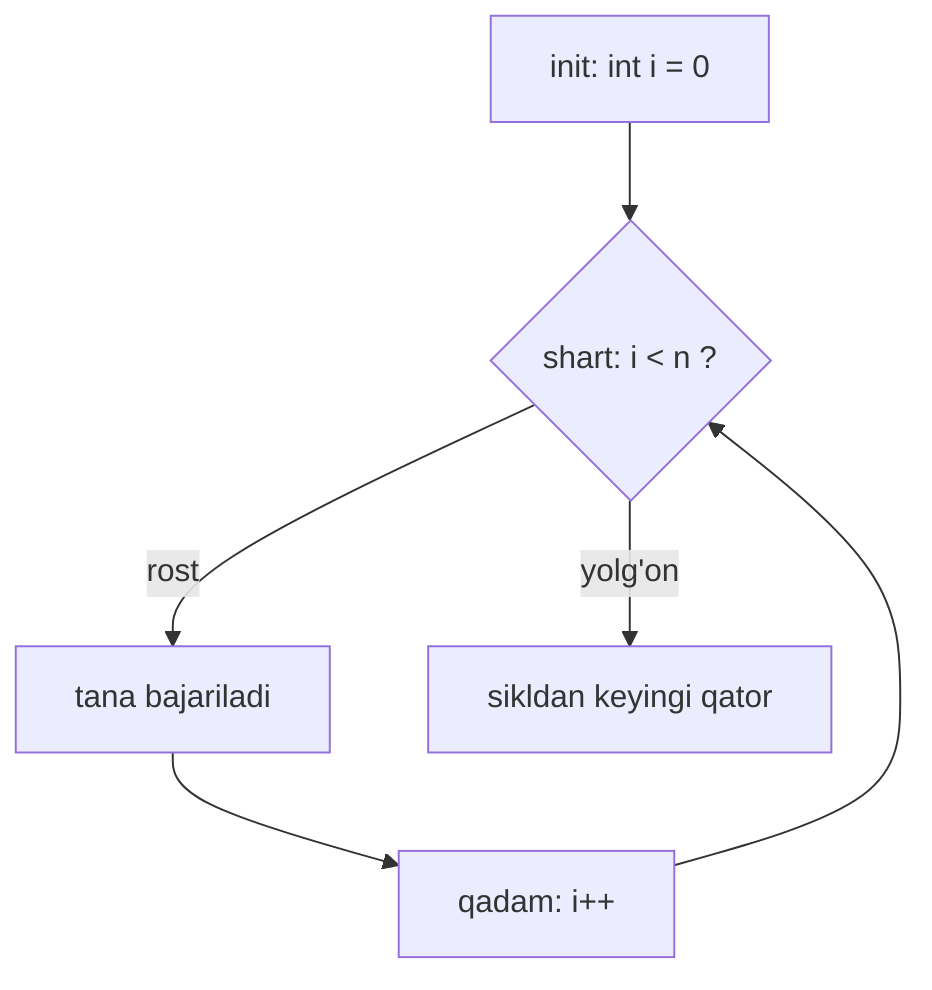

## Bu dars nima uchun kerak

4-darsda dasturlashning qurilish bloklarini (funksiya, shart, sikl, o'zgaruvchi) pseudocode darajasida ko'rdik. 5-7-darslarda C ning o'zi bilan tanishdik: `main`, `printf`, tiplar va ularning chegaralari. Endi shu bloklarni C da aniq yozish vaqti keldi. Bu darsdan keyin har qanday kichik C dasturini mustaqil o'qiy va yoza olasiz, chunki deyarli hamma C dasturi shu to'rt narsadan quriladi: qaror qabul qilish, takrorlash, kodni nomlangan bo'laklarga ajratish va har bir nomning qayerda ko'rinishini boshqarish.

Bu mavzular oddiy ko'rinadi, lekin aynan shu yerda eng ko'p "jim" xatolar tug'iladi: `=` o'rniga `==`, `switch` da unutilgan `break`, bitta ortiqcha yoki kam aylanish (off-by-one), noto'g'ri o'zgaruvchini yashirib qo'ygan ichki e'lon. Kompilyator ularning bir qismini ogohlantirish bilan ushlaydi, qolganini esa faqat qoidani bilgan odam ko'radi.

Bu darsdan keyin siz:

- C da mantiqiy ifoda qanday qiymat berishini (`int`, 0 yoki 1) va `&&`, `||` ning short-circuit qoidasini bilasiz;
- `if / else if / else` va `switch` ni farqlay olasiz, `switch` dagi fall-through ni ataylab yoki xatosiz ishlata olasiz;
- `while`, `for`, `do-while` dan mosini tanlay olasiz va aylanishlar sonini formula bilan hisoblay olasiz;
- `get_int` bilan foydalanuvchi kiritgan qiymatni tekshiradigan sikl yoza olasiz;
- funksiya e'lon qilish (prototype), `return`, `void` va parametrlar nusxa sifatida uzatilishini tushunasiz;
- block scope, file scope (global) va shadowing qoidalarini kod misolida tushuntira olasiz;
- shularning hammasini bitta dasturda, piramida chizadigan misolda birlashtira olasiz.

## Mantiqiy ifodalar: C da "rost" nima

Shart har doim **mantiqiy ifoda** (boolean expression) ustiga quriladi: natijasi "rost" yoki "yolg'on" bo'lgan ifoda. C da buning o'ziga xos tomoni bor: taqqoslash va mantiqiy operatorlar `int` tipidagi qiymat qaytaradi, rost uchun 1, yolg'on uchun 0. Shart tekshirilganda esa har qanday nol bo'lmagan qiymat rost hisoblanadi, nol esa yolg'on.

| Operator | Ma'nosi | Misol (x = 7) | Natija |
|---|---|---|---|
| `==` | teng | `x == 7` | 1 |
| `!=` | teng emas | `x != 7` | 0 |
| `<`, `<=`, `>`, `>=` | kichik, katta | `x >= 10` | 0 |
| `&&` | va (AND) | `x > 0 && x < 10` | 1 |
| `\|\|` | yoki (OR) | `x < 0 \|\| x > 5` | 1 |
| `!` | inkor (NOT) | `!(x == 7)` | 0 |

`bool` tipi va `true`, `false` nomlari `<stdbool.h>` sarlavhasidan keladi. `cs50.h` uni o'zi qo'shadi, shuning uchun CS50 dasturlarida `bool` ni alohida include qilmasdan ishlatish mumkin.

### Short-circuit: ikkinchi operand har doim ham hisoblanmaydi

`&&` va `||` operandlarini chapdan o'ngga hisoblaydi va natija ma'lum bo'lishi bilan to'xtaydi. Bu **short-circuit evaluation** deyiladi:

- `A && B`: A yolg'on (0) bo'lsa, B umuman hisoblanmaydi, natija 0.
- `A || B`: A rost (nol emas) bo'lsa, B umuman hisoblanmaydi, natija 1.

Bu shunchaki tezlik optimizatsiyasi emas, til kafolati. Shu sabab `i < n && a[i] > 0` kabi ifoda xavfsiz: `i` chegaradan chiqqanda `a[i]` o'qilmaydi. Operandlar tartibi almashtirilsa (`a[i] > 0 && i < n`), massiv tashqarisidan o'qish xavfi paydo bo'ladi (massivlar 11-darsda).

Quyidagi dastur buni ko'rsatadi: `is_positive` funksiyasi har chaqirilganda xabar chiqaradi va hisoblagichni oshiradi.

```c run
#include <stdbool.h>
#include <stdio.h>

int calls = 0;

bool is_positive(int x)
{
    calls++;
    printf("  is_positive(%d) chaqirildi\n", x);
    return x > 0;
}

int main(void)
{
    int a = -5;

    printf("1) a > 0 && is_positive(a):\n");
    if (a > 0 && is_positive(a))
    {
        printf("  ikkalasi rost\n");
    }

    printf("2) a < 0 || is_positive(a):\n");
    if (a < 0 || is_positive(a))
    {
        printf("  kamida bittasi rost\n");
    }

    printf("3) is_positive(a) || a < 0:\n");
    if (is_positive(a) || a < 0)
    {
        printf("  kamida bittasi rost\n");
    }

    printf("chaqiruvlar soni: %d\n", calls);
    printf("(3 > 2) qiymati: %d, !(3 > 2) qiymati: %d\n", 3 > 2, !(3 > 2));
}
```

Natija:

```text
1) a > 0 && is_positive(a):
2) a < 0 || is_positive(a):
  kamida bittasi rost
3) is_positive(a) || a < 0:
  is_positive(-5) chaqirildi
  kamida bittasi rost
chaqiruvlar soni: 1
(3 > 2) qiymati: 1, !(3 > 2) qiymati: 0
```

Uchta ifodadan faqat uchinchisida funksiya chaqirildi. 1-holatda `a > 0` yolg'on, `&&` to'xtadi. 2-holatda `a < 0` rost, `||` to'xtadi. 3-holatda operandlar tartibi teskari, shuning uchun funksiya baribir ishladi. Oxirgi qator taqqoslash natijasi haqiqatan oddiy `int` ekanini ko'rsatadi: `%d` bilan 1 va 0 chiqdi.

JavaScript bilan farq: JS da `3 > 2` ning tipi `boolean`, `&&` va `||` esa `boolean` emas, operandlardan birini qaytaradi: `0 || "x"` natijasi `"x"`, `5 && "y"` natijasi `"y"`. C da `&&` va `||` natijasi har doim 0 yoki 1, operand qiymati emas. Short-circuit qoidasi ikkala tilda bir xil.

## Shartlar: if, else if, else va switch

### if / else if / else zanjiri

`if` qavs ichidagi ifodani hisoblaydi va u nol bo'lmasa, keyingi blokni bajaradi. `else if` zanjirida shartlar yuqoridan pastga tekshiriladi va **birinchi** rost shartning bloki bajariladi, qolganlari o'tkazib yuboriladi. Oxirgi `else` hech bir shart rost bo'lmagan holat uchun.

```c
if (score >= 90)
{
    printf("a'lo\n");
}
else if (score >= 70)
{
    printf("yaxshi\n");
}
else
{
    printf("qoniqarsiz\n");
}
```

Bu yerda tartib muhim. `score >= 70` sharti 95 uchun ham rost, lekin u yerga navbat yetmaydi, chunki `score >= 90` avval tekshiriladi va zanjir to'xtaydi. Shartlarni teskari tartibda yozsangiz, 95 ball "yaxshi" bo'lib qoladi. Shuning uchun oraliqlarni tekshirganda eng tor shartdan boshlang yoki har bir shartga ikkala chegarani yozing.

Zanjir va alohida `if` lar bir xil narsa emas. Uchta alohida `if` yozilsa, uchala shart ham tekshiriladi va bir nechta blok bajarilishi mumkin. `else if` esa "faqat bittasi" degan ma'noni beradi. Shart nechta tekshirilishini hisoblasak: n ta tarmoqli zanjirda eng ko'pi bilan n - 1 ta shart hisoblanadi (oxirgi `else` shart tekshirmaydi), n ta alohida `if` da esa har doim n ta.

Figurali qavslar haqida: blokda bitta qator bo'lsa, C qavssiz yozishga ruxsat beradi. Lekin keyin ikkinchi qator qo'shilsa, u shartga kirmaydi, garchi chekinish (indentation) boshqacha ko'rsatsa ham. C chekinishga qaramaydi. CS50 uslubida qavslar har doim yoziladi, biz ham shunday qilamiz.

### switch: bitta qiymatni ko'p konstantaga solishtirish

`switch` bitta butun sonli ifodani bir nechta konstanta bilan solishtirish uchun. Qoidalari `if` dan qat'iyroq:

- boshqaruvchi ifoda butun son tipida bo'lishi kerak (`int`, `char`, `long`, `enum`); `double` yoki satr (string) bo'lmaydi;
- har bir `case` belgisi o'zgarmas butun son ifodasi (`case 'y':`, `case 3:`) va qiymatlar takrorlanmasligi kerak;
- `default:` ko'pi bilan bitta; mos `case` topilmasa, boshqaruv shu yerga o'tadi; `default` ham bo'lmasa, `switch` tanasining hech bir qismi bajarilmaydi.

Eng muhim qoida: `case` - bu faqat **kirish nuqtasi** (label), blok emas. Boshqaruv mos `case` ga sakraydi va `break` uchramaguncha pastga qarab bajarilaveradi, keyingi `case` belgilaridan ham o'tib ketadi. Buni **fall-through** deyiladi.

```c run
#include <cs50.h>
#include <stdio.h>

int main(void)
{
    char c = get_char("Buyruq (y/o/q): ");
    switch (c)
    {
        case 'y':
        case 'Y':
            printf("yuklash\n");
            break;
        case 'o':
            printf("o'chirish\n");
            // break yo'q: keyingi case ham bajariladi
        case 'q':
            printf("chiqish\n");
            break;
        default:
            printf("noma'lum buyruq: %c\n", c);
    }
}
```

```text stdin
o
```

`o` kiritilganda natija:

```text
Buyruq (y/o/q): o'chirish
chiqish
```

Kirish maydoniga `o` o'rniga `Y`, `q` va `x` yozib ko'ring. `case 'y':` va `case 'Y':` ketma-ket turgani - fall-through ning foydali ishlatilishi: ikkala harf bitta kodga boradi. `case 'o':` dan keyin esa `break` unutilgan va "o'chirish" buyrug'i "chiqish" ni ham bajarib yubordi. Ataylab qilingan fall-through ni har doim izoh bilan belgilang, aks holda keyingi o'quvchi uni xato deb "tuzatadi" yoki aksincha.

| Mezon | `if / else if` | `switch` |
|---|---|---|
| Shart turi | ixtiyoriy mantiqiy ifoda: oraliq, `&&`, funksiya chaqiruvi | bitta butun son ifodasi, konstantaga tenglik |
| `double`, satr | mumkin | mumkin emas |
| Bir nechta tarmoq bajarilishi | yo'q, birinchi rost tarmoq | `break` siz - ha (fall-through) |
| Bir nechta qiymat bitta kodga | `x == 1 \|\| x == 2` | ketma-ket `case 1:` `case 2:` |
| Qachon o'qishga qulay | oraliqlar va murakkab shartlar | menyu, holat kodi, harf bo'yicha tanlov |

## Sikllar: while, for, do-while

Sikl tanasini shart rost bo'lguncha takrorlaydi. C da uchta shakl bor va ular kuchi bo'yicha teng: har birini qolgan ikkitasi bilan yozish mumkin. Farq - qaysi biri niyatni aniqroq ifodalashida.

### while

```c
int i = 0;
while (i < 3)
{
    printf("%d\n", i);
    i++;
}
```

Shart har aylanish **oldidan** tekshiriladi. Boshida shart yolg'on bo'lsa, tana bir marta ham bajarilmaydi. Hisoblagichni oshirish (`i++`) unutilsa, shart hech qachon yolg'on bo'lmaydi va dastur cheksiz siklga tushadi. `while (true)` ataylab yoziladigan cheksiz sikl; undan faqat `break` yoki `return` bilan chiqiladi.

### for

`for (init; shart; qadam)` yuqoridagi `while` ning ixcham shakli: boshlang'ich qiymat, shart va o'zgarish bitta qatorda turadi va o'quvchi siklning chegaralarini darhol ko'radi.



Diagrammadan uchta xulosa:

1. `init` faqat bir marta, eng boshida bajariladi.
2. Shart tanadan **oldin** tekshiriladi, xuddi `while` dagi kabi.
3. `qadam` tanadan **keyin** bajariladi, keyin yana shart tekshiriladi. Tanada `continue` uchrasa, boshqaruv qadamga o'tadi, ya'ni `i++` o'tkazib yuborilmaydi. `while` da esa `continue` to'g'ridan-to'g'ri shartga o'tadi va hisoblagich oshmay qolishi mumkin.

### Aylanishlar sonini hisoblash

Off-by-one xatosining oldini olishning eng ishonchli yo'li - aylanishlar sonini formula bilan tekshirish:

- `for (int i = a; i < b; i++)` - b - a ta aylanish (b > a bo'lsa). `for (int i = 0; i < 10; i++)`: 10 - 0 = 10.
- `for (int i = a; i <= b; i++)` - b - a + 1 ta aylanish. `for (int i = 1; i <= 10; i++)`: 10 - 1 + 1 = 10.
- `for (int i = 0; i <= 10; i++)` - 11 ta. Bu "10 marta" deb yozilgan, lekin 11 marta ishlaydigan klassik xato.
- Ichma-ich sikl: tashqi n marta, ichki m marta bo'lsa, ichki tana n · m marta bajariladi. Ichki chegara tashqi o'zgaruvchiga bog'liq bo'lsa (`for (int j = 0; j < i; j++)`, i = 1..n), jami 1 + 2 + ... + n = n(n + 1) / 2. n = 8 da 8 · 9 / 2 = 36.

C da sanash odatda 0 dan boshlanadi va `<` bilan yoziladi, chunki massiv indekslari ham 0 dan n - 1 gacha (11-dars). Bu shaklda aylanishlar soni to'g'ridan-to'g'ri n ga teng va xato qilish qiyinroq.

### do-while va kiritishni tekshirish

`do { ... } while (shart);` da shart tanadan **keyin** tekshiriladi, shuning uchun tana kamida bir marta bajariladi. Bu foydalanuvchidan qiymat so'rash uchun aynan kerakli shakl: avval so'raymiz, keyin tekshiramiz, noto'g'ri bo'lsa qaytadan so'raymiz.

```c
int h;
do
{
    h = get_int("Balandlik (1-8): ");
}
while (h < 1 || h > 8);
```

Shartni diqqat bilan o'qing: u "qachon **qaytadan** so'rash kerak" degan savolga javob beradi, "qachon to'g'ri" degan savolga emas. To'g'ri qiymat 1 dan 8 gacha bo'lsa, qayta so'rash sharti uning inkori: `!(h >= 1 && h <= 8)`, De Morgan qoidasi bo'yicha `h < 1 || h > 8`. Bu yerda `&&` yozib qo'yish (`h < 1 && h > 8`) keng tarqalgan xato: bunday son yo'q, shart doim yolg'on va sikl har qanday qiymatni qabul qiladi.

`get_int` ning o'zi ham tekshiradi: kiritilgan qator butun son bo'lmasa (masalan, `abc`), u qiymat qaytarmaydi va so'rovni takrorlaydi. Demak `do-while` faqat **ma'no** bo'yicha tekshiruvni (oraliq) bajaradi, **format** tekshiruvi kutubxonada.

`h` o'zgaruvchisi sikldan **oldin** e'lon qilingan. Agar u `do { int h = ...; }` ichida e'lon qilinsa, `while (h < 1 ...)` qatorida u ko'rinmaydi va kompilyatsiya xatosi chiqadi: blok ichidagi nom blok tashqarisida yo'q. Bu - scope qoidasi, pastda batafsil.

| Sikl | Shart qachon tekshiriladi | Tana kamida | Qachon tanlanadi |
|---|---|---|---|
| `while` | har aylanish oldidan | 0 marta | aylanishlar soni oldindan noma'lum (fayl tugaguncha, shart buzilguncha) |
| `for` | har aylanish oldidan | 0 marta | soni ma'lum yoki hisoblagich bilan yuriladi |
| `do-while` | har aylanishdan keyin | 1 marta | avval bajarib, keyin tekshirish kerak: kiritishni so'rash |

## Funksiyalar: prototype, return va void

Funksiya - nomlangan, qayta ishlatiladigan kod bo'lagi. C da uning ta'rifi to'rt qismdan iborat: qaytariladigan tip, nom, parametrlar ro'yxati va tana.

```c
int square(int n)
{
    return n * n;
}
```

- `int` (birinchi) - qaytariladigan qiymat tipi. `return` ifodasi shu tipga keltiriladi.
- `square` - nom.
- `(int n)` - parametr: chaqiruvchi bergan qiymat shu nomli lokal o'zgaruvchiga **nusxalanadi**.
- `return n * n;` - funksiyani darhol tugatadi va qiymatni chaqiruvchiga qaytaradi.

### void: qiymat qaytarmaydigan yoki parametrsiz

`void` "hech narsa" degani. Ikki joyda uchraydi:

- `void print_row(int n)` - funksiya qiymat qaytarmaydi, faqat ish bajaradi (yon ta'sir: ekranga chiqarish). Unda `return;` (qiymatsiz) yozish mumkin yoki tana oxiriga yetish kifoya.
- `int get_height(void)` - funksiya parametr olmaydi. C da `int f()` va `int f(void)` bir xil emas: bo'sh qavslar eski uslubda "parametrlar haqida ma'lumot yo'q" degani. Parametrsiz funksiyani `(void)` bilan yozing; CS50 da `int main(void)` aynan shu sababli.

Qiymat qaytaradigan funksiyaning har bir yo'li `return` bilan tugashi kerak. Aks holda chaqiruvchi tasodifiy qiymat oladi. Masalan, `e1.c` faylida shunday funksiya bor (3-13-qatorlar):

```c
int sign(int x)
{
    if (x > 0)
    {
        return 1;
    }
    else if (x < 0)
    {
        return -1;
    }
}
```

clang buni ogohlantiradi:

```text
$ clang -Wall -c e1.c
e1.c:13:1: warning: non-void function does not return a value in all control paths [-Wreturn-type]
```

Bu yerda `sign` funksiyasi `x > 0` va `x < 0` holatlarida qiymat qaytaradi, lekin `x == 0` holati yozilmagan. 1-darsdagi "aks holda to'xta" qatorini eslang: hisobga olinmagan holat har doim bor.

### Prototype: nega funksiya e'lon qilinadi

Kompilyator faylni yuqoridan pastga, bir marta o'qiydi. `noproto.c` faylida `main` ichida `printf("%d\n", square(7));` qatori bor, `square` esa faylda umuman e'lon qilinmagan. `square(7)` uchraganda, agar `square` hali e'lon qilinmagan bo'lsa, kompilyator uning parametr va qaytish tiplarini bilmaydi. clang 18 da bu xato:

```text
$ clang -c noproto.c
noproto.c:5:20: error: call to undeclared function 'square'; ISO C99 and later do not support implicit function declarations [-Wimplicit-function-declaration]
```

Ikki yechim bor: funksiyani `main` dan yuqorida ta'riflash yoki faylning boshida faqat uning **prototype** ini (tanasiz e'lonini) yozish:

```c
int square(int n);   // prototype: nuqta-vergul bilan tugaydi, tana yo'q
```

Prototype kompilyatorga shartnoma beradi: "shunday nomli, shunday tipli funksiya bor, ta'rifi keyinroq yoki boshqa faylda". Ikkinchi yo'l afzalroq, chunki `main` fayl boshida qoladi va dasturni yuqoridan o'qish mumkin. `printf` ham aynan shunday ishlaydi: `#include <stdio.h>` faylingizga `printf` ning prototype ini qo'shadi, ta'rifi esa kutubxonada. Bu qanday amalga oshishi 9-darsda (preprocessing va linking) ko'riladi.

### Parametrlar nusxa sifatida uzatiladi

C da argument funksiyaga **qiymati bo'yicha** (pass by value) uzatiladi: parametr - chaqiruvchi o'zgaruvchisining nusxasi. Funksiya ichida parametrni o'zgartirish chaqiruvchidagi o'zgaruvchiga ta'sir qilmaydi.

```c
void reset(int n)
{
    n = 0;          // faqat nusxa o'zgaradi
}

int main(void)
{
    int x = 5;
    reset(x);
    printf("%d\n", x);   // 5
}
```

Funksiyadan natija olishning asosiy yo'li - `return`. Bir nechta qiymatni o'zgartirish yoki chaqiruvchining o'zgaruvchisini o'zgartirish uchun pointer kerak, bu 25-darsda.

### Funksiya chaqiruvining narxi

Har bir chaqiruv qo'shimcha ish: argumentlarni joylash, boshqaruvni o'tkazish, qaytish. Lekin optimizatsiya yoqilganda kompilyator kichik funksiyalarni ko'pincha chaqiruv joyiga joylashtiradi (inline). 9-darsda `square` funksiyasining assembly kodi `-O0` va `-O2` bilan solishtiriladi. Amaliy xulosa: kodni tushunarli funksiyalarga bo'lishdan qo'rqmang, tezlik muammosi chiqsa, uni o'lchab ko'ring (10-dars).

## Scope: nom qayerda ko'rinadi

**Scope** (ko'rinish sohasi) - dastur matnining nom (o'zgaruvchi, funksiya) ishlatilishi mumkin bo'lgan qismi. C da o'zgaruvchilar uchun ikkita asosiy scope bor.

- **Block scope.** Figurali qavslar ichida (funksiya tanasi, `if` yoki sikl bloki) yoki funksiya parametrlari ro'yxatida e'lon qilingan nom. U e'lon qilingan nuqtadan boshlanadi va o'sha blok tugaganda tugaydi. Bunday o'zgaruvchilar **lokal** deb ataladi.
- **File scope.** Hech qaysi blokdan tashqarida, faylning yuqori darajasida e'lon qilingan nom. E'lon nuqtasidan fayl oxirigacha ko'rinadi. Bunday o'zgaruvchilar odatda **global** deb ataladi.

`for (int i = 0; ...)` da e'lon qilingan `i` ning scope i faqat sikl: sikldan keyin `i` yo'q. Funksiya tanasining ichida ham har bir `{ }` yangi blok ochadi.

Scope (nom qayerda ko'rinadi) va **lifetime** (o'zgaruvchi xotirada qancha yashaydi) - turli tushunchalar, lekin lokal o'zgaruvchilarda ular mos keladi: blok tugashi bilan o'zgaruvchi ham yo'qoladi va keyingi chaqiruvda qayta yaratiladi. Global o'zgaruvchi esa dastur boshidan oxirigacha yashaydi. Xotirada bu qanday joylashishi (stack va global soha) 24-darsda ko'riladi.

### Shadowing: ichki nom tashqisini yashiradi

Ichki blokda tashqi nom bilan bir xil nomli o'zgaruvchi e'lon qilish mumkin. Shunda blok ichida ichki o'zgaruvchi tashqisini **yashiradi** (shadowing). Tashqi o'zgaruvchi o'zgarmaydi, faqat vaqtincha ko'rinmay qoladi.

```c run
#include <stdio.h>

int count = 100;   // file scope (global)

void show(void)
{
    printf("show():      count = %d\n", count);
}

int main(void)
{
    printf("main boshi:  count = %d\n", count);

    int count = 1;   // global count ni yashiradi
    printf("main lokal:  count = %d\n", count);

    for (int i = 0; i < 2; i++)
    {
        int count = 10 + i;   // main dagi lokal count ni yashiradi
        printf("sikl i=%d:    count = %d\n", i, count);
    }

    printf("sikldan keyin: count = %d\n", count);
    show();
}
```

Natija:

```text
main boshi:  count = 100
main lokal:  count = 1
sikl i=0:    count = 10
sikl i=1:    count = 11
sikldan keyin: count = 1
show():      count = 100
```

Har bir qatorni scope qoidasi bilan tushuntirish mumkin:

1. `main` boshida lokal `count` hali e'lon qilinmagan (scope e'lon nuqtasidan boshlanadi), shuning uchun global `count` ko'rinadi: 100.
2. `int count = 1;` dan keyin lokal `count` globalni yashiradi.
3. Sikl tanasi har aylanishda yangi `count` yaratadi va u `main` dagi lokal `count` ni yashiradi. Ichki o'zgaruvchi har aylanishda qaytadan initsializatsiya qilinadi: 10, keyin 11.
4. Sikl tugadi, ichki `count` yo'qoldi, `main` dagi `count` yana ko'rinadi va u o'zgarmagan: 1.
5. `show` boshqa funksiya. `main` ning lokal o'zgaruvchilari unda ko'rinmaydi, u faqat global `count` ni ko'radi: 100.

Shadowing qonuniy, lekin xavfli: siz bitta o'zgaruvchini o'zgartiryapman deb o'ylaysiz, aslida boshqasini. clang ning `-Wshadow` flag i bunday joylarni ogohlantiradi. Amaliy qoida: nomlarni takrorlamang, ayniqsa global nomlarni.

### Global o'zgaruvchilar: qachon kerak

Global o'zgaruvchi istalgan funksiyadan ko'rinadi va o'zgartiriladi. Shuning uchun dastur kattalashgan sari "bu qiymatni kim o'zgartirdi?" degan savolga javob topish qiyinlashadi: har bir funksiya potensial gumondor. Qoida sifatida qiymatni parametr orqali bering va `return` orqali qaytaring. Global nom o'rinli bo'ladigan holatlar: butun dastur uchun o'zgarmas qiymatlar (`const int MAX_HEIGHT = 8;`) yoki yuqoridagi short-circuit misolidagi kabi o'lchov hisoblagichi.

| | Lokal (block scope) | Global (file scope) |
|---|---|---|
| Qayerda e'lon qilinadi | `{ }` ichida yoki parametr sifatida | barcha funksiyalardan tashqarida |
| Qayerdan ko'rinadi | e'lon nuqtasidan blok oxirigacha | e'lon nuqtasidan fayl oxirigacha |
| Qancha yashaydi | blok bajarilayotgan vaqtda | butun dastur davomida |
| Initsializatsiya qilinmasa | noma'lum (garbage) qiymat | 0 |
| Xavf | blokdan tashqarida ishlatib bo'lmaydi | har qanday funksiya o'zgartirishi mumkin |

"Initsializatsiya qilinmasa" qatori muhim: global o'zgaruvchi avtomatik 0 bilan boshlanadi, lokal esa yo'q. Lokal o'zgaruvchini qiymat bermasdan o'qish - undefined behavior (garbage values 24-darsda).

## Hammasi birga: markazlashgan piramida

Endi shart, sikl, funksiya va scope ni bitta dasturda birlashtiramiz. Vazifa: foydalanuvchidan 1 dan 8 gacha balandlik h ni so'rab, `#` belgilaridan markazlashgan piramida chizish. h = 4 uchun:

```text
   #
  ###
 #####
#######
```

### Avval hisob

Qatorlarni 1 dan h gacha raqamlaymiz. i-qatorda:

- bo'shliqlar soni: h - i (yuqori qatorda eng ko'p, pastkisida 0);
- `#` soni: 2i - 1 (1, 3, 5, ...);
- qator uzunligi: (h - i) + (2i - 1) = h + i - 1 belgi, keyin `\n`.

Jami g'ishtlar: 1 + 3 + 5 + ... + (2h - 1) = h². Birinchi h ta toq sonning yig'indisi h² ga teng: h = 4 da 16, h = 8 da 64. Jami bo'shliqlar: (h - 1) + (h - 2) + ... + 0 = h(h - 1) / 2, h = 8 da 28. Chiqariladigan baytlar: 64 + 28 + 8 (qator oxiri) = 100. Pastki qatorning kengligi 2h - 1, h = 8 da 15 belgi.

### Dekompozitsiya

Dasturni har biri bitta ish qiladigan funksiyalarga bo'lamiz:

- `get_height` - balandlikni so'raydi va tekshiradi (`do-while`);
- `print_chars` - bitta belgini n marta chiqaradi (`for`);
- `print_row` - bitta qatorni chizadi (`print_chars` ni ikki marta chaqiradi);
- `main` - qatorlar bo'yicha yuradi va g'ishtlarni sanaydi.

```c run
#include <cs50.h>
#include <stdio.h>

const int MAX_HEIGHT = 8;   // file scope: butun dastur uchun o'zgarmas

int get_height(void);
void print_chars(char c, int n);
int print_row(int spaces, int bricks);

int main(void)
{
    int h = get_height();
    int total = 0;
    for (int i = 1; i <= h; i++)
    {
        total += print_row(h - i, 2 * i - 1);
    }
    printf("jami g'isht: %d (h * h = %d)\n", total, h * h);
}

// 1..MAX_HEIGHT oralig'idagi butun son kiritilmaguncha so'raydi.
int get_height(void)
{
    int h;
    do
    {
        h = get_int("Balandlik (1-%d): ", MAX_HEIGHT);
    }
    while (h < 1 || h > MAX_HEIGHT);
    printf("\n");
    return h;
}

// c belgisini n marta chiqaradi.
void print_chars(char c, int n)
{
    for (int i = 0; i < n; i++)
    {
        putchar(c);
    }
}

// Bitta qator: avval bo'shliqlar, keyin g'ishtlar. Chizilgan g'ishtlar sonini qaytaradi.
int print_row(int spaces, int bricks)
{
    print_chars(' ', spaces);
    print_chars('#', bricks);
    printf("\n");
    return bricks;
}
```

```text stdin
abc
0
9
4
```

Natija (kirish ekranga qaytarilmaydi, shuning uchun takroriy so'rovlar bitta qatorda ko'rinadi):

```text
Balandlik (1-8): Balandlik (1-8): Balandlik (1-8): Balandlik (1-8): 
   #
  ###
 #####
#######
jami g'isht: 16 (h * h = 16)
```

To'rtta so'rov chiqdi: `abc` ni `get_int` o'zi rad etdi (son emas), `0` va `9` ni `do-while` sharti rad etdi (oraliqdan tashqari), `4` qabul qilindi. Natijadagi 16 yuqoridagi h² formulasiga mos.

Dasturdagi scope larga e'tibor bering. `main` dagi `i` va `print_chars` dagi `i` - ikki xil o'zgaruvchi: har biri o'z funksiyasining blokida yashaydi va bir-biriga xalaqit bermaydi. Bu shadowing emas, chunki ularning scope lari ichma-ich emas, alohida. `h` ham ikki joyda bor: `get_height` dagi lokal `h` va `main` dagi `h`. Qiymat ular orasida `return` orqali o'tadi, global o'zgaruvchi orqali emas. `MAX_HEIGHT` esa global, lekin `const`: uni o'qish mumkin, o'zgartirib bo'lmaydi.

Kirish maydonida `4` ni `8` ga almashtirib ko'ring: 64 g'isht va 15 belgi kenglikdagi pastki qator chiqadi. `print_row` dagi bo'shliq va g'isht formulalarini o'zgartirib, chapga yoki o'ngga tekislangan piramida ham hosil qilish mumkin.

## Ko'p uchraydigan xatolar

1. **Shartda `=` yozish.** `if (x = 0)` x ga 0 ni yozadi va shart doim yolg'on. clang `-Wall` bilan "using the result of an assignment as a condition" deb ogohlantiradi. Taqqoslash `==`.
2. **Matematik zanjir `0 < x < 10`.** C da bu `(0 < x) < 10` deb o'qiladi: chap qism 0 yoki 1, u esa doim 10 dan kichik, shart doim rost. clang buni "result of comparison ... is always true" deb ogohlantiradi. To'g'risi: `x > 0 && x < 10`.
3. **`if` yoki `for` dan keyin nuqta-vergul.** `if (x > 100);` - bo'sh tana, keyingi blok shartdan qat'i nazar bajariladi. clang: "if statement has empty body".
4. **`switch` da `break` ni unutish.** Keyingi `case` lar ham bajariladi. Ataylab qilingan fall-through ni izoh bilan belgilang.
5. **Off-by-one.** `i <= n` va `i < n` farqi bitta aylanish. Aylanishlar sonini formula bilan tekshiring: `[a, b)` uchun b - a, `[a, b]` uchun b - a + 1.
6. **Tekshirish sikli shartida `&&` va `||` ni almashtirish.** `while (h < 1 && h > 8)` hech qachon rost emas va noto'g'ri qiymat qabul qilinadi. Qayta so'rash sharti "to'g'ri" shartning inkori ekanini De Morgan bilan tekshiring.
7. **Non-void funksiyada `return` yo'q yo'l.** Chaqiruvchi tasodifiy qiymat oladi. `-Wall` bilan kompilyatsiya qiling va har bir tarmoqni ko'rib chiqing.
8. **Blok ichida e'lon qilingan o'zgaruvchini tashqarida ishlatish yoki bilmasdan yashirish.** `do { int h = ...; } while (h < 1);` kompilyatsiya bo'lmaydi; ichki blokda tashqi nom bilan e'lon esa jim xato beradi. O'zgaruvchini ishlatiladigan eng tor, lekin yetarli blokda e'lon qiling va nomlarni takrorlamang.

## Xulosa

- C da taqqoslash va mantiqiy operatorlar `int` qaytaradi: 1 yoki 0. Shartda nol bo'lmagan har qanday qiymat rost.
- `&&` va `||` short-circuit qiladi: natija aniq bo'lsa, ikkinchi operand hisoblanmaydi. Bu xavfsizlik vositasi, shuning uchun operandlar tartibi muhim.
- `else if` zanjirida birinchi rost tarmoq bajariladi; `switch` esa butun son qiymatni konstantalarga solishtiradi va `break` siz pastga qarab davom etadi.
- `while` va `for` shartni oldin, `do-while` keyin tekshiradi. Kiritishni so'rash uchun `do-while` mos; aylanishlar soni `[a, b)` da b - a.
- Funksiya ishlatilishidan oldin e'lon qilinishi kerak; prototype shu shartnomani beradi. `void` qiymat yo'qligini yoki parametr yo'qligini bildiradi.
- Argumentlar nusxa sifatida uzatiladi; natija `return` orqali qaytadi.
- Block scope blok bilan tugaydi, file scope fayl oxirigacha. Ichki e'lon tashqi nomni yashiradi; buni ataylab qilmang.
- Murakkab vazifani kichik funksiyalarga bo'lish va natijani formula bilan tekshirish (piramidada h²) xatolarni erta topadi.

## Amaliy topshiriq

Vazifa: foydalanuvchi kiritgan **toq** kenglik w (3 dan 15 gacha) bo'yicha `*` belgilaridan olmos (romb) chizadigan C dasturi yozing. w = 5 uchun:

```text
  *
 ***
*****
 ***
  *
```

Qadamlar:

1. **Hisoblang.** w = 2k + 1 bo'lsin. Olmosda nechta qator bor? Yuqori yarmi (o'rta qator bilan) va pastki yarmi uchun i-qatordagi bo'shliqlar va yulduzlar sonini formula bilan yozing. Jami yulduzlar soni uchun formula chiqaring va w = 5, w = 15 da hisoblang.
2. **Kiritishni tekshiring.** `get_width` funksiyasini `do-while` bilan yozing: qiymat oraliqdan tashqarida **yoki juft** bo'lsa, qayta so'rasin. Qayta so'rash shartini to'g'ri shartning inkori sifatida yozing va De Morgan bilan tekshiring.
3. **Dekompozitsiya qiling.** Kamida uchta funksiya: kiritish, bitta qatorni chizish, butun olmosni chizish. Har biri uchun prototype faylning boshida bo'lsin, `main` eng yuqorida tursin.
4. **Scope ni tekshiring.** Global o'zgaruvchi faqat `const` bo'lishi mumkin. `-Wall -Wshadow` bilan kompilyatsiya qiling va ogohlantirish chiqmasligiga erishing.
5. **Chegaraviy holatlarni sinang.** `abc`, `2`, `4`, `17`, `3`, `15` kiritilganda nima bo'lishini yozing. Dastur jami yulduzlar sonini chiqarib, 1-qadamdagi formulangiz bilan solishtirsin.

Boshlash uchun shablon (piramida misolidagi `print_chars` ni qayta ishlatishingiz mumkin):

```c run
#include <cs50.h>
#include <stdio.h>

int get_width(void);

int main(void)
{
    int w = get_width();
    printf("kenglik: %d\n", w);
    // Olmosni shu yerda chizing
}

int get_width(void)
{
    // Toq va 3..15 oralig'idagi son kiritilmaguncha so'rang
    return get_int("Kenglik (toq, 3-15): ");
}
```

```text stdin
4
5
```

Yaxshi javobda bo'lishi kerak bo'lgan narsalar:

- qatorlar soni w ga teng va i-qator uchun bo'shliq va yulduzlar formulasi aniq yozilgan (yuqori yarmida i-qatorda k + 1 - i bo'shliq va 2i - 1 yulduz);
- jami yulduzlar formulasi: (k + 1)² + k² = 2k² + 2k + 1, w = 5 da 13, w = 15 da 113, va dastur chiqargan son shu bilan mos;
- tekshirish sharti `w < 3 || w > 15 || w % 2 == 0` yoki unga teng kuchli ifoda, juft son va oraliqdan tashqari qiymatlar rad etiladi;
- har bir funksiya bitta ish qiladi, prototype lar bor, qiymatlar global o'zgaruvchi orqali emas, parametr va `return` orqali o'tadi;
- `-Wall -Wshadow` bilan ogohlantirishsiz kompilyatsiya bo'ladi va chegaraviy holatlar natijasi bilan berilgan.

Javobingizni pastdagi maydonga yozing va yuqoridagi mezonlar bilan solishtiring.

## Manbalar

- CS50x. [Lecture 1 notes](https://cs50.harvard.edu/x/notes/1/) - "Conditionals", "Loops and meow.c", "Functions", "Mario" bo'limlari: `if / else if / else`, `while`, `for`, `do-while` bilan `get_int` tekshiruvi, prototype va funksiyaga qiymat uzatish.
- cppreference. [Scope](https://en.cppreference.com/w/c/language/scope) - block scope, file scope, function prototype scope, ichki e'lon tashqisini yashirishi va `for` init o'zgaruvchisining scope i.
- cppreference. [Logical operators](https://en.cppreference.com/w/c/language/operator_logical) - `&&`, `||`, `!` natijasi `int` (0 yoki 1) ekani va short-circuit evaluation qoidasi.
- cppreference. [switch statement](https://en.cppreference.com/w/c/language/switch) - boshqaruvchi ifoda tipi, `case` konstantalari, `default`, fall-through va `break`.
- Brian W. Kernighan, Dennis M. Ritchie. [The C Programming Language, 2-nashr](https://www.cs.princeton.edu/~bwk/cbook.html) - 3-bob "Control Flow" va 4-bob "Functions and Program Structure".
