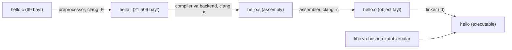

## Bu dars nima uchun kerak

5-darsdan beri biz `clang hello.c -o hello` (yoki uning o'rnini bosuvchi `make hello`) buyrug'ini yozib, tayyor dastur olyapmiz. Bu buyruq qora qutiga o'xshaydi: kirishda matn, chiqishda protsessor bajaradigan fayl. Aslida uning ichida to'rtta alohida bosqich bor va har birining o'z kirishi, chiqishi va o'z xatolari bor.

Bu bosqichlarni bilmasangiz, xato xabarlari sirli ko'rinadi. `'cs50.h' file not found`, `call to undeclared function` va `undefined reference to 'get_string'` - uchta turli bosqichning xatolari va ularning har biri boshqacha tuzatiladi. Birinchisi include yo'li bilan, ikkinchisi prototype bilan (8-dars), uchinchisi esa kodga umuman tegmasdan, buyruqqa kutubxona qo'shish bilan. Bosqichni aniqlay olgan dasturchi xatoni bir daqiqada tuzatadi, aniqlay olmagan esa kodni tasodifiy o'zgartirib yuradi.

Bu dars ikkinchi savolga ham javob beradi: nega 6-darsda `sizeof(long)` bir mashinada 8, bu saytning brauzer muharririda esa 4 chiqadi. Javob kompilyatsiya **nishoni** (target) da.

Bu darsdan keyin siz:

- `clang` bitta buyruq ichida bajaradigan bosqichlarni nomlay olasiz va har birini alohida ishga tushira olasiz (`-E`, `-S`, `-c`);
- preprocessing `#include` va `#define` bilan nima qilishini ko'rsatib bera olasiz va macro tuzoqlarini tushuntira olasiz;
- oddiy funksiyaning x86-64 assembly kodini o'qib, `-O0` va `-O2` farqini ayta olasiz;
- object fayl ichidagi belgilarni (symbol) `nm` bilan ko'rib, qaysilari aniqlangan, qaysilari tashqaridan kutilayotganini ajrata olasiz;
- `undefined reference` va `multiple definition` xatolarining sababini va `-l` flag i bilan kutubxona ulashni tushunasiz;
- brauzerdagi C muharriri clang bilan WebAssembly (wasm32) ga kompilyatsiya qilishini va bu nimani o'zgartirishini bilasiz.

Darsdagi barcha buyruqlar shu sharoitda ishga tushirilgan va natijalar haqiqiy (faqat qisqartirilgan): Ubuntu clang 18.1.3, x86-64 Linux, GNU ld 2.42, glibc 2.39. Boshqa versiya yoki tizimda manzillar, fayl hajmlari va qatorlar soni farq qilishi mumkin, bosqichlarning mantig'i esa bir xil.

## Bitta buyruq, bir nechta bosqich

Tajriba uchun eng oddiy dastur, `hello.c`:

```c
#include <stdio.h>

int main(void)
{
    printf("salom, dunyo\n");
}
```

`clang` aslida **driver** (boshqaruvchi dastur): u o'zi kompilyatsiya qilmaydi, balki kerakli bosqichlar ketma-ketligini quradi va har birini bajaruvchi vositani chaqiradi. Bu ketma-ketlikni `-ccc-print-phases` flag i bilan ko'rish mumkin:

```text
$ clang -ccc-print-phases hello.c -o hello
            +- 0: input, "hello.c", c
         +- 1: preprocessor, {0}, cpp-output
      +- 2: compiler, {1}, ir
   +- 3: backend, {2}, assembler
+- 4: assembler, {3}, object
5: linker, {4}, image
```

Har bir qator - bitta harakat (action), oxirgi so'z - uning chiqish turi. CS50 to'rt bosqich haqida gapiradi va clang ning ro'yxati ham shu to'rtlikka mos keladi, faqat "compiling" ikki qismga bo'lingan: avval C kodi LLVM ning oraliq ko'rinishiga (**IR**, intermediate representation) o'giriladi, keyin backend IR dan aniq protsessor uchun assembly hosil qiladi. Bu bo'linish clang ning bitta front-end i bilan ko'p protsessorni qo'llab-quvvatlashiga imkon beradi: C dan IR gacha qism bir xil, faqat backend almashadi. Darsning oxirida shuni WebAssembly misolida ko'ramiz.



Oraliq fayllarni bir yo'la saqlab qolish uchun `-save-temps` bor. Uning natijasi:

```text
$ clang -save-temps hello.c -o hello
$ ls -l
    69 hello.c
 21509 hello.i
  2584 hello.bc
   797 hello.s
  1248 hello.o
 16008 hello
```

`hello.bc` - LLVM IR ning ikkilik (bitcode) ko'rinishi. Odatda bu fayllar diskka yozilmaydi: clang ularni xotirada uzatadi, `hello.o` ni esa vaqtinchalik katalogga yozadi va linking dan keyin o'chiradi. `clang -###` chaqiruvlar ro'yxatini bajarmasdan ko'rsatadi va unda ikkita asosiy chaqiruv bor: `clang -cc1 ... -emit-obj` (preprocessing, kompilyatsiya va assembly bitta jarayonda, ichki assembler bilan) va `/usr/bin/ld ...` (linking). Demak to'rt bosqich mantiqiy ajratish; jismonan ular ikkita dasturda bajariladi.

Har bir bosqichda to'xtash uchun alohida flag bor:

| Bosqich | To'xtatuvchi flag (clang yordamidagi matn) | Kirish | Chiqish | Shu bosqichning tipik xatosi |
|---|---|---|---|---|
| Preprocessing | `-E` "Only run the preprocessor" | `.c` | `.i` (kengaytirilgan C matni) | `fatal error: 'cs50.h' file not found` |
| Compiling | `-S` "Only run preprocess and compilation steps" | `.i` | `.s` (assembly) | `expected ';'`, `call to undeclared function` |
| Assembling | `-c` "Only run preprocess, compile, and assemble steps" | `.s` | `.o` (object fayl) | o'zingiz yozgan `.s` faylda noto'g'ri instruksiya |
| Linking | flagsiz (to'liq buyruq) | `.o` va kutubxonalar | executable | `undefined reference`, `multiple definition`, `cannot find -lcs50` |

## 1-bosqich: preprocessing

**Preprocessor** C kompilyatsiyasidan oldin ishlaydigan matn almashtiruvchi. U faqat `#` bilan boshlanadigan qatorlarni (directive) bajaradi: `#include`, `#define`, `#if` va boshqalar. U C sintaksisini tushunmaydi va tiplarni bilmaydi, faqat matnni o'zgartiradi.

### #include: faylni joyiga qo'yish

`#include <stdio.h>` qatori o'rniga preprocessor `stdio.h` faylining butun matnini qo'yadi. O'sha fayl ham boshqa fayllarni include qiladi va jarayon rekursiv davom etadi. Natijani `-E` bilan ko'ramiz:

```text
$ clang -E hello.c -o hello.i
$ wc -l hello.c hello.i
    6 hello.c
  832 hello.i
```

6 qatorlik fayl 832 qatorga, 69 baytdan 21 509 baytga aylandi: 21 509 / 69 ≈ 312 baravar. Bu matnga 29 ta turli sarlavha fayli kirgan: `/usr/include/stdio.h`, uning ichidagi `features.h`, `bits/types.h` kabi glibc fayllari va clang ning o'z `stddef.h`, `stdarg.h` fayllari. Fayl oxiri esa shunday ko'rinadi (qisqartirilgan):

```text
# 1 "hello.c"
# 1 "/usr/include/stdio.h" 1 3 4
...
extern int printf (const char *__restrict __format, ...);
...
extern int __uflow (FILE *);
extern int __overflow (FILE *, int);
# 2 "hello.c" 2

int main(void)
{
    printf("salom, dunyo\n");
}
```

Ikki kuzatish:

1. `printf` ning faqat **prototype** i bor (487-qator), tanasi yo'q. `stdio.h` kompilyatorga "printf shunday tipli funksiya" deb aytadi, xolos. Funksiyaning o'zi mashina kodi sifatida C kutubxonasida turibdi va unga faqat linking bosqichida ulanamiz. 8-darsdagi prototype tushunchasi aynan shu yerda ishlaydi.
2. `# 2 "hello.c" 2` kabi qatorlar - **line marker** lar. Ular kompilyatorga "keyingi qator hello.c ning 2-qatori" deb aytadi. Shu sabab xato xabarlarida `.i` faylidagi 831-qator emas, `hello.c:5` ko'rinadi.

`#include <...>` faylni tizim sarlavhalari kataloglarida (`/usr/include` va boshqalar) qidiradi. `#include "..."` avval joriy faylning katalogida, keyin tizim kataloglarida qidiradi. Qo'shimcha katalog `-I` flag i bilan beriladi. Shu sabab CS50 kutubxonasi o'rnatilmagan mashinada birinchi xato aynan preprocessing da chiqadi:

```text
$ clang -c hi50.c
hi50.c:1:10: fatal error: 'cs50.h' file not found
    1 | #include <cs50.h>
      |          ^~~~~~~~
```

### #define: macro almashtirish

`#define` matnli almashtirish qoidasini e'lon qiladi. Preprocessor uni tiplar va qavslarga qaramasdan, so'zma-so'z qo'llaydi. Shuning uchun macro funksiya emas va buni bilmaslik klassik xatoga olib keladi:

```c run
#include <stdio.h>

#define SQUARE_BAD(x) x * x
#define SQUARE(x) ((x) * (x))

int main(void)
{
    printf("SQUARE_BAD(2 + 3) = %d\n", SQUARE_BAD(2 + 3));
    printf("SQUARE(2 + 3)     = %d\n", SQUARE(2 + 3));
    printf("bu qator raqami: %d\n", __LINE__);

#if defined(__wasm32__)
    printf("nishon: wasm32, sizeof(long) = %zu\n", sizeof(long));
#elif defined(__x86_64__)
    printf("nishon: x86-64, sizeof(long) = %zu\n", sizeof(long));
#else
    printf("nishon: boshqa, sizeof(long) = %zu\n", sizeof(long));
#endif
}
```

x86-64 Linux da lokal clang bilan natija:

```text
SQUARE_BAD(2 + 3) = 11
SQUARE(2 + 3)     = 25
bu qator raqami: 10
nishon: x86-64, sizeof(long) = 8
```

Shu sahifadagi muharrirda ishga tushirsangiz, birinchi uch qator bir xil, oxirgisi esa `nishon: wasm32, sizeof(long) = 4` bo'ladi. Nega - pastda, brauzer bo'limida.

Preprocessing natijasini `clang -E -P` bilan ko'rsak (`-P` line marker larni olib tashlaydi), `main` ichida macro lar qanday ochilgani aniq ko'rinadi:

```text
    printf("SQUARE_BAD(2 + 3) = %d\n", 2 + 3 * 2 + 3);
    printf("SQUARE(2 + 3)     = %d\n", ((2 + 3) * (2 + 3)));
    printf("bu qator raqami: %d\n", 10);
    printf("nishon: x86-64, sizeof(long) = %zu\n", sizeof(long));
```

- `SQUARE_BAD(2 + 3)` matni `2 + 3 * 2 + 3` ga aylandi. Ko'paytirish qo'shishdan oldin bajariladi: 2 + 6 + 3 = 11, kutilgan 25 emas. To'g'ri macro har bir parametrni va butun ifodani qavsga oladi.
- `__LINE__` - preprocessor oldindan belgilagan macro, joriy qator raqamiga almashtiriladi.
- `#if defined(...) / #elif / #else / #endif` - **shartli kompilyatsiya**: tanlanmagan tarmoqlar kompilyatorga umuman yetib bormaydi. `__x86_64__`, `__wasm32__` kabi macro larni clang nishon bo'yicha o'zi belgilaydi. Ularning ro'yxatini `echo | clang -E -dM -` bilan ko'rish mumkin.

8-darsdagi `const int MAX_HEIGHT = 8;` va `#define MAX_HEIGHT 8` farqi shu yerdan chiqadi: `const` o'zgaruvchining tipi va scope i bor, `#define` esa preprocessing da matn sifatida almashtiriladi va kompilyator `MAX_HEIGHT` nomini umuman ko'rmaydi.

## 2-bosqich: compiling - C dan assembly ga

Kompilyator kengaytirilgan C matnini tahlil qiladi (sintaksis, tiplar, scope), optimizatsiya qiladi va **assembly** ga, ya'ni protsessor instruksiyalarining matnli ko'rinishiga o'giradi. Har bir assembly qatori odatda bitta mashina instruksiyasiga mos keladi. Sintaksis va tip xatolari shu bosqichda chiqadi:

```text
$ clang -c syn.c
syn.c:3:14: error: expected ';' at end of declaration
    3 |     int x = 5
      |              ^
      |              ;
```

Eng kichik misolni olamiz, `square.c`:

```c
int square(int n)
{
    return n * n;
}
```

`clang -S` bilan, optimizatsiyasiz (`-O0`) va `-fno-asynchronous-unwind-tables` flag i bilan (u `.cfi_` bilan boshlanadigan debug/stack unwinding direktivalarini olib tashlaydi, o'qishni osonlashtirish uchun) olingan natija:

```text
$ clang -S -O0 -fno-asynchronous-unwind-tables square.c -o square-O0.s
square:                                 # @square
# %bb.0:
	pushq	%rbp
	movq	%rsp, %rbp
	movl	%edi, -4(%rbp)
	movl	-4(%rbp), %eax
	imull	-4(%rbp), %eax
	popq	%rbp
	retq
```

Qatorma-qator (AT&T sintaksisi: manba chapda, nishon o'ngda):

1. `pushq %rbp` va `movq %rsp, %rbp` - funksiyaning stack frame ini ochish.
2. `movl %edi, -4(%rbp)` - x86-64 Linux chaqiruv qoidasida birinchi butun son argument `%edi` registrida keladi. `-O0` da kompilyator uni avval stack dagi lokal o'zgaruvchiga (n) saqlaydi. 8-darsdagi "parametr - lokal nusxa" g'oyasi shu yerda jismonan ko'rinadi.
3. `movl -4(%rbp), %eax` va `imull -4(%rbp), %eax` - n ni o'qib, n ga ko'paytirish. `%eax` - qaytish qiymati registri.
4. `popq %rbp`, `retq` - frame ni yopish va chaqiruvchiga qaytish.

Xuddi shu fayl `-O2` bilan:

```text
$ clang -S -O2 -fno-asynchronous-unwind-tables square.c -o square-O2.s
square:                                 # @square
# %bb.0:
	movl	%edi, %eax
	imull	%edi, %eax
	retq
```

7 ta instruksiya 3 taga tushdi: optimizator n ni xotiraga yozib, qayta o'qish shart emasligini ko'rdi va stack frame dan ham voz kechdi. `-O0` kodi debugger uchun qulay (har bir o'zgaruvchi xotirada, 10-dars), `-O2` kodi tez.

Optimizatsiya chaqiruvlarni ham o'zgartiradi. `hello.c` ning `-O0` assembly sida `callq printf@PLT` bor, `-O2` da esa `callq puts@PLT`: formatlash belgisi bo'lmagan va `\n` bilan tugaydigan `printf` ni clang soddaroq `puts` ga almashtirdi. Satrning o'zi assembly da `.asciz "salom, dunyo\n"` sifatida turadi va uning hajmi `.size .L.str, 14`: 12 ta ko'rinadigan belgi + `\n` + oxiridagi `\0` = 14 bayt (satrlar 12-darsda).

8-darsdagi prototype xatosi ham shu bosqichniki: `square` e'lon qilinmagan bo'lsa, kompilyator chaqiruv uchun assembly yarata olmaydi, chunki argument va natija tipini bilmaydi.

## 3-bosqich: assembling - object fayl

**Assembler** assembly matnini mashina kodiga (baytlarga) o'giradi va natijani **object fayl** ga yozadi. Linux da bu ELF formatidagi "relocatable" fayl: unda mashina kodi bor, lekin u hali mustaqil ishga tushadigan dastur emas.

```text
$ clang -c hello.c -o hello.o
$ file hello.o
hello.o: ELF 64-bit LSB relocatable, x86-64, version 1 (SYSV), not stripped
$ nm hello.o
0000000000000000 r .L.str
0000000000000000 T main
                 U printf
```

`nm` object fayldagi **belgilar jadvali** (symbol table) ni ko'rsatadi. Belgi - funksiya yoki global o'zgaruvchi nomi va uning fayl ichidagi manzili. Harflar:

- `T` - belgi shu faylning kod qismida (`.text`) **aniqlangan**: `main` ning mashina kodi shu yerda.
- `U` - **undefined**: belgi ishlatilgan, lekin shu faylda yo'q. `printf` ni kim beradi - bu linker ning vazifasi.
- `r` - faqat o'qiladigan ma'lumot: `.L.str` bizning satrimiz.

Mashina kodining o'zini `objdump -d` ko'rsatadi. `-O2` dagi `square`:

```text
$ objdump -d sq2.o
0000000000000000 <square>:
   0:	89 f8                	mov    %edi,%eax
   2:	0f af c7             	imul   %edi,%eax
   5:	c3                   	ret
```

Chapda bayt manzili, o'rtada mashina kodi, o'ngda unga mos assembly. Butun funksiya 2 + 3 + 1 = 6 bayt. CS50 ma'ruzasidagi "nollar va birlar" aynan shu baytlar: `c3` = 1100 0011 (`ret` instruksiyasi).

### Relocation: bo'sh qoldirilgan manzillar

Endi ikki faylli dasturni olamiz. `main.c` `square` ni chaqiradi, `square` esa `square.c` da:

```c
#include <stdio.h>

int square(int n);

int main(void)
{
    printf("%d\n", square(7));
}
```

Har bir fayl alohida kompilyatsiya qilinadi:

```text
$ clang -c main.c -o main.o
$ clang -c square.c -o square.o
$ nm main.o
0000000000000000 r .L.str
0000000000000000 T main
                 U printf
                 U square
$ nm square.o
0000000000000000 T square
```

`main.c` ni kompilyatsiya qilganda `square` qayerda ekani noma'lum. Assembler chaqiruv instruksiyasini yozadi, lekin manzil o'rniga nollar qo'yadi va "bu yerga keyin square manzilini yoz" degan yozuv - **relocation** - qoldiradi. `objdump -dr` ikkalasini ko'rsatadi:

```text
$ objdump -dr main.o
   4:	bf 07 00 00 00       	mov    $0x7,%edi
   9:	e8 00 00 00 00       	call   e <main+0xe>
			a: R_X86_64_PLT32	square-0x4
```

`bf 07 00 00 00` - argument 7 ni `%edi` ga yozish. `e8` - `call` instruksiyasi, undan keyingi to'rt bayt (0xa manzildan boshlab) hozircha `00 00 00 00`. Relocation yozuvi aynan shu 0xa manzilini ko'rsatadi. Bu raqamni eslab qoling, u linking xatosida qaytadi.

## 4-bosqich: linking

**Linker** object fayllarni va kutubxonalarni bitta executable ga birlashtiradi. Uning ishi ikki qismdan iborat:

1. **Symbol resolution** - har bir `U` belgi uchun uni `T` sifatida aniqlagan joyni topish. Topilmasa yoki ikki joyda topilsa - xato.
2. **Relocation** - barcha kod va ma'lumotni yakuniy manzillarga joylashtirish va bo'sh qoldirilgan joylarni haqiqiy manzil bilan to'ldirish.

Linux da clang buning uchun tizim linkerini chaqiradi; bu yerda bu GNU `ld` (`clang -###` chiqishidagi `"/usr/bin/ld"`). LLVM ning o'z linkeri **lld** ham bor, u GNU linkerlarining buyruq qatori argumentlarini qabul qiladi va ELF, PE/COFF, Mach-O va WebAssembly formatlarini qo'llab-quvvatlaydi.

### undefined reference

`square.o` ni berishni unutsak:

```text
$ clang main.o -o app
/usr/bin/ld: main.o: in function `main':
main.c:(.text+0xa): undefined reference to `square'
clang: error: linker command failed with exit code 1 (use -v to see invocation)
```

Xabar endi to'liq tushunarli: `main.o` ning `.text` qismidagi 0xa manzilda `square` ga relocation bor, lekin hech qaysi kirish faylida `square` aniqlanmagan. E'tibor bering: xabar `ld` dan keladi va kompilyator xatosi emas. Kodda xato yo'q, buyruqda fayl yetishmayapti.

To'g'ri buyruq va natija:

```text
$ clang main.o square.o -o app
$ ./app
49
$ objdump -d app
    1149:	e8 22 00 00 00       	call   1170 <square>
    114e:	89 c6                	mov    %eax,%esi
...
0000000000001170 <square>:
```

Linker `square` ni 0x1170 manzilga joylashtirdi va nollar o'rniga `22 00 00 00` yozdi. x86-64 da `e8` dan keyingi to'rt bayt mutlaq manzil emas, keyingi instruksiyaga nisbatan masofa (little-endian tartibda). Tekshiramiz: keyingi instruksiya manzili + masofa = 0x114e + 0x22 = 0x1170. Bu aynan `square` ning manzili. Relocation shu hisobni bajaradi.

### multiple definition

Teskari holat: bitta nom ikki faylda aniqlangan. `square2.c` - `square.c` ning nusxasi:

```text
$ clang main.c square.c square2.c -o x
/usr/bin/ld: /tmp/square2-599861.o: in function `square':
square2.c:(.text+0x0): multiple definition of `square'; /tmp/square-ac3f9a.o:square.c:(.text+0x0): first defined here
```

Bu yerda `.c` fayllar to'g'ridan-to'g'ri berilgan, shuning uchun clang object fayllarni `/tmp` da vaqtinchalik nomlar bilan yaratdi. Global funksiya nomi butun dasturda bitta bo'lishi kerak. Bu 8-darsdagi scope ning kengroq ko'rinishi: file scope dagi funksiya nomi linker uchun boshqa fayllarga ham ko'rinadi.

### Kutubxonalar va -l

**Kutubxona** - oldindan kompilyatsiya qilingan object fayllar to'plami. Linker ga `-lNAME` berilsa, u kutubxona kataloglarida `libNAME.so` (shared, ya'ni dinamik) yoki `libNAME.a` (static arxiv) faylini qidiradi. Qo'shimcha katalog `-L` bilan beriladi.

C standart kutubxonasining asosiy qismi (libc, `printf` shu yerda) avtomatik ulanadi. Matematik funksiyalar esa glibc da alohida `libm` da va ularni `-lm` bilan so'rash kerak:

```c
#include <math.h>
#include <stdio.h>

int main(void)
{
    double x = 2.0;
    printf("%.4f\n", sqrt(x));
}
```

```text
$ clang root.c -o root
/usr/bin/ld: /tmp/root-b5d29c.o: in function `main':
root.c:(.text+0x1b): undefined reference to `sqrt'
$ clang root.c -o root -lm
$ ./root
1.4142
```

Qiziq holat: `clang -O2 root.c -o root3` `-lm` siz ham muvaffaqiyatli bo'ladi va `nm root3` da `sqrt` umuman yo'q. Optimizator `x` doim 2.0 ekanini ko'rib, `sqrt(2.0)` ni kompilyatsiya vaqtida hisoblab qo'ydi va kutubxona chaqiruvi yo'qoldi. Bunga tayanmang: qiymat foydalanuvchidan kelsa, chaqiruv qoladi va `-lm` yana kerak bo'ladi.

CS50 kutubxonasi ham xuddi shunday: `cs50.h` faqat prototype larni beradi, `get_string` ning mashina kodi `libcs50` da. Kutubxona o'rnatilmagan mashinada sarlavhani `-I` bilan topib bersak, xato linking ga siljiydi:

```text
$ clang -I. hi50.c -o hi50
hi50.c:(.text+0x12): undefined reference to `get_string'
$ clang -I. hi50.c -o hi50 -lcs50
/usr/bin/ld: cannot find -lcs50: No such file or directory
```

Birinchisi: belgi kerak, lekin hech kim bermadi. Ikkinchisi: kutubxona so'raldi, lekin fayl topilmadi. CS50 muhitida `make hello` clang ni `-lcs50` bilan chaqiradi va kutubxona o'rnatilgan, shuning uchun bu xatolar u yerda ko'rinmaydi.

### O'z kutubxonangiz va tartib muammosi

Static kutubxona yaratish uchun object fayllar `ar` bilan arxivga yig'iladi:

```text
$ clang -c greet.c -o greet.o
$ ar rcs libgreet.a greet.o
$ clang usegreet.c -L. -lgreet -o usegreet
$ ./usegreet
salom, Aziza
$ clang -L. -lgreet usegreet.c -o ug2
usegreet.c:(.text+0xc): undefined reference to `greet'
```

Ikkinchi buyruqda fayllar o'sha, faqat tartib boshqa va linking buzildi. Sababi GNU ld hujjatida yozilgan: arxiv buyruq qatorida turgan joyida faqat bir marta ko'rib chiqiladi va undan **oldin** kelgan fayllardagi undefined belgilarni hal qiladi. `-lgreet` ni ko'rganda hali hech kim `greet` ni so'ramagan edi, shuning uchun undan hech narsa olinmadi; `usegreet.o` keyin keldi va uning `U greet` belgisi hal bo'lmay qoldi. Qoida: kutubxonalarni ularni ishlatadigan fayllardan **keyin** yozing (`clang main.c -lcs50 -lm`).

### Static va dinamik linking

`ldd hello` executable qaysi shared kutubxonalarga bog'liqligini ko'rsatadi:

```text
$ ldd hello
	linux-vdso.so.1
	libc.so.6 => /lib/x86_64-linux-gnu/libc.so.6
	/lib64/ld-linux-x86-64.so.2
```

`printf` ning kodi `hello` fayliga ko'chirilmagan. `nm hello` da u hamon `U printf@GLIBC_2.2.5`: fayl ishga tushganda dinamik yuklovchi (`ld-linux-x86-64.so.2`) `libc.so.6` ni xotiraga yuklab, chaqiruvni bog'laydi. Static arxivdan (`libgreet.a`) olingan kod esa executable ichiga ko'chiriladi. Shuning uchun `hello` 16 008 bayt: unda bizning 6 baytlik mantiqdan tashqari ishga tushirish kodi (`_start`, `_init`), dinamik linking jadvallari va boshqa xizmat ma'lumotlari bor, `printf` ning o'zi esa yo'q.

| | Static (`.a`) | Dinamik (`.so`) |
|---|---|---|
| Kod qayerda | executable ichiga ko'chiriladi | alohida faylda, ishga tushganda yuklanadi |
| Executable hajmi | kattaroq | kichikroq |
| Kutubxona yangilansa | qayta linking kerak | keyingi ishga tushishda yangisi ishlatiladi |
| Ishga tushish uchun kerak | faqat executable | executable va mos versiyadagi `.so` |

## Brauzerda: xuddi shu clang, boshqa nishon

Bu saytdagi `c run` belgili kod bloklari ham clang bilan kompilyatsiya qilinadi, lekin serverda emas, sizning brauzeringizda. Muharrir LLVM ning WebAssembly ga o'girilgan nusxasini (YoWASP clang paketi, birinchi ishga tushirishda yuklanadi) ishlatadi va dasturni `--target=wasm32-wasip1` nishoniga kompilyatsiya qiladi. Natija x86-64 mashina kodi emas, **WebAssembly** moduli: brauzer bajaradigan, protsessorga bog'liq bo'lmagan format.

Bosqichlar o'sha: preprocessing (`cs50.h` shu yerda qo'shiladi), kompilyatsiya, object fayl va linking. Sayt kutubxonasi `runtime.c` bir marta alohida `-c` bilan `runtime.o` ga kompilyatsiya qilinadi, keyin har bir dasturingiz `main.c runtime.o -lm` bilan linking qilinadi. Bu yuqoridagi ikki faylli `main.o square.o` misolining aynan o'zi: `get_string` va boshqa funksiyalar `runtime.o` dan olinadi. WebAssembly uchun linker - lld ning `wasm-ld` porti. Linker ga `--wrap=malloc` kabi flag lar ham beriladi: ular `malloc` chaqiruvlarini `runtime.c` dagi `__wrap_malloc` ga yo'naltiradi va xotira xatolarini ushlash shu orqali ishlaydi (23-24-darslar).

Lokal clang 18 da `square.c` ni shu oilaning `wasm32` nishoniga `-S -O2` bilan kompilyatsiya qilsak:

```text
$ clang --target=wasm32 -S -O2 square.c -o square-wasm.s
square:                                 # @square
	.functype	square (i32) -> (i32)
# %bb.0:
	local.get	0
	local.get	0
	i32.mul
                                        # fallthrough-return
	end_function
```

WebAssembly registrlar o'rniga **stack mashina** modelida ishlaydi: `local.get 0` birinchi parametrni stack ga qo'yadi, ikkinchisi yana bir nusxa qo'yadi, `i32.mul` ikkalasini olib, ko'paytmani qo'yadi va funksiya oxirida stack dagi qiymat natija bo'ladi. Object fayl ham boshqacha: `square-wasm.o` - `WebAssembly (wasm) binary module`, 217 bayt; x86-64 dagi `square.o` (`-O0`) esa 968 bayt.

| | x86-64 Linux (lokal) | wasm32-wasip1 (brauzer) |
|---|---|---|
| `square` ning `-O2` kodi | `movl %edi, %eax`, `imull %edi, %eax`, `retq` | `local.get 0`, `local.get 0`, `i32.mul` |
| Argument qayerda | registr (`%edi`) | lokal o'zgaruvchi, stack mashina |
| Object fayl formati | ELF relocatable | WebAssembly moduli |
| Linker | GNU ld (yoki lld) | wasm-ld (lld) |
| `sizeof(long)`, `sizeof(int *)` | 8, 8 | 4, 4 |
| Belgilangan macro | `__x86_64__`, `__linux__` | `__wasm32__`, `__wasi__` |

Oxirgi ikki qator macro misolidagi farqni tushuntiradi. `echo | clang --target=wasm32-wasip1 -E -dM -` chiqishida `__SIZEOF_LONG__ 4` va `__SIZEOF_POINTER__ 4`, lokal x86-64 nishonida esa ikkalasi 8. Tip hajmlari tilning emas, nishonning xususiyati: C standarti `long` ning aniq hajmini belgilamaydi, uni platformaning kelishuvi (ABI) belgilaydi. 6-darsdagi `sizes` dasturi brauzerda va 64-bit Linux da turli natija bergani shu sababli.

## Ko'p uchraydigan xatolar

1. **Linking xatosini kod xatosi deb o'ylash.** `undefined reference` kodni emas, buyruqni tuzatishni talab qiladi: yetishmayotgan `.o` fayl yoki `-l` kutubxona. Xabar `ld` dan kelayotganiga qarang.
2. **Sarlavha faylini kutubxona deb o'ylash.** `#include <math.h>` faqat prototype beradi; `sqrt` ning kodi `libm` da va `-lm` siz linking buziladi. `cs50.h` va `-lcs50` ham xuddi shunday juftlik.
3. **Kutubxonani fayldan oldin yozish.** `clang -lgreet main.c` static arxivda `undefined reference` beradi. Kutubxonalar ularni ishlatadigan fayllardan keyin turadi.
4. **Macro ni funksiya deb o'ylash.** `#define SQUARE(x) x * x` matnni so'zma-so'z almashtiradi: `SQUARE(2 + 3)` 11 beradi. Har bir parametr va butun ifodani qavsga oling yoki oddiy funksiya yozing.
5. **Bitta funksiyani ikki `.c` faylda aniqlash.** `multiple definition` xatosi. Funksiya bitta `.c` faylda aniqlanadi, boshqa fayllarga uning prototype i (odatda `.h` orqali) beriladi.
6. **`.c` faylni `#include` qilish.** Bu ishlaydi, lekin fayl ikki joydan kompilyatsiya qilinsa, uning funksiyalari ikki object faylda paydo bo'ladi va yana `multiple definition` chiqadi. `.h` fayllar include qilinadi, `.c` fayllar kompilyatsiya qilinadi.
7. **Bitta mashinadagi tip hajmini universal deb hisoblash.** `sizeof(long)` x86-64 Linux da 8, wasm32 da 4. Aniq hajm kerak bo'lsa, `<stdint.h>` dagi `int64_t` kabi tiplarni ishlating.
8. **Optimizatsiya darajasini e'tiborsiz qoldirish.** `-O2` bilan yo'qolgan xato (`sqrt` misoli) yoki debugger da "ko'rinmay qolgan" o'zgaruvchi `-O0` da qaytadi. Xatoni qidirishda `-O0 -g` bilan kompilyatsiya qiling.

## Xulosa

- `clang hello.c -o hello` driver: u preprocessing, compiling (IR va backend), assembling va linking bosqichlarini quradi va chaqiradi; `-ccc-print-phases` ularni ko'rsatadi.
- `-E`, `-S`, `-c` mos ravishda preprocessing, assembly va object fayldan keyin to'xtatadi; `-save-temps` barcha oraliq fayllarni saqlaydi.
- Preprocessor matnni almashtiradi: `#include` faylni joyiga qo'yadi (6 qator 832 qatorga aylandi), `#define` macro ni so'zma-so'z ochadi, `#if` nishonga qarab kodni tanlaydi.
- Kompilyator C ni assembly ga o'giradi; `-O2` `square` ni 7 instruksiyadan 3 taga qisqartirdi va `printf` ni `puts` ga almashtirdi.
- Object fayl mashina kodi va belgilar jadvalidan iborat; `nm` da `T` aniqlangan, `U` tashqaridan kutilayotgan belgi; chaqiruv manzillari relocation sifatida bo'sh qoldiriladi.
- Linker `U` belgilarni hal qiladi va manzillarni to'ldiradi (0x114e + 0x22 = 0x1170); xatolari - `undefined reference`, `multiple definition`, `cannot find -l...`.
- Sarlavha prototype beradi, kutubxona kod beradi: `math.h` va `-lm`, `cs50.h` va `-lcs50`; static arxivlarda tartib muhim.
- Brauzer muharriri xuddi shu clang bilan wasm32 ga kompilyatsiya qiladi va `runtime.o` bilan linking qiladi; shu sabab u yerda `long` va pointer 4 bayt.

## Amaliy topshiriq

Vazifa: 8-darsdagi piramida dasturini uch faylga bo'lib, har bir bosqichni qo'lda bajaring va natijalarni tahlil qiling. Buyruqlar uchun lokal kompyuter yoki CS50 ning VS Code muhiti kerak (brauzer muharriri bitta fayl bilan ishlaydi).

1. **Bo'ling.** `pyramid.h` (prototype lar: `print_chars`, `print_row`), `pyramid.c` (ularning ta'rifi), `main.c` (`get_height` va `main`). `main.c` da `#include "pyramid.h"` bo'lsin. Har bir fayl alohida `clang -c -Wall` bilan ogohlantirishsiz kompilyatsiya bo'lsin.
2. **Preprocessing ni o'lchang.** `clang -E main.c` natijasining qatorlar sonini `wc -l` bilan toping. `pyramid.h` matni natijada qayerda paydo bo'lganini line marker orqali ko'rsating. `cs50.h` topilmasa, `-I` bilan qanday hal qilganingizni yozing.
3. **Belgilarni tahlil qiling.** `nm main.o` va `nm pyramid.o` chiqishini keltiring. Har bir `U` belgi qaysi fayl yoki kutubxonadan kelishini jadvalda yozing.
4. **Xatolarni ataylab chaqiring.** (a) `pyramid.o` siz linking; (b) `print_row` ni ikkinchi marta `main.c` da aniqlash; (c) `-lcs50` ni o'chirish; (d) `#include "pyramid.h"` ni o'chirish. Har birida xato xabarini keltiring va u qaysi bosqichdan kelganini ayting.
5. **Assembly ni solishtiring.** `print_chars` uchun `clang -S -O0` va `-O2` natijasidagi instruksiyalar sonini sanang va sikl qayerda (qaysi `jmp`/shartli o'tish) ekanini ko'rsating.

Yaxshi javobda bo'lishi kerak bo'lgan narsalar:

- uch fayl to'g'ri bo'lingan: `.h` da faqat prototype lar, har bir funksiya faqat bitta `.c` da aniqlangan;
- `nm` jadvali to'liq: `main.o` da `print_row` va `get_int` `U`, `pyramid.o` da `print_chars` va `print_row` `T`, `putchar` yoki `printf` libc dan;
- to'rtta xato to'g'ri bosqichga bog'langan: (a) va (c) linking (`undefined reference` yoki `cannot find`), (b) linking (`multiple definition`), (d) compiling (`call to undeclared function`);
- preprocessing hajmi raqam bilan va kirish fayliga nisbat formula bilan berilgan;
- `-O0` va `-O2` assembly farqi instruksiyalar soni bilan va kamida bitta aniq farq (stack ga yozish yo'qolgani, registr ishlatilishi) bilan tushuntirilgan.

Javobingizni pastdagi maydonga yozing va yuqoridagi mezonlar bilan solishtiring.

## Manbalar

- CS50x. [Lecture 2 notes](https://cs50.harvard.edu/x/notes/2/) - "Compiling" bo'limi: preprocessing, compiling, assembling, linking to'rt bosqichi va `clang -o hello hello.c -lcs50` buyrug'i.
- LLVM. [Clang command line argument reference](https://clang.llvm.org/docs/ClangCommandLineReference.html) - "Actions" bo'limi: `-E`, `-S`, `-c` flag lari; `-save-temps`.
- LLVM. [Driver Design & Internals](https://clang.llvm.org/docs/DriverInternals.html) - driver pipeline: preprocess, compile, assemble, link harakatlari va `-ccc-print-phases` misoli.
- GNU Binutils. [ld: Command-line Options](https://sourceware.org/binutils/docs/ld/Options.html) - `-l namespec` va `-L` (kutubxona qidirish, `.so` va `.a`), arxivlar buyruq qatorida bir marta va o'z o'rnida ko'rib chiqilishi, `--wrap`.
- LLVM. [LLD - The LLVM Linker](https://lld.llvm.org/) - lld GNU linkerlari o'rnini bosishi va qo'llab-quvvatlanadigan formatlar (ELF, PE/COFF, Mach-O, WebAssembly).
- LLVM. [WebAssembly lld port](https://lld.llvm.org/WebAssembly.html) - `wasm-ld`: WebAssembly object fayllarni linking qilish.
- Randal E. Bryant, David R. O'Hallaron. [Computer Systems: A Programmer's Perspective](https://csapp.cs.cmu.edu/) - 1-bob (kompilyatsiya tizimi bosqichlari) va 7-bob "Linking" (symbol resolution, relocation, static va shared kutubxonalar).
