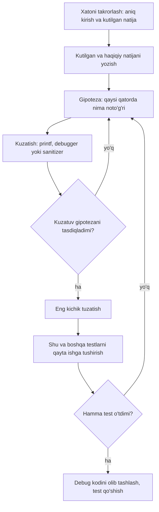

## Bu dars nima uchun kerak

Oldingi to'qqiz darsda biz C da dastur yozishni, uni kompilyatsiya qilishni va kompilyator ichida nima bo'lishini ko'rdik (9-dars). Endi har bir dasturchining kundalik haqiqati bilan to'qnashamiz: yozilgan kodning katta qismi birinchi urinishda ishlamaydi. Ba'zan kompilyator rad etadi, ba'zan dastur ishlaydi-yu, noto'g'ri javob beradi, ba'zan esa bir kirishda to'g'ri, boshqasida xato ishlaydi. Xatoni topish va tuzatish jarayoni - **debugging** - kod yozishning ajralmas qismi, va u tasodif emas, o'rganiladigan usul.

Ikkinchi savol: kod "ishlasa" yetarlimi? CS50 kodni uchta o'q bo'yicha baholaydi: **correctness** (to'g'rilik), **design** (loyiha sifati) va **style** (ko'rinish va izchillik). Ishlaydigan, lekin hech kim o'qiy olmaydigan yoki bitta o'zgarishda buziladigan kod - yarim tayyor ish. Bu dars ikkala mavzuni bog'laydi: sifatli kodda xato kamroq bo'ladi, xato bo'lsa ham u tezroq topiladi.

Kursning keyingi qismida (massivlar, satrlar, pointerlar, malloc) xatolar murakkablashadi: xotira chegarasidan chiqish, initsializatsiya qilinmagan qiymatlar, noto'g'ri manzil. Shuning uchun asboblarni hozir, oddiy dasturlarda o'zlashtirish kerak.

Bu darsdan keyin siz:

- kodni correctness, design va style o'qlari bo'yicha alohida baholay olasiz va ularning farqini misol bilan tushuntira olasiz;
- clang xabarini (fayl, qator, ustun, turi, matn, flag nomi) o'qiy olasiz, error va warning farqini bilasiz va `-Wall` nima qo'shishini ko'rsata olasiz;
- printf debugging ni tizimli qo'llay olasiz: gipoteza, kuzatish nuqtasi, natija;
- debugger da breakpoint qo'yish, step over, step into, finish, o'zgaruvchini ko'rish va watchpoint ishlatishni bilasiz (gdb va lldb buyruqlari bilan);
- brauzerdagi C muhiti chiqaradigan xotira xatosi hisobotini o'qib, off-by-one xatoni qatorigacha topa olasiz;
- rubber duck debugging nima uchun ishlashini tushuntira olasiz;
- CS50 uslub qoidalari bo'yicha kodni formatlay olasiz.

## Kod sifatining uchta o'qi

CS50 kursi 1-haftadan boshlab har bir dasturni uchta savol bilan baholaydi. Ularni o'z so'zimiz bilan ta'riflaymiz.

**Correctness (to'g'rilik):** dastur talab qilingan ishni barcha ruxsat etilgan kirishlarda bajaradimi? 1-darsdagi ta'rifni eslang: algoritm har qanday instance uchun to'g'ri javob berishi kerak. Correctness ni tekshirishning amaliy usuli - test holatlari: oddiy holat, chegaraviy holat (bo'sh kirish, bitta element, eng katta va eng kichik qiymat) va noto'g'ri kirish. CS50 da correctness ni avtomatik tekshirish uchun `check50` vositasi bor.

**Design (loyiha sifati):** dastur masalani qanchalik yaxshi yechadi? Bu yerda savol "ishlaydimi" emas, "qanday ishlaydi": ortiqcha takrorlash bormi, keraksiz qadamlar bormi, algoritm samaralimi, funksiyalarga to'g'ri bo'lingami, bitta o'zgarish uchun nechta joyni tahrirlash kerak. Ikki dastur bir xil to'g'ri natija berishi, lekin biri n qadamda, boshqasi n² qadamda ishlashi mumkin. CS50 da dizaynni baholash uchun `design50` vositasi bor; lekin design ni to'liq avtomatik baholab bo'lmaydi, chunki u kontekstga bog'liq.

**Style (uslub):** kod o'qishga qanchalik qulay va izchil? Chekinish (indentation), qavslar joylashuvi, nomlar, izohlar, qator uzunligi. Kompilyator uchun bularning ahamiyati yo'q, inson uchun esa katta. CS50 da uslubni `style50` baholaydi.

| O'q | Asosiy savol | Qanday tekshiriladi | CS50 vositasi | Buzilish misoli |
|---|---|---|---|---|
| Correctness | Har qanday ruxsat etilgan kirishda to'g'ri natija beradimi? | Test holatlari, chegaraviy kirishlar, invariant | `check50` | 1 dan n gacha yig'indi n ni tashlab ketadi |
| Design | Masala oqilona va samarali yechilganmi? | Kod ko'rib chiqish (review), murakkablik tahlili | `design50` | Bir xil 10 qator kod uch joyda nusxalangan |
| Style | O'qish oson va izchilmi? | Uslub qoidalari, avtomatik formatlash | `style50` | Chekinish aralash, `x1`, `tmp2` kabi nomlar |

Uch o'qning tartibi tasodifiy emas. Noto'g'ri dastur chiroyli formatlangan bo'lsa ham foydasiz. Lekin design va style ham "bezak" emas: yomon dizaynli kodda xato yashirinadi. Masalan, bir hisob uch joyda nusxalangan bo'lsa va siz xatoni ulardan faqat bittasida tuzatsangiz, qolgan ikkitasi xato bilan qoladi. Yomon chekinishli kodda `if` ning qaysi qatorlarga tegishli ekanini noto'g'ri o'qish oson. Shuning uchun uchta o'q bir-biriga bog'liq: design va style correctness ga erishishni osonlashtiradi.

## Kompilyator xabarlarini o'qish

Debugging ning birinchi bosqichi - kompilyator. Kompilyator dasturni ishga tushirmasdan oldin uni to'liq o'qib chiqadi va ko'p xatolarni shu bosqichda topadi. Bu eng arzon xato: u ekranda aniq qator raqami bilan chiqadi.

Kompilyator xabarlari ikki turga bo'linadi:

- **error (xato)** - kod C tili qoidalariga zid, kompilyator bajariladigan fayl yaratmaydi. Masalan, nuqta-vergul tushib qolgan yoki e'lon qilinmagan o'zgaruvchi ishlatilgan.
- **warning (ogohlantirish)** - kod qoidaga mos, kompilyator uni kompilyatsiya qiladi, lekin bu yerda xato bo'lishi ehtimoli katta deb ko'rsatadi. Warning bilan ham dastur yaratiladi, shuning uchun uni e'tiborsiz qoldirish oson va xavfli.

Quyidagi dasturda ataylab uchta muammo bor:

```c
#include <stdio.h>

int main(void)
{
    int count;
    int unused = 7;
    double price = 12.5;

    if (count = 3)
    {
        printf("Narx: %d\n", price);
    }
    printf("Soni: %d\n", count)
}
```

clang 18 bilan kompilyatsiya (qisqartirilgan, `note` qatorlari olib tashlangan):

```text
$ clang -std=c11 -o warn warn.c
warn.c:9:15: warning: using the result of an assignment as a condition without parentheses [-Wparentheses]
    9 |     if (count = 3)
      |         ~~~~~~^~~
warn.c:11:30: warning: format specifies type 'int' but the argument has type 'double' [-Wformat]
   11 |         printf("Narx: %d\n", price);
      |                       ~~     ^~~~~
      |                       %f
warn.c:13:32: error: expected ';' after expression
   13 |     printf("Soni: %d\n", count)
      |                                ^
      |                                ;
2 warnings and 1 error generated.
```

### Xabarning anatomiyasi

`warn.c:11:30: warning: format specifies type 'int' but the argument has type 'double' [-Wformat]` qatorini qismlarga ajratamiz:

1. `warn.c` - fayl nomi. Ko'p faylli loyihada bu muhim.
2. `11:30` - qator va ustun. Ustun belgi raqami: 30-belgida `price` boshlanadi.
3. `warning` - turi: `error`, `warning` yoki `note` (oldingi xabarga qo'shimcha izoh).
4. Matn - nima noto'g'ri: `%d` int kutadi, lekin double berildi.
5. `[-Wformat]` - shu ogohlantirishni boshqaradigan flag nomi. Uni qidiruvga yozib, clang hujjatidan batafsil tavsifni topish mumkin.

Xabar ostidagi `^` belgisi aniq joyni, `~~~` esa tegishli ifoda chegarasini ko'rsatadi. Ba'zan clang tuzatishni ham taklif qiladi: yuqorida `%f` va `;` shunday takliflar.

Uchta amaliy qoida:

- **Birinchi xatodan boshlang.** Bitta tushib qolgan qavs kompilyatorni chalg'itadi va undan keyin o'nlab "soxta" xato chiqishi mumkin. Birinchisini tuzatib, qayta kompilyatsiya qiling.
- **Xato ko'rsatilgan qatorda emas, undan oldin bo'lishi mumkin.** `expected ';' after expression` 13-qatorda chiqdi va haqiqatan ham nuqta-vergul shu qatorda yo'q. Lekin yopilmagan qavs yoki izoh xatosi bir necha qator oldin boshlangan bo'lishi mumkin.
- **Warning ni xato deb qabul qiling.** `if (count = 3)` - bu solishtirish emas, o'zlashtirish (assignment). Shart har doim rost (3 noldan farqli) va `count` ning eski qiymati yo'qoladi. `printf("%d", price)` esa undefined behavior: printf double ni int deb o'qiydi va ma'nosiz son chiqaradi. Ikkalasi ham kompilyatsiya bo'ladi, lekin ikkalasi ham bug.

### `-Wall` nima qo'shadi

Yuqoridagi ikki ogohlantirish clang da sukut bo'yicha yoqilgan. Lekin ba'zi muhim tekshiruvlar faqat `-Wall` bilan yoqiladi. clang hujjatiga ko'ra `-Wall` guruhi `-Wmost`, `-Wparentheses`, `-Wswitch`, `-Wmisleading-indentation` va boshqa guruhlarni boshqaradi. Nomi "all" bo'lsa ham, u **barcha** ogohlantirishlarni yoqmaydi; `-Wextra` yana qo'shimchalarini yoqadi.

Farqni o'zimiz ko'ramiz. Quyidagi kodda `sum` boshlang'ich qiymatsiz:

```c
#include <stdio.h>

int main(void)
{
    int sum;
    for (int i = 1; i <= 3; i++)
    {
        sum += i;
    }
    printf("%d\n", sum);
}
```

```text
$ clang -o un un.c
$ clang -Wall -o un un.c
un.c:8:9: warning: variable 'sum' is uninitialized when used here [-Wuninitialized]
    8 |         sum += i;
      |         ^~~
un.c:5:12: note: initialize the variable 'sum' to silence this warning
    5 |     int sum;
      |            ^
      |             = 0
1 warning generated.
```

`-Wall` siz clang 18 hech narsa demadi, `-Wall` bilan esa xatoni aniq ko'rsatdi. Birinchi misolda `;` tuzatilib, `-Wall` qo'shilsa, uchinchi ogohlantirish chiqadi: `warning: unused variable 'unused' [-Wunused-variable]` (funksiyada sintaksis xatosi turganda clang bu ogohlantirishni chiqarmaydi). Ishlatilmagan o'zgaruvchi o'zi xato emas, lekin ko'pincha "bu yerda nimadir yozish esdan chiqqan" degan belgi.

Yana bir qadam - `-Werror`: barcha ogohlantirishlarni xatoga aylantiradi, ya'ni warning bor ekan, bajariladigan fayl yaratilmaydi. `clang -Wall -Werror` bilan yuqoridagi kod `error: variable 'sum' is uninitialized when used here [-Werror,-Wuninitialized]` beradi va kompilyatsiya to'xtaydi. Jamoaviy loyihalarda shu usul bilan ogohlantirishlar to'planib qolishining oldi olinadi.

Bu kursdagi brauzer muhiti C kodini `-Wall` bilan kompilyatsiya qiladi: ogohlantirishlar dastur natijasidan oldin alohida ko'rinadi. Ularni o'tkazib yubormang.

JavaScript bilan taqqoslash: JS da kompilyatsiya bosqichi yo'q, shuning uchun bunday xatolarning ko'pi faqat ishga tushganda yoki ESLint kabi linter orqali topiladi. TypeScript ning `tsc` va `strict` rejimi C ning `-Wall -Werror` iga o'xshash rol o'ynaydi: kodni ishga tushirishdan oldin rad etadi.

## Debugging jarayoni: gipotezadan tuzatishgacha

Kompilyator jim bo'lsa ham, dastur noto'g'ri ishlashi mumkin. Bunday xato - **mantiqiy xato** (logic error): kod tilning qoidalariga to'liq mos, lekin siz o'ylagan ishni qilmaydi. Uni topish uchun tasodifiy o'zgartirishlar emas, ilmiy usulga o'xshash sikl kerak.



Sikldagi eng muhim qadam - birinchisi. Xatoni ishonchli takrorlay olmasangiz, uni tuzatganingizni ham bilolmaysiz. Shuning uchun "ba'zan noto'g'ri ishlaydi" emas, "4 kiritilganda 10 o'rniga 6 chiqadi" darajasida aniq yozing.

### Qidiruv maydonini ikkiga bo'lish

1-darsdagi binary search g'oyasi debugging da ham ishlaydi. Dastur L qator bo'lsa va xato qayerdaligini bilmasangiz, o'rtaga bitta kuzatish nuqtasi qo'yasiz: shu yerda qiymatlar to'g'rimi? To'g'ri bo'lsa, xato keyingi yarimda; noto'g'ri bo'lsa, oldingi yarimda. Har kuzatish qidiruv maydonini ikkiga bo'ladi, demak kerakli kuzatishlar soni eng ko'pi bilan ⌈log₂ L⌉.

Hisob: L = 1000 qatorlik dastur uchun ⌈log₂ 1000⌉ = ⌈9.97⌉ = 10 kuzatish. Har qatordan keyin printf qo'yib, natijani ketma-ket o'qish esa eng yomon holatda 1000 qatorni ko'rib chiqishni talab qiladi. Bu usul faqat dastur bir yo'nalishda bajarilsa va "shu nuqtada holat to'g'rimi" degan savolga aniq javob bera olsangiz ishlaydi, lekin amalda bu ko'pincha shunday.

## printf debugging

Eng oddiy va eng ko'p ishlatiladigan usul: shubhali joyga o'zgaruvchilar qiymatini chiqaradigan vaqtinchalik `printf` qo'yish. Debugger o'rnatilmagan muhitda ham, uzoq serverda ham ishlaydi.

Quyidagi funksiya 1 dan n gacha bo'lgan sonlar yig'indisini hisoblashi kerak. 1 + 2 + 3 + 4 = 10, formula bo'yicha n(n + 1) / 2 = 4 · 5 / 2 = 10. Dastur esa 6 chiqaradi. Kuzatish nuqtasini sikl ichiga qo'yamiz:

```c run
#include <stdio.h>

int sum_to(int n)
{
    int total = 0;
    for (int i = 1; i < n; i++)
    {
        total += i;
        printf("DEBUG: i = %d, total = %d\n", i, total);
    }
    return total;
}

int main(void)
{
    int n = 4;
    printf("1 dan %d gacha yig'indi: %d (kutilgan %d)\n", n, sum_to(n), n * (n + 1) / 2);
}
```

Natija:

```text
DEBUG: i = 1, total = 1
DEBUG: i = 2, total = 3
DEBUG: i = 3, total = 6
1 dan 4 gacha yig'indi: 6 (kutilgan 10)
```

DEBUG qatorlari muammoni darhol ko'rsatadi: sikl i = 3 da tugagan, i = 4 hech qachon qo'shilmagan. Shart `i < n` o'rniga `i <= n` bo'lishi kerak. Brauzerda shartni tuzatib, qayta ishga tushirib ko'ring: to'rtinchi DEBUG qatori paydo bo'ladi va natija 10 ga teng bo'ladi.

Bu - 8-darsda tanishgan **off-by-one** xatosi: sikl bir marta kam yoki bir marta ko'p aylanadi. Uning klassik ko'rinishi "ustunlar muammosi" (fencepost): 10 metrli devorga har 1 metrda ustun qo'yilsa, ustunlar soni 10 emas, 10 / 1 + 1 = 11. Sikllarda ham shu savol: oraliqning ikki chegarasi kiradimi? `for (int i = a; i < b; i++)` aynan b - a marta, `for (int i = a; i <= b; i++)` esa b - a + 1 marta aylanadi. Yuqoridagi xatoda a = 1, b = 4: `<` bilan 3 marta, `<=` bilan 4 marta.

printf debugging qoidalari:

- **Gipoteza bilan qo'ying.** "Hamma joyga printf" emas, "menimcha, sikl oxirgi elementni o'tkazib yuboradi, shuni tekshiraman".
- **Belgi qo'shing.** `DEBUG:` prefiksi bu qatorlarni dasturning oddiy chiqishidan ajratadi va keyin topib o'chirishni osonlashtiradi.
- **Kontekst chiqaring.** Faqat `total` emas, `i` ham: qaysi aylanishdagi qiymat ekanini bilish kerak.
- **stderr ni ko'rib chiqing.** `fprintf(stderr, ...)` debug matnini dastur natijasidan alohida oqimga yozadi; natija faylga yo'naltirilganda (`./prog > out.txt`) debug matni unga aralashmaydi.
- **Tuzatgandan keyin olib tashlang.** Unutilgan debug chiqishi o'zi correctness xatosiga aylanadi: chiqishni kutilgan matn bilan solishtiradigan har qanday avtomatik test muvaffaqiyatsiz bo'ladi.

## Debugger: dasturni qadam-baqadam bajarish

printf ning cheklovi bor: har yangi savol uchun kodni o'zgartirib, qayta kompilyatsiya qilish kerak. **Debugger** esa dasturni o'zgartirmasdan, uni istalgan joyda to'xtatib, ichini ko'rishga imkon beradi. CS50 muhitida (cs50.dev) bu `debug50`, terminalda esa `gdb` (GNU loyihasi) yoki `lldb` (LLVM loyihasi).

Asosiy tushunchalar:

- **Breakpoint** - dastur shu qatorga yetganda, qatorni bajarishdan oldin to'xtaydi. debug50 da qator raqamining chap tomonini bosib qo'yiladi, gdb da `break main` yoki `break buggy.c:6`.
- **Step over** (gdb: `next`) - joriy qatorni to'liq bajaradi; agar qatorda funksiya chaqiruvi bo'lsa, funksiya ichiga kirmasdan, uni butunlay bajarib keyingi qatorda to'xtaydi.
- **Step into** (gdb: `step`) - qatorda chaqirilgan funksiya ichiga kiradi va uning birinchi qatorida to'xtaydi. gdb hujjatiga ko'ra `step` faqat debug ma'lumoti (qator raqamlari) bor funksiyaga kiradi; `printf` kabi kutubxona funksiyalarida odatda `next` kabi o'tib ketadi.
- **Step out** (gdb: `finish`) - joriy funksiya qaytguncha bajaradi va chaqiruvchiga qaytib to'xtaydi, qaytgan qiymatni ham ko'rsatadi.
- **Continue** (gdb: `continue`) - keyingi breakpoint gacha yoki dastur tugaguncha davom etadi.
- **O'zgaruvchilarni ko'rish** - gdb da `print total`, `info locals` (barcha lokal o'zgaruvchilar); debug50 da chap paneldagi "Variables" ro'yxati.
- **Watchpoint** - qator emas, o'zgaruvchi kuzatiladi: uning qiymati o'zgargan zahoti dastur to'xtaydi va eski hamda yangi qiymatni ko'rsatadi. gdb da `watch total`.
- **Backtrace** (gdb: `bt`) - hozir qaysi funksiya ichida ekanimiz va unga qaysi funksiyalar orqali kelganimiz zanjiri. Rekursiya darsida (18-dars) call stack chuqur ko'riladi.

Debugger ishlashi uchun dastur `-g` flagi bilan kompilyatsiya qilinishi kerak: u bajariladigan faylga mashina kodidagi har bir manzil qaysi manba qatoriga mos kelishini yozib qo'yadi. Optimizatsiyani o'chirish (`-O0`) ham foydali: optimizatsiyalangan kodda kompilyator o'zgaruvchilarni yo'qotishi va qatorlar tartibini o'zgartirishi mumkin, debugger esa "chalkash" sakraydi.

### Haqiqiy gdb sessiyasi

Yuqoridagi `sum_to` ning DEBUG qatorlarisiz versiyasini `buggy.c` fayliga yozamiz:

```c
#include <stdio.h>

int sum_to(int n)
{
    int total = 0;
    for (int i = 1; i < n; i++)
    {
        total += i;
    }
    return total;
}

int main(void)
{
    int n = 4;
    int s = sum_to(n);
    printf("1 dan %d gacha yig'indi: %d\n", n, s);
}
```

Uni gdb da ochamiz (Linux, x86-64; watchpoint to'xtashlaridan keyingi joy qatorlari qisqartirilgan):

```text
$ clang -O0 -g -Wall -o buggy buggy.c
$ gdb -q ./buggy
(gdb) break main
Breakpoint 1 at 0x1188: file buggy.c, line 15.
(gdb) run
Breakpoint 1, main () at buggy.c:15
15	    int n = 4;
(gdb) next
16	    int s = sum_to(n);
(gdb) step
sum_to (n=4) at buggy.c:5
5	    int total = 0;
(gdb) next
6	    for (int i = 1; i < n; i++)
(gdb) next
8	        total += i;
(gdb) next
6	    for (int i = 1; i < n; i++)
(gdb) print total
$1 = 1
(gdb) watch total
Hardware watchpoint 2: total
(gdb) continue
Hardware watchpoint 2: total

Old value = 1
New value = 3
(gdb) continue
Hardware watchpoint 2: total

Old value = 3
New value = 6
(gdb) continue
Watchpoint 2 deleted because the program has left the block in
which its expression is valid.
```

Sessiyani o'qiymiz. `break main` va `run` dasturni `main` ning birinchi qatorida to'xtatdi. `next` 15-qatorni bajardi. 16-qatorda `step` bizni `sum_to` ichiga olib kirdi (gdb argument qiymatini ham ko'rsatdi: `n=4`). `watch total` dan keyin har bir `continue` `total` o'zgargan joyda to'xtadi: 1 -> 3 -> 6. To'rtinchi o'zgarish (6 -> 10) bo'lmadi: funksiya tugadi va watchpoint o'chirildi. Xato printf dagi bilan bir xil joyda topildi, lekin kodga bitta ham qator qo'shilmadi.

CS50 ma'ruza qaydlarida ham ta'kidlanganidek, debugger xatoni o'zi ko'rsatmaydi: u faqat dastur aslida nima qilayotganini ko'rsatadi. Xulosani siz chiqarasiz.

### gdb va lldb buyruqlari

Ikki debugger ning buyruqlari juda o'xshash. LLDB loyihasi gdb buyruqlari uchun rasmiy moslik jadvalini beradi; asosiy buyruqlar:

| Amal | gdb | lldb (qisqa shakl) |
|---|---|---|
| Funksiyada breakpoint | `break main` | `b main` |
| Qatorda breakpoint | `break buggy.c:8` | `b buggy.c:8` |
| Ishga tushirish | `run` | `run` |
| Step over | `next` (`n`) | `next` (`n`) |
| Step into | `step` (`s`) | `step` (`s`) |
| Step out | `finish` | `finish` |
| O'zgaruvchini chiqarish | `print total` | `p total` yoki `frame variable total` |
| Watchpoint | `watch total` | `watchpoint set variable total` |
| Call stack | `bt` | `bt` |

### printf mi yoki debugger mi?

| Usul | Kuchli tomoni | Zaif tomoni | Qachon tanlash kerak |
|---|---|---|---|
| printf debugging | Hamma joyda ishlaydi, sozlash kerak emas, ko'p aylanishni bir qarashda ko'rsatadi | Har savol uchun qayta kompilyatsiya, olib tashlash esdan chiqishi mumkin | Sikl qiymatlari ketma-ketligini ko'rish, debugger yo'q muhit |
| Debugger | Kodni o'zgartirmaydi, istalgan o'zgaruvchini istalgan paytda ko'rish, watchpoint | Muhit va `-g` kerak, ko'p qadamli sikllarda sekin | Funksiyalar orasidagi oqim, kutilmagan qiymat qayerdan kelgani |
| Sanitizer (brauzer muhiti, `-fsanitize`) | Xotira xatosi va UB ni aniq qatorida to'xtatadi | Faqat o'zi taniydigan xato turlarini topadi | Massiv chegarasi, overflow, NULL |
| Rubber duck | Asbob kerak emas, fikrlashdagi xatoni topadi | Kod bajarilishini ko'rsatmaydi | Mantiq noaniq, "bu qanday ishlashi kerak edi" savoli |

## Xotira xatolari: brauzer muhiti ularni qanday ushlaydi

C da eng xavfli xato turi - massiv chegarasidan chiqish. 11-darsda massivlar to'liq o'rganiladi; hozir faqat shuni bilish kifoya: `int temps[5]` beshta int ni ketma-ket saqlaydi, indekslar 0 dan 4 gacha. `temps[5]` - massivdan tashqaridagi xotira. C standarti bo'yicha bunday murojaat **undefined behavior**: dastur har qanday natija berishi mumkin. Oddiy kompilyatsiyada (sanitizer'siz) u ko'pincha jim qolib, qo'shni xotiradagi tasodifiy qiymatni o'qiydi, ya'ni dastur xato natija beradi-yu, hech qanday belgi bermaydi.

Kursdagi brauzer muhiti C kodini xotira tekshiruvi (sanitizer) bilan kompilyatsiya qiladi: har bir massiv atrofida "taqiqlangan" baytlar belgilanadi va dastur ularga tegsa, darhol to'xtatilib, xato qatori ko'rsatiladi. Quyidagi dasturda ataylab off-by-one xato bor. Avval ishga tushiring:

```c run
#include <stdio.h>

int main(void)
{
    int temps[5] = {21, 23, 19, 25, 22};
    int sum = 0;

    // 5 kunlik haroratlar yig'indisi
    for (int i = 0; i <= 5; i++)
    {
        sum += temps[i];
    }
    printf("O'rtacha: %d\n", sum / 5);
}
```

Brauzer muhiti shunday hisobot chiqaradi (manzilning aniq soni bu yerda `0x...` bilan almashtirilgan):

```text
XOTIRA XATOSI: stack-buffer-overflow: lokal massiv chegarasidan tashqarida
O'qish: 4 bayt, manzil 0x...

main.c:11:16, main funksiyasida:
  11 |         sum += temps[i];
     |                ^
```

Hisobotni o'qiymiz:

- `stack-buffer-overflow` - lokal (funksiya ichidagi, stack da joylashgan) massiv chegarasidan chiqildi. Global massiv bo'lsa `global-buffer-overflow`, malloc qilingan xotira bo'lsa `heap-buffer-overflow` chiqadi (23-darsda).
- `O'qish: 4 bayt` - bitta int (4 bayt) o'qilmoqchi bo'lgan. Yozish bo'lganda `Yozish` deyiladi.
- `main.c:11:16` - 11-qator, 16-ustun: aynan `temps[i]` ifodasi.

Hisob-kitob bilan tasdiqlaymiz: massiv 5 · 4 = 20 bayt, baytlar 0 dan 19 gacha. `temps[i]` boshlanishi massiv boshidan i · 4 baytda. i = 5 bo'lganda 5 · 4 = 20-bayt - massivdan bitta element keyin. Sikl i = 0, 1, 2, 3, 4, 5 qiymatlarini oladi: 5 - 0 + 1 = 6 aylanish, massivda esa 5 element. Ortiqcha aylanish shart `i <= 5` dagi `=` belgisidan.

Endi tuzating: shartni `i < 5` qiling va qayta ishga tushiring. Natija `O'rtacha: 22` bo'lishi kerak: (21 + 23 + 19 + 25 + 22) / 5 = 110 / 5 = 22. Yaxshiroq dizayn - 5 sonini bir joyda nomlash (masalan, `const int DAYS = 5;`) va sikl hamda bo'lishda shu nomni ishlatish: shunda massiv hajmi o'zgarsa, sikl chegarasini yangilash esdan chiqmaydi. Bu design ning correctness ga ta'siriga aniq misol.

Muhim farq: shu dasturni o'z kompyuteringizda oddiy `clang -Wall` bilan kompilyatsiya qilsangiz, ehtimol hech qanday xato chiqmaydi. `-Wall` bu xatoni ko'rmaydi, chunki indeks o'zgaruvchi va uning qiymati faqat ishga tushganda ma'lum. Lokal kompyuterda sanitizer ni `clang -fsanitize=address,undefined -g` bilan yoqish mumkin (agar tizimda kerakli kutubxona o'rnatilgan bo'lsa). CS50 esa xotira xatolari uchun keyinroq Valgrind dan foydalanadi (23-dars).

## Rubber duck debugging

Ba'zan muammo kodda emas, sizning tushunchangizda: kod nima qilishi kerakligi haqidagi tasavvuringiz noaniq. Bunday paytda kuchli usul - kodni qatorma-qator, ovoz chiqarib, birovga tushuntirish. "Birov" inson bo'lishi shart emas. Andy Hunt va Dave Thomas ning "The Pragmatic Programmer" kitobida (20 yillik nashri, 2019) bu usul "rubber ducking" deb ataladi: kodni stol ustidagi rezina o'yinchoq o'rdakka tushuntirish. CS50 ham o'z o'quvchilariga shu g'oyani tavsiya qiladi.

Nega ishlaydi? Kodni tushuntirganda har bir qatorni ikki marta qayta ishlaysiz: "bu qator nima qilishi kerak" va "bu qator aslida nima qiladi". Ichki fikrlashda bu ikkisi oson qo'shilib ketadi, chunki miya kutilgan natijani "ko'radi". Ovoz chiqarib aytishda esa har qadamni aniq so'z bilan ifodalashga majbursiz va bo'shliq ochiladi. Masalan, `sum_to` ni tushuntirsangiz: "i birdan boshlanadi... i n dan kichik bo'lguncha... ya'ni n = 4 da i = 1, 2, 3..." - shu joyda to'rt qo'shilmasligi ko'rinadi.

Usulni tizimli qo'llash:

1. Funksiya nima qilishi kerakligini bitta gap bilan ayting: "1 dan n gacha, n ham kiradi, yig'indini qaytaradi".
2. Aniq kirish tanlang (n = 4) va har qatorda o'zgaruvchilar qiymatini qog'ozga yozib boring.
3. Har bir shart va sikl chegarasida "nega aynan shunday, `<` mi yoki `<=` mi?" deb so'rang.
4. Javob bera olmagan joyingiz - gipoteza; uni printf yoki debugger bilan tekshiring.

## Style: kodni o'qish uchun formatlash

Kod bir marta yoziladi va ko'p marta o'qiladi: siz o'zingiz, jamoadoshingiz, kodni tekshiruvchi. Shuning uchun uslubning asosiy maqsadi - o'quvchining vaqtini tejash. CS50 ning C uslub qo'llanmasidagi asosiy qoidalar (qisqa bayon):

- **Chekinish:** har bir daraja uchun 4 ta bo'shliq. Tab tugmasi bosilsa, muharrir uni 4 bo'shliqqa aylantirishi kerak.
- **Jingalak qavslar:** har bir `{` va `}` alohida qatorda, tegishli `if`, `for`, `while` yoki funksiya sarlavhasi bilan bir chiziqda.
- **Qator uzunligi:** 80 belgi - tavsiya qilingan chegara, `style50` uchun qat'iy chegara 100 belgi.
- **Nomlar:** tavsiflovchi, so'zlar pastki chiziq bilan (`is_ready`, `total_score`). `i`, `j`, `k` faqat sikl hisoblagichlari uchun. O'zgaruvchi kerakli joyga iloji boricha yaqin e'lon qilinadi, sikl hisoblagichi `for (int i = 0; ...)` ichida.
- **Izohlar:** har bir fayl boshida va har bir funksiya ustida qisqa izoh; `//` dan keyin bitta bo'shliq va katta harf. Izoh kod **ustida**, nima uchun shunday qilinganini tushuntiradi.
- **Pointerlar:** yulduzcha o'zgaruvchi nomi yonida: `int *p;` (pointerlar 21-darsda).

Bir xil ishni bajaradigan ikki kod:

```c
#include <stdio.h>
int f(int a){int x=0;
for(int i=1;i<=a;i++){x+=i;}
    return x;}
int main(void){printf("%d\n",f(4));}
```

```c
#include <stdio.h>

// 1 dan n gacha (n ham kiradi) butun sonlar yig'indisini qaytaradi
int sum_to(int n)
{
    int total = 0;
    for (int i = 1; i <= n; i++)
    {
        total += i;
    }
    return total;
}

int main(void)
{
    printf("%d\n", sum_to(4));
}
```

Ikkalasi ham to'g'ri (10 chiqaradi) va kompilyator uchun farqi yo'q. Lekin ikkinchisida funksiya nomi va izoh shartni (n ham kiradi) aytib turibdi, sikl chegarasini tekshirish uchun kodni "dekodlash" shart emas. Birinchisida `f`, `a`, `x` hech narsa aytmaydi va bitta qatorga tiqilgan qavslar ichida `<=` ni ko'rish qiyin.

Uslubni qo'lda saqlash charchatadi, shuning uchun uni avtomatlashtirish mumkin: `style50` CS50 qoidalari bo'yicha baholaydi, umumiy dunyoda esa `clang-format` kabi vositalar faylni qoidalar to'plami bo'yicha avtomatik formatlaydi. JavaScript dagi Prettier ham xuddi shu rolni bajaradi. Muhimi - bitta loyihada bitta uslub: qaysi qoida tanlangani izchillikdan kamroq ahamiyatga ega.

## Ko'p uchraydigan xatolar

1. **Warning larni e'tiborsiz qoldirish.** "Kompilyatsiya bo'ldi-ku" - lekin `if (x = 3)` va `printf("%d", double_qiymat)` ham kompilyatsiya bo'ladi. Har doim `-Wall` bilan kompilyatsiya qiling va warning siz kodga intiling.
2. **Oxirgi xatodan boshlash.** Kompilyator 20 ta xato chiqarsa, ko'pincha ularning 19 tasi birinchisining oqibati. Yuqoridan boshlang, bittasini tuzating, qayta kompilyatsiya qiling.
3. **Tasodifiy o'zgartirish.** `<` ni `<=` ga, keyin `+1` qo'shib, keyin olib tashlab "ishlaguncha" sinash. Bu xatoni yashirishi va yangi xato qo'shishi mumkin. Avval gipoteza va kuzatish, keyin bitta aniq tuzatish.
4. **Xatoni takrorlamasdan tuzatish.** Aniq kirish va kutilgan natija yozilmagan bo'lsa, tuzatish ishlaganini bilib bo'lmaydi.
5. **Debug printf larni qoldirib ketish.** Ular dastur chiqishini o'zgartiradi va avtomatik tekshiruvdan o'tmaydi. `DEBUG:` belgisi bilan yozing va oxirida qidirib o'chiring.
6. **`-g` siz debugger ishlatish.** Debug ma'lumoti bo'lmasa, debugger qator raqamlari va o'zgaruvchi nomlarini ko'rsata olmaydi, `step` funksiya ichiga kirmaydi.
7. **"Lokalda ishladi, demak to'g'ri".** Massiv chegarasidan chiqish sanitizer'siz jim o'tishi mumkin. Undefined behavior "to'g'ri ko'ringan" natija ham berishi mumkin; bu xato yo'qligini isbotlamaydi.
8. **Style ni oxiriga qoldirish.** Yomon formatlangan kodda xatoni topish qiyinroq. Formatlashni yozish jarayonida yoki avtomatik vosita bilan qiling.

## Xulosa

- Kod uch o'q bo'yicha baholanadi: correctness (har qanday ruxsat etilgan kirishda to'g'ri), design (oqilona va samarali yechim), style (o'qishga qulay va izchil). CS50 da ular uchun `check50`, `design50` va `style50` bor.
- Kompilyator xabari: fayl:qator:ustun, turi (error, warning, note), matn va flag nomi. Error bo'lsa fayl yaratilmaydi, warning bo'lsa yaratiladi, lekin bug ehtimoli katta.
- `-Wall` sukut bo'yicha o'chiq tekshiruvlarni yoqadi (masalan, `-Wuninitialized`, `-Wunused-variable`), `-Werror` esa warning ni xatoga aylantiradi.
- Debugging - sikl: takrorlash, gipoteza, kuzatish, eng kichik tuzatish, qayta test. Qidiruv maydonini ikkiga bo'lish L qatorli dasturda ⌈log₂ L⌉ kuzatish talab qiladi.
- printf debugging oddiy va universal; debugger (breakpoint, step over, step into, finish, watchpoint) kodni o'zgartirmasdan ichki holatni ko'rsatadi va `-g` talab qiladi.
- Off-by-one: `i < b` sikli b - a marta, `i <= b` b - a + 1 marta aylanadi. n elementli massivda oxirgi indeks n - 1.
- Brauzer muhiti massiv chegarasidan chiqishni `stack-buffer-overflow` yoki `global-buffer-overflow` deb aniq qator va ustun bilan to'xtatadi; oddiy lokal kompilyatsiya buni jim o'tkazib yuborishi mumkin.
- Rubber duck debugging kutilgan va haqiqiy xatti-harakat orasidagi farqni ovoz chiqarib tushuntirish orqali ochadi.

## Amaliy topshiriq

Quyidagi dastur o'quvchilarning ballarini o'qib, o'rtacha ballni va o'tish balidan (60) yuqori ball olganlar sonini chiqarishi kerak. Unda ataylab bir nechta xato bor: kompilyator ogohlantirishi, xotira xatosi, mantiqiy xato va uslub muammolari. Kirishda 5 ta ball berilgan: 70, 55, 90, 60, 81. To'g'ri natija: o'rtacha (70 + 55 + 90 + 60 + 81) / 5 = 356 / 5 = 71.2, 60 dan yuqori ball olganlar soni 3 (70, 90, 81; 60 ning o'zi kirmaydi).

```c run
#include <cs50.h>
#include <stdio.h>

int main(void)
{
int g[5];
    for (int i = 1; i <= 5; i++)
    {
        g[i] = get_int("Ball: ");
    }
    int s = 0; int c = 0;
    for (int i = 0; i < 5; i++) {
        s += g[i];
        if (g[i] >= 60)
        {
            c++;
        }
    }
    float avg = s / 5;
    printf("O'rtacha: %i\n", avg);
    printf("O'tganlar: %i\n", c);
}
```

```text stdin
70
55
90
60
81
```

Topshiriq qadamlari:

1. **Kompilyator xabarlarini o'qing.** Dasturni brauzerda ishga tushiring va ogohlantirishni yozib oling: qaysi qator, qaysi ustun, qaysi flag. Uni kompilyator tavsiyasiga ko'ra tuzating va nima uchun bu undefined behavior ekanini bitta gap bilan tushuntiring.
2. **Xotira xatosini toping.** Brauzer muhiti hisobotini to'liq ko'chirib oling. Xato turi, o'qish yoki yozish ekani va qatori nima? Massiv baytlari va xato indeks manzilini formula bilan hisoblang (int = 4 bayt).
3. **Mantiqiy xatolarni gipoteza bilan toping.** Xotira xatosi tuzatilgandan keyin natija kutilgan 71.2 va 3 bilan mos keladimi? Har bir farq uchun gipoteza yozing va uni printf yoki qo'lda kuzatish (rubber duck) bilan tasdiqlang. Ishora: `s / 5` qanday tipda hisoblanadi (6-dars)?
4. **Har bir tuzatishni alohida qiling.** Har tuzatishdan keyin qayta ishga tushiring va natijani yozing, toki qaysi o'zgarish nimani tuzatgani aniq bo'lsin.
5. **Uslubni tuzating.** CS50 uslub qoidalari bo'yicha: chekinish, qavslar, bitta qatorda bitta e'lon, tavsiflovchi nomlar, fayl boshida izoh. Design uchun: 5 soni dasturda necha joyda takrorlanadi va massiv hajmi o'zgarsa nechta joyni tahrirlash kerak bo'ladi?
6. **Chegaraviy testlar.** Kamida uch qo'shimcha kirish to'plami tuzing (masalan, hammasi 60; hammasi 100; hammasi 0) va har biri uchun kutilgan natijani oldindan hisoblab, dastur natijasi bilan solishtiring.

Yaxshi javobda bo'lishi kerak bo'lgan narsalar:

- `%i` bilan float chiqarish ogohlantirishi (`-Wformat`) aniqlangan va `%.1f` yoki shunga o'xshash to'g'ri format bilan tuzatilgan;
- birinchi siklda indeks 1 dan 5 gacha borishi va `g[5]` ga yozish `stack-buffer-overflow` (Yozish: 4 bayt) ekani ko'rsatilgan; hisob: massiv 5 · 4 = 20 bayt, `g[5]` 20-baytdan boshlanadi;
- butun sonli bo'lish `356 / 5 = 71` va uning to'g'ri yechimi (masalan, `(float) s / 5`) tushuntirilgan;
- `>= 60` sharti talabdagi "60 dan yuqori" bilan mos emasligi (natija 4 o'rniga 3 bo'lishi kerak) gipoteza va kuzatish orqali topilgan;
- tuzatishlar alohida-alohida, har biridan keyingi natija bilan yozilgan;
- yakuniy kod CS50 uslubida va chegaraviy testlar kutilgan natijalari bilan berilgan.

Javobingizni pastdagi maydonga yozing va yuqoridagi mezonlar bilan solishtiring.

## Manbalar

- CS50x. [Lecture 1 notes](https://cs50.harvard.edu/x/notes/1/) - "Correctness, Design, Style" bo'limi (uch o'q va `check50`, `design50`, `style50`) va "Summing Up".
- CS50x. [Lecture 2 notes](https://cs50.harvard.edu/x/notes/2/) - "Debugging" bo'limi: printf, `debug50`, breakpoint, step over va step into, rubber duck.
- CS50. [Style Guide for C](https://cs50.readthedocs.io/style/c/) - "Line Length", "Comments", "Conditions", "Loops", "Indentation", "Variables" bo'limlari.
- GDB documentation. [Continuing and Stepping](https://sourceware.org/gdb/current/onlinedocs/gdb.html/Continuing-and-Stepping.html) - `continue`, `step`, `next`, `finish` semantikasi, `step` ning debug ma'lumotsiz funksiyalardagi xatti-harakati.
- LLDB. [GDB to LLDB command map](https://lldb.llvm.org/use/map.html) - breakpoint, stepping, o'zgaruvchilarni ko'rish, watchpoint va backtrace buyruqlari jadvali.
- Clang. [Diagnostic flags in Clang](https://clang.llvm.org/docs/DiagnosticsReference.html) - `-Wall` guruhi tarkibi (`-Wmost`, `-Wparentheses`, `-Wswitch`, `-Wmisleading-indentation`) va alohida ogohlantirishlar tavsifi.
- cppreference. [Undefined behavior](https://en.cppreference.com/w/c/language/behavior) - "Access out of bounds" bo'limi: massiv chegarasidan chiqish UB ekani va kompilyator undan qanday foydalanishi.
- David Thomas, Andrew Hunt. [The Pragmatic Programmer, 20th Anniversary Edition](https://pragprog.com/titles/tpp20/the-pragmatic-programmer-20th-anniversary-edition/), Addison-Wesley, 2019 - "The Basic Tools" bobi, "Debugging" mavzusi (rubber ducking).
