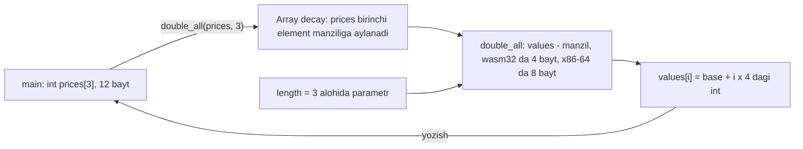
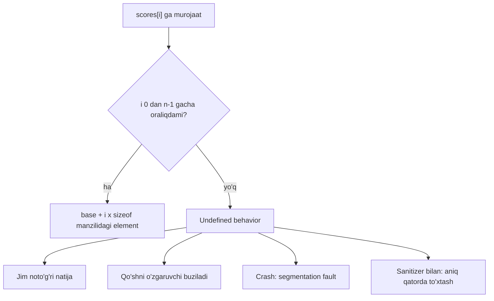

## Bu dars nima uchun kerak

Hozirgacha har bir qiymat uchun alohida o'zgaruvchi e'lon qildik: `int score1`, `int score2`, `int score3`. Uchta ball uchun bu chidasa bo'ladi, lekin 30 o'quvchi yoki bir yillik kunlik harorat (365 qiymat) uchun bu imkonsiz: har bir o'zgaruvchi uchun alohida qator, alohida qo'shish, alohida chiqarish. Bundan ham yomoni, qiymatlar soni dastur yozilganda ma'lum bo'lmasa, o'zgaruvchilar nomini oldindan yozib bo'lmaydi.

**Massiv** (array) bu muammoni hal qiladi: bir xil tipdagi ko'p qiymat bitta nom ostida, xotirada yonma-yon saqlanadi va har biriga raqam (indeks) orqali murojaat qilinadi. Indeks o'zgaruvchi bo'lishi mumkinligi sababli, massiv sikl bilan birga ishlaydi: bitta `for` 3 ta ham, 3 million ta ham elementni qayta ishlaydi.

Massiv - kursning keyingi qismining poydevori. 12-darsda satr (string) aslida `char` massivi ekanini ko'ramiz, 15-19-darslarda qidiruv va saralash algoritmlari massiv ustida ishlaydi, 21-darsda massiv nomi va pointer orasidagi bog'liqlik ochiladi. 2-darsdagi bit va baytlar, 6-darsdagi tip o'lchamlari va 10-darsdagi off-by-one xatosi shu darsda bir joyga yig'iladi.

Bu darsdan keyin siz:

- massivni e'lon qilish, initsializatsiya qilish va elementlariga indeks orqali murojaat qilishni bilasiz;
- nega indeks 0 dan boshlanishini manzil formulasi orqali tushuntira olasiz;
- i-elementning manzilini base + i · sizeof(element) formulasi bilan hisoblay olasiz;
- `sizeof(arr) / sizeof(arr[0])` qachon ishlashini va qachon ishlamasligini bilasiz;
- massivni sikl bilan to'ldirish, yig'indi va o'rtachani hisoblashni yoza olasiz;
- massivni funksiyaga uzatganda nima uchun uzunlikni alohida berish kerakligini tushuntira olasiz;
- ikki o'lchovli massivning xotirada qatorma-qator (row-major) joylashuvini hisoblay olasiz;
- massiv chegarasidan chiqish nima uchun xavfli ekanini va brauzer muhiti uni qanday ushlashini bilasiz.

## Massiv nima va qanday e'lon qilinadi

C da massiv - bir xil tipdagi elementlarning xotirada **ketma-ket**, orasida bo'shliqsiz joylashgan cheklangan ketma-ketligi. cppreference ta'rifi ham aynan shu ikki xususiyatni ta'kidlaydi: elementlar ketma-ket joylashgan va massivning o'lchami u yashagan davr davomida o'zgarmaydi.

E'lon qilish uchun tip, nom va kvadrat qavs ichida elementlar soni yoziladi:

```c
int scores[5];
```

Bu "5 ta int uchun joy ajrat va unga `scores` deb nom ber" degani. 6-darsdan bilamizki, `int` ko'p platformalarda (jumladan, bu kursning brauzer muhitida va oddiy x86-64 kompyuterda) 4 bayt. Demak massiv 5 · 4 = 20 bayt oladi.

Elementga murojaat - **indekslash**: `scores[0]` birinchi element, `scores[4]` oxirgisi. Indeks har qanday butun ifoda bo'lishi mumkin: `scores[i]`, `scores[n - 1]`, `scores[i + 1]`. Shu sababli massiv sikl bilan juda tabiiy ishlaydi.

### Initsializatsiya shakllari

Massivga e'lon paytida boshlang'ich qiymat berish mumkin. Qoidalar cppreference ning array initialization va initialization sahifalarida keltirilgan:

| Yozuv | Natija | Izoh |
|---|---|---|
| `int a[5] = {1, 2, 3, 4, 5};` | 1, 2, 3, 4, 5 | Har bir element aniq berilgan |
| `int a[5] = {1, 2, 3};` | 1, 2, 3, 0, 0 | Berilmagan elementlar 0 bilan to'ldiriladi |
| `int a[5] = {0};` | 0, 0, 0, 0, 0 | Hammasini nolga tenglashning qisqa usuli |
| `int a[] = {7, 8, 9};` | 7, 8, 9 | O'lcham initsializatordan olinadi: 3 element |
| `int a[5];` (funksiya ichida) | Noma'lum qiymatlar | Lokal massiv avtomatik tozalanmaydi |
| `int a[5];` (funksiyadan tashqarida) | 0, 0, 0, 0, 0 | Global massiv nol bilan boshlanadi |

Oxirgi ikki qator muhim farq. Funksiya ichida initsializatsiyasiz e'lon qilingan massivda shu xotirada oldin nima bo'lgan bo'lsa, o'sha "axlat" qiymatlar (garbage values) turadi. Ularni o'qish 10-darsdagi `-Wuninitialized` xatosining massiv shakli. Stack va garbage values 24-darsda chuqur ko'riladi.

Massivlarni `=` bilan bir-biriga o'zlashtirib bo'lmaydi: `int b[5]; b = a;` kompilyatsiya xatosi. Nusxa olish uchun elementma-element sikl kerak.

O'lcham haqida bir eslatma. O'lchamni bir joyda nomlash foydali (10-darsdagi design qoidasi): massiv hajmi o'zgarsa, faqat bir joyni tahrirlaysiz. C da buning eng oddiy usuli 9-darsda ko'rilgan preprocessor direktivasi `#define COUNT 4`: preprocessor kompilyatsiyadan oldin `COUNT` ni 4 ga almashtiradi. `const int N = 4;` bilan e'lon qilingan nom esa C da integer constant expression hisoblanmaydi, shuning uchun funksiya ichidagi `int a[N]` standart bo'yicha VLA (variable length array, o'lchami ish vaqtida hisoblanadigan massiv) bo'ladi, VLA ga esa `{...}` bilan initsializator berib bo'lmaydi. gcc bunday kodni xato deb rad etadi, clang 18 esa massivni kengaytma sifatida oddiy massivga aylantiradi va `-Wgnu-folding-constant` ogohlantirishini chiqaradi. Shuning uchun bu darsda `#define` ishlatamiz.

## Xotirada joylashuv: nega indeks 0 dan boshlanadi

Massivning eng muhim xususiyati - elementlar orasida bo'shliq yo'q. Shuning uchun istalgan elementning manzilini hisoblash uchun faqat ikki narsa kerak: massiv boshining manzili (**base**) va bitta elementning o'lchami.

Formula:

manzil(a[i]) = base + i · sizeof(element)

Misol uchun shart: `int scores[5]` massivi 1000-baytdan boshlanadi (haqiqiy manzil har xil bo'ladi, formula esa bir xil).

| Element | Hisob | Egallagan baytlar |
|---|---|---|
| `scores[0]` | 1000 + 0 · 4 = 1000 | 1000-1003 |
| `scores[1]` | 1000 + 1 · 4 = 1004 | 1004-1007 |
| `scores[2]` | 1000 + 2 · 4 = 1008 | 1008-1011 |
| `scores[3]` | 1000 + 3 · 4 = 1012 | 1012-1015 |
| `scores[4]` | 1000 + 4 · 4 = 1016 | 1016-1019 |

Jadvaldan **zero-indexing** (indeksning noldan boshlanishi) sababi ko'rinadi: indeks - bu elementning tartib raqami emas, massiv boshidan **siljish** (offset), elementlar sonida o'lchangan. Birinchi element boshidan 0 element uzoqda, shuning uchun uning indeksi 0. Agar indekslar 1 dan boshlanganda, formula base + (i - 1) · sizeof bo'lar va har murojaatda qo'shimcha ayirish kerak bo'lardi.

Formulaning muhim natijasi: `scores[4]` ga murojaat `scores[0]` ga murojaat bilan bir xil tezlikda bo'ladi. Bitta ko'paytirish va bitta qo'shish - massiv uzunligidan qat'i nazar. Bu - massivning asosiy afzalligi: istalgan elementga **to'g'ridan-to'g'ri murojaat** (random access). 28-darsdagi linked list da esa 1000-elementga yetish uchun oldingi 999 tasidan o'tish kerak bo'ladi.

cppreference indekslashni aynan shunday ta'riflaydi: `E1[E2]` yozuvi `*((E1)+(E2))` bilan bir xil, ya'ni "boshlang'ich manzilga E2 ta element qo'sh va u yerdagi qiymatni ol". Bu yozuvdagi `*` va pointer arifmetikasi 21-22-darslarda batafsil ko'riladi; hozircha formula yetarli.

Endi buni haqiqiy xotirada tekshiramiz. Quyidagi dastur har bir elementning manzilini (`%p`) va massiv boshidan necha bayt uzoqligini chiqaradi:

```c run
#include <stdio.h>

int main(void)
{
    int scores[5] = {72, 85, 90};

    printf("sizeof(scores)    = %zu bayt\n", sizeof(scores));
    printf("sizeof(scores[0]) = %zu bayt\n", sizeof(scores[0]));
    printf("elementlar soni   = %zu\n", sizeof(scores) / sizeof(scores[0]));

    for (int i = 0; i < 5; i++)
    {
        long offset = (char *) &scores[i] - (char *) &scores[0];
        printf("scores[%d] = %2d   manzil %p   boshidan %2ld bayt\n", i, scores[i], (void *) &scores[i], offset);
    }
}
```

Linux x86-64 kompyuterda natija (manzillar har ishga tushirishda boshqacha bo'lishi mumkin):

```text
sizeof(scores)    = 20 bayt
sizeof(scores[0]) = 4 bayt
elementlar soni   = 5
scores[0] = 72   manzil 0x7ffc075e9c60   boshidan  0 bayt
scores[1] = 85   manzil 0x7ffc075e9c64   boshidan  4 bayt
scores[2] = 90   manzil 0x7ffc075e9c68   boshidan  8 bayt
scores[3] =  0   manzil 0x7ffc075e9c6c   boshidan 12 bayt
scores[4] =  0   manzil 0x7ffc075e9c70   boshidan 16 bayt
```

Kuzatishlar:

1. Qo'shni manzillar farqi har doim 4: 0x...c64 - 0x...c60 = 4 (o'n oltilik sanoqda, 2-dars). Bu `sizeof(int)`.
2. `scores[3]` va `scores[4]` nol, chunki initsializatorda faqat uchta qiymat berilgan.
3. Manzil uzunligi platformaga bog'liq. 64-bitli x86-64 da manzil 8 bayt (16 ta o'n oltilik raqamgacha), brauzer muhiti esa 32-bitli wasm32: unda manzil 4 bayt va `%p` qisqaroq son chiqaradi. Lekin "boshidan" ustuni ikkala muhitda bir xil: 0, 4, 8, 12, 16. Formulaga faqat element o'lchami ta'sir qiladi, manzil o'lchami emas.

`(char *)` ga aylantirish va `&` operatori bu yerda faqat baytlar farqini olish uchun ishlatilgan; ularning mexanikasi 21-darsda.

### `sizeof(arr) / sizeof(arr[0])`

`sizeof` operatori tip yoki ifodaning baytlardagi o'lchamini beradi. Massivga qo'llanganda u butun massiv o'lchamini qaytaradi: 20 bayt. Bitta element o'lchamiga bo'lsak, elementlar soni chiqadi: 20 / 4 = 5. Bu usulning afzalligi: massivga yangi qiymat qo'shilsa (`int a[] = {...}` ga), uzunlikni qo'lda yangilash shart emas. Element tipini `int` dan `double` ga o'zgartirsangiz ham ishlayveradi: 5 · 8 / 8 = 5.

Lekin bu usul **faqat massiv e'lon qilingan joyda** ishlaydi. Massiv funksiyaga uzatilganda u boshqa narsaga aylanadi va `sizeof` noto'g'ri javob beradi. Bu pastda alohida ko'riladi.

## Massiv va sikl: ballarning o'rtachasi

Massivning asosiy ishlatilishi - sikl bilan to'ldirish va qayta ishlash. Quyidagi dastur foydalanuvchidan 4 ta ball so'raydi (`get_int`, cs50.h dan), ularni massivga yozadi va o'rtachani alohida funksiyada hisoblaydi:

```c run
#include <cs50.h>
#include <stdio.h>

#define COUNT 4

float average(const int values[], int length);

int main(void)
{
    int scores[COUNT];

    for (int i = 0; i < COUNT; i++)
    {
        scores[i] = get_int("%d-ball: ", i + 1);
    }

    printf("O'rtacha: %.2f\n", average(scores, COUNT));
}

// length ta elementning o'rta arifmetigini qaytaradi
float average(const int values[], int length)
{
    int sum = 0;
    for (int i = 0; i < length; i++)
    {
        sum += values[i];
    }
    return (float) sum / length;
}
```

```text stdin
72
85
90
64
```

Natija:

```text
1-ball: 2-ball: 3-ball: 4-ball: O'rtacha: 77.75
```

(Brauzerda kirish qatorlari so'rovlardan keyin terminaldagidek ko'rinadi.) Hisob: 72 + 85 + 90 + 64 = 311, 311 / 4 = 77.75.

Bu kichik dasturda bir nechta qaror bor:

- **Sikl `i < COUNT`.** Indekslar 0, 1, 2, 3 - jami COUNT - 0 = 4 aylanish (10-darsdagi formula). `i <= COUNT` bo'lsa, 5-aylanishda `scores[4]` ga yozilardi - massivdan tashqarida.
- **Foydalanuvchiga `i + 1`.** Inson uchun "1-ball" tabiiy, dastur ichida esa indeks 0. Ikkalasini aralashtirmaslik uchun o'zgartirish faqat chiqishda.
- **`(float) sum / length`.** `sum / length` ikki int bo'lishi: 311 / 4 = 77, kasr qismi tashlanadi (6-dars). Bitta operandni float ga aylantirish butun ifodani kasrli bo'lishga o'tkazadi.
- **`const int values[]`.** `const` funksiya massivni o'zgartirmasligini va'da qiladi: `values[i] = 0;` yozilsa, kompilyator xato beradi. Bu - design qarori: funksiya imzosining o'zi "men faqat o'qiyman" deydi.
- **Uzunlik alohida parametr.** `average` massivning o'zini emas, uning boshini oladi. Nechta element borligini bilish uchun `length` kerak. Sababi keyingi bo'limda.

Brauzerda "Kirish" maydonidagi sonlarni o'zgartirib ko'ring, `COUNT` ni 5 qilib, beshinchi qator qo'shing.

## Massivni funksiyaga uzatish

C da funksiyaga oddiy `int` uzatilsa, funksiya uning **nusxasini** oladi (8-dars): funksiya ichidagi o'zgarish chaqiruvchiga ta'sir qilmaydi. Massiv bilan boshqacha. cppreference bo'yicha massiv tipidagi ifoda deyarli barcha kontekstlarda avtomatik ravishda **birinchi elementiga ko'rsatkichga** (pointer) aylanadi. Bu hodisa ko'pincha **array decay** deb ataladi. Istisnolar oz: `sizeof` operandi, `&` operandi, satr literali bilan massivni initsializatsiya qilish, shuningdek `_Alignof` (C11) va `typeof` (C23) operandi.

Funksiya parametri sifatida `int values[]` va `int *values` bir xil narsani bildiradi. Ya'ni funksiya massivning nusxasini emas, uning boshlang'ich manzilini oladi. Ikki oqibat:

1. Funksiya massiv elementlarini o'zgartirsa, chaqiruvchining massivi o'zgaradi (nusxa yo'q).
2. Funksiya massiv uzunligini bilmaydi. cppreference ham shuni aytadi: argument massivning o'lchami chaqirilgan funksiyaga yetib bormaydi va uni alohida uzatish kerak.



Ikkala oqibatni bitta dasturda ko'ramiz:

```c run
#include <stdio.h>

// Massivdagi har bir elementni ikki baravar oshiradi
void double_all(int values[], int length)
{
    printf("funksiya ichida sizeof(values) = %zu\n", sizeof(values));
    for (int i = 0; i < length; i++)
    {
        values[i] *= 2;
    }
}

// Oddiy int nusxa sifatida keladi: o'zgarishi chaqiruvchiga ta'sir qilmaydi
void double_one(int x)
{
    x *= 2;
}

int main(void)
{
    int prices[3] = {10, 20, 30};
    int single = 10;

    printf("main ichida sizeof(prices) = %zu\n", sizeof(prices));
    double_all(prices, 3);
    double_one(single);

    printf("prices: %d %d %d\n", prices[0], prices[1], prices[2]);
    printf("single: %d\n", single);
}
```

clang bu haqda sukut bo'yicha (hatto `-Wall` siz ham) darhol ogohlantiradi:

```text
warning: sizeof on array function parameter will return size of 'int *' instead of 'int[]' [-Wsizeof-array-argument]
```

Natija (brauzer muhitida, wasm32):

```text
main ichida sizeof(prices) = 12
funksiya ichida sizeof(values) = 4
prices: 20 40 60
single: 10
```

x86-64 kompyuterda ikkinchi qator `= 8` bo'ladi: u yerda manzil 8 bayt. Qolgan qatorlar bir xil.

`main` ichida `sizeof(prices)` = 3 · 4 = 12, chunki u yerda `prices` haqiqiy massiv. Funksiya ichida esa `values` - manzil, va `sizeof` manzil o'lchamini beradi. Shuning uchun funksiya ichida `sizeof(values) / sizeof(values[0])` yozilsa, wasm32 da 4 / 4 = 1, x86-64 da 8 / 4 = 2 chiqadi - ikkalasi ham noto'g'ri. Qoida: uzunlikni massiv e'lon qilingan joyda hisoblang va funksiyaga parametr sifatida bering.

`prices` o'zgardi (20 40 60), `single` esa yo'q (10). Bu farqning chuqur sababi - pointer orqali uzatish - 25-darsda ko'riladi.

### C massivi va JavaScript massivi

JavaScript dan kelgan bo'lsangiz, `[]` sintaksisi tanish, lekin ostidagi narsa butunlay boshqa:

| Xususiyat | C massivi | JavaScript `Array` |
|---|---|---|
| O'lcham | E'londa belgilanadi, o'zgarmaydi | `push`, `pop` bilan o'zgaradi |
| Element tipi | Hammasi bir xil (`int`, `double` ...) | Har xil bo'lishi mumkin |
| Uzunlik | Massiv o'zi bilmaydi, alohida saqlash kerak | `arr.length` har doim mavjud |
| Chegaradan tashqari o'qish | Undefined behavior | `undefined` qaytaradi |
| Funksiyaga uzatish | Birinchi element manzili (decay) | Obyektga havola |
| O'zlashtirish `a = b` | Kompilyatsiya xatosi | Ikkala nom bitta massivga qaraydi |
| Xotirada | Elementlar yonma-yon, bo'shliqsiz | Dvigatel ichki ko'rinishni o'zi tanlaydi |

Eng xavfli farq - to'rtinchi qator. JS da `arr[10]` mavjud bo'lmasa, `undefined` olasiz va dastur davom etadi. C da esa hech qanday tekshiruv yo'q.

## Ko'p o'lchovli massivlar

Jadval, taxta yoki rasm kabi ikki o'lchovli ma'lumot uchun **ko'p o'lchovli massiv** ishlatiladi:

```c
int grid[3][4];
```

cppreference ta'rifi bo'yicha bu "4 ta int dan iborat massivlarning 3 elementli massivi": `grid[1]` - bitta qator (4 ta int), `grid[1][2]` - shu qatorning 2-elementi. Xotirada esa ikkinchi o'lchov yo'q: 3 · 4 = 12 ta int bitta uzun qatorda turadi. Tartibi **row-major** (qatorma-qator): avval 0-qatorning hamma elementlari, keyin 1-qator, keyin 2-qator.

Manzil formulasi R qator va C ustunli massiv uchun:

manzil(grid[r][c]) = base + (r · C + c) · sizeof(element)

Misol: `grid[2][1]`, C = 4, sizeof(int) = 4. Siljish (2 · 4 + 1) · 4 = 9 · 4 = 36 bayt. Butun massiv 3 · 4 · 4 = 48 bayt, bitta qator `sizeof(grid[0])` = 4 · 4 = 16 bayt.

```c run
#include <stdio.h>

#define ROWS 3
#define COLS 4

int main(void)
{
    int grid[ROWS][COLS];

    for (int r = 0; r < ROWS; r++)
    {
        for (int c = 0; c < COLS; c++)
        {
            grid[r][c] = r * 10 + c;
        }
    }

    printf("sizeof(grid) = %zu, sizeof(grid[0]) = %zu\n", sizeof(grid), sizeof(grid[0]));

    for (int r = 0; r < ROWS; r++)
    {
        for (int c = 0; c < COLS; c++)
        {
            long offset = (char *) &grid[r][c] - (char *) &grid[0][0];
            printf("[%d][%d]=%2d @%2ld  ", r, c, grid[r][c], offset);
        }
        printf("\n");
    }
}
```

Natija:

```text
sizeof(grid) = 48, sizeof(grid[0]) = 16
[0][0]= 0 @ 0  [0][1]= 1 @ 4  [0][2]= 2 @ 8  [0][3]= 3 @12  
[1][0]=10 @16  [1][1]=11 @20  [1][2]=12 @24  [1][3]=13 @28  
[2][0]=20 @32  [2][1]=21 @36  [2][2]=22 @40  [2][3]=23 @44  
```

`[2][1]` ning siljishi 36 - formula bilan bir xil. `[0][3]` (12) va `[1][0]` (16) orasida ham 4 bayt: 0-qatorning oxiri va 1-qatorning boshi yonma-yon. Ya'ni `grid[0][4]` yozilsa, u xato bo'lsa ham, xotirada `grid[1][0]` ning joyiga tushadi. Bu - ko'p o'lchovli massivlardagi indeks xatolari nima uchun sezilmasligining sababi.

Row-major tartibning amaliy ahamiyati: tashqi siklda qator, ichki siklda ustun bo'yicha yurish xotirani ketma-ket o'qiydi (0, 4, 8, ... baytlar). Teskari tartib (tashqi siklda ustun) har qadamda 16 bayt sakraydi.

Ikki o'lchovli massivni funksiyaga uzatganda ustunlar soni parametrda ko'rsatilishi shart (`void print_grid(int rows, int grid[][COLS])`): kompilyator r · C + c ni hisoblash uchun C ni bilishi kerak, qatorlar soni esa xuddi bir o'lchovli massivdagi kabi alohida beriladi.

## Chegaradan chiqish: undefined behavior

Massivning kuchi (formula bo'yicha to'g'ridan-to'g'ri murojaat) uning zaif tomoni ham. C kompilyatori `scores[i]` ni hisoblaganda i massiv ichidami yoki yo'qmi, tekshirmaydi: base + i · 4 manzilga boradi va u yerda nima bo'lsa, o'qiydi yoki yozadi. i = 5 bo'lsa - massivdan keyingi 4 bayt, i = -1 bo'lsa - massivdan oldingi 4 bayt.

C standarti bo'yicha massiv chegarasidan tashqariga murojaat **undefined behavior**. cppreference ning undefined behavior sahifasida aynan shunday misol bor: 4 elementli massiv ustidagi sikl `i <= 4` sharti bilan yozilgan, va optimizatsiya bilan kompilyator butun funksiyani "doim 1 qaytar" ga qisqartirishi mumkinligi ko'rsatilgan, chunki to'g'ri dasturda chegaradan chiqish bo'lmaydi deb faraz qilishga haqli. Ya'ni UB faqat "noto'g'ri qiymat o'qiladi" degani emas: dastur mantiqi kutilmagan tarzda o'zgarishi mumkin.

Oddiy kompilyatsiyada oqibat uch xil bo'lishi mumkin:

- **Jim noto'g'ri natija.** Qo'shni o'zgaruvchining qiymati o'qiladi va hisobga qo'shiladi.
- **Boshqa o'zgaruvchining buzilishi.** Chegaradan tashqariga **yozish** qo'shni o'zgaruvchini (masalan, sikl hisoblagichini) o'zgartiradi va xato butunlay boshqa joyda namoyon bo'ladi.
- **Crash.** Manzil dasturga tegishli bo'lmagan xotiraga tushsa, operatsion tizim dasturni to'xtatadi (segmentation fault).

Eng xavflisi birinchisi, chunki hech qanday belgi yo'q. Quyidagi dasturda global massiv va uning ustidagi off-by-one sikl bor:

```c run
#include <stdio.h>

int limits[3] = {100, 200, 300};
int total = 0;

int main(void)
{
    for (int i = 0; i <= 3; i++)
    {
        total += limits[i];
    }
    printf("Jami: %d\n", total);
}
```

Shu kodni Linux x86-64 da oddiy `clang -O0 -Wall` bilan kompilyatsiya qilib ishga tushirganda `Jami: 600` chiqdi - go'yo hammasi joyida. Aslida `limits[3]` massivdan keyingi 4 baytni o'qidi va u yerda tasodifan nol turgan. Boshqa kompilyator, boshqa optimizatsiya darajasi yoki qo'shni o'zgaruvchining boshqa qiymati bilan natija boshqacha bo'lardi.

Kursning brauzer muhiti esa har bir massiv atrofida taqiqlangan zonalar qo'yadi va shu dasturni ishga tushirganda to'xtatadi (manzilning aniq soni `0x...` bilan almashtirilgan):

```text
XOTIRA XATOSI: global-buffer-overflow: global massiv chegarasidan tashqarida
O'qish: 4 bayt, manzil 0x...

main.c:10:18, main funksiyasida:
  10 |         total += limits[i];
     |                  ^
```

Global (funksiyadan tashqarida e'lon qilingan) massiv uchun `global-buffer-overflow`, funksiya ichidagi lokal massiv uchun `stack-buffer-overflow` (10-darsdagi misol) chiqadi. Hisob bilan: massiv 3 · 4 = 12 bayt (0-11), `limits[3]` 3 · 4 = 12-baytdan boshlanadi, ya'ni massiv tugagan joyda. Tuzatish: `i < 3`, yoki yaxshirog'i, uzunlikni `sizeof(limits) / sizeof(limits[0])` bilan bir marta hisoblash.

Muhim: brauzer muhiti xatoni faqat u **sodir bo'lganda** topadi. Agar chegaradan chiqadigan kod yo'li sizning kirishingizda bajarilmasa, xato ko'rinmaydi. Shuning uchun chegaraviy holatlarni (bo'sh massiv, bitta element, oxirgi element) ataylab sinab ko'ring.



## Ko'p uchraydigan xatolar

1. **`i <= n` sharti.** n elementli massivning oxirgi indeksi n - 1. `for (int i = 0; i <= n; i++)` n + 1 marta aylanadi va oxirgi aylanishda massivdan tashqariga chiqadi.
2. **Funksiya ichida `sizeof(arr) / sizeof(arr[0])`.** Parametr - manzil, shuning uchun natija wasm32 da 1, x86-64 da 2 bo'ladi. Uzunlikni chaqiruvchida hisoblab, parametr sifatida bering. clang bu holatda sukut bo'yicha `-Wsizeof-array-argument` bilan ogohlantiradi.
3. **Lokal massivni initsializatsiyasiz o'qish.** `int a[5];` funksiya ichida nolga tenglashmaydi. Yig'indi yoki hisoblagich uchun `= {0}` yozing yoki siklda to'ldiring.
4. **1 dan boshlanadigan indeks.** Inson tilidagi "birinchi element" `a[0]`. 1 dan boshlab sanash `a[0]` ni tashlab ketadi va `a[n]` ga chiqadi. Insonga ko'rsatish uchun `i + 1` faqat chiqishda.
5. **Massivni `=` bilan nusxalash yoki `==` bilan solishtirish.** `b = a` xato, `a == b` esa kompilyatsiya bo'ladi, lekin qiymatlarni emas, manzillarni solishtiradi. Ikkala amal ham sikl bilan elementma-element bajariladi.
6. **Butun sonli bo'lish bilan o'rtacha.** `sum / n` int bo'lsa, kasr qismi yo'qoladi. `(float) sum / n` yozing.
7. **Ikki o'lchovli massivda indekslar tartibini almashtirish.** `grid[c][r]` - noto'g'ri element, yoki ustunlar qatorlardan ko'p bo'lsa, chegaradan chiqish. Row-major: birinchi indeks qator.
8. **"Lokal mashinada ishladi" ga ishonish.** Chegaradan chiqish oddiy kompilyatsiyada jim o'tishi mumkin. Sanitizer bilan (brauzer muhiti yoki `-fsanitize=address`) tekshiring.

## Xulosa

- Massiv - bir xil tipdagi elementlarning xotirada yonma-yon, bo'shliqsiz joylashgan, o'lchami o'zgarmaydigan ketma-ketligi.
- i-element manzili: base + i · sizeof(element). Indeks - boshidan siljish, shuning uchun u 0 dan boshlanadi va istalgan elementga murojaat bir xil tezlikda.
- Initsializatsiya: berilmagan elementlar 0 bo'ladi, `int a[] = {...}` o'lchamni o'zi oladi; lokal initsializatsiyasiz massivda garbage values turadi.
- `sizeof(arr) / sizeof(arr[0])` elementlar sonini faqat massiv e'lon qilingan joyda beradi.
- Funksiyaga uzatilganda massiv birinchi elementining manziliga aylanadi (array decay): funksiya uni o'zgartira oladi, lekin uzunligini bilmaydi, shuning uchun uzunlik alohida parametr.
- Manzil o'lchami platformaga bog'liq: brauzer muhitida (wasm32) 4 bayt, x86-64 da 8 bayt; `int` ikkalasida 4 bayt.
- Ko'p o'lchovli massiv row-major tartibda: `grid[r][c]` siljishi (r · C + c) · sizeof(element).
- Chegaradan chiqish undefined behavior: jim xato, buzilgan qo'shni o'zgaruvchi yoki crash. Brauzer muhiti uni `stack-buffer-overflow` yoki `global-buffer-overflow` sifatida aniq qatorda ushlaydi.

## Amaliy topshiriq

Bir haftalik (7 kun) kunlik haroratlar statistikasini hisoblaydigan dastur yozing. Harorat butun son (manfiy ham bo'lishi mumkin) va `get_int` bilan o'qiladi.

Topshiriq qadamlari:

1. **Massiv va o'qish.** `#define DAYS 7` va `int temps[DAYS]` e'lon qiling. Sikl bilan 7 ta qiymatni o'qing; so'rovda kun raqamini 1 dan 7 gacha ko'rsating, indeks esa 0 dan 6 gacha bo'lsin.
2. **Funksiyalar.** Uchta funksiya yozing: `min_value`, `max_value` va `average`. Har biri `const int values[]` va `int length` oladi. `min_value` va `max_value` boshlang'ich qiymatni `values[0]` dan olsin (nima uchun 0 dan emas - izohlang: hamma harorat manfiy bo'lsa nima bo'ladi?).
3. **O'rtachadan yuqori kunlar.** O'rtachadan qat'iy yuqori haroratli kunlar sonini va ularning raqamlarini (1-7) chiqaring.
4. **Teskari tartib.** Haroratlarni oxirgi kundan birinchisiga qarab chiqaring. Sikl chegaralarini yozing va indeks hech qachon -1 yoki 7 bo'lmasligini ko'rsating.
5. **Manzil hisobi.** `temps` massivi uchun: butun massiv necha bayt, `temps[6]` boshidan necha baytda, `temps[7]` qaysi baytdan boshlanardi? Formulani yozing. Agar dastur `int week[4][DAYS]` (4 hafta) bilan ishlasa, `week[2][3]` siljishi necha bayt?
6. **Chegaradan chiqishni sinash.** 4-qadamdagi siklni ataylab `i >= -1` ga o'zgartiring, brauzerda ishga tushiring va hisobotni ko'chiring. Keyin tuzating.

Boshlang'ich shablon (funksiyalar hozircha noto'g'ri qiymat qaytaradi):

```c run
#include <cs50.h>
#include <stdio.h>

#define DAYS 7

int min_value(const int values[], int length);
int max_value(const int values[], int length);
float average(const int values[], int length);

int main(void)
{
    int temps[DAYS];
    for (int i = 0; i < DAYS; i++)
    {
        temps[i] = get_int("%d-kun harorati: ", i + 1);
    }

    printf("\nMin: %d, Max: %d, O'rtacha: %.2f\n", min_value(temps, DAYS), max_value(temps, DAYS),
           average(temps, DAYS));
}

// Eng kichik qiymat
int min_value(const int values[], int length)
{
    // Yechimingizni shu yerga yozing
    return 0;
}

// Eng katta qiymat
int max_value(const int values[], int length)
{
    // Yechimingizni shu yerga yozing
    return 0;
}

// O'rta arifmetik
float average(const int values[], int length)
{
    // Yechimingizni shu yerga yozing
    return 0;
}
```

```text stdin
-3
2
5
-1
7
4
0
```

Shu kirish uchun to'g'ri natija: Min -3, Max 7, o'rtacha (-3 + 2 + 5 - 1 + 7 + 4 + 0) / 7 = 14 / 7 = 2.00, o'rtachadan yuqori kunlar: 3, 5, 6 (jami 3 ta).

Yaxshi javobda bo'lishi kerak bo'lgan narsalar:

- barcha sikllar `i < DAYS` yoki `i < length` shaklida, teskari sikl `i = length - 1` dan `i >= 0` gacha;
- min va max `values[0]` dan boshlangan va nima uchun 0 bilan boshlash hammasi manfiy kirishda xato berishi tushuntirilgan;
- o'rtacha `(float) sum / length` bilan hisoblangan, natija 2.00;
- funksiyalar uzunlikni parametr orqali oladi va ichida `sizeof` bilan uzunlik hisoblanmaydi;
- manzil hisoblari: massiv 7 · 4 = 28 bayt, `temps[6]` 24-baytda, `temps[7]` 28-baytda (massivdan tashqarida), `week[2][3]` siljishi (2 · 7 + 3) · 4 = 68 bayt;
- 6-qadamdagi `stack-buffer-overflow` hisoboti va unda ko'rsatilgan qator keltirilgan.

Javobingizni pastdagi maydonga yozing va yuqoridagi mezonlar bilan solishtiring.

## Manbalar

- CS50x. [Lecture 2 notes](https://cs50.harvard.edu/x/notes/2/) - "Arrays" bo'limi: ballar misoli, `get_int` bilan siklda to'ldirish, massivni funksiyaga uzatish, xotirada yonma-yon joylashuv.
- cppreference. [Array declaration](https://en.cppreference.com/w/c/language/array) - massiv ta'rifi (ketma-ket joylashgan, o'lchami o'zgarmas), "Variable-length arrays", "Array to pointer conversion" va uning istisnolari, parametrdagi massiv, "Multidimensional arrays" (row-major).
- cppreference. [Array initialization](https://en.cppreference.com/w/c/language/array_initialization) - berilmagan elementlarning nol bilan to'ldirilishi, `{0}`, o'lchamsiz massiv, VLA ga initsializator berib bo'lmasligi.
- cppreference. [Initialization](https://en.cppreference.com/w/c/language/initialization) - "Implicit initialization": lokal (automatic) obyektlar noaniq qiymatli, global (static) obyektlar nol bilan boshlanadi.
- cppreference. [Member access operators](https://en.cppreference.com/w/c/language/operator_member_access) - "Subscript" bo'limi: `E1[E2]` ning `*((E1)+(E2))` bilan bir xilligi, ikki o'lchovli massivga `[]` ni ikki marta qo'llash.
- cppreference. [Undefined behavior](https://en.cppreference.com/w/c/language/behavior) - "Access out of bounds" bo'limi: `i <= 4` sikli misoli va kompilyator optimizatsiyasi.
- Clang. [Diagnostic flags in Clang](https://clang.llvm.org/docs/DiagnosticsReference.html) - `-Wsizeof-array-argument` (sukut bo'yicha yoqilgan) va `-Wgnu-folding-constant` ogohlantirishlari.
- CS50. [Style Guide for C](https://cs50.readthedocs.io/style/c/) - "Loops" va "Variables" bo'limlari: sikl hisoblagichlari va nomlash, kodlar shu uslubda yozilgan.
