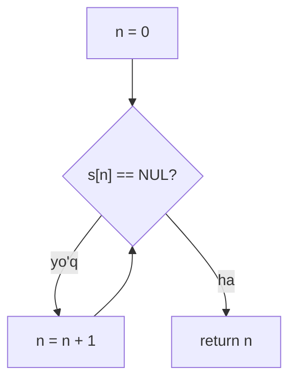

## Bu dars nima uchun kerak

5-darsdan beri `string name = get_string("Ismingiz: ");` yozib, satrni xuddi `int` kabi oddiy qiymat deb ishlatdik. Lekin C tilida alohida "satr" tipi yo'q. `string` - CS50 kutubxonasi bergan qulay nom, uning ostida esa 11-darsda ko'rgan narsa turibdi: xotirada yonma-yon joylashgan baytlar massivi. Farqi bitta: satr qayerda tugashini massiv o'zi bilmaydi, shuning uchun oxiriga maxsus belgi - nol bayt qo'yiladi.

Shu bitta qaror C dagi satrlar bilan bog'liq deyarli hamma narsani tushuntiradi: nega `strlen` satr uzunligini "hisoblaydi" (va bu bepul emas), nega ikkita satrni `==` bilan solishtirib bo'lmaydi, nega `strcpy` xavfli va nega dunyodagi xavfsizlik zaifliklarining katta qismi satr buferlaridan boshlanadi. 2-darsda NUL belgisini ASCII jadvalida ko'rgan edik, 11-darsda massiv chegarasidan chiqishni ko'rdik - bu dars ikkalasini birlashtiradi.

Bu darsdan keyin siz:

- satrning xotiradagi ko'rinishini baytma-bayt chizib, uning necha bayt egallashini hisoblay olasiz;
- `string` aslida nima ekanini va `char s[]` bilan farqini bilasiz;
- `strlen` ni o'zingiz yoza olasiz va uni sikl shartida chaqirish narxini formulada ko'rsata olasiz;
- satrni belgi-belgi aylanib, ASCII arifmetikasi va `ctype.h` funksiyalari bilan harflarni o'zgartira olasiz;
- satrlarni nima uchun `strcmp` bilan solishtirish kerakligini va uning natijasini qanday o'qishni bilasiz;
- `strcpy` va `strcat` uchun bufer hajmini to'g'ri hisoblay olasiz va bufer to'lib ketishi qanday ko'rinishini bilasiz;
- satrlar massivi (`string words[3]`) va ikki o'lchovli `char` massivini farqlay olasiz.

## Satr xotirada: char massivi va NUL

C standarti satrni shunday ta'riflaydi: birinchi nol baytgacha bo'lgan va uni ham o'z ichiga olgan belgilar ketma-ketligi. cppreference buni **null-terminated byte string** (NTBS) deb ataydi: nolga teng bo'lmagan baytlar va ulardan keyin qiymati 0 bo'lgan bitta bayt. O'sha oxirgi bayt **NUL terminator** (satr tugatuvchisi) deyiladi, C kodida u `'\0'` ko'rinishida yoziladi. Bu ASCII jadvalidagi 0-kodli belgi (2-dars), raqam `'0'` (kodi 48) bilan adashtirmang.

`"HI!"` ni olaylik. Ko'zga uchta belgi ko'rinadi, xotirada esa to'rtta bayt:

| Indeks | 0 | 1 | 2 | 3 |
|---|---|---|---|---|
| Belgi | `'H'` | `'I'` | `'!'` | `'\0'` |
| Kod (o'nlik) | 72 | 73 | 33 | 0 |
| Kod (hex) | 0x48 | 0x49 | 0x21 | 0x00 |

Ya'ni n ta ko'rinadigan belgili satr xotirada n + 1 bayt egallaydi. Bu "+1" kursning eng ko'p unutiladigan qismi va pastdagi xatolarning yarmi shundan.

cppreference string literal sahifasi bo'yicha `"HI!"` kabi literal tipi `char[N]`, bu yerda N terminatorni ham o'z ichiga oladi: `"HI!"` - `char[4]`. Buni o'zingiz ko'ring:

```c run
#include <stdio.h>
#include <string.h>

int main(void)
{
    char s[] = "HI!";

    printf("sizeof(s) = %zu, strlen(s) = %zu\n", sizeof(s), strlen(s));
    for (int i = 0; i < (int) sizeof(s); i++)
    {
        printf("s[%d] = %3d  '%c'\n", i, s[i], s[i] ? s[i] : '.');
    }
}
```

Natija:

```text
sizeof(s) = 4, strlen(s) = 3
s[0] =  72  'H'
s[1] =  73  'I'
s[2] =  33  '!'
s[3] =   0  '.'
```

`sizeof` massivning to'liq o'lchamini beradi (4 bayt, terminator bilan), `strlen` esa terminatorgacha bo'lgan belgilar sonini (3). NUL ekranga chiqmaydigan belgi bo'lgani uchun uning o'rniga nuqta chiqardik. `%3d` bilan `char` ni son sifatida chop etish 2-darsdagi fikrni tasdiqlaydi: belgi - bu shunchaki kichik butun son.

### Xotirada qo'shni satrlar

Bir nechta satr e'lon qilinsa, ular xotirada bir-biriga yaqin turishi mumkin. Faraz qilaylik, `"OK"` 2000-baytdan, undan keyin `"SALOM"` boshlanadi (haqiqiy manzillar kompilyatorga bog'liq, bu faqat model):

| Manzil | 2000 | 2001 | 2002 | 2003 | 2004 | 2005 | 2006 | 2007 | 2008 |
|---|---|---|---|---|---|---|---|---|---|
| Bayt | `O` | `K` | `\0` | `S` | `A` | `L` | `O` | `M` | `\0` |

Ikki satr jami 3 + 6 = 9 bayt. Ular orasida "chegara" yo'q, faqat NUL. `printf("%s", ...)` 2000-baytdan boshlab chop etadi va 2002-baytdagi nolni ko'rib to'xtaydi. Agar 2002-baytdagi NUL qandaydir sabab bilan o'chib ketsa, `printf` "OKSALOM" chiqaradi va 2008-baytgacha davom etadi. NUL - satrning yagona chegarasi, va uni hech kim avtomatik tekshirmaydi.

### NUL bo'lmasa nima bo'ladi

C massivni satr literali bilan aniq o'lchamda initsializatsiya qilishga ruxsat beradi, hatto terminatorga joy qolmasa ham: `char t[3] = "HI!";` xato emas, faqat `t` da NUL yo'q (cppreference array initialization sahifasi bu holatni alohida ko'rsatadi). Bunday massiv satr emas, shunchaki uchta `char`. Uni `printf("%s", t)` yoki `strlen(t)` ga bersangiz, funksiya massiv oxiridan keyin ham nol bayt topguncha o'qiyveradi. Bu 11-darsdagi chegaradan chiqish: undefined behavior. Brauzer muhiti buni `stack-buffer-overflow` (o'qish) sifatida to'xtatadi.

```c
char t[3] = "HI!";   // 3 bayt: 'H' 'I' '!' - NUL uchun joy yo'q
printf("%s\n", t);   // UB: NUL qidirib massivdan tashqariga chiqadi
```

Qoida: satr saqlaydigan massiv o'lchami kamida "belgilar soni + 1". O'lchamni yozmay, `char s[] = "HI!";` deb qoldirish eng xavfsiz: kompilyator o'zi 4 ni hisoblaydi.

### `string` aslida nima

CS50 kutubxonasining `cs50.h` faylida bitta qator bor:

```c
typedef char *string;
```

typedef kalit so'zi mavjud tipga yangi nom beradi. Demak `string` - bu `char *`, ya'ni "`char` ning manzili" (**pointer**, ko'rsatkich). `string name = get_string(...)` da `name` ichida harflar emas, birinchi harfning xotiradagi manzili turadi; harflarning o'zi boshqa joyda, `get_string` ajratgan massivda. Brauzer muhitida (wasm32) bu manzil 4 bayt, x86-64 da 8 bayt.

Hozircha shuni bilish yetarli: `string s` ham, `char s[]` ham `s[i]` bilan indekslanadi, `printf("%s")`, `strlen`, `strcmp` ga bir xil beriladi, chunki 11-darsdagi array decay tufayli massiv ham funksiyaga manzil sifatida yetib boradi. Pointer va manzillar 21-22-darslarda batafsil ko'riladi, `get_string` ichidagi xotira ajratish esa 23-24-darslarda.

Bitta amaliy farq hozirdan muhim. `char *p = "HI!";` yozilsa, `p` literalning o'ziga qaraydi, cppreference bo'yicha literalni o'zgartirish esa undefined behavior (u faqat o'qiladigan xotirada turishi mumkin). `char a[] = "HI!";` esa literaldan **nusxa** oladi, va `a[0] = 'h';` mutlaqo to'g'ri. Satrni o'zgartirmoqchi bo'lsangiz, uni massivga oling.

## strlen: NUL gacha sanash

Satrda uning uzunligi saqlanmaydi. Uzunlikni bilishning yagona yo'li - boshidan yurib, NUL gacha sanash. `string.h` dagi `strlen` aynan shuni qiladi. Uni o'zimiz yozsak:

```c
size_t my_strlen(const char *s)
{
    size_t n = 0;
    while (s[n] != '\0')
    {
        n++;
    }
    return n;
}
```

`size_t` - o'lcham va uzunliklar uchun unsigned tip (`sizeof` ham shu tipni qaytaradi, `printf` da `%zu`). `const char *s` - "faqat o'qiladigan satr": funksiya uni o'zgartirmaydi.



n belgili satr uchun shart n + 1 marta tekshiriladi: n ta harf va bitta NUL. Ya'ni `strlen` ning ishi satr uzunligiga proporsional, **O(n)** (asimptotik belgilar 16-darsda chuqur ko'riladi). 3 belgili satr uchun 4 qadam, million belgili satr uchun million va bitta qadam.

### Sikl shartidagi `strlen`

Satrni aylanishning eng tabiiy ko'rinadigan usuli:

```c
for (int i = 0; i < strlen(s); i++)
```

Muammo shundaki, `for` sharti har aylanishdan oldin qayta hisoblanadi. Ya'ni `strlen` n + 1 marta chaqiriladi va har chaqiruv n + 1 bayt o'qiydi. Jami (n + 1) · (n + 1) = (n + 1)² o'qish. To'g'ri usul - uzunlikni bir marta hisoblash:

```c
for (int i = 0, n = strlen(s); i < n; i++)
```

Bu holda `strlen` bir marta ishlaydi: n + 1 o'qish. Farqni o'lchaymiz. Quyidagi dastur `strlen` ning nusxasida har bir o'qilgan baytni sanaydi:

```c run
#include <stdio.h>
#include <string.h>

long reads = 0;

// strlen nusxasi: har o'qilgan baytni sanaydi
size_t counting_strlen(const char *s)
{
    size_t n = 0;
    while (reads++, s[n] != '\0')
    {
        n++;
    }
    return n;
}

int main(void)
{
    static char s[1001];
    int sizes[] = {10, 100, 1000};

    for (int k = 0; k < 3; k++)
    {
        int len = sizes[k];
        memset(s, 'a', len);
        s[len] = '\0';

        reads = 0;
        for (size_t i = 0; i < counting_strlen(s); i++)
        {
        }
        long in_condition = reads;

        reads = 0;
        for (size_t i = 0, n = counting_strlen(s); i < n; i++)
        {
        }
        printf("n = %4d: shartda %8ld o'qish, bir marta %5ld o'qish\n", len, in_condition, reads);
    }
}
```

Natija:

```text
n =   10: shartda      121 o'qish, bir marta    11 o'qish
n =  100: shartda    10201 o'qish, bir marta   101 o'qish
n = 1000: shartda  1002001 o'qish, bir marta  1001 o'qish
```

Formula bilan bir xil: n = 1000 da (1000 + 1)² = 1 002 001 va 1000 + 1 = 1001. Ming belgili satr uchun ming baravar ko'p ish. Satr uzunligi 10 marta oshganda birinchi usul 100 marta sekinlashadi - bu kvadratik o'sish. Optimizatsiyali kompilyator ba'zan `strlen` ni sikldan tashqariga chiqara oladi, lekin buning kafolati yo'q (masalan, sikl ichida satr o'zgarsa, chiqara olmaydi). CS50 style guide misollarida ham uzunlik aynan shunday, `for` ning boshlang'ich qismida bir marta hisoblanadi.

`memset(s, 'a', len)` - `string.h` dagi funksiya, massivning birinchi `len` baytini bitta qiymat bilan to'ldiradi. NUL ni esa o'zimiz qo'ydik: `memset` satr haqida hech narsa bilmaydi.

## Belgi-belgi aylanish: ASCII arifmetikasi va ctype.h

Satr - massiv, demak har bir belgini indeks bilan o'qish va o'zgartirish mumkin. `char` esa son, demak belgilar ustida arifmetika ham ishlaydi. 2-darsdagi ASCII jadvaliga qaytamiz:

| Belgi | Kod | Belgi | Kod | Farq |
|---|---|---|---|---|
| `'A'` | 65 | `'a'` | 97 | 32 |
| `'B'` | 66 | `'b'` | 98 | 32 |
| `'Z'` | 90 | `'z'` | 122 | 32 |
| `'0'` | 48 | `'9'` | 57 | raqam = kod - 48 |

Katta va kichik harflar orasidagi farq doimiy: `'a' - 'A'` = 97 - 65 = 32. 32 ikkilikda 0010 0000, ya'ni katta va kichik harf faqat bitta bit (5-bit, 0x20) bilan farq qiladi. Shuning uchun kichik harfni kattaga aylantirish - 32 ni ayirish:

```c
if (c >= 'a' && c <= 'z')
{
    c = c - ('a' - 'A');
}
```

Raqam belgisini songa aylantirish ham shu mantiq: `'7' - '0'` = 55 - 48 = 7. Belgilarning sonli kodlarini yodlash shart emas, `'a'`, `'A'`, `'0'` ning o'zini yozing: kod o'qilishi oson bo'ladi va kompilyator ularni sonlarga o'zi aylantiradi.

### ctype.h: tayyor tekshiruvlar

Qo'lda yozilgan shartlar tez xatoga olib keladi (`c > 'a'` yoki `c <= 'Z'` kabi). `ctype.h` sarlavhasida tayyor funksiyalar bor:

| Funksiya | Nima qiladi | `'g'` | `'G'` | `'7'` | `' '` |
|---|---|---|---|---|---|
| `isalpha(c)` | harfmi | ha | ha | yo'q | yo'q |
| `isdigit(c)` | raqammi (`'0'`-`'9'`) | yo'q | yo'q | ha | yo'q |
| `isupper(c)` / `islower(c)` | katta / kichik harfmi | yo'q / ha | ha / yo'q | yo'q / yo'q | yo'q / yo'q |
| `isspace(c)` | bo'shliq belgisimi (probel, tab, `\n` ...) | yo'q | yo'q | yo'q | ha |
| `toupper(c)` | katta harfga | `'G'` | `'G'` | `'7'` | `' '` |
| `tolower(c)` | kichik harfga | `'g'` | `'g'` | `'7'` | `' '` |

Ikki nozik nuqta:

1. **`is...` funksiyalari "rost" uchun nolga teng bo'lmagan qiymat qaytaradi, 1 emas.** Shuning uchun `if (isalpha(c))` yozing, `if (isalpha(c) == 1)` emas: ikkinchisi ba'zi kutubxonalarda hech qachon bajarilmaydi.
2. **Argument `unsigned char` diapazonida (0-255) yoki `EOF` bo'lishi kerak**, aks holda cppreference bo'yicha undefined behavior. Muammo shundaki, oddiy `char` ko'p platformalarda (x86-64, wasm32) signed: 2-darsdagi UTF-8 harflarning baytlari (masalan, kirill harflarining 0xD0 bayti) `char` da manfiy son bo'lib qoladi (-48). Xavfsiz yozuv: `toupper((unsigned char) s[i])`.

`toupper` harf bo'lmagan belgini o'zgartirmay qaytaradi, shuning uchun uni tekshiruvsiz chaqirish mumkin. Endi hammasini bitta dasturda ishlatamiz: satrni katta harfga o'tkazamiz va belgilar turlarini sanaymiz.

```c run
#include <cs50.h>
#include <ctype.h>
#include <stdio.h>
#include <string.h>

int main(void)
{
    string s = get_string("Matn: ");

    int letters = 0, digits = 0, spaces = 0, other = 0;
    for (int i = 0, n = strlen(s); i < n; i++)
    {
        unsigned char c = s[i];
        if (isalpha(c))
        {
            letters++;
        }
        else if (isdigit(c))
        {
            digits++;
        }
        else if (isspace(c))
        {
            spaces++;
        }
        else
        {
            other++;
        }
        s[i] = toupper(c);
    }

    printf("%s\n", s);
    printf("harf: %d, raqam: %d, bo'shliq: %d, boshqa: %d\n", letters, digits, spaces, other);
}
```

```text stdin
Salom, Dunyo 2026!
```

Natija:

```text
Matn: SALOM, DUNYO 2026!
harf: 10, raqam: 4, bo'shliq: 2, boshqa: 2
```

Tekshiruv: "Salom" (5) + "Dunyo" (5) = 10 harf, "2026" = 4 raqam, 2 ta probel, vergul va undov - 2 ta. Jami 18 = `strlen`. `get_string` qaytargan satr o'zgartirilishi mumkin bo'lgan xotirada turadi, shuning uchun `s[i] = ...` to'g'ri. "Kirish" maydoniga kirill yoki o'zbekcha "o'" bilan matn yozib ko'ring: kirill harflari `isalpha` bo'yicha harf hisoblanmaydi, chunki standart "C" lokalida faqat ASCII harflar harf.

## Satrlarni solishtirish: == emas, strcmp

JavaScript yoki Python dan kelgan dasturchi `if (s == t)` yozadi. C da bu kompilyatsiya bo'ladi, lekin boshqa narsani tekshiradi:

```c run
#include <cs50.h>
#include <stdio.h>
#include <string.h>

int main(void)
{
    string s = get_string("s: ");
    string t = get_string("t: ");

    if (s == t)
    {
        printf("== : bir xil\n");
    }
    else
    {
        printf("== : har xil\n");
    }

    if (strcmp(s, t) == 0)
    {
        printf("strcmp: bir xil\n");
    }
    else
    {
        printf("strcmp: har xil\n");
    }
}
```

```text stdin
olma
olma
```

Natija:

```text
s: t: == : har xil
strcmp: bir xil
```

Ikkala satr ham "olma", lekin `==` "har xil" dedi. Sababi oldingi bo'limda: `string` - manzil. `get_string` har chaqiruvda yangi massiv ajratadi, shuning uchun `s` va `t` ikki xil joyga qaraydi. `s == t` harflarni emas, ikki **manzilni** solishtiradi. Bu 11-darsdagi "massivni `==` bilan solishtirish manzillarni solishtiradi" xatosining satr shakli.

Mazmunni solishtirish uchun `string.h` dagi `strcmp(a, b)` kerak. U ikkala satrni boshidan birga yuradi va birinchi farq qilgan baytda to'xtaydi. cppreference bo'yicha natija faqat **ishorasi** bilan kafolatlangan:

- manfiy - `a` leksikografik tartibda `b` dan oldin keladi;
- 0 - satrlar teng;
- musbat - `a` `b` dan keyin keladi.

Natijaning aniq qiymatiga (-1, 1, -32) tayanmang: `strcmp(a, b) == -1` deb yozish xato, `strcmp(a, b) < 0` to'g'ri. Ishora birinchi farqli bayt juftligi ayirmasining ishorasi, baytlar esa `unsigned char` sifatida solishtiriladi.

| `a` | `b` | Birinchi farq | Natija ishorasi |
|---|---|---|---|
| `"olma"` | `"olma"` | yo'q, ikkalasida NUL | 0 |
| `"Olma"` | `"olma"` | `'O'` (79) va `'o'` (111) | manfiy |
| `"nok"` | `"nokdon"` | `'\0'` (0) va `'d'` (100) | manfiy |
| `"uzum"` | `"olma"` | `'u'` (117) va `'o'` (111) | musbat |

Ikkinchi qator muhim: `strcmp` alfavit emas, **kod** tartibida solishtiradi, va barcha katta harflar (65-90) kichiklardan (97-122) oldin keladi. Shuning uchun `"Zebra"` `"apple"` dan oldin turadi. Uchinchi qator NUL ning rolini ko'rsatadi: qisqa satr tugaganda uning 0 bayti har qanday harfdan kichik, demak prefiks har doim oldin keladi.

### Mashq: C satrlarini Python da modellashtirish

Mexanikani mustahkamlash uchun C xotirasini Python `bytes` qiymati bilan modellashtiramiz: `b"HI!\0"` - to'rt baytli bufer, `buf[i]` esa i-baytning soni (0-255, ya'ni xuddi `unsigned char`). Ikkita funksiya yozing: `c_strlen(buf)` - birinchi nol baytgacha bo'lgan baytlar soni; `c_strcmp(a, b)` - C dagi kabi manfiy, 0 yoki musbat son. Python ning tayyor `index`, `find`, `split` yoki satr solishtirishidan foydalanmang - siklda baytma-bayt yuring.

```python run
def c_strlen(buf):
    # buf[n] == 0 bo'lguncha n ni oshiring
    return -1


def c_strcmp(a, b):
    # Ikkala buferni birga yuring; birinchi farqli baytda ayirmani qaytaring.
    # Ikkalasi bir vaqtda NUL ga yetsa - satrlar teng.
    return 0


print(c_strlen(b"HI!\0"), c_strcmp(b"nok\0", b"nokdon\0"))
```

```python test
check("c_strlen: b'HI!\\0' uzunligi 3", lambda: c_strlen(b"HI!\0") == 3)
check("c_strlen: NUL dan keyingi baytlar sanalmaydi", lambda: c_strlen(b"OK\0SALOM\0") == 2)
check("c_strlen: bo'sh satr (faqat NUL) uzunligi 0", lambda: c_strlen(b"\0") == 0)
check("c_strcmp: teng satrlar uchun 0", lambda: c_strcmp(b"olma\0", b"olma\0") == 0)
check("c_strcmp: 'O' (79) 'o' (111) dan kichik - manfiy", lambda: c_strcmp(b"Olma\0", b"olma\0") < 0)
check("c_strcmp: prefiks oldin keladi - 'nok' < 'nokdon'", lambda: c_strcmp(b"nok\0", b"nokdon\0") < 0)
check("c_strcmp: uzunroq satr keyin keladi - musbat", lambda: c_strcmp(b"nokdon\0", b"nok\0") > 0)
check("c_strcmp: baytlar unsigned - 0xD0 'z' dan katta", lambda: c_strcmp(b"\xd0\0", b"z\0") > 0)
check("c_strcmp: NUL dan keyingi baytlar e'tiborga olinmaydi", lambda: c_strcmp(b"ab\0X", b"ab\0Y") == 0)
```

## Nusxa olish va ulash: strcpy, strcat va bufer hajmi

Massivni `=` bilan nusxalab bo'lmaydi (11-dars), satrni ham. `string t = s;` nusxa olmaydi: endi ikkala nom bitta massivga qaraydi va `t[0]` ni o'zgartirsangiz, `s[0]` ham o'zgaradi. Haqiqiy nusxa uchun `string.h` da ikki funksiya bor:

- `strcpy(dest, src)` - `src` ni NUL bilan birga `dest` ga ko'chiradi;
- `strcat(dest, src)` - `src` ni `dest` dagi mavjud satr oxiriga ulaydi: `dest` ning NUL ini topadi va o'sha joydan yozadi.

Ikkalasining ham xavfli tomoni bir: **ular `dest` ning o'lchamini bilmaydi**. Funksiyaga faqat manzil keladi (array decay), va funksiya `src` tugaguncha yozaveradi. cppreference strcpy sahifasida aniq yozilgan: `dest` massivi yetarlicha katta bo'lmasa, xatti-harakat aniqlanmagan. Hajmni hisoblash - dasturchining vazifasi:

- `strcpy(dest, src)` uchun: `strlen(src) + 1` bayt;
- `a`, probel va `b` ni ulash uchun: `strlen(a) + 1 + strlen(b) + 1` bayt (oxirgi +1 - NUL).

"Ali" va "Valiyev" uchun: 3 + 1 + 7 + 1 = 12 bayt. 11 baytli buferda oxirgi NUL ga joy qolmaydi.

```c run
#include <stdio.h>
#include <string.h>

int main(void)
{
    char first[] = "Ali";
    char last[] = "Valiyev";
    char full[32];

    size_t need = strlen(first) + 1 + strlen(last) + 1;
    printf("kerak: %zu bayt, bor: %zu bayt\n", need, sizeof(full));

    if (need <= sizeof(full))
    {
        strcpy(full, first);
        strcat(full, " ");
        strcat(full, last);
        printf("'%s' (strlen %zu)\n", full, strlen(full));
    }
}
```

Natija:

```text
kerak: 12 bayt, bor: 32 bayt
'Ali Valiyev' (strlen 11)
```

Hajm tekshiruvi `strcpy` dan **oldin** qilinadi: yozib bo'lgandan keyin tekshirish kech.

### Bufer to'lib ketishi

Endi ataylab xato qilamiz. 8 baytli buferga "Samarqand" (9 harf + NUL = 10 bayt) ko'chiramiz:

```c run
#include <stdio.h>
#include <string.h>

int main(void)
{
    char city[8];
    strcpy(city, "Samarqand");
    printf("%s\n", city);
}
```

Hisob: `city` 0-7 baytlarni egallaydi, `strcpy` esa 0-9 baytlarga yozadi. 8- va 9-baytlar - massivdan tashqarida, ya'ni boshqa o'zgaruvchi yoki stack dagi xizmat ma'lumotlari ustiga yoziladi. Bunday xato **buffer overflow** deyiladi.

Bu misolda manba literal va uning uzunligi kompilyatsiya vaqtida ma'lum, shuning uchun clang 18 darhol ogohlantiradi: `'strcpy' will always overflow; destination buffer has size 8, but the source string has length 10 (including NUL byte) [-Wfortify-source]`. Lekin manba `get_string` dan kelsa, kompilyator uzunlikni bilmaydi va jim qoladi - haqiqiy dasturlardagi holat aynan shunday.

Oddiy kompilyatsiyada (sanitizer'siz) bu dastur ko'pincha "Samarqand" ni chop etib, hech narsa bo'lmagandek tugaydi: ortiqcha ikki bayt tasodifan hech kim ishlatmayotgan joyga tushgan. Boshqa kompilyatorda yoki boshqa qo'shni o'zgaruvchilar bilan u qiymatlarni buzadi yoki dasturni yiqitadi. Kursning brauzer muhiti esa `strcpy` va `strcat` ni ham tekshiradi: yozishdan oldin `dest` dagi har bir baytning ruxsat etilgan zonada ekanini ko'radi va birinchi tashqi baytda to'xtaydi. Hisobot shu qator bilan boshlanadi:

```text
XOTIRA XATOSI: stack-buffer-overflow: lokal massiv chegarasidan tashqarida
Yozish: 1 bayt, manzil 0x...
```

va undan keyin `strcpy` chaqirilgan qator ko'rsatiladi. Agar `city` global massiv bo'lsa, `global-buffer-overflow`, `malloc` bilan ajratilgan bo'lsa, `heap-buffer-overflow` chiqadi (heap 24-darsda). Tuzatish: `char city[10];` yoki o'lchamni umuman yozmaslik: `char city[] = "Samarqand";`.

Buffer overflow - nazariy muammo emas. Hujumchi o'zi boshqaradigan kirish (masalan, juda uzun ism) bilan buferdan tashqariga yozib, dastur ma'lumotlarini yoki boshqaruv oqimini o'zgartira oladi. Xavfsizlik va xotira darslarida (24-dars va undan keyingi) bunga qaytamiz.

### Xavfsizroq muqobillar

| Usul | Hajmni biladimi | Bufer kichik bo'lsa | NUL kafolati |
|---|---|---|---|
| `strcpy(d, s)` | yo'q | undefined behavior | bor (yetarli joy bo'lsa) |
| `strcat(d, s)` | yo'q | undefined behavior | bor (yetarli joy bo'lsa) |
| `strncpy(d, s, n)` | n bayt yozadi | qirqadi | **yo'q**: s uzun bo'lsa, NUL qo'yilmaydi |
| `snprintf(d, size, "%s %s", a, b)` | ha, `size` | qirqadi | bor (`size` > 0 bo'lsa) |
| Avval `strlen` bilan hisoblash | dasturchi biladi | kodga bog'liq | bor |

`strncpy` nomiga qaramay xavfsiz `strcpy` emas: `src` `n` dan uzun bo'lsa, u n baytni ko'chiradi va NUL qo'ymaydi, natijada "NUL siz massiv" muammosiga qaytamiz. `snprintf` esa `printf` kabi ishlaydi, lekin ekranga emas, buferga yozadi, `size` dan ortiq yozmaydi va doim NUL qo'yadi. U yetarli joy bo'lganda yozilishi kerak bo'lgan belgilar sonini qaytaradi, shuning uchun qaytgan qiymat `size` dan katta yoki teng bo'lsa, natija qirqilgan.

## Satrlar massivi

Bir nechta so'zni saqlash uchun satrlar massivi kerak:

```c
string words[3] = {"olma", "nok", "uzum"};
```

`words` - 3 ta `string` dan, ya'ni 3 ta manzildan iborat massiv. Har bir manzil o'z satriga qaraydi, satrlarning o'zi esa boshqa joyda va har xil uzunlikda. Shuning uchun `sizeof(words)` = 3 · sizeof(manzil): brauzer muhitida (wasm32) 3 · 4 = 12 bayt, x86-64 da 3 · 8 = 24 bayt - harflar soniga bog'liq emas.

Ikki marta indekslash ikki qadamli: `words[2]` - uchinchi satr ("uzum"), `words[2][1]` - shu satrning ikkinchi belgisi (`'z'`).

Taqqoslash uchun, xuddi shu so'zlarni ikki o'lchovli `char` massivida saqlash mumkin: `char grid[3][5]`. Bu 11-darsdagi ko'p o'lchovli massiv: 3 qator, har biri 5 bayt, hammasi yonma-yon, jami 15 bayt. Har bir qator eng uzun so'z ("olma" yoki "uzum": 4 + 1 = 5 bayt) sig'adigan bo'lishi kerak, qisqa so'zda ("nok", 4 bayt) qolgan bayt nol bilan to'ladi.

| Xususiyat | `string words[3]` | `char grid[3][5]` |
|---|---|---|
| Element | manzil (`char *`) | 5 baytli `char` massivi |
| Harflar qayerda | har bir satr alohida joyda | hammasi bitta 15 baytli blokda |
| `sizeof` | 3 · sizeof(manzil): 12 (wasm32) yoki 24 (x86-64) | 3 · 5 = 15, har doim |
| Satr uzunligi | har xil bo'lishi mumkin | eng ko'pi 4 belgi (5 - NUL) |
| Literal bilan initsializatsiya | elementlar literallarga qaraydi, o'zgartirib bo'lmaydi | literallar nusxalanadi, o'zgartirish mumkin |

```c run
#include <cs50.h>
#include <stdio.h>
#include <string.h>

int main(void)
{
    string words[3] = {"olma", "nok", "uzum"};
    char grid[3][5] = {"olma", "nok", "uzum"};

    for (int i = 0; i < 3; i++)
    {
        printf("words[%d] = %-5s strlen %zu, birinchi harf %c\n", i, words[i], strlen(words[i]), words[i][0]);
    }

    grid[1][0] = 'N';
    printf("sizeof(grid) = %zu, grid[1] = %s, grid[2][1] = %c\n", sizeof(grid), grid[1], grid[2][1]);
}
```

Natija:

```text
words[0] = olma  strlen 4, birinchi harf o
words[1] = nok   strlen 3, birinchi harf n
words[2] = uzum  strlen 4, birinchi harf u
sizeof(grid) = 15, grid[1] = Nok, grid[2][1] = z
```

`%-5s` - satrni 5 belgili maydonda chapga tekislab chiqarish. `grid[1][0] = 'N'` ruxsat etilgan, chunki `grid` - literallarning nusxasi. `words[1][0] = 'N'` esa literalni o'zgartirishga urinish va undefined behavior bo'lardi. Bu turdagi massiv 13-darsda yana uchraydi: `main` ning `argv` parametri aynan satrlar massivi.

### C satri va JavaScript satri

| Xususiyat | C satri | JavaScript `string` |
|---|---|---|
| Ko'rinishi | `char` massivi + NUL | dvigatel ichidagi obyekt, UTF-16 birliklar |
| Uzunlik | saqlanmaydi, `strlen` O(n) bilan sanaydi | `.length` saqlanadi, O(1) |
| O'zgartirish | massivda mumkin: `s[0] = 'h'` | o'zgarmas (immutable), yangi satr yaratiladi |
| Solishtirish | `strcmp`, `==` manzilni solishtiradi | `===` mazmunni solishtiradi |
| Ulash | `strcat`, bufer hajmini o'zingiz hisoblaysiz | `a + b`, xotira avtomatik |
| Ichida nol belgi | mumkin emas: birinchi NUL satrni tugatadi | mumkin |

## Ko'p uchraydigan xatolar

1. **NUL uchun joy unutish.** `char name[5]` ga "Salom" (5 belgi) sig'maydi: 6 bayt kerak. Hajm har doim `strlen + 1`.
2. **`'\0'` va `'0'` ni adashtirish.** Birinchisi 0-kodli NUL, ikkinchisi 48-kodli raqam. `if (s[i] == '0')` satr oxirini emas, nol raqamini qidiradi.
3. **Satrlarni `==` bilan solishtirish.** Manzillar solishtiriladi. Mazmun uchun `strcmp(a, b) == 0`.
4. **`strcmp` natijasini rost/yolg'on deb o'qish.** `if (strcmp(a, b))` satrlar **teng bo'lmaganda** bajariladi, chunki teng satrlar uchun natija 0. Doim `== 0`, `< 0`, `> 0` deb aniq yozing, -1 yoki 1 ga tenglashtirmang.
5. **`strlen` ni sikl shartida chaqirish.** (n + 1)² o'qish. Uzunlikni bir marta hisoblang: `for (int i = 0, n = strlen(s); i < n; i++)`.
6. **`strcpy` / `strcat` dan oldin hajmni tekshirmaslik.** Funksiya `dest` o'lchamini bilmaydi. `strcat` da mavjud satr uzunligini ham qo'shishni unutmang.
7. **`toupper(s[i])` ni `unsigned char` siz chaqirish.** UTF-8 baytlari signed `char` da manfiy bo'ladi va `ctype.h` funksiyalari uchun bu undefined behavior. `toupper((unsigned char) s[i])`.
8. **Literalni o'zgartirish.** `char *p = "olma"; p[0] = 'O';` - UB. O'zgartiriladigan satrni `char p[] = "olma";` deb e'lon qiling.

## Xulosa

- C satri - NUL (`'\0'`, 0 bayt) bilan tugaydigan `char` massivi; n belgili satr n + 1 bayt egallaydi.
- `cs50.h` dagi `string` - `char *` uchun `typedef`: satrning o'zi emas, birinchi belgisining manzili (21-22-darslar).
- `strlen` NUL gacha sanaydi va O(n). Sikl shartida chaqirilsa, jami (n + 1)² o'qish; uzunlikni bir marta hisoblang.
- `char` - son: `'a' - 'A'` = 32, `'7' - '0'` = 7. `ctype.h` dagi `isalpha`, `isdigit`, `toupper` ga argumentni `unsigned char` qilib bering va `is...` natijasini 1 bilan solishtirmang.
- `==` manzillarni solishtiradi; mazmun uchun `strcmp`, uning natijasi faqat ishorasi bilan ma'noli, solishtirish bayt kodlari bo'yicha.
- `strcpy` va `strcat` bufer hajmini bilmaydi; kerakli hajmni oldindan hisoblang. Bufer to'lishi oddiy kompilyatsiyada jim o'tishi mumkin, brauzer muhiti uni `stack-buffer-overflow` sifatida ushlaydi.
- `string words[3]` - manzillar massivi, `char grid[3][5]` - 15 baytli yaxlit blok; birinchisining `sizeof` i platformaga bog'liq.

## Amaliy topshiriq

Ism-familiyani "tozalaydigan" dastur yozing. Kirish - bitta qator (`get_string`), unda so'zlar orasida bir yoki bir nechta probel bo'lishi, harflar esa tartibsiz katta-kichik bo'lishi mumkin. Faqat ASCII harflar bilan ishlang.

Topshiriq qadamlari:

1. **Uzunlik.** Satr uzunligini bitta `strlen` chaqiruvi bilan oling va qolgan barcha sikllarda shu qiymatdan foydalaning. Izohda yozing: 200 belgili satr uchun `strlen` sikl shartida bo'lganda necha bayt o'qilardi?
2. **Capitalize.** Satrni joyida o'zgartiring: har bir so'zning birinchi harfi katta, qolganlari kichik bo'lsin. So'z boshi - satr boshi yoki probeldan keyingi harf. `toupper`, `tolower`, `isspace` ishlating, argumentni `unsigned char` ga aylantiring.
3. **Bosh harflar.** Har bir so'zning birinchi harfini nuqta bilan chiqaring ("A.V."). Natijani avval `char initials[...]` buferiga yig'ing; bufer hajmini kirish uzunligidan kelib chiqib hisoblang va izohda formulasini yozing.
4. **Statistika.** Harflar, probellar va boshqa belgilar sonini chiqaring.
5. **Solishtirish.** Tozalangan ismni `"Ali Valiyev"` bilan `strcmp` orqali solishtiring va "mos" yoki "mos emas" deb chiqaring. Nega bu yerda `==` ishlamasligini izohda tushuntiring.
6. **Ataylab xato.** `initials` buferini ataylab 2 bayt qilib, brauzerda ishga tushiring, chiqqan hisobotning birinchi qatorini ko'chiring va keyin tuzating.

Boshlang'ich shablon:

```c run
#include <cs50.h>
#include <ctype.h>
#include <stdio.h>
#include <string.h>

int main(void)
{
    string s = get_string("Ism: ");
    int n = strlen(s);

    // 2-qadam: har so'zning birinchi harfi katta, qolganlari kichik
    for (int i = 0; i < n; i++)
    {
        // Yechimingizni shu yerga yozing
    }

    printf("Tozalangan: %s\n", s);
}
```

```text stdin
  aLI    vALIYEV
```

Shu kirish uchun to'g'ri natija: `Tozalangan:   Ali    Valiyev` (probellar o'zgarmaydi), bosh harflar `A.V.`, harflar 10 ta, probellar 6 ta, boshqa belgilar 0 ta, `strcmp` bilan `"Ali Valiyev"` - "mos emas" (ortiqcha probellar sababli).

Yaxshi javobda bo'lishi kerak bo'lgan narsalar:

- `strlen` bir marta chaqirilgan; 200 belgi uchun shartdagi variant (200 + 1)² = 40 401 bayt o'qishi hisoblangan;
- so'z boshi `i == 0 || isspace(s[i - 1])` kabi shart bilan aniqlangan va `s[-1]` ga murojaat yo'q;
- `ctype.h` funksiyalariga `(unsigned char)` bilan argument berilgan;
- `initials` hajmi formulasi asoslangan: n belgili satrda so'zlar soni ko'pi bilan (n + 1) / 2, har biriga 2 bayt ("A."), plus NUL;
- `strcmp` natijasi `== 0` bilan tekshirilgan va `==` nima uchun manzillarni solishtirishi tushuntirilgan;
- 6-qadamdagi `stack-buffer-overflow` hisobotining birinchi qatori keltirilgan.

Javobingizni pastdagi maydonga yozing va yuqoridagi mezonlar bilan solishtiring.

## Manbalar

- CS50x. [Lecture 2 notes](https://cs50.harvard.edu/x/notes/2/) - "Strings" va "String Length" bo'limlari: satr `char` massivi sifatida, NUL, `strlen` va sikl shartidagi chaqiruv.
- cppreference. [Null-terminated byte strings](https://en.cppreference.com/w/c/string/byte) - NTBS ta'rifi, `ctype.h` (tasniflash va `toupper`/`tolower`) va `string.h` funksiyalari ro'yxati.
- cppreference. [String literals](https://en.cppreference.com/w/c/language/string_literal) - literal tipi `char[N]` (N terminator bilan), literalni o'zgartirish UB, `char a[] = "..."` nusxa oladi.
- cppreference. [strcmp](https://en.cppreference.com/w/c/string/byte/strcmp) - "Return value": faqat ishora kafolatlangan, baytlar `unsigned char` sifatida solishtiriladi.
- cppreference. [strcpy](https://en.cppreference.com/w/c/string/byte/strcpy) - `dest` yetarli bo'lmasa yoki satrlar ustma-ust tushsa undefined behavior.
- cppreference. [toupper](https://en.cppreference.com/w/c/string/byte/toupper) - "Parameters": argument `unsigned char` yoki `EOF` bo'lmasa UB, `(unsigned char)` bilan xavfsiz misol.
- cppreference. [Array initialization](https://en.cppreference.com/w/c/language/array_initialization) - "Initialization from strings": `char t[3] = "abc"` holatida terminator tashlab ketilishi.
- CS50. [Style Guide for C](https://cs50.readthedocs.io/style/c/) - "Indentation" misoli (`for (int j = 0, n = strlen(argv[i]); j < n; j++)`) va "Loops" bo'limi.
