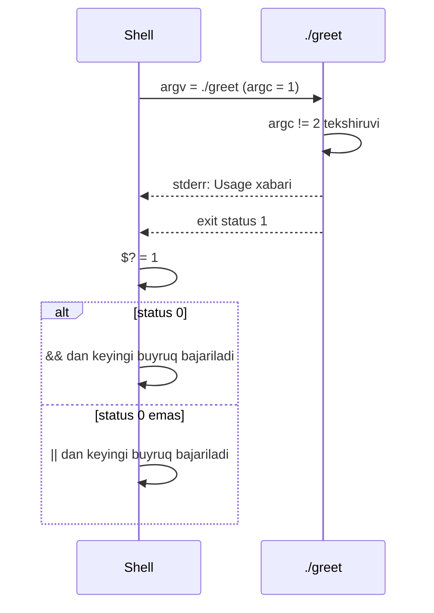

## Bu dars nima uchun kerak

Hozirgacha dasturlarimiz ma'lumotni faqat bitta yo'l bilan olardi: ishga tushgandan keyin `get_string` yoki `get_int` bilan foydalanuvchidan so'rab. Terminaldagi ko'p dasturlar esa boshqacha ishlaydi: `clang -o hello hello.c` yoki `cp a.txt b.txt` buyrug'ida kerakli hamma narsa buyruq qatorining o'zida yoziladi. Dastur hech narsa so'ramaydi, darhol ishlaydi va tugaydi. Bu ikki sababga ko'ra muhim: bunday dasturni boshqa dastur yoki skript avtomatik chaqira oladi, va uni bir buyruq bilan yuzlab marta takrorlash mumkin.

Ikkinchi yo'nalish - dastur qanday tugaganini bildirish. 5-darsda `main` qaytargan son **exit status** bo'lishini aytgan edik: 0 - muvaffaqiyat, boshqa son - xato. Skriptlar, `make`, CI tizimlari va shell'ning o'zi aynan shu songa qarab "keyingi qadamni bajaraymi?" degan qarorni qabul qiladi. Ekranga chiqqan "Xato!" matnini dastur o'qiy olmaydi, exit status ni esa o'qiy oladi.

Bu darsda 12-darsdagi satrlar bilimi to'liq ishlaydi: buyruq qatoridagi har bir so'z dasturga NUL bilan tugaydigan satr bo'lib keladi, ularning hammasi esa satrlar massivida turadi.

Bu darsdan keyin siz:

- `int main(int argc, string argv[])` ning har bir qismini va `argv` ning xotiradagi ko'rinishini tushuntira olasiz;
- shell buyruq qatorini so'zlarga qanday bo'lishini va qo'shtirnoq nimani o'zgartirishini bilasiz;
- argumentlar sonini tekshirib, foydalanuvchiga usage xabarini chiqara olasiz;
- satrni songa `atoi` va `strtol` bilan aylantirib, nega `atoi` xatoni bildira olmasligini va `strtol` bilan xatoni qanday aniqlashni bilasiz;
- exit status ni to'g'ri qaytarib, `echo $?`, `&&` va `||` bilan uning natijasini ko'ra olasiz;
- xato xabarlarini `stderr` ga yozish nima uchun kerakligini va `exit()` `return` dan qachon farq qilishini bilasiz.

## main ning ikkinchi shakli: argc va argv

C standarti `main` uchun ikki shaklni belgilaydi. Birinchisini bilamiz: `int main(void)`. Ikkinchisi buyruq qatorini qabul qiladi:

```c
int main(int argc, string argv[])
```

CS50 tashqarisida xuddi shu narsa `int main(int argc, char *argv[])` deb yoziladi: 12-darsdan bilamizki, `string` - `char *` uchun `typedef`. Nomlar an'anaviy, standart talab qilmaydi, lekin hamma shunday yozadi:

- **`argc`** (argument count) - buyruq qatoridagi so'zlar soni, dastur nomi bilan birga;
- **`argv`** (argument vector) - shu so'zlarning satrlar massivi. 12-darsdagi `string words[3]` ning aynan o'zi, faqat uni operatsion tizim to'ldiradi.

cppreference `main` sahifasida keltirilgan standart kafolatlari:

1. `argv[0]` - dasturni chaqirish uchun ishlatilgan nom (masalan `./greet`). Agar muhit nomni bera olmasa, u bo'sh satr bo'ladi.
2. `argv[1]` dan `argv[argc - 1]` gacha - argumentlar.
3. `argv[argc]` har doim **null pointer** (`NULL`, hech qayerga qaramaydigan manzil). Ya'ni massivda kamida `argc + 1` element bor va oxirgisi - "ro'yxat tugadi" belgisi. Bu satrlardagi NUL terminatorning massiv darajasidagi nusxasi.

`./greet Ali Vali` buyrug'i uchun `argv` shunday ko'rinadi:

| Element | Qiymat | Xotirada |
|---|---|---|
| `argv[0]` | `"./greet"` | `. / g r e e t \0` - 8 bayt |
| `argv[1]` | `"Ali"` | `A l i \0` - 4 bayt |
| `argv[2]` | `"Vali"` | `V a l i \0` - 5 bayt |
| `argv[3]` | `NULL` | satr emas, nol manzil |

`argc` = 3. Har bir element - manzil (wasm32 da 4 bayt, x86-64 da 8 bayt), satrlarning o'zi boshqa joyda. Buni ishga tushirib ko'ramiz. Pastdagi "Buyruq qatori" maydoni terminaldagi qatorning o'zi: birinchi so'z `argv[0]` bo'ladi.

```c run
#include <cs50.h>
#include <stdio.h>
#include <string.h>

int main(int argc, string argv[])
{
    printf("argc = %d\n", argc);
    for (int i = 0; i < argc; i++)
    {
        printf("argv[%d] = \"%s\" (strlen %zu)\n", i, argv[i], strlen(argv[i]));
    }
    printf("argv[argc] == NULL: %s\n", argv[argc] == NULL ? "ha" : "yo'q");
}
```

```text args
./greet Ali Vali
```

Natija:

```text
argc = 3
argv[0] = "./greet" (strlen 7)
argv[1] = "Ali" (strlen 3)
argv[2] = "Vali" (strlen 4)
argv[argc] == NULL: ha
```

Buyruq qatoriga so'z qo'shib yoki olib tashlab ko'ring: `argc` mos ravishda o'zgaradi va shell orqali ishga tushirilganda hech qachon 1 dan kichik bo'lmaydi (dastur nomi doim bor). `argv[argc] == NULL` kafolati tufayli massivni `argc` siz ham aylanish mumkin: `for (int i = 0; argv[i] != NULL; i++)`. Ikkala usul ham to'g'ri, lekin `argc` bilan yozilgan sikl o'qishga osonroq.

### Shell so'zlarni qanday bo'ladi

`argv` ni dastur emas, uni ishga tushirgan **shell** (terminaldagi buyruq tarjimoni, odatda `bash`) tayyorlaydi. Shell qatorni bo'shliqlar bo'yicha so'zlarga bo'ladi, qo'shtirnoq ichidagi bo'shliq esa so'zni bo'lmaydi va qo'shtirnoqning o'zi argumentga kirmaydi:

| Terminalda yozilgan | `argc` | `argv[1]` | `argv[2]` |
|---|---|---|---|
| `./greet Ali Valiyev` | 3 | `"Ali"` | `"Valiyev"` |
| `./greet "Ali Valiyev"` | 2 | `"Ali Valiyev"` | `NULL` |
| `./greet Ali   Valiyev` | 3 | `"Ali"` | `"Valiyev"` (ortiqcha bo'shliq yo'qoladi) |
| `./greet 25` | 2 | `"25"` (satr, son emas) | `NULL` |

Kursning brauzer muhiti ham xuddi shunday qiladi:

```c run
#include <cs50.h>
#include <stdio.h>

int main(int argc, string argv[])
{
    for (int i = 1; i < argc; i++)
    {
        printf("%d: [%s]\n", i, argv[i]);
    }
}
```

```text args
./greet "Ali Valiyev" 25
```

Natija:

```text
1: [Ali Valiyev]
2: [25]
```

Kvadrat qavslar satr chegarasini ko'rsatish uchun: "Ali Valiyev" bitta argument, ichidagi probel bilan. Oxirgi qator muhim: `25` - bu son emas, `"25"` satri, ya'ni `'2'`, `'5'`, `'\0'` baytlari. Argumentlar **har doim satr**. Ular bilan hisob qilish uchun avval songa aylantirish kerak, bu pastda.

## Argumentlarni tekshirish va usage xabari

`argv` dagi har bir elementga murojaat qilishdan oldin u mavjudligini tekshirish kerak. Agar foydalanuvchi argument bermasa, `argc` = 1 va `argv[1]` - `NULL`. `NULL` ni `printf("%s")` yoki `strlen` ga berish undefined behavior: brauzer muhiti uni "NULL yoki noto'g'ri ko'rsatkich orqali murojaat" deb to'xtatadi, oddiy Linux da esa ko'pincha segmentation fault bo'ladi. `argv[2]` esa `argc` = 1 bo'lganda massivdan umuman tashqarida.

Shuning uchun buyruq qatorini qabul qiladigan dastur birinchi navbatda `argc` ni tekshiradi va noto'g'ri bo'lsa, **usage xabari** (qanday ishlatish kerakligi haqida qisqa ko'rsatma) chiqarib, xato kodi bilan tugaydi:

```c run
#include <cs50.h>
#include <stdio.h>

int main(int argc, string argv[])
{
    if (argc != 2)
    {
        fprintf(stderr, "Usage: %s ism\n", argv[0]);
        return 1;
    }

    printf("salom, %s\n", argv[1]);
    return 0;
}
```

```text args
./greet Ali
```

Natija:

```text
salom, Ali
```

Endi "Buyruq qatori" maydonidan `Ali` ni o'chirib, faqat `./greet` qoldiring. Dastur `Usage: ./greet ism` chiqaradi va 1 qaytaradi. Brauzer playground'i dastur 0 dan katta kod bilan tugaganini alohida qatorda bildiradi:

```text
Usage: ./greet ism
Dastur 1 kodi bilan tugadi.
```

Bu kichik dasturda uchta odat bor:

- **`argc != 2`, `argc < 2` emas.** Ortiqcha argument ham xato: `./greet Ali Vali` da foydalanuvchi ehtimol "Ali Vali" ni qo'shtirnoqsiz yozgan. Jim ravishda `argv[2]` ni tashlab ketishdan ko'ra, aytib qo'yish yaxshiroq.
- **Usage da `argv[0]`.** Dastur qaysi nom bilan chaqirilgan bo'lsa, o'sha chiqadi. Fayl qayta nomlansa ham xabar to'g'ri qoladi.
- **`fprintf(stderr, ...)` va `return 1`.** Xato xabari alohida oqimga, xato esa exit status ga. Ikkalasi quyida.

## Satrdan songa: atoi va strtol

`argv[1]` "25" bo'lsa, `argv[1] + 1` 26 emas. Satrni butun songa aylantirishning ikki standart usuli bor, ikkalasi `stdlib.h` da.

### atoi: oddiy, lekin ko'r

`atoi(s)` (ASCII to integer) satr boshidagi raqamlarni `int` ga aylantiradi. cppreference bo'yicha uning ikki muammosi bor:

1. **Aylantirib bo'lmasa, 0 qaytaradi.** `atoi("abc")` = 0. Lekin `atoi("0")` ham 0. Natijaga qarab "foydalanuvchi 0 yozdimi yoki xato kiritdimi" ni farqlab bo'lmaydi.
2. **Natija `int` ga sig'masa - undefined behavior.** `atoi("99999999999")` biror son qaytarishi yoki boshqa narsa qilishi mumkin, va buni bildiruvchi hech qanday belgi yo'q.

Bundan tashqari, `atoi` boshidagi raqamlardan keyin to'xtaydi va qolganini indamay tashlaydi: `atoi("12abc")` = 12.

### strtol: xatoni ko'rsatadigan aylantirish

`strtol(s, &end, 10)` (string to long) ham son qaytaradi, lekin qo'shimcha ma'lumot beradi:

- `end` - aylantirish to'xtagan joyning manzili. Agar `*end == '\0'` bo'lsa, satr oxirigacha o'qilgan, ya'ni butun satr son. Agar `end == s` bo'lsa, birorta ham raqam o'qilmagan.
- `errno` - `errno.h` dagi global o'zgaruvchi. Natija `long` ga sig'masa, `strtol` uni `ERANGE` ga tenglaydi va `LONG_MAX` yoki `LONG_MIN` qaytaradi. `errno` ni boshqa funksiyalar ham o'zgartirishi mumkin, shuning uchun chaqiruvdan oldin uni 0 qiling.
- `10` - sanoq asosi. 16 berilsa, "ff" ni 255 deb o'qiydi (2-dars).

`strtol` boshidagi bo'shliqlarni o'tkazib yuboradi va `+` yoki `-` ishorasini qabul qiladi. `&end` dagi `&` "o'zgaruvchining manzili" degani: funksiya natijani `end` ga shu manzil orqali yozadi. Bu mexanizm 21-22-darslarda ochiladi, hozircha shablon sifatida ishlating.

Ikkalasini yonma-yon ko'ramiz:

```c run
#include <cs50.h>
#include <errno.h>
#include <stdio.h>
#include <stdlib.h>

int main(int argc, string argv[])
{
    for (int i = 1; i < argc; i++)
    {
        string s = argv[i];

        char *end;
        errno = 0;
        long v = strtol(s, &end, 10);

        string verdict;
        if (end == s)
        {
            verdict = "raqam yo'q";
        }
        else if (*end != '\0')
        {
            verdict = "oxirida ortiqcha belgilar";
        }
        else if (errno == ERANGE)
        {
            verdict = "diapazondan tashqari";
        }
        else
        {
            verdict = "to'g'ri son";
        }

        printf("%-6s atoi = %3d   strtol = %3ld   %s\n", s, atoi(s), v, verdict);
    }
}
```

```text args
./parse 42 12abc abc 0 -7
```

Natija:

```text
42     atoi =  42   strtol =  42   to'g'ri son
12abc  atoi =  12   strtol =  12   oxirida ortiqcha belgilar
abc    atoi =   0   strtol =   0   raqam yo'q
0      atoi =   0   strtol =   0   to'g'ri son
-7     atoi =  -7   strtol =  -7   to'g'ri son
```

3- va 4-qatorlarga qarang: `atoi` ustunida ikkalasi ham 0, va ularni farqlab bo'lmaydi. `strtol` esa `end` orqali "abc" da birorta raqam o'qilmaganini aniq aytadi. Buyruq qatoriga `99999999999` qo'shib ko'rmang: `atoi` uchun bu UB. Faqat `strtol` uchun alohida dastur yozish xavfsiz (pastdagi `sum` misoli).

| Usul | Xato kirishni bildiradimi | Diapazondan chiqish | Qachon ishlatiladi |
|---|---|---|---|
| `atoi(s)` | yo'q: "abc" va "0" ikkalasi 0 | undefined behavior | kirish oldindan tekshirilgan bo'lsa |
| `strtol(s, &end, 10)` | ha: `end == s`, `*end != '\0'` | `errno = ERANGE`, `LONG_MAX`/`LONG_MIN` | buyruq qatori, fayl, tarmoq |
| `get_int` (cs50.h) | noto'g'ri bo'lsa qayta so'raydi | qayta so'raydi | interaktiv kirish (stdin) |

Brauzer muhitida `long` 32 bit (wasm32), shuning uchun `strtol` u yerda 2 147 483 647 dan kattasini `ERANGE` deb hisoblaydi. x86-64 Linux da `long` 64 bit va chegara 9 223 372 036 854 775 807 (6-dars). Natijani `int` da saqlamoqchi bo'lsangiz, ikkala platformada ham `v < INT_MIN || v > INT_MAX` tekshiruvini qo'shing: x86-64 da `strtol` "3000000000" ni xatosiz o'qiydi, lekin u `int` ga sig'maydi.

### Mashq: qat'iy parse_int

`strtol` ning qoidalarini Python da modellashtiramiz. `parse_int(s)` funksiyasini yozing: satr butunlay o'nlik butun son bo'lsa va 32-bitli `int` ga (-2 147 483 648 dan 2 147 483 647 gacha) sig'sa, `(True, qiymat)` qaytarsin, aks holda `(False, 0)`. Ixtiyoriy bitta `+` yoki `-` ishorasiga ruxsat bor, boshqa hech qanday belgiga (bo'shliq, nuqta, harf) ruxsat yo'q. Python ning `int()` funksiyasini ishlatmang: u bo'shliq va `_` ni qabul qiladi. Raqamlarni o'zingiz yig'ing: `qiymat = qiymat * 10 + (kod - 48)`, 12-darsdagi `'7' - '0'` kabi.

```python run
def parse_int(s):
    # (True, qiymat) yoki (False, 0)
    return (False, 0)


for s in ["42", "-7", "12abc", "", "2147483648"]:
    print(repr(s), parse_int(s))
```

```python test
check("'42' -> (True, 42)", lambda: parse_int("42") == (True, 42))
check("'-7' -> (True, -7)", lambda: parse_int("-7") == (True, -7))
check("'+5' -> (True, 5)", lambda: parse_int("+5") == (True, 5))
check("'0' to'g'ri son -> (True, 0)", lambda: parse_int("0") == (True, 0))
check("bo'sh satr xato", lambda: parse_int("") == (False, 0))
check("faqat ishora xato: '-'", lambda: parse_int("-") == (False, 0))
check("oxirida harf xato: '12abc'", lambda: parse_int("12abc") == (False, 0))
check("bo'shliq xato: ' 12'", lambda: parse_int(" 12") == (False, 0))
check("pastki chiziq xato: '1_000'", lambda: parse_int("1_000") == (False, 0))
check("INT_MAX sig'adi: '2147483647'", lambda: parse_int("2147483647") == (True, 2147483647))
check("INT_MAX + 1 sig'maydi: '2147483648'", lambda: parse_int("2147483648") == (False, 0))
check("INT_MIN sig'adi: '-2147483648'", lambda: parse_int("-2147483648") == (True, -2147483648))
```

## Exit status: dastur qanday tugaganini aytadi

`main` qaytargan son operatsion tizim orqali dasturni ishga tushirgan jarayonga - odatda shell'ga - yetib boradi. Kelishuv oddiy: **0 - muvaffaqiyat, 0 dan farqli har qanday son - xato**. Qaysi nol emas son nimani bildirishini dasturning o'zi belgilaydi va hujjatida yozadi. `stdlib.h` da ikkita nom bor: `EXIT_SUCCESS` va `EXIT_FAILURE`; standart ularning qiymatini belgilamaydi, lekin Linux va macOS da ular 0 va 1.

Shell oxirgi bajarilgan buyruqning exit status ini `$?` maxsus parametrida saqlaydi:

```text
$ ./greet Ali
salom, Ali
$ echo $?
0
$ ./greet
Usage: ./greet ism
$ echo $?
1
```

`echo $?` dan keyin yana `echo $?` yozsangiz, 0 chiqadi: endi u birinchi `echo` ning statusi. `$?` faqat bitta, eng oxirgi buyruqni eslaydi.

Bash qo'llanmasiga ko'ra exit status 0 dan 255 gacha. POSIX `exit` spetsifikatsiyasi sababini aytadi: ota jarayon `wait()` orqali status ning faqat eng kichik 8 bitini (`status & 0377`) oladi. Demak `return 256;` shell'da 0 bo'lib ko'rinadi (256 = 1 0000 0000, kichik 8 bit nol) - xato muvaffaqiyatga aylanadi. Shuning uchun dastur o'z kodlarini 0-125 oralig'ida tanlaydi: undan yuqorisini shell o'zi ishlatadi.

| Kod | Kim beradi | Ma'nosi |
|---|---|---|
| 0 | dastur | muvaffaqiyat |
| 1 | dastur | umumiy xato (`EXIT_FAILURE` Linux da) |
| 2 | bash ichki buyruqlari, ko'p dasturlar | noto'g'ri ishlatish (usage xatosi) |
| 126 | bash | buyruq topildi, lekin bajarib bo'lmaydi (ruxsat yo'q) |
| 127 | bash | buyruq topilmadi |
| 128 + N | bash | dastur N-signal bilan o'ldirildi |

Oxirgi qator 11-darsdagi segmentation fault bilan bog'liq: Linux da SIGSEGV signalining raqami 11, shuning uchun segfault bilan yiqilgan dastur uchun `echo $?` 128 + 11 = 139 ko'rsatadi.

### && va ||: statusga qarab qaror

Shell buyruqlarni exit status bo'yicha zanjirga bog'lay oladi:

- `A && B` - B faqat A **muvaffaqiyatli** (0) tugasa bajariladi;
- `A || B` - B faqat A **xato** (0 emas) bilan tugasa bajariladi.

```text
$ clang -o greet greet.c && ./greet Ali
salom, Ali
$ ./greet || echo "greet ishlamadi"
Usage: ./greet ism
greet ishlamadi
```

Birinchi qatordagi zanjir har kuni ishlatiladi: kompilyatsiya xatosi bo'lsa, eski `greet` fayli ishga tushib ketmaydi. Bu faqat clang xato bo'lganda 0 dan farqli kod qaytargani uchun ishlaydi. Sizning dasturingiz ham shunday "yaxshi fuqaro" bo'lishi kerak: xato bo'lsa, 0 qaytarmang.



## stdout va stderr

Har bir dastur ishga tushganda unga uchta oqim ochiq bo'ladi: stdin (kirish), stdout (oddiy chiqish) va stderr (xato va diagnostika chiqishi). `printf(...)` - bu `fprintf(stdout, ...)` ning qisqa shakli. Terminalda `stdout` ham, `stderr` ham ekranga chiqadi, shuning uchun farq ko'rinmaydi. Farq **yo'naltirishda** (redirect) ko'rinadi:

```text
$ ./greet > natija.txt
Usage: ./greet ism
$ ./greet Ali > natija.txt
$ cat natija.txt
salom, Ali
```

`>` faqat `stdout` ni faylga yo'naltiradi. Usage xabari `stderr` ga yozilgani uchun foydalanuvchi uni baribir ekranda ko'radi, fayl esa xato matni bilan "ifloslanmaydi". Agar xato `printf` bilan yozilganda, u `natija.txt` ichiga tushar va keyingi dastur uni ma'lumot deb o'qib ketardi. `stderr` ni alohida yo'naltirish uchun `2>` ishlatiladi: `./greet 2> xatolar.txt`.

Ikkinchi farq - buferlash. man7 dagi `stdin(3)` sahifasi bo'yicha `stderr` buferlanmaydi: yozilgan har bir belgi darhol chiqadi. `stdout` esa terminalga ulanganda qatorma-qator buferlanadi, faylga yo'naltirilganda esa odatda kattaroq bloklar bilan. Shuning uchun dastur yiqilishidan oldin `stderr` ga yozilgan xabar yo'qolmaydi, `stdout` dagi esa yo'qolishi mumkin.

| Xususiyat | `stdout` | `stderr` |
|---|---|---|
| Nima uchun | dastur natijasi, ma'lumot | xato, ogohlantirish, usage |
| C da | `printf(...)`, `fprintf(stdout, ...)` | `fprintf(stderr, ...)` |
| Fayl deskriptori | 1 | 2 |
| `>` bilan yo'naltirish | faylga ketadi | ekranda qoladi (`2>` kerak) |
| Buferlash | terminalda qatorma-qator | buferlanmaydi |

Kursning brauzer playground'i ham ikki oqimni farqlaydi: `stderr` ga yozilgan matn natijada boshqa rangda ko'rsatiladi.

## exit() va return

`main` dan `return n;` qilish `exit(n);` ni chaqirish bilan bir xil: cppreference `main` sahifasida aynan shunday yozilgan. Ikkalasi ham `atexit` bilan ro'yxatdan o'tgan funksiyalarni chaqiradi, ochiq oqimlarning buferini yozib yopadi va boshqaruvni operatsion tizimga qaytaradi.

Farq **boshqa funksiya ichida** paydo bo'ladi. `return` faqat joriy funksiyadan chiqadi va chaqiruvchiga qaytadi. `exit()` (`stdlib.h`) esa qayerda chaqirilmasin, butun dasturni tugatadi. Bu argumentlarni tekshiradigan yordamchi funksiyalarda qulay: har bir chaqiruvdan keyin "xato bo'ldimi?" deb tekshirish shart emas.

```c run
#include <cs50.h>
#include <errno.h>
#include <limits.h>
#include <stdio.h>
#include <stdlib.h>

// s ni int ga aylantiradi; bo'lmasa xabar chiqarib, dasturni 2 kodi bilan tugatadi
int parse_or_exit(string s)
{
    char *end;
    errno = 0;
    long v = strtol(s, &end, 10);
    if (end == s || *end != '\0')
    {
        fprintf(stderr, "Xato: '%s' butun son emas\n", s);
        exit(2);
    }
    if (errno == ERANGE || v < INT_MIN || v > INT_MAX)
    {
        fprintf(stderr, "Xato: '%s' int diapazonidan tashqari\n", s);
        exit(2);
    }
    return (int) v;
}

int main(int argc, string argv[])
{
    if (argc < 2)
    {
        fprintf(stderr, "Usage: %s son [son ...]\n", argv[0]);
        return 1;
    }

    long sum = 0;
    for (int i = 1; i < argc; i++)
    {
        int x = parse_or_exit(argv[i]);
        printf("+ %d\n", x);
        sum += x;
    }
    printf("Yig'indi: %ld\n", sum);
    return 0;
}
```

```text args
./sum 10 20 x5
```

Natija:

```text
+ 10
+ 20
Xato: 'x5' butun son emas
Dastur 2 kodi bilan tugadi.
```

`x5` ga yetganda `parse_or_exit` dasturni o'sha yerda tugatdi: "Yig'indi" qatori chiqmadi, chunki boshqaruv `main` ga qaytmadi. Buyruq qatorini `./sum 10 20 30` ga o'zgartirsangiz, "Yig'indi: 60" chiqadi va xabar bo'lmaydi (status 0). `./sum 99999999999` - diapazon xatosi, yana 2. `./sum` - usage va 1. Shu tarzda dastur uch xil holatni uch xil kod bilan ajratadi: 0 - muvaffaqiyat, 1 - noto'g'ri ishlatish, 2 - noto'g'ri qiymat. Bu kodlarni usage yoki hujjatda yozib qo'yish odat.

Bitta ehtiyot: `exit()` ni katta dasturlarda ko'p ishlatish kodni kuzatishni qiyinlashtiradi (funksiya "qaytmasligi" mumkin bo'ladi) va 23-darsdan keyin xotirani bo'shatmasdan chiqib ketishga olib kelishi mumkin. Kichik buyruq qatori dasturlarida argument tekshiruvi uchun u odatiy usul.

## Ko'p uchraydigan xatolar

1. **`argc` ni tekshirmasdan `argv[1]` ga murojaat.** Argument berilmasa, `argv[1]` - `NULL`, uni chop etish yoki `strlen` ga berish UB. Har doim avval `argc` ni tekshiring.
2. **`argc` ga dastur nomini qo'shmaslik.** Bitta argumentli dasturda `argc == 2`, `argc == 1` emas. Argumentlar `argv[1]` dan boshlanadi.
3. **Argumentni son deb ishlatish.** `argv[1]` "25" satri. `argv[1] * 2` kompilyatsiya bo'lmaydi, `argv[1][0]` esa 25 emas, `'2'` belgisi (kodi 50).
4. **`atoi` natijasiga ishonish.** `atoi("abc")` = 0 = `atoi("0")`, diapazondan chiqish UB. Foydalanuvchi kiritgan qiymat uchun `strtol` + `end` + `errno`.
5. **`strtol` da faqat `errno` ni tekshirish.** "12abc" da `errno` 0, xato faqat `*end != '\0'` da ko'rinadi. "abc" da esa `end == s`. Uchala shart kerak, va `errno = 0` chaqiruvdan **oldin**.
6. **Xatoda 0 qaytarish.** Usage chiqarib, `return 0` qilgan dastur `&&` zanjirini aldaydi: keyingi buyruq "muvaffaqiyat" deb ishga tushadi. Xato - nol emas kod.
7. **Xato xabarini `printf` bilan yozish.** U `stdout` ga ketadi va `> fayl` bilan ma'lumot orasiga aralashadi. `fprintf(stderr, ...)`.
8. **255 dan katta yoki manfiy kod qaytarish.** Shell faqat kichik 8 bitni ko'radi: 256 - 0, -1 - 255. Kodlarni 0-125 oralig'ida tanlang.

## Xulosa

- `int main(int argc, string argv[])`: `argc` - so'zlar soni dastur nomi bilan, `argv` - satrlar massivi; `argv[0]` - dastur nomi, `argv[argc]` standart bo'yicha `NULL`.
- Buyruq qatorini so'zlarga shell bo'ladi; qo'shtirnoq ichidagi probel so'zni bo'lmaydi. Har bir argument - NUL bilan tugaydigan satr, son emas.
- Har bir `argv[i]` dan oldin `argc` tekshiriladi; noto'g'ri bo'lsa, `stderr` ga usage xabari va nol emas exit status.
- `atoi` xatoni bildira olmaydi va diapazondan chiqishda UB; `strtol` `end == s`, `*end != '\0'` va `errno == ERANGE` orqali uchala xato turini ko'rsatadi.
- Exit status: 0 - muvaffaqiyat, boshqasi - xato; shell `$?` da saqlaydi, `&&` va `||` unga qarab qaror qiladi, faqat kichik 8 bit (0-255) yetib boradi.
- `stdout` - natija, `stderr` - xatolar: `>` faqat birinchisini yo'naltiradi, `stderr` buferlanmaydi.
- `main` dan `return n` = `exit(n)`; `exit()` istalgan funksiyadan butun dasturni tugatadi. Brauzer playground'i 0 dan katta kodni "Dastur N kodi bilan tugadi." deb ko'rsatadi.

## Amaliy topshiriq

`range` dasturini yozing: u arifmetik progressiyani chiqaradi. Ishlatilishi: `./range boshi oxiri qadam`, masalan `./range 1 10 3` 1, 4, 7, 10 ni har birini alohida qatorda chiqaradi. Qadam manfiy bo'lsa, progressiya kamayadi: `./range 10 1 -4` - 10, 6, 2.

Topshiriq qadamlari:

1. **Argumentlar soni.** `argc` aniq 4 bo'lmasa, `stderr` ga `Usage: ./range boshi oxiri qadam` (dastur nomi `argv[0]` dan) chiqaring va 1 qaytaring.
2. **Aylantirish.** Har bir argumentni `strtol` bilan `int` ga aylantiradigan yordamchi funksiya yozing. "raqam yo'q", "ortiqcha belgilar" va "diapazondan tashqari" holatlarida aniq xabar chiqarib, dasturni 2 kodi bilan tugating (`exit`).
3. **Mantiqiy tekshiruv.** Qadam 0 bo'lsa (cheksiz sikl bo'lardi) yoki qadam ishorasi yo'nalishga mos kelmasa (`./range 1 10 -1`), xabar chiqarib 3 qaytaring.
4. **Chiqarish.** Progressiyani chiqaring. Sikl shartini ham o'suvchi, ham kamayuvchi holat uchun to'g'ri yozing va `oxiri` dan oshib ketmang.
5. **Statuslar jadvali.** Izohda dasturingizning barcha exit statuslarini va ularning ma'nosini yozing. `./range 1 5 1 && echo tayyor` va `./range 1 5 0 || echo xato` buyruqlari nima chiqarishini tushuntiring.
6. **Chegaralar.** `./range 2147483640 2147483647 5` ni ishga tushiring. `i += step` overflow bo'lmasligi uchun (7-dars) siklni qanday yozdingiz?

Boshlang'ich shablon:

```c run
#include <cs50.h>
#include <errno.h>
#include <limits.h>
#include <stdio.h>
#include <stdlib.h>

int main(int argc, string argv[])
{
    // 1-qadam: argc tekshiruvi va usage

    // 2-qadam: uchala argumentni int ga aylantirish

    // 3-4-qadamlar: tekshiruv va chiqarish
    printf("argc = %d\n", argc);
    return 0;
}
```

```text args
./range 1 10 3
```

Yaxshi javobda bo'lishi kerak bo'lgan narsalar:

- usage `stderr` ga yozilgan, `argv[0]` ishlatilgan, `argc != 4` da status 1;
- `strtol` dan oldin `errno = 0`, keyin `end == s`, `*end != '\0'`, `errno == ERANGE` va `INT_MIN`/`INT_MAX` tekshiruvlari; `atoi` ishlatilmagan;
- qadam 0 va noto'g'ri yo'nalish uchun alohida status (3), hech bir xato holatida 0 qaytmaydi;
- `./range 1 10 3` uchun 1 4 7 10, `./range 10 1 -4` uchun 10 6 2;
- statuslar jadvali va `&&` / `||` misollarining natijasi tushuntirilgan (`tayyor` chiqadi, `xato` chiqadi);
- 6-qadamda overflow'siz sikl: masalan, keyingi qiymatni qo'shishdan oldin `i > INT_MAX - step` tekshiruvi yoki `long` hisoblagich.

Javobingizni pastdagi maydonga yozing va yuqoridagi mezonlar bilan solishtiring.

## Manbalar

- CS50x. [Lecture 2 notes](https://cs50.harvard.edu/x/notes/2/) - "Command-Line Arguments" va "Exit Status" bo'limlari: `argc`, `argv`, usage va `echo $?`.
- cppreference. [Main function](https://en.cppreference.com/w/c/language/main_function) - `main` ning ikki shakli, `argv[0]` va `argv[argc]` kafolati, `main` dan qaytish `exit` ga tengligi, `EXIT_SUCCESS`/`EXIT_FAILURE`.
- cppreference. [atoi](https://en.cppreference.com/w/c/string/byte/atoi) - aylantirib bo'lmasa 0, diapazondan chiqish UB.
- cppreference. [strtol](https://en.cppreference.com/w/c/string/byte/strtol) - `str_end`, `ERANGE`, `LONG_MAX`/`LONG_MIN`, boshidagi bo'shliqlar, `errno = 0` bilan misol.
- GNU Bash manual. [Exit Status](https://www.gnu.org/software/bash/manual/html_node/Exit-Status.html) - 0-255 oralig'i, 126, 127, 128 + N, `$?`.
- GNU Bash manual. [Lists of Commands](https://www.gnu.org/software/bash/manual/html_node/Lists.html) - `&&` (AND list) va `||` (OR list) qoidalari va ularning statusi.
- POSIX. [exit](https://pubs.opengroup.org/onlinepubs/9799919799/functions/exit.html) - ota jarayonga faqat `status & 0377` yetib borishi, `EXIT_SUCCESS`/`EXIT_FAILURE`.
- man7.org. [stdin(3)](https://man7.org/linux/man-pages/man3/stdin.3.html) - "Notes": `stderr` buferlanmaydi, `stdout` terminalda qatorma-qator buferlanadi.
