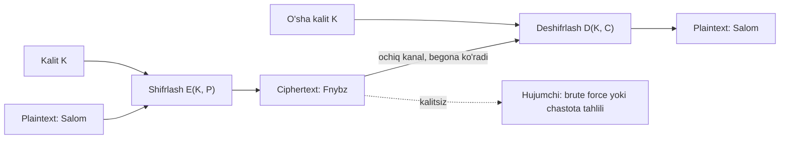
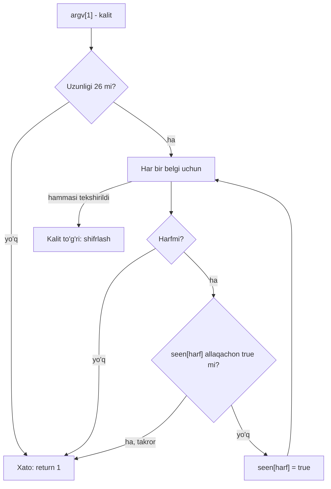

## Bu dars nima uchun kerak

Oldingi uch darsda C ning uchta vositasini o'rgandik: massiv (11-dars), satr - `char` massivi (12-dars) va buyruq qatori argumentlari (13-dars). Bu dars ularni bitta amaliy masalada birlashtiradi: matnni boshqalar o'qiy olmaydigan ko'rinishga keltirish va qaytarish. Har bir klassik shifr aslida satr ustida harfma-harf yuradigan sikl, harfni son sifatida ko'rish (2-darsdagi ASCII) va qoldiqli bo'lish arifmetikasi.

Mavzu ikki sababga ko'ra muhim. Birinchidan, bu dasturlash mashqi sifatida juda foydali: chegaraviy holatlar ko'p (katta va kichik harf, harf bo'lmagan belgilar, alifbo oxiridan boshiga "aylanish", manfiy qoldiq), va har biri o'ylab yozilmasa, dastur jim noto'g'ri natija beradi. Ikkinchidan, klassik shifrlarning qanday buzilishini tushunish zamonaviy kriptografiyaning nega aynan shunday qurilganini tushuntiradi. 52-darsda hash, simmetrik va asimmetrik shifrlash ko'riladi; u yerdagi har bir talab shu darsdagi biror zaiflikka javob.

Bu darsdan keyin siz:

- plaintext, ciphertext va kalit atamalarini va ular orasidagi munosabatni aniq ayta olasiz;
- Caesar shifrini c = (p + k) mod 26 formulasi bilan, registrni saqlab va harf bo'lmagan belgilarni o'tkazib yubora olasiz;
- C dagi `%` operatori manfiy sonda nima qaytarishini va deshifrlashda bu qanday xato berishini bilasiz;
- Vigenere shifrida kalit indeksi nega faqat harflarda siljishini tushuntira olasiz;
- substitution kalitini tekshiradigan (uzunlik, faqat harf, takror yo'q) kod yoza olasiz;
- kalitlar sonini hisoblab, brute force va chastota tahlili qachon ishlashini baholay olasiz;
- Kerckhoffs tamoyili nima talab qilishini va klassik shifrlar uni nega qanoatlantira olmasligini tushuntira olasiz.

## Atamalar: plaintext, ciphertext, kalit

Kriptografiyada bir nechta atama doimiy ishlatiladi, ularni boshidan aniq kelishib olamiz.

- **Plaintext** (ochiq matn) - shifrlanishi kerak bo'lgan asl xabar, masalan `Salom`.
- **Ciphertext** (shifrlangan matn) - shifrlashdan keyingi natija, masalan `Fnybz`. Uni ko'rgan begona odam asl xabarni bilmasligi kerak.
- **Kalit** (key) - shifrlash va deshifrlashni boshqaradigan maxfiy qiymat. Caesar shifrida bu bitta son, Vigenere da so'z, substitution da 26 harfli satr.
- **Shifrlash** (encryption) - plaintext va kalitdan ciphertext hosil qilish: C = E(K, P).
- **Deshifrlash** (decryption) - ciphertext va kalitdan plaintext ni qaytarish: P = D(K, C).

Asosiy talab: istalgan plaintext uchun D(K, E(K, P)) = P. Ya'ni deshifrlash shifrlashni aniq bekor qilishi kerak. Agar ikkita turli harf bir xil harfga shifrlansa, bu talab buziladi: ciphertext dagi harfni qaysi biriga qaytarishni bilib bo'lmaydi. Shuning uchun har bir klassik shifr alifboni o'z-o'ziga **o'zaro bir qiymatli** (har harf aniq bitta harfga, va teskarisi) akslantiradi.

Shifr va kod (code) farqi ham shu yerda: kod butun so'z yoki iborani boshqa belgi bilan almashtiradi (lug'at kerak), shifr esa harf yoki baytlar darajasida mexanik qoida bilan ishlaydi. Dasturlashda bizni shifrlar qiziqtiradi, chunki ular algoritm.



Diagrammada ikkala tomon bir xil kalitdan foydalanadi: bunday shifrlar **simmetrik** deyiladi. Bu darsdagi hamma shifr simmetrik. Kalitni ikki tomonga xavfsiz yetkazish - alohida va qiyin muammo; uning yechimi (asimmetrik kriptografiya) 52-darsda.

## Caesar shifri

Rim tarixchisi Suetonius ga ko'ra, Yuliy Sezar harbiy xabarlarni har bir harfni alifboda 3 ta o'ngga surish orqali yashirgan: A o'rniga D, B o'rniga E. Shundan **Caesar shifri** nomi kelib chiqqan. Umumiy holda surish miqdori k istalgan son bo'lishi mumkin, va k - kalit.

### Formula

Harflarni 0 dan 25 gacha raqamlaymiz: A = 0, B = 1, ..., Z = 25. Plaintext dagi harf raqami p, kalit k bo'lsa, ciphertext dagi harf raqami:

c = (p + k) mod 26

Deshifrlash teskari yo'nalishda surish:

p = (c - k) mod 26

`mod 26` - 26 ga bo'lgandagi qoldiq. U alifbo oxiridan boshiga "aylanish"ni ta'minlaydi. Misol: `x` ni k = 3 bilan shifrlaymiz. x ning raqami 23, 23 + 3 = 26, 26 mod 26 = 0, ya'ni `a`. Xuddi soat siferblatidagidek: 11 dan keyin 3 soat o'tsa, 14 emas, 2 bo'ladi (mod 12).

### Harfdan raqamga va qaytib

C da `char` - kichik butun son (6-dars), uning qiymati ASCII kodi (2-dars): `'A'` = 65, `'Z'` = 90, `'a'` = 97, `'z'` = 122. Katta harflar ham, kichiklar ham ketma-ket kodlarda turadi. Shuning uchun harfning alifbodagi raqamini bitta ayirish bilan olamiz:

- katta harf uchun p = c - 'A', masalan 'D' - 'A' = 68 - 65 = 3;
- kichik harf uchun p = c - 'a', masalan 'x' - 'a' = 120 - 97 = 23.

Natijani qaytarish uchun teskari amal: 'A' + c yoki 'a' + c. Bu bizga **registrni saqlash** imkonini beradi: katta harf katta harfga, kichigi kichigiga shifrlanadi. Agar hamma harfni bitta `'A'` bilan hisoblasak, `'x'` uchun (120 - 65 + 3) mod 26 = 58 mod 26 = 6 chiqadi va natija `'G'` bo'ladi - registr yo'qoladi va javob noto'g'ri.

**Harf bo'lmagan belgilar** (bo'shliq, vergul, raqam, apostrof) o'zgarishsiz o'tadi. Ularni shifrlashga urinish ma'nosiz: `' '` (32) - 'a' manfiy son beradi, natija esa harf ham bo'lmaydi.

Belgining turini aniqlash uchun `ctype.h` funksiyalari bor: `isupper`, `islower`, `isalpha`, `isdigit`. Bitta nozik joy: cppreference ga ko'ra, bu funksiyalarga `unsigned char` sifatida ifodalanmaydigan va `EOF` ga teng bo'lmagan qiymat berilsa, xatti-harakat aniqlanmagan. Ko'p platformalarda `char` signed, va UTF-8 dagi ASCII bo'lmagan harflar (masalan, kirill harflari) baytlari manfiy qiymat bo'ladi. Shuning uchun xavfsiz yozuv: `isupper((unsigned char) c)`.

### Dastur

Kalit buyruq qatoridan keladi (13-darsda `argc` va `argv` ni ko'rdik), matn esa kirishdan (`get_string`). Kalitni tekshirishda bir hiyla ishlatamiz: kalit satrini raqamma-raqam o'qib, har qadamda mod 26 ni olamiz. Shunda `./caesar 99999999999999999999` kabi juda uzun kalit ham `int` ni overflow qilmaydi (7-dars), chunki oraliq natija hech qachon 25 · 10 + 9 = 259 dan oshmaydi. `atoi` esa bunday satrda undefined behavior beradi.

```c run
#include <cs50.h>
#include <ctype.h>
#include <stdio.h>

char rotate(char c, int k);

int main(int argc, string argv[])
{
    if (argc != 2)
    {
        fprintf(stderr, "Foydalanish: ./caesar kalit\n");
        return 1;
    }

    // Kalitni raqamma-raqam o'qib, darhol mod 26 olamiz: overflow bo'lmaydi
    int k = 0;
    for (int i = 0; argv[1][i] != '\0'; i++)
    {
        if (!isdigit((unsigned char) argv[1][i]))
        {
            fprintf(stderr, "Kalit manfiy bo'lmagan butun son bo'lishi kerak\n");
            return 1;
        }
        k = (k * 10 + (argv[1][i] - '0')) % 26;
    }

    string text = get_string("Matn:  ");
    printf("Shifr: ");
    for (int i = 0; text[i] != '\0'; i++)
    {
        printf("%c", rotate(text[i], k));
    }
    printf("\n");
    return 0;
}

// Harfni alifboda k ta o'ngga suradi, registrni saqlaydi; boshqa belgilar o'zgarmaydi
char rotate(char c, int k)
{
    if (isupper((unsigned char) c))
    {
        return 'A' + (c - 'A' + k) % 26;
    }
    if (islower((unsigned char) c))
    {
        return 'a' + (c - 'a' + k) % 26;
    }
    return c;
}
```

```text args
./caesar 13
```

```text stdin
Salom, Dunyo! 2026
```

Natija:

```text
Matn:  Shifr: Fnybz, Qhalb! 2026
```

Kuzatishlar:

1. `S` (18) + 13 = 31, 31 mod 26 = 5, ya'ni `F`. Katta harf katta harfga o'tdi.
2. `y` (24) + 13 = 37, 37 mod 26 = 11, ya'ni `l` - alifbo oxiridan boshiga aylandi.
3. Vergul, undov, bo'shliq va `2026` o'zgarmadi. Natijada so'zlar uzunligi va tinish belgilari saqlanadi - bu ham hujumchiga ma'lumot beradi (pastda).

"Buyruq qatori" maydonida kalitni `39` ga o'zgartirib ko'ring: natija bir xil, chunki 39 mod 26 = 13. Kalitni `26` qilsangiz, ciphertext plaintext ning o'zi bo'ladi. Demak Caesar da haqiqatan farq qiladigan kalitlar 26 ta (0-25), ulardan biri (0) hech narsani yashirmaydi.

k = 13 alohida: 13 + 13 = 26 ≡ 0 (mod 26), ya'ni ikki marta shifrlash asl matnni qaytaradi. Bu variant **ROT13** deb ataladi va shifrlash bilan deshifrlash bitta funksiya bo'ladi. Ciphertext `Fnybz, Qhalb! 2026` ni kirishga berib, kalit 13 bilan qayta ishga tushiring.

## Qoldiq va manfiy son muammosi

Deshifrlash formulasi p = (c - k) mod 26. Matematikada mod natijasi doim 0 dan 25 gacha. C dagi `%` operatori esa boshqacha ishlaydi, va bu darsdagi eng ko'p uchraydigan bug shu yerda.

C99 dan boshlab butun sonli bo'lish **nolga qarab qirqiladi** (truncation toward zero): -7 / 3 = -2 (aniq natija -2.33, kasr qismi tashlanadi). Qoldiq esa shunday aniqlanadi: (a / b) · b + a % b = a. cppreference ning arithmetic operators sahifasi aynan shu tenglikni beradi (C standartida 6.5.5 bo'lim). Undan:

-7 % 3 = -7 - (-2) · 3 = -7 + 6 = -1

Ya'ni C da qoldiqning ishorasi bo'linuvchi (chap operand) ishorasi bilan bir xil. Python da esa teskari: hujjatga ko'ra `%` natijasi doim ikkinchi operand (bo'luvchi) ishorasida, shuning uchun Python da `-7 % 3` = 2.

Endi deshifrlashga qaytamiz. Ciphertext dagi `c` (2) ni k = 5 bilan deshifrlaymiz: 2 - 5 = -3. Matematikada -3 mod 26 = 23, ya'ni `x`. C da esa `-3 % 26` = -3, va `'a' + (-3)` = 94, bu `^` belgisi. Dastur xato bermaydi, shunchaki noto'g'ri belgi chiqaradi.

```c run
#include <stdio.h>

// Matematik mod: natija doim 0..m-1 oralig'ida (m > 0 bo'lsa)
int mod(int x, int m)
{
    return ((x % m) + m) % m;
}

int main(void)
{
    int values[] = {29, 26, 3, 0, -3, -26, -29};
    printf("%5s %8s %10s\n", "x", "x % 26", "mod(x,26)");
    for (int i = 0; i < 7; i++)
    {
        printf("%5d %8d %10d\n", values[i], values[i] % 26, mod(values[i], 26));
    }

    int c = 'c' - 'a';
    int k = 5;
    printf("\n'c' ni k=5 bilan deshifrlash:\n");
    printf("  oddiy %%:  '%c'\n", 'a' + (c - k) % 26);
    printf("  mod():    '%c'\n", 'a' + mod(c - k, 26));
    return 0;
}
```

Natija:

```text
    x   x % 26  mod(x,26)
   29        3          3
   26        0          0
    3        3          3
    0        0          0
   -3       -3         23
  -26        0          0
  -29       -3         23

'c' ni k=5 bilan deshifrlash:
  oddiy %:  '^'
  mod():    'x'
```

`mod` funksiyasi qanday ishlaydi: `x % m` natijasi -(m - 1) dan m - 1 gacha. Unga m qo'shilsa, natija 1 dan 2m - 1 gacha, ya'ni albatta musbat. Yana bir `% m` uni 0..m-1 ga qaytaradi. Misol: -3 % 26 = -3, -3 + 26 = 23, 23 % 26 = 23. Musbat x uchun ham to'g'ri: 29 % 26 = 3, 3 + 26 = 29, 29 % 26 = 3.

Manfiy son muammosidan butunlay qochishning ikkinchi usuli: deshifrlashni ham "o'ngga surish" deb yozish. k ga chapga surish 26 - k ga o'ngga surish bilan bir xil: p = (c + (26 - k)) mod 26. Kalit oldindan 0..25 ga keltirilgan bo'lsa, yig'indi doim manfiy emas. Masalan, c = 2, k = 5: 2 + 21 = 23, `x`.

| Ifoda | C natijasi | Python natijasi | Matematik mod |
|---|---|---|---|
| `-7 % 3` | -1 | 2 | 2 |
| `7 % -3` | 1 | -2 | (bo'luvchi musbat bo'lishi odatiy) |
| `-3 % 26` | -3 | 23 | 23 |
| `-26 % 26` | 0 | 0 | 0 |
| `((-3 % 26) + 26) % 26` | 23 | 23 | 23 |

JavaScript dagi `%` C bilan bir xil ishlaydi (ishora bo'linuvchidan olinadi): `-3 % 26` JS da ham -3. Shuning uchun C dan Python ga yoki teskari kod ko'chirganda bu farq jim bug ga aylanadi.

## Vigenere shifri

Caesar ning asosiy zaifligi - hamma harf bir xil miqdorda suriladi. Plaintext dagi har bir `a` ciphertext da bir xil harfga aylanadi. **Vigenere shifri** bu zaiflikni yumshatadi: har bir harf boshqa miqdorda suriladi, miqdorlar esa kalit so'zdan olinadi.

Tarix haqida qisqa: shifrni birinchi bo'lib italiyalik Giovan Battista Bellaso 1553 yilda tasvirlagan, keyinchalik u noto'g'ri ravishda fransuz Blaise de Vigenère ga nisbat berilgan va nomi shundan qolgan. Uch asr davomida uni buzishning umumiy usuli e'lon qilinmagan va u "buzib bo'lmaydigan shifr" degan nom olgan. Umumiy usulni birinchi bo'lib Friedrich Kasiski 1863 yilda chop etgan.

### Algoritm

Kalit - harflardan iborat so'z, masalan `LEMON`. Har bir kalit harfi surish miqdorini beradi: A = 0, B = 1, ..., Z = 25. `LEMON` uchun: L = 11, E = 4, M = 12, O = 14, N = 13. Plaintext ning birinchi harfi 11 ga, ikkinchisi 4 ga, ..., oltinchisi yana 11 ga suriladi - kalit takrorlanadi.

c_i = (p_i + k_(j mod L)) mod 26

Bu yerda L - kalit uzunligi, j - shu paytgacha shifrlangan **harflar** soni. Muhim nuqta: j faqat harf shifrlanganda oshadi. Bo'shliq, vergul va raqamlar o'tadi va kalitdan harf "yemaydi". Aks holda natija bo'shliqlar soniga bog'liq bo'lib qolardi: "ATTACK AT DAWN" va "ATTACKATDAWN" bir xil harflarga ega bo'lsa ham, turli ciphertext berardi va deshifrlovchi bo'shliqlarni aniq bilishi kerak bo'lardi.

Qo'lda hisoblaymiz, plaintext `Attack at dawn!`, kalit `LEMON`:

| Plaintext harfi | A | t | t | a | c | k | a | t | d | a | w | n |
|---|---|---|---|---|---|---|---|---|---|---|---|---|
| j | 0 | 1 | 2 | 3 | 4 | 5 | 6 | 7 | 8 | 9 | 10 | 11 |
| Kalit harfi (j mod 5) | L | E | M | O | N | L | E | M | O | N | L | E |
| p + k | 0+11 | 19+4 | 19+12 | 0+14 | 2+13 | 10+11 | 0+4 | 19+12 | 3+14 | 0+13 | 22+11 | 13+4 |
| mod 26 | 11 | 23 | 5 | 14 | 15 | 21 | 4 | 5 | 17 | 13 | 7 | 17 |
| Ciphertext | L | x | f | o | p | v | e | f | r | n | h | r |

E'tibor bering: plaintext dagi uchta `t` ikki xil harfga aylandi (`x`, `f`, `f`): birinchisi E bilan, qolgan ikkitasi tasodifan bir xil M bilan surildi. Caesar da hammasi bir xil bo'lardi.

```c run
#include <cs50.h>
#include <ctype.h>
#include <stdio.h>

int main(int argc, string argv[])
{
    if (argc != 2)
    {
        fprintf(stderr, "Foydalanish: ./vigenere KALIT\n");
        return 1;
    }
    string key = argv[1];
    int len = 0;
    for (int i = 0; key[i] != '\0'; i++)
    {
        if (!isalpha((unsigned char) key[i]))
        {
            fprintf(stderr, "Kalit faqat harflardan iborat bo'lishi kerak\n");
            return 1;
        }
        len++;
    }

    string text = get_string("Matn:  ");
    printf("Shifr: ");
    int j = 0; // shifrlangan harflar soni: kalit indeksi faqat harfda siljiydi
    for (int i = 0; text[i] != '\0'; i++)
    {
        char c = text[i];
        if (isalpha((unsigned char) c))
        {
            int shift = toupper((unsigned char) key[j % len]) - 'A';
            char base = isupper((unsigned char) c) ? 'A' : 'a';
            c = base + (c - base + shift) % 26;
            j++;
        }
        printf("%c", c);
    }
    printf("\n");
    return 0;
}
```

```text args
./vigenere LEMON
```

```text stdin
Attack at dawn!
```

Natija:

```text
Matn:  Shifr: Lxfopv ef rnhr!
```

Natija jadval bilan bir xil. Kodda uchta qaror bor:

- **`j % len` va alohida `j`.** Kalit indeksi `i` (matndagi pozitsiya) emas, `j` (harflar soni). `i % len` yozilsa, bo'shliqlar ham kalit harfini sarflaydi va natija `Lxfopv mh oeib!` kabi boshqa narsaga aylanadi (sinab ko'ring).
- **`toupper` kalitda.** Kalit `lemon` deb yozilsa ham surish bir xil bo'lishi kerak: 'l' - 'A' = 43 emas, 'L' - 'A' = 11.
- **`base` o'zgaruvchisi.** Registrni saqlash uchun Caesar dagi ikki tarmoqni bitta ifodaga yig'dik.

Kalit `A` bo'lsa, surish 0 va shifr hech narsa qilmaydi. Kalit bitta harf bo'lsa (masalan, `N`), Vigenere aynan Caesar (k = 13) ga aylanadi. Ya'ni Caesar - Vigenere ning L = 1 bo'lgan xususiy holi.

## Substitution shifri

Caesar va Vigenere da harflar **surish** bilan almashtiriladi: alifbo tartibi saqlanadi, faqat boshlanish nuqtasi o'zgaradi. **Substitution shifri** (oddiy almashtirish shifri) bu cheklovni olib tashlaydi: kalit - 26 harfning istalgan tartibi. Kalitning birinchi harfi A o'rniga, ikkinchisi B o'rniga va hokazo yoziladi.

Misol uchun kalit sifatida klaviaturaning harf qatorlarini olamiz: `QWERTYUIOPASDFGHJKLZXCVBNM`. Unda A → Q, B → W, C → E, ..., Z → M. Shifrlash formulasi juda oddiy: c = key[p], bu yerda p - harfning raqami. Ya'ni kalit - 26 elementli massiv (11-dars), va shifrlash bitta indekslash.

### Kalitni tekshirish

Kalit foydalanuvchidan kelgani uchun uni ishonchsiz kirish deb qabul qilamiz. To'g'ri kalit uchta shartni qanoatlantirishi kerak:

1. **Uzunligi aniq 26.** Qisqa kalitda ba'zi harflar uchun almashtirish yo'q (`key[25]` satr oxiridan tashqarida bo'ladi, 11-darsdagi chegaradan chiqish); uzun kalitning ortiqcha qismi ma'nosiz.
2. **Faqat harflar.** Kalitda raqam yoki belgi bo'lsa, plaintext harfi harf bo'lmagan belgiga aylanadi.
3. **Takror yo'q** (registrdan qat'i nazar). Agar kalitda `Q` ikki marta bo'lsa, ikki turli harf `Q` ga shifrlanadi va deshifrlash mumkin emas (D(K, E(K, P)) = P buziladi). 26 ta harf, 26 ta joy va takror yo'q - demak har bir harf aniq bir marta uchraydi.

Takrorni tekshirishning samarali usuli - 26 elementli "ko'rilgan" massivi: har bir kalit harfi uchun `seen[harf - 'A']` ni tekshiramiz va belgilaymiz. Bu 26 ta qadam. Har bir harfni qolgan hamma harf bilan solishtirish esa 26 · 25 / 2 = 325 juftlikni tekshiradi. 26 da farq sezilmaydi, lekin bu kursda qadamlar sonini sanash odatini hozirdan shakllantiramiz (15-16-darslar).



```c run
#include <cs50.h>
#include <ctype.h>
#include <stdbool.h>
#include <stdio.h>
#include <string.h>

bool valid_key(string key);

int main(int argc, string argv[])
{
    if (argc != 2 || !valid_key(argv[1]))
    {
        fprintf(stderr, "Foydalanish: ./substitution KALIT (26 ta takrorlanmas harf)\n");
        return 1;
    }
    string key = argv[1];

    string text = get_string("Matn:  ");
    printf("Shifr: ");
    for (int i = 0; text[i] != '\0'; i++)
    {
        char c = text[i];
        if (isupper((unsigned char) c))
        {
            c = toupper((unsigned char) key[c - 'A']);
        }
        else if (islower((unsigned char) c))
        {
            c = tolower((unsigned char) key[c - 'a']);
        }
        printf("%c", c);
    }
    printf("\n");
    return 0;
}

// Kalit: aniq 26 belgi, hammasi harf, registrdan qat'i nazar takror yo'q
bool valid_key(string key)
{
    if (strlen(key) != 26)
    {
        return false;
    }
    bool seen[26] = {false};
    for (int i = 0; i < 26; i++)
    {
        if (!isalpha((unsigned char) key[i]))
        {
            return false;
        }
        int index = toupper((unsigned char) key[i]) - 'A';
        if (seen[index])
        {
            return false;
        }
        seen[index] = true;
    }
    return true;
}
```

```text args
./substitution QWERTYUIOPASDFGHJKLZXCVBNM
```

```text stdin
Salom, Dunyo!
```

Natija:

```text
Matn:  Shifr: Lqsgd, Rxfng!
```

Tekshiruv: S - alifboning 18-harfi (0 dan), kalitda 18-o'rinda `L`; a (0) → `q`; l (11) → `s`; o (14) → `g`; m (12) → `d`. Kalitni `QWERTYUIOPASDFGHJKLZXCVBNQ` ga (oxirgi harf takror `Q`) o'zgartirib ko'ring: dastur xato bilan tugaydi.

Deshifrlash uchun **teskari kalit** kerak: agar key[p] = c bo'lsa, inverse[c] = p. Uni bitta sikl bilan quramiz: `inverse[key[i] - 'A'] = 'A' + i`. Kalit tekshiruvidan o'tgan bo'lsa (takror yo'q), teskari kalit ham to'liq va to'g'ri bo'ladi. Bu - kalitni tekshirish nega shart ekanining yana bir sababi.

### Uch shifrni solishtirish

| Xususiyat | Caesar | Vigenere | Substitution |
|---|---|---|---|
| Kalit | Son 0-25 | Harflardan iborat so'z, uzunligi L | 26 harfning tartibi |
| Har bir harf qanday o'zgaradi | Hammasi bir xil k ga suriladi | Pozitsiyaga qarab L xil surishdan biri | Kalit jadvali bo'yicha, surish emas |
| Bir xil plaintext harfi | Doim bir xil ciphertext harfi | L tagacha turli harf | Doim bir xil ciphertext harfi |
| Kalitlar soni | 26 | 26ᴸ | 26! ≈ 4.03 · 10²⁶ |
| Brute force | Bir zumda | Qisqa kalitda oson | Amalda imkonsiz |
| Chastota tahlili | Bitta eng ko'p harf yetarli | Kalit uzunligi topilgach har ustun alohida | Ko'proq matn bilan buziladi |

## Nega bu shifrlar xavfsiz emas

Hujumchi kalitni bilmaydi, lekin ciphertext ni ko'radi va qaysi shifr ishlatilganini biladi (pastdagi Kerckhoffs tamoyiliga qarang). Uning ikki asosiy quroli bor.

### Brute force: hamma kalitni sinash

**Brute force** - barcha mumkin bo'lgan kalitlarni ketma-ket sinab, ma'noli matn chiqqanini tanlash. Caesar uchun bu juda oson: 25 ta foydali kalit bor (0 hech narsani o'zgartirmaydi), va natijani inson ko'z bilan tekshiradi.

```c run
#include <cs50.h>
#include <ctype.h>
#include <stdio.h>

int main(void)
{
    string cipher = get_string("Ciphertext: ");
    printf("\n");
    for (int k = 1; k < 26; k++)
    {
        printf("k=%2d: ", k);
        for (int i = 0; cipher[i] != '\0'; i++)
        {
            char c = cipher[i];
            if (isupper((unsigned char) c))
            {
                c = 'A' + (c - 'A' + 26 - k) % 26; // k ga chapga = 26 - k ga o'ngga
            }
            else if (islower((unsigned char) c))
            {
                c = 'a' + (c - 'a' + 26 - k) % 26;
            }
            printf("%c", c);
        }
        printf("\n");
    }
    return 0;
}
```

```text stdin
Ibnbu rljoxbybu zvha flaapkh bjoyhzohtpg
```

Natijaning boshi:

```text
Ciphertext: 
k= 1: Hamat qkinwaxat yugz ekzzojg ainxgyngsof
k= 2: Gzlzs pjhmvzwzs xtfy djyynif zhmwfxmfrne
k= 3: Fykyr oigluyvyr wsex cixxmhe yglvewleqmd
k= 4: Exjxq nhfktxuxq vrdw bhwwlgd xfkudvkdplc
k= 5: Dwiwp mgejswtwp uqcv agvvkfc wejtcujcokb
k= 6: Cvhvo lfdirvsvo tpbu zfuujeb vdisbtibnja
k= 7: Bugun kechqurun soat yettida uchrashamiz
k= 8: Atftm jdbgptqtm rnzs xdsshcz tbgqzrgzlhy
...
```

25 qatordan faqat bittasi ma'noli: kalit 7. Dasturdagi `26 - k` - manfiy son muammosini oldini olishning ikkinchi usuli, yuqorida ko'rgan.

Kalitlar soni oshgan sari brute force qiyinlashadi. Hisob uchun hujumchi soniyasiga 10⁹ kalit sinaydi deb faraz qilamiz:

| Shifr | Kalitlar soni | Bitlarda (log₂) | Hammasini sinash, 10⁹ kalit/s |
|---|---|---|---|
| Caesar | 26 | ≈ 4.7 | 26 ns |
| Vigenere, L = 5 | 26⁵ = 11 881 376 | ≈ 23.5 | ≈ 0.012 s |
| Vigenere, L = 10 | 26¹⁰ ≈ 1.41 · 10¹⁴ | ≈ 47.0 | ≈ 1.41 · 10⁵ s ≈ 39 soat |
| Substitution | 26! ≈ 4.03 · 10²⁶ | ≈ 88.4 | ≈ 4.03 · 10¹⁷ s ≈ 1.28 · 10¹⁰ yil |

Hisoblar: 26! = 403 291 461 126 605 635 584 000 000. 4.03 · 10²⁶ / 10⁹ = 4.03 · 10¹⁷ soniya; bir yil ≈ 3.15 · 10⁷ soniya, demak ≈ 1.28 · 10¹⁰ yil. Substitution kalitlari ≈ 2⁸⁸ ga teng.

Jadvalga qarab substitution ni xavfsiz deb o'ylash mumkin. Lekin bu - eng muhim saboq: **kalitlar soni ko'pligi xavfsizlikni kafolatlamaydi**. Agar shifr plaintext haqidagi ma'lumotni ciphertext da qoldirsa, hujumchiga hamma kalitni sinash shart emas.

### Chastota tahlili

Har bir tabiiy tilda harflar notekis uchraydi. Bu kursning 1-11-darslari matnini (kod bloklarisiz, faqat lotin harflari) sanab ko'rdik: taxminan 190 ming harfdan `a` 14.7%, `i` 12.9%, `n` 6.9%, `s`, `r`, `o` esa 5.5-5.6% atrofida; `w` atigi 0.13%. Ingliz tilida esa eng ko'p uchraydigan harf `e`.

Caesar va substitution da plaintext dagi har bir `a` doim bir xil harfga aylanadi. Demak ciphertext dagi harflar chastotasi plaintext dagisi bilan bir xil, faqat harflar "nomi" almashgan. Ciphertext da eng ko'p uchraydigan harf, ehtimol, `a` ning shifri. Caesar da bitta shunday moslik kalitni to'liq beradi: kalit = (eng ko'p harf - 'a') mod 26.

Bu usulning birinchi ma'lum yozma tavsifi IX asrda yashagan arab olimi al-Kindiyga tegishli ("Kriptografik xabarlarni deshifrlash haqida risola").

```c run
#include <cs50.h>
#include <ctype.h>
#include <stdio.h>

int main(void)
{
    string cipher = get_string("Ciphertext: ");

    int counts[26] = {0};
    int total = 0;
    for (int i = 0; cipher[i] != '\0'; i++)
    {
        if (isalpha((unsigned char) cipher[i]))
        {
            counts[tolower((unsigned char) cipher[i]) - 'a']++;
            total++;
        }
    }

    int top = 0;
    for (int i = 1; i < 26; i++)
    {
        if (counts[i] > counts[top])
        {
            top = i;
        }
    }

    printf("\nHarflar: %d, eng ko'p: '%c' (%d marta, %.1f%%)\n", total, 'a' + top, counts[top],
           100.0 * counts[top] / total);
    int key = top; // faraz: eng ko'p harf - 'a' (raqami 0)
    printf("Taxminiy kalit: %d\n", key);
    printf("Deshifr: ");
    for (int i = 0; cipher[i] != '\0'; i++)
    {
        char c = cipher[i];
        if (isupper((unsigned char) c))
        {
            c = 'A' + (c - 'A' + 26 - key) % 26;
        }
        else if (islower((unsigned char) c))
        {
            c = 'a' + (c - 'a' + 26 - key) % 26;
        }
        printf("%c", c);
    }
    printf("\n");
    return 0;
}
```

```text stdin
Pcelrl pcelwlm dzle dlvvtkol ldzdtj olcgzkl jzytol fnscldslxtk. Vlwteyt zwtm vpwtdsyt fyfexlyr, nsfyvt lcitg izyldt jzatb mz'wlot. Lrlc cpul z'krlcdl, vpnsbfcfy ilmlc mpclxly gl jlyrt glbeyt ljelxly.
```

Natija:

```text
Ciphertext: 
Harflar: 166, eng ko'p: 'l' (33 marta, 19.9%)
Taxminiy kalit: 11
Deshifr: Ertaga ertalab soat sakkizda asosiy darvoza yonida uchrashamiz. Kalitni olib kelishni unutmang, chunki arxiv xonasi yopiq bo'ladi. Agar reja o'zgarsa, kechqurun xabar beraman va yangi vaqtni aytaman.
```

Dastur kalitni sinamasdan, bitta o'tishda topdi. 166 harfli matnda `a` 33 marta (19.9%) uchragan - umumiy o'rtachadan ham ko'p, shuning uchun moslik aniq chiqdi. Qisqa matnda (masalan, brute force misolidagi 36 harf) eng ko'p harf `u` bo'lishi mumkin va bitta farazli usul adashadi. Shuning uchun haqiqiy hujumda bitta harf emas, butun taqsimot solishtiriladi (amaliy topshiriqda shuni qilasiz).

**Substitution** da bitta moslik yetmaydi, lekin usul o'sha: eng ko'p harflar `a` va `i` ga, eng ko'p ikki harfli birikmalar `sh`, `ch`, `ng` ga mos keladi, keyin qisman ochilgan so'zlar qolganini beradi. Har bir topilgan harf qolgan qidiruvni keskin qisqartiradi: 26! ta kalitning hammasini emas, harflarni birma-bir topamiz. Bundan tashqari, bo'shliq va tinish belgilari o'z joyida qolgani so'z chegaralarini ochib beradi.

**Vigenere** chastotani tekislaydi: bitta `a` L xil harfga aylanadi. Lekin kalit takrorlanadi. Kalit uzunligi L topilsa (Kasiski usuli ciphertext dagi takrorlanuvchi harf guruhlari orasidagi masofadan foydalanadi), ciphertext ni L ta ustunga bo'lamiz: 0, L, 2L, ... pozitsiyalar bitta kalit harfi bilan surilgan, ya'ni oddiy Caesar. Har bir ustunga chastota tahlilini alohida qo'llaymiz. Shunday qilib Vigenere L ta Caesar ga bo'linadi.

### Kerckhoffs tamoyili

1883 yilda Auguste Kerckhoffs "La cryptographie militaire" (Harbiy kriptografiya) maqolasini "Journal des sciences militaires" jurnalida ikki qismda chop etgan va harbiy shifrlar uchun oltita talab qo'ygan. Ularning eng mashhuri hozir **Kerckhoffs tamoyili** deb ataladi: tizim maxfiylikni talab qilmasligi kerak va dushman qo'liga tushsa ham muammo bo'lmasligi kerak. Ya'ni xavfsizlik faqat kalitning maxfiyligiga tayanishi kerak, algoritmning maxfiyligiga emas. Claude Shannon keyinroq buni qisqa ifodalagan: "dushman tizimni biladi".

Buning amaliy sabablari:

- algoritm ko'p joyda (dasturlarda, qurilmalarda, hujjatlarda) yashaydi va uni sir saqlab bo'lmaydi; kalitni esa almashtirish oson;
- ochiq algoritmni ko'p mutaxassis tahlil qiladi va zaifliklar oldinroq topiladi;
- algoritm oshkor bo'lsa, butun tizimni almashtirish kerak, kalit oshkor bo'lsa - faqat kalitni.

Bu darsdagi tahlil aynan shu tamoyil asosida qilindi: hujumchi Caesar ekanini biladi, kalitni bilmaydi. Shunda ham shifr buzildi. Demak klassik shifrlar Kerckhoffs talabidan o'ta olmaydi: ularning "xavfsizligi" hujumchi qaysi shifr ishlatilganini bilmasligiga bog'liq edi.

### Zamonaviy kriptografiyaga ko'prik

Zamonaviy shifrlar ikki saboqni hisobga oladi. Birinchidan, kalitlar soni brute force ni amalda imkonsiz qiladigan darajada katta: masalan, 128 bitli kalit uchun 2¹²⁸ ≈ 3.4 · 10³⁸ variant, 10⁹ kalit/s tezlikda ≈ 1.08 · 10²² yil. Ikkinchidan, ciphertext plaintext ning statistik izini qoldirmaydi: ular harflar ustida emas, baytlar bloklari ustida ishlaydi va to'g'ri ishlatilganda bir xil plaintext ham har safar boshqa ko'rinishga keladi. Bularning qanday erishilishi va kalitni qanday almashish 52-darsda ko'riladi.

Bu darsdagi shifrlarni haqiqiy ma'lumotni himoya qilish uchun **hech qachon** ishlatmang. Ular faqat o'quv vositasi va satr bilan ishlash mashqi.

## Ko'p uchraydigan xatolar

1. **Registrni yo'qotish.** Hamma harfni `'A'` asosida hisoblash kichik harflarni buzadi: `'x'` k = 3 bilan `'G'` ga aylanadi. Katta va kichik harf uchun alohida asos (`'A'` yoki `'a'`) kerak.
2. **Harf bo'lmagan belgini shifrlash.** Bo'shliq yoki raqamni formulaga berish ularni boshqa belgiga aylantiradi va matn tuzilishini buzadi. `isalpha` bilan tekshiring.
3. **Deshifrlashda manfiy `%`.** C da `(c - k) % 26` manfiy bo'lishi mumkin: `-3 % 26` = -3. `((x % 26) + 26) % 26` yoki `26 - k` ga o'ngga surishdan foydalaning. Python dan ko'chirilgan kodda bu xato ayniqsa ko'p uchraydi.
4. **Vigenere da kalit indeksini har belgida oshirish.** `key[i % len]` bo'shliqlarni ham hisoblaydi; to'g'risi alohida `j` hisoblagichi, faqat harf shifrlanganda oshadi.
5. **Kalitni tekshirmaslik.** `argc` tekshirilmasa, `argv[1]` NULL bo'lishi mumkin (13-dars); substitution kalitida takror bo'lsa, deshifrlash imkonsiz; qisqa kalit massiv chegarasidan chiqishga olib keladi.
6. **Katta kalitni `atoi` bilan o'qish.** 10 va undan ko'p xonali kalit `int` ga sig'masligi mumkin (32-bitli `int` ning chegarasi 2 147 483 647). Raqamma-raqam o'qib, har qadamda mod 26 olish bu muammoni yo'q qiladi.
7. **`ctype.h` funksiyalariga manfiy `char` berish.** UTF-8 dagi ASCII bo'lmagan baytlar signed `char` da manfiy; `isalpha(c)` undefined behavior. `(unsigned char) c` ga aylantiring.
8. **Kalitlar soniga qarab xavfsizlikni baholash.** 26! ≈ 2⁸⁸ katta raqam, lekin substitution chastota tahlili bilan buziladi. Xavfsizlik - eng arzon hujumning narxi, eng qimmatiniki emas.

## Xulosa

- Plaintext kalit yordamida ciphertext ga shifrlanadi; deshifrlash uni aniq qaytarishi uchun shifr alifboni o'zaro bir qiymatli akslantirishi kerak.
- Caesar: c = (p + k) mod 26. Harf raqami `c - 'A'` yoki `c - 'a'`, registr saqlanadi, harf bo'lmagan belgilar o'tadi; farqli kalitlar 26 ta.
- C da `%` ishorasi bo'linuvchidan olinadi (`-3 % 26` = -3), Python da bo'luvchidan (23). Deshifrlashda `((x % m) + m) % m` yoki m - k ga o'ngga surish ishlatiladi.
- Vigenere har bir harfni kalit so'zning navbatdagi harfi bilan suradi; kalit indeksi faqat harflarda siljiydi. L = 1 bo'lsa, u Caesar.
- Substitution kaliti - 26 harfning tartibi; u uzunlik, faqat harf va takror yo'qligi bo'yicha tekshiriladi, deshifrlash uchun teskari kalit quriladi.
- Brute force Caesar ni 25 urinishda buzadi; substitution da 26! ≈ 4.03 · 10²⁶ kalit bor, lekin chastota tahlili uni baribir buzadi, chunki bir xil harf doim bir xil harfga aylanadi.
- Vigenere kalit uzunligi topilgach L ta Caesar ga bo'linadi va har biri chastota tahlili bilan ochiladi.
- Kerckhoffs tamoyili: xavfsizlik faqat kalit maxfiyligiga tayanishi kerak. Zamonaviy shifrlar (52-dars) katta kalit va statistik izsiz ciphertext bilan bunga erishadi.

## Amaliy topshiriq

Kalitni bilmasdan Caesar ciphertext ni ochadigan dastur yozing. Darsdagi "eng ko'p harf - `a`" usuli qisqa matnda adashadi; siz butun chastota taqsimotini solishtiradigan ishonchliroq usul quring. Keyin uni Vigenere ga kengaytiring.

Topshiriq qadamlari:

1. **Chastota massivi.** Ciphertext ni `get_string` bilan o'qing va 26 elementli `counts` massiviga har bir harf sonini yozing (registrdan qat'i nazar). Harflar jami sonini ham hisoblang.
2. **Baholash funksiyasi.** Pastdagi shablonda o'zbek matni uchun taxminiy chastotalar (`expected`, foizda, shu darsda hisoblangan qiymatlar) berilgan. `double score(const int counts[], int total, int k)` funksiyasini yozing: ciphertext ni k ga chapga surilgan deb faraz qilib, χ² (xi-kvadrat) masofasini hisoblasin: har bir plaintext harfi p uchun kuzatilgan son O = counts[(p + k) mod 26], kutilgan son E = total · expected[p] / 100, masofaga (O - E)² / E qo'shiladi. Kichik masofa - tilga yaqin taqsimot.
3. **Eng yaxshi kalit.** 0 dan 25 gacha barcha k uchun `score` ni hisoblang, eng kichigini tanlang va matnni shu kalit bilan deshifrlang. Manfiy qoldiq xatosiga yo'l qo'ymang.
4. **Qisqa matnda sinash.** Darsdagi brute force misoli ciphertext i (`Ibnbu rljoxbybu ...`, 36 harf) va chastota tahlili misolidagi uzun matnda sinang. "Eng ko'p harf" usuli va χ² usuli qaysi kalitni beradi? Taxminan necha harfdan boshlab ikkalasi ham to'g'ri ishlaydi? Bir nechta qisqa matn bilan tajriba qiling va natijani jadvalda bering.
5. **Vigenere ga kengaytirish.** Kalit uzunligi L buyruq qatoridan berilsin (`./crack 5`). Ciphertext harflarini (faqat harflar, darsdagi j hisoblagichi kabi) L ta ustunga ajrating va har bir ustun uchun 3-qadamdagi usul bilan surishni toping. Kalitni harflarda chiqaring. O'zingiz `LEMON` kaliti bilan shifrlagan kamida 300 harfli o'zbekcha matnda sinang.
6. **Tahlil.** Kalitlar soni bo'yicha: L = 5 da brute force necha kalitni sinaydi, sizning usulingiz-chi (L · 26 ta `score` chaqiruvi)? Kerckhoffs tamoyili nuqtai nazaridan natijani bir paragrafda izohlang.

Boshlang'ich shablon (1-3-qadamlar; `score` hozircha 0 qaytaradi, shuning uchun dastur doim k = 0 ni tanlaydi):

```c run
#include <cs50.h>
#include <ctype.h>
#include <stdio.h>

// Taxminiy o'zbekcha harf chastotalari, foizda (a..z)
const double expected[26] = {14.7, 3.1, 2.1, 4.0, 3.2, 1.0, 3.1, 4.1, 12.9, 0.5, 2.6, 5.3, 2.8,
                             6.9, 5.6, 1.0, 2.1, 5.6, 5.6, 5.2, 3.2, 1.3, 0.1, 0.6, 2.7, 1.0};

double score(const int counts[], int total, int k);

int main(void)
{
    string cipher = get_string("Ciphertext: ");
    int counts[26] = {0};
    int total = 0;
    for (int i = 0; cipher[i] != '\0'; i++)
    {
        // 1-qadam: harf bo'lsa, counts va total ni yangilang
    }

    int best = 0;
    for (int k = 1; k < 26; k++)
    {
        if (score(counts, total, k) < score(counts, total, best))
        {
            best = k;
        }
    }
    printf("\nKalit: %d\n", best);
    // 3-qadam: matnni best kaliti bilan deshifrlab chiqaring
    return 0;
}

// k ga surilgan deb faraz qilingandagi chi-kvadrat masofa
double score(const int counts[], int total, int k)
{
    // 2-qadam: yechimingizni shu yerga yozing
    return 0;
}
```

```text stdin
Ibnbu rljoxbybu zvha flaapkh bjoyhzohtpg
```

Ishni boshlashdan oldin Vigenere deshifrlovchisini Python da yozib, testlar bilan tekshiring. U 5-qadamda o'z matningizni tayyorlash va natijani tekshirish uchun kerak bo'ladi. Funksiya registrni saqlasin, harf bo'lmagan belgilarni o'tkazsin va kalit indeksini faqat harflarda siljitsin; kalit kichik harf bilan ham berilishi mumkin.

```python run
def vigenere_decrypt(text, key):
    """text - Vigenere ciphertext, key - faqat harflardan iborat kalit.
    Plaintext ni qaytaradi: registr saqlanadi, harf bo'lmagan belgilar o'zgarmaydi."""
    # Yechimingizni shu yerga yozing
    return text


print(vigenere_decrypt("Lxfopv ef rnhr!", "LEMON"))  # Attack at dawn! chiqishi kerak
```

```python test
import random
import string


def _encrypt(text, key):
    out, j = [], 0
    for ch in text:
        if ch.isascii() and ch.isalpha():
            base = ord("A") if ch.isupper() else ord("a")
            shift = ord(key[j % len(key)].upper()) - ord("A")
            out.append(chr(base + (ord(ch) - base + shift) % 26))
            j += 1
        else:
            out.append(ch)
    return "".join(out)


check("darsdagi misol: Lxfopv ef rnhr! -> Attack at dawn!",
      lambda: vigenere_decrypt("Lxfopv ef rnhr!", "LEMON") == "Attack at dawn!")
check("kichik harfli kalit ham ishlaydi: key = 'lemon'",
      lambda: vigenere_decrypt("Lxfopv ef rnhr!", "lemon") == "Attack at dawn!")
check("manfiy qoldiq: 'a' ni 'B' kaliti bilan deshifrlash 'z' beradi",
      lambda: vigenere_decrypt("a", "B") == "z")
check("harf bo'lmagan belgilar o'zgarmaydi va kalitni sarflamaydi: 'B-c d' kalit 'BC'",
      lambda: vigenere_decrypt("B-c d", "BC") == "A-a c")
check("kalit 'A' matnni o'zgartirmaydi", lambda: vigenere_decrypt("Salom, 2026!", "A") == "Salom, 2026!")


def _roundtrip():
    rng = random.Random(14)
    alphabet = string.ascii_letters + " ,.!'0123456789"
    for _ in range(200):
        text = "".join(rng.choice(alphabet) for _ in range(rng.randint(0, 60)))
        key = "".join(rng.choice(string.ascii_letters) for _ in range(rng.randint(1, 8)))
        if vigenere_decrypt(_encrypt(text, key), key) != text:
            return False
    return True


check("200 ta tasodifiy matn va kalitda shifrlash-deshifrlash asl matnni qaytaradi", _roundtrip)
```

Yaxshi javobda bo'lishi kerak bo'lgan narsalar:

- `counts` massivi registrdan qat'i nazar to'ldirilgan, harf bo'lmagan belgilar hisobga olinmagan, `ctype.h` funksiyalariga `(unsigned char)` berilgan;
- χ² formulasi aniq yozilgan va `score` da (p + k) mod 26 indeksi to'g'ri hisoblangan; deshifrlashda manfiy qoldiq yo'q (`26 - k` yoki `mod` funksiyasi);
- natijalar jadvali: uzun matnda ikkala usul ham kalit 11 ni beradi; qisqa (36 harfli) matnda "eng ko'p harf" usuli adashadi (eng ko'p harf `b`, ya'ni plaintext dagi `u`, va kalit 1 chiqadi), χ² esa kalit 7 ni topadi; kam harfda taqsimot shovqinli ekani izohlangan;
- Vigenere ga kengaytirishda harflar ustunlarga faqat harflar hisoblagichi bo'yicha ajratilgan va topilgan kalit `LEMON` bilan solishtirilgan;
- hisob: L = 5 da brute force 26⁵ = 11 881 376 kalit, ustunlar usuli 5 · 26 = 130 ta `score` chaqiruvi;
- Python dagi `vigenere_decrypt` barcha testlardan o'tgan;
- Kerckhoffs tamoyili bo'yicha xulosa: hujumchi algoritmni bilgan holda kalitni topdi, demak shifr kalit maxfiyligi bilan himoyalanmagan.

Javobingizni pastdagi maydonga yozing va yuqoridagi mezonlar bilan solishtiring.

## Manbalar

- CS50x. [Lecture 2 notes](https://cs50.harvard.edu/x/notes/2/) - "Strings", "Command-Line Arguments" va "Exit Status" bo'limlari: satr ustida harfma-harf sikl, `argc`/`argv`, xato holatida `return 1`; shu ko'nikmalar ushbu darsdagi dasturlarning asosi.
- CS50x. [Problem Set 2](https://cs50.harvard.edu/x/2026/psets/2/) - Caesar va Substitution masalalari: ushbu darsdan keyin shu masalalarni mustaqil yeching (shartlari bu yerda takrorlanmagan).
- cppreference. [Arithmetic operators](https://en.cppreference.com/w/c/language/operator_arithmetic) - "Division" (C99 dan nolga qarab qirqish) va "Remainder" bo'limlari: (a/b)*b + a%b == a tengligi, nolga bo'lish UB.
- cppreference. [isalpha](https://en.cppreference.com/w/c/string/byte/isalpha) - qiymat `unsigned char` ga sig'masa va `EOF` bo'lmasa xatti-harakat aniqlanmaganligi.
- Python documentation. [Expressions: Binary arithmetic operations](https://docs.python.org/3/reference/expressions.html) - `%` natijasi doim ikkinchi operand ishorasida bo'lishi.
- Wikipedia. [Vigenère cipher](https://en.wikipedia.org/wiki/Vigen%C3%A8re_cipher) - kirish va "History" bo'limlari: Bellaso (1553), Vigenère ga noto'g'ri nisbat berilishi, Kasiski (1863); "Cryptanalysis" bo'limi: Kasiski usuli va ustunlarga bo'lish.
- Wikipedia. [Substitution cipher](https://en.wikipedia.org/wiki/Substitution_cipher) - "Simple substitution": kalitlar soni 26! ≈ 2⁸⁸·⁴ va chastota tahlili bilan buzilishi; [Frequency analysis](https://en.wikipedia.org/wiki/Frequency_analysis) - "History and usage": al-Kindiy (IX asr); [Caesar cipher](https://en.wikipedia.org/wiki/Caesar_cipher) - "History and usage": Suetonius ga ko'ra 3 ga surish.
- Wikipedia. [Kerckhoffs's principle](https://en.wikipedia.org/wiki/Kerckhoffs%27s_principle) - "Origins": 1883, "Journal des sciences militaires", oltita talab; Shannon ning "the enemy knows the system" ifodasi.
