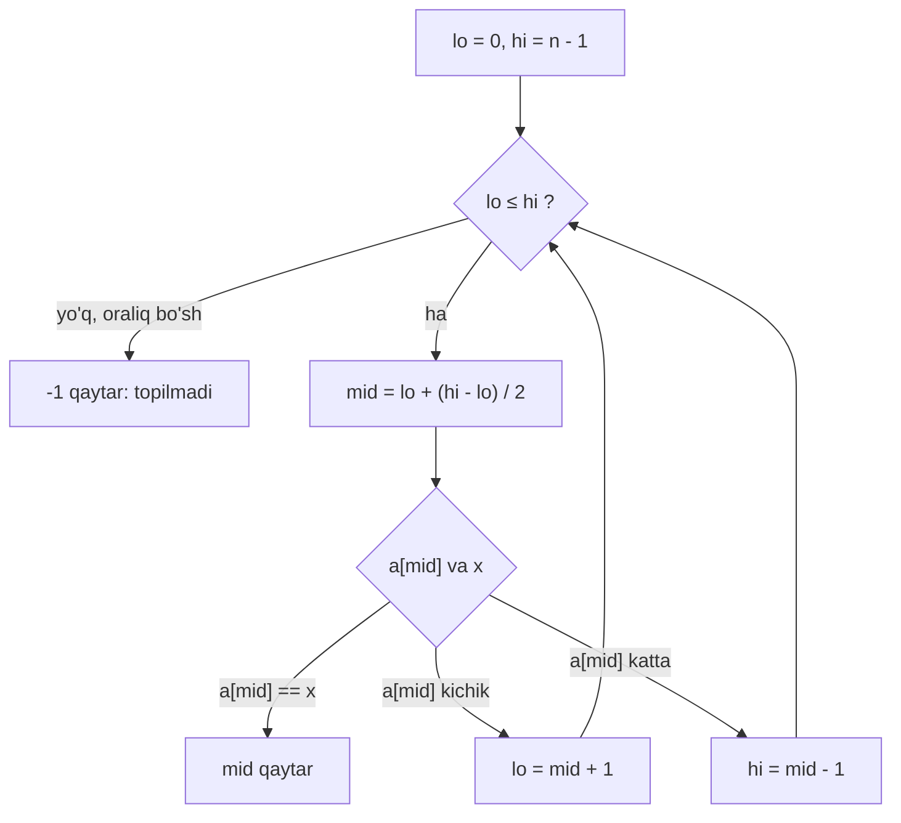

## Bu dars nima uchun kerak

Qidiruv - dasturlashdagi eng ko'p bajariladigan amallardan biri: foydalanuvchini login bo'yicha topish, narxlar jadvalidan tarifni aniqlash, lug'atdan so'zni izlash. 1-darsda telefon kitobi misolida ikki g'oyani ko'rgan edik: sahifalarni birma-bir varaqlash (**linear search**) va o'rtadan ochib, yarmini tashlash (**binary search**). U yerda binary search ning loop invarianti, to'xtashining isboti va `(low + high) / 2` overflow bugi ham ko'rildi.

Bu dars o'sha g'oyalarni C dagi aniq kodga va aniq raqamlarga aylantiradi. 11-darsda massivni, 12-darsda satrlarni o'rgandik; endi ular ustida qidiruv yozamiz va har bir algoritm **necha qadam** qilishini o'lchaymiz va formula bilan isbotlaymiz. Shuningdek, binary search ni yozishda deyarli har bir dasturchi yo'l qo'yadigan xatolarni (off-by-one, cheksiz sikl, unsigned indeks, overflow) bittalab ko'rib chiqamiz va qachon massivni saralab, keyin binary search qilish o'zini oqlashini hisoblaymiz.

Bu darsda faqat qadamlar sonini sanaymiz. Ularni O(n), O(log n) kabi belgilar bilan qisqa ifodalash va formal ta'riflar 16-darsda.

Bu darsdan keyin siz:

- linear search ning eng yaxshi, eng yomon va o'rtacha holatdagi taqqoslashlar sonini (1, n, (n + 1) / 2) keltirib chiqara olasiz;
- binary search eng yomon holatda nega aynan ⌊log₂ n⌋ + 1 ta taqqoslash qilishini isbotlay olasiz;
- n = 1000 va n = 1 000 000 uchun qadamlarni sanaydigan C dasturini yozib, natijani formula bilan solishtira olasiz;
- yopiq [lo, hi] va yarim ochiq [lo, hi) oraliqli ikki yozuv uslubini va ularni aralashtirishdan keladigan xatolarni bilasiz;
- `mid = (low + high) / 2` qaysi n dan boshlab buziladi va Java kutubxonasida nima bo'lganini hisob bilan tushuntira olasiz;
- k ta qidiruv uchun "saralamasdan linear search" va "saralab binary search" narxini solishtira olasiz.

## Linear search

**Linear search** (chiziqli qidiruv) massivni boshidan oxirigacha bittalab tekshiradi: element qidirilgan qiymatga teng bo'lsa - indeksini qaytaradi, oxirigacha topilmasa - "yo'q" (odatda -1).

```c
// Topilsa indeks, topilmasa -1
int linear_search(const int a[], int n, int x)
{
    for (int i = 0; i < n; i++)
    {
        if (a[i] == x)
        {
            return i;
        }
    }
    return -1;
}
```

Linear search ning kuchli tomoni - u massivdan hech narsa talab qilmaydi. Massiv saralangan bo'lishi shart emas, elementlar faqat "tengmi?" savoliga javob bersa yetarli. Shuning uchun u satrlar (`strcmp` bilan, 12-dars), `struct` lar (20-dars) va hatto tartiblash qoidasi yo'q ma'lumotlar uchun ham ishlaydi. Massivning o'rniga linked list (28-dars) bo'lsa ham algoritm o'zgarmaydi, chunki u faqat "keyingi elementga o't" amalidan foydalanadi.

### Qadamlar soni

Qadam deb bitta element bilan taqqoslashni olamiz. n elementli massivda:

- **Eng yaxshi holat** (best case): qidirilgan qiymat birinchi o'rinda. 1 ta taqqoslash.
- **Eng yomon holat** (worst case): qiymat oxirgi o'rinda yoki umuman yo'q. n ta taqqoslash. "Topilmadi" degan javob uchun linear search **har doim** n ta taqqoslash qiladi, chunki oxirgi elementni ko'rmaguncha "yo'q" deyishga haqi yo'q.
- **O'rtacha holat** (average case): qiymat massivda bor va har bir pozitsiyada bo'lish ehtimoli bir xil deb faraz qilamiz. i-pozitsiyadagi (1 dan sanab) element i ta taqqoslashda topiladi. O'rtacha:

(1 + 2 + ... + n) / n = (n(n + 1) / 2) / n = (n + 1) / 2

n = 1000 da bu 500.5, n = 1 000 000 da 500 000.5. Ya'ni o'rtacha holat eng yomon holatning yarmi, lekin n bilan bir xil sur'atda o'sadi: massiv 1000 baravar kattalashsa, o'rtacha ham 1000 baravar oshadi.

O'rtacha holat formulasi farazga bog'liq ekanini unutmang. Agar foydalanuvchilar asosan massiv boshidagi elementlarni qidirsa (masalan, yaqinda qo'shilganlar oldinda tursa), o'rtacha ancha kichik bo'ladi. Agar qidiruvlarning ko'pi "topilmadi" bilan tugasa - n ga yaqin.

Formulani tajribada tekshiramiz. Quyidagi dastur 0-999 sonlarini **aralash** tartibda massivga yozadi (i · 7919 mod 1000: 7919 va 1000 o'zaro tub bo'lgani uchun har bir son aniq bir marta chiqadi) va 1000 ta qiymatning har birini qidirib, taqqoslashlarni sanaydi:

```c run
#include <stdio.h>

#define N 1000

int main(void)
{
    // Saralanmagan massiv: 0..999 sonlari aralash tartibda (7919 va 1000 o'zaro tub)
    int a[N];
    for (int i = 0; i < N; i++)
    {
        a[i] = (i * 7919) % N;
    }

    long total = 0;
    int best = N, worst = 0;
    for (int x = 0; x < N; x++)
    {
        int steps = 0;
        for (int i = 0; i < N; i++)
        {
            steps++;
            if (a[i] == x)
            {
                break;
            }
        }
        total += steps;
        if (steps < best)
        {
            best = steps;
        }
        if (steps > worst)
        {
            worst = steps;
        }
    }
    printf("Birinchi elementlar: %d %d %d %d %d\n", a[0], a[1], a[2], a[3], a[4]);
    printf("Eng yaxshi: %d, eng yomon: %d, o'rtacha: %.1f\n", best, worst, (double) total / N);
    return 0;
}
```

Natija:

```text
Birinchi elementlar: 0 919 838 757 676
Eng yaxshi: 1, eng yomon: 1000, o'rtacha: 500.5
```

O'rtacha aynan 500.5: har bir qiymat bir marta qidirilgani uchun tajriba formuladagi farazni to'liq bajaradi. `N` ni 10 yoki 5000 ga o'zgartirib, (N + 1) / 2 chiqishini tekshiring.

## Binary search: nega aynan ⌊log₂ n⌋ + 1

**Binary search** (ikkiga bo'lib qidirish) faqat **saralangan** massivda ishlaydi. U qidiruv oralig'ining o'rtasidagi elementni qidirilgan qiymat bilan solishtiradi: teng bo'lsa - topildi; o'rtadagi kichik bo'lsa - qiymat faqat o'ng yarmida bo'lishi mumkin; katta bo'lsa - chap yarmida. Har bir taqqoslash oraliqning yarmini tashlab yuboradi.



Saralanganlik - bu algoritmning **precondition** i (1-dars). U bajarilmasa, binary search xato haqida xabar bermaydi, shunchaki noto'g'ri javob qaytaradi. Qadamlar soni esa kiritilgan massivning tartibiga emas, faqat uzunligiga bog'liq.

### Eng yomon holat isboti

Oraliqda m ta element bor deb faraz qilaylik. mid = lo + (m - 1) / 2 (butun bo'lish). mid dan chapda ⌊(m - 1) / 2⌋ ta, o'ngda ⌈(m - 1) / 2⌉ ta element qoladi. Kattarog'i ⌈(m - 1) / 2⌉ = ⌊m / 2⌋. Demak bitta taqqoslashdan keyin oraliq **ko'pi bilan ⌊m / 2⌋** elementga tushadi.

Eng yomon holatda (qiymat yo'q yoki eng oxirgi taqqoslashda topiladi) oraliq har safar kattaroq yarmiga o'tadi va bo'sh bo'lguncha davom etadi. n = 1000 uchun:

1000 → 500 → 250 → 125 → 62 → 31 → 15 → 7 → 3 → 1 → 0

O'qlar soni - taqqoslashlar soni: 10 ta. Umumiy holda: n ni 2 ga necha marta butun bo'lsak 1 ga tushadi - bu ⌊log₂ n⌋ marta (chunki 2ᵏ ≤ n < 2ᵏ⁺¹ bo'lsa, k = ⌊log₂ n⌋). 1 elementli oraliqda yana bitta taqqoslash kerak. Jami:

eng yomon holat = ⌊log₂ n⌋ + 1

Tekshiramiz: 2⁹ = 512 ≤ 1000 < 1024 = 2¹⁰, demak ⌊log₂ 1000⌋ = 9, javob 10. 2¹⁹ = 524 288 ≤ 1 000 000 < 1 048 576 = 2²⁰, demak ⌊log₂ 10⁶⌋ = 19, javob 20.

| n | ⌊log₂ n⌋ + 1 (binary, eng yomon) | n (linear, eng yomon) | Nisbat |
|---|---|---|---|
| 1 | 1 | 1 | 1 |
| 1 000 | 10 | 1 000 | 100 |
| 1 024 | 11 | 1 024 | ≈ 93 |
| 1 000 000 | 20 | 1 000 000 | 50 000 |
| 2³¹ - 1 ≈ 2.1 · 10⁹ | 31 | ≈ 2.1 · 10⁹ | ≈ 6.9 · 10⁷ |

1000 dan 1024 ga o'tish bitta qadam qo'shadi: 1024 = 2¹⁰, ⌊log₂ 1024⌋ = 10. Massiv **ikki baravar** kattalashganda binary search ga faqat **bitta** qadam qo'shiladi, linear search esa ikki baravar ko'p ishlaydi.

### Tajriba: n = 1000 va n = 1 000 000

Endi formulani o'lchaymiz. Dastur massivni 0, 2, 4, ... juft sonlar bilan to'ldiradi va ikki xil qidiruv qiladi: massivdagi **har bir** qiymat (topiladigan) va har bir "oraliqdagi" toq son, jumladan -1 va eng kattasidan katta son (topilmaydigan). Massiv 1 000 000 `int` = 4 000 000 bayt bo'lgani uchun u funksiya ichida emas, global (`static`) e'lon qilingan: lokal massivlar stack da turadi va u ko'pincha bunday hajm uchun juda kichik (24-dars).

```c run
#include <stdio.h>

#define MAX 1000000

static int a[MAX];

// Topilsa indeks, topilmasa -1. *steps - nechta element bilan taqqoslangani
int linear_search(const int arr[], int n, int x, long *steps)
{
    for (int i = 0; i < n; i++)
    {
        (*steps)++;
        if (arr[i] == x)
        {
            return i;
        }
    }
    return -1;
}

// arr o'sish tartibida saralangan bo'lishi shart
int binary_search(const int arr[], int n, int x, long *steps)
{
    int lo = 0, hi = n - 1;
    while (lo <= hi)
    {
        int mid = lo + (hi - lo) / 2;
        (*steps)++;
        if (arr[mid] == x)
        {
            return mid;
        }
        if (arr[mid] < x)
        {
            lo = mid + 1;
        }
        else
        {
            hi = mid - 1;
        }
    }
    return -1;
}

int floor_log2(int n)
{
    int k = 0;
    while (n > 1)
    {
        n /= 2;
        k++;
    }
    return k;
}

void measure(int n)
{
    for (int i = 0; i < n; i++)
    {
        a[i] = 2 * i; // 0, 2, 4, ... saralangan, faqat juft sonlar
    }

    // Binary search: massivdagi har bir qiymat va har bir "oraliq" (toq son) uchun
    long total = 0, worst_found = 0, worst_missing = 0;
    for (int i = 0; i < n; i++)
    {
        long steps = 0;
        binary_search(a, n, 2 * i, &steps);
        total += steps;
        if (steps > worst_found)
        {
            worst_found = steps;
        }
    }
    for (int i = -1; i < n; i++)
    {
        long steps = 0;
        binary_search(a, n, 2 * i + 1, &steps);
        if (steps > worst_missing)
        {
            worst_missing = steps;
        }
    }

    // Linear search: topilmagan qiymat har doim n qadam
    long linear_missing = 0;
    linear_search(a, n, -1, &linear_missing);

    printf("n = %d\n", n);
    printf("  linear: topilmasa %ld qadam, topilsa o'rtacha (n + 1) / 2 = %.1f\n", linear_missing,
           (n + 1) / 2.0);
    printf("  binary: topilsa eng ko'pi %ld, o'rtacha %.2f; topilmasa eng ko'pi %ld\n", worst_found,
           (double) total / n, worst_missing);
    printf("  formula floor(log2 n) + 1 = %d\n", floor_log2(n) + 1);
}

int main(void)
{
    measure(1000);
    measure(1000000);
    return 0;
}
```

Natija:

```text
n = 1000
  linear: topilmasa 1000 qadam, topilsa o'rtacha (n + 1) / 2 = 500.5
  binary: topilsa eng ko'pi 10, o'rtacha 8.99; topilmasa eng ko'pi 10
  formula floor(log2 n) + 1 = 10
n = 1000000
  linear: topilmasa 1000000 qadam, topilsa o'rtacha (n + 1) / 2 = 500000.5
  binary: topilsa eng ko'pi 20, o'rtacha 18.95; topilmasa eng ko'pi 20
  formula floor(log2 n) + 1 = 20
```

Kuzatishlar:

1. **Eng yomon holat formulaga aniq mos:** 10 va 20. Hech bir qidiruv bu chegaradan oshmadi - n = 10⁶ dagi 1 000 001 ta topilmaydigan qiymat orasida ham.
2. **Binary search ning o'rtacha holati eng yomoniga juda yaqin:** 8.99 va 18.95. Sababi: elementlarning yarmiga yaqini eng oxirgi qadamda topiladi. O'rta element 1 qadamda, chorak nuqtalardagi ikkitasi 2 qadamda, keyingi to'rttasi 3 qadamda topiladi: d-qadamda 2ᵈ⁻¹ ta element. Shuning uchun "omadli" qidiruv binary search da kam uchraydi, lekin bu muhim emas - eng yomon holatning o'zi juda kichik.
3. **Linear search ning o'rtachasi esa eng yomonining yarmi** (500 000.5 va 1 000 000) va har ikkalasi n ga proporsional.

Dasturdagi linear search 1 000 000 element uchun bir marta ishlatilgan. Har bir qiymatni linear search bilan qidirish 10⁶ · 500 000.5 ≈ 5 · 10¹¹ taqqoslash bo'lardi - brauzerdagi 5 soniyalik chegarada tugamaydi. Binary search bilan esa n = 10⁶ dagi 2 000 001 ta qidiruv (10⁶ topiladigan va 10⁶ + 1 topilmaydigan) jami 4 · 10⁷ dan kam taqqoslash qildi.

## Ikki yozuv uslubi va off-by-one xatolari

Binary search g'oyasi oddiy, lekin kodda to'rtta qaror bor: `hi` ning boshlang'ich qiymati, sikl sharti, `lo` ni yangilash va `hi` ni yangilash. Ular bir-biriga mos bo'lishi shart. Wikipedia dagi binary search maqolasi 1988 yilda chop etilgan tadqiqotni keltiradi: 20 ta darslikdan faqat 5 tasida to'g'ri binary search kodi topilgan.

Ikkita izchil uslub bor:

| Qaror | Yopiq oraliq [lo, hi] | Yarim ochiq oraliq [lo, hi) |
|---|---|---|
| Ma'nosi | lo va hi ikkalasi ham nomzod | lo nomzod, hi oraliqdan tashqarida |
| Boshlanish | `lo = 0, hi = n - 1` | `lo = 0, hi = n` |
| Sikl sharti | `while (lo <= hi)` | `while (lo < hi)` |
| Oraliq uzunligi | hi - lo + 1 | hi - lo |
| `a[mid] < x` | `lo = mid + 1` | `lo = mid + 1` |
| `a[mid] > x` | `hi = mid - 1` | `hi = mid` |
| Bo'sh massiv (n = 0) | hi = -1 (unsigned indeksda muammo) | hi = 0, sikl ishlamaydi |

**Yarim ochiq oraliq** (half-open interval) [lo, hi) - lo kiradi, hi kirmaydi. C dagi `for (int i = 0; i < n; i++)` sikli ham aynan shu uslubda: [0, n). Uning afzalliklari: uzunlik oddiy ayirma (hi - lo), bo'sh oraliq lo == hi, va oraliqni ikkiga bo'lish [lo, mid) va [mid, hi) shaklida hech qanday ±1 siz yoziladi. Python ning `bisect` moduli va ko'p standart kutubxonalar shu uslubni ishlatadi.

Xatolar ikki uslub aralashib ketganda paydo bo'ladi. Quyidagi dasturda to'g'ri versiya va ikkita tipik xato bor. Cheksiz siklni ko'rish uchun har bir funksiyada aylanishlar 100 ta bilan cheklangan:

```c run
#include <stdio.h>

#define LIMIT 100 // sikl shuncha aylansa, "cheksiz" deb to'xtatamiz

// To'g'ri: yarim ochiq oraliq [lo, hi)
int search_ok(const int a[], int n, int x, int *iters)
{
    int lo = 0, hi = n;
    *iters = 0;
    while (lo < hi && *iters < LIMIT)
    {
        (*iters)++;
        int mid = lo + (hi - lo) / 2;
        if (a[mid] == x)
        {
            return mid;
        }
        if (a[mid] < x)
        {
            lo = mid + 1;
        }
        else
        {
            hi = mid;
        }
    }
    return -1;
}

// Xato 1: yopiq oraliq [lo, hi], lekin shart lo < hi - oxirgi bitta element tekshirilmaydi
int search_bug1(const int a[], int n, int x, int *iters)
{
    int lo = 0, hi = n - 1;
    *iters = 0;
    while (lo < hi && *iters < LIMIT)
    {
        (*iters)++;
        int mid = lo + (hi - lo) / 2;
        if (a[mid] == x)
        {
            return mid;
        }
        if (a[mid] < x)
        {
            lo = mid + 1;
        }
        else
        {
            hi = mid - 1;
        }
    }
    return -1;
}

// Xato 2: yarim ochiq oraliq, lekin lo = mid - oraliq kichraymay qolishi mumkin
int search_bug2(const int a[], int n, int x, int *iters)
{
    int lo = 0, hi = n;
    *iters = 0;
    while (lo < hi && *iters < LIMIT)
    {
        (*iters)++;
        int mid = lo + (hi - lo) / 2;
        if (a[mid] == x)
        {
            return mid;
        }
        if (a[mid] < x)
        {
            lo = mid;
        }
        else
        {
            hi = mid;
        }
    }
    return -1;
}

int main(void)
{
    int a[] = {10, 20, 30, 40, 50};
    int n = 5;
    int xs[] = {10, 50, 30, 35, 60};

    for (int i = 0; i < 5; i++)
    {
        int it0, it1, it2;
        int r0 = search_ok(a, n, xs[i], &it0);
        int r1 = search_bug1(a, n, xs[i], &it1);
        int r2 = search_bug2(a, n, xs[i], &it2);
        printf("x=%2d  to'g'ri: %2d (%d)   xato1: %2d (%d)   xato2: %2d (%d%s)\n", xs[i], r0, it0, r1, it1,
               r2, it2, it2 == LIMIT ? ", cheksiz" : "");
    }
    return 0;
}
```

Natija (qavs ichida - aylanishlar soni):

```text
x=10  to'g'ri:  0 (3)   xato1:  0 (2)   xato2:  0 (3)
x=50  to'g'ri:  4 (2)   xato1: -1 (2)   xato2:  4 (3)
x=30  to'g'ri:  2 (1)   xato1:  2 (1)   xato2:  2 (1)
x=35  to'g'ri: -1 (3)   xato1: -1 (2)   xato2: -1 (100, cheksiz)
x=60  to'g'ri: -1 (2)   xato1: -1 (2)   xato2: -1 (100, cheksiz)
```

**Xato 1** 50 ni topmadi, garchi u massivda bo'lsa ham. Qadamlab: lo = 0, hi = 4, mid = 2 (30 < 50), lo = 3; mid = 3 (40 < 50), lo = 4. Endi lo = hi = 4, oraliqda bitta element (50) qoldi, lekin `lo < hi` yolg'on va sikl tugadi. Yopiq oraliqda lo == hi - bo'sh emas, bitta elementli oraliq. Bu xato jim: dastur ishlaydi, faqat ba'zi qiymatlar uchun "topilmadi" deydi. Testda faqat o'rtadagi qiymatlarni qidirsangiz, uni sezmaysiz.

**Xato 2** topilmaydigan qiymatda abadiy aylandi. x = 35: lo = 0, hi = 5, mid = 2 (30 < 35), lo = 2; mid = 3 (40 > 35), hi = 3; mid = 2 (30 < 35), lo = mid = 2 - hech narsa o'zgarmadi. lo = 2, hi = 3 da mid har doim 2 va oraliq kichraymaydi. 1-darsdagi to'xtash isboti "har qadamda hi - lo qat'iy kamayadi" degan da'voga tayanardi; `lo = mid` uni buzadi. Haqiqiy dasturda bu chegara yo'q, dastur shunchaki osilib qoladi.

Chegaraviy holatlar ro'yxati, har bir binary search ni shu bilan sinang: bo'sh massiv, bitta element (topiladigan va topilmaydigan), birinchi element, oxirgi element, eng kichigidan kichik va eng kattasidan katta qiymat, ikki element orasidagi qiymat.

### Unsigned indeks: `n - 1` tuzog'i

Massiv uzunligi va indekslari uchun C da ko'pincha `size_t` ishlatiladi - `sizeof` va `strlen` qaytaradigan unsigned tip (brauzer muhitida 4 bayt, x86-64 da 8 bayt). Unsigned arifmetika modul 2ᴺ bo'yicha ishlaydi (7-dars), ya'ni manfiy natija bo'lmaydi: 0 - 1 eng katta qiymatga aylanadi.

```c run
#include <stdint.h>
#include <stdio.h>

int main(void)
{
    size_t n = 0;      // bo'sh massiv
    size_t lo = 0;
    size_t hi = n - 1; // yopiq oraliq [0, n - 1] uchun oxirgi indeks
    printf("n - 1 == SIZE_MAX: %s\n", hi == SIZE_MAX ? "ha" : "yo'q");
    printf("lo <= hi: %s\n", lo <= hi ? "true, sikl boshlanadi" : "false");

    size_t mid = 0;
    printf("mid - 1 (mid = 0) == SIZE_MAX: %s\n", mid - 1 == SIZE_MAX ? "ha" : "yo'q");
    return 0;
}
```

Natija:

```text
n - 1 == SIZE_MAX: ha
lo <= hi: true, sikl boshlanadi
mid - 1 (mid = 0) == SIZE_MAX: ha
```

Bo'sh massivda yopiq oraliqli binary search `size_t` bilan yozilsa, `hi` ulkan son bo'ladi, sikl boshlanadi va `a[mid]` massivdan juda uzoqdagi manzilni o'qiydi (11-darsdagi chegaradan chiqish). Bo'sh bo'lmagan massivda ham x birinchi elementdan kichik bo'lsa, oxirida mid = 0 va `hi = mid - 1` xuddi shu tuzoqqa tushadi. Yarim ochiq uslubda bunday ayirish umuman yo'q: `hi = n` va `hi = mid` hech qachon manfiy bo'lmaydi. Shuning uchun unsigned indekslar bilan [lo, hi) ni tanlash xavfsizroq.

## O'rtani hisoblash: overflow va Java kutubxonasidagi bug

1-darsda ko'rdik: `mid = (low + high) / 2` da `low + high` yig'indisi `int` ga sig'masa, C da bu undefined behavior. Endi aniq savol beramiz: bu **qaysi n dan** boshlab sodir bo'ladi?

32-bitli `int` ning eng katta qiymati 2³¹ - 1 = 2 147 483 647. Eng katta indeks n - 1. Overflow uchun low + high > 2³¹ - 1 bo'lishi kerak. low va high ikkalasi n - 1 dan oshmaydi, va eng yomon holatda qidiruv o'ng chekkaga borib, ikkalasi ham n - 1 ga yaqinlashadi. Demak:

2(n - 1) > 2³¹ - 1 → n > 2³⁰ + 0.5, ya'ni taxminan n ≥ 2³⁰ + 1 = 1 073 741 825

Ya'ni muammo taxminan milliard elementdan boshlanadi. Joshua Bloch ning 2006 yil 2 iyundagi Google Research blogidagi maqolasi deyarli shu chegarani aytadi: uzunligi 2³⁰ va undan katta massivlarda (aniq hisobda n = 2³⁰ da yig'indi 2³¹ - 2 ga yetadi va hali sig'adi). Uning ta'kidlashicha, `java.util.Arrays` dagi binary search da bu xato to'qqiz yilcha sezilmay yotgan, Jon Bentley ning "Programming Pearls" kitobidagi versiyada esa yigirma yil ("two decades"). Maqolada havola qilingan bug yozuvi (JDK-6412541) sarlavhasi: "Arrays.binarySearch does not work for arrays larger than 1<<30" (1<<30 = 2³⁰).

Bloch ikki tuzatishni taklif qilgan: `low + ((high - low) / 2)` va Java ning `(low + high) >>> 1` (unsigned surish). C uchun u keltirgan unsigned ga aylantirish usuli haqida 2008 yildagi qo'shimchada ogohlantirish bor: u C99 standarti bo'yicha kafolatlanmagan. `lo + (hi - lo) / 2` esa har qanday tilda va tipda ishlaydi, chunki hi - lo oraliq uzunligidan oshmaydi va natija hech qachon hi dan katta bo'lmaydi.

Brauzer muhitida `int` ham 32 bit, va 2³⁰ ta `int` massiv 4 GiB bo'lardi - wasm32 manzil maydonining (4 GiB) o'zi. Shuning uchun bu bug ni bu yerda massiv bilan qayta yaratib bo'lmaydi; uning mexanikasini 1-darsdagi to'g'ridan-to'g'ri `lo` va `hi` qiymatlari bilan ko'rsatilgan misol namoyish qiladi.

## Takrorlar, `bsearch` va lower_bound

Massivda bir xil qiymat bir necha marta uchrasa, yuqoridagi binary search **qaysi birini** qaytaradi? Javob: qaysi biriga birinchi bo'lib "tushsa", o'shani. [2, 2, 2, 2] da 2 ni qidirsak, mid = 1 bo'ladi va 1 qaytadi - birinchisi ham, oxirgisi ham emas.

C standart kutubxonasidagi `bsearch` funksiyasi (`stdlib.h`) ham shunday: cppreference ga ko'ra, agar massivda qidirilgan qiymatga teng bir nechta element bo'lsa, qaysi biri qaytarilishi aniqlanmagan (unspecified). Shuningdek, massiv qidirilgan qiymatga nisbatan to'g'ri tartiblanmagan bo'lsa, xatti-harakat undefined. `bsearch` element topilmasa `NULL` qaytaradi; u void pointer va solishtirish funksiyasi bilan ishlaydi, ularni 21-23-darslardan keyin batafsil ko'ramiz.

Ko'p amaliy savollar esa aniq chegara talab qiladi:

- **lower_bound**: x dan kichik bo'lmagan birinchi elementning indeksi (bunday element bo'lmasa, n). Bu 1-darsdagi amaliy topshiriq, u yerda Python testli mashq bor - qayta yozmaymiz.
- **upper_bound**: x dan katta bo'lgan birinchi elementning indeksi (bunday element bo'lmasa, n). Python da `bisect.bisect_right`, lower_bound esa `bisect.bisect_left`.

Ikkalasi birga ko'p savolga javob beradi: x ning massivda nechta ekani - upper_bound - lower_bound; x bormi - lower_bound < n va a[lower_bound] == x; [a, b] oralig'idagi qiymatlar soni - upper_bound(b) - lower_bound(a). Ular topilganda to'xtamaydi, oraliq bitta nuqtaga qisqarguncha davom etadi; yarim ochiq uslubda bu ko'pi bilan ⌈log₂(n + 1)⌉ ta o'qish (ba'zi x uchun bittaga kam), ya'ni n ≥ 1 da ⌊log₂ n⌋ + 1 (n = 10⁶ da 20).

Xato yondashuv: binary search bilan istalgan uchrashni topib, keyin chapga yoki o'ngga **linear** yurish. Takrorlar kam bo'lsa tez, lekin 1 000 000 ta bir xil elementda yurish 500 000 qadamgacha cho'ziladi. Chegarani binary search ning o'zi topishi kerak.

## Saralash qachon o'zini oqlaydi

Binary search saralangan massiv talab qiladi. Massiv saralanmagan bo'lsa, ikki yo'l bor: har safar linear search qilish yoki bir marta saralab, keyin binary search qilish. Saralash bepul emas. 17-19-darslarda ko'ramizki, yaxshi saralash algoritmlari (masalan, merge sort) n log₂ n ga yaqin taqqoslash qiladi, oddiylari esa n² ga yaqin.

Hisobni taqqoslashlar sonida qilamiz. k ta qidiruv bo'ladi, hammasi topiladigan qiymatlar uchun:

- saralamasdan: k · (n + 1) / 2;
- saralab: n log₂ n + k · (⌊log₂ n⌋ + 1).

Ikkalasi tenglashadigan k:

k · ((n + 1) / 2 - (⌊log₂ n⌋ + 1)) = n log₂ n

n = 10⁶ uchun: n log₂ n ≈ 10⁶ · 19.93 ≈ 1.99 · 10⁷. Qavs ichida 500 000.5 - 20 = 499 980.5. k ≈ 1.99 · 10⁷ / 499 980.5 ≈ 39.9. Ya'ni taxminan **40 ta** qidiruvdan boshlab saralash foyda beradi. Qidiruvlar topilmaydigan qiymatlar uchun bo'lsa (linear search har safar n qadam), chegara ikki baravar past: 1.99 · 10⁷ / (10⁶ - 20) ≈ 20.

| Stsenariy (n = 10⁶) | Saralamasdan, linear | Saralab, binary | Tanlov |
|---|---|---|---|
| 1 ta qidiruv | ≈ 5 · 10⁵ | ≈ 1.99 · 10⁷ + 20 | Linear |
| 10 ta qidiruv | ≈ 5 · 10⁶ | ≈ 1.99 · 10⁷ + 200 | Linear |
| 40 ta qidiruv | ≈ 2.0 · 10⁷ | ≈ 1.99 · 10⁷ + 800 | Teng atrofida |
| 1000 ta qidiruv | ≈ 5 · 10⁸ | ≈ 1.99 · 10⁷ + 2 · 10⁴ | Binary, ≈ 25 baravar kam |
| 10⁶ ta qidiruv | ≈ 5 · 10¹¹ | ≈ 1.99 · 10⁷ + 2 · 10⁷ | Binary, ≈ 12 500 baravar kam |

Bu jadval qo'pol model: taqqoslashlar har xil narxda bo'lishi mumkin, saralash elementlarni ko'chiradi ham, va n log₂ n faqat yaxshi algoritm uchun to'g'ri. Lekin xulosa barqaror:

- bir marta qidiriladigan ma'lumotni saralash befoyda;
- ko'p marta qidiriladigan, kam o'zgaradigan ma'lumotni bir marta saralab saqlash o'zini tez oqlaydi;
- ma'lumot tez-tez o'zgarsa (qo'shish, o'chirish), saralangan massivni saqlash qimmat: yangi elementni o'rniga qo'yish uchun undan keyingi hammasini surish kerak (o'rtacha n / 2 ta ko'chirish). Bunday hollar uchun binary search tree (29-dars) va hash table (30-dars) mavjud. Hash table faqat "teng" savoliga javob beradi; "x dan kichik eng katta element" kabi tartibga bog'liq savollar uchun saralangan tuzilma kerak.

n = 1000 uchun xuddi shu hisob: n log₂ n ≈ 9966, (n + 1) / 2 - 10 = 490.5, k ≈ 20.3. Kichik massivlarda chegara pastroq, lekin u yerda ikkala yo'l ham mikrosoniyalar oladi.

## Ko'p uchraydigan xatolar

1. **Saralanmagan massivda binary search.** Precondition buzilsa, javob noto'g'ri, lekin xato xabari yo'q. Massivni kim saralashi (chaqiruvchi yoki funksiya) hujjatda yoki nomda aniq bo'lsin.
2. **Uslublarni aralashtirish.** `hi = n - 1` bilan `while (lo < hi)` oxirgi elementni tashlab ketadi; `hi = n` bilan `while (lo <= hi)` `a[n]` ni o'qib, massiv chegarasidan chiqadi. Bitta uslubni tanlang va to'rtala qarorni unga moslang.
3. **`lo = mid` yoki `hi = mid` noto'g'ri joyda.** Oraliq kichraymasa, sikl cheksiz. Har bir tarmoqda hi - lo qat'iy kamayishini tekshiring.
4. **`size_t` bilan `n - 1` va `mid - 1`.** Unsigned ayirish 0 dan pastga tushmaydi, eng katta qiymatga aylanadi. Unsigned indeks bilan yarim ochiq oraliqni ishlating.
5. **`(lo + hi) / 2`.** Taxminan 2³⁰ dan katta massivda `int` overflow (C da undefined behavior). `lo + (hi - lo) / 2` yozing.
6. **Topilgan takrordan linear yurish.** Birinchi yoki oxirgi uchrash kerak bo'lsa, lower_bound/upper_bound yozing; aks holda bir xil elementlar ko'p bo'lganda qidiruv n ga yaqin qadam oladi.
7. **Linear search o'rtacha holatini doim n / 2 deb hisoblash.** (n + 1) / 2 qiymat massivda bor va hamma pozitsiya teng ehtimolli bo'lgandagina to'g'ri. Topilmaydigan qidiruvlar har doim n qadam.
8. **Bitta qidiruv uchun saralash.** Saralash n log₂ n atrofida turadi, bitta linear search esa n. Saralash faqat ko'p qidiruvlarda (n = 10⁶ da taxminan 40 tadan) foyda beradi.

## Xulosa

- Linear search har qanday massivda ishlaydi: eng yaxshi holat 1, eng yomon n, o'rtacha (qiymat bor, pozitsiyalar teng ehtimolli) (n + 1) / 2; topilmasa har doim n.
- Binary search faqat saralangan massivda ishlaydi va har taqqoslashda oraliqni ko'pi bilan ⌊m / 2⌋ ga tushiradi, shuning uchun eng yomon holat ⌊log₂ n⌋ + 1: n = 1000 da 10, n = 10⁶ da 20.
- O'lchov formulani tasdiqladi; binary search ning o'rtachasi (8.99 va 18.95) eng yomon holatga juda yaqin.
- Yopiq [lo, hi] va yarim ochiq [lo, hi) uslublarining to'rtta qarori bir-biriga mos bo'lishi kerak; aralashsa - oxirgi element yo'qoladi yoki sikl cheksiz bo'ladi.
- Unsigned indeksda `n - 1` va `mid - 1` eng katta songa aylanadi; yarim ochiq uslub bu ayirishlarni yo'q qiladi.
- `(lo + hi) / 2` taxminan 2³⁰ elementdan boshlab overflow qiladi; Java kutubxonasida bu xato to'qqiz yilcha yashagan. `lo + (hi - lo) / 2` xavfsiz.
- `bsearch` takrorlardan istalganini qaytarishi mumkin; aniq chegara uchun lower_bound va upper_bound (Python da `bisect_left` va `bisect_right`).
- Saralash taxminan n log₂ n turadi va k ta qidiruvdan keyin o'zini oqlaydi: n = 10⁶ da k ≈ 40 (topiladigan qiymatlar), k ≈ 20 (topilmaydiganlar).

## Amaliy topshiriq

Tarif jadvali vazifasi: chegaralar o'sish tartibida saralangan massivda berilgan (masalan, `{0, 1000, 5000, 20000}` - shu summadan boshlab amal qiladigan tariflar). Berilgan summa x uchun qaysi tarif ishlashini topish kerak, ya'ni **x dan katta bo'lmagan oxirgi elementning indeksi**. Bunday element bo'lmasa (x eng kichik chegaradan ham kichik), javob -1.

Topshiriq qadamlari:

1. **Muammoni aniq yozing.** Input, output, precondition. Javobni upper_bound orqali ifodalang: last_at_most(a, x) = upper_bound(a, x) - 1. Nega bu to'g'ri? Bo'sh massiv va takrorlar bo'lganda nima qaytadi?
2. **Uslubni tanlang.** Yopiq yoki yarim ochiq oraliqni tanlang, to'rtta qarorni (boshlanish, shart, ikkala yangilash) yozing va loop invariantni bitta gap bilan ifodalang (1-darsdagi kabi: boshlanish, saqlanish, yakun).
3. **Python da yozing va testlardan o'tkazing.** Pastdagi mashqda `last_at_most` ni yozing. Testlar chegaraviy holatlarni, 300 ta tasodifiy ro'yxatni va usulni tekshiradi: 1 000 000 elementli ro'yxatda har bir qidiruv 21 tadan (⌊log₂ n⌋ + 1 = 20 va bitta zaxira) ko'p element o'qimasligi kerak, jumladan hamma elementi bir xil bo'lgan ro'yxatda ham.
4. **C ga o'giring va qadamlarni sanang.** Funksiyani C da `int last_at_most(const int a[], int n, int x, int *steps)` ko'rinishida yozing. Darsdagi tajriba dasturi kabi n = 1000 va n = 1 000 000 uchun barcha topiladigan va topilmaydigan x larda eng ko'p qadamni o'lchang va formula bilan solishtiring.
5. **Chegaraviy holatlar jadvali.** C versiyasida kamida: bo'sh massiv, bitta element (x kichik, teng, katta), [1, 3, 3, 3, 5] da x = 0, 3, 4, 6, va `{0, 1000, 5000, 20000}` da x = 999, 1000, 25000. Kutilgan va olingan javoblarni jadvalda bering.
6. **Hisob.** Tarif jadvalida 50 ta chegara bor va kuniga 2 000 000 ta to'lov uchun tarif aniqlanadi. Linear search (eng yomon holat) va binary search uchun kunlik taqqoslashlar sonini hisoblang. Chegaralar har kuni bir marta yangilanib, saralanmagan holda kelsa, saralash (n log₂ n deb oling) o'zini oqlaydimi?

```python run
def last_at_most(a, x):
    """a - o'sish tartibida saralangan ro'yxat.
    x dan katta bo'lmagan oxirgi elementning indeksini qaytaradi;
    bunday element bo'lmasa - -1."""
    # Yechimingizni shu yerga yozing
    return -1


print(last_at_most([0, 1000, 5000, 20000], 4999))  # 1 chiqishi kerak
```

```python test
import bisect
import random


class Counting(list):
    """Elementlarni o'qishlar sonini sanaydigan ro'yxat."""
    reads = 0

    def __getitem__(self, i):
        self.reads += 1
        return super().__getitem__(i)

    def __iter__(self):
        for i in range(len(self)):
            yield self[i]


check("bo'sh ro'yxat: last_at_most([], 5) == -1", lambda: last_at_most([], 5) == -1)
check("hamma element katta: last_at_most([5], 3) == -1", lambda: last_at_most([5], 3) == -1)
check("teng element: last_at_most([5], 5) == 0", lambda: last_at_most([5], 5) == 0)
check("hamma element kichik: last_at_most([5], 9) == 0", lambda: last_at_most([5], 9) == 0)
check("takrorlarda oxirgisi: last_at_most([2, 2, 2], 2) == 2", lambda: last_at_most([2, 2, 2], 2) == 2)
check("last_at_most([1, 3, 3, 3, 5], 3) == 3", lambda: last_at_most([1, 3, 3, 3, 5], 3) == 3)
check("last_at_most([1, 3, 3, 3, 5], 4) == 3", lambda: last_at_most([1, 3, 3, 3, 5], 4) == 3)
check("last_at_most([1, 3, 3, 3, 5], 0) == -1", lambda: last_at_most([1, 3, 3, 3, 5], 0) == -1)
check("last_at_most([1, 3, 3, 3, 5], 6) == 4", lambda: last_at_most([1, 3, 3, 3, 5], 6) == 4)


def random_cases():
    rng = random.Random(15)
    for _ in range(300):
        a = sorted(rng.randint(0, 30) for _ in range(rng.randint(0, 40)))
        x = rng.randint(-3, 33)
        if last_at_most(a, x) != bisect.bisect_right(a, x) - 1:
            return False
    return True


check("300 ta tasodifiy ro'yxatda to'g'ri javob", random_cases)


def few_reads():
    a = Counting(range(0, 3_000_000, 3))  # 1 000 000 element: 0, 3, 6, ...
    for x, javob in [(1_000_000, 333_333), (-1, -1), (2_999_997, 999_999), (10**9, 999_999)]:
        a.reads = 0
        if last_at_most(a, x) != javob or a.reads > 21:
            return False
    return True


check("1 000 000 elementda har qidiruv 21 tadan ko'p o'qimaydi (binary search: floor(log2 n) + 1 = 20)", few_reads)


def same_values():
    a = Counting([7] * 1_000_000)
    return last_at_most(a, 7) == 999_999 and a.reads <= 21


check("1 000 000 ta bir xil elementda ham 21 tadan ko'p o'qimaydi (topgach linear yurmang)", same_values)
```

Yaxshi javobda bo'lishi kerak bo'lgan narsalar:

- precondition (saralangan) va -1 holati aniq yozilgan; upper_bound - 1 munosabati takrorlar misolida ([2, 2, 2] da 3 - 1 = 2) tushuntirilgan;
- tanlangan uslubning to'rtta qarori bir-biriga mos, loop invariant boshlanish, saqlanish va yakun qismlari bilan yozilgan, sikl nega to'xtashi hi - lo kamayishi orqali ko'rsatilgan;
- Python versiyasi barcha testlardan, jumladan o'qishlar soni testlaridan o'tgan;
- C versiyasida `mid = lo + (hi - lo) / 2`, o'lchangan eng ko'p qadam n = 1000 da 10 dan, n = 10⁶ da 20 dan (yarim ochiq uslubda ⌈log₂(n + 1)⌉ ga teng) oshmagani ko'rsatilgan;
- chegaraviy holatlar jadvali to'liq: `{0, 1000, 5000, 20000}` da 999 → 0, 1000 → 1, 25000 → 3;
- hisob: linear 50 · 2 · 10⁶ = 10⁸, binary (⌊log₂ 50⌋ + 1 = 6) 6 · 2 · 10⁶ = 1.2 · 10⁷ taqqoslash; saralash 50 · log₂ 50 ≈ 282 taqqoslash - kunlik hajm oldida arzimas, shuning uchun saralash o'zini oqlaydi.

Javobingizni pastdagi maydonga yozing va yuqoridagi mezonlar bilan solishtiring.

## Manbalar

- CS50x. [Lecture 3 notes](https://cs50.harvard.edu/x/notes/3/) - "Linear Search", "Binary Search" va "Running Time" bo'limlari: yettita shkafcha (lockers) misoli, ikki algoritmning pseudocode i va binary search uchun saralanganlik sharti.
- Joshua Bloch. [Extra, Extra - Read All About It: Nearly All Binary Searches and Mergesorts are Broken](https://research.google/blog/extra-extra-read-all-about-it-nearly-all-binary-searches-and-mergesorts-are-broken/), Google Research blog, 2006 yil 2 iyun - 2³⁰ chegarasi, JDK da to'qqiz yilcha yashagan xato, `low + ((high - low) / 2)` va `>>> 1` tuzatishlari, C bo'yicha 2008 yildagi qo'shimcha.
- OpenJDK. [JDK-6412541: Arrays.binarySearch does not work for arrays larger than 1<<30](https://bugs.openjdk.org/browse/JDK-6412541) - Bloch maqolasida havola qilingan bug yozuvi.
- Wikipedia. [Binary search](https://en.wikipedia.org/wiki/Binary_search) - "Performance": eng yomon holatda ⌊log₂ n + 1⌋ iteratsiya; "Implementation issues": 1988 yilgi tadqiqot (20 darslikdan 5 tasi to'g'ri), Programming Pearls va Java dagi overflow xatosi.
- cppreference. [bsearch, bsearch_s](https://en.cppreference.com/w/c/algorithm/bsearch) - massiv qidirilgan qiymatga nisbatan bo'lingan bo'lishi talabi, teng elementlardan qaysi biri qaytishi aniqlanmaganligi.
- Python documentation. [bisect - Array bisection algorithm](https://docs.python.org/3/library/bisect.html) - `bisect_left` va `bisect_right` ning qo'yish nuqtasi ta'rifi, `lo` va `hi` parametrlari.
- Thomas H. Cormen va boshq. [Introduction to Algorithms, 4-nashr](https://mitpress.mit.edu/9780262046305/introduction-to-algorithms/), MIT Press - 2-bob "Getting Started": loop invariant usuli (boshlanish, saqlanish, yakun) va algoritmni eng yomon hamda o'rtacha holat bo'yicha tahlil qilish.
