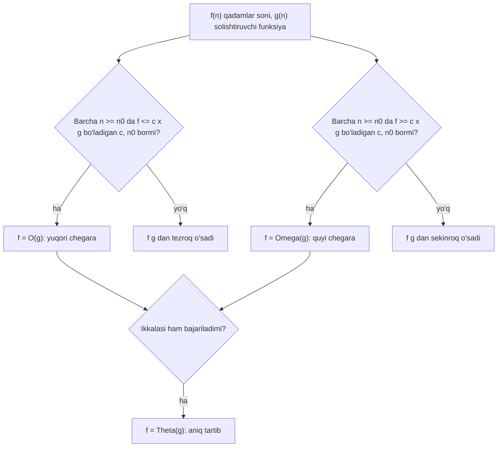

## Bu dars nima uchun kerak

15-darsda ikkita qidiruv algoritmini ko'rdik va ularning qadamlari sonini sanadik: biri elementlar soniga proporsional o'sadi, ikkinchisi esa har qadamda qidiruv oralig'ini yarmiga qisqartiradi. "Qaysi algoritm tezroq?" degan savolga javob berish uchun biz hali norasmiy so'zlar ishlatdik: "taxminan n qadam", "taxminan log n qadam". Bu darsda shu so'zlarga aniq matematik ma'no beramiz.

Muammo shunday. Ikkita dastur bir xil ishni bajaradi. Birinchisi 100 ta element ustida 2 ms, ikkinchisi 5 ms ishladi. Bundan birinchisi yaxshi degan xulosa chiqadimi? Yo'q: 1 million element ustida birinchisi bir necha soat, ikkinchisi bir necha soniya ishlashi mumkin. Bizga dasturning bitta o'lchovdagi vaqti emas, **kirish kattalashganda ish hajmi qanday o'sishi** kerak. Buni ifodalaydigan til - **asimptotik tahlil** (asymptotic analysis): funksiyalarni n juda katta bo'lgandagi xatti-harakati bo'yicha solishtirish. 1-darsda "konstanta farqi" va "o'sishning boshqa sinfi" deb gapirgan narsamiz shu yerda formal ko'rinish oladi.

Bu dars kursning qolgan qismi uchun lug'at vazifasini bajaradi: 17-darsdagi uchta saralash, 19-darsdagi merge sort, 28-30-darslardagi linked list, daraxt va hash table hammasi shu tilda solishtiriladi.

Bu darsdan keyin siz:

- nega algoritm soniyalarda emas, asosiy amallar (qadamlar) sonida o'lchanishini tushuntira olasiz;
- 1, log n, n, n log n, n^2, 2^n, n! funksiyalari n = 10, 1000, 10^6 da qancha qadam va qancha vaqt berishini hisoblay olasiz;
- O, Omega va Theta ning c va n0 konstantalari bilan rasmiy ta'rifini yozib, oddiy misolda isbotlay olasiz;
- eng yaxshi, eng yomon va o'rtacha holat O va Omega bilan bir xil narsa emasligini tushuntira olasiz;
- konstantalar va kichik hadlarni qaysi qoida bilan tashlash mumkinligini bilasiz;
- sikllar va ichma-ich sikllardan murakkablikni hisoblay olasiz;
- C dasturda qadamlarni sanab, n ni ikki baravar oshirganda nisbatga qarab murakkablikni tekshira olasiz;
- xotira murakkabligini (space complexity) vaqt murakkabligidan ajrata olasiz va O(n^2) algoritmni O(n) ga aylantira olasiz.

## Nega soniyalarda emas, qadamlarda o'lchaymiz

Dasturning ishlash vaqtini sekundomer bilan o'lchash mumkin va amalda bu foydali. Lekin algoritmni **tavsiflash** uchun soniya yomon birlik, chunki u algoritmga emas, ko'p boshqa narsaga bog'liq:

- **Kompyuter.** Bir xil kod yangi protsessorda eski noutbukdagidan bir necha baravar tez ishlaydi.
- **Kompilyator va sozlamalar.** 9-darsda ko'rgan `-O0` va `-O2` bir xil manba kod uchun sezilarli farqli mashina kodini beradi.
- **Xotira ierarxiyasi.** Massivni ketma-ket o'qish (11-darsdagi row-major yurish) sakrab o'qishdan tezroq, garchi amallar soni bir xil bo'lsa ham.
- **Boshqa jarayonlar.** Operatsion tizim bir vaqtda boshqa dasturlarni ham bajaradi, shuning uchun bir xil dastur ikki marta ishga tushirilganda vaqt har xil chiqadi.
- **Kirishning o'zi.** Bitta o'lchov faqat bitta kirish haqida gapiradi.

Shuning uchun algoritm tahlilida soddalashtirilgan model ishlatiladi: har bir oddiy amal (o'zlashtirish, solishtirish, arifmetika, massiv elementini o'qish) **bitta qadam** deb hisoblanadi va uning narxi o'zgarmas. Bu model CLRS darsligida RAM modeli (random-access machine) deb ataladi. Keyin savol shunday qo'yiladi: kirish o'lchami n bo'lsa, algoritm necha qadam bajaradi? Javob - n ning funksiyasi, masalan T(n) = 3n^2 + 5n + 2.

Bu funksiya allaqachon kompyuterdan mustaqil. Haqiqiy vaqt taxminan T(n) · (bitta qadam narxi) bo'ladi, va bitta qadam narxi har kompyuterda boshqacha bo'lsa ham, **o'sish shakli** bir xil qoladi: n ikki baravar oshsa, 3n^2 qism to'rt baravar oshadi, protsessor qanday bo'lmasin.

Model qo'pol ekanini yodda tuting. Haqiqatda keshdan o'qish va asosiy xotiradan o'qish narxi o'nlab marta farq qiladi. Shuning uchun bir xil asimptotik sinfdagi ikki algoritmdan qaysi biri tez ekanini faqat o'lchash ko'rsatadi. 17-darsda bunga misol ko'ramiz: kichik massivlar uchun "sekin" n^2 algoritm "tez" n log n algoritmdan yutadi.

## O'sish sur'atlari: n kattalashganda nima bo'ladi

Kursda eng ko'p uchraydigan yettita o'sish sur'ati (growth rate) bor. Har biriga tipik misol:

| Sur'at | Nomi | Tipik misol |
|---|---|---|
| 1 | konstanta | massivning i-elementini o'qish (11-dars) |
| log n | logarifmik | binary search (15-dars) |
| n | chiziqli | linear search, massiv yig'indisi |
| n log n | "n log n" | merge sort (19-dars) |
| n^2 | kvadratik | barcha juftlarni tekshirish, selection sort (17-dars) |
| 2^n | eksponensial | n ta elementning barcha qism to'plamlarini ko'rib chiqish |
| n! | faktorial | n ta elementning barcha tartiblarini (permutatsiyalarini) ko'rib chiqish |

Bu darsda log deganda log2 tushuniladi; nima uchun asos muhim emasligini pastda ko'ramiz.

### Qadamlar soni

Har bir funksiyani n = 10, 1000 va 10^6 uchun hisoblaymiz. Formulalar: log2 10 ≈ 3.32, log2 1000 ≈ 9.97, log2 10^6 ≈ 19.93 (chunki 2^10 = 1024 ≈ 1000, demak log2 1000 biroz kam 10; 10^6 = 1000^2, demak log2 10^6 = 2 · 9.97 ≈ 19.93).

| f(n) | n = 10 | n = 1000 | n = 10^6 |
|---|---|---|---|
| 1 | 1 | 1 | 1 |
| log2 n | 3.32 | 9.97 | 19.93 |
| n | 10 | 1 000 | 1 000 000 |
| n log2 n | 10 · 3.32 ≈ 33.2 | 1000 · 9.97 ≈ 9 966 | 10^6 · 19.93 ≈ 1.99 · 10^7 |
| n^2 | 100 | 10^6 | 10^12 |
| 2^n | 1 024 | ≈ 1.07 · 10^301 | ≈ 9.9 · 10^301029 |
| n! | 3 628 800 | ≈ 4.02 · 10^2567 | ≈ 8.26 · 10^5565708 |

Katta sonlar qanday topildi: 2^1000 = 10^(1000 · log10 2) = 10^(1000 · 0.30103) = 10^301.03 ≈ 1.07 · 10^301. 2^(10^6) = 10^(10^6 · 0.30103) = 10^301029.996 ≈ 9.9 · 10^301029. Faktoriallar uchun log10(n!) ni kompyuterda hisobladik (Python'da `math.lgamma(n + 1) / math.log(10)`): 1000! uchun 2567.60, 10^6! uchun 5565708.92.

### Vaqt: sekundiga 10^9 amal

Endi kompyuter sekundiga 10^9 oddiy amal bajaradi deb faraz qilamiz (zamonaviy protsessor uchun tartib jihatidan real taxmin). Vaqt = qadamlar / 10^9 soniya.

| f(n) | n = 10 | n = 1000 | n = 10^6 |
|---|---|---|---|
| 1 | 1 ns | 1 ns | 1 ns |
| log2 n | 3.3 ns | 10 ns | 20 ns |
| n | 10 ns | 1 µs | 1 ms |
| n log2 n | 33 ns | 10 µs | 20 ms |
| n^2 | 100 ns | 1 ms | 10^12 / 10^9 = 1000 s ≈ 16.7 daqiqa |
| 2^n | 1 µs | ≈ 3.4 · 10^284 yil | hisoblab bo'lmaydi |
| n! | 3.6 ms | ≈ 10^2551 yil | hisoblab bo'lmaydi |

2^1000 qatori hisobi: 1.07 · 10^301 / 10^9 = 1.07 · 10^292 soniya. Bir yil ≈ 365.25 · 86 400 ≈ 3.16 · 10^7 soniya. 1.07 · 10^292 / 3.16 · 10^7 ≈ 3.4 · 10^284 yil. Taqqoslash uchun koinotning yoshi taxminan 1.4 · 10^10 yil.

Jadvaldan uchta xulosa:

1. n = 10 da hamma algoritm "tez". Kichik kirishda sinov o'tkazib, algoritm yaxshi degan xulosa chiqarish xavfli.
2. n log n va n^2 orasidagi farq n = 10^6 da 20 ms va 17 daqiqa. Bir million yozuvni saralash - oddiy vazifa, va bu farq foydalanuvchi uchun "darhol" va "ishlamaydi" orasidagi farq.
3. 2^n va n! ni tezroq kompyuter qutqarmaydi. Kompyuter 1000 baravar tezlashsa, n^2 algoritm bir xil vaqtda √1000 ≈ 31.6 baravar katta kirishni ishlay oladi, 2^n algoritm esa atigi log2 1000 ≈ 10 ta element ko'proq.

## O, Omega va Theta: rasmiy ta'rif

Endi "taxminan n^2" ni aniq qilamiz. f(n) - algoritmning qadamlari soni, g(n) - solishtiriladigan oddiy funksiya (n, n^2, n log n). Ikkala funksiya ham katta n uchun manfiy emas deb faraz qilinadi.

### Big O: yuqori chegara

**Ta'rif.** f(n) = O(g(n)), agar shunday musbat konstanta c va n0 mavjud bo'lsaki, barcha n ≥ n0 uchun 0 ≤ f(n) ≤ c · g(n) bajarilsa.

Oddiy tilda: biror nuqtadan boshlab f hech qachon g ning qandaydir o'zgarmas karralisidan oshmaydi. f "g dan tezroq o'smaydi".

Ikki konstanta nima uchun kerak:

- **c** konstanta farqlarini yutadi. 3n^2 va n^2 bir xil sinfda bo'lishi uchun c = 3 olish kifoya. Aynan shu sababli "bitta qadam narxi" (kompyuter tezligi) natijaga ta'sir qilmaydi.
- **n0** kichik n dagi tartibsizliklarni e'tiborsiz qoldiradi. Bizni faqat katta n qiziqtiradi, "asimptotik" so'zi shuni bildiradi.

### Big Omega: quyi chegara

**Ta'rif.** f(n) = Ω(g(n)), agar shunday musbat c va n0 mavjud bo'lsaki, barcha n ≥ n0 uchun 0 ≤ c · g(n) ≤ f(n).

Oddiy tilda: biror nuqtadan boshlab f kamida g ning o'zgarmas ulushiga teng. f "g dan sekinroq o'smaydi". Bu ta'rifni 1976-yilda Knuth hozirgi ma'nosida taklif qilgan, shuning uchun informatikada Big Omega deganda aynan shu ma'no tushuniladi (matematikada Ω belgisining boshqa, eskiroq ma'nosi ham bor).

### Big Theta: aniq tartib

**Ta'rif.** f(n) = Θ(g(n)), agar shunday musbat c1, c2 va n0 mavjud bo'lsaki, barcha n ≥ n0 uchun 0 ≤ c1 · g(n) ≤ f(n) ≤ c2 · g(n).

Oddiy tilda: f ikki tomondan g ning karralilari orasiga "qisilgan". Bu ta'rifdan darhol kelib chiqadi: f = Θ(g) faqat va faqat f = O(g) va f = Ω(g) bo'lganda. Big Theta eng ko'p ma'lumot beradigan bayon: "aynan shu tartibda o'sadi".

### Misol: 3n^2 + 5n + 2

f(n) = 3n^2 + 5n + 2 uchun f = Θ(n^2) ekanini isbotlaymiz.

**O(n^2) qismi.** c = 4 tanlaymiz. 3n^2 + 5n + 2 ≤ 4n^2 tengsizligi n^2 - 5n - 2 ≥ 0 ga teng kuchli. Tekshiramiz: n = 5 da 25 - 25 - 2 = -2 (bajarilmaydi), n = 6 da 36 - 30 - 2 = 4 (bajariladi), n oshgan sari n^2 - 5n tez o'sadi. Demak c = 4, n0 = 6.

Boshqa tanlov ham mumkin: c = 10 va n0 = 1, chunki n ≥ 1 da 5n ≤ 5n^2 va 2 ≤ 2n^2, demak f(n) ≤ 3n^2 + 5n^2 + 2n^2 = 10n^2. Konstantalar yagona emas, ta'rif faqat **qandaydir** juftlik mavjudligini talab qiladi.

**Ω(n^2) qismi.** c = 3, n0 = 1: barcha n ≥ 1 uchun 3n^2 ≤ 3n^2 + 5n + 2, chunki qo'shilgan hadlar musbat.

Ikkalasi birga: c1 = 3, c2 = 4, n0 = 6 bilan 3n^2 ≤ f(n) ≤ 4n^2. Demak f(n) = Θ(n^2).

**Nima uchun f ≠ O(n)?** Faraz qilaylik, c va n0 bor va n ≥ n0 da 3n^2 + 5n + 2 ≤ c · n. U holda 3n^2 ≤ c · n, ya'ni n ≤ c / 3. Lekin n istalgancha katta bo'lishi mumkin, masalan n = c, bu c / 3 dan katta. Qarama-qarshilik. Hech qanday c n^2 ni n ning karralisi ostida ushlab turolmaydi.

**f = O(n^3) to'g'rimi?** Ha: n ≥ 1 da n^2 ≤ n^3, demak f ≤ 10n^2 ≤ 10n^3. Bu bayon rost, lekin "bo'sh": u yuqori chegarani juda baland qo'yadi. Shuning uchun amalda imkon qadar aniq (tight) chegara aytiladi, va eng yaxshisi - Θ.



### Konstantalar va kichik hadlarni tashlash qoidalari

Ta'rifdan bir nechta amaliy qoida kelib chiqadi. Ular yuqoridagi kabi isbotni har safar yozmaslikka imkon beradi:

1. **Konstanta ko'paytuvchi tashlanadi.** 7n = Θ(n), n^2 / 2 = Θ(n^2). Sabab: c bu ko'paytuvchini yutadi.
2. **Kichik hadlar tashlanadi.** n^2 + 1000n = Θ(n^2). Sabab: n ≥ 1000 da 1000n ≤ n^2, demak yig'indi 2n^2 dan oshmaydi. Ko'phadda faqat eng katta daraja qoladi.
3. **Yig'indi qoidasi.** Ketma-ket bajariladigan ikki qism: O(f) + O(g) = O(max(f, g)). n log n qismdan keyin n qism kelsa, jami Θ(n log n).
4. **Ko'paytma qoidasi.** f marta takrorlanadigan sikl ichida g qadamlik ish bo'lsa, jami O(f · g). Ichma-ich sikllar shu qoida bilan hisoblanadi.
5. **Logarifm asosi muhim emas.** loga n = logb n / logb a, va 1 / logb a - konstanta. Shuning uchun log2 n, log10 n va ln n bitta sinf: Θ(log n). Asos yozilmaydi.
6. **Daraja asosi esa muhim.** 2^n va 3^n bitta sinf emas: 3^n / 2^n = 1.5^n cheksiz o'sadi, uni hech qanday c ostida ushlab bo'lmaydi. Xuddi shunday n^2 va n^3 ham har xil.

Sinflar tartibi (har biri keyingisidan sekinroq o'sadi):

1 < log n < n < n log n < n^2 < n^3 < 2^n < n!

## Eng yaxshi, eng yomon va o'rtacha holat

Bu bo'lim darsning eng muhim qismi, chunki bu yerda keng tarqalgan chalkashlik bor: "Big O - eng yomon holat, Omega - eng yaxshi holat". Bu **noto'g'ri**. Ular ikki xil savolga javob beradi.

- **Holat** (case) - **qaysi kirish** haqida gapirayotganimiz. Bir xil n uchun ham kirishlar har xil: massiv saralangan, teskari, tasodifiy. **Worst case** (eng yomon holat) - n o'lchamli barcha kirishlar orasida eng ko'p qadam talab qiladigani. **Best case** (eng yaxshi holat) - eng kam qadamlisi. **Average case** (o'rtacha holat) - kirishlarning biror taqsimoti bo'yicha kutilgan qadamlar soni (odatda "har bir tartib bir xil ehtimollik bilan").
- **O, Ω, Θ** - **funksiya haqida bayon**: berilgan funksiya qaysi g dan tez yoki sekin o'smaydi.

Ya'ni avval holat tanlanadi, u bizga bitta funksiyani beradi: Tworst(n), Tbest(n) yoki Tavg(n). Keyin shu funksiyaga O, Ω yoki Θ qo'llanadi. Har uch holat har uch belgi bilan birlashishi mumkin: "eng yomon holat Θ(n^2)", "eng yaxshi holat Θ(1)", "eng yomon holat Ω(n log n)" - hammasi to'g'ri tuzilgan bayonlar.

Misol uchun massivda takroriy element bor-yo'qligini tekshiradigan funksiyani olaylik. U barcha juftlarni tekshiradi va birinchi takror topilishi bilan to'xtaydi:

```c run
#include <stdio.h>

#define N 1000

long long comparisons = 0;

// Massivda bir xil ikki element bormi? Topilishi bilan to'xtaydi.
int has_duplicate(const int a[], int n)
{
    for (int i = 0; i < n; i++)
    {
        for (int j = i + 1; j < n; j++)
        {
            comparisons++;
            if (a[i] == a[j])
            {
                return 1;
            }
        }
    }
    return 0;
}

int main(void)
{
    int a[N];

    // Eng yaxshi holat: birinchi ikki element teng
    for (int i = 0; i < N; i++)
    {
        a[i] = i;
    }
    a[1] = a[0];
    comparisons = 0;
    int found = has_duplicate(a, N);
    printf("birinchi ikkitasi teng: javob %d, taqqoslash %lld\n", found, comparisons);

    // Takror oxirida: oxirgi ikki element teng
    for (int i = 0; i < N; i++)
    {
        a[i] = i;
    }
    a[N - 1] = a[N - 2];
    comparisons = 0;
    found = has_duplicate(a, N);
    printf("oxirgi ikkitasi teng:   javob %d, taqqoslash %lld\n", found, comparisons);

    // Eng yomon holat: takror yo'q
    for (int i = 0; i < N; i++)
    {
        a[i] = i;
    }
    comparisons = 0;
    found = has_duplicate(a, N);
    printf("takror yo'q:            javob %d, taqqoslash %lld\n", found, comparisons);
}
```

Natija:

```text
birinchi ikkitasi teng: javob 1, taqqoslash 1
oxirgi ikkitasi teng:   javob 1, taqqoslash 499500
takror yo'q:            javob 0, taqqoslash 499500
```

Hisob: takror bo'lmasa, barcha juftlar tekshiriladi: (n - 1) + (n - 2) + ... + 1 = n(n - 1) / 2 = 1000 · 999 / 2 = 499 500. Eng yaxshi holatda birinchi solishtirishdayoq javob topiladi: 1 qadam.

Endi to'g'ri bayonlar:

| Bayon | To'g'rimi | Nega |
|---|---|---|
| Eng yomon holat Θ(n^2) | ha | Tworst(n) = n(n - 1) / 2 |
| Eng yaxshi holat Θ(1) | ha | Tbest(n) = 1, n ga bog'liq emas |
| Algoritm O(n^2) | ha | har qanday kirishda qadamlar ≤ n(n - 1) / 2 |
| Algoritm Ω(1) | ha | har qanday kirishda kamida 1 qadam |
| Algoritm Θ(n^2) | yo'q | ba'zi kirishlarda 1 qadam, demak barcha kirishlar uchun Ω(n^2) emas |
| Eng yaxshi holat O(n^2) | ha, lekin bo'sh | 1 ≤ n^2, lekin aniqroq: Θ(1) |

Oxirgi qator chalkashlikni yaxshi ko'rsatadi: eng yaxshi holat haqida ham O bayonini aytish mumkin. "Algoritm O(f)" degan qisqa ibora odatda "eng yomon holatda ham f dan oshmaydi" degani, shuning uchun O va eng yomon holat ko'p birga uchraydi. Lekin bu odat, ta'rif emas.

O'rtacha holat uchun kirishlar taqsimotini aniqlash kerak. 15-darsda linear search uchun "qidirilgan element har bir joyda bir xil ehtimollik bilan" degan faraz bilan o'rtacha qadamlar sonini ko'rdik. Bizning `has_duplicate` uchun o'rtacha holat taqsimotga juda bog'liq: agar qiymatlar 1-10 oralig'ida bo'lsa, takror deyarli darhol topiladi, agar hammasi har xil bo'lsa, doim n(n - 1) / 2. Shuning uchun o'rtacha holat haqida gapirganda farazni doim aytish kerak.

## Kodga qarab murakkablikni hisoblash

Amalda isbotni har safar c va n0 bilan yozmaymiz. Buning o'rniga sikllar tuzilishidan qadamlar formulasini chiqaramiz va yuqoridagi qoidalar bilan soddalashtiramiz. Asosiy savol: **eng ichki amal necha marta bajariladi?**

Quyidagi dasturda beshta tipik sikl shakli bor. Har biri ichki amalni sanaydi:

```c run
#include <stdio.h>

int main(void)
{
    int n = 1000;
    long long a = 0, b = 0, c = 0, d = 0, e = 0;

    // 1) Ichma-ich, ichki sikl i+1 dan boshlanadi (barcha juftlar)
    for (int i = 0; i < n; i++)
    {
        for (int j = i + 1; j < n; j++)
        {
            a++;
        }
    }

    // 2) Ichki sikl n ga bog'liq emas: doim 10 marta
    for (int i = 0; i < n; i++)
    {
        for (int j = 0; j < 10; j++)
        {
            b++;
        }
    }

    // 3) Ketma-ket ikki sikl (ichma-ich emas)
    for (int i = 0; i < n; i++)
    {
        c++;
    }
    for (int j = 0; j < n; j++)
    {
        c++;
    }

    // 4) Tashqi sikl ikki baravar o'sadi, ichki sikl n marta
    for (int i = 1; i < n; i *= 2)
    {
        for (int j = 0; j < n; j++)
        {
            d++;
        }
    }

    // 5) i * i <= n bo'lguncha
    for (int i = 1; i * i <= n; i++)
    {
        e++;
    }

    printf("1) juftlar:        %lld  (formula n(n-1)/2 = %d)\n", a, n * (n - 1) / 2);
    printf("2) 10 marta ichki: %lld  (formula 10n = %d)\n", b, 10 * n);
    printf("3) ketma-ket:      %lld  (formula 2n = %d)\n", c, 2 * n);
    printf("4) i *= 2:         %lld\n", d);
    printf("5) i * i <= n:     %lld\n", e);
}
```

Natija:

```text
1) juftlar:        499500  (formula n(n-1)/2 = 499500)
2) 10 marta ichki: 10000  (formula 10n = 10000)
3) ketma-ket:      2000  (formula 2n = 2000)
4) i *= 2:         10000
5) i * i <= n:     31
```

Har birini tahlil qilamiz:

1. **Uchburchak shakldagi ichma-ich sikl.** i = 0 da ichki sikl n - 1 marta, i = 1 da n - 2 marta, ..., oxirida 0 marta. Yig'indi 0 + 1 + ... + (n - 1) = n(n - 1) / 2 = n^2 / 2 - n / 2. Konstanta 1/2 va kichik had n / 2 tashlanadi: **Θ(n^2)**. Ichki sikl "faqat yarmini" aylanishi sinfni o'zgartirmaydi.
2. **Ichki sikl o'zgarmas.** 10 · n = **Θ(n)**. Ikki sikl ichma-ich bo'lishi avtomatik n^2 degani emas: ichki sikl chegarasi n ga bog'liq bo'lgandagina ko'paytma n · n bo'ladi.
3. **Ketma-ket sikllar.** n + n = 2n = **Θ(n)**. Yig'indi qoidasi: ketma-ket qismlar qo'shiladi, ko'paytirilmaydi.
4. **Ikki baravar o'sadigan hisoblagich.** i = 1, 2, 4, ..., 512: 2^k < 1000 bo'lgan k lar 0 dan 9 gacha, ya'ni 10 ta qiymat = ⌈log2 1000⌉. Har birida ichki sikl 1000 marta: 10 · 1000 = 10 000. Umumiy formula n · ⌈log2 n⌉ = **Θ(n log n)**. Hisoblagich har qadamda ko'paysa yoki bo'linsa (15-darsdagi binary search kabi), aylanishlar soni logarifmik.
5. **Kvadrat ildiz.** i · i ≤ n sharti i ≤ √n degani: √1000 ≈ 31.6, demak 31 aylanish. **Θ(√n)** - n dan sekin, log n dan tez o'sadigan sinf. Masalan, sonning tub ekanini 2 dan √n gacha bo'luvchilarni tekshirib aniqlash shunday ishlaydi.

### Analiz tartibi

Murakkab funksiya uchun quyidagi tartib ishlaydi:

1. n nima ekanini aniqlang (massiv uzunligi, satr uzunligi, son qiymati).
2. Eng ichki "asosiy amal"ni tanlang (solishtirish, o'zlashtirish).
3. Har bir sikl necha marta aylanishini n orqali yozing; ichki sikl chegarasi tashqi sikl o'zgaruvchisiga bog'liq bo'lsa, yig'indi yozing.
4. Ketma-ket qismlarni qo'shing, ichma-ichlarini ko'paytiring.
5. Funksiya chaqiruvlarini ham hisoblang: siklning ichida `strlen(s)` chaqirilsa, u har aylanishda butun satrni o'qiydi (12-dars), va n aylanishli sikl Θ(n^2) ga aylanadi.
6. Konstanta va kichik hadlarni tashlang, holatni (eng yomon, eng yaxshi) aniq ayting.

## O'lchab tekshirish: n ni ikki baravar oshirish

Nazariy tahlilni tajriba bilan tekshirishning oddiy usuli bor: n ni ikki baravar oshirib, qadamlar (yoki vaqt) necha baravar oshganini qarash. Formula bo'yicha kutilgan nisbat:

| Sinf | f(2n) / f(n) | Hisob |
|---|---|---|
| Θ(1) | 1 | 1 / 1 |
| Θ(log n) | 1 ga yaqin, sekin kamayadi | (log n + 1) / log n |
| Θ(n) | 2 | 2n / n |
| Θ(n log n) | 2 dan biroz katta | 2(log n + 1) / log n |
| Θ(n^2) | 4 | (2n)^2 / n^2 |
| Θ(n^3) | 8 | (2n)^3 / n^3 |
| Θ(2^n) | 2^n | 2^(2n) / 2^n |

Quyidagi dastur besh xil sikl shaklini n = 500, 1000, 2000, 4000 uchun sanaydi va har ikki qo'shni o'lcham orasidagi nisbatni chiqaradi:

```c run
#include <stdio.h>

// Har bir funksiya asosiy amal necha marta bajarilganini qaytaradi

long long constant(int n)
{
    return 1;
}

long long halving(int n)
{
    long long steps = 0;
    for (int i = n; i > 0; i /= 2)
    {
        steps++;
    }
    return steps;
}

long long linear(int n)
{
    long long steps = 0;
    for (int i = 0; i < n; i++)
    {
        steps++;
    }
    return steps;
}

long long n_log_n(int n)
{
    long long steps = 0;
    for (int i = 0; i < n; i++)
    {
        for (int j = n; j > 0; j /= 2)
        {
            steps++;
        }
    }
    return steps;
}

long long quadratic(int n)
{
    long long steps = 0;
    for (int i = 0; i < n; i++)
    {
        for (int j = 0; j < n; j++)
        {
            steps++;
        }
    }
    return steps;
}

int main(void)
{
    printf("%6s %6s %6s %8s %10s %10s\n", "n", "1", "log n", "n", "n log n", "n^2");
    long long prev[5] = {0};
    for (int n = 500; n <= 4000; n *= 2)
    {
        long long s[5] = {constant(n), halving(n), linear(n), n_log_n(n), quadratic(n)};
        printf("%6d %6lld %6lld %8lld %10lld %10lld\n", n, s[0], s[1], s[2], s[3], s[4]);
        if (prev[0] > 0)
        {
            printf("%6s %6.2f %6.2f %8.2f %10.2f %10.2f\n", "nisbat", (double) s[0] / prev[0],
                   (double) s[1] / prev[1], (double) s[2] / prev[2], (double) s[3] / prev[3],
                   (double) s[4] / prev[4]);
        }
        for (int k = 0; k < 5; k++)
        {
            prev[k] = s[k];
        }
    }
}
```

Natija:

```text
     n      1  log n        n    n log n        n^2
   500      1      9      500       4500     250000
  1000      1     10     1000      10000    1000000
nisbat   1.00   1.11     2.00       2.22       4.00
  2000      1     11     2000      22000    4000000
nisbat   1.00   1.10     2.00       2.20       4.00
  4000      1     12     4000      48000   16000000
nisbat   1.00   1.09     2.00       2.18       4.00
```

Kuzatishlar:

- "log n" ustunida `halving` aylanishlari soni ⌊log2 n⌋ + 1: n = 500 da 500, 250, 125, 62, 31, 15, 7, 3, 1 - 9 ta qiymat. Ikki baravar kattaroq n faqat bitta qo'shimcha aylanish beradi, nisbat 1 ga yaqin.
- n ustunida nisbat aniq 2.00, n^2 ustunida aniq 4.00.
- n log n ustunida nisbat 2 dan biroz katta va n oshgan sari 2 ga yaqinlashadi: logarifm ko'paytuvchisi sekin o'sadi.

Haqiqiy vaqtni o'lchaganda ham xuddi shu usul ishlaydi (masalan, `time ./program` bilan), faqat raqamlar shovqinli bo'ladi: kesh, boshqa jarayonlar va o'lchash xatosi tufayli nisbat 4.00 emas, 3.7 yoki 4.4 chiqishi mumkin. Shuning uchun tajribada bir nechta o'lcham olinadi va nisbatlarning **tendensiyasi** qaraladi. Kichik n da konstantalar ustunlik qiladi, shuning uchun o'lchamlar yetarlicha katta bo'lishi kerak.

## Xotira murakkabligi

Vaqtdan tashqari, algoritm qancha **qo'shimcha xotira** ishlatishi ham n ga bog'liq funksiya. Bu **space complexity** (xotira murakkabligi) deyiladi va xuddi shu O, Ω, Θ belgilari bilan yoziladi. Odatda faqat qo'shimcha xotira (auxiliary space) hisoblanadi: kirish massivining o'zi sanalmaydi.

Ikki xil usulda massivni teskari aylantirish:

```c
// Θ(n) qo'shimcha xotira: natija uchun ikkinchi massiv kerak
void reverse_copy(const int src[], int dst[], int n)
{
    for (int i = 0; i < n; i++)
    {
        dst[i] = src[n - 1 - i];
    }
}

// Θ(1) qo'shimcha xotira: faqat i va tmp
void reverse_in_place(int a[], int n)
{
    for (int i = 0; i < n / 2; i++)
    {
        int tmp = a[i];
        a[i] = a[n - 1 - i];
        a[n - 1 - i] = tmp;
    }
}
```

Ikkalasining vaqt murakkabligi Θ(n). Lekin n = 10^6 ta `int` uchun birinchisi qo'shimcha 10^6 · 4 = 4 · 10^6 bayt ≈ 4 MB oladi, ikkinchisi esa n dan qat'i nazar bir nechta o'zgaruvchi (bir necha o'n bayt). Xotira murakkabligining amaliy ahamiyati shu yerda: stack hajmi cheklangan (24-darsda chuqur ko'riladi), va katta lokal massiv dasturni to'xtatishi mumkin.

Ko'pincha vaqt va xotira o'rtasida tanlov (trade-off) bo'ladi: qo'shimcha xotira evaziga tezlik. Keyingi bo'limdagi mashq aynan shunday: takrorni topish uchun Θ(n) qo'shimcha xotira ishlatib, vaqtni Θ(n^2) dan o'rtacha Θ(n) ga tushiramiz. Rekursiya ham xotira ishlatadi: har bir chaqiruv stack'da joy oladi, shuning uchun chuqurligi n bo'lgan rekursiya Θ(n) xotira talab qiladi (18-dars).

| Algoritm | Vaqt (eng yomon) | Qo'shimcha xotira |
|---|---|---|
| `reverse_copy` | Θ(n) | Θ(n) |
| `reverse_in_place` | Θ(n) | Θ(1) |
| `has_duplicate`, juftlar bilan | Θ(n^2) | Θ(1) |
| Takror qidirish, ko'rilganlar to'plami bilan | o'rtacha Θ(n) | Θ(n) |
| Avval saralab, keyin qo'shnilarni solishtirish | Θ(n log n) | saralashga bog'liq |

## Mashq: O(n^2) dan O(n) ga

Takroriy elementni topishning tezroq usuli: elementlarni bir marta ko'rib chiqib, ko'rilganlarni **to'plamda** (Python'da `set`) saqlash. Har bir yangi element uchun "u to'plamda bormi?" deb so'raymiz. `set` ichida hash table ishlaydi (30-darsda chuqur ko'riladi), va a'zolikni tekshirish o'rtacha Θ(1) qadam oladi. Natijada n ta element uchun o'rtacha Θ(n) qadam, evaziga Θ(n) qo'shimcha xotira.

Mashq Python'da, chunki C da hash table hali yo'q. Boshlang'ich kodda ikkala funksiya to'g'ri natija beradi, lekin ichma-ich sikl bilan ishlaydi. Vazifangiz - ularni bitta o'tishli qilib qayta yozish:

- `has_duplicate(items)` - ro'yxatda bir xil ikki element bo'lsa `True`, aks holda `False`;
- `first_repeat(items)` - chapdan o'ngga o'qiganda **oldin uchragan** qiymatga teng birinchi elementni qaytaradi, bo'lmasa `None`. Masalan `[3, 1, 4, 1, 5, 3]` uchun javob `1`: 4-o'rindagi 1 oldin ko'rilgan, 6-o'rindagi 3 esa undan keyin keladi.

Testlar `Tracked` sinfi orqali elementlarni necha marta o'qiganingizni sanaydi. n = 2000 ta har xil element uchun ichma-ich sikl har bir juft uchun ikki element o'qiydi: 2 · n(n - 1) / 2 = 2000 · 1999 = 3 998 000 o'qish (boshlang'ich kodni ishga tushirib ko'ring); testlar 3n dan ko'p o'qishni qabul qilmaydi. Elementlarga oddiy `for x in items:` yoki `items[i]` bilan murojaat qiling, `items.data` ga to'g'ridan-to'g'ri murojaat qilmang.

```python run
class Tracked:
    """Ro'yxat o'rami: har bir element o'qilishini sanaydi."""
    def __init__(self, data):
        self.data = list(data)
        self.reads = 0
    def __len__(self):
        return len(self.data)
    def __getitem__(self, i):
        self.reads += 1
        return self.data[i]
    def __iter__(self):
        for x in self.data:
            self.reads += 1
            yield x


def has_duplicate(items):
    # Hozir Θ(n^2): barcha juftlar. Bitta o'tishli qiling.
    n = len(items)
    for i in range(n):
        for j in range(i + 1, n):
            if items[i] == items[j]:
                return True
    return False


def first_repeat(items):
    # Hozir Θ(n^2): har bir element uchun oldingilarni qayta ko'radi.
    n = len(items)
    for j in range(n):
        for i in range(j):
            if items[i] == items[j]:
                return items[j]
    return None


t = Tracked(range(2000))
print(has_duplicate(t), "o'qishlar:", t.reads)
print(first_repeat([3, 1, 4, 1, 5, 3]))
```

```python test
check("bo'sh ro'yxatda takror yo'q", lambda: has_duplicate(Tracked([])) is False)
check("bitta elementda takror yo'q", lambda: has_duplicate(Tracked([7])) is False)
check("[3, 1, 4, 1] da takror bor", lambda: has_duplicate(Tracked([3, 1, 4, 1])) is True)
check("satrlar bilan ham ishlaydi", lambda: has_duplicate(Tracked(["a", "b", "a"])) is True)
check("first_repeat([3, 1, 4, 1, 5, 3]) == 1", lambda: first_repeat(Tracked([3, 1, 4, 1, 5, 3])) == 1)
check("first_repeat takrorsiz ro'yxatda None", lambda: first_repeat(Tracked([1, 2, 3])) is None)
check("first_repeat([2, 2]) == 2", lambda: first_repeat(Tracked([2, 2])) == 2)
def _reads(fn, n):
    t = Tracked(range(n))
    fn(t)
    return t.reads
check("has_duplicate n = 2000 da ko'pi bilan 3n o'qish (bitta o'tish)", lambda: _reads(has_duplicate, 2000) <= 6000)
check("first_repeat n = 2000 da ko'pi bilan 3n o'qish (bitta o'tish)", lambda: _reads(first_repeat, 2000) <= 6000)
```

Yechimni tekshirgandan keyin o'zingizga savol bering: yangi versiyaning xotira murakkabligi qanday? Eng yaxshi holatda (birinchi ikki element teng) qancha qadam?

## Ko'p uchraydigan xatolar

1. **"Big O = eng yomon holat, Omega = eng yaxshi holat".** O, Ω, Θ funksiya chegaralari, holat esa kirish tanlovi. Eng yaxshi holat haqida O bayoni ham, eng yomon holat haqida Ω bayoni ham mumkin.
2. **"Algoritm Θ(n^2)" deyish, holatni aytmasdan.** Agar eng yaxshi holat tezroq bo'lsa (masalan, erta to'xtaydigan qidiruv), "algoritm Θ(n^2)" noto'g'ri. "Eng yomon holat Θ(n^2)" deyish kerak.
3. **Ikki sikl ko'rinsa, n^2 deb o'ylash.** Ichki sikl chegarasi o'zgarmas bo'lsa (10 marta), yoki sikllar ketma-ket bo'lsa, natija Θ(n). Faqat ichma-ich va ikkalasi n ga bog'liq bo'lsa ko'paytiriladi.
4. **Sikl ichidagi funksiya narxini unutish.** `for (int i = 0; i < strlen(s); i++)` shartda har aylanishda satr uzunligini qayta hisoblaydi: tashqaridan Θ(n) ko'rinadi, aslida Θ(n^2). Uzunlikni sikldan oldin bir marta hisoblang.
5. **Kichik n bilan o'lchab xulosa chiqarish.** n = 10 da 2^n ham 1 µs. Konstantalar kichik n da asosiy rol o'ynaydi; o'lchashni bir nechta katta o'lchamda va nisbat bilan qiling.
6. **Konstantalarni amalda butunlay e'tiborsiz qoldirish.** 100n va n bitta sinf, lekin 100 baravar farq real. Asimptotik tahlil sinfni tanlashga yordam beradi, bir sinf ichida esa o'lchash hal qiladi.
7. **2^n va 3^n ni bir sinf deb hisoblash.** Logarifm asosi tashlanadi, daraja asosi tashlanmaydi: 3^n / 2^n = 1.5^n.
8. **Xotirani hisobga olmaslik.** Θ(n) vaqtli yechim Θ(n) qo'shimcha xotira talab qilishi mumkin; cheklangan muhitda (kichik stack, katta n) bu hal qiluvchi bo'ladi.

## Xulosa

- Algoritm qadamlar sonida, kirish o'lchami n ning funksiyasi sifatida o'lchanadi: bu kompyuter, kompilyator va shovqindan mustaqil.
- O'sish sur'atlari tartibi: 1 < log n < n < n log n < n^2 < 2^n < n!. n = 10^6 da n log n 20 ms, n^2 taxminan 17 daqiqa (sekundiga 10^9 amal), 2^n esa hisoblab bo'lmaydi.
- f = O(g): n ≥ n0 da f ≤ c · g (yuqori chegara); f = Ω(g): f ≥ c · g (quyi chegara); f = Θ(g): ikkalasi birga.
- Konstanta ko'paytuvchilar, kichik hadlar va logarifm asosi tashlanadi; daraja asosi tashlanmaydi.
- Eng yaxshi, eng yomon va o'rtacha holat - qaysi kirish haqida gapirayotganimiz; O, Ω, Θ - shu holat funksiyasi haqidagi bayon. Ular mustaqil.
- Sikllardan: ketma-ket qismlar qo'shiladi, ichma-ich qismlar ko'paytiriladi, ikki baravar o'zgaradigan hisoblagich log n beradi.
- n ni ikki baravar oshirib nisbatga qarash nazariyani tekshiradi: Θ(n) uchun 2, Θ(n^2) uchun 4, Θ(n log n) uchun 2 dan biroz ko'p.
- Space complexity - qo'shimcha xotiraning n ga bog'liqligi; ko'pincha xotira evaziga vaqt yutiladi.

## Amaliy topshiriq

Saralangan butun sonlar massivi va `target` soni berilgan. Yig'indisi `target` ga teng bo'lgan juftlar (i < j) sonini hisoblaydigan dasturni C da ikki usulda yozing va tahlil qiling.

Topshiriq qadamlari:

1. **Oddiy usul.** `count_pairs_naive(const int a[], int n, int target)` - barcha juftlarni ichma-ich sikl bilan tekshiradi. Global `long long steps` hisoblagichini har bir solishtirishda oshiring.
2. **Ikki ko'rsatkich usuli.** `count_pairs_two_pointers` - `left = 0`, `right = n - 1` dan boshlab: yig'indi kichik bo'lsa `left++`, katta bo'lsa `right--`, teng bo'lsa hisoblagichni oshirib, ikkalasini siljiting. Massiv qiymatlari takrorlanmaydi deb faraz qiling. Bu usul nima uchun to'g'ri ishlashini (nima uchun hech bir to'g'ri juft tashlab ketilmasligini) 2-3 gapda tushuntiring.
3. **O'lchash.** `a[i] = 2 * i` (i = 0 dan n - 1 gacha) va `target = n` uchun n = 1000, 2000, 4000 da ikkala usulning qadamlarini chiqaring va nisbatlarni hisoblang.
4. **Rasmiy chegara.** Oddiy usulning qadamlari T(n) = n(n - 1) / 2 ekanini ko'rsating va T(n) = Θ(n^2) ni aniq c1, c2, n0 bilan isbotlang.
5. **Holatlar.** Ikki ko'rsatkich usuli uchun eng yaxshi va eng yomon holatda qadamlar sonini toping. Agar oddiy usul birinchi juft topilganda to'xtasa (faqat "bormi?" savoli), uning eng yaxshi va eng yomon holati qanday bo'lardi?
6. **Xotira.** Ikkala usulning qo'shimcha xotira murakkabligini yozing. Massiv saralanmagan bo'lsa, ikki ko'rsatkich usulidan foydalanish uchun nima qilish kerak va bu umumiy murakkablikni qanday o'zgartiradi (17 va 19-darslarga havola bilan)?

Yaxshi javobda bo'lishi kerak bo'lgan narsalar:

- ikkala funksiya bir xil natija beradi; `a[i] = 2i`, `target = n` uchun juftlar soni to'g'ri chiqariladi;
- oddiy usulda qadamlar n = 1000 da 499 500, nisbat 4.00; ikki ko'rsatkich usulida qadamlar n ga proporsional, nisbat 2 ga yaqin;
- Θ(n^2) isboti aniq konstantalar bilan, masalan n ≥ 2 da n^2 / 4 ≤ n(n - 1) / 2 ≤ n^2 / 2;
- ikki ko'rsatkich usulining to'g'riligi sababi: har siljishda tashlangan element hech bir qolgan element bilan target bermaydi;
- holatlar va O/Ω farqlangan: "eng yomon holat Θ(n)" kabi bayonlar, "O - eng yomon holat" kabi chalkashliksiz;
- xotira: ikkala usul Θ(1) qo'shimcha xotira; saralanmagan massiv uchun avval saralash kerak, umumiy vaqt saralash murakkabligi bilan belgilanadi.

Javobingizni pastdagi maydonga yozing va yuqoridagi mezonlar bilan solishtiring.

## Manbalar

- CS50x. [Lecture 3 notes](https://cs50.harvard.edu/x/notes/3/) - "Running Time" bo'limi: O, Ω, Θ belgilari, tipik o'sish sur'atlari va qidiruv algoritmlarining yuqori va quyi chegaralari.
- CS50x. [Week 3](https://cs50.harvard.edu/x/2026/weeks/3/) - haftaning ma'ruza, shorts va "Asymptotic Notation" mavzulari ro'yxati.
- Cormen, Leiserson, Rivest, Stein. [Introduction to Algorithms, 4-nashr](https://mitpress.mit.edu/9780262046305/introduction-to-algorithms/) - 2-bob (RAM modeli, eng yomon va o'rtacha holat tahlili) va 3-bob "Characterizing Running Times" (O, Ω, Θ ning c va n0 bilan ta'riflari).
- Wikipedia. [Big O notation](https://en.wikipedia.org/wiki/Big_O_notation) - "Formal definition", "Properties" (yig'indi, ko'paytma, konstanta), "Knuth's big Ω" va "Knuth's big Θ" bo'limlari, "Orders of common functions" jadvali.
- Python. [Built-in Types: set](https://docs.python.org/3/library/stdtypes.html#set-types-set-frozenset) - mashqda ishlatilgan `set` turi va a'zolikni tekshirish.
- CS50. [Style Guide for C](https://cs50.readthedocs.io/style/c/) - darsdagi C kodlari shu uslubda yozilgan.
