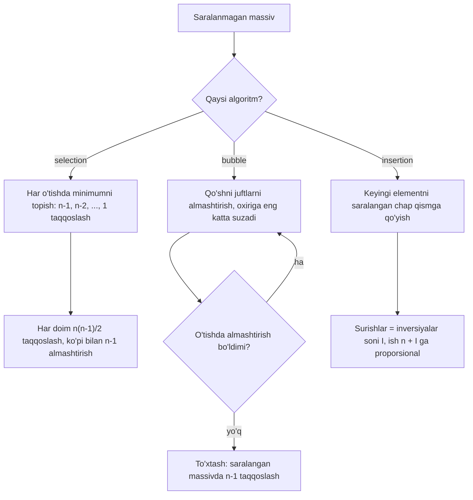

## Bu dars nima uchun kerak

15-darsda binary search linear search'dan beqiyos tez ekanini ko'rdik: 10^6 element ustida taxminan 20 va 10^6 qadam. Lekin binary search'ning sharti bor: massiv **saralangan** bo'lishi kerak. Ma'lumot esa odatda saralanmagan holda keladi: foydalanuvchilar ro'yxatdan o'tish tartibida, o'lchovlar vaqt tartibida, ballar kiritilish tartibida. Demak, tez qidirishdan oldin saralash kerak, va saralashning o'zi qancha turishini bilishimiz kerak.

**Saralash** (sorting) - elementlarni tartibga keltirish: kirish n ta elementli massiv, chiqish - xuddi shu elementlar, lekin har biri keyingisidan katta emas (o'sish tartibida). Bu darsda eng oddiy uchta saralash algoritmini ko'ramiz: selection sort, bubble sort va insertion sort. Uchalasi ham massiv ustida (11-dars) ishlaydi, uchalasi ham eng yomon holatda n^2 tartibida qadam qiladi, lekin har birining xatti-harakati turli kirishlarda keskin farq qiladi. 16-darsdagi O, Ω, Θ va eng yaxshi/eng yomon holat tushunchalari aynan shu yerda amaliy ma'no oladi.

Nega "sekin" algoritmlarni o'rganamiz, agar 19-darsdagi merge sort Θ(n log n)? Uchta sabab bor. Birinchidan, ular algoritm tahlilining eng toza mashqlari: har bir qadamni qo'lda sanash mumkin. Ikkinchidan, ular stable sort, in-place va adaptivlik kabi xususiyatlarni ko'rsatadi, bu xususiyatlar har qanday saralashni tanlashda kerak. Uchinchidan, insertion sort bugun ham real standart kutubxonalar ichida ishlatiladi: kichik massivlar uchun u murakkab algoritmlardan tezroq.

Bu darsdan keyin siz:

- selection, bubble va insertion sort g'oyasini bir gap bilan aytib, C da yoza olasiz;
- kichik massivda har bir o'tishdan keyingi holatni qo'lda chiqara olasiz;
- taqqoslashlar va almashtirishlar sonini dastur bilan sanab, natijani formulaga solishtira olasiz;
- nima uchun selection sort har doim Θ(n^2), bubble sort erta to'xtash bilan eng yaxshi holatda Θ(n), insertion sort esa deyarli saralangan massivda tez ekanini tushuntira olasiz;
- inversiya tushunchasi orqali insertion sort ishini aniq hisoblay olasiz;
- stable va in-place nima ekanini, qaysi algoritm stable ekanini va nega shundayligini bilasiz;
- real kutubxonalar (C++ `std::sort`, Python `list.sort`, V8 `Array.prototype.sort`) insertion sort'ni qayerda ishlatishini bilasiz.

## Saralashni qanday o'lchaymiz

16-darsdagi qoidaga ko'ra, soniyalar o'rniga asosiy amallarni sanaymiz. Saralashda ikki xil amal bor:

- **Taqqoslash** (comparison): ikki elementdan qaysi biri katta. Bu algoritm qaror qabul qiladigan joy.
- **Ma'lumotni ko'chirish**: almashtirish (swap, ikki elementning o'rnini almashtirish, ichida 3 ta o'zlashtirish) yoki surish (shift, elementni bitta o'ngga ko'chirish, 1 ta o'zlashtirish).

Nega alohida sanaladi? Taqqoslash narxi elementlar turiga bog'liq: ikki `int` ni solishtirish bitta protsessor amali, ikki uzun satrni `strcmp` bilan solishtirish esa satr uzunligiga bog'liq (12-dars). Ko'chirish narxi element o'lchamiga bog'liq: 4 baytli `int` ni ko'chirish arzon, 200 baytli yozuvni ko'chirish qimmat. Shuning uchun bir algoritm taqqoslashda tejamkor, boshqasi ko'chirishda tejamkor bo'lishi mumkin, va tanlov ma'lumotga bog'liq.

Barcha misollarda bitta kichik massiv ishlatiladi: `{5, 2, 6, 1, 4, 3}`, n = 6.

Yana bitta tushuncha keyinroq hammasini bog'laydi. **Inversiya** - noto'g'ri tartibda turgan juftlik: i < j, lekin a[i] > a[j]. Saralangan massivda inversiya 0 ta, teskari massivda barcha juftlar inversiya: n(n - 1) / 2 ta. Bizning massivda: 5 dan keyin undan kichik 2, 1, 4, 3 (4 ta), 2 dan keyin 1 (1 ta), 6 dan keyin 1, 4, 3 (3 ta), 1 dan keyin hech nima, 4 dan keyin 3 (1 ta). Jami 4 + 1 + 3 + 0 + 1 = 9 inversiya. Bu son pastda ikki marta paydo bo'ladi.

## Selection sort

**G'oya:** saralanmagan qismdan eng kichik elementni topib, uni shu qismning boshiga qo'yish; keyin saralanmagan qism bittaga qisqaradi.

Massiv ikki qismga bo'linadi: chapda tayyor (saralangan va o'z joyidagi) qism, o'ngda qolgan elementlar. i-o'tishda a[i..n-1] oralig'idan minimum topiladi va a[i] bilan almashtiriladi. Har bir o'tishdan keyin tayyor qism bittaga o'sadi. Oxirgi element o'z-o'zidan joyida qoladi, shuning uchun n - 1 o'tish kifoya.

```c run
#include <stdio.h>

void print_array(const int a[], int n)
{
    for (int i = 0; i < n; i++)
    {
        printf(" %d", a[i]);
    }
    printf("\n");
}

void selection_sort(int a[], int n)
{
    for (int i = 0; i < n - 1; i++)
    {
        // a[i..n-1] oralig'idagi eng kichik elementni topamiz
        int min = i;
        for (int j = i + 1; j < n; j++)
        {
            if (a[j] < a[min])
            {
                min = j;
            }
        }

        // Uni oraliq boshiga qo'yamiz
        int tmp = a[i];
        a[i] = a[min];
        a[min] = tmp;

        printf("%d-o'tish (min = %d):", i + 1, a[i]);
        print_array(a, n);
    }
}

int main(void)
{
    int a[] = {5, 2, 6, 1, 4, 3};
    int n = sizeof(a) / sizeof(a[0]);

    printf("boshida:           ");
    print_array(a, n);
    selection_sort(a, n);
}
```

Natija:

```text
boshida:            5 2 6 1 4 3
1-o'tish (min = 1): 1 2 6 5 4 3
2-o'tish (min = 2): 1 2 6 5 4 3
3-o'tish (min = 3): 1 2 3 5 4 6
4-o'tish (min = 4): 1 2 3 4 5 6
5-o'tish (min = 5): 1 2 3 4 5 6
```

Jadval ko'rinishida (qavs ichida - shu o'tishda o'z joyiga tushgan element):

| O'tish | Qidiruv oralig'i | Taqqoslashlar | Almashtirish | Holat |
|---|---|---|---|---|
| boshida | | | | 5 2 6 1 4 3 |
| 1 | a[0..5] | 5 | 5 va 1 | (1) 2 6 5 4 3 |
| 2 | a[1..5] | 4 | 2 o'z joyida | 1 (2) 6 5 4 3 |
| 3 | a[2..5] | 3 | 6 va 3 | 1 2 (3) 5 4 6 |
| 4 | a[3..5] | 2 | 5 va 4 | 1 2 3 (4) 5 6 |
| 5 | a[4..5] | 1 | 5 o'z joyida | 1 2 3 4 (5) 6 |

### Tahlil

Taqqoslashlar: 1-o'tishda n - 1, 2-o'tishda n - 2, ..., oxirida 1:

(n - 1) + (n - 2) + ... + 1 = n(n - 1) / 2

n = 6 da 6 · 5 / 2 = 15 (jadvaldagi 5 + 4 + 3 + 2 + 1). Muhim kuzatish: bu son **massivning holatiga bog'liq emas**. Minimumni topish uchun oraliqning har bir elementini ko'rish shart: oxirgi element eng kichik bo'lmasligiga hech qanday kafolat yo'q. Saralangan massiv berilsa ham selection sort xuddi shu 15 taqqoslashni bajaradi.

Demak eng yaxshi, eng yomon va o'rtacha holatning uchalasida ham taqqoslashlar n(n - 1) / 2 = **Θ(n^2)**. Bu - "algoritm Θ(n^2)" deb holatni aytmasdan gapirish to'g'ri bo'lgan kam uchraydigan holat (16-dars).

Almashtirishlar esa ko'pi bilan n - 1 ta: har o'tishda bittadan. Bu selection sort'ning yagona kuchli tomoni: agar element ko'chirish juda qimmat bo'lsa (katta yozuvlar), u minimal miqdorda yozadi.

## Bubble sort

**G'oya:** massiv bo'ylab yurib, qo'shni juftlarni solishtirish va noto'g'ri tartibda bo'lsa almashtirish; har o'tishda eng katta element "pufakchadek" oxiriga suzib chiqadi.

Bir o'tishda j = 0, 1, ..., a[j] va a[j + 1] solishtiriladi. Eng katta element qayerda bo'lmasin, unga yetib kelgach, har bir qadamda o'ngga suriladi va oxirgi o'ringa tushadi. Shuning uchun keyingi o'tishda oxirgi elementni tekshirish shart emas: pass-o'tishdan keyin oxirgi pass ta element o'z joyida.

Muhim optimizatsiya - **erta to'xtash**: agar butun o'tish davomida birorta ham almashtirish bo'lmasa, barcha qo'shni juftlar tartibda, demak massiv saralangan va davom etish shart emas.

```c run
#include <stdbool.h>
#include <stdio.h>

void print_array(const int a[], int n)
{
    for (int i = 0; i < n; i++)
    {
        printf(" %d", a[i]);
    }
    printf("\n");
}

void bubble_sort(int a[], int n)
{
    for (int pass = 0; pass < n - 1; pass++)
    {
        bool swapped = false;

        // Oxirgi pass ta element allaqachon o'z joyida
        for (int j = 0; j < n - 1 - pass; j++)
        {
            if (a[j] > a[j + 1])
            {
                int tmp = a[j];
                a[j] = a[j + 1];
                a[j + 1] = tmp;
                swapped = true;
            }
        }

        printf("%d-o'tish:", pass + 1);
        print_array(a, n);

        // Birorta almashtirish bo'lmasa, massiv saralangan
        if (!swapped)
        {
            printf("almashtirish yo'q, to'xtaymiz\n");
            break;
        }
    }
}

int main(void)
{
    int a[] = {5, 2, 6, 1, 4, 3};
    int n = sizeof(a) / sizeof(a[0]);

    printf("boshida: ");
    print_array(a, n);
    bubble_sort(a, n);
}
```

Natija:

```text
boshida:  5 2 6 1 4 3
1-o'tish: 2 5 1 4 3 6
2-o'tish: 2 1 4 3 5 6
3-o'tish: 1 2 3 4 5 6
4-o'tish: 1 2 3 4 5 6
almashtirish yo'q, to'xtaymiz
```

| O'tish | Taqqoslashlar | Almashtirishlar | Holat |
|---|---|---|---|
| boshida | | | 5 2 6 1 4 3 |
| 1 | 5 | 4 (5-2, 6-1, 6-4, 6-3) | 2 5 1 4 3 (6) |
| 2 | 4 | 3 (5-1, 5-4, 5-3) | 2 1 4 3 (5 6) |
| 3 | 3 | 2 (2-1, 4-3) | 1 2 3 (4 5 6) |
| 4 | 2 | 0, to'xtash | 1 2 3 4 5 6 |

Almashtirishlar jami 4 + 3 + 2 = 9 - inversiyalar soniga aynan teng. Bu tasodif emas: qo'shni noto'g'ri juftni almashtirish aynan bitta inversiyani yo'qotadi va boshqa hech bir juftning tartibiga ta'sir qilmaydi. Demak bubble sort'ning almashtirishlari doim inversiyalar soniga teng.

Erta to'xtash bu yerda 5-o'tishni tejadi: 4-o'tishda almashtirish bo'lmagani massiv tayyorligini ko'rsatdi.

### Tahlil

- **Eng yomon holat** (teskari massiv): har bir o'tishda har bir juft almashtiriladi, erta to'xtash ishlamaydi. Taqqoslashlar (n - 1) + (n - 2) + ... + 1 = n(n - 1) / 2, almashtirishlar ham n(n - 1) / 2 (barcha juftlar inversiya). **Θ(n^2)**.
- **Eng yaxshi holat** (saralangan massiv): birinchi o'tishda n - 1 taqqoslash, 0 almashtirish, darhol to'xtash. **Θ(n)**. Shuning uchun bubble sort haqida "Ω(n)" deyiladi: hech qanday kirishda n - 1 taqqoslashdan kam bo'lmaydi, chunki har bir qo'shni juftni kamida bir marta ko'rmay turib, massiv saralangan deb bo'lmaydi.
- **Erta to'xtashsiz** versiya saralangan massivda ham barcha n - 1 o'tishni bajaradi: eng yaxshi holat ham Θ(n^2) bo'lib qoladi. Ya'ni Ω(n) - aniq shu optimizatsiyaning xossasi, algoritm g'oyasining emas.

Bubble sort'ning zaif nuqtasi: katta elementlar bitta o'tishda oxiriga yetib boradi, lekin kichik element oxirida tursa, har o'tishda faqat **bitta** o'ringa chapga siljiydi. Masalan, {2, 3, 4, 5, 6, 1} massivida 1 boshiga yetishi uchun 5 o'tish kerak, garchi massiv deyarli saralangan bo'lsa ham.

## Insertion sort

**G'oya:** chap qism doim saralangan; har qadamda keyingi elementni olib, uni chap qismdagi to'g'ri joyiga **qo'yish** (insert), undan katta elementlarni bittadan o'ngga surib.

Bu qo'lingizdagi kartalarni tartiblashga o'xshaydi: yangi karta olinadi va kerakli joyga suqiladi. Selection sort'dan farqi: chap qism saralangan, lekin elementlar hali **yakuniy** joyida emas, keyin kelgan kichik element ularni surishi mumkin.

```c run
#include <stdio.h>

void print_array(const int a[], int n)
{
    for (int i = 0; i < n; i++)
    {
        printf(" %d", a[i]);
    }
    printf("\n");
}

void insertion_sort(int a[], int n)
{
    for (int i = 1; i < n; i++)
    {
        int key = a[i];
        int j = i - 1;

        // key dan katta elementlarni bitta o'ngga suramiz
        while (j >= 0 && a[j] > key)
        {
            a[j + 1] = a[j];
            j--;
        }
        a[j + 1] = key;

        printf("%d-o'tish (key = %d, surildi %d):", i, key, i - 1 - j);
        print_array(a, n);
    }
}

int main(void)
{
    int a[] = {5, 2, 6, 1, 4, 3};
    int n = sizeof(a) / sizeof(a[0]);

    printf("boshida:                       ");
    print_array(a, n);
    insertion_sort(a, n);
}
```

Natija:

```text
boshida:                        5 2 6 1 4 3
1-o'tish (key = 2, surildi 1): 2 5 6 1 4 3
2-o'tish (key = 6, surildi 0): 2 5 6 1 4 3
3-o'tish (key = 1, surildi 3): 1 2 5 6 4 3
4-o'tish (key = 4, surildi 2): 1 2 4 5 6 3
5-o'tish (key = 3, surildi 3): 1 2 3 4 5 6
```

| O'tish | key | Saralangan qism (oldin) | Surilganlar | Holat |
|---|---|---|---|---|
| boshida | | 5 | | 5 2 6 1 4 3 |
| 1 | 2 | 5 | 5 | 2 5 / 6 1 4 3 |
| 2 | 6 | 2 5 | yo'q | 2 5 6 / 1 4 3 |
| 3 | 1 | 2 5 6 | 6, 5, 2 | 1 2 5 6 / 4 3 |
| 4 | 4 | 1 2 5 6 | 6, 5 | 1 2 4 5 6 / 3 |
| 5 | 3 | 1 2 4 5 6 | 6, 5, 4 | 1 2 3 4 5 6 |

Surishlar jami 1 + 0 + 3 + 2 + 3 = 9 - yana inversiyalar soni. Sabab: key ning chapida undan katta har bir element u bilan inversiya hosil qiladi, va aynan shu elementlar suriladi. Har bir surish bitta inversiyani yo'qotadi.

Ichki siklda `j >= 0` sharti birinchi turishi shart: `&&` qisqa tutashuvi (8-dars) tufayli j = -1 bo'lganda `a[-1]` o'qilmaydi. Shartlar almashtirilsa, massiv chegarasidan tashqarida o'qish yuz beradi (11-dars).

### Tahlil: inversiyalar orqali

I - massivdagi inversiyalar soni bo'lsin. Yuqorida ko'rdikki, insertion sort aynan I ta surish bajaradi. Taqqoslashlar: har bir key uchun har surilgan element bitta taqqoslash, va to'xtatgan bitta taqqoslash (agar key eng boshiga yetmasa). Demak taqqoslashlar I dan I + (n - 1) gacha. Ish hajmi **Θ(n + I)**.

- **Eng yaxshi holat** (saralangan): I = 0, har key uchun bitta taqqoslash: n - 1 = **Θ(n)**.
- **Eng yomon holat** (teskari): I = n(n - 1) / 2, **Θ(n^2)**.
- **O'rtacha holat** (barcha tartiblar teng ehtimolli): har bir juft yarim ehtimollik bilan inversiya, kutilgan I = n(n - 1) / 4. Bu ham **Θ(n^2)**, lekin eng yomon holatning yarmi.
- **Deyarli saralangan massiv**: agar har element yakuniy joyidan ko'pi bilan k o'rin uzoqda bo'lsa, har key ko'pi bilan k ta surishga sabab bo'ladi, I ≤ k · n, ish **O(k · n)**. k o'zgarmas bo'lsa (masalan, ozgina buzilgan saralangan ro'yxat), bu Θ(n).

Ish hajmi kirishning "tartibsizligi"ga moslashadigan algoritm **adaptive** (moslashuvchan) deyiladi. Insertion sort tabiiy ravishda adaptive, bubble sort erta to'xtash bilan qisman adaptive, selection sort esa umuman adaptive emas.



## Uchalasini sanab solishtirish

Nazariyani tekshirish uchun uchta algoritmni n = 1000 elementli to'rt xil massiv ustida ishga tushiramiz va global hisoblagichlar bilan sanaymiz:

- **tasodifiy** - psevdotasodifiy sonlar. Natija har kompyuterda bir xil bo'lishi uchun `rand()` o'rniga o'zimizning oddiy generator (LCG, linear congruential generator) ishlatilgan: `rand()` ning ketma-ketligi C standart kutubxonasining realizatsiyasiga bog'liq.
- **saralangan** - 0, 1, ..., 999.
- **teskari** - 1000, 999, ..., 1.
- **deyarli** - saralangan massivda har 50-o'rindagi qo'shni juft almashtirilgan: 1000 / 50 = 20 ta inversiya.

"Yozish" ustuni selection va bubble uchun almashtirishlar, insertion uchun surishlar soni.

```c run
#include <stdbool.h>
#include <stdio.h>

#define N 1000

// Global hisoblagichlar: har bir saralashdan oldin nolga tenglanadi
long long comparisons = 0;
long long writes = 0;

// Takrorlanadigan psevdotasodifiy sonlar (oddiy LCG): har qanday kompyuterda bir xil ketma-ketlik
unsigned int seed = 42;
int next_random(void)
{
    seed = seed * 1103515245u + 12345u;
    return (seed >> 16) % 10000;
}

void swap(int a[], int i, int j)
{
    int tmp = a[i];
    a[i] = a[j];
    a[j] = tmp;
}

void selection_sort(int a[], int n)
{
    for (int i = 0; i < n - 1; i++)
    {
        int min = i;
        for (int j = i + 1; j < n; j++)
        {
            comparisons++;
            if (a[j] < a[min])
            {
                min = j;
            }
        }
        if (min != i)
        {
            swap(a, i, min);
            writes++;
        }
    }
}

void bubble_sort(int a[], int n)
{
    for (int pass = 0; pass < n - 1; pass++)
    {
        bool swapped = false;
        for (int j = 0; j < n - 1 - pass; j++)
        {
            comparisons++;
            if (a[j] > a[j + 1])
            {
                swap(a, j, j + 1);
                writes++;
                swapped = true;
            }
        }
        if (!swapped)
        {
            break;
        }
    }
}

void insertion_sort(int a[], int n)
{
    for (int i = 1; i < n; i++)
    {
        int key = a[i];
        int j = i - 1;
        while (j >= 0)
        {
            comparisons++;
            if (a[j] <= key)
            {
                break;
            }
            a[j + 1] = a[j];
            writes++;
            j--;
        }
        a[j + 1] = key;
    }
}

// kind: 0 tasodifiy, 1 saralangan, 2 teskari, 3 deyarli saralangan
void fill(int a[], int n, int kind)
{
    seed = 42;
    for (int i = 0; i < n; i++)
    {
        if (kind == 0)
        {
            a[i] = next_random();
        }
        else if (kind == 2)
        {
            a[i] = n - i;
        }
        else
        {
            a[i] = i;
        }
    }
    if (kind == 3)
    {
        // Har 50-o'rindagi qo'shni juftni almashtiramiz: 20 ta inversiya
        for (int i = 0; i + 1 < n; i += 50)
        {
            swap(a, i, i + 1);
        }
    }
}

bool is_sorted(const int a[], int n)
{
    for (int i = 1; i < n; i++)
    {
        if (a[i - 1] > a[i])
        {
            return false;
        }
    }
    return true;
}

int main(void)
{
    const char *kinds[] = {"tasodifiy", "saralangan", "teskari", "deyarli"};
    const char *names[] = {"selection", "bubble", "insertion"};
    int a[N];

    printf("n = %d\n%-10s %-11s %11s %11s\n", N, "algoritm", "massiv", "taqqoslash", "yozish");
    for (int s = 0; s < 3; s++)
    {
        for (int k = 0; k < 4; k++)
        {
            fill(a, N, k);
            comparisons = 0;
            writes = 0;
            if (s == 0)
            {
                selection_sort(a, N);
            }
            else if (s == 1)
            {
                bubble_sort(a, N);
            }
            else
            {
                insertion_sort(a, N);
            }
            printf("%-10s %-11s %11lld %11lld%s\n", names[s], kinds[k], comparisons, writes,
                   is_sorted(a, N) ? "" : "  XATO");
        }
    }
}
```

Natija:

```text
n = 1000
algoritm   massiv       taqqoslash      yozish
selection  tasodifiy        499500         989
selection  saralangan       499500           0
selection  teskari          499500         500
selection  deyarli          499500          20
bubble     tasodifiy        497847      246350
bubble     saralangan          999           0
bubble     teskari          499500      499500
bubble     deyarli            1997          20
insertion  tasodifiy        247345      246350
insertion  saralangan          999           0
insertion  teskari          499500      499500
insertion  deyarli            1018          20
```

Raqamlarni formulalar bilan solishtiramiz:

1. **Selection: taqqoslash har doim 499 500** = 1000 · 999 / 2. To'rt xil kirish, bitta son - Θ(n^2) har doim. Almashtirishlar 0 dan 989 gacha, ya'ni n - 1 = 999 dan oshmaydi. Teskari massivda 500: birinchi o'tish 1 va 1000 ni almashtiradi, o'rtasi yana teskari qoladi, shuning uchun har o'tish ikki elementni joyiga qo'yadi va n / 2 o'tishdan keyin qolgan o'tishlarda almashtirish kerak bo'lmaydi.
2. **Bubble va insertion: yozishlar bir xil.** Tasodifiy massivda ikkalasida 246 350, teskarida 499 500, deyarli saralanganda 20. Bu - inversiyalar soni I. Tasodifiy massiv uchun kutilgan qiymat n(n - 1) / 4 = 1000 · 999 / 4 = 249 750, haqiqiy 246 350 unga yaqin.
3. **Insertion taqqoslashlari I ga yaqin.** Tasodifiy massivda 247 345 = 246 350 + 995, ya'ni I + (n - 1) dan biroz kam (key eng boshiga yetgan 4 holatda to'xtatuvchi taqqoslash bo'lmaydi). Bubble esa xuddi shu massivda 497 847 taqqoslash qildi - qariyb ikki baravar ko'p, chunki u har o'tishda saralangan qismni ham qayta tekshiradi.
4. **Saralangan massiv:** bubble (erta to'xtash bilan) va insertion 999 = n - 1 taqqoslash, selection 499 500. Eng yaxshi holatdagi Θ(n) va Θ(n^2) farqi 500 baravar.
5. **Deyarli saralangan:** insertion 1018 taqqoslash (n - 1 + 20 ga yaqin), bubble 1997 (ikki o'tish: biri tuzatadi, biri tekshiradi), selection yana 499 500. Insertion sort amalda nima uchun qadrlanishi shu qatorda ko'rinadi.

Natijalarni bitta jadvalga yig'amiz:

| Xususiyat | Selection sort | Bubble sort (erta to'xtash) | Insertion sort |
|---|---|---|---|
| Taqqoslash, eng yaxshi holat | n(n-1)/2, Θ(n^2) | n - 1, Θ(n) | n - 1, Θ(n) |
| Taqqoslash, eng yomon holat | n(n-1)/2, Θ(n^2) | n(n-1)/2, Θ(n^2) | n(n-1)/2, Θ(n^2) |
| Yozish (almashtirish yoki surish) | ko'pi bilan n - 1 almashtirish | I almashtirish | I surish |
| Adaptive | yo'q | qisman | ha, Θ(n + I) |
| Stable | yo'q | ha | ha |
| Qo'shimcha xotira | Θ(1) | Θ(1) | Θ(1) |

## Stable sort va in-place

### Stable sort

Saralash ko'pincha butun yozuvlarni bitta **kalit** bo'yicha tartiblaydi: talabalarni ball bo'yicha, buyurtmalarni sana bo'yicha. Kaliti teng bo'lgan ikki yozuv qanday tartibda chiqadi? **Stable sort** (barqaror saralash) - teng kalitli elementlarning kirishdagi o'zaro tartibini saqlaydigan saralash.

Bu nima uchun kerak: avval ism bo'yicha saralangan talabalar ro'yxatini ball bo'yicha stable saralasangiz, bir xil balli talabalar ism bo'yicha tartibda qoladi. Ya'ni stable saralashni ketma-ket qo'llab, bir necha kalit bo'yicha saralash mumkin. Python hujjatlari ham shu usulni tavsiya qiladi, chunki Python'ning saralashi stable bo'lishi kafolatlangan. JavaScript'da `Array.prototype.sort` ECMAScript 2019 dan boshlab stable bo'lishi shart.

Quyidagi dasturda kartalar faqat birinchi belgi (qiymat) bo'yicha saralanadi, ikkinchi belgi esa qaysi nusxa ekanini ko'rsatadi: "4a" "4b" dan oldin kelgan. `string` turi va `card[0]` belgiga murojaat 12-darsdan tanish:

```c run
#include <cs50.h>
#include <stdio.h>

#define N 6

// Har bir karta: birinchi belgi - qiymat (kalit), ikkinchisi - qaysi nusxa ekani.
// Saralash faqat kalit bo'yicha: card[0]

void print_cards(string label, string cards[], int n)
{
    printf("%-10s", label);
    for (int i = 0; i < n; i++)
    {
        printf(" %s", cards[i]);
    }
    printf("\n");
}

void selection_sort(string a[], int n)
{
    for (int i = 0; i < n - 1; i++)
    {
        int min = i;
        for (int j = i + 1; j < n; j++)
        {
            if (a[j][0] < a[min][0])
            {
                min = j;
            }
        }
        string tmp = a[i];
        a[i] = a[min];
        a[min] = tmp;
    }
}

void insertion_sort(string a[], int n)
{
    for (int i = 1; i < n; i++)
    {
        string key = a[i];
        int j = i - 1;
        while (j >= 0 && a[j][0] > key[0])
        {
            a[j + 1] = a[j];
            j--;
        }
        a[j + 1] = key;
    }
}

int main(void)
{
    string s[N] = {"4a", "2a", "4b", "1a", "2b", "3a"};
    string t[N] = {"4a", "2a", "4b", "1a", "2b", "3a"};

    print_cards("boshida:", s, N);
    selection_sort(s, N);
    print_cards("selection:", s, N);
    insertion_sort(t, N);
    print_cards("insertion:", t, N);
}
```

Natija:

```text
boshida:   4a 2a 4b 1a 2b 3a
selection: 1a 2a 2b 3a 4b 4a
insertion: 1a 2a 2b 3a 4a 4b
```

Selection sort "4a" va "4b" ni almashtirib yubordi. Sabab birinchi o'tishda: minimum "1a" 3-o'rinda, u 0-o'rindagi "4a" bilan almashtiriladi va "4a" bir sakrashda 3-o'ringa, ya'ni "4b" dan **keyinga** tushadi. Uzoq masofali almashtirish oradagi teng elementlardan sakrab o'tadi - selection sort shuning uchun **stable emas**.

Insertion sort stable, chunki u faqat **qat'iy katta** elementlarni suradi: `a[j] > key`. Teng elementga yetganda to'xtaydi va key undan keyin qo'yiladi. Agar shart `a[j] >= key` deb yozilsa, saralash baribir to'g'ri bo'ladi, lekin stable bo'lmay qoladi. Xuddi shunday bubble sort ham stable: u faqat qo'shni va qat'iy `a[j] > a[j + 1]` bo'lgan juftlarni almashtiradi, teng qo'shnilar hech qachon bir-biridan sakrab o'tmaydi.

Selection sort'ni stable qilish mumkin: minimumni almashtirish o'rniga uni oraliq boshiga qo'yib, oradagi elementlarni bitta o'ngga surish. Lekin bunda yozishlar soni Θ(n^2) ga oshadi va selection sort'ning yagona afzalligi yo'qoladi.

### In-place

**In-place** (joyida) saralash - massivning o'zi ichida ishlaydigan va faqat O(1) qo'shimcha xotira (bir nechta o'zgaruvchi) ishlatadigan saralash. Uchala algoritm ham in-place: ularga faqat `i`, `j`, `min`, `key`, `tmp` kerak, n qanday bo'lmasin. 16-darsdagi atama bilan: qo'shimcha xotira murakkabligi Θ(1). Taqqoslash uchun 19-darsdagi merge sort odatiy ko'rinishida Θ(n) qo'shimcha massiv talab qiladi - u Θ(n log n) vaqt evaziga xotira sarflaydi.

## Amalda: insertion sort real kutubxonalarda

Θ(n^2) algoritm Θ(n log n) algoritmdan qanday qilib tezroq bo'lishi mumkin? 16-darsdagi ogohlantirish: asimptotik tahlil konstantalarni tashlaydi. Kichik n da konstantalar hal qiladi, va insertion sort'ning konstantalari juda kichik: rekursiya yo'q, funksiya chaqiruvlari yo'q, qo'shimcha massiv yo'q, xotirani ketma-ket o'qiydi va bitta oddiy sikl. Shuning uchun real kutubxonalar **gibrid** algoritmlar ishlatadi: katta massivni tez algoritm bilan bo'ladi, kichik bo'laklarni insertion sort bilan tugatadi.

- **C++ `std::sort` (GCC libstdc++).** Introsort ishlatiladi: asosan quicksort, rekursiya juda chuqurlashsa heapsort'ga o'tadi. Manba kodida `_S_threshold = 16` konstantasi bor: `__introsort_loop` 16 tadan katta bo'laklarni bo'lishni davom ettiradi, 16 yoki kichik bo'laklarni tegmay qoldiradi, keyin `__final_insertion_sort` butun massivni insertion sort bilan tugatadi. Bu oxirgi o'tish tez, chunki massiv allaqachon "deyarli saralangan": har element o'z bo'lagi ichida, ya'ni yakuniy joyidan 16 o'rindan uzoq emas (yuqoridagi O(k · n) holati).
- **Python `list.sort` (CPython).** Timsort oilasidagi algoritm (CPython'ning `listsort.txt` hujjati, birlashtirish strategiyasi hozir Munro va Wild'ning powersort usuli). U massivdagi tayyor saralangan bo'laklarni (run) topadi; run juda qisqa bo'lsa, uni minrun uzunligiga yetkazish uchun stable **binary insertion sort** ishlatiladi. Hujjatga ko'ra, element soni 64 dan kam bo'lsa, butun massiv binary insertion sort bilan saralanadi. Binary insertion sort - joyni 15-darsdagi binary search bilan topadigan insertion sort: taqqoslashlar Θ(n log n) ga tushadi, surishlar esa baribir I ta.
- **JavaScript V8 (Chrome, Node.js).** V8 blogiga ko'ra, eski realizatsiya quicksort edi va 10 tadan qisqa massivlar uchun insertion sort'ga o'tardi. V8 v7.0 (Chrome 70) dan boshlab Timsort ishlatiladi, va u ham qisqa run'larni insertion sort bilan uzaytiradi.

Uchala holatda insertion sort'ning ikki xossasi ishlatiladi: kichik n da konstantalar kichik, va deyarli saralangan ma'lumotda Θ(n) ga yaqin ishlash. Python va V8 versiyalari stable bo'lishi kerak, va insertion sort bu talabni buzmaydi. libstdc++ `std::sort` esa stable emas (stable variant alohida: `std::stable_sort`), chunki quicksort bosqichi teng elementlarni sakratib almashtiradi.

## Mashq: insertion sort yozing

Python'da `insertion_sort(items)` funksiyasini yozing: u ro'yxatni **joyida** (in-place) o'sish tartibida saralaydi va hech narsa qaytarmaydi. Elementlarni faqat `<` operatori bilan solishtiring.

Boshlang'ich kod - selection sort. U to'g'ri saralaydi, lekin testlarning bir qismidan o'tmaydi. Testlar `Card` obyektlari bilan ishlaydi: ular faqat `value` bo'yicha solishtiriladi va har bir `<` chaqiruvini sanaydi. Testlar tekshiradi:

- natija to'g'ri saralangan va ro'yxatning o'zi o'zgargan (yangi ro'yxat qaytarilmagan);
- teng qiymatli kartalar o'zaro tartibini saqlaydi (stable);
- saralangan 1000 elementli ro'yxatda ko'pi bilan n - 1 = 999 taqqoslash (adaptive, eng yaxshi holat Θ(n));
- teskari 200 elementli ro'yxatda ko'pi bilan n(n - 1) / 2 = 19 900 taqqoslash.

```python run
class Card:
    """Faqat value bo'yicha solishtiriladi; label teng kartalarni farqlash uchun."""
    comparisons = 0
    def __init__(self, value, label=""):
        self.value = value
        self.label = label
    def __lt__(self, other):
        Card.comparisons += 1
        return self.value < other.value
    def __repr__(self):
        return f"{self.value}{self.label}"


def insertion_sort(items):
    # Hozir selection sort: stable emas va saralangan ro'yxatda ham n(n-1)/2 taqqoslash.
    n = len(items)
    for i in range(n - 1):
        m = i
        for j in range(i + 1, n):
            if items[j] < items[m]:
                m = j
        items[i], items[m] = items[m], items[i]


cards = [Card(4, "a"), Card(2, "a"), Card(4, "b"), Card(1, "a"), Card(2, "b"), Card(3, "a")]
Card.comparisons = 0
insertion_sort(cards)
print(cards, "taqqoslashlar:", Card.comparisons)
```

```python test
def _sorted_ok(xs):
    return all(not (xs[i + 1] < xs[i]) for i in range(len(xs) - 1))
def _t_basic():
    xs = [Card(v) for v in [5, 2, 6, 1, 4, 3]]
    r = insertion_sort(xs)
    return r is None and [c.value for c in xs] == [1, 2, 3, 4, 5, 6]
check("joyida saralaydi va None qaytaradi", _t_basic)
check("bo'sh va bitta elementli ro'yxat", lambda: insertion_sort([]) is None and insertion_sort([Card(1)]) is None)
def _t_stable():
    xs = [Card(4, "a"), Card(2, "a"), Card(4, "b"), Card(1, "a"), Card(2, "b"), Card(3, "a")]
    insertion_sort(xs)
    return [repr(c) for c in xs] == ["1a", "2a", "2b", "3a", "4a", "4b"]
check("stable: 4a 4b dan, 2a 2b dan oldin qoladi", _t_stable)
def _t_dups():
    vals = [3, 1, 3, 1, 2, 2, 3, 1]
    xs = [Card(v, str(i)) for i, v in enumerate(vals)]
    insertion_sort(xs)
    ok = [c.value for c in xs] == sorted(vals)
    labels = [int(c.label) for c in xs]
    return ok and all(labels[i] < labels[i + 1] for i in range(len(xs) - 1) if xs[i].value == xs[i + 1].value)
check("ko'p takrorli qiymatlar: tartib va stabillik", _t_dups)
def _cmp(vals):
    xs = [Card(v) for v in vals]
    Card.comparisons = 0
    insertion_sort(xs)
    return Card.comparisons, _sorted_ok(xs)
check("saralangan 1000 ta: ko'pi bilan 999 taqqoslash", lambda: _cmp(list(range(1000))) [0] <= 999)
check("teskari 200 ta: to'g'ri va ko'pi bilan 19900 taqqoslash", lambda: (lambda r: r[1] and r[0] <= 19900)(_cmp(list(range(200, 0, -1)))))
```

## Ko'p uchraydigan xatolar

1. **Insertion sort'da shartlar tartibi.** `while (a[j] > key && j >= 0)` j = -1 da avval `a[-1]` ni o'qiydi - chegaradan tashqarida o'qish. `j >= 0` birinchi turishi kerak.
2. **`>` o'rniga `>=`.** Insertion yoki bubble sort'da `a[j] >= key` yoki `a[j] >= a[j + 1]` yozish natijani baribir saralangan qiladi, lekin teng elementlar o'rin almashadi: stable xossa yo'qoladi va ortiqcha yozishlar paydo bo'ladi.
3. **Bubble sort'da ichki sikl chegarasi.** `j < n - 1` o'rniga `j < n` yozilsa, oxirgi qadamda `a[j + 1]` = `a[n]` o'qiladi - massivdan tashqarida. To'g'ri chegara `j < n - 1 - pass`.
4. **Erta to'xtashni unutish.** Bayroqsiz bubble sort saralangan massivda ham n(n - 1) / 2 taqqoslash qiladi; "bubble sort eng yaxshi holatda Θ(n)" degan da'vo faqat bayroq bilan to'g'ri.
5. **Selection sort'ni "saralangan massivda tez" deb o'ylash.** Minimumni topish oraliqning barcha elementlarini ko'rishni talab qiladi: kirish qanday bo'lmasin, Θ(n^2).
6. **Faqat taqqoslashlarni sanash.** Insertion sort tasodifiy massivda bubble sort'dan ikki baravarga yaqin kam taqqoslaydi, lekin yozishlar soni bir xil (I). Ko'chirish qimmat bo'lsa, selection sort'ning n - 1 almashtirishi afzal bo'lishi mumkin.
7. **Kichik test bilan algoritmni "tez" deb baholash.** n = 6 da hamma narsa bir zumda; farq n = 1000 da 999 va 499 500 taqqoslash ko'rinishida chiqadi. Turli xil kirishlarni (saralangan, teskari, tasodifiy, takrorli) sinang.
8. **Stable bo'lmagan saralashni ketma-ket qo'llash.** Ikki kalit bo'yicha saralash uchun ikkinchi bosqich stable bo'lishi shart, aks holda birinchi bosqich natijasi buziladi.

## Xulosa

- Selection sort: har o'tishda minimumni tanlab oraliq boshiga qo'yadi; har doim n(n - 1) / 2 taqqoslash, Θ(n^2), lekin ko'pi bilan n - 1 almashtirish. Stable emas.
- Bubble sort: qo'shni noto'g'ri juftlarni almashtiradi, eng katta element oxiriga suzadi; erta to'xtash bilan eng yaxshi holat n - 1 taqqoslash (Θ(n)), eng yomon holat Θ(n^2). Stable.
- Insertion sort: har keyingi elementni saralangan chap qismga qo'yadi; ish Θ(n + I), I - inversiyalar soni. Saralangan va deyarli saralangan massivda tez, eng yomon va o'rtacha holatda Θ(n^2). Stable.
- Bubble sort'ning almashtirishlari va insertion sort'ning surishlari doim inversiyalar soniga teng; n = 1000 tasodifiy massivda ikkalasi 246 350.
- Stable sort teng kalitlarning tartibini saqlaydi va ko'p kalitli saralashga imkon beradi; uzoq masofali almashtirish (selection) stabillikni buzadi.
- Uchala algoritm in-place: Θ(1) qo'shimcha xotira.
- Real kutubxonalar gibrid: libstdc++ `std::sort` 16 elementgacha bo'laklarni insertion sort bilan tugatadi, CPython va V8 Timsort'i qisqa run'larni insertion sort bilan uzaytiradi.

## Amaliy topshiriq

Talabalar ballari jadvalini saralaydigan C dastur yozing. Har bir talaba ikki parallel massivda saqlanadi: `string names[]` va `int scores[]` (struct 20-darsda keladi). Maqsad - ballar bo'yicha kamayish tartibida saralash, teng balli talabalar esa kirishdagi tartibda qolishi kerak.

Topshiriq qadamlari:

1. **Insertion sort ikki massiv uchun.** `sort_by_score(string names[], int scores[], int n)` - insertion sort, kamayish tartibida. Ballni surganda ismni ham birga suring. Taqqoslash va surishlarni global hisoblagichlarda sanang.
2. **Stabillikni isbotlang.** Kirish: "Ali 90", "Vali 85", "Hasan 90", "Husan 85", "Olim 70" (stdin orqali yoki massivda). Natijada "Ali" "Hasan" dan, "Vali" "Husan" dan oldin turishini ko'rsating. Shartdagi qaysi belgi stabillikni ta'minlashini yozing.
3. **Selection sort bilan solishtirish.** Xuddi shu ikki massiv uchun selection sort yozing va xuddi shu kirishda stabillik buziladimi, tekshiring. Buzilsa, qaysi o'tishdagi qaysi almashtirish sabab bo'lganini ko'rsating.
4. **Sanash.** n = 1000 talaba uchun ballarni uch xil to'ldiring: tasodifiy (o'zingizning LCG generatoringiz bilan, 0-100), allaqachon kamayish tartibida, o'sish tartibida. Ikkala algoritmning taqqoslash va yozishlarini jadvalga yozing.
5. **Formulalar bilan tekshirish.** Har bir natijani darsdagi formulalar bilan solishtiring: n(n - 1) / 2, n - 1, inversiyalar soni. Ballar 0-100 oralig'ida bo'lgani uchun teng qiymatlar ko'p - bu inversiyalar soniga qanday ta'sir qiladi?
6. **Tanlov.** Har kuni 1000 talabalik saralangan jadvalga 5 ta yangi talaba qo'shiladi va jadval qayta saralanadi. Qaysi algoritm va nima uchun? Qo'shimcha xotira cheklangan bo'lsa-chi?

Yaxshi javobda bo'lishi kerak bo'lgan narsalar:

- insertion sort'da `j >= 0` birinchi tekshiriladi va kamayish tartibi uchun shart `scores[j] < key` (qat'iy), shuning uchun teng ballar surilmaydi va stable;
- ism va ball har doim birga ko'chiriladi, ikki massiv hech qachon "ajralib" qolmaydi;
- selection sort shu kirishda stabillikni buzadi yoki buzmasa, nima uchun aynan shu kirishda buzilmagani tushuntirilgan (uzoq almashtirish teng elementdan sakrab o'tadimi);
- jadvalda selection sort taqqoslashlari uchala kirishda 1000 · 999 / 2 = 499 500, insertion sort esa kamayish tartibidagi kirishda 999 taqqoslash va 0 surish;
- teng qiymatlar inversiya hosil qilmasligi sababli tasodifiy kirishda inversiyalar n(n - 1) / 4 dan biroz kam bo'lishi aytilgan;
- 6-qadamda insertion sort tanlangan: yangi 5 ta element ko'pi bilan 5 · n ta inversiya qo'shadi, ish O(n), qo'shimcha xotira Θ(1).

Javobingizni pastdagi maydonga yozing va yuqoridagi mezonlar bilan solishtiring.

## Manbalar

- CS50x. [Lecture 3 notes](https://cs50.harvard.edu/x/notes/3/) - "Sorting and Selection Sort" va "Bubble Sort" bo'limlari: algoritmlar g'oyasi, qadamlar soni va O, Ω chegaralari.
- CS50x. [Week 3](https://cs50.harvard.edu/x/2026/weeks/3/) - "Shorts" ro'yxati: Bubble Sort, Selection Sort, Merge Sort videolari.
- Cormen, Leiserson, Rivest, Stein. [Introduction to Algorithms, 4-nashr](https://mitpress.mit.edu/9780262046305/introduction-to-algorithms/) - 2.1 "Insertion sort" (loop invariant bilan to'g'rilik), 2.2 "Analyzing algorithms" (eng yaxshi va eng yomon holat), 2-bob masalalari (bubble sort, inversiyalar).
- GCC libstdc++. [bits/stl_algo.h](https://github.com/gcc-mirror/gcc/blob/master/libstdc%2B%2B-v3/include/bits/stl_algo.h) - `_S_threshold = 16`, `__introsort_loop` (chuqurlik chegarasida `__partial_sort`), `__final_insertion_sort`.
- CPython. [Objects/listsort.txt](https://github.com/python/cpython/blob/main/Objects/listsort.txt) - qisqa run'larni stable binary insertion sort bilan minrun'gacha uzaytirish, N < 64 holati, powersort birlashtirish strategiyasi.
- V8. [Getting things sorted in V8](https://v8.dev/blog/array-sort) - eski quicksort va 10 tadan qisqa massivlar uchun insertion sort, V8 v7.0 dagi Timsort.
- Python. [Sorting Techniques](https://docs.python.org/3/howto/sorting.html) - "Sort Stability and Complex Sorts": stabillik kafolati va bir necha kalit bo'yicha ketma-ket saralash.
- MDN. [Array.prototype.sort()](https://developer.mozilla.org/en-US/docs/Web/JavaScript/Reference/Global_Objects/Array/sort) - "Sort stability": ECMAScript 2019 dan boshlab stable bo'lish talabi.
