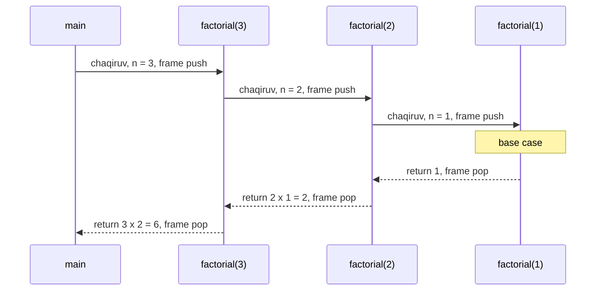
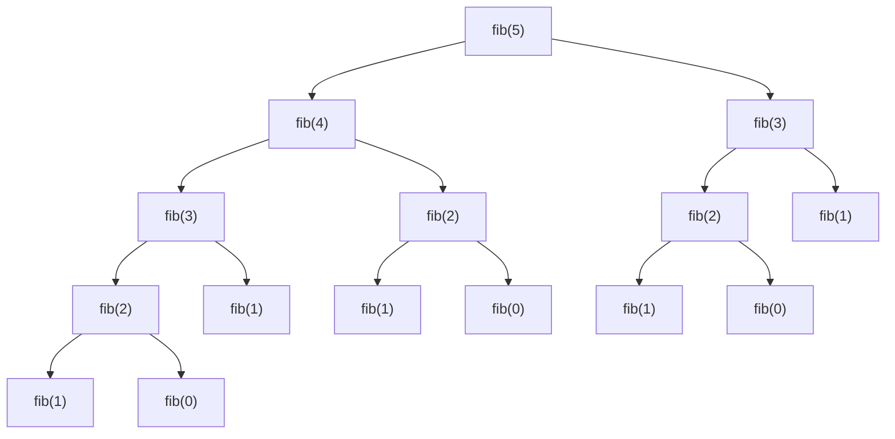

## Bu dars nima uchun kerak

Ba'zi masalalarni tabiiy ravishda "o'zidan kichikroq nusxasi" orqali ta'riflash mumkin. 4 qavatli zinapoya - bu 3 qavatli zinapoya ustiga qo'yilgan yana bitta qator. 1 000 sahifali kitobda so'z qidirish - kitobni ikkiga bo'lib, kerakli yarmida (500 sahifa) xuddi shu qidiruvni takrorlash. Papka hajmini hisoblash - undagi fayllar va har bir ichki papkaning hajmi yig'indisi, ichki papka hajmi esa xuddi shu usulda hisoblanadi.

Bunday ta'riflarni to'g'ridan-to'g'ri kodga aylantirish usuli - **rekursiya** (recursion): funksiya o'z ishining bir qismini bajarish uchun o'zini o'zi, kichikroq kirish bilan chaqiradi. 15-darsdagi binary search ham aslida rekursiv g'oya edi: "o'rtadagi elementni tekshir, keyin yarmida xuddi shuni qil". 19-darsdagi merge sort esa rekursiyasiz deyarli tushunib bo'lmaydi. 29-darsdagi daraxtlar ham rekursiv tuzilma.

Rekursiya "sehr" emas. Har bir chaqiruv kompyuter xotirasida, **call stack** deb ataladigan joyda, o'z yozuviga ega bo'ladi. 8-darsda lokal o'zgaruvchi blok tugashi bilan yo'qolishini, 9-darsda esa `-O0` assembly'da funksiya o'z stack frame'ini ochishini ko'rgan edik. 10-darsda debugger'dagi `bt` (backtrace) buyrug'i call stack'ni ko'rsatishini aytib, uni shu darsga qoldirgandik. Bu dars shu bo'laklarni birlashtiradi: rekursiv funksiya qanday yoziladi, ichkarida nima sodir bo'ladi, qachon u xotirani tugatadi va qachon u juda sekin bo'ladi.

Bu darsdan keyin siz:

- masalani base case va rekursiv qadamga ajratib, rekursiv funksiya yoza olasiz;
- har bir chaqiruvda stack frame'da nima saqlanishini va call stack qanday o'sib-kamayishini qadam-baqadam chiza olasiz;
- base case yo'q yoki unga yetib bo'lmaydigan funksiya nima uchun stack'ni to'ldirishini tushuntira olasiz va buni brauzerda ko'rasiz;
- rekursiya chuqurligi chegarasini xotira hajmidan taxminan hisoblay olasiz;
- naive Fibonacci nima uchun eksponensial vaqt olishini chaqiruvlar sonining formulasi bilan isbotlay olasiz va memoization bilan uni chiziqli qilasiz;
- rekursiya va iteratsiyani taqqoslab, qaysi birini tanlashni asoslay olasiz;
- tail recursion nima ekanini va C hamda Python unga nima kafolat bermasligini bilasiz.

## Rekursiv ta'rif: o'zidan kichik nusxa orqali

Matematikada faktorial shunday ta'riflanadi: n! = 1 · 2 · 3 · ... · n. Bu ta'rif "ko'paytirishni takrorla" degan sikl g'oyasini beradi. Lekin xuddi shu narsani boshqacha ham yozish mumkin:

- 1! = 1;
- n! = n · (n - 1)!, n > 1 bo'lsa.

Ikkinchi ta'rif o'zini o'zi ishlatadi: 4! ni bilish uchun 3! kerak, 3! uchun 2!, 2! uchun 1!, 1! esa to'g'ridan-to'g'ri ma'lum. Har qanday to'g'ri rekursiv ta'rifda ikki qism bor:

1. **Base case** (asosiy holat) - javob boshqa chaqiruvsiz, darhol ma'lum bo'lgan eng kichik holat. Faktorialda bu n = 1 (yoki n = 0, chunki 0! = 1).
2. **Rekursiv qadam** - masalani o'zining kichikroq nusxasiga keltirish va natijani shundan yasash. Faktorialda: n · (n - 1)!.

Rekursiv qadam har safar kirishni base case tomon **kamaytirishi** shart. n dan n - 1 ga o'tish - kamayish; n dan n + 1 ga o'tish yoki n ning o'zini qayta chaqirish - kamayish emas, va bunday funksiya hech qachon to'xtamaydi.

C dagi to'g'ridan-to'g'ri tarjima:

```c
int factorial(int n)
{
    if (n <= 1)
    {
        return 1;               // base case
    }
    return n * factorial(n - 1); // rekursiv qadam
}
```

Funksiya o'zini chaqirishi uchun C da maxsus kalit so'z kerak emas: funksiya nomi uning tanasi boshlanishidan oldin e'lon qilingan bo'ladi, shuning uchun tanada uni ishlatish mumkin. 8-darsdagi prototip qoidasi o'z kuchida: boshqa funksiyadan oldin chaqirilsa, prototip kerak.

`n <= 1` sharti `n == 1` dan ishonchliroq: kimdir `factorial(0)` yoki `factorial(-5)` chaqirsa ham funksiya to'xtaydi. `n == 1` bilan esa `factorial(0)` -1, -2, -3, ... ga qarab ketadi va hech qachon base case'ga yetmaydi. Bu darsning "Ko'p uchraydigan xatolar" bo'limidagi birinchi band aynan shu.

Faktorial butun soni tez o'sadi: 12! = 479 001 600 `int` ga sig'adi, 13! = 6 227 020 800 esa 32-bitli `int` chegarasidan (2 147 483 647) katta, ya'ni 7-darsdagi signed overflow. Bu darsdagi misollar kichik n bilan ishlaydi.

### Rekursiv fikrlash: "ishonch sakrashi"

Rekursiv funksiya yozishda eng qiyin narsa - butun chaqiruvlar zanjirini boshda kuzatishga urinish. Buning o'rniga shunday fikrlang:

1. Eng kichik holat qaysi va uning javobi nima? (base case)
2. Faraz qilaylik, funksiya kichikroq kirish uchun **allaqachon to'g'ri ishlaydi**. Shu natijadan katta kirish javobini qanday yasayman? (rekursiv qadam)
3. Har bir chaqiruv kirishni base case tomon kamaytiradimi?

Bu matematik induksiya bilan bir xil: agar base case to'g'ri bo'lsa va "n - 1 uchun to'g'ri bo'lsa, n uchun ham to'g'ri" bo'lsa, funksiya barcha n uchun to'g'ri. Ikkinchi qadamdagi "faraz qilaylik" ba'zan "ishonch sakrashi" (leap of faith) deb ataladi: chaqiruv ichiga kirmasdan, u o'z ishini qiladi deb qabul qilasiz.

### O'z misolimiz: raqamli piramida

CS50 ma'ruzasida rekursiya `#` belgilaridan iborat piramida bilan ko'rsatiladi. Biz boshqa shakl chizamiz: k-qatorda k ta k raqami.

```
1
22
333
4444
```

Rekursiv fikrlash bilan: 4 qatorli piramida - bu 3 qatorli piramida, uning ostida esa `4444` qatori. 0 qatorli piramida - hech narsa (base case). Muhim savol: qatorni rekursiv chaqiruvdan **keyin** chiqaramizmi yoki **oldin**? Quyidagi dastur ikkalasini ham ko'rsatadi.

```c run
#include <stdio.h>

// n-qatorgacha bo'lgan "raqamli piramida": k-qatorda k ta k raqami.
void draw(int n)
{
    if (n <= 0)
    {
        return;
    }
    draw(n - 1);
    for (int i = 0; i < n; i++)
    {
        printf("%d", n);
    }
    printf("\n");
}

// Xuddi shu, lekin qator rekursiv chaqiruvdan OLDIN chiqariladi.
void draw_upside_down(int n)
{
    if (n <= 0)
    {
        return;
    }
    for (int i = 0; i < n; i++)
    {
        printf("%d", n);
    }
    printf("\n");
    draw_upside_down(n - 1);
}

int main(void)
{
    draw(4);
    printf("--\n");
    draw_upside_down(4);
}
```

```text
1
22
333
4444
--
4444
333
22
1
```

`draw(4)` avval `draw(3)` ni chaqiradi va u tugaguncha kutadi; `draw(3)` esa `draw(2)` ni, va hokazo. Birinchi bo'lib `draw(1)` o'z qatorini chiqaradi, chunki `draw(0)` darhol qaytgan. Keyin boshqaruv `draw(2)` ga qaytadi, u `22` ni chiqaradi, va hokazo. `draw_upside_down` da esa har bir chaqiruv avval o'z qatorini chiqarib, keyin chuqurroq ketadi. Bir xil chaqiruvlar, faqat ish chaqiruvdan oldin yoki keyin bajariladi - natija teskari. Bu farq keyinchalik daraxtlarni aylanishda (29-dars) "pre-order" va "post-order" deb nomlanadi.

## Call stack va stack frame

Endi asosiy savol: `factorial(3)` ichida `factorial(2)` chaqirilganda, `factorial(3)` ning `n = 3` qiymati qayerda saqlanadi? Axir `factorial(2)` ham `n` degan parametrga ega va unda 2 turadi.

Javob: har bir chaqiruv o'zining **stack frame**'iga (chaqiruv yozuviga) ega. Frame - xotirada bitta funksiya chaqiruvi uchun ajratilgan bo'lak. Unda odatda quyidagilar saqlanadi:

| Frame ichidagi narsa | Nima uchun kerak |
|---|---|
| Parametrlar (`n`) | Har chaqiruvning o'z qiymati, boshqalarnikidan mustaqil |
| Lokal o'zgaruvchilar (`rest`, `result`) | Chaqiruv tugaguncha yashaydi (8-darsdagi lifetime) |
| Qaytish manzili (return address) | Chaqiruv tugagach, chaqiruvchi funksiyaning qaysi joyidan davom etish kerak |
| Saqlangan registrlar, oldingi frame manzili | Chaqiruvchining holatini tiklash uchun (9-darsdagi `pushq %rbp`) |

Bu frame'lar **call stack** deb ataladigan xotira hududida bir-birining ustiga taxlanadi. Stack (taxlam) - likopchalar taxlami kabi tuzilma: oxirgi qo'yilgan birinchi olinadi (LIFO, last in, first out). Funksiya chaqirilganda yangi frame tepaga qo'shiladi (push), funksiya `return` qilganda tepadagi frame olib tashlanadi (pop) va boshqaruv tagidagi frame'ga, qaytish manzili ko'rsatgan joyga qaytadi. Har doim faqat eng tepadagi frame "faol": hozir bajarilayotgan kod shu frame'dagi o'zgaruvchilar bilan ishlaydi.

Ko'p platformalarda (x86-64, ARM) stack xotirada yuqori manzillardan pastga qarab o'sadi, ya'ni yangi frame oldingisidan kichikroq manzilda joylashadi. Bu tafsilot 24-darsda (stack va heap) chuqur ko'riladi; hozir muhimi - har chaqiruv alohida, cheklangan xotiradan joy oladi.

### Faktorial chaqiruvlarini kuzatish

Quyidagi dastur har bir chaqiruvni chuqurligiga qarab surib chiqaradi: chaqiruv boshlanganda va natija qaytganda.

```c run
#include <stdio.h>

int factorial(int n, int depth)
{
    printf("%*sfactorial(%d) chaqirildi\n", depth * 2, "", n);
    if (n <= 1)
    {
        printf("%*sbase case: 1 qaytaramiz\n", depth * 2, "");
        return 1;
    }
    int rest = factorial(n - 1, depth + 1);
    int result = n * rest;
    printf("%*sfactorial(%d) = %d * %d = %d\n", depth * 2, "", n, n, rest, result);
    return result;
}

int main(void)
{
    int x = factorial(4, 0);
    printf("Natija: %d\n", x);
}
```

```text
factorial(4) chaqirildi
  factorial(3) chaqirildi
    factorial(2) chaqirildi
      factorial(1) chaqirildi
      base case: 1 qaytaramiz
    factorial(2) = 2 * 1 = 2
  factorial(3) = 3 * 2 = 6
factorial(4) = 4 * 6 = 24
Natija: 24
```

`%*s` formati `printf` ga kenglikni argument sifatida beradi: `depth * 2` ta bo'shliq chiqariladi, shu bilan chuqurlik ko'rinadi. Natijada ikki bosqich aniq ko'rinadi:

- **Pastga tushish** (winding): 4, 3, 2, 1 - har chaqiruv `factorial(n - 1, ...)` qatorida to'xtab, javobni kutadi. Bu paytda hali hech qanday ko'paytirish bajarilmagan.
- **Yuqoriga qaytish** (unwinding): base case 1 ni qaytaradi, keyin har bir kutib turgan frame o'z `n` ini olgan natijaga ko'paytiradi va yuqoriga uzatadi.

Kutib turgan frame'lar o'z `n` ini "eslab" turadi - aynan frame'dagi parametr nusxasi tufayli. 8-darsdagi pass by value shu yerda ishlaydi: `factorial(n - 1, ...)` chaqiruvi `n - 1` qiymatining nusxasini yangi frame'ga yozadi va chaqiruvchining `n` i o'zgarmaydi.

### Stack holati qadam-baqadam

Eng chuqur nuqtada (`factorial(1)` bajarilayotganda) call stack shunday ko'rinadi. Jadvalda tepadagi qator stack'ning tepasi.

| Frame | `n` | `rest` | Qayerda kutyapti |
|---|---|---|---|
| `factorial(1)` | 1 | hali yo'q | faol, base case'ni bajaryapti |
| `factorial(2)` | 2 | hali yo'q | `factorial(1)` natijasini kutyapti |
| `factorial(3)` | 3 | hali yo'q | `factorial(2)` natijasini kutyapti |
| `factorial(4)` | 4 | hali yo'q | `factorial(3)` natijasini kutyapti |
| `main` | - | - | `x = factorial(4, 0)` qatorida kutyapti |

Bir vaqtda 5 ta frame: `main` va 4 ta `factorial`. Umumiy qoida: `factorial(n)` uchun maksimal chuqurlik n frame (va `main`). Demak bu funksiyaning xotira narxi O(n) - 16-darsdagi belgilash bilan. Siklli versiya esa O(1) xotira oladi: faqat bitta `result` o'zgaruvchisi.

Butun jarayon vaqt bo'yicha:



Debugger'da (10-dars) `factorial(1)` ichidagi qatorga breakpoint qo'yib, `bt` buyrug'ini bersangiz, aynan shu taxlamni ko'rasiz: eng tepada `factorial (n=1)`, ostida `n=2`, `n=3`, `n=4` va eng pastda `main`. Har bir frame'ga `frame N` buyrug'i bilan o'tib, uning `n` qiymatini ko'rish mumkin.

## Base case bo'lmasa: stack to'ladi

Call stack cheksiz emas. Operatsion tizim yoki muhit dastur stack'i uchun belgilangan hajm ajratadi. Ko'p Linux tizimlarida asosiy oqim (thread) uchun standart chegara 8 MB: uni `ulimit -s` buyrug'i KB larda ko'rsatadi (odatda `8192`). Bu kursning brauzer muhitida esa C dastur stack'i **1 MB** ga sozlangan. Har yangi chaqiruv frame qo'shadi; base case bo'lmasa yoki unga hech qachon yetib bo'lmasa, frame'lar to'xtovsiz qo'shiladi va oxir-oqibat ajratilgan joy tugaydi. Buni **stack overflow** (stack to'lishi) deyiladi.

Chuqurlik chegarasini taxminan hisoblash oson: maksimal chuqurlik ≈ stack hajmi / bitta frame hajmi. Masalan, frame 32 bayt bo'lsa:

- 8 MB stack: 8 · 1 048 576 / 32 = 262 144 chaqiruv;
- 1 MB stack: 1 048 576 / 32 = 32 768 chaqiruv.

Bu faqat baho: frame hajmi kompilyatorga, optimizatsiya darajasiga, parametrlar va lokal o'zgaruvchilar soniga bog'liq. Funksiya ichida `char buffer[4000]` kabi katta lokal massiv bo'lsa, har frame kamida 4 000 baytga o'sadi va 8 MB stack faqat taxminan 2 000 chaqiruvga yetadi.

### Ataylab xato: chuqurlikni o'lchash

Quyidagi funksiyada base case yo'q. Har 1 000 ta chaqiruvda u qanchalik chuqurga tushganini chiqaradi. Bu ataylab xato namunasi: dastur oddiy tugamaydi.

```c run
#include <stdio.h>

int depth = 0;

void dive(int n)
{
    depth++;
    if (depth % 1000 == 0)
    {
        printf("chuqurlik: %d\n", depth);
        fflush(stdout);
    }
    dive(n + 1);
}

int main(void)
{
    dive(1);
}
```

Uch narsaga e'tibor bering.

Birinchidan, kompilyatorning o'zi ogohlantiradi. `-Wall` bilan clang shunday deydi:

```text
warning: all paths through this function will call itself [-Winfinite-recursion]
```

Ya'ni funksiyaning hech bir yo'li `return` ga olib bormaydi. Bu ogohlantirishni hech qachon e'tiborsiz qoldirmang.

Ikkinchidan, `fflush(stdout)`. `printf` matnni har doim ham darhol chiqarmaydi: natija faylga yoki boshqa dasturga yo'naltirilganda u avval buferda to'planadi. Dastur halokat bilan to'xtasa, buferda qolgan qatorlar yo'qoladi. `fflush` buferni har safar majburan chiqaradi, shuning uchun to'xtashdan oldingi oxirgi qatorni ko'ramiz.

Uchinchidan, natija. Brauzer muhitida bir nechta "chuqurlik" qatoridan keyin dastur quyidagi xabar bilan to'xtaydi, ostida esa xato yuz bergan funksiya va qator ko'rsatiladi:

```text
Stack to'ldi: rekursiya juda chuqur yoki cheksiz.
```

Oxirgi chiqqan chuqurlik qiymati brauzerga va dvigatelga bog'liq: Chromium'da sinovda `chuqurlik: 4000` dan keyin to'xtadi, boshqa brauzerda boshqacha bo'lishi mumkin. Brauzer muhitida chegara faqat dasturning 1 MB stack'i bilan emas, balki WebAssembly kodini bajaradigan dvigatelning o'z chaqiruvlar stack'i bilan ham belgilanadi, va qaysi biri birinchi tugashi brauzerga qarab farq qiladi. O'zingiz ishga tushirib ko'ring va qiymatni yozib qo'ying.

Taqqoslash uchun, shu dastur Linux x86-64 da `clang -O0` bilan (sanitizer'siz), 8 MB stack bilan ishga tushirilganda oxirgi qator bir sinovda `chuqurlik: 260000`, boshqasida (bir xil kod, boshqa ishga tushirish muhiti) `chuqurlik: 200000` atrofida bo'ldi, keyin operatsion tizim dasturni `Segmentation fault` bilan to'xtatdi (chiqish kodi 139). 8 388 608 / 260 000 ≈ 32 bayt - bitta `dive` frame'i taxminan shuncha joy oladi, yuqoridagi baho bilan mos. Natijaning tarqoqligi ham saboq: stack'ning bir qismini dastur boshlanishidan oldin muhit o'zgaruvchilari va kutubxonalar egallaydi, shuning uchun aniq chegarani oldindan aytib bo'lmaydi.

Bu xatoni tuzatish - base case qo'shish va kirishni unga qarab kamaytirish:

```c
void dive(int n)
{
    if (n == 0)
    {
        return;      // base case
    }
    dive(n - 1);     // n kamayadi, 0 ga albatta yetadi (n >= 0 bo'lsa)
}
```

### Python bilan taqqoslash: recursion limit

Python C stack'ini to'ldirishni kutmaydi. Interpreter chaqiruvlar chuqurligini o'zi sanaydi va u belgilangan chegaradan oshsa, `RecursionError` istisnosini ko'taradi. Chegarani `sys.getrecursionlimit()` qaytaradi; CPython'da standart qiymat 1000. Python hujjatiga ko'ra bu chegara cheksiz rekursiya C stack'ini to'ldirib, interpreterni qulatishining oldini oladi. `sys.setrecursionlimit()` bilan uni oshirish mumkin, lekin hujjat ogohlantiradi: juda katta qiymat haqiqiy crash'ga olib kelishi mumkin.

```python run
import sys

print("recursion limit:", sys.getrecursionlimit())

depth = 0


def dive():
    global depth
    depth += 1
    dive()


try:
    dive()
except RecursionError as e:
    print("RecursionError:", e)
    print("yetib borilgan chuqurlik:", depth)
```

Lokal CPython 3.13 da natija:

```text
recursion limit: 1000
RecursionError: maximum recursion depth exceeded
yetib borilgan chuqurlik: 999
```

999, 1000 emas: modulning o'zi ham bitta frame egallaydi. Brauzerdagi Python boshqa muhitda ishlaydi, shuning uchun u yerda chegara va chuqurlik farq qilishi mumkin; aniq sonni o'zingiz ko'ring.

| | C (brauzer muhiti) | C (Linux, oddiy kompilyatsiya) | Python (CPython) |
|---|---|---|---|
| Chegarani nima belgilaydi | 1 MB stack va dvigatelning chaqiruvlar stack'i | Stack hajmi (`ulimit -s`, odatda 8 MB) | Chaqiruvlar soni (`sys.getrecursionlimit()`) |
| Oshganda nima bo'ladi | Dastur to'xtaydi: "Stack to'ldi..." | `Segmentation fault`, dastur o'ladi | `RecursionError`, ushlash mumkin |
| Taxminiy chuqurlik | Brauzerga bog'liq | Frame hajmiga bog'liq, yuz minglab | 1000 atrofida |
| Dastur ichidan tiklash | Yo'q | Yo'q | `try`/`except` bilan |

Python'ning chegarasi C nikidan ancha past, lekin oldindan aytib bo'ladigan va xavfsiz: siz istisnoni ushlab, dasturni davom ettira olasiz. C da esa stack overflow - dasturning o'limi.

## Naive Fibonacci: eksponensial chaqiruvlar

Fibonacci sonlari: F(0) = 0, F(1) = 1, va n ≥ 2 uchun F(n) = F(n - 1) + F(n - 2). Ketma-ketlik: 0, 1, 1, 2, 3, 5, 8, 13, ... Ta'rif rekursiv, va uni so'zma-so'z kodga ko'chirish juda oson:

```c
long long fib(int n)
{
    if (n < 2)
    {
        return n;
    }
    return fib(n - 1) + fib(n - 2);
}
```

Bu kod to'g'ri, lekin juda sekin. Faktorialdan farqi: bu yerda rekursiv qadam o'zini **ikki marta** chaqiradi. `fib(5)` chaqiruvlar daraxtini chizamiz:



15 ta tugun - 15 ta chaqiruv. `fib(3)` ikki marta, `fib(2)` uch marta to'liq qaytadan hisoblanadi. n o'sgan sari takrorlar portlaydi.

### Chaqiruvlar sonining formulasi

C(n) - `fib(n)` bajaradigan chaqiruvlar soni (o'zi bilan birga) bo'lsin. Kod bo'yicha:

- C(0) = C(1) = 1 (faqat o'zi);
- C(n) = 1 + C(n - 1) + C(n - 2), n ≥ 2.

Bu Fibonacci ta'rifining o'ziga juda o'xshaydi. Ikkala tomonga 1 qo'shsak: C(n) + 1 = (C(n - 1) + 1) + (C(n - 2) + 1). Demak D(n) = C(n) + 1 aynan Fibonacci qoidasiga bo'ysunadi, D(0) = D(1) = 2. Boshlang'ich qiymatlar F(1) = F(2) = 1 ning ikki baravari, shuning uchun D(n) = 2 · F(n + 1), ya'ni:

**C(n) = 2 · F(n + 1) - 1**

Tekshiramiz: C(5) = 2 · F(6) - 1 = 2 · 8 - 1 = 15 - daraxtdagi tugunlar soni bilan bir xil.

F(n) taxminan φⁿ / √5 ga teng, bu yerda φ = (1 + √5) / 2 ≈ 1.618 (oltin nisbat). Demak chaqiruvlar soni Θ(φⁿ): n ga 1 qo'shilsa, ish taxminan 1.618 baravar ortadi, n ga 10 qo'shilsa - taxminan 1.618¹⁰ ≈ 123 baravar. Bu 16-darsdagi eksponensial o'sish.

### Memoization: bir marta hisobla, eslab qol

Muammo - bir xil `fib(k)` ning qayta-qayta hisoblanishi. Yechim oddiy: har bir natijani birinchi marta hisoblaganda jadvalga yozib qo'yamiz, keyingi safar esa jadvaldan olamiz. Bu usul **memoization** (eslab qolish) deyiladi.

```c run
#include <stdio.h>

long long calls = 0;

long long fib(int n)
{
    calls++;
    if (n < 2)
    {
        return n;
    }
    return fib(n - 1) + fib(n - 2);
}

long long memo[100];
long long memo_calls = 0;

long long fib_memo(int n)
{
    memo_calls++;
    if (n < 2)
    {
        return n;
    }
    if (memo[n] != 0)
    {
        return memo[n];
    }
    memo[n] = fib_memo(n - 1) + fib_memo(n - 2);
    return memo[n];
}

int main(void)
{
    printf(" n        fib(n)   naive chaqiruv   memo chaqiruv\n");
    int ns[] = {5, 10, 20, 30};
    for (int i = 0; i < 4; i++)
    {
        int n = ns[i];
        calls = 0;
        memo_calls = 0;
        for (int j = 0; j < 100; j++)
        {
            memo[j] = 0;
        }
        long long a = fib(n);
        long long b = fib_memo(n);
        printf("%2d %13lld %16lld %15lld\n", n, a, calls, memo_calls);
        if (a != b)
        {
            printf("xato!\n");
        }
    }

    for (int j = 0; j < 100; j++)
    {
        memo[j] = 0;
    }
    memo_calls = 0;
    printf("fib_memo(90) = %lld, chaqiruvlar: %lld\n", fib_memo(90), memo_calls);
}
```

```text
 n        fib(n)   naive chaqiruv   memo chaqiruv
 5             5               15               9
10            55              177              19
20          6765            21891              39
30        832040          2692537              59
fib_memo(90) = 2880067194370816120, chaqiruvlar: 179
```

Formulani tekshiramiz: C(30) = 2 · F(31) - 1 = 2 · 1 346 269 - 1 = 2 692 537. Naive versiya 30-son uchun 2.7 milliondan ortiq chaqiruv qildi. Memo versiya esa atigi 59 ta: har bir `fib_memo(k)` (k ≥ 2) tanasi to'liq faqat bir marta bajariladi va ikki chaqiruv qiladi, qolgan chaqiruvlar darhol jadvaldan qaytadi. Hisob: 2n - 1 = 2 · 30 - 1 = 59. Ya'ni Θ(φⁿ) dan Θ(n) ga tushdik.

`fib(90)` ni naive usulda hisoblash uchun 2 · F(91) - 1 ≈ 9.3 · 10¹⁸ chaqiruv kerak bo'lardi - sekundiga milliard chaqiruv bilan ham 290 yildan ortiq. Memo bilan - 179 chaqiruv.

Ikki nozik joy:

- `memo[n] != 0` "hali hisoblanmagan" belgisi sifatida ishlaydi, chunki n ≥ 2 uchun F(n) hech qachon 0 emas. Agar natija 0 bo'lishi mumkin bo'lgan masala bo'lsa, alohida "hisoblangan" belgisi (masalan, -1 bilan to'ldirilgan jadval) kerak.
- F(92) = 7 540 113 804 746 346 429 `long long` (maksimal 9 223 372 036 854 775 807) ga hali sig'adi, F(93) esa sig'maydi. Shuning uchun dastur 90 bilan cheklangan.

Memoization - keyinchalik "dynamic programming" deb ataladigan katta usullar oilasining kirish eshigi. Python'da shu g'oya standart kutubxonada tayyor: `functools.lru_cache` dekoratori (33-darsda dekoratorlar bilan birga ko'riladi).

## Rekursiya va iteratsiya

Har qanday rekursiv funksiyani sikl bilan yozish mumkin (zarur bo'lsa, stack'ni qo'lda massiv bilan boshqarib), va aksincha. Faktorial va Fibonacci uchun sikl tabiiy:

```c
long long fib_loop(int n)
{
    long long prev = 0, cur = 1;
    if (n == 0)
    {
        return 0;
    }
    for (int i = 2; i <= n; i++)
    {
        long long next = prev + cur;
        prev = cur;
        cur = next;
    }
    return cur;
}
```

Bu versiya n - 1 marta aylanadi va faqat uchta o'zgaruvchi ishlatadi: Θ(n) vaqt, O(1) xotira. Memo versiya ham Θ(n) vaqt oladi, lekin jadval uchun O(n) xotira va O(n) chuqurlikdagi call stack talab qiladi.

| Mezon | Rekursiya | Iteratsiya (sikl) |
|---|---|---|
| Kodning ta'rifga yaqinligi | Rekursiv ta'rifni deyarli so'zma-so'z aks ettiradi | Holatni o'zgaruvchilarda qo'lda yuritish kerak |
| Xotira | Har chaqiruv uchun frame: chuqurlik d bo'lsa, O(d) | Odatda O(1) qo'shimcha xotira |
| Chuqurlik chegarasi | Stack hajmi (C) yoki recursion limit (Python) | Yo'q |
| Chaqiruv narxi | Har chaqiruvda frame push/pop | Faqat sikl sharti va o'tish |
| Tabiiy mos masalalar | Daraxtlar, ichma-ich tuzilmalar, divide and conquer (19-dars) | Ketma-ket ishlov: massiv bo'ylab yurish, hisoblagich |
| Xavf | Base case xatosi - stack overflow; ko'p tarmoqli rekursiyada takroriy ish | Shart xatosi - cheksiz sikl (stack to'lmaydi, dastur qotadi) |

Amaliy qoida: chuqurlik kichik va oldindan ma'lum bo'lsa (masalan, log₂ n - binary search yoki merge sort'da 1 000 000 element uchun atigi 20 daraja), rekursiya xavfsiz va kodni soddalashtiradi. Chuqurlik n ga chiziqli bog'liq va n katta bo'lishi mumkin bo'lsa (bog'langan ro'yxat bo'ylab yurish, 1 000 000 qadamli hisob), sikl ishonchliroq.

## Tail recursion

Faktorialda rekursiv chaqiruvdan keyin yana ish bor: `n * factorial(n - 1)` - ko'paytirish chaqiruv qaytgandan keyin bajariladi. Shuning uchun frame saqlanishi shart. Agar rekursiv chaqiruv funksiyaning **eng oxirgi amali** bo'lsa va uning natijasi o'zgarishsiz qaytarilsa, bunday chaqiruv **tail call**, funksiya esa **tail recursion** (dum rekursiyasi) deyiladi. Faktorialni shunday yozish mumkin: natijani yig'uvchi qo'shimcha parametr (accumulator) olib yuriladi.

```c
long long factorial_acc(int n, long long acc)
{
    if (n <= 1)
    {
        return acc;
    }
    return factorial_acc(n - 1, acc * n); // chaqiruvdan keyin hech qanday ish yo'q
}
// factorial_acc(5, 1) = 120
```

Tail call'dan keyin joriy frame'ning hech narsasi kerak emas, shuning uchun kompilyator yangi frame ochish o'rniga eskisini qayta ishlatib, chaqiruvni oddiy `jump` (sikl) ga aylantirishi mumkin. Bu **tail call optimization** deyiladi va bunda chuqurlik qancha bo'lmasin, stack o'smaydi.

Lekin muhim: **C standarti bu optimizatsiyani kafolatlamaydi**. Standartda tail call haqida hech qanday talab yo'q; bu kompilyatorning ixtiyoriy optimizatsiyasi. Amalda:

- `-O0` da clang odatda har chaqiruvga frame ochadi. Yuqoridagi `dive` dasturi aynan shunday stack'ni to'ldirdi.
- `-O2` da clang ko'p tail call'larni siklga aylantiradi. Tajriba: o'sha `dive` dasturi Linux x86-64 da `clang -O2` bilan kompilyatsiya qilinganda umuman to'xtamadi - stack o'smay qoldi va dastur cheksiz siklga aylandi (uni `timeout` bilan to'xtatishga to'g'ri keldi). Ya'ni bir xil kod optimizatsiya darajasiga qarab yo crash, yo abadiy ishlash beradi.
- Clang'da standartdan tashqari `musttail` atributi bor (`__attribute__((musttail)) return f(...);`): u tail call'ni majburiy qiladi, buning iloji bo'lmasa kompilyatsiya xatosi beradi. Bu clang kengaytmasi, standart C emas.

Xulosa: C da chuqur rekursiyani "kompilyator baribir tail call'ni optimallashtiradi" degan umidga qurmang. Chuqurlik katta bo'lsa, siklga o'tkazing. CPython ham tail call optimization qilmaydi: tail recursive Python funksiyasi ham 1000 atrofidagi chegaraga uriladi.

## Ko'p uchraydigan xatolar

- **Base case'ga yetib bo'lmaydi.** `if (n == 1)` sharti `factorial(0)` yoki manfiy kirishda hech qachon bajarilmaydi. Base case'ni oraliq bilan yozing (`n <= 1`) va manfiy kirishni alohida tekshiring.
- **Rekursiv qadam kirishni kamaytirmaydi.** `f(n)` ichida `f(n)` yoki `f(n + 1)` chaqirilsa, base case'ga yaqinlashish yo'q. Har bir chaqiruvda "kirish o'lchami kichraydimi?" deb so'rang.
- **Rekursiv chaqiruv natijasini tashlab yuborish.** `factorial(n - 1);` deb yozib, natijani `return` qilmaslik yoki o'zgaruvchiga olmaslik. Funksiya ishlaydi, lekin javob yo'qoladi. Clang `-Wall` ba'zi holatlarda ("non-void function does not return a value") ogohlantiradi.
- **`-Winfinite-recursion` ogohlantirishini e'tiborsiz qoldirish.** Kompilyator "barcha yo'llar o'zini chaqiradi" desa, bu deyarli har doim base case yo'qligini bildiradi.
- **Ko'p tarmoqli rekursiyada takroriy hisob.** Naive Fibonacci kabi bir xil kichik masalalarni qayta-qayta yechish. Chaqiruvlar daraxtini chizing; bir xil tugunlar ko'p bo'lsa, memoization yoki sikl kerak.
- **Chiziqli chuqurlikdagi rekursiyani katta n uchun ishlatish.** Rekursiv yig'indi 100 element uchun ishlaydi, 10 000 000 uchun esa stack'ni to'ldiradi. Chuqurlikni oldindan hisoblang: chuqurlik × frame hajmi < stack hajmi.
- **Funksiya ichida katta lokal massiv.** Rekursiv funksiyada `char buf[10000]` har frame'ni 10 KB ga oshiradi va 8 MB stack 800 ga yaqin chaqiruvda tugaydi. Katta buferni bir marta tashqarida yarating (yoki 23-darsda ko'riladigan heap'dan oling) va pointer bilan uzating.
- **Tail call optimization'ga tayanish.** C standarti uni kafolatlamaydi; `-O0` va `-O2` natijasi farq qiladi. Python esa uni umuman qilmaydi.

## Xulosa

- Rekursiv funksiya ikki qismdan iborat: darhol javob beradigan base case va masalani o'zining kichikroq nusxasiga keltiradigan rekursiv qadam. Har qadam kirishni base case tomon kamaytirishi shart.
- Rekursiv fikrlash - induksiya: kichik kirish uchun funksiya to'g'ri ishlaydi deb faraz qilib, katta kirish javobini yasash.
- Har chaqiruv call stack'da o'z frame'iga ega: parametrlar, lokal o'zgaruvchilar, qaytish manzili. Chaqiruvda frame push, `return` da pop qilinadi (LIFO).
- Stack hajmi cheklangan (Linux'da odatda 8 MB, brauzer muhitida 1 MB). Maksimal chuqurlik ≈ stack hajmi / frame hajmi. Base case bo'lmasa, brauzerda dastur "Stack to'ldi" xabari bilan, Linux'da `Segmentation fault` bilan to'xtaydi.
- Python chuqurlikni sanaydi va `sys.getrecursionlimit()` (standart 1000) dan oshganda ushlasa bo'ladigan `RecursionError` beradi.
- Naive Fibonacci 2 · F(n + 1) - 1 ta chaqiruv qiladi, ya'ni Θ(φⁿ). Memoization har kichik masalani bir marta yechib, buni Θ(n) ga tushiradi.
- Rekursiya daraxtlar va divide and conquer uchun tabiiy; chuqurligi n ga chiziqli bog'liq masalalar uchun sikl xavfsizroq.
- Tail recursion'ni kompilyator siklga aylantirishi mumkin, lekin C standarti buni kafolatlamaydi, CPython esa umuman qilmaydi.

## Amaliy topshiriq

Rekursiv funksiyalar to'plamini yozing va har birining chaqiruvlar sonini va chuqurligini tahlil qiling.

Topshiriq qadamlari:

1. **Ichma-ich ro'yxat yig'indisi (Python, pastdagi mashq).** `nested_sum(items)` funksiyasini rekursiv yozing: ro'yxat elementlari son yoki yana ro'yxat bo'lishi mumkin, chuqurlik ixtiyoriy. Base case va rekursiv qadamni izohda aniq belgilang.
2. **Satrni teskari aylantirish (C).** `void print_reverse(string s, int i)` funksiyasini yozing: u `s` ni oxiridan boshiga chiqaradi, sikl ishlatmaydi. Qaysi qatorni rekursiv chaqiruvdan oldin, qaysini keyin qo'yish kerakligini piramida misoli bilan solishtirib tushuntiring.
3. **Raqamlar yig'indisi (C).** `int digit_sum(int n)` - musbat butun sonning raqamlari yig'indisi (`digit_sum(4096)` = 19). Base case qaysi? `n` ning chuqurlik bilan bog'lanishini yozing: 10 xonali son uchun nechta frame ochiladi?
4. **Stack holati jadvali.** `digit_sum(4096)` uchun eng chuqur nuqtadagi call stack jadvalini chizing (har frame'da `n` va kutilayotgan amal).
5. **Chaqiruvlarni sanash.** "Zinapoya" masalasi: n pog'onaga bir urinishda 1 yoki 2 pog'ona chiqib necha xil usulda yetish mumkin? `ways(n) = ways(n - 1) + ways(n - 2)`, `ways(0) = ways(1) = 1`. Naive versiyaga chaqiruv hisoblagichini qo'shib, n = 10, 20, 30 uchun sonlarni chiqaring va Fibonacci formulasi bilan solishtiring. Keyin memoization qo'shing.
6. **Chuqurlik tajribasi.** `dive` dasturini brauzerda ishga tushirib, oxirgi chuqurlik qiymatini yozing. Funksiyaga `char pad[256]; pad[0] = 0;` lokal massivini qo'shib, qayta ishga tushiring. Chuqurlik qanday o'zgardi va nima uchun?

Ichma-ich ro'yxat mashqi (boshlang'ich kod testlardan o'tmaydi):

```python run
def nested_sum(items):
    # Yechimingizni shu yerga yozing: rekursiv bo'lsin
    return 0


print(nested_sum([1, [2, 3], [[4]], []]))  # 10 bo'lishi kerak
```

```python test
check("oddiy ro'yxat: [1, 2, 3] -> 6", lambda: nested_sum([1, 2, 3]) == 6)
check("bo'sh ro'yxat -> 0", lambda: nested_sum([]) == 0)
check("bir daraja ichma-ich: [1, [2, 3]] -> 6", lambda: nested_sum([1, [2, 3]]) == 6)
check("chuqur va bo'sh ichki ro'yxatlar: [1, [2, [3, [4]]], [], [[]]] -> 10", lambda: nested_sum([1, [2, [3, [4]]], [], [[]]]) == 10)
check("manfiy sonlar: [[-5, 5], [-1]] -> -1", lambda: nested_sum([[-5, 5], [-1]]) == -1)
check("kirish ro'yxati o'zgarmasligi kerak", lambda: (lambda d: (nested_sum(d), d == [1, [2, [3]]])[1])([1, [2, [3]]]))
check("funksiya o'zini chaqirishi kerak (rekursiya)", lambda: "nested_sum" in nested_sum.__code__.co_names)
```

Yaxshi javobda bo'lishi kerak bo'lgan narsalar:

- `nested_sum` da base case (son yoki bo'sh ro'yxat) va rekursiv qadam (ichki ro'yxat uchun o'zini chaqirish) aniq ajratilgan, `isinstance(x, list)` bilan tekshirilgan, hamma testlar o'tgan;
- `print_reverse` da chiqarish rekursiv chaqiruvdan keyin turgani va bu `draw` dagi tartib bilan bir xil mantiq ekani tushuntirilgan;
- `digit_sum` base case'i `n < 10` (bitta raqam), rekursiv qadam `n % 10 + digit_sum(n / 10)`; 10 xonali son uchun 10 ta frame (va `main`);
- 4-qadam jadvali: `digit_sum(4096)`, `(409)`, `(40)`, `(4)` frame'lari, har birida kutilayotgan `6 + ...`, `9 + ...`, `0 + ...` amali;
- 5-qadamda `ways(n)` = F(n + 1), naive chaqiruvlar soni 2 · F(n + 1) - 1 ko'rinishida (n = 30 uchun 2 692 537) va memo bilan 2n - 1 (59) ekani sonlar bilan ko'rsatilgan;
- 6-qadamda chuqurlik kamaygani va buning sababi (har frame 256 baytdan ko'proq) stack hajmi / frame hajmi formulasi bilan tushuntirilgan.

Javobingizni pastdagi maydonga yozing va yuqoridagi mezonlar bilan solishtiring.

## Manbalar

- CS50x. [Lecture 3 notes](https://cs50.harvard.edu/x/notes/3/) - "Recursion" bo'limi: rekursiv piramida (`iteration.c` va `recursion.c`), base case, binary search'ning rekursiv psevdokodi.
- Abelson, Sussman. [Structure and Interpretation of Computer Programs, 1.2.1-1.2.2](https://mitp-content-server.mit.edu/books/content/sectbyfn/books_pres_0/6515/sicp.zip/full-text/book/book-Z-H-11.html) - "Linear Recursion and Iteration" (faktorialning rekursiv va iterativ jarayonlari), "Tree Recursion" (Fibonacci, eksponensial o'sish va oltin nisbat).
- Python. [sys.getrecursionlimit va sys.setrecursionlimit](https://docs.python.org/3/library/sys.html#sys.getrecursionlimit) - chegara C stack'ini to'ldirishning oldini olishi, juda katta qiymatning xavfi.
- Python. [RecursionError](https://docs.python.org/3/library/exceptions.html#RecursionError) - maksimal rekursiya chuqurligidan oshganda ko'tariladigan istisno.
- Python. [functools.lru_cache](https://docs.python.org/3/library/functools.html#functools.lru_cache) - standart kutubxonadagi memoization dekoratori.
- Clang. [Diagnostic flags in Clang](https://clang.llvm.org/docs/DiagnosticsReference.html#winfinite-recursion) - `-Winfinite-recursion` ogohlantirishi.
- Clang. [Attributes in Clang: musttail](https://clang.llvm.org/docs/AttributeReference.html#musttail) - tail call'ni majburiy qiladigan nostandart atribut.
