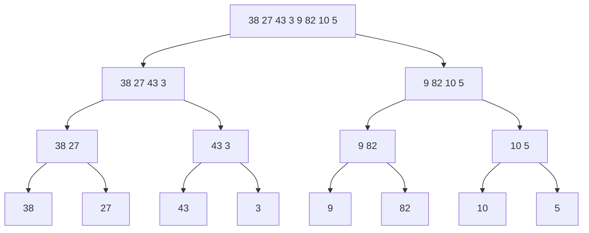

## Bu dars nima uchun kerak

17-darsdagi selection, bubble va insertion sort sodda va tushunarli, lekin ularning umumiy kamchiligi bor: eng yomon holatda taxminan n² / 2 ta taqqoslash. 1 000 elementli massiv uchun bu yarim million amal - sezilmaydi. 1 000 000 element uchun esa taxminan 500 milliard taqqoslash: sekundiga milliard taqqoslash qiladigan kompyuterda ham 8 daqiqadan ortiq. Ma'lumotlar bazasi, qidiruv tizimi yoki oddiy jadval dasturi har kuni bundan katta massivlarni saralaydi.

Kvadratik vaqtdan qutulish uchun boshqacha fikrlash kerak. 17-darsdagi algoritmlar har qadamda massivni bitta elementga "kichraytiradi": eng kichigini topib joyiga qo'yadi va qolgan n - 1 element bilan davom etadi. Merge sort esa massivni **ikkiga bo'ladi**, har yarmini alohida saralaydi va ikki saralangan yarmini tez birlashtiradi. Bu g'oya - **divide and conquer** (bo'lib tashla va yeng) - 15-darsdagi binary search'da ham bor edi, 18-darsdagi rekursiya esa uni kodga aylantirish vositasi.

Bu dars merge sort'ni boshidan oxirigacha quradi va uning narxini aniq hisoblaydi: nechta taqqoslash, qancha qo'shimcha xotira. Keyin teskari savolni beramiz: taqqoslash orqali saralaydigan **har qanday** algoritm n log n dan tezroq bo'la oladimi? Javob - yo'q, va buni isbotlash mumkin.

Bu darsdan keyin siz:

- divide and conquer'ning uch qadamini (bo'lish, yechish, birlashtirish) aniq masalalarda ajrata olasiz;
- ikki saralangan massivni n qadamda birlashtiradigan `merge` funksiyasini yoza olasiz va uning taqqoslashlar sonini baholay olasiz;
- yordamchi massivli merge sort'ni C da yoza olasiz va rekursiya daraxtini chiza olasiz;
- T(n) = 2T(n/2) + n tenglamasidan Θ(n log n) ni daraxt sathlari orqali chiqara olasiz va n = 8 hamda n = 1 000 000 uchun hisoblay olasiz;
- merge sort'ning O(n) xotira narxini va stable ekanini tushuntira olasiz;
- taqqoslashga asoslangan saralashning Ω(n log n) quyi chegarasini qaror daraxti orqali tushuntira olasiz;
- Python'ning `sort` funksiyasi ostida qanday algoritm ishlashini bilasiz.

## Divide and conquer

Divide and conquer usuli uch qadamdan iborat:

1. **Divide (bo'lish).** Masalani bir xil turdagi, lekin kichikroq kichik masalalarga bo'lish.
2. **Conquer (yechish).** Kichik masalalarni rekursiv yechish. Kichik masala yetarlicha kichik bo'lsa (base case), uni to'g'ridan-to'g'ri yechish.
3. **Combine (birlashtirish).** Kichik masalalar javoblaridan asl masala javobini yasash.

15-darsdagi binary search bu sxemaning eng sodda holati: massiv ikkiga bo'linadi, lekin faqat **bitta** yarmida qidiriladi, birlashtirish esa yo'q (javob shu yarmining javobi). Shuning uchun u log₂ n qadamda tugaydi.

Merge sort'da esa:

- **bo'lish**: massivni o'rtasidan ikkiga ajratish - bitta arifmetik amal, `mid = lo + (hi - lo) / 2`;
- **yechish**: ikkala yarmini rekursiv saralash; 0 yoki 1 elementli massiv allaqachon saralangan (base case);
- **birlashtirish**: ikki saralangan yarmini bitta saralangan massivga qo'shish - `merge`.

Algoritmning butun "aqli" uchinchi qadamda. Bo'lish arzon, rekursiya o'zini o'zi boshqaradi, asosiy ish esa `merge` da. Shuning uchun avval uni alohida o'rganamiz.

## Merge: ikki saralangan massivni birlashtirish

Ikkita saralangan qator bor deylik: `3 8 12 20` va `5 6 15`. Ikkalasi ham saralangan, demak natijaning eng kichik elementi ikki qatorning **birinchi** elementlaridan biri: boshqa hech qayerda bo'lishi mumkin emas. 3 va 5 ni taqqoslaymiz, 3 ni natijaga olamiz. Endi chap qatorning "boshi" 8, o'ngniki 5. Yana taqqoslaymiz va hokazo. Har qadamda bitta taqqoslash va bitta element natijaga o'tadi. Qatorlardan biri tugasa, ikkinchisining qolgan qismi taqqoslashsiz oxiriga ko'chiriladi: u allaqachon saralangan va hammasi natijadagi oxirgi elementdan katta yoki teng.

```c run
#include <stdio.h>

// Ikki saralangan massivni bitta saralangan massivga birlashtiradi.
// Har qadamda ikki "bosh" elementdan kichigi natijaga ko'chiriladi.
int merge(const int a[], int na, const int b[], int nb, int out[])
{
    int i = 0, j = 0, k = 0, comparisons = 0;
    while (i < na && j < nb)
    {
        comparisons++;
        if (a[i] <= b[j])
        {
            printf("%d <= %d: chapdan %d\n", a[i], b[j], a[i]);
            out[k++] = a[i++];
        }
        else
        {
            printf("%d >  %d: o'ngdan %d\n", a[i], b[j], b[j]);
            out[k++] = b[j++];
        }
    }
    // Bir tomoni tugadi: ikkinchisining qoldig'i taqqoslashsiz ko'chiriladi.
    while (i < na)
    {
        out[k++] = a[i++];
    }
    while (j < nb)
    {
        out[k++] = b[j++];
    }
    return comparisons;
}

int main(void)
{
    int a[] = {3, 8, 12, 20};
    int b[] = {5, 6, 15};
    int out[7];
    int c = merge(a, 4, b, 3, out);
    printf("Natija:");
    for (int k = 0; k < 7; k++)
    {
        printf(" %d", out[k]);
    }
    printf("\nTaqqoslashlar: %d, ko'chirishlar: %d\n", c, 7);
}
```

```text
3 <= 5: chapdan 3
8 >  5: o'ngdan 5
8 >  6: o'ngdan 6
8 <= 15: chapdan 8
12 <= 15: chapdan 12
20 >  15: o'ngdan 15
Natija: 3 5 6 8 12 15 20
Taqqoslashlar: 6, ko'chirishlar: 7
```

O'ng qator 15 bilan tugadi, chap qatorda qolgan 20 taqqoslashsiz ko'chirildi.

### Merge narxi

Birlashtirilayotgan qatorlar uzunligi na va nb, jami n = na + nb bo'lsin.

- **Ko'chirishlar** har doim aniq n: har element natijaga bir marta tushadi.
- **Taqqoslashlar** n - 1 dan oshmaydi: har taqqoslash bitta elementni natijaga chiqaradi, va oxirgi element hech qachon taqqoslashni talab qilmaydi (u tushganda qarshi qator allaqachon bo'sh). Eng kam holat - min(na, nb): masalan, chap qatorning hamma elementi o'ngning birinchisidan kichik bo'lsa, 4 ta taqqoslashdan keyin chap qator tugaydi va o'ng qator to'liq ko'chiriladi.

Misolimizda n = 7, taqqoslashlar 6 = n - 1, ya'ni eng yomon holat. Har qanday holatda merge Θ(n) vaqt oladi: chiziqli.

Muhim shart: merge **faqat saralangan** qatorlarda to'g'ri ishlaydi. Saralanmagan qatorlarni birlashtirish natijasi saralangan bo'lmaydi. Merge sort'ning g'oyasi - massivni shunday mayda bo'laklarga ajratishki, ular avtomatik saralangan bo'lsin (1 elementli massiv), keyin ularni merge bilan ketma-ket kattalashtirish.

## Merge sort C da

Endi to'liq algoritm. Massivning `a[lo..hi)` oralig'i bilan ishlaymiz: `lo` kiradi, `hi` kirmaydi, uzunlik `hi - lo`. Bunday yarim ochiq oraliq bo'lishni soddalashtiradi: `[lo, mid)` va `[mid, hi)` bir-biriga yopishadi, hech bir element yo'qolmaydi yoki ikki marta sanalmaydi.

`merge` natijani yozish uchun joy talab qiladi: ikki yarmini o'z joyida birlashtirsak, hali o'qilmagan elementlar ustiga yozib yuboramiz. Shuning uchun **yordamchi massiv** (`tmp`) ishlatiladi. U bir marta, butun massiv o'lchamida `malloc` bilan ajratiladi va barcha rekursiv chaqiruvlar uni birgalikda ishlatadi. `malloc` va `free` 23-darsda chuqur o'rganiladi; hozircha bilish kifoya: `malloc(n * sizeof(int))` n ta `int` uchun joy beradi yoki xotira yetmasa `NULL` qaytaradi, `free` esa joyni qaytaradi.

```c run
#include <stdio.h>
#include <stdlib.h>

long long comparisons = 0;

// a[lo..mid) va a[mid..hi) allaqachon saralangan: ularni tmp orqali birlashtiramiz.
void merge(int a[], int tmp[], int lo, int mid, int hi)
{
    int i = lo, j = mid, k = lo;
    while (i < mid && j < hi)
    {
        comparisons++;
        if (a[i] <= a[j])
        {
            tmp[k++] = a[i++];
        }
        else
        {
            tmp[k++] = a[j++];
        }
    }
    while (i < mid)
    {
        tmp[k++] = a[i++];
    }
    while (j < hi)
    {
        tmp[k++] = a[j++];
    }
    for (k = lo; k < hi; k++)
    {
        a[k] = tmp[k];
    }
}

// a[lo..hi) oralig'ini saralaydi.
void sort_range(int a[], int tmp[], int lo, int hi)
{
    if (hi - lo < 2)
    {
        return; // base case: 0 yoki 1 element allaqachon saralangan
    }
    int mid = lo + (hi - lo) / 2;
    sort_range(a, tmp, lo, mid);
    sort_range(a, tmp, mid, hi);
    merge(a, tmp, lo, mid, hi);
}

void merge_sort(int a[], int n)
{
    int *tmp = malloc(n * sizeof(int));
    if (tmp == NULL)
    {
        return;
    }
    sort_range(a, tmp, 0, n);
    free(tmp);
}

int main(void)
{
    int a[] = {38, 27, 43, 3, 9, 82, 10, 5};
    int n = sizeof(a) / sizeof(a[0]);
    merge_sort(a, n);
    for (int i = 0; i < n; i++)
    {
        printf("%d ", a[i]);
    }
    printf("\nn = %d, taqqoslashlar: %lld\n", n, comparisons);
}
```

```text
3 5 9 10 27 38 43 82 
n = 8, taqqoslashlar: 17
```

Kodda 18-darsdagi hamma narsa bor: base case (`hi - lo < 2`), kirishni kamaytiruvchi rekursiv qadam (har chaqiruv yarim uzunlik bilan) va chaqiruvlardan keyingi ish (`merge`). `mid = lo + (hi - lo) / 2` yozuvi 7-darsda ko'rilgan `(lo + hi) / 2` dagi overflow xavfidan qochadi.

### Rekursiya daraxti

`{38, 27, 43, 3, 9, 82, 10, 5}` uchun bo'lish bosqichi. Har tugun bitta `sort_range` chaqiruvi; barglar - 1 elementli base case'lar.



Birlashtirish pastdan yuqoriga boradi. Pastki sathda juftliklar birlashadi: `27 38`, `3 43`, `9 82`, `5 10` (har biri 1 ta taqqoslash, jami 4). O'rta sathda: `3 27 38 43` (3 ta taqqoslash) va `5 9 10 82` (3 ta). Eng yuqorida: `3 5 9 10 27 38 43 82` - 7 ta taqqoslash. Jami 4 + 6 + 7 = 17, dastur chiqargan son bilan bir xil.

Chaqiruvlar tartibi daraxtni chapdan o'ngga, chuqurlikka qarab aylanadi: avval `38 27 43 3` to'liq saralanadi, faqat keyin `9 82 10 5` ga o'tiladi. Bir vaqtda call stack'da eng ko'p 4 ta `sort_range` frame'i bo'ladi (daraxt balandligi + 1), ya'ni rekursiya chuqurligi log₂ n atrofida. 1 000 000 element uchun bu 20-21 frame: 18-darsda ko'rgan stack chegarasidan juda uzoq.

## Tahlil: nega n log n

Merge sort'ning ish vaqtini T(n) bilan belgilaymiz. Kod bo'yicha:

- 1 elementli massiv uchun ish o'zgarmas: T(1) = c;
- n elementli massiv uchun: ikki yarmini saralash 2 · T(n / 2) va merge taxminan n qadam.

**T(n) = 2T(n/2) + n**

Bu - rekurrent tenglama (recurrence): funksiya o'zi orqali ifodalangan. Uni rekursiya daraxti bilan yechamiz (soddalik uchun n ikkining darajasi deb olamiz).

- 0-sath (ildiz): bitta n uzunlikdagi merge - n qadam.
- 1-sath: ikkita n/2 uzunlikdagi merge - 2 · n/2 = n qadam.
- 2-sath: to'rtta n/4 uzunlikdagi merge - 4 · n/4 = n qadam.
- ...
- k-sath: 2ᵏ ta n/2ᵏ uzunlikdagi bo'lak - yana n qadam.

Bo'laklar uzunligi 1 ga tushganda bo'lish to'xtaydi: n / 2ᵏ = 1, ya'ni k = log₂ n. Demak merge bajariladigan sathlar soni log₂ n, har birida n ish:

**T(n) ≈ n · log₂ n = Θ(n log n)**

Muhim kuzatish: bu hisob kirish ma'lumotiga bog'liq emas. Massiv saralangan bo'ladimi, teskari bo'ladimi, tasodifiy bo'ladimi, merge sort har doim bo'ladi va har doim birlashtiradi. Shuning uchun uning eng yaxshi, o'rtacha va eng yomon vaqti bir xil: Θ(n log n). Faqat taqqoslashlar soni biroz farq qiladi (har bir merge'da min(na, nb) dan n - 1 gacha).

n = 8 uchun: log₂ 8 = 3 sath, n · log₂ n = 8 · 3 = 24. Haqiqiy taqqoslashlar biroz kamroq, chunki har merge n emas, ko'pi bilan n - 1 taqqoslash qiladi. Merge sort'ning eng yomon holatdagi taqqoslashlar sonining aniq formulasi n · ⌈log₂ n⌉ - 2^⌈log₂ n⌉ + 1; n = 8 uchun 8 · 3 - 8 + 1 = 17. Bizning misol massivimiz aynan eng yomon holatga tushgan: har bir merge n - 1 taqqoslash qilgan (1 + 1 + 1 + 1, 3 + 3, 7).

### Taqqoslashlarni sanaymiz: n = 1 000 000

Nazariyani tekshiramiz. Quyidagi dastur 1 000 000 elementli massivni uch xil kirish bilan saralaydi va taqqoslashlarni sanaydi. Tasodifiy sonlar `rand()` bilan emas, o'zimizning oddiy generatorimiz (LCG) bilan olinadi: `rand()` turli kutubxonalarda turli ketma-ketlik beradi, bizning generator esa brauzerda ham, kompyuterda ham bir xil sonlarni chiqaradi. Unda `unsigned int` ishlatilgan: 7-darsdan, unsigned aylanish aniqlangan xatti-harakat.

```c run
#include <math.h>
#include <stdio.h>
#include <stdlib.h>

long long comparisons = 0;

void merge(int a[], int tmp[], int lo, int mid, int hi)
{
    int i = lo, j = mid, k = lo;
    while (i < mid && j < hi)
    {
        comparisons++;
        if (a[i] <= a[j])
        {
            tmp[k++] = a[i++];
        }
        else
        {
            tmp[k++] = a[j++];
        }
    }
    while (i < mid)
    {
        tmp[k++] = a[i++];
    }
    while (j < hi)
    {
        tmp[k++] = a[j++];
    }
    for (k = lo; k < hi; k++)
    {
        a[k] = tmp[k];
    }
}

void sort_range(int a[], int tmp[], int lo, int hi)
{
    if (hi - lo < 2)
    {
        return;
    }
    int mid = lo + (hi - lo) / 2;
    sort_range(a, tmp, lo, mid);
    sort_range(a, tmp, mid, hi);
    merge(a, tmp, lo, mid, hi);
}

// Platformadan qat'i nazar bir xil "tasodifiy" sonlar: oddiy LCG (unsigned aylanishi aniqlangan).
unsigned int seed = 12345;
int next_random(void)
{
    seed = seed * 1103515245u + 12345u;
    return (int) (seed >> 1);
}

int is_sorted(const int a[], int n)
{
    for (int i = 1; i < n; i++)
    {
        if (a[i - 1] > a[i])
        {
            return 0;
        }
    }
    return 1;
}

void experiment(const char *name, int a[], int tmp[], int n)
{
    comparisons = 0;
    sort_range(a, tmp, 0, n);
    printf("%-10s n = %7d: %10lld taqqoslash, saralangan: %s\n", name, n, comparisons,
           is_sorted(a, n) ? "ha" : "YO'Q");
}

int main(void)
{
    int n = 1000000;
    int *a = malloc(n * sizeof(int));
    int *tmp = malloc(n * sizeof(int));
    if (a == NULL || tmp == NULL)
    {
        return 1;
    }

    for (int i = 0; i < n; i++)
    {
        a[i] = next_random();
    }
    experiment("tasodifiy", a, tmp, n);

    for (int i = 0; i < n; i++)
    {
        a[i] = i;
    }
    experiment("saralangan", a, tmp, n);

    for (int i = 0; i < n; i++)
    {
        a[i] = n - i;
    }
    experiment("teskari", a, tmp, n);

    printf("n * log2(n)     = %.0f\n", n * log2(n));
    printf("n * (n - 1) / 2 = %lld\n", (long long) n * (n - 1) / 2);

    free(a);
    free(tmp);
}
```

```text
tasodifiy  n = 1000000:   18673530 taqqoslash, saralangan: ha
saralangan n = 1000000:    9884992 taqqoslash, saralangan: ha
teskari    n = 1000000:   10066432 taqqoslash, saralangan: ha
n * log2(n)     = 19931569
n * (n - 1) / 2 = 499999500000
```

Brauzerda dastur bir necha soniya ishlashi mumkin: 3 ta saralash, har biri 20 milliongacha taqqoslash va har bir xotira murojaatida xavfsizlik tekshiruvi.

Natijalarni tahlil qilamiz:

- Tasodifiy massiv: 18 673 530 ta taqqoslash, n · log₂ n ≈ 19 931 569 dan biroz kam. Eng yomon holat formulasi bo'yicha yuqori chegara 1 000 000 · 20 - 2²⁰ + 1 = 20 000 000 - 1 048 576 + 1 = 18 951 425; tasodifiy kirish unga juda yaqin.
- Saralangan va teskari massiv: taxminan ikki baravar kam (≈ 10 million). Bunday kirishda har bir merge'da bir qator boshqasidan butunlay oldin keladi, shuning uchun taqqoslashlar min(na, nb) ≈ n/2 ga tushadi: (n/2) · log₂ n ≈ 9.97 million.
- Lekin uchala holatda ham merge sort bir xil miqdorda **ko'chirish** qiladi: har sathda n ta element `tmp` ga va n ta orqaga. Shuning uchun saralangan kirishda ham u "bekorga" ishlaydi - 17-darsdagi insertion sort esa saralangan massivni n - 1 taqqoslashda tugatardi.

### Kvadratik algoritmlar bilan taqqoslash

17-darsdagi algoritmlarning taqqoslashlar soni (eng yomon holat) n(n - 1)/2 (selection sort uchun bu har doim shunday). Merge sort uchun eng yomon holat formulasi. Vaqt sekundiga 10⁹ taqqoslash deb baholangan.

| n | n(n - 1)/2 (selection, bubble, insertion eng yomon) | Merge sort eng yomon | Nisbat | Vaqt: kvadratik | Vaqt: merge sort |
|---|---|---|---|---|---|
| 8 | 28 | 17 | 1.6 | sezilmaydi | sezilmaydi |
| 1 000 | 499 500 | 8 977 | 56 | 0.5 ms | 0.009 ms |
| 1 000 000 | 499 999 500 000 | 18 951 425 | 26 383 | ≈ 500 s (8.3 daqiqa) | ≈ 0.019 s |

n = 1 000 uchun merge sort qiymati: ⌈log₂ 1000⌉ = 10, 1000 · 10 - 2¹⁰ + 1 = 10 000 - 1 024 + 1 = 8 977.

n = 8 da farq deyarli yo'q, va amalda kichik massivlarda insertion sort hatto tezroq ham bo'ladi (rekursiya va ko'chirish xarajati yo'q). n o'sgan sari esa farq portlaydi: 1 000 000 da 26 ming baravar. Bu - 16-darsdagi asimptotik tahlilning amaliy ma'nosi: n katta bo'lganda konstantalar emas, o'sish tartibi hal qiladi.

## Xotira narxi va stable'lik

### O(n) qo'shimcha xotira

Bizning merge sort `tmp` uchun n ta `int` qo'shimcha joy oladi: 1 000 000 element uchun 4 000 000 bayt (4 MB), ya'ni massivning o'zi qancha bo'lsa, shuncha. Bunga rekursiya stack'i qo'shiladi: chuqurlik log₂ n atrofida, ya'ni O(log n) frame - n ga nisbatan juda kichik. Jami qo'shimcha xotira **O(n)**.

17-darsdagi uchala algoritm esa **in-place** (o'z joyida) ishlaydi: massivdan tashqari faqat bir nechta o'zgaruvchi, O(1) qo'shimcha xotira. Bu merge sort'ning asosiy trade-off'i: vaqtda n log n ni xotirada n evaziga olamiz. Xotira tanqis tizimlarda (mikrokontroller, katta ma'lumotlar) bu muhim. In-place merge sort variantlari ham mavjud, lekin ular ancha murakkab va amalda sekinroq.

### Stable saralash

Saralash **stable** (barqaror) deyiladi, agar teng kalitli elementlarning boshlang'ich nisbiy tartibi saqlansa. Misol: o'quvchilar ro'yxati avval ism bo'yicha saralangan, endi uni ball bo'yicha saralaymiz. Stable saralash bir xil ballli o'quvchilarni ism bo'yicha tartibda qoldiradi; stable bo'lmagan saralash ularni aralashtirib yuborishi mumkin.

Merge sort stable, va buning sababi bitta belgida: `if (a[i] <= a[j])`. Teng elementlar uchrashganda **chap** qatordagi element birinchi oladi. Chap qator massivda o'ngdagidan oldin turgan elementlardan iborat, demak teng elementlarning eski tartibi saqlanadi. Agar `<=` o'rniga `<` yozilsa, teng elementlarda o'ngdagi birinchi ketadi va algoritm stable bo'lmay qoladi - natija baribir saralangan, lekin tenglar tartibi buziladi.

| Xususiyat | Selection sort | Bubble sort | Insertion sort | Merge sort |
|---|---|---|---|---|
| Eng yomon vaqt | Θ(n²) | Θ(n²) | Θ(n²) | Θ(n log n) |
| Eng yaxshi vaqt | Θ(n²) | Θ(n) (almashtirishsiz o'tishda to'xtasa) | Θ(n) | Θ(n log n) |
| Qo'shimcha xotira | O(1) | O(1) | O(1) | O(n) |
| Stable | Yo'q (odatiy variant) | Ha | Ha | Ha (`<=` bilan) |
| Kichik n da | Sodda | Sodda | Juda tez | Rekursiya xarajati |

## Quyi chegara: Ω(n log n)

Merge sort n log n taqqoslash qiladi. Undan yaxshiroq algoritm bormi? Agar algoritm elementlar haqida faqat **taqqoslash** orqali ma'lumot olsa (`a[i] <= a[j]` - ha yoki yo'q), javob yo'q. Bu taqqoslashga asoslangan (comparison-based) saralashning quyi chegarasi.

Dalil **qaror daraxti** (decision tree) bilan. Har qanday taqqoslash algoritmini daraxt sifatida tasavvur qilamiz: har ichki tugun bitta taqqoslash ("a[i] ≤ a[j] mi?"), ikki shoxi - "ha" va "yo'q" javoblari. Algoritm kirishga qarab ildizdan bitta bargga boradi; barg - yakuniy javob: elementlarni qaysi tartibda joylashtirish kerak. Ildizdan barggacha yo'l uzunligi - shu kirishdagi taqqoslashlar soni; eng uzun yo'l (daraxt balandligi h) - eng yomon holat.

1. n ta turli element n! xil tartibda kelishi mumkin, va har biri uchun to'g'ri javob boshqa. Demak daraxtda kamida n! barg bo'lishi kerak: aks holda ikki xil kirish bir xil bargga tushadi va ulardan biri noto'g'ri saralanadi.
2. Balandligi h bo'lgan ikkilik daraxtda ko'pi bilan 2ʰ barg bo'ladi.
3. Demak 2ʰ ≥ n!, ya'ni **h ≥ log₂(n!)**.

Endi log₂(n!) ni baholaymiz. n! = 1 · 2 · ... · n ko'paytmasining katta yarmidagi n/2 ta ko'paytuvchining har biri kamida n/2. Shuning uchun n! ≥ (n/2)^(n/2) va

log₂(n!) ≥ (n/2) · log₂(n/2) = Ω(n log n).

Yuqoridan esa n! ≤ nⁿ, demak log₂(n!) ≤ n log₂ n. Ya'ni log₂(n!) = Θ(n log n), va **har qanday** taqqoslashga asoslangan saralash eng yomon holatda Ω(n log n) taqqoslash qiladi. Merge sort bu chegaraga yetadi, shuning uchun u asimptotik jihatdan optimal.

Raqamlarda:

- n = 8: 8! = 40 320, log₂ 40 320 ≈ 15.3. Taqqoslashlar soni butun son, demak har qanday algoritm eng yomon holatda kamida **16** ta taqqoslash qiladi. Merge sort'ning eng yomon holati 17 - chegaradan atigi bitta ortiq.
- n = 1 000 000: log₂(1 000 000!) ≈ 18 488 885. Merge sort'ning eng yomon holati 18 951 425 - quyi chegaradan 2.5% ortiq. Bizning tasodifiy massivdagi 18 673 530 esa undan atigi 1% ortiq.

Bu chegara faqat taqqoslash modeli uchun. Agar elementlar haqida qo'shimcha ma'lumot bo'lsa (masalan, ular 0 dan 255 gacha bo'lgan butun sonlar), counting sort yoki radix sort kabi taqqoslamaydigan algoritmlar chiziqli vaqtda ishlashi mumkin - ular qaror daraxti modeliga kirmaydi.

## Real kutubxonalarda

Amaliy kutubxonalar sof merge sort'ni kamdan-kam ishlatadi, lekin uning g'oyalarini keng qo'llaydi. Eng mashhur misol - Python.

CPython'ning `list.sort()` va `sorted()` funksiyalari **Timsort** asosida qurilgan: CPython manbasidagi `Objects/listsort.txt` hujjati uni "adaptive, stable, natural mergesort" deb ta'riflaydi. Asosiy g'oyalari:

- **Tabiiy run'lar.** Massiv bo'laklarga mexanik ravishda o'rtadan bo'linmaydi; buning o'rniga unda allaqachon saralangan (yoki qat'iy kamayuvchi, keyin teskari aylantiriladigan) ketma-ket qismlar - run'lar - qidiriladi. Qisman saralangan real ma'lumotlarda bu juda ko'p ishni tejaydi; to'liq saralangan massiv n - 1 taqqoslashda tugaydi.
- **Kichik bo'laklar uchun insertion sort.** Run juda qisqa bo'lsa, u binary insertion sort bilan minimal uzunlikkacha (minrun) kengaytiriladi. Hujjatga ko'ra massiv 64 elementdan kichik bo'lsa, butun massiv shu usulda saralanadi. Bu yuqoridagi kuzatishning amaliy ifodasi: kichik n da kvadratik algoritm tezroq.
- **Galloping.** Merge paytida bir qatordan elementlar ketma-ket ko'p marta yutsa, algoritm bittalab taqqoslash o'rniga eksponensial qadamlar bilan "sakrab" chegarani qidiradi.
- **Run'larni birlashtirish tartibi.** Python 3.11 dan boshlab bu tartib **Powersort** strategiyasi bilan tanlanadi (Munro va Wild, 2018). Avvalgi qoidalar hujjatning o'zida "tushunish qiyin" deb tan olingan; Powersort esa birlashtirish narxi yaqin-optimal ekani isbotlangan qoidaga asoslanadi.

Python hujjati `sort()` stable bo'lishini **kafolatlaydi** va bundan foydalanishni tavsiya qiladi: masalan, avval ikkinchi darajali kalit bo'yicha, keyin asosiy kalit bo'yicha saralab, ko'p bosqichli tartib olish mumkin. Bu aynan yuqorida ko'rgan stable'lik xususiyati.

Shunday qilib, siz har kuni yozadigan `sorted(items)` ostida shu darsdagi merge, kichik bo'laklar uchun 17-darsdagi insertion sort va 15-darsdagi binary search g'oyalari birgalikda ishlaydi.

## Ko'p uchraydigan xatolar

- **Base case'ni noto'g'ri yozish.** `if (hi - lo == 0) return;` faqat bo'sh oraliqda to'xtaydi; 1 elementli oraliq `mid = lo` beradi va `sort_range(a, tmp, lo, lo + 1)` o'zini o'zi abadiy chaqiradi - 18-darsdagi "Stack to'ldi". To'g'risi: `hi - lo < 2`.
- **Oraliq chegaralarini aralashtirish.** Yarim ochiq `[lo, hi)` va yopiq `[lo, hi]` oraliqlarni bitta kodda aralashtirish off-by-one beradi: bitta element ikki marta saralanadi yoki tushib qoladi. Bitta qoidani tanlang va hamma joyda ushlab turing.
- **Merge'dan keyin qoldiqni ko'chirishni unutish.** `while (i < mid)` va `while (j < hi)` sikllari bo'lmasa, qatorlardan biri tugaganda ikkinchisining qolgan elementlari yo'qoladi.
- **`tmp` dan asl massivga qaytarmaslik.** Merge natijasi `tmp` da qoladi, yuqori sath esa `a` dan o'qiydi va saralanmagan ma'lumot bilan ishlaydi.
- **Har chaqiruvda `malloc` qilish.** Yordamchi massivni har `merge` ichida ajratish O(n log n) marta `malloc` va `free` degani. Uni bir marta ajratib, pointer sifatida uzating; `free` ni unutish esa leak (23-dars).
- **`<` va `<=` farqini bilmaslik.** `a[i] < a[j]` bilan natija saralangan, lekin stable emas. Ko'p bosqichli saralashda bu sezilmas xatoga olib keladi.
- **"n log n doim tezroq" deb o'ylash.** Kichik massivlarda insertion sort tezroq, merge sort esa O(n) qo'shimcha xotira talab qiladi. Real kutubxonalar shuning uchun gibrid algoritmlarni ishlatadi.

## Xulosa

- Divide and conquer: masalani kichik nusxalarga bo'lish, ularni rekursiv yechish va javoblarni birlashtirish. Binary search - bitta yarmi bilan, merge sort - ikkala yarmi bilan.
- Merge ikki saralangan qatorni Θ(n) vaqtda birlashtiradi: n ta ko'chirish va ko'pi bilan n - 1 taqqoslash.
- Merge sort: T(n) = 2T(n/2) + n, rekursiya daraxtida log₂ n sath va har sathda n ish, jami Θ(n log n) - eng yaxshi, o'rtacha va eng yomon holatda.
- n = 1 000 000 uchun merge sort ≈ 19 million taqqoslash qiladi, kvadratik algoritmlar esa ≈ 500 milliard: 26 ming baravar farq.
- Narxi - O(n) qo'shimcha xotira (yordamchi massiv) va O(log n) chuqurlikdagi rekursiya.
- `<=` bilan yozilgan merge sort stable: teng elementlar tartibi saqlanadi.
- Har qanday taqqoslashga asoslangan saralash eng yomon holatda kamida log₂(n!) = Ω(n log n) taqqoslash qiladi (qaror daraxti dalili); merge sort bu chegarada optimal.
- Python'ning `sort()` - Timsort asosidagi stable, adaptiv merge sort; 3.11 dan run'larni birlashtirish tartibi Powersort bilan tanlanadi.

## Amaliy topshiriq

Merge sort g'oyasini saralashdan boshqa masalaga qo'llang: massivdagi **inversiyalar** sonini hisoblang. Inversiya - i < j bo'lib, a[i] > a[j] bo'lgan indekslar juftligi. Saralangan massivda inversiya 0 ta, teskari massivda n(n - 1)/2 ta; inversiyalar soni massiv saralanishdan qanchalik uzoq ekanini o'lchaydi (va insertion sort aynan shuncha almashtirish qiladi).

Topshiriq qadamlari:

1. **To'liq tekshiruv.** Ikki ichma-ich sikl bilan inversiyalarni sanaydigan oddiy funksiya yozing va uning vaqtini Θ(n²) deb asoslang. Bu funksiya keyingi qadamlar uchun to'g'rilik tekshiruvchisi bo'ladi.
2. **Merge orqali sanash.** Asosiy kuzatish: merge paytida o'ng qatordagi `right[j]` natijaga chap qatordagi `left[i]` dan oldin o'tsa, u chap qatorda qolgan **barcha** elementlardan kichik, chunki chap qator saralangan. Demak bu qadam bir yo'la `len(left) - i` ta inversiya beradi. Shu g'oya bilan pastdagi `count_inversions` funksiyasini yozing (Python, merge sort asosida).
3. **Teng elementlar.** `[2, 2, 1]` da nechta inversiya? Merge'dagi `<=` va `<` tanlovi natijaga qanday ta'sir qiladi va qaysi biri to'g'ri?
4. **Vaqt tahlili.** Funksiyangiz uchun T(n) tenglamasini yozing va n = 20 000 uchun to'liq tekshiruv bilan taqqoslashlar sonini solishtiring.
5. **C versiyasi.** Darsdagi C merge sort'ga `long long inversions` hisoblagichini qo'shing va `{38, 27, 43, 3, 9, 82, 10, 5}` uchun javobni chiqaring. Javobni 1-qadamdagi usul bilan tekshiring.

Inversiyalar mashqi (boshlang'ich kod testlardan o'tmaydi):

```python run
def count_inversions(a):
    # Yechimingizni shu yerga yozing: merge sort asosida, O(n log n)
    return 0


print(count_inversions([2, 4, 1, 3, 5]))  # 3 bo'lishi kerak
```

```python test
import random
import time


def _brute(a):
    return sum(1 for i in range(len(a)) for j in range(i + 1, len(a)) if a[i] > a[j])


def _random_ok():
    rng = random.Random(50)
    for _ in range(30):
        a = [rng.randint(0, 20) for _ in range(rng.randint(0, 60))]
        if count_inversions(a) != _brute(a):
            return False
    return True


def _fast():
    a = list(range(20000, 0, -1))
    start = time.perf_counter()
    ok = count_inversions(a) == 20000 * 19999 // 2
    return ok and time.perf_counter() - start < 3


check("bo'sh va bitta element: 0", lambda: count_inversions([]) == 0 and count_inversions([7]) == 0)
check("[2, 4, 1, 3, 5] da 3 ta inversiya", lambda: count_inversions([2, 4, 1, 3, 5]) == 3)
check("saralangan massivda 0", lambda: count_inversions([1, 2, 3, 4, 5, 6]) == 0)
check("teskari [5, 4, 3, 2, 1] da 10 = n(n-1)/2", lambda: count_inversions([5, 4, 3, 2, 1]) == 10)
check("teng elementlar inversiya emas: [2, 2, 1] -> 2", lambda: count_inversions([2, 2, 1]) == 2)
check("kirish ro'yxati o'zgarmasligi kerak", lambda: (lambda d: (count_inversions(d), d == [3, 1, 2])[1])([3, 1, 2]))
check("30 ta tasodifiy massivda to'liq tekshiruv bilan bir xil", _random_ok)
check("20 000 elementli teskari massiv 3 soniyadan tez (O(n^2) emas)", _fast)
```

Yaxshi javobda bo'lishi kerak bo'lgan narsalar:

- to'liq tekshiruv funksiyasi n(n - 1)/2 juftlikni ko'rib chiqishi va shuning uchun Θ(n²) ekani ko'rsatilgan;
- `count_inversions` merge paytida `len(left) - i` ni qo'shadi, kirish ro'yxatini o'zgartirmaydi va hamma testlardan o'tadi;
- `[2, 2, 1]` uchun javob 2 va teng elementlarda chapdan olish (`<=`) kerakligi tushuntirilgan: `<` bilan teng juftlik ham inversiya deb sanalib, 3 chiqadi;
- T(n) = 2T(n/2) + n va Θ(n log n) yozilgan; n = 20 000 uchun ≈ 20 000 · 15 = 300 000 atrofidagi amal va to'liq tekshiruvning 199 990 000 juftligi solishtirilgan;
- C versiyasida `{38, 27, 43, 3, 9, 82, 10, 5}` uchun 17 ta inversiya chiqqan (tasodifan merge sort taqqoslashlari soni bilan bir xil, lekin bu boshqa kattalik) va to'liq tekshiruv bilan tasdiqlangan.

Javobingizni pastdagi maydonga yozing va yuqoridagi mezonlar bilan solishtiring.

## Manbalar

- CS50x. [Lecture 3 notes](https://cs50.harvard.edu/x/notes/3/) - "Merge Sort" bo'limi: psevdokod, ikki yarmini saralab birlashtirish g'oyasi, n log n ish vaqti; "Running Time" bo'limidagi O, Ω, Θ belgilari.
- Cormen, Leiserson, Rivest, Stein. [Introduction to Algorithms, 4-nashr](https://mitpress.mit.edu/9780262046305/introduction-to-algorithms/) - 2.3 bo'lim "Designing algorithms" (divide and conquer, merge sort, rekurrent tenglama va rekursiya daraxti tahlili), 8.1 bo'lim "Lower bounds for sorting" (qaror daraxti va Ω(n lg n) chegarasi).
- CPython. [Objects/listsort.txt](https://github.com/python/cpython/blob/main/Objects/listsort.txt) - Timsort'ning tavsifi: natural run'lar, minrun va binary insertion sort, galloping, Powersort birlashtirish strategiyasi.
- Python. [list.sort](https://docs.python.org/3/library/stdtypes.html#list.sort) - `sort()` stable bo'lishining kafolati va ko'p bosqichli saralashdagi foydasi.
- Munro, Wild. [Nearly-Optimal Mergesorts: Fast, Practical Sorting Methods That Optimally Adapt to Existing Runs](https://arxiv.org/abs/1805.04154) - Powersort algoritmining asl maqolasi (2018).
- Wikipedia. [Powersort](https://en.wikipedia.org/wiki/Powersort) - Powersort Python 3.11 dan CPython'ning standart ro'yxat saralash algoritmi ekani.
