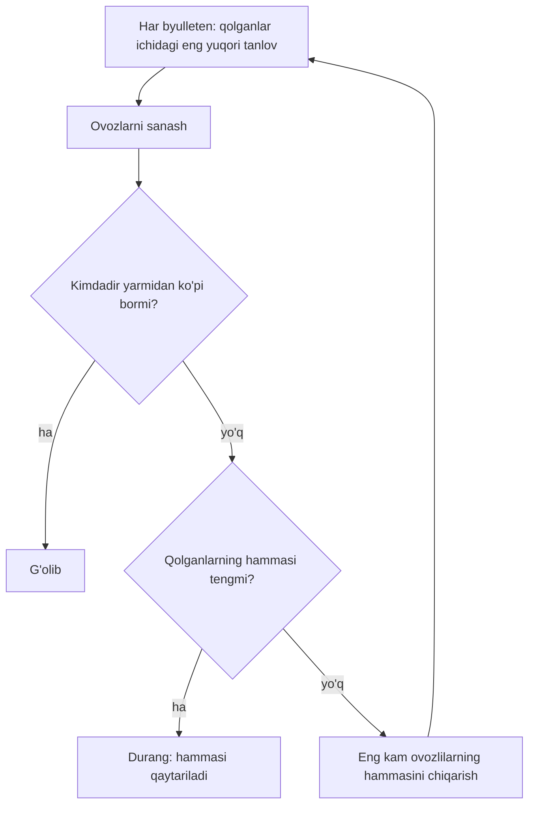
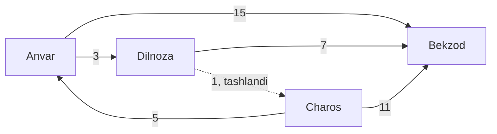

## Bu dars nima uchun kerak

11-darsda massiv bir xil tipdagi ko'p qiymatni bitta nom ostida saqlashini ko'rdik. Lekin real ma'lumot ko'pincha **har xil tipdagi** qiymatlarning to'plami: nomzodning ismi (string) va ovozlari soni (int), juftlik bellashuvining g'olibi, mag'lubi va farqi. Ularni ikkita alohida massivda (`string names[4]` va `int votes[4]`) saqlash mumkin, lekin bu mo'rt: bitta massivni saralab, ikkinchisini unutsangiz, ism boshqa nomzodning ovozlariga "yopishib" qoladi. C bu muammoni **struct** bilan hal qiladi: bir nechta maydonni bitta yangi tipga yig'ish.

Darsning ikkinchi yarmi struct ishlatiladigan klassik masala - saylov natijasini hisoblash. Bu oddiy ko'rinadi ("eng ko'p ovoz olgan yutadi"), lekin uch nomzod paydo bo'lishi bilan qiziq savollar chiqadi: bir xil byulletenlardan uch xil usul uch xil g'olib chiqaradi, ba'zan esa "ko'pchilik xohlagan" nomzod umuman mavjud bo'lmaydi. Bu yerda 2-modulda o'rganilgan hamma narsa ishlaydi: massivlar (11-dars), satrlar va `strcmp` (12-dars), chiziqli qidiruv (15-dars), Big O (16-dars), insertion sort (17-dars) va rekursiya (18-dars). Shuning uchun bu dars modulning yakuniy darsi.

CS50 ning 3-hafta problem set'ida ham shu mavzudagi uchta masala bor. Biz ularning shartlari va kod skeletlarini takrorlamaymiz: kod, nomlar va tuzilma shu darsniki, algoritmlar esa umumiy bilim sifatida o'z so'zimiz bilan ochiladi.

Bu darsdan keyin siz:

- `typedef struct` bilan yangi tip e'lon qilish, maydonlarga nuqta operatori bilan murojaat qilish va struct massivini ishlatishni bilasiz;
- struct o'lchamini padding va alignment qoidalari bo'yicha qo'lda hisoblay olasiz va nima uchun maydonlar tartibi o'lchamni o'zgartirishini tushuntira olasiz;
- struct funksiyaga nusxa sifatida uzatilishini va bu massiv uzatishdan qanday farq qilishini bilasiz;
- plurality, instant runoff va ranked pairs usullarini qo'lda va kodda hisoblay olasiz;
- Condorcet g'olibi, Condorcet paradoksi va spoiler effekti nima ekanini misol bilan ko'rsata olasiz;
- Arrow teoremasi nima deyishini bir-ikki gapda ayta olasiz.

## struct: bir nechta qiymatdan bitta tip

**struct** (structure, tuzilma) - har biri o'z nomi va tipiga ega bo'lgan **maydonlar** (members, fields) ketma-ketligi. cppreference ta'rifiga ko'ra struct maydonlari xotirada e'lon qilingan tartibda joylashadi (union'dan farqli, unda maydonlar ustma-ust tushadi).

Eng oddiy e'lon:

```c
struct candidate
{
    string name;
    int votes;
};
```

Bu yozuv xotira ajratmaydi: u faqat kompilyatorga "candidate degan shakl bor, unda ikkita maydon" deydi. O'zgaruvchi e'lon qilish uchun har safar `struct candidate a;` deb yozish kerak bo'ladi. Buni qisqartirish uchun **typedef** ishlatiladi: u mavjud tipga yangi nom beradi. `string` ning o'zi ham cs50.h ichida `typedef char *string;` bilan berilgan nom (12-darsda ko'rganimizdek, satr aslida `char` massivining boshiga ko'rsatkich).

```c
typedef struct
{
    string name;
    int votes;
} candidate;
```

Endi `candidate` - `int` yoki `float` kabi oddiy tip nomi: `candidate a;`, `candidate field[4];`, funksiya parametri `candidate c`.

### Nuqta operatori va initsializatsiya

Maydonga murojaat **nuqta operatori** bilan: `a.name`, `a.votes`. Maydon oddiy o'zgaruvchi kabi ishlaydi: `a.votes++`, `a.votes = 0`, `printf("%s", a.name)`.

Initsializatsiyaning ikki shakli bor:

- tartib bo'yicha: `candidate a = {"Anvar", 5};` - qiymatlar maydonlarga e'lon tartibida tushadi;
- nom bo'yicha (designated initializer, C99 dan): `candidate a = {.name = "Anvar", .votes = 5};` - tartibga bog'liq emas, struct'ga keyin yangi maydon qo'shilsa ham buzilmaydi.

Massivlardagi kabi (11-dars), initsializatorda berilmagan maydonlar nolga tenglashadi: `candidate a = {"Anvar"};` da `a.votes` 0.

### struct massivi

`candidate field[4]` - 4 ta struct'dan iborat massiv. `field[1].votes` o'qilishi: "1-indeksdagi struct'ning votes maydoni". `[]` va `.` operatorlari bir xil ustuvorlikka ega va chapdan o'ngga bajariladi, shuning uchun qavs kerak emas. Endi ism va ovoz bir butun: nomzodni saralasangiz, ovozi u bilan birga ko'chadi.

struct'larni `=` bilan bir-biriga o'zlashtirish mumkin - bu barcha maydonlarni nusxalaydi. Massivlarda `b = a` kompilyatsiya xatosi bo'lgani bilan solishtiring (11-dars). Lekin `==` bilan solishtirib bo'lmaydi: `if (a == b)` kompilyatsiya xatosi. Maydonma-maydon solishtirish kerak.

```c run
#include <cs50.h>
#include <stdio.h>

typedef struct
{
    string name;
    int votes;
} candidate;

int main(void)
{
    candidate field[3] = {{"Anvar", 5}, {"Bekzod", 0}, {.name = "Charos", .votes = 4}};

    field[1].votes = field[1].votes + 2;

    // Yetakchini topish: struct butunligicha nusxalanadi
    candidate leader = field[0];
    for (int i = 1; i < 3; i++)
    {
        if (field[i].votes > leader.votes)
        {
            leader = field[i];
        }
    }

    for (int i = 0; i < 3; i++)
    {
        printf("%-7s %d\n", field[i].name, field[i].votes);
    }
    printf("Yetakchi: %s, %d ovoz\n", leader.name, leader.votes);
    printf("sizeof(candidate) = %zu, sizeof(field) = %zu\n", sizeof(candidate), sizeof(field));
}
```

Natija (brauzer muhitida, wasm32):

```text
Anvar   5
Bekzod  2
Charos  4
Yetakchi: Anvar, 5 ovoz
sizeof(candidate) = 8, sizeof(field) = 24
```

Oxirgi qatorni tushuntiramiz. `name` maydoni `string`, ya'ni manzil: wasm32 da 4 bayt. `votes` - `int`, 4 bayt. Jami 4 + 4 = 8, massiv 3 · 8 = 24 bayt. 64-bitli x86-64 kompyuterda manzil 8 bayt bo'lgani uchun natija `sizeof(candidate) = 16, sizeof(field) = 48` bo'ladi - va 8 + 4 = 12 emas, 16. Qo'shimcha 4 bayt qayerdan kelgani keyingi bo'limda.

E'tibor bering: struct ichida ismning harflari emas, faqat manzili saqlanadi. "Charos" harflari xotiraning boshqa joyida turadi; `leader = field[0]` nusxalaganda ham faqat manzil nusxalanadi, harflar emas. Bu farq 21-22-darslarda pointer bilan chuqur ochiladi.

## Xotirada struct: padding va alignment

Protsessor ma'lumotni o'z o'lchamiga karrali manzildan o'qishni afzal ko'radi: 4 baytli `int` 4 ga bo'linadigan manzilda, 8 baytli `double` 8 ga bo'linadigan manzilda. Bu talab **alignment** (tekislash) deyiladi. Ba'zi arxitekturalarda noto'g'ri tekislangan o'qish sekinroq, ba'zilarida umuman mumkin emas. Kompilyator talabni bajarish uchun maydonlar orasiga nomsiz bo'sh baytlar qo'yadi - **padding**.

cppreference struct sahifasi qoidani shunday beradi: padding istalgan ikki maydon orasida va oxirgi maydondan keyin bo'lishi mumkin, lekin birinchi maydondan oldin hech qachon bo'lmaydi; struct o'lchami maydonlar o'lchamlari yig'indisidan kichik emas. Aniq qancha padding qo'yilishini standart emas, platformaning ABI qoidalari belgilaydi. Amalda (x86-64 da ham, wasm32 da ham) ikki qoida ishlaydi:

1. Har bir maydon o'z alignment'iga karrali siljishda (offset) boshlanadi.
2. Butun struct o'lchami eng katta alignment'ga karrali bo'ladi - massivdagi keyingi element ham to'g'ri tekislanishi uchun.

Siljishni `<stddef.h>` dagi `offsetof(tip, maydon)` makrosi beradi.

```c run
#include <stddef.h>
#include <stdio.h>

typedef struct
{
    char tag;
    int votes;
    char round;
} loose;

typedef struct
{
    int votes;
    char tag;
    char round;
} tight;

typedef struct
{
    char tag;
    double share;
} with_double;

int main(void)
{
    printf("loose:       sizeof %2zu, tag @%zu, votes @%zu, round @%zu\n", sizeof(loose), offsetof(loose, tag),
           offsetof(loose, votes), offsetof(loose, round));
    printf("tight:       sizeof %2zu, votes @%zu, tag @%zu, round @%zu\n", sizeof(tight), offsetof(tight, votes),
           offsetof(tight, tag), offsetof(tight, round));
    printf("with_double: sizeof %2zu, tag @%zu, share @%zu\n", sizeof(with_double), offsetof(with_double, tag),
           offsetof(with_double, share));
    printf("1000 ta loose: %zu bayt, 1000 ta tight: %zu bayt\n", 1000 * sizeof(loose), 1000 * sizeof(tight));
}
```

Natija (brauzerda va x86-64 da bir xil, chunki bu struct'larda manzil yo'q):

```text
loose:       sizeof 12, tag @0, votes @4, round @8
tight:       sizeof  8, votes @0, tag @4, round @5
with_double: sizeof 16, tag @0, share @8
1000 ta loose: 12000 bayt, 1000 ta tight: 8000 bayt
```

`loose` ni bayt-baytga hisoblaymiz:

- `tag` - 0-bayt (birinchi maydondan oldin padding yo'q);
- `votes` 4 ga karrali siljish talab qiladi; 1 band, keyingi mos joy 4. Demak 1-3 baytlar padding, `votes` 4-7;
- `round` - 8-bayt (char uchun istalgan siljish mos);
- jami 9 bayt, lekin o'lcham eng katta alignment'ga (4) karrali bo'lishi kerak: 9 dan keyingi 4 ga karrali son 12. Oxirida 3 bayt padding.

Ya'ni 6 bayt foydali ma'lumot uchun 12 bayt - yarmi bo'sh. `tight` da xuddi shu uch maydon, faqat tartib boshqa: `votes` 0-3, `tag` 4, `round` 5, jami 6, 4 ga yaxlitlangan 8. Maydonlarni kattadan kichikka tartiblash oddiy, lekin samarali qoida: 1000 ta element uchun 4000 bayt tejaldi.

`with_double` da `double` 8 baytlik alignment talab qiladi (wasm32 da ham), shuning uchun 1 baytli `tag` dan keyin 7 bayt padding.

| Struct | Maydonlar | Foydali bayt | wasm32 (brauzer) | x86-64 |
|---|---|---|---|---|
| `loose` | char, int, char | 6 | 12 | 12 |
| `tight` | int, char, char | 6 | 8 | 8 |
| `with_double` | char, double | 9 | 16 | 16 |
| `candidate` | string, int | 8 yoki 12 | 8 | 16 |
| `candidate` + `bool active` | string, int, bool | 9 yoki 13 | 12 | 16 |

`candidate` x86-64 da: `name` 0-7, `votes` 8-11, jami 12, eng katta alignment 8 (manzil), shuning uchun 16. wasm32 da manzil 4 bayt va 4 baytga tekislanadi: 4 + 4 = 8, padding yo'q. Bitta kod, ikki platforma, ikki xil o'lcham - shuning uchun struct o'lchamini hech qachon qo'lda "4 + 4" deb yozmang, doim `sizeof` ishlating. Bu qiymatlar shu dars uchun clang 18 da `--target=wasm32` va x86-64 uchun `_Static_assert(sizeof(...) == ...)` bilan kompilyatsiya vaqtida tekshirilgan.

Padding baytlarining qiymati haqida bir ogohlantirish. C standarti (N1570, 6.2.6.1) struct'ga qiymat yozilganda padding baytlari aniqlanmagan (unspecified) qiymat olishini aytadi. Shuning uchun ikki struct'ni `memcmp` bilan bayt-baytga solishtirish ishonchsiz: maydonlar teng bo'lsa ham, padding'dagi "axlat" farq qilishi mumkin.

## struct'ni funksiyaga uzatish: nusxa

8-darsda oddiy `int` funksiyaga nusxa sifatida uzatilishini ko'rdik. struct ham xuddi shunday: funksiya parametri chaqiruvchidagi struct'ning **to'liq nusxasini** oladi - barcha maydonlar, `sizeof` baytning hammasi. Funksiya ichidagi o'zgarish asl nusxaga ta'sir qilmaydi.

Bu 11-darsdagi massivdan keskin farq qiladi: massiv funksiyaga birinchi elementining manzili sifatida boradi (array decay) va funksiya asl elementlarni o'zgartiradi. Qiziq holat: massiv struct **ichida** bo'lsa, u struct bilan birga to'liq nusxalanadi.

```c run
#include <cs50.h>
#include <stdio.h>

typedef struct
{
    string name;
    int votes;
} candidate;

typedef struct
{
    int ranks[4];
} ballot;

// c - nusxa: o'zgarish faqat shu funksiya ichida
void add_vote(candidate c)
{
    c.votes++;
    printf("add_vote ichida: %d\n", c.votes);
}

// O'zgargan nusxani qaytaramiz, chaqiruvchi uni o'zlashtiradi
candidate with_vote(candidate c)
{
    c.votes++;
    return c;
}

// Struct ichidagi massiv ham nusxa bo'lib keladi
void scramble(ballot b)
{
    b.ranks[0] = 99;
}

int main(void)
{
    candidate a = {"Anvar", 5};
    add_vote(a);
    printf("add_vote dan keyin: %d\n", a.votes);
    a = with_vote(a);
    printf("with_vote dan keyin: %d\n", a.votes);

    ballot b1 = {{3, 2, 0, 1}};
    ballot b2 = b1;
    b2.ranks[0] = 7;
    scramble(b1);
    printf("b1.ranks[0] = %d, b2.ranks[0] = %d\n", b1.ranks[0], b2.ranks[0]);
    printf("har chaqiruvda nusxalanadigan bayt: candidate %zu, ballot %zu\n", sizeof(candidate), sizeof(ballot));
}
```

Natija (brauzerda):

```text
add_vote ichida: 6
add_vote dan keyin: 5
with_vote dan keyin: 6
b1.ranks[0] = 3, b2.ranks[0] = 7
har chaqiruvda nusxalanadigan bayt: candidate 8, ballot 16
```

x86-64 da oxirgi qatorda `candidate 16` bo'ladi. Uchta xulosa:

- `add_vote` asl `a` ni o'zgartirmadi (5 qoldi). Natijani chaqiruvchiga yetkazishning bir usuli - `with_vote` kabi o'zgargan struct'ni qaytarish va `a = with_vote(a)` bilan o'zlashtirish. Ikkinchi usul - struct manzilini uzatish - 25-darsda.
- `ballot b2 = b1` massivni ham nusxaladi: `b2.ranks[0] = 7` `b1` ga tegmadi. `scramble(b1)` ham `b1` ni o'zgartirmadi. Yalang'och massiv bilan ikkalasi ham boshqacha bo'lardi.
- Nusxa bepul emas: har chaqiruvda `sizeof` bayt ko'chiriladi. 16 bayt sezilmaydi, lekin ichida `int data[10000]` bo'lgan struct har chaqiruvda 40 000 bayt nusxalaydi. Katta struct'lar shuning uchun odatda manzil orqali uzatiladi.

| Xususiyat | Oddiy massiv `int a[4]` | struct (ichida massiv bo'lsa ham) | JavaScript obyekti |
|---|---|---|---|
| `b = a` | Kompilyatsiya xatosi | Barcha maydonlar nusxalanadi | Ikki nom bitta obyektga qaraydi |
| Funksiyaga uzatish | Birinchi element manzili | To'liq nusxa (`sizeof` bayt) | Obyektga havola |
| Funksiya o'zgartirsa | Asl massiv o'zgaradi | Asl struct o'zgarmaydi | Asl obyekt o'zgaradi |
| `a == b` | Manzillarni solishtiradi | Kompilyatsiya xatosi | Havolalarni solishtiradi |
| Funksiyadan qaytarish | Mumkin emas | Mumkin (nusxa qaytadi) | Havola qaytadi |

## Saylovni ma'lumotga aylantirish

Endi struct'larni ishlatadigan masalaga o'tamiz. Saylovda har bir saylovchi **byulleten** to'ldiradi. Ikki xil byulleten bor:

- **bitta tanlov**: saylovchi faqat bitta ismni yozadi;
- **tartiblangan byulleten** (ranked ballot): saylovchi nomzodlarni afzallik tartibida yozadi: 1-o'rin, 2-o'rin va hokazo.

Ikkinchi shakl ko'proq ma'lumot beradi, va biz ko'radigan uch usuldan ikkitasi aynan shunga tayanadi. Dasturda tartiblangan byulleten - nomzod indekslari massivi: nomzodlar `{Anvar, Bekzod, Charos, Dilnoza}` = `{0, 1, 2, 3}` bo'lsa, "Dilnoza, Charos, Anvar, Bekzod" byulleteni `{3, 2, 0, 1}` bo'ladi. Indekslar bilan ishlash ism satrlarini har safar `strcmp` bilan solishtirishdan arzonroq: ismni faqat o'qishda bir marta qidiramiz.

Butun dars davomida bitta saylovni ishlatamiz. 4 nomzod, 15 saylovchi, byulletenlar 4 xil:

| Saylovchilar | 1-o'rin | 2-o'rin | 3-o'rin | 4-o'rin |
|---|---|---|---|---|
| 2 | Anvar | Dilnoza | Bekzod | Charos |
| 3 | Anvar | Charos | Dilnoza | Bekzod |
| 6 | Dilnoza | Charos | Anvar | Bekzod |
| 4 | Charos | Anvar | Bekzod | Dilnoza |

Jami 2 + 3 + 6 + 4 = 15. Oldindan aytib qo'yamiz: uchta usul uchta har xil g'olib chiqaradi.

## Plurality: eng ko'p birinchi o'rin

**Plurality** (nisbiy ko'pchilik) - eng sodda usul: har bir saylovchi bitta nomzodga ovoz beradi, eng ko'p ovoz olgan yutadi. Tartiblangan byulletendan faqat 1-o'rin ishlatiladi. Bizning misolda:

- Anvar: 2 + 3 = 5;
- Bekzod: 0;
- Charos: 4;
- Dilnoza: 6.

Dilnoza yutadi - 6 / 15 = 40% ovoz bilan. Diqqat: 60% saylovchi uni birinchi o'ringa qo'ymagan, 4 saylovchi esa uni eng oxiriga qo'ygan. Plurality g'olibning mutlaq ko'pchilikka (yarmidan ko'piga) ega bo'lishini talab qilmaydi.

Algoritm C da struct massivi va chiziqli qidiruv bilan yoziladi. Har bir kirish qatori - bitta saylovchining tanlovi. Kirish tugaganda `get_string` `NULL` qaytaradi, sikl shu bilan to'xtaydi. Noto'g'ri yozilgan ism yaroqsiz ovoz sifatida sanaladi:

```c run
#include <cs50.h>
#include <stdio.h>
#include <string.h>

#define COUNT 4

typedef struct
{
    string name;
    int votes;
} candidate;

// Ism bo'yicha chiziqli qidiruv (15-dars): indeks yoki -1
int find(candidate field[], int length, string name)
{
    for (int i = 0; i < length; i++)
    {
        if (strcmp(field[i].name, name) == 0)
        {
            return i;
        }
    }
    return -1;
}

int main(void)
{
    candidate field[COUNT] = {{"Anvar", 0}, {"Bekzod", 0}, {"Charos", 0}, {"Dilnoza", 0}};
    int valid = 0;
    int invalid = 0;

    // Har qator - bitta saylovchining tanlovi
    string line;
    while ((line = get_string("")) != NULL)
    {
        int i = find(field, COUNT, line);
        if (i == -1)
        {
            invalid++;
        }
        else
        {
            field[i].votes++;
            valid++;
        }
    }
    if (valid == 0)
    {
        printf("Yaroqli ovoz yo'q\n");
        return 1;
    }

    int best = 0;
    for (int i = 0; i < COUNT; i++)
    {
        printf("%-8s %2d\n", field[i].name, field[i].votes);
        if (field[i].votes > best)
        {
            best = field[i].votes;
        }
    }
    printf("Yaroqli: %d, yaroqsiz: %d\n", valid, invalid);

    // Eng ko'p ovozli hamma nomzod: durang bo'lsa, bir nechta qator
    for (int i = 0; i < COUNT; i++)
    {
        if (field[i].votes == best)
        {
            printf("G'olib: %s, %d%%\n", field[i].name, best * 100 / valid);
        }
    }
}
```

```text stdin
Dilnoza
Anvar
Charos
Dilnoza
Anvar
Dilnoza
Charos
Anvar
Dilnoza
Anvar
Charos
Dilnoza
Anvar
Dilnoza
Bobur
Charos
```

Natija:

```text
Anvar     5
Bekzod    0
Charos    4
Dilnoza   6
Yaroqli: 15, yaroqsiz: 1
G'olib: Dilnoza, 40%
```

Bir nechta qaror: durangda (masalan, ikkala nomzodda 7 tadan) dastur ikkala ismni chiqaradi - "birinchi topilgani yutadi" qoidasi jim adolatsizlik bo'lardi. Qidiruv har ovoz uchun ko'pi bilan n ta `strcmp`, demak V ovoz uchun O(V · n) (16-dars). n kichik bo'lgani uchun bu yetarli; minglab nomzod bo'lsa, 30-darsdagi hash table kerak bo'lardi. "Kirish" maydonida bir qatorni "Bekzod" ga almashtirib yoki durang yaratib ko'ring.

### Spoiler effekti

Plurality ning eng mashhur kamchiligi - **spoiler effekti**: yutish imkoni yo'q nomzodning ishtiroki natijani boshqa nomzod foydasiga o'zgartiradi. Bizning misolda Charos o'zini saylovdan olib qo'ysin. Uning 4 saylovchisining keyingi tanlovi - Anvar. Yangi hisob: Anvar 5 + 4 = 9, Dilnoza 6. Anvar yutadi.

Ya'ni Charos hech kimni "yutqazmadi" ham, o'zi yutmadi ham, lekin uning borligi g'olibni Anvardan Dilnozaga almashtirdi: o'xshash fikrdagi saylovchilar ovozi ikki nomzod orasida bo'linib ketdi (vote splitting). Tideman 1987-yilgi maqolasida klonlardan mustaqillik (independence of clones) shartini aynan plurality dagi shu "ovoz bo'linishi" muammosining umumlashmasi sifatida kiritadi.

Spoiler effekti sabab saylovchilar ko'pincha haqiqiy afzalligiga emas, "yutishi mumkin bo'lganiga" ovoz beradi. Bu yechim emas, balki muammoning belgisi: byulleten saylovchining fikrini to'liq aks ettirmaydi. Keyingi ikki usul tartiblangan byulletendagi qo'shimcha ma'lumotdan foydalanadi.

## Instant runoff: ovozlarni ko'chirish

**Instant runoff** (IRV, instant-runoff voting; ranked-choice voting yoki alternative vote deb ham ataladi) ikkinchi turni byulletenning o'zida o'tkazadi. Stanford Encyclopedia of Philosophy (SEP) uni Hare qoidasi deb ham ataydi. Algoritm:

1. Har bir byulleten **hali saylovda qolgan** nomzodlar orasidagi eng yuqori tanloviga ovoz beradi.
2. Kimdir faol byulletenlarning yarmidan ko'pini olgan bo'lsa, u g'olib.
3. Aks holda eng kam ovozli nomzod(lar) chiqariladi va 1-qadamga qaytiladi. Chiqarilgan nomzodga ovoz bergan byulletenlar keyingi raundda o'z ro'yxatidagi navbatdagi qolgan nomzodga o'tadi.
4. Qolgan nomzodlarning hammasi teng ovozli bo'lsa, ularni chiqarib bo'lmaydi: bu **durang**.



Bizning saylovda qadam-baqadam. Ko'pchilik uchun kerak: 15 / 2 = 7.5 dan ko'p, ya'ni kamida 8.

| Raund | Anvar | Bekzod | Charos | Dilnoza | Qaror |
|---|---|---|---|---|---|
| 1 | 5 | 0 | 4 | 6 | Hech kimda 8 yo'q. Eng kami Bekzod (0) - chiqadi |
| 2 | 5 | - | 4 | 6 | Ko'chadigan ovoz yo'q edi. Eng kami Charos (4) - chiqadi |
| 3 | 5 + 4 = 9 | - | - | 6 | Charosning 4 byulleteni keyingi tanlov Anvarga o'tdi. 9 ≥ 8, Anvar g'olib |

1-raund nozik joyni ko'rsatadi: hech kim birinchi o'ringa qo'ymagan Bekzod ham "0 ovozli nomzod" sifatida sanalishi va chiqarilishi kerak. Faqat byulletenlarda 1-o'rinda uchragan ismlarni sanaydigan kod Bekzodni ko'rmaydi va u oxirigacha "qolgan" bo'lib qoladi.

Uchinchi raundda Charosning byulleteni "Charos, Anvar, Bekzod, Dilnoza": Charos chiqarilgan, keyingi qolgan nomzod Anvar. Agar Anvar ham chiqarilgan bo'lsa, Bekzodga o'tilardi, u ham chiqarilgan bo'lsa - Dilnozaga. Agar saylovchi faqat bir nechta ism yozgan bo'lsa va ularning hammasi chiqarilgan bo'lsa, byulleten **tugagan** (exhausted) hisoblanadi va keyingi raundlarda sanalmaydi; "yarmidan ko'pi" faol byulletenlardan hisoblanadi.

Plurality da Dilnoza yutgan edi, IRV da Anvar. Spoiler effekti bu yerda yumshadi: Charos chiqarilganda uning tarafdorlari ovozi yo'qolmadi, Anvarga o'tdi.

**Eng kam ovozlilar birga chiqariladi.** 3-qadamda "eng kam ovozli nomzodlar" ko'plikda: bir raundda ikkita nomzod teng eng kam bo'lsa, ikkalasi birga chiqadi. Bu tanlov natijaga ta'sir qiladi. Bitta-bittadan chiqarsangiz, qaysi biri birinchi ketishini tasodifiy tartib (masalan, alifbo) hal qiladi - mashqdagi testlardan biri aynan shu farqni tekshiradi. Real saylov qonunlarida bu holat uchun aniq qoidalar yoziladi; bizning darsda soddaligi uchun "hammasini birga chiqarish" qoidasini tanlaymiz.

**Hisob-kitob.** Bitta raundda har byulletendan ko'pi bilan n ta ism o'qiladi: V · n qadam. Har raundda kamida bitta nomzod chiqadi, demak raundlar soni ko'pi bilan n. Jami O(V · n²). Bizning misolda ish 15 · 4 · 3 = 180 ta o'qishdan oshmaydi.

**Kamchiliklari.** SEP ning "Failures of Monotonicity" bo'limiga ko'ra Hare qoidasi monotonlikni buzadi: ba'zi profillarda nomzodni byulletenda yuqoriroq ko'tarish uni yutqazishi mumkin. IRV Condorcet g'olibini (pastda) tanlashni ham kafolatlamaydi.

### Mashq: IRV g'olibini aniqlash

`irv_winner(candidates, ballots)` funksiyasini yozing. `candidates` - nomzodlar ismlari ro'yxati, `ballots` - har biri afzallik tartibidagi ismlar ro'yxati (to'liq bo'lmasligi ham mumkin). Funksiya yuqoridagi to'rt qadamni bajaradi va g'olib(lar) ro'yxatini `candidates` dagi tartibda qaytaradi: bitta g'olib bo'lsa `["Anvar"]`, durang bo'lsa bir nechta ism. Kirish ro'yxatlarini o'zgartirmang. Testlar asosiy misolni (3 raund), birinchi raunddagi ko'pchilikni, durangni, bir raundda ikki nomzodni birga chiqarishni, tugagan byulletenni va bo'sh kirishni tekshiradi.

```python run
def irv_winner(candidates, ballots):
    """Instant runoff: g'olib(lar) ro'yxati, candidates tartibida."""
    # Yechimingizni shu yerga yozing
    return []


N4 = ["Anvar", "Bekzod", "Charos", "Dilnoza"]
MAIN = ([["Anvar", "Dilnoza", "Bekzod", "Charos"]] * 2 + [["Anvar", "Charos", "Dilnoza", "Bekzod"]] * 3
        + [["Dilnoza", "Charos", "Anvar", "Bekzod"]] * 6 + [["Charos", "Anvar", "Bekzod", "Dilnoza"]] * 4)
print(irv_winner(N4, MAIN))
```

```python test
check("asosiy misol: 3 raunddan keyin Anvar", lambda: irv_winner(N4, MAIN) == ["Anvar"])
check("1-raundda mutlaq ko'pchilik bo'lsa, darhol g'olib", lambda: irv_winner(["A", "B", "C"], [["A", "B", "C"]] * 3 + [["B", "C", "A"]] * 2) == ["A"])
check("ikki nomzod teng: ikkalasi ham qaytadi (durang)", lambda: irv_winner(["A", "B"], [["A", "B"], ["B", "A"]]) == ["A", "B"])
check("eng kam ovozlilar bir raundda birga chiqariladi", lambda: irv_winner(["A", "B", "C", "D"], [["A", "B", "C", "D"]] * 3 + [["B", "A", "C", "D"]] * 3 + [["C", "D", "B", "A"]] * 2 + [["D", "C", "A", "B"]] * 2) == ["A", "B"])
check("tugagan (qisqa) byulleten keyingi raundda sanalmaydi", lambda: irv_winner(["A", "B", "C"], [["A"], ["A"], ["B"], ["B"], ["C"]]) == ["A", "B"])
check("byulleten yo'q: hamma nomzod teng", lambda: irv_winner(["A", "B", "C"], []) == ["A", "B", "C"])
check("natija candidates tartibida", lambda: irv_winner(["B", "A"], [["A", "B"], ["B", "A"]]) == ["B", "A"])
check("kirish ro'yxatlari o'zgartirilmaydi", lambda: (lambda b: irv_winner(N4, b) == ["Anvar"] and b == MAIN)([list(x) for x in MAIN]))
```

Maslahat: har raundda qolgan nomzodlar uchun `{ism: 0}` lug'atini yarating (shunda 0 ovozlilar ham sanaladi), har byulletenda lug'atda bor birinchi ismni toping, faol byulletenlar sonini shu raundda sanalganlar yig'indisi sifatida oling.

## Ranked pairs: juftliklar, saralash va lock

Uchinchi usul byulletenni butunlay boshqacha o'qiydi. U "kim birinchi?" deb emas, har ikki nomzod uchun "bu ikkisidan qaysi biri ko'proq saylovchiga yoqadi?" deb so'raydi. **Ranked pairs** usulini Nicolaus Tideman 1987-yilda "Social Choice and Welfare" jurnalida taklif qilgan, shuning uchun u **Tideman usuli** deb ham ataladi.

### 1-qadam: juftlik afzalliklari matritsasi

`support[x][y]` - x ni y dan yuqori qo'ygan saylovchilar soni. Har bir byulleten uchun undagi har bir juftlikni (i < j o'rinlar) ko'rib chiqamiz: `support[rank[i]][rank[j]]++`. 4 nomzodli byulletenda juftliklar soni 4 · 3 / 2 = 6, 15 byulleten uchun 15 · 6 = 90 ta oshirish. Umuman O(V · n²).

Bizning saylov uchun matritsa (qator - x, ustun - y):

| x \ y | Anvar | Bekzod | Charos | Dilnoza |
|---|---|---|---|---|
| Anvar | - | 15 | 5 | 9 |
| Bekzod | 0 | - | 2 | 4 |
| Charos | 10 | 13 | - | 7 |
| Dilnoza | 6 | 11 | 8 | - |

Tekshiruv: har juftlik uchun `support[x][y] + support[y][x] = 15`, chunki har saylovchi ikkisini ham tartiblagan. Masalan, Charos va Dilnoza: Dilnozani yuqori qo'yganlar 2 (birinchi guruh) + 6 = 8, Charosni yuqori qo'yganlar 3 + 4 = 7.

### 2-qadam: bellashuvlar va saralash

Har juftlikdan bitta **duel** chiqadi: g'olib, mag'lub va g'alaba kuchi. Bu yerda struct tabiiy:

```c
typedef struct
{
    int winner;
    int loser;
    int strength;
} duel;
```

wasm32 da ham, x86-64 da ham `sizeof(duel)` = 12 bayt, padding yo'q (uchta int). 4 nomzod uchun 6 ta duel, 8 nomzod uchun 8 · 7 / 2 = 28 ta.

G'alaba kuchini o'lchashning ikki varianti bor. Tideman maqolasida **farq** (margin) ishlatiladi: `support[w][l] - support[l][w]`. CS50 ning problem set'ida esa g'olibni afzal ko'rgan saylovchilar soni (winning votes) olinadi. Hamma byulleten to'liq bo'lsa, ikkalasi bir xil tartib beradi: V saylovchida farq = w - (V - w) = 2w - V, ya'ni w o'sishi bilan farq ham o'sadi. Byulletenlar to'liq bo'lmasa, tartiblar farq qilishi mumkin.

Duellar kuchi bo'yicha kamayish tartibida saralanadi. Bizda:

| # | Duel | Hisob | Farq |
|---|---|---|---|
| 1 | Anvar yutadi Bekzod | 15-0 | 15 |
| 2 | Charos yutadi Bekzod | 13-2 | 11 |
| 3 | Dilnoza yutadi Bekzod | 11-4 | 7 |
| 4 | Charos yutadi Anvar | 10-5 | 5 |
| 5 | Anvar yutadi Dilnoza | 9-6 | 3 |
| 6 | Dilnoza yutadi Charos | 8-7 | 1 |

### 3-qadam: sikl hosil qilmasdan lock qilish

Duellarni **graf** sifatida tasavvur qilamiz: nomzodlar - tugunlar, "w yutadi l" - w dan l ga strelka (yo'naltirilgan qirra). Ro'yxat bo'ylab kuchlidan boshlab har strelkani grafga **lock** qilamiz (qotiramiz), bitta istisno bilan: agar strelka **sikl** hosil qilsa, u tashlab yuboriladi.

1-5 duellar sikl hosil qilmaydi va lock qilinadi. 6-duel "Dilnoza yutadi Charos" ni qo'shishdan oldin tekshiramiz: Charosdan Dilnozaga lock qilingan yo'l bormi? Bor: Charos yutadi Anvar (4), Anvar yutadi Dilnoza (5). Yangi strelka Dilnozadan Charosga qaytib, Charos, Anvar, Dilnoza, Charos siklini yopardi. Tashlanadi.



### 4-qadam: g'olib - grafning manbasi

Sikl yo'q grafda kamida bitta **manba** (source) bor: unga hech qanday strelka kirmaydi. Bizda Charos: Bekzod, Anvar va Dilnozaga strelkalar kiradi, Charosga kiradigan yagona strelka tashlangan edi. Ranked pairs g'olibi - Charos.

Charos birinchi o'rinlar bo'yicha uchinchi edi (4 ovoz), plurality da ham, IRV da ham yutmadi. Lekin u Bekzodni 13-2, Anvarni 10-5 yutadi va Dilnozaga atigi 7-8 yutqazadi - bu eng kuchsiz natija, va aynan u tashlandi. Mantiq: siklni buzish kerak bo'lsa, eng kam saylovchi qo'llab-quvvatlagan "hukm" qurbon qilinadi.

### Kod: byulletenlar fayldan

Endi butun algoritmni C da yozamiz va byulletenlarni klaviaturadan emas, **fayldan** o'qiymiz. Fayllar 26-darsda batafsil ko'riladi; bu yerda uchta funksiya yetarli:

- `FILE *file = fopen("votes.txt", "r");` - faylni o'qish uchun ochadi; ochilmasa `NULL` qaytaradi, buni doim tekshirish kerak;
- `fscanf(file, "%31s", word)` - `scanf` ning fayl varianti: bo'shliq yoki yangi qatorgacha bitta so'z o'qiydi (31 belgidan oshmasin, 32-chi NUL uchun). Muvaffaqiyatli o'qilgan qiymatlar sonini qaytaradi, fayl tugaganda 1 emas;
- `fclose(file);` - faylni yopadi.

Fayl formati: birinchi so'z - nomzodlar soni, keyin ismlar, keyin byulletenlar, har biri n tadan so'z. `fscanf` qatorlarni farqlamaydi, shuning uchun har byulletenni bitta qatorga yozish faqat o'qish qulayligi uchun.

`reaches(from, to)` funksiyasi 18-darsdagi rekursiya: `from` dan `to` ga lock qilingan strelkalar bo'ylab yo'l bormi? `from == to` - base case; aks holda `from` dan chiquvchi har strelka uchun o'sha qo'shnidan yo'l qidiramiz. "w yutadi l" strelkasi sikl hosil qiladimi degan savol `reaches(l, w)` ga teng: l dan w ga yo'l bo'lsa, w dan l ga strelka uni yopadi. Lock qilingan graf doim siklsiz bo'lgani uchun rekursiya cheksiz aylanmaydi.

```c run
#include <stdbool.h>
#include <stdio.h>
#include <string.h>

#define MAX 8
#define NAME_LEN 32

// Bitta juftlik bellashuvi: kim kimni yutdi va qanchalik kuchli
typedef struct
{
    int winner;
    int loser;
    int strength;
} duel;

char names[MAX][NAME_LEN];
int n;

// support[x][y] - x ni y dan yuqori qo'ygan saylovchilar soni
int support[MAX][MAX];

// edge[x][y] - lock qilingan strelka x -> y
bool edge[MAX][MAX];

int index_of(const char *name)
{
    for (int i = 0; i < n; i++)
    {
        if (strcmp(names[i], name) == 0)
        {
            return i;
        }
    }
    return -1;
}

// from dan to ga lock qilingan strelkalar bo'ylab yo'l bormi
bool reaches(int from, int to)
{
    if (from == to)
    {
        return true;
    }
    for (int k = 0; k < n; k++)
    {
        if (edge[from][k] && reaches(k, to))
        {
            return true;
        }
    }
    return false;
}

int main(void)
{
    FILE *file = fopen("votes.txt", "r");
    if (file == NULL)
    {
        printf("votes.txt ochilmadi\n");
        return 1;
    }

    // Boshida: nomzodlar soni va ismlari
    if (fscanf(file, "%d", &n) != 1 || n < 2 || n > MAX)
    {
        printf("Nomzodlar soni 2 dan %d gacha bo'lishi kerak\n", MAX);
        fclose(file);
        return 1;
    }
    for (int i = 0; i < n; i++)
    {
        fscanf(file, "%31s", names[i]);
    }

    // Qolgan so'zlar: har n tasi bitta byulleten
    char word[NAME_LEN];
    int rank[MAX];
    int voters = 0;
    while (fscanf(file, "%31s", word) == 1)
    {
        rank[0] = index_of(word);
        bool valid = rank[0] != -1;
        for (int r = 1; r < n; r++)
        {
            if (fscanf(file, "%31s", word) != 1)
            {
                valid = false;
                break;
            }
            rank[r] = index_of(word);
            if (rank[r] == -1)
            {
                valid = false;
            }
        }
        if (!valid)
        {
            printf("Yaroqsiz byulleten o'tkazib yuborildi\n");
            continue;
        }
        for (int i = 0; i < n; i++)
        {
            for (int j = i + 1; j < n; j++)
            {
                support[rank[i]][rank[j]]++;
            }
        }
        voters++;
    }
    fclose(file);
    printf("Byulletenlar: %d\n", voters);

    // Har juftlik uchun bitta duel (durang juftliklar tashlanadi)
    duel duels[MAX * (MAX - 1) / 2];
    int count = 0;
    for (int x = 0; x < n; x++)
    {
        for (int y = x + 1; y < n; y++)
        {
            if (support[x][y] != support[y][x])
            {
                bool x_wins = support[x][y] > support[y][x];
                duels[count].winner = x_wins ? x : y;
                duels[count].loser = x_wins ? y : x;
                duels[count].strength = x_wins ? support[x][y] - support[y][x] : support[y][x] - support[x][y];
                count++;
            }
        }
    }

    // Insertion sort: kuchlisi oldinda (17-dars)
    for (int i = 1; i < count; i++)
    {
        duel key = duels[i];
        int j = i - 1;
        while (j >= 0 && duels[j].strength < key.strength)
        {
            duels[j + 1] = duels[j];
            j--;
        }
        duels[j + 1] = key;
    }

    // Lock: sikl hosil qilmasa, strelkani grafga qo'shamiz
    for (int i = 0; i < count; i++)
    {
        int w = duels[i].winner;
        int l = duels[i].loser;
        printf("%-7s > %-7s %2d-%-2d farq %2d: ", names[w], names[l], support[w][l], support[l][w], duels[i].strength);
        if (reaches(l, w))
        {
            printf("tashlandi (sikl)\n");
        }
        else
        {
            edge[w][l] = true;
            printf("lock\n");
        }
    }

    // G'olib: hech kim unga strelka yubormagan nomzod (manba)
    for (int c = 0; c < n; c++)
    {
        bool source = true;
        for (int o = 0; o < n; o++)
        {
            if (edge[o][c])
            {
                source = false;
            }
        }
        if (source)
        {
            printf("G'olib: %s\n", names[c]);
        }
    }
}
```

```text file votes.txt
4 Anvar Bekzod Charos Dilnoza
Anvar Dilnoza Bekzod Charos
Anvar Dilnoza Bekzod Charos
Anvar Charos Dilnoza Bekzod
Anvar Charos Dilnoza Bekzod
Anvar Charos Dilnoza Bekzod
Dilnoza Charos Anvar Bekzod
Dilnoza Charos Anvar Bekzod
Dilnoza Charos Anvar Bekzod
Dilnoza Charos Anvar Bekzod
Dilnoza Charos Anvar Bekzod
Dilnoza Charos Anvar Bekzod
Charos Anvar Bekzod Dilnoza
Charos Anvar Bekzod Dilnoza
Charos Anvar Bekzod Dilnoza
Charos Anvar Bekzod Dilnoza
```

Natija:

```text
Byulletenlar: 15
Anvar   > Bekzod  15-0  farq 15: lock
Charos  > Bekzod  13-2  farq 11: lock
Dilnoza > Bekzod  11-4  farq  7: lock
Charos  > Anvar   10-5  farq  5: lock
Anvar   > Dilnoza  9-6  farq  3: lock
Dilnoza > Charos   8-7  farq  1: tashlandi (sikl)
G'olib: Charos
```

Qo'lda hisoblangan jadvallar bilan bir xil. Kodda struct uch joyda ishlaydi: `duels[count].winner = ...` maydonlarni to'ldiradi, `duel key = duels[i]` va `duels[j + 1] = duels[j]` butun struct'ni nusxalaydi (insertion sort massivdagi struct'larni xuddi int'lar kabi ko'chiradi). Agar duel uchun uchta parallel massiv ishlatilganda, har ko'chirishni uch marta yozish va birini unutmaslik kerak bo'lardi.

Fayl matnini o'zgartirib ko'ring: oxirgi to'rt byulletendan birini "Dilnoza Charos Anvar Bekzod" ga almashtirsangiz, nima o'zgaradi? Yoki ismni noto'g'ri yozib, yaroqsiz byulleten xabarini ko'ring.

**Durang duellar.** Teng kuchli duellar uchun insertion sort barqaror (stable): fayldagi juftliklar tartibi saqlanadi va lock tartibini shu belgilaydi. Bu ixtiyoriy tanlov: teng kuchli duellar tartibi natijani o'zgartirishi mumkin, va ranked pairs'ning to'liq ta'rifi bunday tenglikni alohida hal qiladi; biz soddalashtirdik. `support[x][y] == support[y][x]` bo'lgan juftlik duel hosil qilmaydi.

**Hisob-kitob.** Matritsa O(V · n²), P = n(n - 1) / 2 duel, insertion sort eng yomon holda P(P - 1) / 2 taqqoslash (6 duel uchun 15), har lock tekshiruvi grafni aylanib chiqadi. n = 8 da P = 28 - bularning hammasi bir zumda. V katta bo'lganda (millionlab byulleten) asosiy ish matritsani to'ldirish.

## Condorcet g'olibi, paradoks va Arrow teoremasi

### Condorcet g'olibi

**Condorcet g'olibi** - har bir boshqa nomzodni juftlik bellashuvida yutadigan nomzod. Agar u mavjud bo'lsa, ko'pchilikning fikri aniq: uni har qanday raqibga qarshi qo'ysangiz, saylovchilarning ko'pi uni afzal ko'radi. Ranked pairs Condorcet g'olibini doim tanlaydi: uning barcha strelkalari chiquvchi, ular hech qachon sikl hosil qilmaydi (ularning hammasi bitta tugundan chiqadi va unga hech narsa kirmaydi), shuning uchun u manba bo'lib qoladi. Tideman maqolasining annotatsiyasida ham bu xususiyat (Condorcet consistency) usulning asosiy afzalliklaridan biri sifatida keltirilgan.

Plurality va IRV buni kafolatlamaydi. Kichik misol: 9 saylovchi, 4 tasi "A, B, C", 3 tasi "C, B, A", 2 tasi "B, C, A". Plurality: A (4). IRV: B (2) chiqadi, uning ovozlari C ga o'tadi, C 5 bilan yutadi. Lekin B ni A ga qarshi 5 saylovchi, C ga qarshi 6 saylovchi afzal ko'radi: B - Condorcet g'olibi, va uni ikkala usul ham o'tkazib yubordi. Teskari tushuncha **Condorcet mag'lubi** - hammaga yutqazadigan nomzod; SEP ga ko'ra plurality hatto Condorcet mag'lubini ham saylashi mumkin. Bizning asosiy misolda Bekzod - Condorcet mag'lubi, va u har uchala usulda birinchi chiqariladi yoki oxirgi o'rinda qoladi.

### Condorcet paradoksi

Bizning asosiy saylovda Condorcet g'olibi yo'q: Charos Anvarni yutadi, Anvar Dilnozani, Dilnoza Charosni. Bu sikl shunchaki tasodif emas, ko'pchilik qoidasining tabiiy xususiyati. Eng kichik misol 3 saylovchi bilan (SEP keltirgan klassik namuna):

| Saylovchi | 1-o'rin | 2-o'rin | 3-o'rin |
|---|---|---|---|
| 1 | A | B | C |
| 2 | B | C | A |
| 3 | C | A | B |

A ni B dan 2 saylovchi (1 va 3) afzal ko'radi, B ni C dan 2 saylovchi (1 va 2), C ni A dan 2 saylovchi (2 va 3). Har bir **alohida** saylovchining afzalliklari izchil (sikl yo'q), lekin **ko'pchilikning** afzalliklari sikl hosil qiladi: A, B dan yaxshi, B, C dan yaxshi, C esa A dan yaxshi. Bu **Condorcet paradoksi**, 18-asr fransuz matematigi markiz de Condorcet nomi bilan ataladi. Ranked pairs bunday siklni eng kuchsiz bo'g'inini tashlab buzadi; bu misolda uchala farq ham 1 ga teng, shuning uchun natija tenglikni hal qilish qoidasiga bog'liq bo'ladi.

### Arrow teoremasi

Bularning hammasi "ideal saylov usuli bormi?" degan savolga olib keladi. Kenneth Arrow 1951-yilda chiqqan "Social Choice and Individual Values" kitobida javob berdi: kamida uchta variant bo'lsa, yo'q. SEP bayoniga ko'ra, saylovchilarning tartiblangan afzalliklarini jamiyatning tartibiga aylantiradigan hech bir qoida quyidagilarning hammasini bir vaqtda bajara olmaydi: istalgan afzalliklar to'plamini qabul qilish, natija doim sikl yo'q tartib bo'lishi, hamma A ni B dan afzal ko'rsa jamiyat ham shunday qilishi (kuchsiz Pareto), A va B tartibi faqat A va B haqidagi fikrlarga bog'liq bo'lishi (independence of irrelevant alternatives) va diktator yo'qligi. Arrow 1972-yilda iqtisodiyot bo'yicha Nobel mukofotini olgan.

Amaliy ma'nosi: har bir tartiblangan usul qaysidir shartni buzadi, va usul tanlash - qaysi kamchilik bilan yashashni tanlash. Ranked pairs, masalan, Condorcet izchilligi va monotonlik uchun to'liq IIA dan voz kechadi. SEP ta'kidlaganidek, teorema faqat tartiblangan byulletenlarga taalluqli: ball yoki baho qo'yiladigan usullar boshqa chegaralarga duch keladi.

| Xususiyat | Plurality | Instant runoff | Ranked pairs |
|---|---|---|---|
| Byulletendan nima ishlatiladi | Faqat 1-o'rin | To'liq tartib, raundma-raund | To'liq tartib, barcha juftliklar |
| Condorcet g'olibini doim tanlaydimi | Yo'q | Yo'q | Ha |
| Monotonlik | Ha | Yo'q (SEP, 3.2) | Ha (Tideman) |
| Spoiler effektiga sezgirlik | Yuqori | Pastroq: ovozlar ko'chadi | Past: klonlardan deyarli mustaqil |
| Ishlash vaqti | O(V · n) | O(V · n²) | O(V · n²) + saralash va lock |
| Bizning saylovda g'olib | Dilnoza | Anvar | Charos |

## Ko'p uchraydigan xatolar

1. **struct o'lchamini qo'lda hisoblash.** "string 8 bayt + int 4 bayt = 12" - x86-64 da padding bilan 16, brauzerda 8. Har doim `sizeof(tip)` yozing, `malloc` va `fwrite` da ayniqsa.
2. **struct'larni `==` yoki `memcmp` bilan solishtirish.** `==` kompilyatsiya bo'lmaydi; `memcmp` padding baytlaridagi aniqlanmagan qiymatlarni ham solishtiradi. Maydonma-maydon solishtiring, satr maydonlari uchun `strcmp`.
3. **Funksiya struct'ni o'zgartiradi deb kutish.** `void add_vote(candidate c)` nusxa oladi. O'zgargan struct'ni qaytaring yoki (25-darsdan keyin) manzilini uzating. Bu massivdan farqli - struct ichidagi massiv ham nusxalanadi.
4. **0 ovozli nomzodni sanamaslik.** IRV da hisoblagichni faqat byulletenlarda uchragan ismlar uchun yaratish birinchi o'ringa hech kim qo'ymagan nomzodni "unutadi". Hisoblagichni qolgan har bir nomzod uchun 0 dan boshlang.
5. **Ko'pchilikni `>=` bilan tekshirish.** 10 ovozdan 5 tasi yarmidan ko'p emas. Shart `votes * 2 > active`; kasrli bo'lishdan qochish uchun ko'paytirish bilan yozing.
6. **Plurality da durangni yo'qotish.** "Birinchi topilgan maksimum yutadi" sikli tenglikda alifbo yoki fayl tartibi bo'yicha g'olib tanlaydi. Avval maksimumni toping, keyin unga teng hammasini chiqaring.
7. **Ranked pairs da faqat to'g'ridan-to'g'ri siklni tekshirish.** "Teskari strelka allaqachon bormi?" tekshiruvi faqat 2 tugunli siklni topadi. Bizning misoldagi sikl 3 tugunli edi; yo'lni rekursiv qidirish (`reaches(l, w)`) kerak.
8. **`fopen` natijasini tekshirmaslik.** Fayl yo'q bo'lsa `NULL` qaytadi va keyingi `fscanf` dasturni buzadi. Ochilmasa xabar chiqarib, chiqing; ish tugagach `fclose`.

## Xulosa

- `typedef struct { ... } nom;` har xil tipdagi maydonlarni bitta tipga yig'adi; maydonlarga nuqta operatori bilan murojaat qilinadi, struct massivi ism va qiymatni bir butun saqlaydi.
- struct o'lchami padding tufayli maydonlar yig'indisidan katta bo'lishi mumkin: har maydon o'z alignment'ida, butun o'lcham eng katta alignment'ga karrali. Maydonlarni kattadan kichikka tartiblash joy tejaydi (12 o'rniga 8).
- Manzil o'lchami platformaga bog'liq: `{string, int}` brauzerda (wasm32) 8, x86-64 da 16 bayt. Faqat `sizeof` ga ishoning.
- struct `=` bilan va funksiyaga to'liq nusxa sifatida uzatiladi, ichidagi massiv bilan birga; `==` bilan solishtirilmaydi.
- Plurality faqat 1-o'rinni sanaydi va spoiler effektiga sezgir; IRV eng kam ovozlilarni chiqarib, ovozlarni ko'chiradi; ranked pairs juftlik matritsasini quradi, duellarni kuchi bo'yicha saralaydi va sikl hosil qilmaydiganlarini lock qiladi.
- Bitta saylovda uch usul uch xil g'olib berishi mumkin: bizda Dilnoza, Anvar va Charos.
- Condorcet g'olibi hamma juftlikni yutadi, lekin u mavjud bo'lmasligi mumkin (Condorcet paradoksi); ranked pairs u mavjud bo'lsa, doim uni tanlaydi.
- Arrow teoremasi: kamida 3 variantda hamma tabiiy shartlarni bajaradigan tartiblangan usul yo'q, shuning uchun har usul - trade-off.

## Amaliy topshiriq

Yana bir mashhur tartiblangan usul - **Borda hisobi**: n nomzodli byulletenda 1-o'rin n - 1 ball, 2-o'rin n - 2 ball, ..., oxirgi o'rin 0 ball oladi; eng ko'p ball to'plagan yutadi. Ranked pairs kodidagi `votes.txt` formatini o'qiydigan va bitta saylovni bir nechta usulda tahlil qiladigan C dastur yozing.

Topshiriq qadamlari:

1. **struct.** `typedef struct` bilan `tally` tipini e'lon qiling: `char name[32]`, `int first` (1-o'rinlar soni), `int borda` (ball). Shu struct'larning massivini ishlating, parallel massivlar emas. Brauzer muhitida `sizeof(tally)` ni chiqaring va qo'lda hisoblang (padding bormi?).
2. **O'qish.** `votes.txt` ni `fopen` va `fscanf` bilan o'qing, `NULL` va yaroqsiz byulletenni tekshiring, oxirida `fclose`.
3. **Plurality va Borda.** Har byulleten uchun 1-o'rin nomzodining `first` maydonini oshiring va r-o'rindagi nomzodga n - 1 - r ball qo'shing. Ikkala natijani jadval qilib chiqaring, durang bo'lsa barcha g'oliblarni.
4. **Condorcet g'olibi.** Juftlik matritsasini quring va har bir nomzod qolgan hammasini yutadimi, tekshiring. Bo'lsa ismini, bo'lmasa "Condorcet g'olibi yo'q" chiqaring.
5. **Saralash.** Natijalar jadvalini Borda bali bo'yicha kamayish tartibida insertion sort bilan saralang: struct'lar butunligicha ko'chsin.
6. **Tahlil.** Darsdagi 15 byulletenli saylov uchun natijalarni qo'lda hisoblang va dastur bilan solishtiring. Keyin faylni shunday o'zgartiringki, Condorcet g'olibi paydo bo'lsin, va Borda uni tanlaydimi, tekshiring.

Boshlang'ich shablon (o'qish tayyor, hisoblash qismi bo'sh):

```c run
#include <stdbool.h>
#include <stdio.h>
#include <string.h>

#define MAX 8

typedef struct
{
    char name[32];
    int first;
    int borda;
} tally;

int main(void)
{
    tally field[MAX] = {0};
    int n;

    FILE *file = fopen("votes.txt", "r");
    if (file == NULL || fscanf(file, "%d", &n) != 1 || n < 2 || n > MAX)
    {
        printf("votes.txt o'qilmadi\n");
        return 1;
    }
    for (int i = 0; i < n; i++)
    {
        fscanf(file, "%31s", field[i].name);
    }

    // Byulletenlarni o'qing, first va borda maydonlarini to'ldiring
    fclose(file);

    printf("sizeof(tally) = %zu\n", sizeof(tally));
    for (int i = 0; i < n; i++)
    {
        printf("%-8s 1-o'rin %2d   Borda %2d\n", field[i].name, field[i].first, field[i].borda);
    }
}
```

```text file votes.txt
4 Anvar Bekzod Charos Dilnoza
Anvar Dilnoza Bekzod Charos
Anvar Dilnoza Bekzod Charos
Anvar Charos Dilnoza Bekzod
Anvar Charos Dilnoza Bekzod
Anvar Charos Dilnoza Bekzod
Dilnoza Charos Anvar Bekzod
Dilnoza Charos Anvar Bekzod
Dilnoza Charos Anvar Bekzod
Dilnoza Charos Anvar Bekzod
Dilnoza Charos Anvar Bekzod
Dilnoza Charos Anvar Bekzod
Charos Anvar Bekzod Dilnoza
Charos Anvar Bekzod Dilnoza
Charos Anvar Bekzod Dilnoza
Charos Anvar Bekzod Dilnoza
```

Yaxshi javobda bo'lishi kerak bo'lgan narsalar:

- `tally` struct'lari massivi ishlatilgan, saralashda `tally key = field[i]` kabi butun struct ko'chiriladi;
- `sizeof(tally)` = 32 + 4 + 4 = 40 bayt, padding yo'q (char massivi istalgan siljishda, ikkala int 32 va 36 da 4 ga karrali), brauzerda ham, x86-64 da ham;
- `fopen` natijasi va yaroqsiz byulletenlar tekshirilgan, fayl `fclose` qilingan;
- 15 byulletenli saylov uchun 1-o'rinlar: Anvar 5, Bekzod 0, Charos 4, Dilnoza 6;
- Borda ballari: Anvar 2 · 3 + 3 · 3 + 6 · 1 + 4 · 2 = 29, Bekzod 6, Charos 30, Dilnoza 25; tekshiruv: jami 90 = 15 · (3 + 2 + 1 + 0); Borda g'olibi Charos, Anvar bir ball orqada;
- Condorcet g'olibi yo'qligi (Charos, Anvar, Dilnoza sikli) dastur chiqishida ko'rsatilgan;
- o'zgartirilgan fayl va unda Borda Condorcet g'olibini tanlagan-tanlamagani izohlangan.

Javobingizni pastdagi maydonga yozing va yuqoridagi mezonlar bilan solishtiring.

## Manbalar

- CS50x. [Lecture 3 notes](https://cs50.harvard.edu/x/notes/3/) - "Structs" bo'limi: `typedef struct`, struct massivi va nuqta operatori; qidiruv va saralash bo'limlari shu modulning boshqa darslari bilan bog'liq.
- CS50x 2026. [Problem Set 3: Plurality](https://cs50.harvard.edu/x/psets/3/plurality/), [Runoff](https://cs50.harvard.edu/x/psets/3/runoff/), [Tideman](https://cs50.harvard.edu/x/psets/3/tideman/) - shu uch usulga bag'ishlangan problem set'lar; shartlari va skeletlari bu darsda ishlatilmagan, Tideman sahifasidagi "strength" ta'rifi (winning votes) farq bilan solishtirish uchun keltirilgan.
- cppreference. [Struct declaration](https://en.cppreference.com/w/c/language/struct) - maydonlar tartibi, "padding birinchi maydondan oldin bo'lmaydi" qoidasi, `offsetof` misoli va maydonlar tartibi o'lchamni o'zgartirishi.
- Linux man-pages. [offsetof(3)](https://man7.org/linux/man-pages/man3/offsetof.3.html) va [fopen(3)](https://man7.org/linux/man-pages/man3/fopen.3.html) - siljish makrosi va nima uchun maydon siljishi oldingi maydonlar o'lchamlari yig'indisiga teng bo'lmasligi (padding); faylni ochish rejimlari va xatoda `NULL` qaytishi.
- ISO/IEC 9899:2011 (N1570). [Qoralama matni, PDF](https://www.open-std.org/jtc1/sc22/wg14/www/docs/n1570.pdf) - 6.2.6.1, 6-band: struct'ga qiymat yozilganda padding baytlari aniqlanmagan (unspecified) qiymat oladi.
- Stanford Encyclopedia of Philosophy. [Voting Methods](https://plato.stanford.edu/entries/voting-methods/) - 2.1 "Ranking Methods" (plurality, Hare qoidasi), 3.1 "Condorcet's Paradox" (3 saylovchili sikl, Condorcet g'olibi va mag'lubi), 3.2 "Failures of Monotonicity".
- Stanford Encyclopedia of Philosophy. [Arrow's Theorem](https://plato.stanford.edu/entries/arrows-theorem/) - 3-4 bo'limlar: teorema shartlari va ularning birga bajarilmasligi; 5-bo'lim: ball va baholarga asoslangan usullar.
- T. N. Tideman. [Independence of clones as a criterion for voting rules](https://link.springer.com/article/10.1007/BF00433944), Social Choice and Welfare 4, 185-206 (1987) - ranked pairs ning asl ta'rifi (farqlar bo'yicha tartib), Condorcet izchilligi, klonlardan mustaqillik va vote splitting bilan bog'liqligi (annotatsiya).
