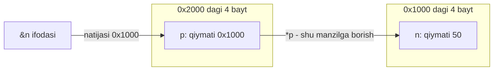

## Bu dars nima uchun kerak

Oldingi darslarda pointer so'zi bir necha marta "keyinroq" degan va'da bilan uchradi. 11-darsda massivni funksiyaga uzatganda funksiya massivning o'zini emas, birinchi elementining manzilini olishini ko'rdik. 12-darsda `string` aslida `char *` ekanini va ikkita bir xil satrni `==` bilan solishtirish "har xil" deyishini ko'rdik. 13-darsda `argv[1]` argument berilmaganda `NULL` bo'lishini, 20-darsda esa `struct` funksiyaga to'liq nusxa sifatida ketishini ko'rdik. Bularning hammasi bitta g'oyaga tayanadi: xotiradagi har bir baytning raqami (manzili) bor, va C dasturi shu raqamlar bilan to'g'ridan-to'g'ri ishlay oladi.

Bu dars 3-modulni ochadi. Keyingi o'nta dars (dinamik xotira, stack va heap, fayllar, linked list, daraxtlar, hash table) pointer'siz yozib bo'lmaydi. Shuning uchun bu yerda faqat sintaksisni emas, mexanikani o'rganamiz: pointer xotirada qayerda turadi, necha bayt oladi, `*` bosilganda protsessor nima qiladi, va nega noto'g'ri pointer dasturni jim buzadi yoki yiqitadi.

Bu darsdan keyin siz:

- xotirani raqamlangan baytlar ketma-ketligi sifatida tasavvur qilib, ko'p baytli qiymatning har bir baytini manzili bilan ko'rsata olasiz;
- `&` operatori bilan manzil olish va uni `%p` bilan chop etishni bilasiz;
- `int *p` e'lonini o'qiy olasiz va `*p` bilan qiymatni o'qish va o'zgartirishni bilasiz;
- pointer o'lchami nimaga bog'liqligini (brauzerda 4 bayt, 64-bit tizimda 8 bayt) hisob bilan tushuntira olasiz;
- `NULL` nima ekanini, uni dereference qilish nima uchun xato ekanini va initsializatsiya qilinmagan pointer undan ham xavfliroq ekanini bilasiz;
- massiv nomi va pointer o'rtasidagi o'xshashlik va farqni (`sizeof`, o'zlashtirish) aniq ayta olasiz;
- `string` nima uchun `char *` ekanini va `printf("%s")` unga qanday ishlashini tushuntira olasiz.

## Xotira: raqamlangan baytlar

Operativ xotirani (RAM) uzun bir qator kataklar deb tasavvur qiling. Har bir katak - bitta bayt (8 bit, 2-dars), va har bir katakning o'z tartib raqami bor. Shu raqam **manzil** (address) deyiladi. Manzillar 0 dan boshlanadi va ketma-ket oshib boradi: 0, 1, 2, 3, ... Dasturdagi har bir o'zgaruvchi shu qatorning qaysidir joyini egallaydi.

Bitta `char` bitta katakni oladi. `int` esa 4 bayt (6-dars), ya'ni yonma-yon 4 ta katakni. Bunday ko'p baytli qiymatning manzili deganda uning **birinchi** (eng kichik raqamli) baytining manzili tushuniladi. Masalan, `int n` 1000-1003 baytlarni egallasa, `n` ning manzili 1000.

Manzillar odatda o'n oltilik (hex) sanoqda yoziladi. 2-darsda ko'rganimizdek, bitta hex raqam 4 bitni ifodalaydi, shuning uchun 32 bitli manzil 8 ta hex raqamga, 64 bitli manzil 16 ta hex raqamga sig'adi. `0x7ffec09a7dac` dagi `0x` - "bu hex son" degan prefiks. Manzilni o'nlikda yozish ham mumkin edi, lekin hex da bayt chegaralari ko'rinib turadi: oxirgi ikki raqam - oxirgi bayt.

Bu modelni haqiqiy xotirada tekshiramiz. Quyidagi dastur bitta `int` ni oladi va uning 4 ta baytini alohida-alohida, manzili bilan chiqaradi. Hozircha `(unsigned char *)` yozuviga e'tibor bermang: u "shu manzilga baytlar qatori deb qara" degani, pastda tushuntiriladi.

```c run
#include <stdio.h>

int main(void)
{
    int n = 0x12345678;
    unsigned char *b = (unsigned char *) &n;

    for (int i = 0; i < (int) sizeof(n); i++)
    {
        printf("manzil %p  bayt %d: 0x%02x\n", (void *) (b + i), i, b[i]);
    }
}
```

Linux x86-64 da natija (manzillar har ishga tushirishda boshqacha):

```text
manzil 0x7ffebe5e5118  bayt 0: 0x78
manzil 0x7ffebe5e5119  bayt 1: 0x56
manzil 0x7ffebe5e511a  bayt 2: 0x34
manzil 0x7ffebe5e511b  bayt 3: 0x12
```

Ikki kuzatish:

1. **Manzillar ketma-ket**: ...118, ...119, ...11a, ...11b. Har qadam 1 bayt. `int` ning 4 bayti xotirada orasiz turadi.
2. **Baytlar teskari tartibda**: `0x12345678` sonining eng kichik bayti (`0x78`) eng kichik manzilda turibdi. Bu tartib **little-endian** deyiladi. x86-64 va WebAssembly ikkalasi ham little-endian, shuning uchun brauzerda ham bayt ustuni aynan shunday chiqadi, faqat manzillar qisqaroq (pastda). Ba'zi boshqa arxitekturalarda (big-endian) tartib teskari bo'ladi. Odatiy C kodida buni sezmaysiz: `n` ni `int` sifatida o'qisangiz, protsessor baytlarni o'zi to'g'ri yig'adi. Farq faqat baytlarga alohida qaraganda yoki 26-darsdagi binary fayllarda ko'rinadi.

## & operatori va %p

Har qanday o'zgaruvchining manzilini **address-of** operatori `&` beradi (o'zbekchasiga: manzil operatori). `&n` - "n qayerda turibdi?" savolining javobi. cppreference bo'yicha `&` ning natijasi operand tipiga ko'rsatkich: `n` ning tipi `int` bo'lsa, `&n` ning tipi `int *`.

Manzilni chop etish uchun `printf` da `%p` format belgisi bor. cppreference `printf` sahifasiga ko'ra `%p` argumenti `void *` bo'lishi kerak va natija ko'rinishi implementatsiyaga bog'liq. Amalda Linux va brauzer muhiti uni `0x` bilan boshlanadigan hex son sifatida chiqaradi. Argumentni `(void *)` ga aylantirish shart: `int *` ni to'g'ridan-to'g'ri bersangiz, clang `-Wformat-pedantic` bilan "format specifies type 'void *' but the argument has type 'int *'" deb ogohlantiradi. `void *` - tipi aytilmagan, "shunchaki manzil" ma'nosidagi pointer (void pointer); u keyingi darslarda `malloc` bilan qayta uchraydi.

Manzilni `%d` yoki `%i` bilan chop etish esa xato: manzil 64-bit tizimda 8 bayt, `int` esa 4 bayt, va clang `-Wformat` bilan ogohlantiradi.

## Pointer: manzilni saqlaydigan o'zgaruvchi

Manzil - shunchaki son. Uni saqlash uchun o'zgaruvchi kerak, va bunday o'zgaruvchi **pointer** (ko'rsatkich) deyiladi. E'lon qilish:

```c
int n = 50;
int *p = &n;
```

`int *p` ni o'ngdan chapga o'qing: "`p` - `int` ga ko'rsatkich". `*` bu yerda e'lonning bir qismi: u "p ning o'zi int emas, int turgan joyning manzili" deydi. `p` ga `&n` yozildi, endi `p` ning ichida `n` ning manzili turibdi. Odatda buni "p n ga ko'rsatyapti" (p points to n) deyiladi.

Pointer ham oddiy o'zgaruvchi: u xotirada o'z joyini egallaydi va o'z manziliga ega. Farqi - uning qiymati boshqa joyning manzili. Buni chizib ko'ramiz. Faraz qilaylik, `n` 0x1000 manzilda, `p` esa 0x2000 manzilda turibdi (raqamlar model uchun tanlangan):



Strelka - pointerni chizishning an'anaviy usuli, lekin xotirada strelka yo'q: `p` ning 4 baytida shunchaki 0x1000 soni yozilgan. "Strelka bo'ylab yurish" - bu shu sonni manzil sifatida ishlatib, u yerdagi qiymatni o'qish.

### Dereference: *p

Pointer orqali qiymatga murojaat qilish **dereference** deyiladi va `*` operatori bilan yoziladi. Shu belgining ikki xil ma'nosi chalkashtiradi:

| Qayerda | Yozuv | Ma'nosi |
|---|---|---|
| E'londa | `int *p;` | `p` - int ga ko'rsatkich |
| Ifodada | `*p` | `p` ko'rsatgan joydagi int qiymat |
| Ifodada | `&n` | `n` ning manzili |
| Ifodada | `a * b` | oddiy ko'paytirish |

`&` va `*` bir-biriga teskari: `&` qiymatdan manzilga o'tadi, `*` manzildan qiymatga qaytadi. Shuning uchun `*&n` bu `n` ning o'zi. cppreference ham dereference operatorini shunday ta'riflaydi: natija pointer ko'rsatgan obyektni bildiradi va unga yozish ham mumkin.

`*p` faqat o'qish uchun emas. `*p = 73;` - "p ko'rsatgan joyga 73 yoz". `n` nomini ishlatmasdan `n` ni o'zgartiramiz:

```c run
#include <stdio.h>

int main(void)
{
    int n = 50;
    int *p = &n;

    printf("n qiymati:    %d\n", n);
    printf("n manzili:    %p\n", (void *) &n);
    printf("p qiymati:    %p\n", (void *) p);
    printf("*p qiymati:   %d\n", *p);

    *p = 73;
    printf("*p = 73 dan keyin n = %d\n", n);
}
```

Linux x86-64 da natija:

```text
n qiymati:    50
n manzili:    0x7ffec09a7dac
p qiymati:    0x7ffec09a7dac
*p qiymati:   50
*p = 73 dan keyin n = 73
```

2- va 3-qatorlar bir xil: `p` ning ichida aynan `n` ning manzili. Brauzerda manzil qisqaroq son bo'ladi (32 bit, 8 tagacha hex raqam), qolgan qatorlar bir xil. `n` ni boshqa songa, `*p = 73` ni `*p = *p * 2` ga o'zgartirib ko'ring.

Nega bu kerak, agar `n = 73` deb yozsa bo'lsa? Chunki pointer `n` nomi ko'rinmaydigan joyda ham ishlaydi. 8-darsda ko'rganimizdek, funksiya argumentning nusxasini oladi va chaqiruvchining o'zgaruvchisini o'zgartira olmaydi. Agar funksiyaga `n` ning qiymatini emas, manzilini bersak, funksiya `*p = ...` bilan chaqiruvchining `n` iga yoza oladi. `swap` va `scanf` aynan shunday ishlaydi, bu 25-darsda batafsil. 11-darsda massivni funksiya ichida o'zgartira olganimizning sababi ham shu: massiv manzil sifatida uzatilgan edi.

### Pointer tipi nima uchun kerak

Manzil - shunchaki son bo'lsa, nega `int *`, `char *`, `double *` alohida tiplar? Chunki manzil faqat **boshlanish** joyini aytadi. `*p` ni bajarish uchun kompilyator yana ikki narsani bilishi kerak: nechta bayt o'qish kerak va ularni qanday talqin qilish kerak. `int *` uchun - 4 bayt, butun son sifatida. `double *` uchun - 8 bayt, IEEE 754 kasr soni sifatida (7-dars). `char *` uchun - 1 bayt.

Yuqoridagi baytlar dasturida aynan shundan foydalandik: `n` ning manzilini `unsigned char *` ga aylantirdik, va `b[i]` endi 4 baytli int emas, bitta baytni o'qidi. Manzil bir xil, tip boshqa, natija boshqa. Bu - **type casting** (6-dars) ning pointer shakli. Har qanday obyektning baytlarini `unsigned char *` orqali o'qishga C standarti ruxsat beradi; boshqa tipga aylantirib o'qish esa ko'p hollarda undefined behavior, shuning uchun bu usulni faqat baytlarni ko'rish uchun ishlating.

## Pointer o'lchami: 4 bayt yoki 8 bayt

Pointer o'zi necha bayt oladi? Bu u ko'rsatayotgan tipga bog'liq emas: `char *` ham, `double *` ham bir xil o'lchamda, chunki ikkalasi ham faqat manzil saqlaydi. O'lcham **platformaga** bog'liq: manzil qancha bitli bo'lsa, pointer shuncha joy oladi.

| Platforma | Manzil | `sizeof(int *)` | Manzillar soni |
|---|---|---|---|
| Kursning brauzer muhiti (wasm32) | 32 bit | 4 bayt | 2³² = 4 294 967 296 bayt = 4 GiB |
| Linux / macOS x86-64 yoki ARM64 | 64 bit | 8 bayt | 2⁶⁴ (amalda protsessor 48 yoki 57 bitdan foydalanadi) |

32 bitli manzil bilan ko'pi bilan 2³² bayt = 4 GiB xotirani raqamlash mumkin. Shuning uchun 32-bitli tizimlarda dastur 4 GiB dan ortiq xotiraga yeta olmasdi va 64-bitga o'tildi. 6-darsda ko'rgan **data model** nomlari ham aynan shu farqni bildiradi: ILP32 - `int`, `long` va pointer 32 bit (brauzer muhiti), LP64 - `long` va pointer 64 bit, `int` 32 bit (Linux, macOS).

```c run
#include <stdio.h>

int main(void)
{
    printf("sizeof(char)     = %zu   sizeof(char *)   = %zu\n", sizeof(char), sizeof(char *));
    printf("sizeof(int)      = %zu   sizeof(int *)    = %zu\n", sizeof(int), sizeof(int *));
    printf("sizeof(double)   = %zu   sizeof(double *) = %zu\n", sizeof(double), sizeof(double *));
    printf("sizeof(long)     = %zu   sizeof(size_t)   = %zu\n", sizeof(long), sizeof(size_t));
}
```

Brauzer muhitida (wasm32) natija:

```text
sizeof(char)     = 1   sizeof(char *)   = 4
sizeof(int)      = 4   sizeof(int *)    = 4
sizeof(double)   = 8   sizeof(double *) = 4
sizeof(long)     = 4   sizeof(size_t)   = 4
```

Linux x86-64 da esa o'ng ustundagi har bir qiymat va `sizeof(long)` 8 bo'ladi:

```text
sizeof(char)     = 1   sizeof(char *)   = 8
sizeof(int)      = 4   sizeof(int *)    = 8
sizeof(double)   = 8   sizeof(double *) = 8
sizeof(long)     = 8   sizeof(size_t)   = 8
```

Ikki xulosa. Birinchidan, chap ustun (ko'rsatilgan tip) ikkala platformada bir xil, o'ng ustun (pointer) esa faqat platformaga bog'liq. Ikkinchidan, `double *` (4 yoki 8 bayt) ko'pincha `double` dan (8 bayt) kichik yoki teng: katta struct'ni funksiyaga nusxa sifatida emas, pointer sifatida uzatish arzonroq bo'lishining sababi shu. 20-darsdagi 40 baytli `struct` ni uzatish 40 bayt nusxalaydi, unga pointer esa 4 yoki 8 bayt.

Amaliy hisob: `string words[100]` massivi brauzerda 100 · 4 = 400 bayt, x86-64 da 100 · 8 = 800 bayt egallaydi - so'zlarning o'zi bunga kirmaydi, ular boshqa joyda. Pointerlar ko'p ishlatiladigan tuzilmalarda (28-darsdagi linked list) 64-bit tizimda xotira sarfi sezilarli oshishi shundan.

## NULL: hech qayerga ko'rsatmaydigan pointer

Ba'zan pointer hali hech narsaga ko'rsatmasligi kerak: masalan, qidiruv natija topmadi yoki xotira hali ajratilmadi. Buning uchun maxsus qiymat bor: **null pointer**. C da u `NULL` makrosi bilan yoziladi (`stdio.h`, `stdlib.h`, `string.h` va boshqa sarlavhalarda e'lon qilingan). cppreference bo'yicha `NULL` - implementatsiya belgilaydigan null pointer konstantasi: qiymati 0 bo'lgan butun son ifodasi yoki uning `void *` ga aylantirilgani; POSIX tizimlarida aynan `((void *) 0)`. C23 da bunga `nullptr` kalit so'zi qo'shildi, lekin CS50 va bu kurs `NULL` ishlatadi.

Null pointer kafolatlangan holda hech qanday haqiqiy obyektga teng emas. Shuning uchun u "manzil yo'q" signali sifatida ishlatiladi: 13-darsda argument berilmaganda `argv[1]` `NULL` edi, 23-darsda `malloc` xotira ajrata olmasa `NULL` qaytaradi, 26-darsda `fopen` fayl ochilmasa `NULL` qaytaradi. Har safar qoida bir xil: **pointerni ishlatishdan oldin NULL emasligini tekshiring.**

```c
if (p != NULL)
{
    printf("%d\n", *p);
}
```

`if (p)` qisqa yozuvi ham bir xil ishlaydi: null pointer shartda yolg'on hisoblanadi.

### NULL ni dereference qilish

NULL ko'rsatgan joyda hech qanday obyekt yo'q, shuning uchun `*p` ning ma'nosi yo'q. C standarti bo'yicha null pointerni dereference qilish undefined behavior. Amalda oddiy Linux tizimida 0 manzil atrofidagi xotira dasturga berilmaydi, va murojaat qilinganda operatsion tizim dasturni **segmentation fault** (segfault) bilan to'xtatadi: dastur "Segmentation fault" xabari bilan yiqiladi va 13-darsda ko'rganimizdek exit status 139 bo'ladi.

Endi ataylab xato qilamiz. Quyidagi dastur NULL ni dereference qiladi:

```c run
#include <stdio.h>

int main(void)
{
    int *p = NULL;
    printf("p = %p\n", (void *) p);
    printf("*p = %d\n", *p);
}
```

Kursning brauzer muhitida birinchi qator `p = 0` bo'lib chiqadi (bu muhitning `printf` i NULL ni `%p` da shunchaki `0` deb yozadi), ikkinchisida esa dastur to'xtaydi. Hisobot shunday boshlanadi:

```text
XOTIRA XATOSI: NULL yoki noto'g'ri ko'rsatkich orqali murojaat
O'qish: 4 bayt, manzil 0x0
```

va undan keyin `*p` turgan qator va ustun ko'rsatiladi. "4 bayt" - chunki `p` ning tipi `int *`, `*p` esa 4 baytli int o'qishga urinish. Brauzer muhiti 0 manzil atrofini taqiqlangan zona sifatida belgilab qo'ygan, shuning uchun murojaat aniq qatorda ushlanadi. Linux da xuddi shu dastur `p = (nil)` (glibc NULL ni `%p` da shunday chiqaradi) va keyin "Segmentation fault" chiqaradi, qaysi qatorda ekanini esa aytmaydi.

Muhim nozik nuqta: undefined behavior bo'lgani uchun optimizatsiyali kompilyator NULL tekshiruvini "keraksiz" deb olib tashlashi ham mumkin. Masalan, `*p` dan **keyin** yozilgan `if (p == NULL)` tekshiruvini kompilyator o'chirishga haqli, chunki to'g'ri dasturda `*p` bajarilgan bo'lsa, `p` NULL bo'lmagan. Shuning uchun tekshiruv har doim dereference dan **oldin** turishi kerak.

### Initsializatsiya qilinmagan pointer

NULL hech bo'lmasa aniq qiymat: uni tekshirish mumkin. Initsializatsiya qilinmagan pointer esa undan ham xavfliroq:

```c
int *p;      // qiymati noma'lum
*p = 50;     // noma'lum manzilga yozish
```

Funksiya ichidagi lokal o'zgaruvchi avtomatik tozalanmaydi (11-dars, garbage values). `p` ichida shu xotirada oldin nima bo'lgan bo'lsa, o'sha son turadi va `*p = 50` o'sha tasodifiy manzilga yozadi. Bunday pointer **wild pointer** ("yovvoyi" pointer) deyiladi. Uchta mumkin bo'lgan oqibat:

- tasodifiy manzil dasturga tegishli emas - segmentation fault (eng yaxshi holat, chunki xato ko'rinadi);
- tasodifiy manzil boshqa o'zgaruvchiga tushadi - u jim buziladi, xato esa butunlay boshqa joyda namoyon bo'ladi;
- tasodifan 0 bo'lib qolsa - NULL murojaati.

clang bu holatni sukut bo'yicha `-Wall` bilan ushlaydi:

```text
warning: variable 'p' is uninitialized when used here [-Wuninitialized]
note: initialize the variable 'p' to silence this warning
```

va hatto tuzatishni ham taklif qiladi: `= NULL`. Brauzer muhitida bunday dastur ko'pincha yuqoridagi "NULL yoki noto'g'ri ko'rsatkich orqali murojaat" hisoboti bilan to'xtaydi, lekin bu kafolat emas: agar tasodifiy qiymat ruxsat etilgan xotiraga tushsa, yozuv jim o'tadi. Qoida oddiy: **pointerni e'lon qilganda darhol initsializatsiya qiling** - haqiqiy manzil bilan yoki `NULL` bilan. Shunda uning holati har doim tekshirsa bo'ladigan ikki variantdan biri.

| Pointer holati | Qiymati | Tekshirsa bo'ladimi | `*p` natijasi |
|---|---|---|---|
| To'g'ri | mavjud obyekt manzili | ha | obyekt qiymati |
| Null pointer | `NULL` | ha, `p != NULL` | UB; Linux da segfault, brauzerda aniq hisobot |
| Wild pointer | noma'lum | yo'q | UB; segfault, jim buzilish yoki NULL murojaati |
| Obyekt yo'qolgan (dangling) | eski manzil | yo'q | UB; 23-24-darslarda |

Oxirgi qator keyingi darslar uchun: `free` qilingan xotiraga yoki tugagan funksiyaning lokal o'zgaruvchisiga ko'rsatayotgan pointer ham shu xavfli guruhga kiradi.

## Massiv nomi va pointer

11-darsda array decay ni ko'rdik: massiv nomi deyarli barcha ifodalarda birinchi elementining manziliga aylanadi. Endi buni pointer bilan aniq ko'ramiz:

```c run
#include <stdio.h>

int main(void)
{
    int a[5] = {10, 20, 30, 40, 50};
    int *p = a;

    printf("a        = %p\n", (void *) a);
    printf("&a[0]    = %p\n", (void *) &a[0]);
    printf("p        = %p\n", (void *) p);
    printf("&a       = %p\n", (void *) &a);
    printf("a == &a[0]: %d\n", a == &a[0]);

    printf("sizeof(a) = %zu, sizeof(p) = %zu\n", sizeof(a), sizeof(p));
    printf("p[3] = %d, a[3] = %d\n", p[3], a[3]);

    p[3] = 99;
    printf("p[3] = 99 dan keyin a[3] = %d\n", a[3]);
}
```

Brauzerda natija (manzillar o'rniga `0x...`, ular to'rt qatorda bir xil):

```text
a        = 0x...
&a[0]    = 0x...
p        = 0x...
&a       = 0x...
a == &a[0]: 1
sizeof(a) = 20, sizeof(p) = 4
p[3] = 40, a[3] = 40
p[3] = 99 dan keyin a[3] = 99
```

x86-64 da yagona farq: `sizeof(p) = 8`.

Bu natijadan nimani o'qiymiz:

1. `int *p = a;` - `&` siz yozildi va xato yo'q. Array decay: `a` ifodada `&a[0]` ga aylanadi.
2. `p[3]` ishlaydi. Indekslash aslida pointer amali: 11-darsda keltirilgan `E1[E2]` = `*((E1) + (E2))` ta'rifi bo'yicha. `p + 3` qanday hisoblanishi 22-darsning mavzusi.
3. `p[3] = 99` `a` ni o'zgartirdi. `p` nusxa emas, o'sha massivning boshiga ko'rsatkich.
4. **`sizeof` farq qiladi**: `sizeof(a)` = 5 · 4 = 20, chunki `sizeof` operandi decay istisnolaridan biri va u yerda `a` haqiqiy massiv. `sizeof(p)` esa pointerning o'lchami: 4 yoki 8. 11-darsda funksiya ichida `sizeof` ning "noto'g'ri" javobi aynan shu.
5. `&a` ham xuddi shu raqamni berdi, lekin uning tipi boshqa: `int (*)[5]`, "5 ta int lik massivga pointer". `&` ham decay istisnosi. Raqam bir xil bo'lsa-da, tip farqi 22-darsda pointer arifmetikasida ko'rinadi.

Massiv va pointer bir xil emas. Farqlarni jadvalda yig'amiz:

| Xususiyat | `int a[5]` | `int *p = a` |
|---|---|---|
| Nima saqlanadi | 5 ta int (20 bayt) | bitta manzil |
| `sizeof` | 20 | 4 (wasm32) yoki 8 (x86-64) |
| `&` natijasi tipi | `int (*)[5]` | `int **` |
| Boshqa joyga ko'rsatish | mumkin emas: `a = ...` kompilyatsiya xatosi | mumkin: `p = &n;` |
| `x[i]` yozuvi | ishlaydi | ishlaydi |
| Funksiya parametri `int x[]` | aslida `int *x` | `int *x` |

Ya'ni massiv nomini "o'zgarmas pointer" deb aytish ham to'liq to'g'ri emas: massiv nomi hech qanday pointer saqlamaydi, xotirada faqat elementlar bor. Kompilyator `a` ning manzilini biladi va kerak bo'lganda uni o'zi qo'yadi.

## string aslida char *

12-darsda `cs50.h` dagi bitta qatorni ko'rgan edik: `typedef char *string;`. Endi uning to'liq ma'nosini aytish mumkin. `string s = "HI!";` yozilganda:

- `"HI!"` string literal - 4 baytli `char[4]` massivi (oxirida NUL), u dastur xotirasining alohida qismida saqlanadi;
- `s` - bitta pointer (4 yoki 8 bayt), uning ichida o'sha massivning birinchi baytining manzili.

```c run
#include <cs50.h>
#include <stdio.h>

int main(void)
{
    string s = "HI!";
    char *t = s;

    printf("s       = %p\n", (void *) s);
    printf("&s[0]   = %p\n", (void *) &s[0]);
    printf("&s[1]   = %p\n", (void *) &s[1]);
    printf("&s      = %p\n", (void *) &s);
    printf("*s = %c, s[1] = %c, t = %s\n", *s, s[1], t);
    printf("sizeof(s) = %zu, sizeof(\"HI!\") = %zu\n", sizeof(s), sizeof("HI!"));
}
```

Linux x86-64 da natija:

```text
s       = 0x55f4e6378004
&s[0]   = 0x55f4e6378004
&s[1]   = 0x55f4e6378005
&s      = 0x7ffdfb751b08
*s = H, s[1] = I, t = HI!
sizeof(s) = 8, sizeof("HI!") = 4
```

Brauzerda `sizeof(s) = 4`, manzillar qisqaroq, qolgani bir xil.

Kuzatishlar:

- `s` va `&s[0]` bir xil: satr "o'zgaruvchisi" shunchaki birinchi harfning manzili. `&s[1]` bir bayt keyin: `char` 1 bayt.
- `&s` butunlay boshqa joyda (`0x7ffd...` va `0x55f4...`). `&s` - pointer o'zgaruvchisining o'z manzili (u funksiya ichidagi lokal o'zgaruvchi, stack da), `s` esa literal turgan joy (dasturning o'zgarmas ma'lumotlari orasida). Xotiraning bu qismlari 24-darsda ko'riladi.
- `*s` - `H`. Pointer `char *` bo'lgani uchun `*s` bitta baytni o'qiydi.
- `t = s` faqat manzilni nusxaladi: endi ikki pointer bitta satrga ko'rsatadi. Bu 22-darsda nusxa olish mavzusining boshlanishi.
- `sizeof(s)` - pointer o'lchami, satr uzunligi emas. Satr uzunligi uchun har doim `strlen`.

### printf("%s") pointer bilan qanday ishlaydi

`printf("%s", s)` ga satr emas, faqat manzil beriladi. `printf` shu manzildan boshlab baytlarni birma-bir chiqaradi va NUL (`'\0'`) ni ko'rganda to'xtaydi (12-dars). Boshqacha aytganda, `%s` ning ishi shu tsiklga teng: `*s` ni chiqar, keyingi baytga o't, `'\0'` gacha takrorla. Shuning uchun:

- `printf("%s", &s[1])` - `IH!` emas, `I!` chiqaradi: ikkinchi harfning manzilidan boshlab NUL gacha.
- `printf("%s", NULL)` - undefined behavior: manzil yo'q. 13-darsdagi `argv[1]` xatosi aynan shu.
- `printf("%s", s)` da `s` qayerdan kelgani (literal, massiv, `get_string`) ahamiyatsiz, faqat NUL bilan tugashi kerak.

`get_string` ham `string`, ya'ni `char *` qaytaradi: u kiritilgan matn uchun xotira ajratadi, harflarni u yerga yozadi va birinchi harfning manzilini beradi. 12-darsda ikki bir xil satr `==` bilan "har xil" chiqqanining to'liq izohi shu: ikki `get_string` chaqiruvi ikki xil joy ajratdi, `==` esa ikki manzilni solishtirdi. Xotirani qanday ajratish - 23-darsning mavzusi.

### JavaScript bilan taqqoslash

JavaScript da obyektlar "havola" (reference) orqali uzatiladi va bu C pointeriga o'xshaydi: `let b = a;` dan keyin ikkala nom bitta obyektga qaraydi. Lekin farqlar katta:

| Xususiyat | C pointer | JavaScript havolasi |
|---|---|---|
| Manzilni ko'rish | `%p` bilan, son sifatida | mumkin emas |
| Hech narsaga ko'rsatmaslik | `NULL`, dereference UB | `null`, xususiyatga murojaat `TypeError` beradi |
| Initsializatsiyasiz | noma'lum manzil (wild) | `undefined`, xavfsiz |
| Arifmetika | `p + 1` mumkin (22-dars) | yo'q |
| Obyekt o'chirilganda | pointer eski manzilni saqlaydi | garbage collector obyektni havola bor ekan saqlaydi |

JavaScript dagi `null.x` dasturni aniq xato bilan to'xtatadi va qaysi qatorda ekanini aytadi. C dagi `*NULL` esa Linux da faqat "Segmentation fault" deydi, wild pointer esa umuman hech narsa demasligi mumkin. Shu sababli bu kurs brauzer muhiti har bir xotira murojaatini tekshiradi.

### Mashq: xotira modeli

Pointer mexanikasini mustahkamlash uchun xotirani Python `bytearray` bilan modellashtiramiz: `mem[i]` - i-manzildagi bayt. 32-bitli muhitdagi kabi `int` ham, pointer ham 4 bayt, little-endian. Uchta funksiya yozing:

- `load_int(mem, addr)` - `addr` dan boshlanadigan 4 baytni little-endian butun son sifatida qaytaradi (eng kichik manzildagi bayt - eng kichik bayt; manfiy sonlarni hisobga olmang);
- `store_int(mem, addr, value)` - `value` ni (0 dan 2³² - 1 gacha) 4 baytga little-endian tartibda yozadi;
- `deref(mem, p)` - C dagi `*p` (bu yerda `p` - `int *`): agar `p` 0 (NULL) bo'lsa, `ValueError` ko'taradi, aks holda `load_int(mem, p)` ni qaytaradi.

Tayyor `int.from_bytes`, `to_bytes` va `struct` modulidan foydalanmang: baytlarni o'zingiz 256 ning darajalari bilan yig'ing va ajrating.

```python run
def load_int(mem, addr):
    # mem[addr] + mem[addr + 1] * 256 + ...
    return 0


def store_int(mem, addr, value):
    # value % 256 -> mem[addr], value // 256 % 256 -> mem[addr + 1], ...
    pass


def deref(mem, p):
    # NULL tekshiruvi, keyin load_int
    return 0


mem = bytearray(32)
store_int(mem, 8, 50)        # int n = 50;   n 8-manzilda
store_int(mem, 20, 8)        # int *p = &n;  p 20-manzilda, qiymati 8
p = load_int(mem, 20)
print("p =", p, " *p =", deref(mem, p))
```

```python test
check("load_int: 0x78 0x56 0x34 0x12 baytlari 0x12345678 beradi", lambda: load_int(bytearray([0x78, 0x56, 0x34, 0x12]), 0) == 0x12345678)
check("load_int: addr dan boshlab o'qiladi", lambda: load_int(bytearray([9, 9, 1, 0, 0, 0]), 2) == 1)
def _st():
    m = bytearray(8)
    store_int(m, 4, 0x12345678)
    return list(m) == [0, 0, 0, 0, 0x78, 0x56, 0x34, 0x12]
check("store_int: eng kichik bayt eng kichik manzilga yoziladi", _st)
def _round():
    m = bytearray(16)
    store_int(m, 3, 4000000000)
    return load_int(m, 3) == 4000000000
check("store_int va load_int: katta qiymat aynan qaytadi", _round)
def _chain():
    m = bytearray(32)
    store_int(m, 8, 50)
    store_int(m, 20, 8)
    return deref(m, load_int(m, 20)) == 50
check("deref: p = &n bo'lsa, *p = 50", _chain)
def _null():
    try:
        deref(bytearray(8), 0)
        return False
    except ValueError:
        return True
check("deref: NULL (0) uchun ValueError", _null)
```

## Ko'p uchraydigan xatolar

1. **Pointerni initsializatsiyasiz qoldirish.** `int *p;` va keyin `*p = ...` - noma'lum manzilga yozish. Doim `int *p = NULL;` yoki haqiqiy manzil bilan e'lon qiling.
2. **NULL tekshiruvini unutish yoki kech qo'yish.** `get_string`, `malloc`, `fopen` va `argv[i]` NULL bo'lishi mumkin. Tekshiruv dereference dan oldin bo'lishi kerak, keyin emas.
3. **E'londagi `*` va ifodadagi `*` ni adashtirish.** `int *p = &n;` da `*` - tip qismi, `p` ga manzil yoziladi. `*p = &n;` esa butunlay boshqa narsa: `p` ko'rsatgan int ga manzil yozishga urinish (kompilyator ogohlantiradi).
4. **Bir qatorda bir nechta pointer e'lon qilish.** `int *p, q;` da faqat `p` pointer, `q` oddiy `int`. Har biriga `*` kerak: `int *p, *q;`, yoki yaxshirog'i, har birini alohida qatorda.
5. **Manzilni `%d` yoki `%i` bilan chop etish.** Manzil uchun `%p` va `(void *)` aylantirish. 64-bit tizimda `%d` manzilning yarmini ko'rsatadi.
6. **`sizeof(p)` ni massiv yoki satr o'lchami deb o'ylash.** Pointer uchun `sizeof` 4 yoki 8 beradi. Satr uzunligi - `strlen`, massiv uzunligi - alohida o'zgaruvchi.
7. **Pointer o'lchamini 8 baytga "qattiq" bog'lash.** Hisobda `8` emas, `sizeof(char *)` yozing: brauzer muhitida bu 4.
8. **`string` ni qiymat deb o'ylash.** `string t = s;` nusxa emas, ikkinchi pointer. `t[0]` ni o'zgartirish `s` ni ham o'zgartiradi (agar o'zgartirish mumkin bo'lgan xotira bo'lsa).

## Xulosa

- Xotira - raqamlangan baytlar qatori; o'zgaruvchining manzili uning birinchi baytining raqami. Ko'p baytli qiymatlar x86-64 va WebAssembly da little-endian tartibda saqlanadi.
- `&n` - `n` ning manzili, `%p` va `(void *)` bilan hex ko'rinishda chop etiladi.
- Pointer - manzil saqlaydigan o'zgaruvchi. `int *p = &n;` dan keyin `*p` `n` ning o'zi: o'qish ham, yozish ham mumkin. Pointer tipi `*p` necha bayt o'qishini va qanday talqin qilishini belgilaydi.
- Pointer o'lchami ko'rsatilgan tipga emas, platformaga bog'liq: brauzer muhitida (wasm32, ILP32) 4 bayt, Linux x86-64 da (LP64) 8 bayt.
- `NULL` - "manzil yo'q" signali; uni dereference qilish UB (Linux da segfault, brauzerda "NULL yoki noto'g'ri ko'rsatkich orqali murojaat"). Initsializatsiya qilinmagan (wild) pointer bundan ham xavfli, chunki uni tekshirib bo'lmaydi.
- Massiv nomi ifodada birinchi elementga pointerga aylanadi, shuning uchun `p = a` va `p[i]` ishlaydi; lekin massiv pointer emas: `sizeof(a)` butun massiv, `a = ...` mumkin emas.
- `string` - `char *`: birinchi harfning manzili. `printf("%s")` shu manzildan NUL gacha o'qiydi, `==` esa manzillarni solishtiradi.

## Amaliy topshiriq

Pointerlar bilan "xotira inspektori" dasturini yozing. Dastur bir nechta o'zgaruvchining manzili va baytlarini ko'rsatadi va pointer orqali qiymatlarni o'zgartiradi.

Topshiriq qadamlari:

1. **O'zgaruvchilar va manzillar.** `main` ichida `char c = 'A';`, `int n = 2026;`, `double d = 0.5;` va `int a[3] = {1, 2, 3};` e'lon qiling. Har birining manzilini `%p` bilan, o'lchamini `sizeof` bilan chiqaring.
2. **Pointerlar.** Har biri uchun mos tipdagi pointer e'lon qiling (`char *pc`, `int *pn`, `double *pd`, `int *pa`) va `&` bilan initsializatsiya qiling (massiv uchun `&` siz). Har bir pointerning o'z o'lchamini chiqaring va natijani brauzerda va (imkoni bo'lsa) 64-bit kompyuterda solishtiring.
3. **Pointer orqali yozish.** Faqat pointerlar orqali (`*pc`, `*pn`, `*pd`, `pa[1]`) qiymatlarni o'zgartiring: `c` ni `'Z'` ga, `n` ni ikki baravar, `d` ni 1.5 ga, `a[1]` ni 20 ga. Keyin asl o'zgaruvchilarni nomi bilan chop etib, o'zgarganini ko'rsating.
4. **Baytlar.** `void dump(const void *addr, int size)` funksiyasini yozing: u `addr` ni `const unsigned char *` ga aylantirib, `size` ta baytni hex da (`%02x`) chiqaradi. `dump(&n, sizeof(n))` natijasini qo'lda tekshiring: 4052 o'nlikda nechaga teng va baytlar qaysi tartibda chiqdi?
5. **NULL bilan ishlash.** `int *find(int a[], int length, int target)` funksiyasini yozing: massivdan `target` ni qidiradi va topilsa o'sha elementning manzilini, topilmasa `NULL` qaytaradi. `main` da natijani NULL ga tekshirib, topilsa `*result = 0` bilan elementni nolga tenglashtiring.
6. **Ataylab xato.** 5-qadamdagi NULL tekshiruvini olib tashlang va mavjud bo'lmagan qiymatni qidiring. Brauzerda chiqqan hisobotning birinchi ikki qatorini ko'chiring va "nechta bayt" qismini pointer tipi bilan izohlang. Keyin tekshiruvni qaytaring.

Boshlang'ich shablon:

```c run
#include <stdio.h>

int *find(int a[], int length, int target);

int main(void)
{
    char c = 'A';
    int n = 2026;
    double d = 0.5;
    int a[3] = {1, 2, 3};

    printf("c: manzil %p, sizeof %zu\n", (void *) &c, sizeof(c));
    printf("n: %d, d: %.1f, a[1]: %d\n", n, d, a[1]);
    // 1-3-qadamlar: qolgan manzillar va pointerlar

    int *result = find(a, 3, 2);
    printf("find natijasi: %p\n", (void *) result);
    // 5-qadam: NULL tekshiruvi va *result = 0
}

// target topilsa elementning manzili, topilmasa NULL
int *find(int a[], int length, int target)
{
    // Yechimingizni shu yerga yozing
    return NULL;
}
```

Yaxshi javobda bo'lishi kerak bo'lgan narsalar:

- hamma manzillar `%p` va `(void *)` bilan chop etilgan, `%d` bilan emas;
- pointerlar o'lchami brauzerda 4, x86-64 da 8, ko'rsatilgan tipdan qat'i nazar, va buning sababi (manzil bit kengligi, ILP32 va LP64) yozilgan;
- 3-qadamda o'zgaruvchilar nomi ishlatilmagan, faqat pointerlar, va natija asl o'zgaruvchilarda ko'ringan;
- 4052 = 0x00000FD4, baytlar `d4 0f 00 00` tartibida chiqqan va bu little-endian deb izohlangan;
- `find` NULL ni topilmagan holat uchun qaytaradi, `main` dereference dan oldin tekshiradi;
- 6-qadamdagi hisobot keltirilgan: "NULL yoki noto'g'ri ko'rsatkich orqali murojaat" va 4 baytli yozish (`int` o'lchami).

Javobingizni pastdagi maydonga yozing va yuqoridagi mezonlar bilan solishtiring.

## Manbalar

- CS50x. [Lecture 4 notes](https://cs50.harvard.edu/x/notes/4/) - "Pointers" va "Strings" bo'limlari: `&`, `*`, `%p`, pointer o'lchami, `string` ning `char *` ekani.
- cppreference. [Pointer declaration](https://en.cppreference.com/w/c/language/pointer) - pointer e'loni, null pointerlar, `void` ga pointer, massivga pointer.
- cppreference. [Member access operators](https://en.cppreference.com/w/c/language/operator_member_access) - "Dereference" va "Address of" bo'limlari, `E1[E2]` ning `*((E1)+(E2))` ga tengligi.
- cppreference. [NULL](https://en.cppreference.com/w/c/types/NULL) - null pointer konstantasi, implementatsiyaga bog'liq ta'rifi.
- cppreference. [printf, fprintf, sprintf, snprintf](https://en.cppreference.com/w/c/io/fprintf) - `%p` konversiyasi va uning `void *` argumenti.
- cppreference. [Array declaration](https://en.cppreference.com/w/c/language/array) - "Array to pointer conversion" va uning istisnolari (`sizeof`, `&`).
- CS50. [libcs50 cs50.h](https://github.com/cs50/libcs50/blob/main/src/cs50.h) - `typedef char *string;` ta'rifi.
- Clang. [Diagnostic flags in Clang](https://clang.llvm.org/docs/DiagnosticsReference.html) - `-Wuninitialized` va `-Wformat-pedantic` ogohlantirishlari.
