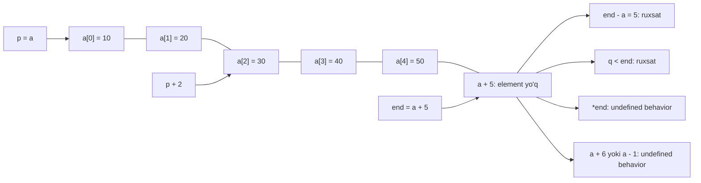

## Bu dars nima uchun kerak

21-darsda pointer - manzil saqlaydigan o'zgaruvchi ekanini, `&` manzil olishini, `*` esa manzildagi qiymatga borishini ko'rdik. Lekin bitta savol ochiq qoldi: `p[3]` qanday ishlaydi, agar `p` faqat bitta manzil bo'lsa? 11-darsda formulani ko'rgan edik: `E1[E2]` aslida `*((E1) + (E2))`. Demak indekslash - pointerga son qo'shish va natijani dereference qilish. Bu darsda shu qo'shish amalini, ya'ni **pointer arifmetikasini** to'liq ochamiz.

Pointer arifmetikasi C dagi satrlar bilan ishlashning asosi. `strlen`, `strcpy`, `strchr` kabi standart funksiyalar ichida indeks emas, pointer yuradi. 12-darsda satrni indeks bilan aylangan edik, bu yerda xuddi shu ishni pointer bilan qilamiz va ikkalasi aslida bir xil ekanini ko'ramiz. Keyin satrni nusxalash muammosiga qaytamiz: `s = t` nima uchun nusxa emas va haqiqiy nusxa uchun nima kerak. Bu 23-darsdagi `malloc` ga to'g'ridan-to'g'ri ko'prik.

Bu darsdan keyin siz:

- `p + 1` necha bayt siljishini pointer tipidan hisoblay olasiz;
- `a[i]`, `*(a + i)` va `p[i]` bir xil ekanini isbotlay olasiz;
- ikki pointer ayirmasi nimani bildirishini, uning tipi `ptrdiff_t` ekanini va qachon ma'noli ekanini bilasiz;
- massiv oxiridan keyingi (one-past-the-end) pointer qachon ruxsat etilgan va qachon xato ekanini ajrata olasiz;
- satrni `char *` bilan aylanib, `strlen` va belgi qidiruvini pointerlar bilan yoza olasiz;
- `s = t` faqat manzilni nusxalashini va haqiqiy nusxa uchun alohida xotira kerakligini tushuntira olasiz;
- string literalni o'zgartirish nima uchun undefined behavior ekanini va `const char *` bundan qanday himoya qilishini bilasiz;
- `sizeof` va `strlen` qachon nimani qaytarishini oldindan ayta olasiz.

## p + 1: tip o'lchamiga qarab siljish

Pointerga butun son qo'shish mumkin. Lekin `p + 1` "manzilga 1 qo'sh" degani emas, "**keyingi elementga** o't" degani. Agar `p` `int *` bo'lsa, keyingi `int` 4 bayt keyin turadi, shuning uchun manzil 4 ga oshadi. cppreference arithmetic operators sahifasida qoida shunday: `p` massivning i-elementiga ko'rsatsa, `p + n` (i + n)-elementga ko'rsatadi.

Formula:

manzil(p + n) = manzil(p) + n · sizeof(*p)

Bu 11-darsdagi base + i · sizeof(element) formulasining o'zi, faqat endi u alohida o'zgaruvchida saqlanadigan pointer uchun yozilgan. Uchta tip uchun tekshiramiz. Dastur manzillarning o'zini emas, boshidan necha bayt siljiganini chiqaradi, shuning uchun natija brauzerda ham, 64-bit kompyuterda ham bir xil:

```c run
#include <stdio.h>

int main(void)
{
    char c[4];
    int n[4];
    double d[4];

    char *pc = c;
    int *pn = n;
    double *pd = d;

    for (int i = 0; i < 4; i++)
    {
        printf("i = %d:  pc + i: +%2ld bayt   pn + i: +%2ld bayt   pd + i: +%2ld bayt\n", i,
               (long) ((char *) (pc + i) - (char *) pc),
               (long) ((char *) (pn + i) - (char *) pn),
               (long) ((char *) (pd + i) - (char *) pd));
    }
}
```

Natija:

```text
i = 0:  pc + i: + 0 bayt   pn + i: + 0 bayt   pd + i: + 0 bayt
i = 1:  pc + i: + 1 bayt   pn + i: + 4 bayt   pd + i: + 8 bayt
i = 2:  pc + i: + 2 bayt   pn + i: + 8 bayt   pd + i: +16 bayt
i = 3:  pc + i: + 3 bayt   pn + i: +12 bayt   pd + i: +24 bayt
```

Har ustun o'z formulasi bilan: `char` uchun i · 1, `int` uchun i · 4, `double` uchun i · 8. Baytlar farqini olish uchun ikkala pointerni `(char *)` ga aylantirdik: `char *` ayirmasi baytlarda o'lchanadi, chunki `sizeof(char)` = 1. Pointer arifmetikasi uchun pointer tipi nima uchun kerakligi shu yerda ko'rinadi: kompilyator `pn + 1` ni hisoblash uchun 4 ni, `pd + 1` uchun 8 ni bilishi shart. 21-darsda tip `*p` necha bayt o'qishini belgilagan edi, endi u `p + 1` necha bayt siljishini ham belgilaydi.

`void *` uchun arifmetika standart C da yo'q: `void` ning o'lchami yo'q, demak "keyingi element" ham aniqlanmagan. gcc va clang buni kengaytma sifatida 1 bayt deb hisoblaydi, lekin bunga tayanmang - baytlar bo'yicha yurish kerak bo'lsa, `char *` yoki `unsigned char *` ishlating.

### &a + 1: butun massivga sakrash

21-darsda `a` va `&a` bir xil raqam berishini, lekin tiplari har xil ekanini aytgan edik. Endi farq ko'rinadi:

```c run
#include <stdio.h>

int main(void)
{
    int a[5] = {10, 20, 30, 40, 50};

    printf("a      = %p\n", (void *) a);
    printf("a + 1  = %p\n", (void *) (a + 1));
    printf("&a     = %p\n", (void *) &a);
    printf("&a + 1 = %p\n", (void *) (&a + 1));
    printf("farqlar: %td bayt va %td bayt\n", (char *) (a + 1) - (char *) a, (char *) (&a + 1) - (char *) &a);
}
```

Natijaning oxirgi qatori ikkala platformada bir xil:

```text
farqlar: 4 bayt va 20 bayt
```

`a` ifodada `int *` ga aylanadi va `a + 1` bitta `int` ga (4 bayt) siljiydi. `&a` esa `int (*)[5]` - "5 ta int lik massivga pointer", uning elementi butun massiv (5 · 4 = 20 bayt), shuning uchun `&a + 1` 20 bayt siljiydi va massiv tugagan joyga tushadi. Formula bir xil, faqat `sizeof(*p)` boshqa.

## a[i] == *(a + i)

Endi indekslashning to'liq izohini yozish mumkin. `a[i]` ni kompilyator shunday tushunadi:

1. `a` ifodada birinchi element manziliga aylanadi (array decay, 11-dars);
2. unga `i` qo'shiladi: manzil i · sizeof(int) bayt oshadi;
3. natija dereference qilinadi.

Ya'ni `a[i]` - `*(a + i)` ning qisqa yozuvi. Qo'shish o'rin almashtirish xususiyatiga ega bo'lgani uchun `*(a + i)` = `*(i + a)`, demak `i[a]` ham xuddi shu elementni beradi. Bu yozuvni hech qachon ishlatmang, lekin u qoidaning aynan shunday ishlashini isbotlaydi.

```c run
#include <stdio.h>

int main(void)
{
    int a[5] = {10, 20, 30, 40, 50};
    int *p = a + 1;

    printf("a[3] = %d, *(a + 3) = %d, 3[a] = %d\n", a[3], *(a + 3), 3[a]);
    printf("p[0] = %d, p[2] = %d, p[-1] = %d\n", p[0], p[2], p[-1]);
    printf("*p + 1 = %d, *(p + 1) = %d\n", *p + 1, *(p + 1));

    int *end = a + 5;
    int sum = 0;
    for (int *q = a; q < end; q++)
    {
        sum += *q;
    }
    printf("yig'indi = %d, elementlar soni = %td\n", sum, end - a);
}
```

Natija:

```text
a[3] = 40, *(a + 3) = 40, 3[a] = 40
p[0] = 20, p[2] = 40, p[-1] = 10
*p + 1 = 21, *(p + 1) = 30
yig'indi = 150, elementlar soni = 5
```

Kuzatishlar:

- `p = a + 1` massiv o'rtasiga ko'rsatadi, va `p[0]` endi `a[1]`. Indeks pointerga nisbatan hisoblanadi, massiv boshiga nisbatan emas. Shu sababli `p[-1]` ham to'g'ri: u `a[0]`, chunki `p - 1` hali massiv ichida.
- **Qavslar muhim.** `*p + 1` - "p dagi qiymatga 1 qo'sh" (20 + 1 = 21), `*(p + 1)` - "keyingi elementning qiymati" (30). `*` qo'shishdan kuchliroq bog'lanadi.
- Siklni indekssiz, faqat pointerlar bilan yozish mumkin: `q` boshidan `end` gacha yuradi. Bu uslub C standart kutubxonasida keng tarqalgan.

### *p++: operatorlar ustuvorligi

Pointer sikllarida ko'p uchraydigan ifoda - `*p++`. cppreference operatorlar ustuvorligi jadvalida postfiks `++` eng yuqori guruhda, `*` esa undan keyingi guruhda turadi. Demak `*p++` = `*(p++)`: `p` ning eski qiymati dereference qilinadi, keyin `p` keyingi elementga o'tadi. Qiymatni emas, pointerni oshiradi.

| Ifoda | Nima o'qiladi | Nima o'zgaradi |
|---|---|---|
| `*p++` | `p` dagi qiymat | `p` keyingi elementga o'tadi |
| `(*p)++` | `p` dagi qiymat | qiymat 1 ga oshadi, `p` joyida |
| `*++p` | keyingi elementdagi qiymat | `p` avval oshadi |
| `++*p` | oshirilgan qiymat | qiymat 1 ga oshadi |

Agar jadvalni eslab qolish qiyin bo'lsa, qavs qo'ying. O'qilishi oson kod qisqa koddan qimmatroq.

## Pointer ayirmasi va massiv chegaralari

Ikki pointerni ayirish mumkin, agar ular **bitta massiv** ichiga ko'rsatsa. Natija - ular orasidagi elementlar soni (baytlar emas). cppreference bo'yicha: `P1` i-elementga, `P2` j-elementga ko'rsatsa, `P1 - P2` = i - j, natija tipi esa **`ptrdiff_t`** - `stddef.h` da e'lon qilingan ishorali butun son tipi. Ishorali, chunki ayirma manfiy ham bo'lishi mumkin. `printf` da u `%td` bilan chiqariladi (`t` - ptrdiff_t uchun uzunlik modifikatori, `z` esa `size_t` uchun edi).

Yuqoridagi dasturda `end - a` = 5: `end` 5-o'ringa (massivdan keyingi joyga), `a` 0-o'ringa ko'rsatadi, 5 - 0 = 5. Baytlarda bu 20, lekin natija elementlarda, chunki ayirma `sizeof(int)` ga bo'lingan. `ptrdiff_t` brauzer muhitida 4 bayt, x86-64 da 8 bayt: pointer bilan bir xil kenglikda.

Ayirma faqat bitta massiv elementlari uchun aniqlangan. Ikki alohida o'zgaruvchining manzillarini ayirish (`&x - &y`) undefined behavior: ular xotirada qayerda turishini standart kafolatlamaydi. Xuddi shunday, `<` va `>` bilan pointerlarni solishtirish ham faqat bitta massiv ichida ma'noli. `==` va `!=` esa har qanday ikki pointer uchun ishlaydi.

### One-past-the-end: ruxsat etilgan, lekin dereference qilinmaydi

Yuqoridagi siklda `end = a + 5` yozildi, `a` esa faqat 5 elementli (0-4). `a + 5` massivdan tashqarida-ku? Bu C standartidagi maxsus istisno: massiv oxiridan **keyingi bitta** pozitsiyaga pointer yaratish, uni saqlash, solishtirish va ayirishda ishlatish mumkin. cppreference arithmetic sahifasi bo'yicha pointer arifmetikasi natijasi massiv elementiga yoki "oxiridan keyingi" pozitsiyaga tushsagina aniqlangan. Member access sahifasida ham shu aytilgan: N elementli massiv uchun `&a[N]` to'g'ri ifoda. Bu pozitsiya **one-past-the-end** deyiladi.

Faqat bitta narsa taqiqlangan: uni dereference qilish. `end` da hech qanday element yo'q, `*end` o'qish ham, yozish ham undefined behavior.



Diagrammaning oxirgi qatori ham muhim: `a + 6` yoki `a - 1` ni **hisoblashning o'zi** (dereference qilmasdan ham) undefined behavior. cppreference alohida ta'kidlaydi: `p` birinchi elementga ko'rsatganda `p - 1` ni bajarish UB va ba'zi platformalarda haqiqatan ishlamay qoladi. Shuning uchun teskari sikllarni `p >= a` sharti bilan yozish xavfli: oxirgi qadamda `p` `a - 1` ga aylanadi. Teskari yurish uchun indeks yoki `p > a` va `*(p - 1)` ishlating.

Nega bunday qoida? Yarim ochiq oraliq `[a, a + n)` (15-dars) bilan ishlash qulay: sikl sharti `q < end`, elementlar soni `end - a`, bo'sh massivda `a == end`. Oxirgi elementdan keyingi joyga pointer bo'lmasa, bularning hech biri yozib bo'lmasdi.

### Ataylab xato: chegaradan tashqariga yozish

Endi klassik xato: sikl shartida `<` o'rniga `<=`.

```c run
#include <stdio.h>

int main(void)
{
    int a[3] = {1, 2, 3};
    int *end = a + 3;

    for (int *p = a; p <= end; p++)
    {
        *p = 0;
    }
    printf("%d %d %d\n", a[0], a[1], a[2]);
}
```

Oxirgi aylanishda `p == end` va `*p = 0` massivdan keyingi 4 baytga yozadi. Linux x86-64 da oddiy `clang -O0` bilan bu dastur `0 0 0` chiqarib, xatosiz tugadi - ortiqcha yozuv tasodifan hech kimga zarar bermadi. Kursning brauzer muhitida esa dastur shu qatorda to'xtaydi:

```text
XOTIRA XATOSI: stack-buffer-overflow: lokal massiv chegarasidan tashqarida
Yozish: 4 bayt, manzil 0x...
```

va undan keyin `*p = 0;` qatori ko'rsatiladi. "Yozish: 4 bayt" - `int *` orqali yozish. Hisob: massiv 3 · 4 = 12 bayt (0-11), `end` boshidan 12-baytga ko'rsatadi, ya'ni yozuv birinchi taqiqlangan baytdan boshlanadi. Xuddi shu xato `*end` ni o'qishda ham chiqadi, faqat "O'qish" so'zi bilan. Tuzatish: `p < end`.

## char * bilan satrni aylanish

Satr - NUL bilan tugaydigan `char` massivi (12-dars), `string` esa `char *` (21-dars). Demak satrni pointer bilan aylanish mumkin: pointer birinchi harfdan boshlaydi, har qadamda `p++` bilan keyingi baytga o'tadi va `*p == '\0'` bo'lganda to'xtaydi. Massivdagi `end` o'rnini bu yerda NUL egallaydi: satrning oxiri pointer bilan emas, qiymat bilan belgilanadi.

```c run
#include <stdio.h>
#include <stddef.h>

// NUL gacha yurib, oxirgi va birinchi manzil farqini qaytaradi
size_t ptr_strlen(const char *s)
{
    const char *p = s;
    while (*p != '\0')
    {
        p++;
    }
    return p - s;
}

// c birinchi uchragan joyning manzili yoki NULL
const char *find_char(const char *s, char c)
{
    for (const char *p = s; *p != '\0'; p++)
    {
        if (*p == c)
        {
            return p;
        }
    }
    return NULL;
}

int main(void)
{
    const char *s = "Toshkent";

    for (const char *p = s; *p != '\0'; p++)
    {
        printf("%c", *p);
    }
    printf("\nuzunlik: %zu\n", ptr_strlen(s));

    const char *k = find_char(s, 'k');
    if (k != NULL)
    {
        printf("'k' indeksi: %td, qolgan qism: %s\n", k - s, k);
    }
    if (find_char(s, 'z') == NULL)
    {
        printf("'z' topilmadi\n");
    }
}
```

Natija:

```text
Toshkent
uzunlik: 8
'k' indeksi: 4, qolgan qism: kent
'z' topilmadi
```

Uchta usul ko'rinadi:

1. **`ptr_strlen` da pointer ayirmasi.** `p` NUL ga yetganda u `s` dan 8 element uzoqda, `p - s` = 8. 12-darsdagi `my_strlen` hisoblagich oshirgan edi, bu yerda hisoblagich yo'q: uzunlik ikki manzil farqidan chiqadi. Ikkala versiya ham n + 1 bayt o'qiydi.
2. **`find_char` pointer qaytaradi.** Topilgan joyning manzili indeksdan ko'proq ma'lumot beradi: `k - s` bilan indeksni olish mumkin (4), `k` ning o'zi esa "qolgan qism" satri - `printf("%s", k)` `k` dan NUL gacha chiqaradi. Topilmasa `NULL` - 21-darsdagi "manzil yo'q" signali. Standart kutubxonadagi `strchr` aynan shunday ishlaydi.
3. **`const char *`.** Ikkala funksiya satrni faqat o'qiydi va buni imzosida e'lon qiladi (pastda batafsil).

`printf("%s", k)` misoli muhim g'oyani ko'rsatadi: satr o'rtasidagi pointer ham to'la huquqli satr. Uni yangi satr yaratmasdan, faqat manzilni siljitib olish mumkin. Lekin bu "yangi" satr asl satr bilan xotirani bo'lishadi: asl satr o'zgarsa, u ham o'zgaradi.

## Satrni nusxalash: s = t manzilni nusxalaydi

12-darsda `string t = s;` nusxa emasligini aytgan edik. Endi buning sababi aniq: `string` - pointer, `t = s` esa pointerning **qiymatini**, ya'ni manzilni nusxalaydi. Harflar bitta joyda qoladi, ularga endi ikkita pointer ko'rsatadi. Bunday nusxa **shallow copy** (sayoz nusxa) deyiladi. Harflarning o'zini yangi joyga ko'chirish esa **deep copy** (to'liq nusxa).

Haqiqiy nusxa uchun ikki narsa kerak: harflar uchun **yangi xotira** (kamida `strlen + 1` bayt) va baytlarni u yerga ko'chiradigan sikl. Xotirani dastur ishlayotganda ajratish - `malloc` - 23-darsning mavzusi. Hozircha yangi xotira sifatida yetarli o'lchamdagi massiv olamiz:

```c run
#include <stdio.h>
#include <string.h>

int main(void)
{
    char s[] = "olma";
    char *t = s;

    t[0] = 'O';
    printf("t = s dan keyin: s = %s, t = %s, s == t: %d\n", s, t, s == t);

    char copy[sizeof(s)];
    char *dst = copy;
    const char *src = s;
    while ((*dst++ = *src++) != '\0')
    {
    }
    printf("nusxa olingach:  copy = %s, strcmp(s, copy) == 0: %d\n", copy, strcmp(s, copy) == 0);

    copy[0] = 'X';
    printf("copy[0] = 'X':   s = %s, copy = %s\n", s, copy);
}
```

Natija:

```text
t = s dan keyin: s = Olma, t = Olma, s == t: 1
nusxa olingach:  copy = Olma, strcmp(s, copy) == 0: 1
copy[0] = 'X':   s = Olma, copy = Xlma
```

Birinchi qator: `t[0] = 'O'` yozildi, lekin `s` ham `Olma` bo'ldi, va `s == t` rost - ikkala nom bitta joy. Ikkinchi qator: nusxa mazmunan teng (`strcmp` 0), lekin u alohida xotirada. Uchinchi qator buni tasdiqlaydi: `copy` ni o'zgartirish `s` ga ta'sir qilmadi. 12-darsdagi `==` va `strcmp` farqi shu yerda yana ko'rinadi: `s == t` manzillar teng bo'lgani uchun rost, `s` va `copy` uchun `==` yolg'on bo'lardi (har xil massivlar), garchi mazmun teng bo'lsa ham.

Nusxa sikli - C ning eng mashhur ifodalaridan biri: `while ((*dst++ = *src++) != '\0')`. Uni qismlarga ajratamiz:

1. `*src++` - `src` dagi baytni o'qiydi, `src` ni keyingi baytga suradi;
2. `*dst++ = ...` - o'qilgan baytni `dst` ga yozadi, `dst` ni suradi;
3. o'zlashtirish ifodasining qiymati - yozilgan bayt; u `'\0'` bo'lsa, sikl to'xtaydi.

NUL ham yozilgandan **keyin** tekshiriladi, shuning uchun nusxa avtomatik tugatiladi. Bu `strcpy` ning mohiyati, va 12-darsdagi xavf ham shu yerda ko'rinadi: siklda `dst` ning o'lchami umuman tekshirilmaydi. `copy` ni `char copy[sizeof(s)]` deb, ya'ni 5 bayt (4 harf + NUL) qilib ajratganimiz uchun xavfsiz. 4 bayt bo'lsa, oxirgi NUL massivdan tashqariga yozilardi va brauzer muhiti `stack-buffer-overflow` bilan to'xtatardi.

Nusxaning chegarasi ham shu: `copy` o'lchami kompilyatsiya vaqtida ma'lum bo'lishi kerak. `get_string` bilan kiritilgan, uzunligi oldindan noma'lum satrni nusxalash uchun xotirani ish vaqtida `strlen(s) + 1` baytlik qilib ajratish kerak - 23-darsda `malloc` bilan aynan shu qilinadi.

## String literal va const char *

`char *p = "olma";` yozilganda `p` literalning o'ziga ko'rsatadi. cppreference string literal sahifasi bo'yicha literal statik massiv bo'lib, faqat o'qiladigan xotirada (masalan, `.rodata` bo'limida) joylashtirilishi mumkin, va uni o'zgartirishga urinish undefined behavior:

```c
char *p = "olma";
p[0] = 'O';          // UB: literalni o'zgartirish
printf("%s\n", p);
```

Linux x86-64 da bu dastur `p[0] = 'O'` qatorida segmentation fault bilan yiqiladi (exit status 139): literal faqat o'qiladigan sahifada, va operatsion tizim yozishga ruxsat bermaydi. WebAssembly xotirasida esa faqat o'qiladigan sahifalar tushunchasi yo'q, shuning uchun brauzer muhitida bunday yozuv hisobotsiz o'tib ketishi mumkin. Bu undefined behavior ning tipik ko'rinishi: bitta kod ikki muhitda butunlay boshqacha natija beradi va ikkalasi ham "standartga mos". "Mening kompyuterimda ishladi" - dalil emas.

Shunga o'xshash yana bir nozik nuqta: cppreference bo'yicha bir xil ikkita literal xotirada bitta joyda turishi talab ham qilinmaydi, taqiqlanmaydi ham. Ya'ni `"olma" == "olma"` kompilyatorga qarab 1 ham, 0 ham bo'lishi mumkin. Satrlarni solishtirish uchun yagona to'g'ri yo'l - 12-darsdagi `strcmp`.

O'zgartiriladigan satr kerak bo'lsa, uni massivga oling: `char a[] = "olma";` literaldan **nusxa** yaratadi (12-dars), va `a[0] = 'O'` to'g'ri.

### const char *: kompilyator yordami

C da string literal tipi `char[N]`, `const char[N]` emas (C++ dan farqli), shuning uchun `char *p = "olma";` C da xatosiz kompilyatsiya bo'ladi va xato faqat ish vaqtida chiqadi. Buni kompilyatsiya vaqtiga ko'chirish mumkin: literalga ko'rsatadigan pointerni `const char *` deb e'lon qiling.

```c
const char *p = "olma";
p[0] = 'O';
```

clang endi kompilyatsiyani to'xtatadi:

```text
error: read-only variable is not assignable
```

`const char *p` ni o'ngdan chapga o'qing: "`p` - o'zgarmas `char` ga pointer" (pointer to const). `*p` ni o'zgartirib bo'lmaydi, lekin `p` ning o'zini boshqa joyga burish mumkin: `p = "nok";` to'g'ri. Teskari holat ham bor:

| E'lon | `p[0] = 'X'` | `p = boshqa` | Ma'nosi |
|---|---|---|---|
| `char *p` | mumkin | mumkin | oddiy pointer |
| `const char *p` | xato | mumkin | o'zgarmas ma'lumotga pointer |
| `char *const p` | mumkin | xato | o'zi o'zgarmas pointer |
| `const char *const p` | xato | xato | ikkalasi ham o'zgarmas |

`char *const q = ...;` dan keyin `q = p;` yozilsa, clang "cannot assign to variable 'q' with const-qualified type 'char *const'" deydi. Amalda eng ko'p ishlatiladigani ikkinchi qator: `strlen(const char *s)`, `strcmp(const char *, const char *)`, `printf(const char *format, ...)` - standart kutubxona funksiyalari shu tarzda "men satringizni o'zgartirmayman" deb va'da beradi. O'zingizning faqat o'qiydigan funksiyalaringiz ham shunday bo'lsin: yuqoridagi `ptr_strlen` va `find_char` kabi.

cppreference const sahifasidagi qoida: `char *` dan `const char *` ga aylantirish avtomatik va xavfsiz (cheklov qo'shiladi), teskari aylantirish esa faqat aniq cast bilan. Shuning uchun `const char *` parametrli funksiyaga oddiy `char *` ham, literal ham berish mumkin.

## sizeof va strlen

Bu ikki operator ko'pincha adashtiriladi, chunki ba'zan bir xil son beradi. Ular butunlay boshqa savollarga javob beradi:

- `sizeof x` - `x` ning **tipi** necha bayt egallaydi. Kompilyatsiya vaqtida hisoblanadi (VLA dan tashqari), qiymatga qaramaydi.
- `strlen(s)` - `s` manzilidan boshlab NUL gacha nechta bayt bor. Ish vaqtida, baytlarni sanab hisoblanadi (O(n), 12-dars).

```c run
#include <stdio.h>
#include <string.h>

int main(void)
{
    char a[] = "salom";
    char *p = a;
    char buf[20] = "hi";
    const char *lit = "dunyo";

    printf("a:   sizeof %2zu, strlen %zu\n", sizeof(a), strlen(a));
    printf("p:   sizeof %2zu, strlen %zu\n", sizeof(p), strlen(p));
    printf("buf: sizeof %2zu, strlen %zu\n", sizeof(buf), strlen(buf));
    printf("lit: sizeof %2zu, strlen %zu\n", sizeof(lit), strlen(lit));
}
```

Brauzer muhitida (wasm32) natija:

```text
a:   sizeof  6, strlen 5
p:   sizeof  4, strlen 5
buf: sizeof 20, strlen 2
lit: sizeof  4, strlen 5
```

Linux x86-64 da `p` va `lit` qatorlarida `sizeof 8` bo'ladi, qolgani bir xil.

| Ifoda | `sizeof` | `strlen` | Izoh |
|---|---|---|---|
| `char a[] = "salom"` | 6 | 5 | massiv: 5 harf + NUL |
| `char *p = a` | 4 yoki 8 | 5 | pointer o'lchami; satr bir xil |
| `char buf[20] = "hi"` | 20 | 2 | massiv sig'imi va satr uzunligi har xil |
| `const char *lit = "dunyo"` | 4 yoki 8 | 5 | literalga pointer |

Qoidalar:

- Bufer **sig'imi** kerak bo'lsa (nechta bayt yozish mumkin) - `sizeof`, lekin faqat massiv e'lon qilingan joyda; pointer orqali sig'imni bilib bo'lmaydi, uni alohida uzatish kerak (11-dars).
- Satr **uzunligi** kerak bo'lsa - `strlen`. Nusxa uchun xotira - `strlen(s) + 1`.
- `sizeof(p) - 1` ni satr uzunligi sifatida ishlatish klassik xato: brauzerda u har qanday satr uchun 3, x86-64 da 7.

Shuning uchun yuqoridagi nusxa misolida `char copy[sizeof(s)]` to'g'ri edi (`s` massiv, 5 bayt), lekin agar `s` `char *` bo'lganda, `sizeof(s)` 4 yoki 8 bo'lib, "olma" uchun tasodifan yetarli, uzunroq satr uchun esa yetarli bo'lmasdi.

### Mashq: pointerlar bilan strchr va strcpy

Xotirani yana Python `bytearray` bilan modellashtiramiz (21-darsdagi kabi): `mem[i]` - i-manzildagi bayt, pointer esa shunchaki son (manzil). 0-manzil ishlatilmaydi va `NULL` ni bildiradi. Ikkita funksiya yozing:

- `c_strchr(mem, s, ch)` - `s` manzilidagi satrda `ch` baytining birinchi uchrashi manzilini qaytaradi; topilmasa 0 (NULL). NUL ning o'zi qidirilmaydi.
- `c_strcpy(mem, dst, src)` - `src` dagi satrni NUL bilan birga `dst` ga ko'chiradi va `dst` ni qaytaradi (C dagi `strcpy` kabi).

Python ning `index`, `find`, kesmalar (`mem[a:b]`) va `bytes` usullaridan foydalanmang: faqat pointerni (sonni) oshirib, bittadan bayt o'qing va yozing.

```python run
def c_strchr(mem, s, ch):
    p = s
    # mem[p] NUL bo'lmaguncha yuring
    return 0


def c_strcpy(mem, dst, src):
    # *dst++ = *src++ ni NUL gacha (NUL ham) takrorlang
    return dst


mem = bytearray(32)
for i, b in enumerate(b"Toshkent\0"):
    mem[4 + i] = b
k = c_strchr(mem, 4, ord("k"))
print("k manzili:", k, " indeksi:", k - 4)
c_strcpy(mem, 16, 4)
print(bytes(mem[16:25]))
```

```python test
def _mem(text, at=4, size=40):
    m = bytearray(size)
    for i, b in enumerate(text):
        m[at + i] = b
    return m
check("c_strchr: 'Toshkent' da 'k' 4-manzildan 4 bayt keyin (8)", lambda: c_strchr(_mem(b"Toshkent\0"), 4, ord("k")) == 8)
check("c_strchr: birinchi uchrash qaytariladi", lambda: c_strchr(_mem(b"olma olma\0"), 4, ord("m")) == 6)
check("c_strchr: topilmasa 0 (NULL)", lambda: c_strchr(_mem(b"olma\0"), 4, ord("z")) == 0)
check("c_strchr: NUL dan keyingi baytlar qidirilmaydi", lambda: c_strchr(_mem(b"ab\0z\0"), 4, ord("z")) == 0)
def _cpy():
    m = _mem(b"salom\0")
    r = c_strcpy(m, 20, 4)
    return r == 20 and bytes(m[20:26]) == b"salom\0"
check("c_strcpy: 'salom' NUL bilan ko'chiriladi va dst qaytariladi", _cpy)
def _cpy_nul():
    m = _mem(b"hi\0")
    for i in range(20, 26):
        m[i] = 0xFF
    c_strcpy(m, 20, 4)
    return bytes(m[20:24]) == b"hi\0\xff"
check("c_strcpy: NUL yoziladi, undan keyin hech narsa yozilmaydi", _cpy_nul)
def _empty():
    m = _mem(b"\0")
    m[30] = 7
    c_strcpy(m, 30, 4)
    return m[30] == 0
check("c_strcpy: bo'sh satr - faqat NUL ko'chiriladi", _empty)
```

## Ko'p uchraydigan xatolar

1. **`p + 1` ni "1 bayt keyin" deb o'ylash.** Siljish `sizeof(*p)` ga ko'paytiriladi: `int *` uchun 4 bayt. Baytlar bo'yicha yurish kerak bo'lsa, `char *` yoki `unsigned char *` ishlating.
2. **`*p + 1` va `*(p + 1)` ni adashtirish.** Birinchisi qiymatga 1 qo'shadi, ikkinchisi keyingi elementni o'qiydi. Xuddi shunday `*p++` pointerni oshiradi, `(*p)++` qiymatni.
3. **Sikl shartida `p <= end`.** One-past-the-end pointerni yaratish mumkin, dereference qilish mumkin emas. Shart `p < end` bo'lishi kerak.
4. **Massivdan oldinga chiqish.** `p - 1` ni `p == a` bo'lganda hisoblash ham UB. Teskari siklni `p >= a` bilan yozmang.
5. **Har xil massivlarga ko'rsatgan pointerlarni ayirish yoki `<` bilan solishtirish.** Natija aniqlanmagan. Ayirma faqat bitta massiv ichida (va one-past-the-end bilan) ma'noli.
6. **`s = t` ni nusxa deb o'ylash.** Faqat manzil nusxalanadi; bir satrni o'zgartirish ikkinchisida ko'rinadi. Haqiqiy nusxa uchun `strlen(t) + 1` baytlik xotira va ko'chirish sikli (yoki `strcpy`) kerak.
7. **String literalni o'zgartirish.** `char *p = "olma"; p[0] = 'O';` - UB: Linux da segfault, boshqa muhitda jim o'tishi mumkin. Literalga `const char *` bilan ko'rsating, o'zgartirish uchun `char a[] = "..."` oling.
8. **Satr uzunligini `sizeof` bilan olish.** Pointer uchun `sizeof` 4 yoki 8, massiv uchun sig'im. Uzunlik - faqat `strlen`.

## Xulosa

- `p + n` manzilni n · sizeof(*p) baytga siljitadi: `char *` uchun n, `int *` uchun 4n, `double *` uchun 8n. `&a + 1` esa butun massiv o'lchamiga siljiydi.
- `a[i]` - `*(a + i)` ning qisqa yozuvi; indeks pointerga nisbatan hisoblanadi, shuning uchun `p[-1]` ham massiv ichida bo'lsa to'g'ri.
- Bitta massivdagi ikki pointer ayirmasi elementlar soni, tipi `ptrdiff_t` (`%td`); boshqa massivlar uchun ayirma va `<` UB.
- One-past-the-end (`a + n`) pointerni yaratish, solishtirish va ayirish mumkin, dereference qilish mumkin emas. Chegaradan tashqari o'qish va yozishni brauzer muhiti `stack-buffer-overflow` sifatida ushlaydi.
- Satrni `char *` bilan aylanish: `for (p = s; *p != '\0'; p++)`; `p - s` uzunlik yoki indeks beradi, satr o'rtasidagi pointer ham satr.
- `s = t` shallow copy - faqat manzil; deep copy uchun `strlen + 1` baytlik yangi xotira va `*dst++ = *src++` sikli kerak (ish vaqtidagi xotira - 23-dars).
- String literalni o'zgartirish UB; `const char *` buni kompilyatsiya xatosiga aylantiradi. `sizeof` tip o'lchamini, `strlen` NUL gacha uzunlikni beradi.

## Amaliy topshiriq

Satrlar bilan ishlaydigan kichik kutubxonani faqat pointer arifmetikasi bilan yozing: ichida `[]` indekslash ishlatilmasin (faqat `*`, `+`, `-`, `++`).

Topshiriq qadamlari:

1. **`size_t my_strlen(const char *s)`** - pointer ayirmasi bilan, hisoblagichsiz.
2. **`void my_strcpy(char *dst, const char *src)`** - `*dst++ = *src++` sikli bilan. Izohda yozing: chaqiruvchi `dst` uchun kamida necha bayt ajratishi kerak?
3. **`void reverse(char *s)`** - satrni joyida teskari aylantiradi: ikki pointer, biri boshida (`s`), biri oxirgi harfda (`s + n - 1`); ular uchrashguncha qiymatlarni almashtiradi. Bo'sh satr (`n = 0`) uchun `s + n - 1` nima uchun hisoblanmasligi kerakligini izohlang va shuni hisobga oling.
4. **`int count_char(const char *s, char c)`** - `c` necha marta uchrashini sanaydi. Uni `find_char` ga o'xshash funksiya va `p + 1` dan qayta qidirish orqali yozing.
5. **`main`** - `get_string` bilan satr oling, uning nusxasini `char copy[100]` ga oling (uzunlik 99 dan oshsa, nusxa olmay xabar chiqaring), nusxani teskari aylantiring va asl satr o'zgarmaganini ko'rsating. `sizeof(copy)` va `my_strlen(copy)` ni chiqaring va farqini izohlang.
6. **Ataylab xato.** `copy` ni ataylab `char copy[8]` qiling va uzunlik tekshiruvini olib tashlang. "Toshkent" kirishi bilan brauzerda ishga tushiring, hisobotning birinchi ikki qatorini ko'chiring va nechta bayt yetmaganini hisoblang. Keyin tuzating.

Boshlang'ich shablon:

```c run
#include <cs50.h>
#include <stdio.h>
#include <string.h>

size_t my_strlen(const char *s);
void reverse(char *s);

int main(void)
{
    string s = get_string("Satr: ");
    char copy[100];

    if (strlen(s) + 1 > sizeof(copy))
    {
        printf("Juda uzun\n");
        return 1;
    }
    strcpy(copy, s);  // 2-qadamda my_strcpy bilan almashtiring
    reverse(copy);
    printf("asl: %s, teskari: %s, uzunlik: %zu\n", s, copy, my_strlen(copy));
}

// NUL gacha uzunlik, pointer ayirmasi bilan
size_t my_strlen(const char *s)
{
    // Yechimingizni shu yerga yozing
    return 0;
}

// Satrni joyida teskari aylantiradi
void reverse(char *s)
{
    // Yechimingizni shu yerga yozing
}
```

```text stdin
Toshkent
```

Shu kirish uchun to'g'ri natija: `asl: Toshkent, teskari: tnekhsoT, uzunlik: 8`, `sizeof(copy)` = 100.

Yaxshi javobda bo'lishi kerak bo'lgan narsalar:

- funksiyalar ichida `[]` yo'q, faqat pointer amallari; `my_strlen` `return p - s;` bilan tugaydi;
- `my_strcpy` uchun talab `strlen(src) + 1` bayt deb yozilgan;
- `reverse` `n < 2` holatini alohida ko'radi yoki shartni shunday tuzadiki, `s - 1` hech qachon hisoblanmaydi, va almashtirish `left < right` sharti bilan;
- `main` da nusxa alohida massivda, `copy` teskari aylanganda `s` o'zgarmagani ko'rsatilgan va bu shallow va deep copy farqi bilan izohlangan;
- `sizeof(copy)` = 100 (sig'im) va `my_strlen(copy)` = 8 (satr uzunligi) farqi tushuntirilgan;
- 6-qadamdagi hisobot keltirilgan (`stack-buffer-overflow`, chunki `copy` lokal massiv) va hisob ko'rsatilgan: "Toshkent" uchun 8 + 1 = 9 bayt kerak, massiv 8 bayt, NUL birinchi taqiqlangan baytga (8-indeks) yoziladi.

Javobingizni pastdagi maydonga yozing va yuqoridagi mezonlar bilan solishtiring.

## Manbalar

- CS50x. [Lecture 4 notes](https://cs50.harvard.edu/x/notes/4/) - "Pointer Arithmetic", "String Comparison" va "Copying" bo'limlari: `*(s + 1)`, `s = t` muammosi va nusxa olish.
- cppreference. [Arithmetic operators](https://en.cppreference.com/w/c/language/operator_arithmetic) - "Pointer arithmetic": `p + n` qoidasi, one-past-the-end, birinchi elementdan oldinga chiqish UB, pointer ayirmasi va `ptrdiff_t`.
- cppreference. [ptrdiff_t](https://en.cppreference.com/w/c/types/ptrdiff_t) - ishorali tip, faqat bitta massiv elementlari ayirmasi uchun.
- cppreference. [Member access operators](https://en.cppreference.com/w/c/language/operator_member_access) - "Subscript" (`E1[E2]` = `*((E1)+(E2))`) va "Address of" (`&a[N]` to'g'ri ifoda).
- cppreference. [C Operator Precedence](https://en.cppreference.com/w/c/language/operator_precedence) - postfiks `++` va `*` ustuvorligi.
- cppreference. [String literals](https://en.cppreference.com/w/c/language/string_literal) - literalni o'zgartirish UB, `.rodata`, bir xil literallar bitta joyda bo'lishi shart emas.
- cppreference. [const type qualifier](https://en.cppreference.com/w/c/language/const) - `const` ga pointer, `T *` dan `const T *` ga avtomatik aylantirish.
- cppreference. [printf, fprintf, sprintf, snprintf](https://en.cppreference.com/w/c/io/fprintf) - `%td` (ptrdiff_t) va `%zu` (size_t) uzunlik modifikatorlari.
