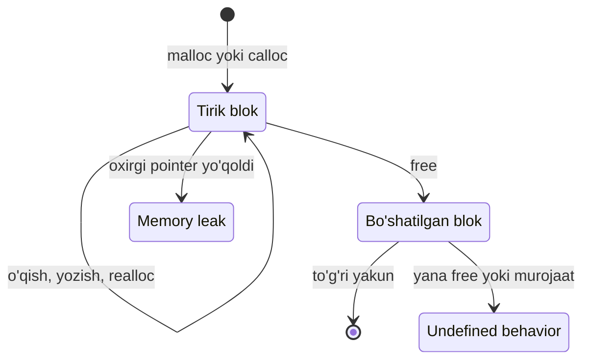

## Bu dars nima uchun kerak

11-darsdagi massivning o'lchami e'lon paytida yoziladi: `int scores[5]`. 21-22-darslarda esa pointer (xotira manzilini saqlaydigan o'zgaruvchi) va pointer arifmetikasini ko'rdik: `p[i]` aslida `*(p + i)`. Endi shu ikkalasini birlashtiramiz va bitta katta savolga javob beramiz: agar nechta element kerakligi faqat dastur ishlayotganda ma'lum bo'lsa, ular uchun joyni qayerdan olamiz?

Misollar ko'p: foydalanuvchi nechta ball kiritishini oldindan bilmaymiz; fayldagi qatorlar soni faylni o'qimaguncha noma'lum; `get_string` qaytargan ismning uzunligi har safar boshqacha. Bundan tashqari, funksiya ichida yaratilgan massiv funksiya `return` qilganda yo'qoladi (18-darsdagi stack frame bilan birga), lekin ko'pincha natija funksiyadan keyin ham yashashi kerak.

Bu ikkala muammoning yechimi - **dinamik xotira** (dynamic memory): dastur ish vaqtida operatsion tizim kutubxonasidan kerakli hajmdagi blokni so'raydi (`malloc`), u bilan ishlaydi va ishi tugagach qaytaradi (`free`). Bu blok **heap** deb ataladigan hududda joylashadi va uni dasturchi o'zi bo'shatmaguncha yashaydi. Erkinlikning narxi ham bor: qaytarishni unutsangiz - **memory leak**, ikki marta qaytarsangiz yoki qaytarilgan blokdan foydalansangiz - undefined behavior.

Bu darsdan keyin siz:

- `malloc`, `calloc`, `realloc` va `free` imzolarini, qaytish qiymatlarini va qachon `NULL` qaytishini bilasiz;
- kerakli baytlar sonini `n * sizeof(int)` formulasi bilan hisoblay olasiz va bu hisob qachon toshib ketishini bilasiz;
- satr nusxasini `malloc(strlen(s) + 1)` va `strcpy` bilan to'g'ri yarata olasiz va "+1" nima uchun kerakligini tushuntira olasiz;
- memory leak, double free va use-after-free nima ekanini, brauzer muhiti ularni qanday xabar bilan ko'rsatishini bilasiz;
- `realloc` ni vaqtinchalik pointer bilan xavfsiz ishlata olasiz va massivni ikki baravar o'stirish qancha nusxa olishini hisoblay olasiz;
- haqiqiy Linux tizimida Valgrind hisobotini o'qiy olasiz.

Stack, heap va jarayon xotirasining umumiy xaritasi 24-darsda chuqur ko'riladi. Bu darsda heap'ni "malloc beradigan xotira" deb qabul qilamiz.

## Nega dinamik xotira kerak

Ikki savolni ajratib olaylik: **qancha** joy kerak va joy **qancha vaqt** yashashi kerak.

Birinchi savol - o'lcham. `int scores[5]` da 5 soni kompilyatsiya vaqtida ma'lum. 11-darsda VLA (variable length array, `int a[n]`) ni ham eslatgan edik: u o'lchamni ish vaqtida oladi, lekin stack'da yaratiladi. Stack esa kichik: 18-darsda ko'rganimizdek, Linux'da odatda 8 MB, kursning brauzer muhitida 1 MB. Foydalanuvchi 1 000 000 ta `int` (4 000 000 bayt) so'rasa, VLA brauzerdagi stack'ni darhol to'ldiradi. Bundan tashqari, VLA uchun joy yetmasa, dastur buni tekshira olmaydi: xato qaytarilmaydi, dastur shunchaki yiqiladi.

Ikkinchi savol - umr (lifetime). Lokal o'zgaruvchi va lokal massiv funksiya tugashi bilan yo'qoladi: ular **automatic storage duration** ga ega (cppreference atamasi). Global o'zgaruvchi esa dastur boshidan oxirigacha yashaydi (**static storage duration**), lekin uning o'lchami yana kompilyatsiya vaqtida belgilanadi. Uchinchi tur - **allocated storage duration**: obyekt `malloc` chaqirilgan paytda paydo bo'ladi va `free` chaqirilguncha yashaydi. Uni yaratgan funksiya allaqachon qaytgan bo'lsa ham.

| Xotira turi | O'lcham qachon ma'lum | Qachon yaratiladi | Qachon yo'qoladi | Kim boshqaradi |
|---|---|---|---|---|
| Lokal (stack) | Kompilyatsiyada (VLA - ish vaqtida) | Funksiyaga kirganda | Funksiyadan chiqqanda | Kompilyator, avtomatik |
| Global / `static` | Kompilyatsiyada | Dastur boshida | Dastur oxirida | Kompilyator va yuklovchi |
| Dinamik (heap) | Ish vaqtida | `malloc` chaqirilganda | `free` chaqirilganda | Dasturchi |

Jadvaldagi oxirgi ustun eng muhimi. Stack'da xotirani boshqarish bepul va xatosiz: kompilyator frame'ni o'zi ochadi va yopadi. Heap'da esa har bir `malloc` uchun aynan bitta `free` yozish - sizning vazifangiz. C da garbage collector (JavaScript, Python va Java'dagi kabi foydalanilmayotgan xotirani o'zi topib bo'shatadigan mexanizm) yo'q.

## malloc, calloc, realloc, free: imzolar va qaytish qiymatlari

To'rtta funksiya ham `<stdlib.h>` da e'lon qilingan. Ularning imzolari va xatti-harakati cppreference'ning "Dynamic memory management" sahifalaridan olingan:

| Funksiya | Imzo | Nima qiladi | Muvaffaqiyatsiz bo'lsa |
|---|---|---|---|
| `malloc` | `void *malloc(size_t size);` | `size` bayt joy ajratadi, ichi **initsializatsiya qilinmagan** | `NULL` qaytaradi |
| `calloc` | `void *calloc(size_t num, size_t size);` | `num` ta `size` baytlik obyekt uchun joy ajratadi va **hamma baytni 0** qiladi | `NULL` qaytaradi |
| `realloc` | `void *realloc(void *ptr, size_t new_size);` | Blok o'lchamini o'zgartiradi: joyida kengaytiradi yoki yangi blok ochib, eski ma'lumotni ko'chiradi va eskisini bo'shatadi | `NULL` qaytaradi, **eski blok tirik qoladi** |
| `free` | `void free(void *ptr);` | `malloc`/`calloc`/`realloc` bergan blokni qaytaradi | Qaytish qiymati yo'q |

Bir nechta tafsilot:

- **`void *`** - "tipi aytilmagan manzil". C da `void *` istalgan obyekt pointeriga avtomatik aylanadi, shuning uchun `int *p = malloc(...)` da cast (`(int *)`) shart emas. C++ da esa shart; CS50 va bu kurs C yozadi.
- **`size_t`** - `sizeof` qaytaradigan ishorasiz (unsigned) butun tip. 6-darsdagi data model bo'yicha u x86-64 da 8 bayt, brauzer muhitida (wasm32) 4 bayt, ya'ni brauzerda eng katta qiymati 2³² - 1 = 4 294 967 295.
- **`malloc(0)`** - natija implementation-defined (amalga oshirishga bog'liq): `NULL` yoki ishlatib bo'lmaydigan, lekin `free` qilinishi kerak bo'lgan manzil. Bunga tayanmang.
- **`free(NULL)`** hech narsa qilmaydi. cppreference izohiga ko'ra, bu ataylab qilingan: tozalash kodida har safar `if (p != NULL)` yozish shart emas.
- **`realloc(NULL, n)`** - `malloc(n)` bilan bir xil. `realloc(p, 0)` esa C17 da eskirgan deb belgilangan, C23 da undefined behavior. Ishlatmang.

### NULL tekshiruvi

`malloc` hech qachon "xato" bilan dasturni to'xtatmaydi: joy bo'lmasa, u shunchaki `NULL` (13-darsdagi null pointer, hech qayerga qaramaydigan manzil) qaytaradi. Agar natijani tekshirmasdan `p[0] = 72` yozsangiz, bu null pointer orqali yozish: Linux'da odatda segmentation fault, brauzer muhitida "NULL yoki noto'g'ri ko'rsatkich orqali murojaat" xatosi. Shuning uchun har bir `malloc` dan keyin darhol:

```c
int *scores = malloc(n * sizeof(int));
if (scores == NULL)
{
    printf("Xotira yetmadi\n");
    return 1;
}
```

Zamonaviy kompyuterda kichik `malloc` ning `NULL` qaytarishi kam uchraydi, lekin kursning brauzer muhitida butun dastur xotirasi 128 MB bilan cheklangan. Pastdagi dasturda ballar sonini 50000000 qilib ko'ring: 50 000 000 · 4 = 200 000 000 bayt, bu chegaradan katta, va `malloc` `NULL` qaytaradi.

## Baytlarni hisoblash: n * sizeof(int)

`malloc` elementlarni emas, **baytlarni** so'raydi. n ta `int` uchun n · sizeof(int) bayt kerak. Quyidagi dastur ballar sonini so'raydi, aynan shuncha joy ajratadi, o'rtachani hisoblaydi va xotirani qaytaradi:

```c run
#include <cs50.h>
#include <stdio.h>
#include <stdlib.h>

int main(void)
{
    int n = get_int("Nechta ball? ");
    if (n < 1)
    {
        printf("Kamida 1 ta ball kerak\n");
        return 1;
    }

    // n ta int uchun joy: n * sizeof(int) bayt
    int *scores = malloc(n * sizeof(int));
    if (scores == NULL)
    {
        printf("Xotira yetmadi\n");
        return 1;
    }
    printf("Ajratildi: %d * %zu = %zu bayt\n", n, sizeof(int), n * sizeof(int));

    int sum = 0;
    for (int i = 0; i < n; i++)
    {
        scores[i] = get_int("%d-ball: ", i + 1);
        sum += scores[i];
    }
    printf("O'rtacha: %.2f\n", (float) sum / n);

    free(scores);
    return 0;
}
```

```text stdin
5
72
85
90
64
99
```

Natija:

```text
Nechta ball? Ajratildi: 5 * 4 = 20 bayt
1-ball: 2-ball: 3-ball: 4-ball: 5-ball: O'rtacha: 82.00
```

Hisob: 72 + 85 + 90 + 64 + 99 = 410, 410 / 5 = 82. Dastur oxirida leak hisoboti chiqmadi, chunki bitta `malloc` ga bitta `free` to'g'ri keldi.

E'tibor bering: `scores` - pointer, lekin u massiv kabi indekslanadi. 22-darsdagi qoida: `scores[i]` bu `*(scores + i)`, ya'ni blok boshidan i · 4 bayt keyingi `int`. Heap'dagi blok ham xuddi massiv kabi ketma-ket baytlar. Farqi bitta: `sizeof(scores)` bu yerda 20 emas, pointer o'lchami (brauzerda 4, x86-64 da 8). Blokning uzunligini `n` da o'zingiz saqlashingiz kerak.

### `sizeof *p` usuli

cppreference misollarida tez-tez uchraydigan yozuv: `int *p = malloc(n * sizeof *p);`. Bu yerda `sizeof *p` - "p qaraydigan narsaning o'lchami". Afzalligi: keyinchalik `p` tipini `double *` ga o'zgartirsangiz, `malloc` qatorini tuzatish esdan chiqmaydi, o'lcham o'zi 8 ga o'zgaradi. `sizeof` operandini hisoblamaydi, shuning uchun `p` hali initsializatsiya qilinmagan bo'lsa ham bu xavfsiz.

### Ko'paytma toshib ketishi

`n * sizeof(int)` ko'paytmasi `size_t` tipida hisoblanadi va 7-darsdagi unsigned arifmetika qoidasiga bo'ysunadi: natija modul 2ᴺ olinadi. Brauzerda `size_t` 32 bit. n = 1 100 000 000 bo'lsa:

1 100 000 000 · 4 = 4 400 000 000; 4 400 000 000 - 4 294 967 296 = 105 032 704 bayt.

Ya'ni `malloc` 4,4 milliard bayt o'rniga taxminan 100 MB ajratadi va **muvaffaqiyatli** qaytadi. Keyin sikl 1,1 milliard elementga yozishga urinadi va blokdan chiqib ketadi. Bu - haqiqiy xavfsizlik zaifliklarining keng tarqalgan sababi. Ikki himoya: `n` ni oqilona chegarada tekshirish, yoki `calloc(n, sizeof(int))` ishlatish. cppreference'ga ko'ra `calloc` ikki argumentni alohida oladi, va amaldagi kutubxonalar (glibc, kursning brauzer runtime'i ham) ko'paytma toshganda `NULL` qaytaradi. Yana bir tuzoq: `n` manfiy `int` bo'lsa, `size_t` ga aylanganda ulkan musbat songa aylanadi. Shuning uchun yuqoridagi dasturda `n < 1` tekshiruvi `malloc` dan **oldin** turibdi.

## Satr nusxasi: malloc(strlen(s) + 1)

12-darsda `strcpy(dest, src)` ni ko'rdik va `dest` uchun yetarli joy bo'lishi shartligini aytdik. Endi bu joyni heap'dan olamiz. Satr nusxasi uchun formula:

kerakli baytlar = strlen(s) + 1

`strlen` NUL terminatorni sanamaydi, `strcpy` esa uni ham ko'chiradi. "Dilnoza" uchun strlen = 7, kerakli joy 8 bayt.

Quyidagi `duplicate` funksiyasi heap'da nusxa yaratib, uni qaytaradi. Bu - dinamik xotiraning ikkinchi foydasi: nusxa funksiya tugagandan keyin ham yashaydi, chunki u stack frame'da emas.

```c run
#include <cs50.h>
#include <ctype.h>
#include <stdio.h>
#include <stdlib.h>
#include <string.h>

// s ning heap'dagi nusxasini qaytaradi (xato bo'lsa NULL). Chaqiruvchi free qilishi shart.
char *duplicate(const char *s)
{
    size_t length = strlen(s);
    char *copy = malloc(length + 1);
    if (copy == NULL)
    {
        return NULL;
    }
    strcpy(copy, s);
    printf("ajratildi: %zu bayt (%zu belgi + NUL)\n", length + 1, length);
    return copy;
}

int main(void)
{
    string name = get_string("Ism: ");
    if (name == NULL)
    {
        return 1;
    }

    char *loud = duplicate(name);
    if (loud == NULL)
    {
        return 1;
    }
    for (int i = 0; loud[i] != '\0'; i++)
    {
        loud[i] = toupper((unsigned char) loud[i]);
    }

    printf("asl:   %s\n", name);
    printf("nusxa: %s\n", loud);
    free(loud);
}
```

```text stdin
Dilnoza
```

Natija:

```text
Ism: ajratildi: 8 bayt (7 belgi + NUL)
asl:   Dilnoza
nusxa: DILNOZA
```

Asl satr o'zgarmadi: `loud` boshqa blokka qaraydi. Agar `char *loud = name;` yozganimizda, ikkala nom bitta blokka qarar va katta harfga o'tkazish asl ismni ham buzar edi (22-darsda pointer nusxasi va ma'lumot nusxasi farqini ko'rgan edik).

Endi ataylab xato qiling: `malloc(length + 1)` ni `malloc(length)` ga o'zgartirib ishga tushiring. Brauzer muhiti `strcpy` yozayotgan har baytni tekshiradi va NUL uchun joy yo'qligini ko'radi:

```text
XOTIRA XATOSI: heap-buffer-overflow: malloc qilingan blok chegarasidan tashqarida
Yozish: 1 bayt, manzil 0x...
Manzil 7 baytlik blok (0..6 baytlar) tugaganidan 0 bayt keyin.
```

Undan keyin `strcpy` chaqirilgan qator ko'rsatiladi. "0 bayt keyin" - blok tugagan joyning o'zi, ya'ni 7-bayt: aynan NUL yozilishi kerak bo'lgan joy. Oddiy kompilyatsiyada bu xato ko'pincha jim o'tadi, chunki `malloc` odatda so'ralganidan biroz ko'proq joy beradi, lekin bunga tayanib bo'lmaydi.

### get_string xotirasi kimniki

`get_string` ham satrni heap'da saqlaydi: kiritish uzunligi oldindan noma'lum, shuning uchun boshqa yo'l yo'q. Nega biz `free(name)` yozmadik? CS50 kutubxonasi hujjatiga ko'ra, satr heap'da saqlanadi, lekin kutubxonaning destruktori (dastur tugaganda avtomatik chaqiriladigan funksiya) bu xotirani o'zi bo'shatadi. Kursning brauzer runtime'i ham shunday ishlaydi: `get_string` ajratgan bloklar leak hisobotiga kirmaydi. Shuning uchun qoida: `get_string` natijasini `free` qilmang (asl CS50 kutubxonasida u dastur oxirida yana bir marta bo'shatiladi, ya'ni double free), lekin o'zingiz `malloc` qilgan har bir blokni `free` qiling.

## Memory leak: qaytarilmagan xotira

**Memory leak** - ajratilgan, lekin endi hech qachon bo'shatilmaydigan blok. Ko'pincha sabab bitta: blokka qaragan yagona pointer yo'qoladi. Pointer lokal o'zgaruvchi bo'lsa va funksiya tugasa, yoki unga yangi qiymat yozilsa, eski blokning manzili hech qayerda qolmaydi, demak uni `free` ga berib bo'lmaydi.

Qisqa dasturda leak sezilmaydi: dastur tugaganda operatsion tizim jarayonning butun xotirasini qaytarib oladi. Muammo uzoq ishlaydigan dasturlarda: web server, brauzer, o'yin. Har so'rovda 1 KB yo'qotadigan server soniyasiga 1000 so'rovda soatiga 1 KB · 1000 · 3600 = 3 600 000 KB, ya'ni taxminan 3,4 GB xotirani yo'qotadi va oxiri xotira tugab to'xtaydi.

Quyidagi dasturda ataylab leak bor. `make_range(n)` 0 dan n - 1 gacha sonlar massivini heap'da yaratadi. `main` uni siklda chaqiradi va natijani bitta `row` o'zgaruvchisiga yozadi:

```c run
#include <stdio.h>
#include <stdlib.h>

// 0, 1, ..., n-1 sonlaridan iborat yangi massiv (heap'da)
int *make_range(int n)
{
    int *values = malloc(n * sizeof(int));
    if (values == NULL)
    {
        return NULL;
    }
    for (int i = 0; i < n; i++)
    {
        values[i] = i;
    }
    return values;
}

int main(void)
{
    int *row = NULL;
    for (int k = 1; k <= 3; k++)
    {
        // Ataylab xato: eski row free qilinmasdan ustiga yoziladi
        row = make_range(k * 2);
        if (row == NULL)
        {
            return 1;
        }
        printf("%d ta element, oxirgisi %d\n", k * 2, row[k * 2 - 1]);
    }
    free(row);
}
```

Dastur o'z ishini to'g'ri bajaradi:

```text
2 ta element, oxirgisi 1
4 ta element, oxirgisi 3
6 ta element, oxirgisi 5
```

Lekin brauzer muhiti dastur tugaganda hisob qiladi va qo'shimcha xabar chiqaradi:

```text
XOTIRA: 24 bayt bo'shatilmagan, 2 ta blokda (3 ta malloc, 1 ta free). Har malloc uchun free kerak.
```

Hisob bilan tekshiramiz. Uchta `malloc`: 2 · 4 = 8, 4 · 4 = 16 va 6 · 4 = 24 bayt. Faqat oxirgisi (24 bayt) `free` qilindi. Yo'qolganlar: 8 + 16 = 24 bayt, 2 ta blok. 2-aylanishda `row` ga yangi manzil yozilganda 8 baytlik blokning yagona manzili o'chdi; 3-aylanishda 16 baytlik blokniki.

Tuzatish: yangi qiymat yozishdan oldin eskisini qaytarish. Sikl ichida `row = make_range(...)` dan oldin `free(row);` qo'ying. Birinchi aylanishda `row` hali `NULL`, va `free(NULL)` hech narsa qilmaydi, shuning uchun alohida tekshiruv kerak emas. Qayta ishga tushiring: hisobot yo'qoladi.

Leak hisoboti dastur **normal tugaganda** chiqadi. Agar dastur xotira xatosi bilan to'xtasa, avval o'sha xatoni tuzating.

## Blokning hayot sikli va uchta klassik xato

Har bir heap blokining holati quyidagi diagrammadagi kabi o'zgaradi. Faqat bitta yo'l to'g'ri: ajratish, ishlatish, bitta `free`.



Uchta xatoning farqi:

| Xato | Nima bo'ladi | Oddiy kompilyatsiyada | Brauzer muhiti xabari |
|---|---|---|---|
| Memory leak | Blok bo'shatilmaydi | Hech qanday belgi yo'q | Dastur oxirida `XOTIRA: N bayt bo'shatilmagan, M ta blokda (...)` |
| Use-after-free | `free` dan keyin blokka murojaat | Ko'pincha "ishlaydi", eski yoki begona qiymat | `heap-use-after-free: free() qilingan xotiraga murojaat` |
| Double free | Bitta blokka ikki marta `free` | Ba'zan crash, ba'zan heap buziladi | `double-free: bu blok allaqachon free() qilingan` |

Leak - resurs yo'qotish, lekin undefined behavior emas. Use-after-free va double free esa cppreference'ning `free` sahifasida aniq aytilganidek **undefined behavior**. Ular leakdan xavfliroq: `free` qilingan blokni `malloc` boshqa maqsad uchun qayta berishi mumkin, va eski pointer orqali yozish endi butunlay boshqa ma'lumotni buzadi. Xavfsizlik nuqtai nazaridan use-after-free hujumchiga dastur ma'lumotlarini boshqarish imkonini beradigan klassik zaiflik turi.

Quyidagi dasturda ikkala xato ham bor:

```c run
#include <stdio.h>
#include <stdlib.h>

int main(void)
{
    int *prices = malloc(4 * sizeof(int));
    if (prices == NULL)
    {
        return 1;
    }
    prices[2] = 7;
    free(prices);

    // Ataylab xato 1: use-after-free
    printf("%d\n", prices[2]);

    // Ataylab xato 2: double free
    free(prices);
}
```

Brauzer muhiti birinchi xatoda to'xtaydi:

```text
XOTIRA XATOSI: heap-use-after-free: free() qilingan xotiraga murojaat
O'qish: 4 bayt, manzil 0x...
Manzil free() qilingan 16 baytlik blok ichida (boshidan 8-bayt).
```

va `printf` qatorini ko'rsatadi. Hisob: blok 4 · 4 = 16 bayt, `prices[2]` boshidan 2 · 4 = 8-baytda. Runtime bo'shatilgan bloklarni darhol qayta bermaydi, ularni bir muddat "karantinda" ushlab turadi: shuning uchun eski manzilga murojaat aniq ushlanadi. `printf` qatorini o'chirib qayta ishga tushirsangiz, ikkinchi xato ko'rinadi:

```text
XOTIRA XATOSI: double-free: bu blok allaqachon free() qilingan
```

Ikkala xatodan bitta odat himoya qiladi: `free(p);` dan keyin darhol `p = NULL;`. Shunda keyingi `free(p)` zararsiz (`free(NULL)`), `p[2]` esa noaniq eski qiymat o'rniga darhol null pointer xatosini beradi. Lekin bu faqat shu bitta o'zgaruvchini himoya qiladi: agar blok manzili boshqa pointerda ham saqlangan bo'lsa, u hali ham eski joyga qaraydi.

## realloc: blokni o'stirish

Ko'p holatda elementlar soni oldindan umuman ma'lum emas: foydalanuvchi 0 kiritguncha sonlarni o'qish kerak. Yechim - kichik blok bilan boshlab, to'lganda `realloc` bilan kattalashtirish.

`realloc` ning xavfli tomoni - xato bo'lgandagi xatti-harakati. cppreference'ga ko'ra, joy yetmasa `realloc` `NULL` qaytaradi va **eski blokni bo'shatmaydi**. Shuning uchun quyidagi yozuv xato:

```c
values = realloc(values, new_capacity * sizeof(int));   // xato
```

`realloc` `NULL` qaytarsa, `values` ga `NULL` yoziladi, eski blokning yagona manzili yo'qoladi - leak, va undagi ma'lumot ham yo'qoldi. To'g'ri usul - natijani avval vaqtinchalik pointerga olish:

```c
int *bigger = realloc(values, new_capacity * sizeof(int));
if (bigger == NULL)
{
    free(values);
    return 1;
}
values = bigger;
```

Muvaffaqiyatli `realloc` dan keyin eski `values` manzili yaroqsiz, hatto blok joyida kengaygan bo'lsa ham: endi faqat qaytgan manzildan foydalaning.

Quyidagi dastur sonlarni 0 kelguncha o'qiydi. Sig'im (capacity) 2 dan boshlanadi va har to'lganda ikki baravar oshadi:

```c run
#include <cs50.h>
#include <stdio.h>
#include <stdlib.h>

int main(void)
{
    int capacity = 2;
    int count = 0;
    int *values = malloc(capacity * sizeof(int));
    if (values == NULL)
    {
        return 1;
    }

    while (true)
    {
        int x = get_int("Son (0 - tugatish): ");
        if (x == 0)
        {
            break;
        }
        if (count == capacity)
        {
            // Vaqtinchalik pointer: realloc NULL qaytarsa, values yo'qolmaydi
            int *bigger = realloc(values, capacity * 2 * sizeof(int));
            if (bigger == NULL)
            {
                free(values);
                return 1;
            }
            values = bigger;
            capacity *= 2;
            printf("\nsig'im %d -> %d\n", capacity / 2, capacity);
        }
        values[count] = x;
        count++;
    }

    printf("\n%d ta son, sig'im %d:", count, capacity);
    for (int i = 0; i < count; i++)
    {
        printf(" %d", values[i]);
    }
    printf("\n");
    free(values);
}
```

```text stdin
5
3
8
1
9
2
7
0
```

Natija (har "Son" so'rovidan keyin kiritilgan qiymat brauzerda alohida ko'rinadi):

```text
Son (0 - tugatish): Son (0 - tugatish): Son (0 - tugatish): 
sig'im 2 -> 4
Son (0 - tugatish): Son (0 - tugatish): 
sig'im 4 -> 8
Son (0 - tugatish): Son (0 - tugatish): Son (0 - tugatish): 
7 ta son, sig'im 8: 5 3 8 1 9 2 7
```

Leak hisoboti chiqmaydi. Brauzer runtime'i har `realloc` ni bitta yangi ajratish va bitta bo'shatish deb sanaydi: 1 `malloc` + 2 `realloc` = 3 ajratish, 2 `realloc` + oxirgi `free` = 3 bo'shatish.

### Nega ikki baravar, bir tadan emas

`realloc` blokni joyida kengaytira olmasa, hamma elementlarni yangi joyga ko'chiradi. Har yangi element uchun sig'imni 1 ga oshirsak, n ta element qo'shilganda ko'chirishlar soni 1 + 2 + ... + (n - 1) = n(n - 1)/2 ga yetadi: n = 1000 da 499 500 ta element nusxasi, ya'ni Θ(n²) (16-dars).

Ikki baravar oshirsak, n = 1024 element uchun sig'im 1 dan 2, 4, 8, ..., 1024 gacha 10 marta o'sadi, ko'chirishlar esa 1 + 2 + 4 + ... + 512 = 1023 ta, ya'ni 2n dan kam. Bitta element qo'shishning o'rtacha narxi O(1) bo'lib qoladi. Narxi - xotira: eng yomon holatda sig'imning deyarli yarmi bo'sh turadi. Yuqoridagi misolda 7 ta son uchun 8 ta joy: 1 ta bo'sh.

## Valgrind: haqiqiy Linux'da xotira tekshiruvi

Kursning brauzer muhiti xotira xatolarini kompilyator qo'shgan tekshiruvlar (10-darsdagi sanitizer) va o'z runtime'i orqali topadi. Haqiqiy Linux tizimida, jumladan CS50 ning o'z muhitida, buning uchun ko'pincha **Valgrind** ishlatiladi. Valgrind - dasturni qayta kompilyatsiya qilmasdan, uni o'zining virtual protsessorida bajaradigan va har bir xotira murojaatini kuzatadigan asboblar to'plami. Xotira xatolarini topadigan asbob **Memcheck** deb ataladi va u sukut bo'yicha ishlaydi.

Valgrind hujjatidagi tavsiyalar: dasturni `-g` bilan kompilyatsiya qiling (shunda xabarlarda fayl va qator raqami chiqadi), iloji bo'lsa `-O0` bilan. Dastur Memcheck ostida odatdagidan 20-30 marta sekin ishlaydi.

Quyidagi `copy.c` da ikkita ataylab xato bor: satr nusxasi uchun "+1" unutilgan va `free` yo'q.

```c
#include <stdio.h>
#include <stdlib.h>
#include <string.h>

int main(void)
{
    const char *city = "Termiz";
    char *copy = malloc(strlen(city));
    if (copy == NULL)
    {
        return 1;
    }
    strcpy(copy, city);
    printf("%s\n", copy);
    return 0;
}
```

Ubuntu 24.04 da (x86-64, clang 18, Valgrind 3.22, chiqish terminalga):

```text
$ clang -g -O0 -o copy copy.c
$ valgrind --leak-check=full ./copy
==3691== Memcheck, a memory error detector
==3691== Command: ./copy
==3691==
==3691== Invalid write of size 1
==3691==    at 0x484F39E: strcpy (in /usr/libexec/valgrind/vgpreload_memcheck-amd64-linux.so)
==3691==    by 0x1091C2: main (copy.c:13)
==3691==  Address 0x4a7e046 is 0 bytes after a block of size 6 alloc'd
==3691==    at 0x4846828: malloc (in /usr/libexec/valgrind/vgpreload_memcheck-amd64-linux.so)
==3691==    by 0x10919A: main (copy.c:8)
==3691==
==3691== Invalid read of size 1
==3691==    at 0x484F234: strlen (in /usr/libexec/valgrind/vgpreload_memcheck-amd64-linux.so)
==3691==    by 0x48D2DA7: __printf_buffer (vfprintf-process-arg.c:435)
==3691==    by 0x48D373A: __vfprintf_internal (vfprintf-internal.c:1544)
==3691==    by 0x48C81B2: printf (printf.c:33)
==3691==    by 0x1091D4: main (copy.c:14)
==3691==  Address 0x4a7e046 is 0 bytes after a block of size 6 alloc'd
==3691==    at 0x4846828: malloc (in /usr/libexec/valgrind/vgpreload_memcheck-amd64-linux.so)
==3691==    by 0x10919A: main (copy.c:8)
==3691==
Termiz
==3691==
==3691== HEAP SUMMARY:
==3691==     in use at exit: 6 bytes in 1 blocks
==3691==   total heap usage: 2 allocs, 1 frees, 1,030 bytes allocated
==3691==
==3691== 6 bytes in 1 blocks are definitely lost in loss record 1 of 1
==3691==    at 0x4846828: malloc (in /usr/libexec/valgrind/vgpreload_memcheck-amd64-linux.so)
==3691==    by 0x10919A: main (copy.c:8)
==3691==
==3691== LEAK SUMMARY:
==3691==    definitely lost: 6 bytes in 1 blocks
==3691==    indirectly lost: 0 bytes in 0 blocks
==3691==      possibly lost: 0 bytes in 0 blocks
==3691==    still reachable: 0 bytes in 0 blocks
==3691==         suppressed: 0 bytes in 0 blocks
==3691==
==3691== ERROR SUMMARY: 3 errors from 3 contexts (suppressed: 0 from 0)
```

(Mualliflik huquqi qatorlari, oxiridagi `-s` maslahati va bir nechta bo'sh qator qisqartirilgan; manzillar va jarayon raqami har safar boshqacha.) Hisobotni qismlarga ajratamiz:

1. **`==3691==`** - jarayon raqami (PID). Valgrind qatorlarini dasturning o'z chiqishidan (`Termiz`) ajratish uchun.
2. **`Invalid write of size 1`** - xato turi: 1 baytlik ruxsatsiz yozish. Undan keyingi `at ... by ...` qatorlari - stack trace: xato `strcpy` ichida, uni esa `main` `copy.c` ning 13-qatorida chaqirgan. Valgrind hujjati stack trace'ni pastdan yuqoriga o'qishni maslahat beradi; o'z kodingizdagi eng yuqori qator odatda kerakli joy.
3. **`Address ... is 0 bytes after a block of size 6 alloc'd`** - manzil 6 baytlik blokning oxiridan 0 bayt keyin, blok esa 8-qatordagi `malloc` da ajratilgan. "Termiz" 6 belgi, NUL 7-bayt: brauzerdagi `heap-buffer-overflow` xabaridagi "tugaganidan 0 bayt keyin" bilan aynan bir xil ma'lumot.
4. **`Invalid read of size 1`** - ikkinchi xato birinchisining oqibati: `printf("%s")` satr oxirini topish uchun NUL gacha o'qiydi, NUL esa blokdan tashqariga yozilgan. Valgrind hujjati xatolarni chiqqan tartibida tuzatishni maslahat beradi, chunki keyingilari ko'pincha oldingilardan kelib chiqadi: birinchisini tuzatsangiz, bu ham yo'qoladi.
5. **`HEAP SUMMARY`** - dastur tugaganda 6 bayt 1 blokda bo'shatilmagan. `2 allocs, 1 frees, 1,030 bytes`: bizning 6 baytimizdan tashqari, C kutubxonasi `printf` chiqishi uchun 1024 baytlik buferni o'zi ajratgan va o'zi bo'shatgan (6 + 1024 = 1030). Chiqish terminalga emas, faylga yoki boshqa dasturga yo'naltirilsa, bufer kattaroq bo'ladi (shu tizimda 4096 bayt, jami 4,102).
6. **`definitely lost`** - blokka qaraydigan birorta ham pointer qolmagan, ya'ni dastur uni bo'shata olmas edi. Valgrind hujjatiga ko'ra bu albatta tuzatilishi kerak bo'lgan leak.
7. **`ERROR SUMMARY: 3 errors`** - ikkita ruxsatsiz murojaat va bitta leak.

Memcheck leaklarni to'rt turga ajratadi:

| Tur | Ma'nosi | Nima qilish kerak |
|---|---|---|
| definitely lost | Blokka hech qanday pointer yo'q | Tuzatish shart |
| indirectly lost | Blokka faqat yo'qolgan bloklar qaraydi (masalan, linked list boshi yo'qolsa, qolgan tugunlar) | Asosiy "definitely lost" ni tuzatsangiz, o'zi yo'qoladi |
| possibly lost | Blok ichiga qaraydigan pointer bor, lekin boshiga emas | Odatda leak, tekshirish kerak |
| still reachable | Dastur oxirida blokka hali pointer bor, faqat `free` qilinmagan | Ko'pincha zararsiz, lekin toza kodda bo'lmaydi |

Tuzatilgan versiya (`malloc(strlen(city) + 1)` va `free(copy)`) uchun Valgrind `All heap blocks were freed -- no leaks are possible` va `ERROR SUMMARY: 0 errors` deydi.

Valgrind boshqa xatolarni ham topadi: use-after-free uchun `Invalid read` va "inside a block of size 16 free'd" tavsifi, double free uchun `Invalid free()`, initsializatsiya qilinmagan qiymatdan foydalanish uchun `Conditional jump or move depends on uninitialised value(s)` (24-darsda).

### Valgrind, sanitizer va brauzer muhiti

| Xususiyat | Valgrind (Memcheck) | AddressSanitizer (`-fsanitize=address`) | Kursning brauzer muhiti |
|---|---|---|---|
| Qayta kompilyatsiya | Shart emas | Shart | Avtomatik (har ishga tushirishda) |
| Sekinlashish | Taxminan 20-30 marta | Taxminan 2 marta | Sezilarli emas (kichik dasturlar) |
| Heap overflow | Topadi | Topadi | Topadi |
| Stack yoki global massiv overflow | Topmaydi | Topadi | Topadi |
| Use-after-free, double free | Topadi | Topadi | Topadi |
| Leak hisoboti | Batafsil, qaysi qatorda ajratilgani bilan | LeakSanitizer orqali (Linux) | Umumiy: baytlar, bloklar, malloc/free soni |
| Initsializatsiya qilinmagan qiymat | Topadi | Topmaydi | Topmaydi |

ASan uchun odatiy sekinlashish taxminan 2 marta ekani clang'ning AddressSanitizer hujjatida keltirilgan (24-dars manbalarida). Valgrind'ning [FAQ](https://valgrind.org/docs/manual/faq.html) sahifasida (4.5-savol) esa ochiq aytilgan: Memcheck global va stack massivlari chegarasini tekshirmaydi. U qaysi baytlar dasturga tegishli ekanini kuzatadi, stack'dagi qo'shni o'zgaruvchining baytlari esa ham dasturniki, shuning uchun `int stack[5]` dan keyingi `stack[5]` ga yozish uning uchun ruxsat etilgan yozish. Stack'ning tuzilishi 24-darsda ko'riladi.

## Mashq: leak hisobotini o'zingiz hisoblang

Brauzer runtime'i leak hisobotini qanday hisoblashini Python'da modellashtiring. `memory_report(events)` hodisalar ro'yxatini oladi:

- `("malloc", nom, bayt)` - yangi blok, nom bilan;
- `("realloc", nom, bayt)` - mavjud blokning o'lchamini o'zgartirish: runtime buni **bitta ajratish va bitta bo'shatish** deb sanaydi;
- `("free", nom)` - blokni bo'shatish.

Funksiya `(bo'shatilmagan_baytlar, bo'shatilmagan_bloklar, ajratishlar, bo'shatishlar)` kortejini qaytarsin. Tirik bo'lmagan blokni `free` yoki `realloc` qilish (double free) `ValueError` ko'tarsin.

```python run
def memory_report(events):
    # Yechimingizni shu yerga yozing
    return (0, 0, 0, 0)


print(memory_report([("malloc", "a", 8), ("malloc", "b", 16), ("free", "b")]))
```

```python test
check("bitta malloc, bitta free: leak yo'q", lambda: memory_report([("malloc", "a", 20), ("free", "a")]) == (0, 0, 1, 1))
check("darsdagi make_range misoli: 24 bayt, 2 blok, 3 malloc, 1 free", lambda: memory_report([("malloc", "r1", 8), ("malloc", "r2", 16), ("malloc", "r3", 24), ("free", "r3")]) == (24, 2, 3, 1))
check("realloc bitta ajratish va bitta bo'shatish deb sanaladi", lambda: memory_report([("malloc", "v", 8), ("realloc", "v", 16), ("realloc", "v", 32), ("free", "v")]) == (0, 0, 3, 3))
check("realloc'dan keyin yangi o'lcham hisobga olinadi", lambda: memory_report([("malloc", "v", 8), ("realloc", "v", 32)]) == (32, 1, 2, 1))
check("hech narsa bo'lmasa hammasi 0", lambda: memory_report([]) == (0, 0, 0, 0))


def _double_free():
    try:
        memory_report([("malloc", "p", 16), ("free", "p"), ("free", "p")])
    except ValueError:
        return True
    return False


check("double free ValueError ko'taradi", _double_free)
```

## Ko'p uchraydigan xatolar

1. **`malloc` natijasini tekshirmaslik.** `NULL` orqali yozish - crash yoki undefined behavior. Har `malloc`, `calloc`, `realloc` dan keyin `NULL` tekshiruvi.
2. **Baytlar o'rniga elementlar sonini berish.** `malloc(n)` n ta `int` uchun emas, n bayt uchun joy beradi: kerakli joyning to'rtdan biri. To'g'risi `malloc(n * sizeof(int))` yoki `malloc(n * sizeof *p)`.
3. **Satr uchun "+1" ni unutish.** `malloc(strlen(s))` NUL uchun joy qoldirmaydi va `strcpy` blokdan bitta bayt tashqariga yozadi. Formula: `strlen(s) + 1`.
4. **`p = realloc(p, ...)`.** Xato bo'lsa, eski blok manzili yo'qoladi. Natijani vaqtinchalik pointerga oling.
5. **Pointer ustiga yozishdan oldin `free` qilmaslik.** Sikl ichida `row = make_range(...)` kabi qayta yozish - eng keng tarqalgan leak manbai. Avval eski blokni qaytaring.
6. **`free` dan keyin pointerdan foydalanish.** Use-after-free va double free - undefined behavior. `free(p); p = NULL;` odati ularning ko'pini zararsizlantiradi.
7. **O'zingiz ajratmagan xotirani `free` qilish.** `free` faqat `malloc`/`calloc`/`realloc` qaytargan manzil uchun. Lokal massiv yoki satr literalini `free` ga berishni brauzer muhiti `bad-free` deb ushlaydi. `get_string` natijasi heap'da, lekin uni kutubxona bo'shatadi: asl CS50 da qo'lda `free` dastur oxirida double free'ga olib keladi.
8. **`sizeof(p)` bilan blok o'lchamini olish.** Pointer uchun `sizeof` pointer o'lchamini beradi (brauzerda 4, x86-64 da 8). Elementlar sonini alohida o'zgaruvchida saqlang.

## Xulosa

- Dinamik xotira o'lcham faqat ish vaqtida ma'lum bo'lganda yoki ma'lumot uni yaratgan funksiyadan uzoqroq yashashi kerak bo'lganda ishlatiladi. Heap bloki `malloc` dan `free` gacha yashaydi.
- `malloc(size)` initsializatsiya qilinmagan baytlar, `calloc(num, size)` nolga tenglangan baytlar beradi; ikkalasi ham xatoda `NULL` qaytaradi. `free(NULL)` hech narsa qilmaydi.
- Baytlar soni: n · sizeof(element). Brauzerda `size_t` 32 bit va ko'paytma 2³² dan oshsa jim toshib ketadi; `calloc` toshishni tekshiradi.
- Satr nusxasi: `malloc(strlen(s) + 1)` va `strcpy`. `get_string` xotirasini CS50 kutubxonasi o'zi bo'shatadi.
- Memory leak - yagona pointeri yo'qolgan blok; use-after-free va double free - undefined behavior. Brauzer muhiti birinchisini dastur oxirida, qolganlarini sodir bo'lgan qatorda ko'rsatadi.
- `realloc` natijasi avval vaqtinchalik pointerga olinadi; xatoda eski blok tirik qoladi. Ikki baravar o'stirish qo'shishning o'rtacha narxini O(1) da ushlaydi.
- Haqiqiy Linux'da `valgrind --leak-check=full ./dastur` xatoning turi, qatori va leak turini (definitely, indirectly, possibly lost, still reachable) ko'rsatadi.

## Amaliy topshiriq

Kirishdan so'zlarni (har qatorda bitta, `get_string` bilan) bo'sh qator yoki kirish tugaguncha o'qib, ularni teskari tartibda chiqaradigan `reverse_words` dasturini yozing. So'zlar soni oldindan noma'lum, har bir so'z uzunligi ham.

Topshiriq qadamlari:

1. **Dinamik massiv.** `char **words` (satrlar massivi, har elementi `char *`) va `int count`, `int capacity` o'zgaruvchilari. Boshlang'ich sig'im 2, to'lganda `realloc` bilan ikki baravar, vaqtinchalik pointer orqali.
2. **Har so'zning nusxasi.** `get_string` natijasini to'g'ridan-to'g'ri saqlamang: o'zingizning `duplicate` funksiyangiz bilan heap'da nusxa yarating (`strlen + 1`). Nima uchun shunday qilish kerakligini bir gap bilan izohlang (kim bo'shatadi?).
3. **Teskari chiqarish.** So'zlarni oxiridan boshiga chiqaring; sikl chegaralari `count - 1` dan `0` gacha.
4. **Tozalash.** Avval har bir so'z nusxasini, keyin `words` massivining o'zini `free` qiling. Tartib nega muhim: teskari tartibda qilsangiz nima bo'ladi?
5. **Hisob.** Pastdagi kirish uchun nechta `malloc`/`realloc`/`free` chaqiriladi va brauzer runtime'i bo'yicha nechta ajratish va bo'shatish sanaladi? Ko'rsatkichlar massivi brauzerda (4 baytlik pointer) eng oxirida necha bayt?
6. **Ataylab leak.** 4-qadamdagi so'zlarni bo'shatadigan siklni o'chiring, ishga tushiring va hisobotdagi baytlar sonini qo'lda hisoblangan son bilan solishtiring.

Kirish namunasi (5 so'z):

```text
olma
nok
uzum
anor
behi
```

Yaxshi javobda bo'lishi kerak bo'lgan narsalar:

- `realloc` natijasi vaqtinchalik pointerga olinadi, `NULL` holatida mavjud so'zlar va massiv bo'shatilib, dastur 1 bilan chiqadi;
- har `malloc` va `realloc` dan keyin `NULL` tekshiruvi bor;
- so'z nusxasi `strlen + 1` bayt; `get_string` natijasi `free` qilinmaydi va nusxa kerakligi tushuntirilgan;
- tozalash tartibi: avval so'zlar, keyin massiv; teskari tartibda massiv bo'shatilgach `words[i]` o'qish use-after-free bo'lishi aytilgan;
- 5-qadam hisobi: sig'im 2 -> 4 -> 8 (2 ta `realloc`), massiv oxirida 8 · 4 = 32 bayt; 5 so'z nusxasi 5 + 4 + 5 + 5 + 5 = 24 bayt; runtime bo'yicha 1 + 2 + 5 = 8 ta ajratish va 2 + 5 + 1 = 8 ta bo'shatish;
- 6-qadamda hisobot `XOTIRA: 24 bayt bo'shatilmagan, 5 ta blokda (8 ta malloc, 3 ta free)` bilan bir xil ekani ko'rsatilgan.

Javobingizni pastdagi maydonga yozing va yuqoridagi mezonlar bilan solishtiring.

## Manbalar

- CS50x. [Lecture 4 notes](https://cs50.harvard.edu/x/notes/4/) - "Copying and malloc", "Valgrind" va "Garbage Values" bo'limlari: satr nusxasi, `free`, Valgrind bilan leak va chegaradan chiqishni topish.
- cppreference. [malloc](https://en.cppreference.com/w/c/memory/malloc) - imzo, initsializatsiya qilinmagan xotira, `malloc(0)` ning implementation-defined ekani, xatoda `NULL`.
- cppreference. [calloc](https://en.cppreference.com/w/c/memory/calloc) - nol bilan to'ldirish, `num * size` bilan ajratish.
- cppreference. [realloc](https://en.cppreference.com/w/c/memory/realloc) - joyida kengaytirish yoki ko'chirish, xatoda eski blokning tirik qolishi, `realloc(p, 0)` ning C17 dagi eskirishi va C23 dagi undefined behavior maqomi.
- cppreference. [free](https://en.cppreference.com/w/c/memory/free) - `free(NULL)`, double free va `free` dan keyingi murojaatning undefined behavior ekani.
- CS50. [CS50 Library for C](https://cs50.readthedocs.io/libraries/cs50/c/) - `get_string`: satr heap'da, kutubxona destruktori uni dastur tugaganda bo'shatadi.
- Valgrind. [Quick Start Guide](https://valgrind.org/docs/manual/quick-start.html) - `-g`, `-O0` tavsiyasi, `--leak-check`, xabarlarni o'qish, 20-30 marta sekinlashish.
- Valgrind. [Memcheck manual](https://valgrind.org/docs/manual/mc-manual.html) - "Explanation of error messages" va "Memory leak detection": definitely, indirectly, possibly lost va still reachable ta'riflari.
