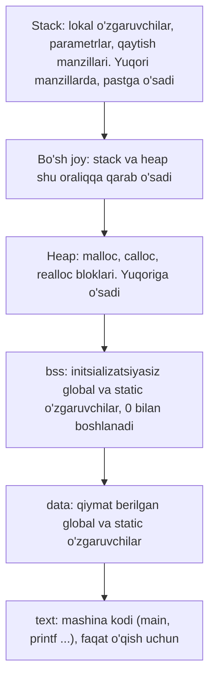

## Bu dars nima uchun kerak

Oldingi darslarda xotiraning turli qismlarini alohida-alohida uchratdik. 8-darsda lokal o'zgaruvchi blok tugashi bilan yo'qolishini, global o'zgaruvchi esa 0 bilan boshlanishini ko'rdik. 18-darsda har funksiya chaqiruvi call stack'da o'z stack frame'ini olishini va juda chuqur rekursiya stack overflow bilan tugashini ko'rdik. 23-darsda `malloc` heap'dan blok berishini va u `free` gacha yashashini ko'rdik. Endi ularni bitta rasmga yig'amiz: dastur ishga tushganda operatsion tizim unga qanday xotira xaritasini beradi va har bir o'zgaruvchi qayerga tushadi.

Bu rasm uchta amaliy savolga javob beradi. Nega funksiya o'zining lokal massivi manzilini qaytarsa, dastur buziladi? Nega initsializatsiya qilinmagan o'zgaruvchida "tasodifiy" son turadi va u qayerdan keladi? Va eng muhimi: nega stack'dagi massiv chegarasidan tashqariga yozish oddiy xato emas, balki xavfsizlik teshigi? 12-darsda buffer overflow ni ko'rib, unga xavfsizlik nuqtai nazaridan qaytishimizni aytgan edik. Bu dars shu va'dani bajaradi: tarixdagi birinchi mashhur internet qurti aynan stack'dagi buferni to'ldirish orqali tarqalgan.

Bu darsdan keyin siz:

- jarayon xotirasining beshta asosiy qismini (text, data, bss, heap, stack) va har biriga nima tushishini aytib bera olasiz;
- stack qaysi tomonga o'sishini o'z dasturingizdagi manzillar orqali ko'rsata olasiz;
- lokal o'zgaruvchiga pointer qaytarish nima uchun xato ekanini va uni qanday tuzatishni bilasiz;
- garbage values qayerdan kelishini tushuntira olasiz va kompilyator ogohlantirishidan foydalana olasiz;
- buffer overflow return address ni qanday buzishini va 1988 yilgi Morris qurti undan qanday foydalanganini bilasiz;
- `gets` nima uchun C11 dan olib tashlanganini bilasiz va `fgets`, `snprintf` bilan xavfsiz kod yoza olasiz;
- stack canary va ASLR nima qilishini va nimani qila olmasligini bilasiz.

## Jarayon xotirasi xaritasi

Dastur ishga tushganda operatsion tizim uning uchun **jarayon** (process) yaratadi va unga alohida manzillar maydonini (address space) beradi. Bu maydon bir nechta qismga (segmentga) bo'linadi. Linux va boshqa Unix tizimlaridagi klassik tartib, past manzildan yuqoriga:



Diagrammada yuqorida - katta manzillar, pastda - kichik manzillar. Har bir qism:

| Qism | Nima saqlanadi | Qachon yaratiladi | O'lchami qachon ma'lum |
|---|---|---|---|
| text | Funksiyalarning mashina kodi | Dastur yuklanganda, fayldan | Kompilyatsiyada |
| data | `int counter = 42;` kabi qiymat berilgan globallar | Yuklanganda, qiymatlar fayldan o'qiladi | Kompilyatsiyada |
| bss | `int table[1000];` kabi initsializatsiyasiz globallar | Yuklanganda, nol bilan to'ldiriladi | Kompilyatsiyada |
| heap | `malloc` bloklari | Ish vaqtida, har `malloc` da | Ish vaqtida |
| stack | Stack frame'lar: lokal o'zgaruvchilar, parametrlar, qaytish manzili | Har funksiya chaqiruvida | Ish vaqtida (chegarasi oldindan: Linux'da odatda 8 MB) |

data va bss farqi faylda ko'rinadi: data qiymatlari executable faylda saqlanishi kerak, bss uchun esa faqat "shuncha bayt nol kerak" degan son yoziladi. 4000 baytlik nol massiv fayl hajmini 4000 baytga oshirmaydi.

Endi buni o'lchab ko'ramiz. Quyidagi dastur har qismdan bittadan narsaning manzilini chiqaradi, stack uchun esa uch darajali rekursiv chaqiruvdagi lokal o'zgaruvchilarni:

```c run
#include <stdio.h>
#include <stdlib.h>

int counter = 42;  // data: qiymat berilgan global
int table[1000];   // bss: initsializatsiyasiz global (nol)

void depth(int n)
{
    int local = n;
    printf("stack, depth(%d): %p\n", n, (void *) &local);
    if (n < 3)
    {
        depth(n + 1);
    }
}

int main(void)
{
    int *heap = malloc(16);
    if (heap == NULL)
    {
        return 1;
    }
    printf("text (main):     %p\n", (void *) main);
    printf("data (counter):  %p\n", (void *) &counter);
    printf("bss (table):     %p\n", (void *) table);
    printf("heap (malloc):   %p\n", (void *) heap);
    depth(1);
    free(heap);
}
```

Linux x86-64 da ikki marta ishga tushirganda (clang 18, `-O0`):

```text
text (main):     0x55c7043a51b0
data (counter):  0x55c7043a8028
bss (table):     0x55c7043a8040
heap (malloc):   0x55c714ed12a0
stack, depth(1): 0x7ffc7d10a4f8
stack, depth(2): 0x7ffc7d10a4d8
stack, depth(3): 0x7ffc7d10a4b8
```

```text
text (main):     0x55696db771b0
data (counter):  0x55696db7a028
bss (table):     0x55696db7a040
heap (malloc):   0x5569875202a0
stack, depth(1): 0x7ffdae1bc8b8
stack, depth(2): 0x7ffdae1bc898
stack, depth(3): 0x7ffdae1bc878
```

Kuzatishlar:

1. **Tartib xaritaga mos**: text < data < bss < heap < stack. Text va data orasida 0x...8028 - 0x...51b0 = 0x2e78, ya'ni taxminan 11 KB: ular bitta fayldan yuklangan qo'shni qismlar. Stack esa ulardan juda uzoqda, manzillar maydonining yuqori qismida.
2. **Stack pastga o'sadi**: depth(1) dan depth(2) ga o'tganda manzil 0x...a4f8 - 0x...a4d8 = 0x20 = 32 baytga **kamaydi**. Har chaqiruv oldingisidan 32 bayt pastda o'z frame'ini oldi. 18-darsda "ko'p platformalarda stack pastga o'sadi" degan edik; mana uning dalili. 32 bayt - shu funksiyaning bitta frame'i: `local`, `n`, qaytish manzili va saqlangan registr, tekislash (alignment) bilan.
3. **Har ishga tushirishda manzillar boshqacha**, lekin oxirgi raqamlar (0x...1b0, 0x...028, 0x...2a0) bir xil. Bu - ASLR (pastda ko'ramiz): operatsion tizim har qismni tasodifiy siljish bilan joylashtiradi, siljish esa sahifa o'lchamiga karrali bo'ladi.

`size` buyrug'i executable fayldagi qismlarning o'lchamini ko'rsatadi:

```text
$ size map
   text    data     bss     dec     hex filename
   1800     604    4016    6420    1914 map
```

bss 4016 bayt: undan 1000 · 4 = 4000 bayt bizning `table` massivimiz.

### Brauzer muhitida xarita boshqacha

Kursning brauzer muhiti dasturni WebAssembly ga kompilyatsiya qiladi va u yerda xarita boshqacha. Bu dasturni brauzerda ishga tushirsangiz, quyidagi farqlarni ko'rasiz:

- **Kod xotirada emas.** WebAssembly'da mashina kodi dastur ko'radigan chiziqli xotiradan alohida turadi. `main` uchun chiqqan son manzil emas, funksiyalar jadvalidagi tartib raqami (kichik son).
- **Tartib boshqacha.** Brauzer runtime'i global o'zgaruvchilarni 16 MB dan (0x1000000) boshlab joylashtiradi, ulardan keyin 1 MB lik stack, undan keyin heap keladi. Shuning uchun heap manzili stack manzillaridan **katta** chiqadi.
- **Stack baribir pastga o'sadi**: depth(2) manzili depth(1) dan kichik. Frame orasidagi masofa esa 32 dan katta, chunki xotira tekshiruvi har lokal o'zgaruvchi atrofiga taqiqlangan zonalar qo'yadi.
- **ASLR yo'q**: har ishga tushirishda manzillar bir xil.

Xarita platformaga bog'liq, lekin tushunchalar bir xil: kod, globallar, heap va stack - alohida hududlar, alohida umr bilan.

## Stack o'sishi va lokal o'zgaruvchining umri

Stack'ning ishlash tamoyili 18-darsda ko'rilgan: chaqiruvda frame qo'shiladi, `return` da olib tashlanadi. "Olib tashlanadi" so'zining aniq ma'nosi muhim: frame ichidagi baytlar o'chirilmaydi va nolga tenglanmaydi. Faqat stack ko'rsatkichi (stack pointer, stack tepasini bildiruvchi registr) orqaga suriladi. Eski baytlar joyida qoladi, lekin endi ular "hech kimniki emas" va keyingi chaqiruv ularning ustiga o'z frame'ini quradi.

C standarti buni lifetime (umr) orqali ifodalaydi. Lokal o'zgaruvchi automatic storage duration ga ega: uning umri blok tugashi bilan tugaydi. cppreference'ning [Lifetime](https://en.cppreference.com/w/c/language/lifetime) sahifasiga ko'ra, obyektga uning umridan tashqarida murojaat qilish undefined behavior, umri tugagan obyektga qaragan pointerning qiymati esa noaniq (indeterminate). Bunday "osilib qolgan" pointer **dangling pointer** deyiladi.

Klassik xato - funksiyadan lokal massiv manzilini qaytarish:

```c run
#include <stdio.h>

// Ataylab xato: lokal massiv manzilini qaytaradi
int *make_scores(void)
{
    int scores[3] = {72, 85, 90};
    return scores;
}

// Boshqa funksiya: o'z lokal massivini to'ldiradi
void other_work(void)
{
    int temp[3] = {-1, -2, -3};
    printf("other_work: %d %d %d\n", temp[0], temp[1], temp[2]);
}

int main(void)
{
    int *p = make_scores();
    printf("birinchi o'qish: %d %d %d\n", p[0], p[1], p[2]);
    other_work();
    printf("ikkinchi o'qish: %d %d %d\n", p[0], p[1], p[2]);
}
```

Kompilyator xatoni darhol ko'radi va (hatto `-Wall` siz ham) ogohlantiradi:

```text
warning: address of stack memory associated with local variable 'scores' returned [-Wreturn-stack-address]
```

Linux x86-64 da (`clang -O0`) natija:

```text
birinchi o'qish: 72 85 90
other_work: -1 -2 -3
ikkinchi o'qish: -1 -2 -3
```

Birinchi o'qish "ishladi": `make_scores` frame'i olib tashlangan, lekin uning baytlari hali joyida edi. Keyin `other_work` chaqirildi, uning frame'i aynan o'sha joyga tushdi va `temp` qiymatlari `scores` ning eski baytlari ustiga yozildi. `p` o'zgarmagan, u hali ham o'sha manzilga qaraydi, lekin u yerdagi ma'lumot endi boshqa funksiyaniki. Dastur hech qanday xato bermadi: bu undefined behavior ning eng yomon shakli, jim noto'g'ri natija.

Brauzer muhitida ham bu misol, ehtimol, **xato bermaydi**. Brauzer muhitining xotira tekshiruvi AddressSanitizer asosida qurilgan. AddressSanitizer'ning "stack-use-after-return" tekshiruvi bor (clang hujjatiga ko'ra, Linux'da u sukut bo'yicha yoqilgan): u funksiya lokal o'zgaruvchilarini qaytgandan keyin ham bir muddat "taqiqlangan" holda ushlab turadi. Lekin brauzer muhiti bu rejimni o'chirib ishlaydi (`-asan-use-after-return=never`), shuning uchun qaytgan frame'ga murojaat ushlanmaydi va natija raqamlari ham yuqoridagidan farq qilishi mumkin. Bu holatda yagona himoya - kompilyator ogohlantirishi. Uni hech qachon e'tiborsiz qoldirmang.

Tuzatishning uchta usuli:

| Usul | Kod | Kim bo'shatadi | Kamchiligi |
|---|---|---|---|
| Heap'da yaratish | `int *s = malloc(3 * sizeof(int));` | Chaqiruvchi `free` qiladi | Unutilsa leak (23-dars) |
| Chaqiruvchining buferi | `void make_scores(int out[], int n)` | Hech kim, bufer chaqiruvchining stack'ida | Chaqiruvchi o'lchamni oldindan bilishi kerak |
| `static` lokal | `static int scores[3] = {...};` | Hech kim, data qismida yashaydi | Hamma chaqiruvlar bitta massivni bo'lishadi |

Ikkinchi usul C standart kutubxonasida eng ko'p uchraydi: `fgets(buf, n, stream)` va `snprintf(buf, n, ...)` ham natijani chaqiruvchi bergan buferga yozadi va uning o'lchamini parametr sifatida oladi.

## Garbage values: initsializatsiya qilinmagan xotira

Stack'dagi baytlar `return` da o'chirilmasligining ikkinchi oqibati - **garbage values** (axlat qiymatlar). Funksiya ichida qiymat berilmasdan e'lon qilingan o'zgaruvchi xotirada qayerga tushsa, o'sha yerda oldin nima turgan bo'lsa, o'shani "qiymat" sifatida ko'rsatadi. 8-darsda bu haqda faqat qisqa eslatma bergan edik; endi uning manbasini ko'ramiz:

```c run
#include <stdio.h>

void fill(void)
{
    int secret[4] = {1111, 2222, 3333, 4444};
    printf("fill: %d\n", secret[0] + secret[3]);
}

void show(void)
{
    int fresh[4];
    printf("show: %d %d %d %d\n", fresh[0], fresh[1], fresh[2], fresh[3]);
}

int main(void)
{
    show();
    fill();
    show();
}
```

Linux x86-64 da (`clang -O0`):

```text
show: 0 0 355793648 32726
fill: 5555
show: 1111 2222 3333 4444
```

Birinchi `show` chaqiruvida `fresh` o'rnida dastur ishga tushish jarayonidan qolgan tasodifiy baytlar bor. `fill` dan keyin esa `fresh` aynan `secret` turgan joyga tushdi va uning "maxfiy" qiymatlarini ko'rsatdi. Bu - nazariy muammo emas: initsializatsiya qilinmagan bufer boshqa funksiyaning parol yoki kalit kabi ma'lumotlarini tashqariga chiqarib yuborishi mumkin. Brauzer muhitida birinchi qator boshqacha bo'lishi mumkin (masalan, nollar), chunki u yerda stack toza xotiradan boshlanadi; lekin bu ham kafolat emas, faqat tasodif.

Qaysi xotira initsializatsiya qilinadi va qaysi biri yo'q:

| Xotira | Qiymat bermasangiz | Manba |
|---|---|---|
| Global va `static` (data, bss) | 0 | Standart kafolatlaydi |
| Lokal o'zgaruvchi va massiv (stack) | Noaniq (garbage) | Frame oldingi chaqiruv baytlari ustida |
| `malloc` bloki (heap) | Noaniq (garbage) | Blok oldin boshqa maqsadda ishlatilgan bo'lishi mumkin |
| `calloc` bloki (heap) | 0 | `calloc` hamma baytni nolga tenglaydi |

### Kompilyator ogohlantirishi

Oddiy o'zgaruvchi uchun clang `-Wall` bilan xatoni kompilyatsiya vaqtidayoq topadi:

```c
int main(void)
{
    int total;
    for (int i = 1; i <= 3; i++)
    {
        total += i;
    }
    printf("%d\n", total);
}
```

```text
uninit.c:8:9: warning: variable 'total' is uninitialized when used here [-Wuninitialized]
    8 |         total += i;
      |         ^~~~~
uninit.c:5:14: note: initialize the variable 'total' to silence this warning
    5 |     int total;
      |              ^
      |               = 0
```

Kompilyator hatto tuzatishni ham ko'rsatadi: `= 0`. Shu dastur Linux'da `-105420562` kabi son chiqardi; to'g'ri javob 1 + 2 + 3 = 6. Lekin ogohlantirish hamma holatni ushlamaydi: yuqoridagi `fresh[4]` massivi uchun clang `-Wall` bilan hech narsa demadi. Kompilyator massiv elementlari va pointer orqali o'qishlarni har doim kuzata olmaydi.

Haqiqiy Linux'da bunday xatolarni Valgrind ish vaqtida topadi. U initsializatsiya qilinmagan qiymatni nusxalashga e'tiroz bildirmaydi, faqat u dastur xatti-harakatiga ta'sir qilganda (shart tekshirilganda yoki son ekranga chiqarilganda) xabar beradi. `total` dasturi uchun birinchi xabar:

```text
==600== Conditional jump or move depends on uninitialised value(s)
==600==    at 0x48D20CB: __printf_buffer (vfprintf-process-arg.c:58)
==600==    by 0x48D373A: __vfprintf_internal (vfprintf-internal.c:1544)
==600==    by 0x48C81B2: printf (printf.c:33)
```

Xato `printf` ichida ko'rsatilgan, chunki aynan u `total` qiymatini raqamlarga aylantirish uchun tekshirgan. Kursning brauzer muhiti va AddressSanitizer initsializatsiya qilinmagan qiymatlarni topmaydi (23-darsdagi jadval). Shuning uchun eng ishonchli himoya - odat: har o'zgaruvchiga e'lon paytida qiymat bering.

## Buffer overflow va xavfsizlik

Endi eng muhim savol. 12-darsda `strcpy` kichik `char` massiviga uzun satrni yozganda massivdan tashqariga chiqishini ko'rdik. Agar bu massiv lokal bo'lsa, uning yonida stack'da nima turadi?

18-darsdagi jadvalga ko'ra, frame ichida lokal o'zgaruvchilar, saqlangan registrlar va **qaytish manzili** (return address) bor. x86-64 kabi stack pastga o'sadigan platformalarda funksiya chaqirilganda avval qaytish manzili stack'ga qo'yiladi, keyin funksiya o'z lokal o'zgaruvchilari uchun undan pastroqdan joy oladi. Massiv esa indeks oshgan sari **yuqori** manzillar tomon yoziladi. Natijada:

| Manzil (frame ichida) | Nima turadi | `buffer` ga 8 baytdan ko'p yozilsa |
|---|---|---|
| Yuqori | Chaqiruvchining frame'i | Uzun kirish bu yergacha ham yetishi mumkin |
| | Qaytish manzili | Ustiga yoziladi: `return` boshqa joyga sakraydi |
| | Saqlangan registrlar (oldingi frame manzili) | Ustiga yoziladi |
| Past | `char buffer[8]` | `buffer[0]` dan `buffer[7]` gacha - ruxsat etilgan |

Bu - **stack smashing** (stack'ni ezish). Qaytish manzili buzilsa, funksiya `return` qilganda protsessor u yerda yozilgan istalgan manzilga sakraydi. Tasodifiy kirish bo'lsa - crash (segmentation fault). Hujumchi esa kirishni ataylab tuzadi: buferga o'z mashina kodini joylaydi va qaytish manzili o'rniga shu kodning manzilini yozadi. Endi funksiya qaytganda hujumchining kodi bajariladi, dasturning barcha huquqlari bilan.

Bu texnikani 1996 yilda Aleph One "Smashing The Stack For Fun And Profit" maqolasida (Phrack jurnali, 49-son) bosqichma-bosqich tushuntirib bergan va u keyingi o'n yillikdagi ko'plab hujumlar uchun asos bo'lgan. Lekin texnika undan ancha oldin real hayotda qo'llanilgan.

### Morris qurti, 1988

1988 yil 2 noyabr kechqurun internetga o'z-o'zidan tarqaladigan dastur, **qurt** (worm), qo'yib yuborildi. FBI'ning tarixiy [ma'lumotiga](https://www.fbi.gov/history/cases-and-criminals/morris-worm) ko'ra, 24 soat ichida o'sha paytda internetga ulangan taxminan 60 000 kompyuterdan 6 000 tasi zararlangan. Qurt bir nechta yo'l bilan tarqalgan, ulardan biri - `fingerd` serveri.

Eugene Spafford'ning "The Internet Worm Program: An Analysis" (Purdue, 1988) tahliliga ko'ra:

1. `fingerd` - boshqa kompyuterlardagi foydalanuvchilar haqida ma'lumot beradigan tarmoq xizmati. U tarmoqdan kelgan so'rovni `gets` bilan stack'dagi buferga o'qigan.
2. `gets` bufer o'lchamini bilmaydi va qator tugaguncha yozaveradi.
3. Qurt `fingerd` ga maxsus tuzilgan 536 baytlik satr yuborgan. U buferni to'ldirib, stack'ning bir qismi ustiga yozgan.
4. VAX kompyuterlaridagi 4 BSD tizimlarida bu `main` funksiyasining qaytish manzilini o'zgartirgan: endi u stack'dagi buferning o'ziga qaragan. Buferga esa `/bin/sh` ni ishga tushiradigan bir necha mashina instruksiyasi joylangan.
5. `main` qaytganda shu instruksiyalar bajarilgan va qurt tarmoq orqali masofadagi shell'ga ega bo'lgan.

Spafford o'sha hisobotda `gets` yagona xavfli funksiya emasligini ham ta'kidlagan: chegarani tekshirmaydigan `scanf` oilasi, `sprintf`, `strcpy` va `strcat` ham buferni to'ldirishi mumkin.

### Brauzerda: stack-buffer-overflow

Quyidagi dastur foydalanuvchi ismini 8 baytlik lokal buferga uzunligini tekshirmasdan ko'chiradi. Kirish - 21 belgili ism, ya'ni NUL bilan 22 bayt:

```c run
#include <cs50.h>
#include <stdio.h>
#include <string.h>

void greet(const char *name)
{
    char buffer[8];
    // Ataylab xato: name uzunligi tekshirilmaydi
    strcpy(buffer, name);
    printf("Salom, %s!\n", buffer);
}

int main(void)
{
    string name = get_string("Ism: ");
    if (name == NULL)
    {
        return 1;
    }
    greet(name);
}
```

```text stdin
Abdurahmonbek Karimov
```

Brauzer muhiti `strcpy` yozayotgan har baytni tekshiradi va birinchi taqiqlangan baytda to'xtaydi:

```text
XOTIRA XATOSI: stack-buffer-overflow: lokal massiv chegarasidan tashqarida
Yozish: 1 bayt, manzil 0x...
```

va undan keyin `strcpy` chaqirilgan qator ko'rsatiladi. Hisob: `buffer` 0-7 baytlar, `strcpy` esa 0-21 baytlarga yozmoqchi; 8-bayt birinchi taqiqlangan bayt. Qolgan 14 bayt real tizimda saqlangan registrlar va qaytish manzili ustiga tushgan bo'lardi. Kirishni 7 belgigacha qisqartiring (masalan, `Aziz`): xato yo'qoladi.

Shu xato oddiy Linux'da qanday ko'rinishi pastda, "Himoya qatlamlari" bo'limida.

## gets olib tashlangan: fgets va snprintf

`gets(buf)` ning imzosida bufer o'lchami yo'q: funksiya qancha joy borligini bilishning iloji yo'q. cppreference bu haqda aniq yozadi: `gets` chegarani tekshirmaydi, shuning uchun uni xavfsiz ishlatib bo'lmaydi; u C99 ning uchinchi tuzatishida (corrigendum) eskirgan deb belgilangan va C11 standartidan butunlay olib tashlangan. O'rniga `fgets` yoki `gets_s` tavsiya qilinadi.

Xavfli funksiyalar va ularning o'lcham oladigan muqobillari:

| Xavfli | Muammo | Xavfsizroq muqobil | Muqobil nima kafolatlaydi |
|---|---|---|---|
| `gets(buf)` | O'lcham umuman yo'q; C11 da olib tashlangan | `fgets(buf, sizeof(buf), stdin)` | Ko'pi bilan n - 1 belgi va NUL |
| `sprintf(buf, fmt, ...)` | Natija uzunligi tekshirilmaydi | `snprintf(buf, sizeof(buf), fmt, ...)` | Ko'pi bilan n - 1 belgi va NUL; to'liq uzunlikni qaytaradi |
| `strcpy(d, s)` | `d` hajmi tekshirilmaydi | Avval `strlen(s) + 1 <= hajm` tekshiruvi yoki `snprintf(d, hajm, "%s", s)` | Bufer tashqarisiga yozilmaydi |
| `scanf("%s", buf)` | So'z uzunligi cheklanmagan | `scanf("%7s", buf)` (8 baytlik bufer uchun) | Ko'pi bilan 7 belgi va NUL |

`fgets` ning ikki xususiyati tez-tez xato beradi. Birinchisi: agar butun qator sig'sa, `fgets` oxiridagi `'\n'` ni ham buferga yozadi, uni o'zingiz olib tashlashingiz kerak. Ikkinchisi: qator sig'masa, qolgan belgilar kirishda qoladi va keyingi o'qishga tushadi. `snprintf` ning foydali xususiyati - qaytish qiymati: cppreference bo'yicha u bufer cheklanmaganda yoziladigan belgilar sonini (NUL siz) qaytaradi. Agar bu son bufer hajmidan kichik bo'lmasa, natija qisqartirilgan.

```c run
#include <stdio.h>
#include <string.h>

int main(void)
{
    char name[8];
    printf("Ism: ");
    if (fgets(name, sizeof(name), stdin) == NULL)
    {
        return 1;
    }

    size_t length = strlen(name);
    if (length > 0 && name[length - 1] == '\n')
    {
        // Butun qator sig'di: oxiridagi '\n' ni olib tashlaymiz
        name[length - 1] = '\0';
    }
    else
    {
        // Qator sig'madi: qolgan belgilarni o'qib tashlaymiz
        int c;
        int skipped = 0;
        while ((c = getchar()) != '\n' && c != EOF)
        {
            skipped++;
        }
        printf("\n(qisqartirildi, %d belgi tashlandi)", skipped);
    }
    printf("\nname = \"%s\", strlen = %zu\n", name, strlen(name));

    char greeting[12];
    int needed = snprintf(greeting, sizeof(greeting), "Salom, %s!", name);
    printf("greeting = \"%s\"\n", greeting);
    printf("kerak edi: %d belgi, sig'di: %zu belgi\n", needed, strlen(greeting));
    if (needed >= (int) sizeof(greeting))
    {
        printf("snprintf natijani qisqartirdi\n");
    }
}
```

```text stdin
Abdurahmonbek
```

Natija:

```text
Ism: 
(qisqartirildi, 6 belgi tashlandi)
name = "Abdurah", strlen = 7
greeting = "Salom, Abdu"
kerak edi: 15 belgi, sig'di: 11 belgi
snprintf natijani qisqartirdi
```

Hisob qadam-baqadam:

- "Abdurahmonbek" - 13 belgi. `fgets` ko'pi bilan sizeof(name) - 1 = 8 - 1 = 7 belgi o'qidi: "Abdurah", va 8-baytga NUL qo'ydi. Qolgan 13 - 7 = 6 belgi ("monbek") kirishda qoldi va sikl ularni tashladi.
- "Salom, " (7 belgi) + "Abdurah" (7) + "!" (1) = 15 belgi kerak. Bufer 12 bayt: 11 belgi va NUL. `snprintf` 15 qaytardi, 15 >= 12, demak qisqartirilgan.

Ikkala funksiya ham buferdan bir bayt ham tashqariga yozmadi. Natija qisqa, lekin dastur to'g'ri va xavfsiz. Kirishni `Ali` ga o'zgartirib ko'ring: "(qisqartirildi...)" chiqmaydi, `kerak edi: 11 belgi, sig'di: 11 belgi`, qisqartirish xabari ham yo'q.

## Himoya qatlamlari: stack canary va ASLR

Buffer overflow'ning asosiy yechimi - to'g'ri kod: o'lchamni biladigan funksiyalar va har yozishdan oldin chegarani tekshirish. Lekin real dasturlarda xato baribir uchraydi, shuning uchun kompilyator va operatsion tizim qo'shimcha himoya qatlamlarini qo'shadi. Ular xatoni tuzatmaydi, faqat undan foydalanishni qiyinlashtiradi.

### Stack canary

Kompilyator buferli funksiyaning frame'ida lokal o'zgaruvchilar va qaytish manzili orasiga maxsus qiymat - **stack canary** (qo'riqchi qiymat) qo'yadi. Funksiya boshida canary yoziladi, `return` dan oldin tekshiriladi. Buffer overflow qaytish manziliga yetishi uchun avval canary ustidan o'tishi kerak; qiymat o'zgargan bo'lsa, dastur `return` qilmasdan to'xtatiladi. Nomi ko'mir konlaridagi kanareykadan olingan: qush xavfli gazni odamlardan oldin sezgan.

GCC hujjatiga ko'ra, `-fstack-protector` "guard variable" ni `alloca` chaqiradigan va 8 baytdan katta yoki teng buferi bor funksiyalarga qo'shadi, `-fstack-protector-strong` esa har qanday lokal massivi bor funksiyalarga ham. Ubuntu'dagi gcc'da `-fstack-protector-strong` sukut bo'yicha yoqilgan (`gcc -Q --help=common` buni `[enabled]` deb ko'rsatadi). 12-darsdagi kabi `char buffer[8]` ga 21 belgili ism ko'chiradigan dastur shunday to'xtaydi:

```text
$ gcc -O0 smash.c -o smash && ./smash
*** stack smashing detected ***: terminated
```

Dastur `abort` bilan to'xtaydi (shell'da exit status 134).

Shu dastur `-fno-stack-protector` bilan kompilyatsiya qilinsa, natija `Segmentation fault`: buzilgan qaytish manziliga sakrash. Canary dasturni qutqarmaydi, lekin uni hujumchi boshqaruvi ostida davom etishga qo'ymaydi. Chegarasi ham bor: canary faqat qaytish manziligacha uzluksiz yozishni ushlaydi. Overflow faqat qo'shni lokal o'zgaruvchini (masalan, `is_admin` bayrog'ini) buzsa yoki funksiya `return` gacha yetmasa, canary hech narsa sezmaydi.

### ASLR

Hujumchi qaytish manzili o'rniga o'z kodining manzilini yozishi uchun bu manzilni **bilishi** kerak. Morris qurti davrida stack har safar bir xil joyda edi. **ASLR** (address space layout randomization) har ishga tushirishda stack, heap, kutubxonalar va (PIE dasturlarda) kodning o'zini tasodifiy siljish bilan joylashtiradi. Yuqoridagi xarita misolida stack bir safar 0x7ffc7d10a4f8 da, keyingi safar 0x7ffdae1bc8b8 da edi.

Linux'da ASLR `/proc/sys/kernel/randomize_va_space` sozlamasi bilan boshqariladi. Kernel hujjatiga ko'ra:

| Qiymat | Nima tasodifiy |
|---|---|
| 0 | Hech narsa (ASLR o'chirilgan) |
| 1 | mmap bazasi, stack va VDSO; demak umumiy kutubxonalar; PIE dasturlarda kod boshlanishi ham |
| 2 | 1 dagilar va qo'shimcha heap (brk hududi) |

Darsdagi misollar ishga tushirilgan tizimda qiymat 2 edi. ASLR'ning ham chegarasi bor: agar dastur biror manzilni tashqariga chiqarib yuborsa (masalan, `%p` bilan), hujumchi siljishni hisoblab olishi mumkin.

| Himoya | Nimani to'xtatadi | Nimani to'xtatmaydi |
|---|---|---|
| To'g'ri kod (`fgets`, `snprintf`, chegara tekshiruvi) | Xatoning o'zini | Dasturchi unutgan joyni |
| Stack canary | Qaytish manziligacha uzluksiz yozishni, `return` paytida | Qo'shni lokal o'zgaruvchi buzilishini, heap overflow'ni |
| ASLR | Oldindan ma'lum manzilga sakrashni | Manzil sizib chiqqan holatni |
| Sanitizer (brauzer muhiti, ASan) | Har qanday chegaradan chiqishni, sodir bo'lgan zahoti | Faqat test paytida ishlaydi, mahsulotda odatda o'chirilgan |

## Mashq: snprintf qoidasini modellashtiring

`snprintf` qisqartirish qoidasini Python'da yozing. `bounded_copy(src, size)` C dagi `snprintf(buf, size, "%s", src)` kabi ishlasin va `(buferdagi_satr, qaytish_qiymati)` kortejini qaytarsin:

- bufer `size` bayt: NUL uchun bitta bayt kerak, shuning uchun ko'pi bilan `size - 1` belgi sig'adi;
- `size` 0 bo'lsa, buferga hech narsa yozilmaydi (bo'sh satr qaytaring);
- qaytish qiymati har doim `src` ning to'liq uzunligi.

```python run
def bounded_copy(src, size):
    # Yechimingizni shu yerga yozing
    return (src, len(src))


print(bounded_copy("Abdurahmonbek", 8))
```

```python test
check("sig'adi: 'Ali', 12 bayt -> ('Ali', 3)", lambda: bounded_copy("Ali", 12) == ("Ali", 3))
check("qisqartiradi: 'Abdurahmonbek', 8 bayt -> 7 belgi", lambda: bounded_copy("Abdurahmonbek", 8) == ("Abdurah", 13))
check("chegara: uzunlik = size - 1 bo'lsa, to'liq sig'adi", lambda: bounded_copy("abcdefg", 8) == ("abcdefg", 7))
check("chegara: uzunlik = size bo'lsa, oxirgi belgi NUL uchun kesiladi", lambda: bounded_copy("abcdefgh", 8) == ("abcdefg", 8))
check("size 1: faqat NUL sig'adi", lambda: bounded_copy("salom", 1) == ("", 5))
check("size 0: hech narsa yozilmaydi, uzunlik baribir qaytadi", lambda: bounded_copy("salom", 0) == ("", 5))
```

## Ko'p uchraydigan xatolar

1. **Lokal o'zgaruvchi yoki massiv manzilini qaytarish.** Frame `return` da yo'qoladi va pointer dangling bo'ladi. `-Wreturn-stack-address` ogohlantirishini xato deb qabul qiling; heap, chaqiruvchi buferi yoki `static` ishlating.
2. **"Ishladi, demak to'g'ri" deb hisoblash.** Dangling pointer va garbage values ko'pincha tasodifan to'g'ri qiymat beradi. Natija boshqa funksiya chaqirilgunga qadar, boshqa optimizatsiya darajasiga yoki boshqa kompilyatorgacha to'g'ri.
3. **Lokal o'zgaruvchiga boshlang'ich qiymat bermaslik.** Faqat global va `static` o'zgaruvchilar 0 bilan boshlanadi. Yig'indi, hisoblagich va bayroqlarga e'lon paytida qiymat bering; `-Wall` ogohlantirishlarini o'qing.
4. **`malloc` blokini nol deb hisoblash.** `malloc` initsializatsiya qilmaydi. Nol kerak bo'lsa, `calloc`.
5. **`gets` yoki o'lchamsiz `scanf("%s")`.** Ikkalasi ham kirish uzunligini cheklamaydi. `fgets(buf, sizeof(buf), stdin)` yoki `scanf("%7s", buf)`.
6. **`fgets` dan keyin `'\n'` ni unutish.** Butun qator sig'sa, oxirida `'\n'` turadi va `strcmp(name, "Ali")` 0 bermaydi. Uzunlikni tekshirib, `'\n'` ni NUL bilan almashtiring; sig'magan qoldiqni kirishdan o'qib tashlang.
7. **`snprintf` qaytish qiymatini e'tiborsiz qoldirish.** Qisqartirilgan natija jim o'tadi. `needed >= sizeof(buf)` tekshiruvi bilan qisqartirishni aniqlang.
8. **Canary va ASLR ni yechim deb bilish.** Ular faqat hujumni qiyinlashtiradi. Buferni chegarasidan tashqariga yozmaydigan kod - yagona haqiqiy tuzatish.

## Xulosa

- Jarayon xotirasi: text (kod), data (qiymat berilgan globallar), bss (nol globallar), heap (`malloc`) va stack (frame'lar). Linux x86-64 da stack yuqori manzillarda va pastga o'sadi.
- `return` frame baytlarini o'chirmaydi, faqat stack ko'rsatkichini suradi. Shuning uchun lokal o'zgaruvchiga qaytarilgan pointer dangling, initsializatsiyasiz lokal o'zgaruvchi esa eski frame'ning garbage qiymatini ko'radi.
- Brauzer muhiti stack-use-after-return'ni tekshirmaydi; bu xato uchun kompilyatorning `-Wreturn-stack-address` ogohlantirishi yagona signal.
- Faqat global, `static` va `calloc` xotirasi nol bilan boshlanadi; lokal va `malloc` xotirasi - yo'q. `-Wuninitialized` oddiy o'zgaruvchilarni ushlaydi, massivlarni har doim emas.
- Stack'dagi buffer overflow qaytish manzilini buzadi va hujumchiga o'z kodini bajarish imkonini beradi. 1988 yilda Morris qurti `fingerd` dagi `gets` orqali aynan shunday tarqalgan.
- `gets` C11 dan olib tashlangan. `fgets` va `snprintf` bufer o'lchamini oladi va undan tashqariga yozmaydi; `snprintf` qaytish qiymati qisqartirishni aniqlashga yordam beradi.
- Stack canary va ASLR hujumni qiyinlashtiradi, lekin xatoni tuzatmaydi.

## Amaliy topshiriq

Foydalanuvchidan login va parolni o'qib, ularni tekshiradigan kichik dasturning xavfli va xavfsiz versiyalarini yozing va tahlil qiling.

Topshiriq qadamlari:

1. **Xavfli versiya.** `check_login` funksiyasi ichida `char user[8]` va undan keyin e'lon qilingan `int is_admin = 0;` bo'lsin. Login `get_string` bilan o'qilib, `strcpy` bilan `user` ga ko'chirilsin; `user` "admin" bo'lsa va parol to'g'ri bo'lsa `is_admin = 1`. Brauzerda 7 belgili va 20 belgili login bilan ishga tushiring va hisobotni yozib oling.
2. **Tahlil.** Agar sanitizer bo'lmaganda va `is_admin` stack'da `user` dan keyin (yuqoriroq manzilda) joylashganda, 20 belgili login `is_admin` ga qanday ta'sir qilishi mumkin edi? Stack canary bu holatni ushlaydimi? Javobni frame jadvali bilan asoslang.
3. **Xavfsiz versiya.** `fgets` bilan o'qing, `'\n'` ni olib tashlang, sig'magan qoldiqni tashlang va 7 belgidan uzun loginni rad eting (dastur `Login juda uzun` deb 1 bilan chiqsin).
4. **Xabar.** Javob xabarini `char message[32]` ga `snprintf` bilan yig'ing ("Xush kelibsiz, <login>!"). Qaytish qiymatini tekshiring va qisqartirish bo'lsa, buni ekranga chiqaring.
5. **Hisob.** 7 belgili login uchun `message` ga necha belgi yoziladi va necha bayt bo'sh qoladi? Qaysi login uzunligidan boshlab `snprintf` qisqartira boshlaydi?
6. **Garbage tekshiruvi.** `is_admin` ni initsializatsiyasiz e'lon qilib, `-Wall` ogohlantirishini va natijani yozing, keyin tuzating.

Yaxshi javobda bo'lishi kerak bo'lgan narsalar:

- 1-qadamda 20 belgili login uchun `stack-buffer-overflow` hisoboti va `strcpy` qatori keltirilgan; 7 belgili login xatosiz ishlagan;
- 2-qadamda overflow `user[8]` dan yuqoriga qarab yozilishi, `is_admin` nolmas baytlar bilan to'ldirilib "rost" bo'lib qolishi mumkinligi, canary esa faqat qaytish manzili oldidagi qiymatni `return` paytida tekshirgani uchun bu holatni ushlamasligi tushuntirilgan;
- xavfsiz versiyada `fgets(user, sizeof(user), stdin)`, `'\n'` olib tashlash va qoldiqni tashlash sikli bor, `gets` va `strcpy` yo'q;
- `snprintf` qaytish qiymati `sizeof(message)` bilan solishtirilgan;
- 5-qadam hisobi: "Xush kelibsiz, " 15 belgi + login + "!" 1 belgi; 7 belgili login uchun 15 + 7 + 1 = 23 belgi, NUL bilan 24 bayt, 32 - 24 = 8 bayt bo'sh; qisqartirish 15 + L + 1 >= 32, ya'ni L >= 16 dan boshlanadi (bu dasturda login 7 belgidan oshmagani uchun hech qachon);
- 6-qadamda `-Wuninitialized` ogohlantirishi va `= 0` bilan tuzatish.

Javobingizni pastdagi maydonga yozing va yuqoridagi mezonlar bilan solishtiring.

## Manbalar

- CS50x. [Lecture 4 notes](https://cs50.harvard.edu/x/notes/4/) - "Garbage Values" va "Overflow" bo'limlari: initsializatsiya qilinmagan xotira, heap overflow va stack overflow.
- cppreference. [gets, gets_s](https://en.cppreference.com/w/c/io/gets) - "Notes": chegara tekshiruvi yo'qligi, C99 uchinchi tuzatishida eskirgani va C11 da olib tashlangani, `fgets` tavsiyasi.
- cppreference. [printf, fprintf, sprintf, snprintf](https://en.cppreference.com/w/c/io/fprintf) - "Return value": `snprintf` bufer cheklanmaganda yoziladigan belgilar sonini qaytarishi.
- E. H. Spafford. [The Internet Worm Program: An Analysis](https://www.cs.unc.edu/~jeffay/courses/nidsS05/attacks/spafford-RTMworm88.pdf) - Purdue CSD-TR-823, 1988: "fingerd and gets" bo'limi va hujum tavsifi (536 baytlik satr, qaytish manzili).
- Aleph One. [Smashing The Stack For Fun And Profit](https://phrack.org/issues/49/14) - Phrack 49, 1996: stack, frame va qaytish manzilini buzish mexanikasi.
- GCC. [Instrumentation Options](https://gcc.gnu.org/onlinedocs/gcc/Instrumentation-Options.html) - `-fstack-protector`, `-fstack-protector-strong`: guard variable va qaysi funksiyalar himoyalanishi.
- Linux kernel. [Documentation for /proc/sys/kernel/](https://docs.kernel.org/admin-guide/sysctl/kernel.html) - `randomize_va_space`: 0, 1, 2 qiymatlari.
- Clang. [AddressSanitizer](https://clang.llvm.org/docs/AddressSanitizer.html) - topiladigan xatolar ro'yxati, use-after-return rejimi va uning sozlamalari, odatiy 2 marta sekinlashish.
