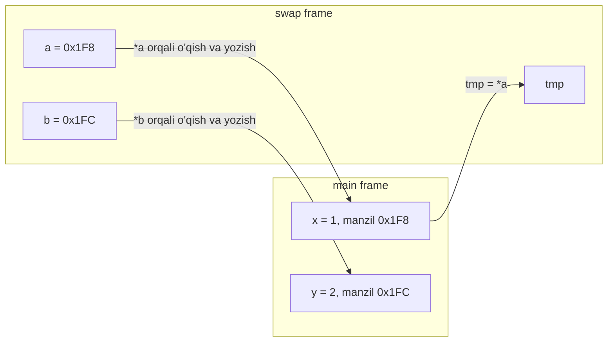

## Bu dars nima uchun kerak

8-darsda funksiya parametri chaqiruvchi o'zgaruvchisining **nusxasi** ekanini ko'rdik: funksiya ichida `n = 0` yozilsa, chaqiruvchidagi qiymat o'zgarmaydi. 11-darsda esa g'alati istisno uchradi: `double_all(prices, 3)` massiv elementlarini o'zgartirdi, `double_one(single)` esa `single` ni o'zgartirmadi. 20-darsda struct yana nusxa sifatida uzatildi va `add_vote` ovozni qo'sha olmadi. Uchala darsda ham savol keyinga qoldirilgan edi: funksiya chaqiruvchining o'zgaruvchisini qanday o'zgartiradi?

21-darsda manzil (`&x`), pointer tipi (`int *p`) va dereference (`*p`) bilan tanishdik, 22-23-darslarda pointer arifmetikasi va dinamik xotira, 24-darsda stack va heap ko'rildi. Bu dars shu vositalarni funksiyalarga qo'llaydi. Javob bitta gapga sig'adi: **C da argument doim qiymat bo'yicha uzatiladi, lekin bu qiymat manzil bo'lishi mumkin**. Shu bitta qoida swap, massiv uzatish, struct'ni o'zgartirish, `scanf` va bir nechta natija qaytarishning hammasini tushuntiradi.

Bu darsdan keyin siz:

- nega `void swap(int a, int b)` hech narsani almashtirmasligini stack frame'lar jadvali bilan ko'rsata olasiz;
- `swap(int *a, int *b)` ni yozib, uning har qadamida xotirada nima o'zgarishini tushuntira olasiz;
- massiv parametri aslida pointer ekanini va bu `sizeof` ga qanday ta'sir qilishini bilasiz;
- struct'ni pointer bilan uzatib, maydonlarga `->` orqali murojaat qila olasiz va nusxa narxini baytlarda hisoblay olasiz;
- `const int *p` va `int *const p` farqini va qachon qaysi biri kerakligini bilasiz;
- `scanf` ga nima uchun `&x` berilishini, uning qaytish qiymatini qanday tekshirishni va `%s` ni `%9s` kabi kenglik bilan cheklashni bilasiz;
- funksiyadan bir nechta natijani out-parametrlar orqali qaytara olasiz.

## C da hamma narsa qiymat bo'yicha uzatiladi

C standarti (N1570, 6.5.2.2-band, 4-paragraf) funksiya chaqiruvini shunday ta'riflaydi: chaqiruvdan oldin argumentlar hisoblanadi va har bir parametrga mos argumentning **qiymati** beriladi. Shu bandning izohida ham ikki narsa aniq aytilgan: funksiya o'z parametrlarini o'zgartirishi mumkin, lekin bu argumentga ta'sir qilmaydi; lekin obyektning manzilini uzatsa, funksiya o'sha obyektni o'zgartira oladi.

Demak C da boshqa uzatish usuli umuman yo'q. C++ dagi `int &x` kabi **pass by reference** (havola bo'yicha uzatish, parametr argumentning o'zi bo'lib qoladi) C da mavjud emas. Uning o'rnini quyidagi usul bosadi:

1. chaqiruvchi o'zgaruvchining manzilini hisoblaydi: `&x`;
2. bu manzil - oddiy son - qiymat bo'yicha, ya'ni nusxa sifatida uzatiladi;
3. funksiya shu manzil bo'yicha yozadi: `*p = ...`.

Manzilning nusxasi ham aynan o'sha joyni ko'rsatadi. Xuddi uy manzili yozilgan qog'ozni nusxalaganingiz kabi: nusxadagi manzil bo'yicha borgan odam ham aynan o'sha uyga keladi.

| Nima uzatiladi | Funksiya nimani oladi | Funksiya chaqiruvchining o'zgaruvchisini o'zgartira oladimi |
|---|---|---|
| `int x` | `x` qiymatining nusxasi | Yo'q |
| `&x` (`int *`) | Manzilning nusxasi | Ha, `*p = ...` orqali |
| Massiv `a` | Birinchi element manzili (11-dars, array decay) | Ha, elementlarni |
| struct `s` | Barcha maydonlar nusxasi (20-dars) | Yo'q |
| `&s` (struct pointer) | Manzil nusxasi | Ha, `p->maydon = ...` orqali |
| Pointer `p` | Pointerning nusxasi | Ko'rsatilgan obyektni ha, `p` ning o'zini yo'q |

Oxirgi qator keyinroq muhim bo'ladi: funksiyaga pointer berilsa, u pointer ko'rsatgan obyektni o'zgartira oladi, lekin chaqiruvchining pointer o'zgaruvchisini boshqa joyga burish uchun pointerning manzili (`int **`) kerak. Bu 28-darsdagi linked list'da uchraydi.

## Noto'g'ri swap va nega u ishlamaydi

Ikki o'zgaruvchi qiymatini almashtirish - klassik vazifa. Uchinchi vaqtinchalik o'zgaruvchi bilan: `tmp = a; a = b; b = tmp;`. Buni funksiyaga chiqaramiz:

```c run
#include <stdio.h>

// Faqat nusxalarni almashtiradi
void swap(int a, int b)
{
    printf("swap ichida, oldin: a = %d, b = %d, &a = %p\n", a, b, (void *) &a);
    int tmp = a;
    a = b;
    b = tmp;
    printf("swap ichida, keyin: a = %d, b = %d\n", a, b);
}

int main(void)
{
    int x = 1;
    int y = 2;
    printf("main, oldin: x = %d, y = %d, &x = %p\n", x, y, (void *) &x);
    swap(x, y);
    printf("main, keyin: x = %d, y = %d\n", x, y);
}
```

Brauzerdagi natija (manzillarning aniq soni `0x...` bilan almashtirilgan):

```text
main, oldin: x = 1, y = 2, &x = 0x...
swap ichida, oldin: a = 1, b = 2, &a = 0x...
swap ichida, keyin: a = 2, b = 1
main, keyin: x = 1, y = 2
```

Funksiya ichida almashtirish to'g'ri ishladi: `a = 2, b = 1`. Lekin `main` ga qaytganda `x` va `y` o'zgarmagan. Ikki manzil (`&x` va `&a`) farq qiladi - bu ikki xil o'zgaruvchi.

### Stack frame'lar jadvali

18-darsda har bir chaqiruv call stack'da o'z stack frame'ini olishini ko'rdik. Endi xotiraning o'zini chizamiz. Manzillar shartli (haqiqiysi har xil bo'ladi), har bir `int` 4 bayt:

| Qadam | `main` frame: x (0x1F8) | `main` frame: y (0x1FC) | `swap` frame: a (0x1E0) | `swap` frame: b (0x1E4) | `swap` frame: tmp (0x1E8) |
|---|---|---|---|---|---|
| `swap(x, y)` dan oldin | 1 | 2 | - | - | - |
| Chaqiruv: qiymatlar nusxalanadi | 1 | 2 | 1 | 2 | ? |
| `tmp = a` | 1 | 2 | 1 | 2 | 1 |
| `a = b` | 1 | 2 | 2 | 2 | 1 |
| `b = tmp` | 1 | 2 | 2 | 1 | 1 |
| `return`: `swap` frame yo'qoladi | 1 | 2 | - | - | - |

Jadvaldagi uchta yozuv qadami ham faqat o'ng tomondagi ustunlarni o'zgartiradi. `swap` dagi `a` va `b` - `main` dagi `x` va `y` bilan hech qanday bog'liqligi yo'q alohida xotira kataklari; ular faqat chaqiruv paytida bir xil qiymat oldi. `return` dan keyin `swap` frame'i bo'shatiladi va ishning natijasi u bilan birga yo'qoladi. `?` - `tmp` initsializatsiya qilinmagan paytdagi garbage value (24-dars).

Bitta funksiyaning `return` orqali faqat bitta qiymat qaytara olishi (8-dars) ham bu yerda yordam bermaydi: bizga ikkita o'zgaruvchini o'zgartirish kerak.

## To'g'ri swap: manzillarni uzatish

Yechim: `swap` ga qiymatlarni emas, ular yotgan joylarning manzillarini beramiz. Funksiya manzil bo'yicha o'qiydi va yozadi:

```c run
#include <stdio.h>

// a va b - chaqiruvchi o'zgaruvchilarining manzillari
void swap(int *a, int *b)
{
    int tmp = *a;
    *a = *b;
    *b = tmp;
}

int main(void)
{
    int x = 1;
    int y = 2;
    printf("oldin: x = %d, y = %d\n", x, y);
    swap(&x, &y);
    printf("keyin: x = %d, y = %d\n", x, y);

    int scores[3] = {70, 85, 90};
    swap(&scores[0], &scores[2]);
    printf("scores: %d %d %d\n", scores[0], scores[1], scores[2]);
}
```

Natija:

```text
oldin: x = 1, y = 2
keyin: x = 2, y = 1
scores: 90 85 70
```

Uchta o'zgarish bor: parametr tipi `int *`, ichkarida har murojaat `*a`, chaqiruvda `&x`. Endi jadval boshqacha (manzillar yana shartli; wasm32 da pointer 4 bayt, x86-64 da 8 bayt bo'lardi):

| Qadam | x (0x1F8) | y (0x1FC) | `swap`: a | `swap`: b | `swap`: tmp |
|---|---|---|---|---|---|
| `swap(&x, &y)`: manzillar nusxalanadi | 1 | 2 | 0x1F8 | 0x1FC | ? |
| `tmp = *a` (0x1F8 dagi qiymat) | 1 | 2 | 0x1F8 | 0x1FC | 1 |
| `*a = *b` (0x1F8 ga 0x1FC dagi qiymat) | **2** | 2 | 0x1F8 | 0x1FC | 1 |
| `*b = tmp` (0x1FC ga 1) | 2 | **1** | 0x1F8 | 0x1FC | 1 |
| `return` | 2 | 1 | - | - | - |

`a` va `b` o'zgaruvchilari ham nusxa - ular butun ish davomida o'zgarmadi. O'zgargani ular **ko'rsatgan** joylar, ya'ni `main` frame'idagi kataklar. Pass by value qoidasi buzilmadi: manzil qiymat sifatida uzatildi.



`swap(&scores[0], &scores[2])` qatoriga e'tibor bering: `swap` qayerdagi `int` bilan ishlashini bilmaydi va bilishi shart emas. Massiv elementi, struct maydoni, global o'zgaruvchi - manzili bor har qanday `int` bo'ladi.

### JavaScript bilan taqqoslash

JavaScript ham argumentlarni qiymat bo'yicha uzatadi: `function swap(a, b)` ichidagi almashtirish chaqiruvchining `let x, y` o'zgaruvchilariga ta'sir qilmaydi. Obyekt yoki massiv uzatilganda esa qiymat - obyektga havola, shuning uchun funksiya `arr[0] = ...` bilan asl massivni o'zgartira oladi, lekin `arr = [...]` bilan chaqiruvchining o'zgaruvchisini boshqa massivga bura olmaydi. Bu C dagi pointer qatoriga aynan mos keladi. Farq shundaki, JS da sonning manzilini olib bo'lmaydi: ikki sonni almashtirish uchun `[x, y] = [y, x]` kabi chaqiruvchining o'zida yozish yoki ularni obyekt ichida uzatish kerak.

## Massivni funksiyaga uzatish: aslida pointer

11-darsda massiv funksiyaga birinchi elementining manzili sifatida borishini (array decay) va funksiya ichida `sizeof` manzil o'lchamini berishini ko'rgan edik. Endi buni pointer tili bilan aniq aytamiz: parametr ro'yxatidagi massiv e'loni kompilyator tomonidan pointerga almashtiriladi. Quyidagi uchta prototip **bir xil**:

```c
int sum(int values[], int n);
int sum(int values[100], int n);   // 100 e'tiborga olinmaydi
int sum(int *values, int n);
```

Shuning uchun `int values[100]` deb yozish funksiyaga 100 ta element kafolatini bermaydi va `sizeof(values)` baribir manzil o'lchami: brauzer muhitida (wasm32) 4, x86-64 da 8. clang buni `-Wsizeof-array-argument` bilan ogohlantiradi (11-dars).

Massiv pointer bo'lib kelgani uchun funksiyaga uning bir qismini ham berish mumkin. `&values[2]` - uchinchi elementning manzili, va funksiya uchun u "boshqa massivning boshi" bo'lib ko'rinadi:

```c run
#include <stdio.h>

// n ta elementning yig'indisi; values - birinchi element manzili
int sum(const int *values, int n)
{
    printf("  sizeof(values) = %zu, values[0] = %d\n", sizeof(values), values[0]);
    int total = 0;
    for (int i = 0; i < n; i++)
    {
        total += values[i];
    }
    return total;
}

int main(void)
{
    int data[6] = {5, 10, 15, 20, 25, 30};
    printf("sizeof(data) = %zu\n", sizeof(data));
    printf("hammasi: %d\n", sum(data, 6));
    printf("2-indeksdan 3 ta: %d\n", sum(&data[2], 3));
}
```

Natija (brauzerda; x86-64 da `sizeof(values) = 8`):

```text
sizeof(data) = 24
  sizeof(values) = 4, values[0] = 5
hammasi: 105
  sizeof(values) = 4, values[0] = 15
2-indeksdan 3 ta: 60
```

Hisob: 15 + 20 + 25 = 60. `&data[2]` ni `data + 2` deb ham yozish mumkin - bu 22-darsdagi pointer arifmetikasi: manzilga 2 · sizeof(int) = 8 bayt qo'shiladi.

Ikkinchi oqibat - massiv **hech qachon** nusxalanmaydi. 6 ta element ham, 6 million ta element ham funksiyaga bir xil narxda boradi: 4 baytli manzil. Bu tezlik, lekin xavf ham: funksiya chaqiruvchining ma'lumotini buzishi mumkin. Shu xavfni yopadigan vosita - `const`, pastda.

## struct'ni pointer bilan uzatish va `->` operatori

20-darsda `add_vote(candidate c)` nusxa olgani uchun ovoz qo'shilmagan edi. Ikki yechim ko'rilgan: o'zgargan struct'ni qaytarish yoki manzilni uzatish. Ikkinchisini yozamiz.

`candidate *c` parametri bilan maydonga murojaat ikki qadam: avval `*c` - struct'ning o'zi, keyin `.votes` - uning maydoni. Lekin `*c.votes` yozib bo'lmaydi: nuqta operatorining ustuvorligi (precedence) `*` dan yuqori, shuning uchun bu `*(c.votes)` deb o'qiladi, `c` esa struct emas, pointer. clang aniq xabar beradi:

```text
error: member reference type 'candidate *' is a pointer; did you mean to use '->'?
```

To'g'ri yozuv `(*c).votes` - qavslar bilan. Bu shunchalik ko'p uchraydiki, C da uning uchun alohida operator bor: **arrow operatori** `->`. cppreference ta'rifi bo'yicha `p->m` aynan `(*p).m` ning qisqa yozuvi.

```c run
#include <stdio.h>

typedef struct
{
    char name[16];
    int votes;
} candidate;

typedef struct
{
    int readings[1000];
    int count;
} sensor_log;

// Asl struct'ni o'zgartiradi
void add_vote(candidate *c)
{
    c->votes++;          // (*c).votes++ bilan bir xil
}

// Katta struct: nusxa bilan uzatish
int last_by_value(sensor_log log)
{
    return log.readings[log.count - 1];
}

// Katta struct: pointer bilan, o'zgartirmaslik va'dasi bilan
int last_by_pointer(const sensor_log *log)
{
    return log->readings[log->count - 1];
}

int main(void)
{
    candidate a = {"Anvar", 5};
    add_vote(&a);
    add_vote(&a);
    printf("%s: %d ovoz\n", a.name, a.votes);

    static sensor_log log = {.count = 3, .readings = {12, 15, 19}};
    printf("oxirgisi: %d va %d\n", last_by_value(log), last_by_pointer(&log));
    printf("nusxa narxi: %zu bayt, pointer narxi: %zu bayt\n", sizeof(sensor_log), sizeof(sensor_log *));
}
```

Natija (brauzerda; x86-64 da pointer narxi 8 bayt):

```text
Anvar: 7 ovoz
oxirgisi: 19 va 19
nusxa narxi: 4004 bayt, pointer narxi: 4 bayt
```

`sensor_log` o'lchami: 1000 · 4 + 4 = 4004 bayt (padding yo'q, chunki hamma maydon `int`). `last_by_value` ni har chaqirganda 4004 bayt stack'ka ko'chiriladi, `last_by_pointer` esa 4 bayt oladi: farq 1001 marta. Million marta chaqiriladigan funksiyada bu 4 GB ga yaqin ko'chirish va 4 MB ga qarshi. Bundan tashqari, stack hajmi cheklangan (18-darsdagi stack overflow): katta struct'larni nusxa bilan uzatish rekursiyada stack'ni tezroq to'ldiradi. `log` ni `static` qilishimiz ham shu sababli: 4 KB lokal massivni `main` stack'iga qo'ymaslik uchun (`static` lokal o'zgaruvchi global kabi stack'da emas, dastur boshidan oxirigacha yashaydigan alohida xotira hududida turadi).

Qoida sifatida: kichik struct'larni (bir necha maydon) nusxa bilan uzatish normal va hatto aniqroq; katta struct'larni yoki funksiya o'zgartirishi kerak bo'lgan struct'larni pointer bilan uzating, faqat o'qiladigan bo'lsa `const` bilan.

## `const` pointer parametrlari

`const` va pointer birga kelganda ikki xil narsa "o'zgarmas" bo'lishi mumkin: pointer ko'rsatgan qiymat yoki pointerning o'zi. Qoidani o'qish usuli: e'lonni o'ngdan chapga o'qing, `const` o'zidan chapdagi narsaga (chapda hech narsa bo'lmasa, o'ngdagiga) tegishli.

| E'lon | O'qilishi | `*p = 5` | `p = &other` |
|---|---|---|---|
| `int *p` | int ga pointer | Mumkin | Mumkin |
| `const int *p` (yoki `int const *p`) | o'zgarmas int ga pointer | Xato | Mumkin |
| `int *const p` | int ga o'zgarmas pointer | Mumkin | Xato |
| `const int *const p` | o'zgarmas int ga o'zgarmas pointer | Xato | Xato |

Funksiya parametrlari uchun deyarli har doim ikkinchi qator kerak bo'ladi. `int sum(const int *values, int n)` imzosining o'zi chaqiruvchiga "massivingizni o'zgartirmayman" deydi, va kompilyator buni majburlaydi:

```text
error: read-only variable is not assignable
```

Uchinchi qator (`int *const p`) parametrda kam foydali: `p` baribir nusxa, uni funksiya ichida boshqa joyga burish chaqiruvchiga ta'sir qilmaydi. Shuning uchun parametrda pointerning o'zini `const` qilish faqat funksiya ichidagi o'zingizning xatolaringizdan himoya.

Bu yondashuv **const correctness** deb ataladi: faqat o'qiladigan har bir pointer parametr `const` bilan e'lon qilinadi. Uning ikki foydasi bor. Birinchisi - hujjat: imzoni o'qigan odam qaysi argumentlar o'zgarishini darhol ko'radi (`strcpy(char *dest, const char *src)` da faqat `dest` o'zgaradi). Ikkinchisi - kompilyator tekshiruvi: tasodifan `values[i] = 0` yozilsa, xato ishga tushirishdan oldin topiladi. Bir cheklov: `const int *` ni `int *` kutgan funksiyaga berish kompilyator ogohlantirishiga olib keladi, shuning uchun `const` ni pastki funksiyalardan boshlab hamma joyga izchil qo'yish kerak.

## `scanf`: nega `&x` kerak

5-darsda standart C da klaviaturadan o'qish murakkabligini CS50 kutubxonasi yashirishini aytgan edik. Endi `get_int` siz, standart kutubxonadagi `scanf` bilan o'qiymiz. `scanf("%d", &x)` - endi tushunarli: `scanf` ham oddiy funksiya, u ham argumentlarni qiymat bo'yicha oladi. `scanf("%d", x)` yozilsa, unga `x` ning hozirgi qiymati (masalan, garbage) boradi va `scanf` o'qigan sonni qayerga yozishni bilmaydi. Shuning uchun unga manzil kerak: `&x`. clang `-Wall` bilan bu xatoni ushlaydi:

```text
warning: format specifies type 'int *' but the argument has type 'int' [-Wformat]
```

Ogohlantirishni e'tiborsiz qoldirib ishga tushirsangiz, `scanf` garbage qiymatni manzil deb hisoblab, o'sha joyga yozadi - undefined behavior, ko'pincha crash.

Satr uchun `&` kerak emas: `char name[10]; scanf("%9s", name);` da `name` allaqachon birinchi elementning manzili (array decay). `&name` yozish xato tipdagi (`char (*)[10]`) manzil beradi va clang yana `-Wformat` bilan ogohlantiradi.

### Qaytish qiymati

`scanf` **muvaffaqiyatli o'zlashtirilgan** qiymatlar sonini qaytaradi. cppreference va man7 bo'yicha uchta holat bor:

| Holat | Misol (`scanf("%d %d", &a, &b)`) | Qaytish qiymati |
|---|---|---|
| Hammasi o'qildi | `10 20` | 2 |
| Mos kelmaydigan belgi (matching failure) | `10 abc` | 1 (`b` o'zgarmadi) |
| Birinchi qiymatdan oldin mos kelmaslik | `abc` | 0 |
| Birinchi qiymatdan oldin kirish tugadi | bo'sh kirish | `EOF` (-1) |

Ikki muhim tafsilot. Birinchidan, matching failure bo'lganda `scanf` noto'g'ri belgini **o'qimaydi**: `abc` kirishda qoladi va keyingi `scanf("%d", ...)` yana o'sha `a` ga urilib, yana 0 qaytaradi. Faqat `while (scanf("%d", &x) != 1)` deb qayta so'rash cheksiz siklga olib keladi. Kirishdagi qatorning qolgan qismini tashlab yuborish kerak. Ikkinchidan, `scanf` qaytish qiymatini tekshirmasdan `x` ni ishlatish - initsializatsiya qilinmagan qiymatni ishlatish demak.

Quyidagi dastur sonlarni birinchi xatoga yoki kirish oxirigacha o'qiydi va nega to'xtaganini aytadi:

```c run
#include <stdio.h>

int main(void)
{
    int x;
    int sum = 0;
    int count = 0;
    int r;

    while ((r = scanf("%d", &x)) == 1)
    {
        sum += x;
        count++;
    }

    if (r == EOF)
    {
        printf("Kirish tugadi.\n");
    }
    else
    {
        char word[16];
        if (scanf("%15s", word) == 1)
        {
            printf("Son emas: %s\n", word);
        }
    }
    printf("%d ta son, yig'indi %d\n", count, sum);
}
```

```text stdin
12 7
-3
x5 40
```

Natija:

```text
Son emas: x5
3 ta son, yig'indi 16
```

`%d` bo'shliqlar va yangi qatorlarni o'zi o'tkazib yuboradi, shuning uchun `12 7` bitta qatorda yoki alohida qatorlarda bo'lishi farq qilmaydi. `x5` da `scanf` 0 qaytardi va `x5` kirishda qoldi, shuning uchun keyingi `%15s` aynan uni o'qidi. `40` umuman o'qilmadi. Kirishdan `x5` ni o'chirib ko'ring: endi uchinchi qatordagi `40` ham qo'shiladi va dastur "Kirish tugadi." deydi.

### `%s` va bufer chegarasi

`%s` bo'shliq bo'lmagan belgilarni bo'shliq, yangi qator yoki kirish oxirigacha o'qiydi va oxiriga NUL qo'shadi. Uning **chegarasi yo'q**: `char name[10]` ga 30 belgili so'z kelsa, `scanf` 31 baytni yozadi va 12-24-darslardagi buffer overflow sodir bo'ladi. Bu 12-darsdagi `strcpy` xatosining kirish varianti, faqat xavfliroq: bu safar ma'lumotni foydalanuvchi boshqaradi.

Yechim - **kenglik** (field width): `%9s` ko'pi bilan 9 belgi o'qiydi va 10-baytga NUL yozadi. Formula: kenglik = massiv o'lchami - 1. 20-darsda `fscanf(file, "%31s", word)` ni aynan shu sababli `char word[32]` bilan ishlatgan edik.

Kenglik muammoni to'liq yopmaydi: sig'magan qism kirishda qoladi va keyingi o'qishga tushadi.

```c run
#include <stdio.h>

int main(void)
{
    char name[10];
    int age;

    if (scanf("%9s", name) != 1)
    {
        return 1;
    }
    printf("O'qildi: \"%s\"\n", name);

    if (scanf("%d", &age) != 1)
    {
        printf("Yosh o'qilmadi: qatorda ism qoldig'i bor\n");

        // Qatorning qolganini tashlab, qayta urinamiz
        int c;
        while ((c = getchar()) != '\n' && c != EOF)
        {
        }
        if (scanf("%d", &age) != 1)
        {
            return 1;
        }
    }
    printf("Yosh: %d\n", age);
}
```

```text stdin
Abdurahmonbek
25
```

Natija:

```text
O'qildi: "Abdurahmo"
Yosh o'qilmadi: qatorda ism qoldig'i bor
Yosh: 25
```

(Brauzerda bu qatorlar orasida kirish qatorlari ham ko'rinadi: ular dastur ularni o'qigan paytda chiqadi.) 13 belgili ismdan 9 tasi `name` ga tushdi, `nbek` esa kirishda qoldi va `%d` unga urilib 0 qaytardi. `getchar` sikli qatorning qolgan qismini yangi qatorgacha tashlab yubordi, keyingi `%d` esa `25` ni o'qidi. Kenglikni olib tashlab (`%s`) ishga tushirsangiz, `scanf` 14 baytni (13 belgi va NUL) 10 baytli massivga yozadi. Bu xato jim o'tishi mumkin: sanitizer o'quvchi kodidagi murojaatlarni va o'ralgan funksiyalarni (brauzer muhitida `strcpy`, `strcat`) tekshiradi, lekin standart kutubxonaning ichida bajarilgan yozuvni har doim ham ko'rmaydi. Aynan shuning uchun kenglik ixtiyoriy emas.

`scanf` ning yana bir nozik joyi: `%d` va `%s` boshidagi bo'shliqlarni o'tkazib yuboradi, `%c` esa yo'q. `scanf("%d", &n); scanf("%c", &ch);` da `ch` ga oldingi qatordan qolgan `'\n'` tushadi. Formatdagi bo'shliq (`" %c"`) har qanday bo'shliqlarni o'tkazib yuborish degani.

Bu murakkabliklar tufayli amaliy dasturlarda ko'pincha boshqacha yo'l tutiladi: butun qator `fgets` bilan chegaralangan buferga o'qiladi, keyin `sscanf` yoki `strtol` bilan tahlil qilinadi. CS50 kutubxonasidagi `get_int` ham ichida shunga o'xshash ish qiladi: qatorni o'qiydi, butun qator son bo'lmasa qayta so'raydi. `fgets` 26-darsda fayllar bilan ko'riladi.

### Mashq: `scanf` qaytish qiymatini modellashtirish

`scanf("%d %d %d", ...)` qaytaradigan qiymatni Python'da hisoblovchi funksiya yozing. `scan3(text)` `(n, values)` juftligini qaytarsin: `n` - o'zlashtirilgan qiymatlar soni yoki birinchi qiymatdan oldin kirish tugasa `-1` (EOF), `values` - o'qilgan butun sonlar ro'yxati. Soddalashtirish: son - ixtiyoriy `-` yoki `+` belgisi va raqamlar, oldidagi bo'shliqlar o'tkazib yuboriladi, son raqamdan boshqa belgida tugaydi (`"12abc"` da 12 o'qiladi, keyingi `%d` esa `a` ga uriladi).

```python run
def scan3(text):
    # Yechimingizni shu yerga yozing
    return 0, []


print(scan3("10 20 30"))
print(scan3("10 abc 30"))
print(scan3("   "))
```

```python test
check("uchta son: (3, [10, 20, 30])", lambda: scan3("10 20 30") == (3, [10, 20, 30]))
check("qatorlarga bo'lingan sonlar ham o'qiladi", lambda: scan3("1\n2\n  3") == (3, [1, 2, 3]))
check("ikkinchi qiymatda mos kelmaslik: 1", lambda: scan3("10 abc 30") == (1, [10]))
check("birinchi qiymatda mos kelmaslik: 0, EOF emas", lambda: scan3("abc") == (0, []))
check("bo'sh kirish: -1 (EOF)", lambda: scan3("") == (-1, []))
check("faqat bo'shliqlar: -1 (EOF)", lambda: scan3("  \n ") == (-1, []))
check("son o'qilgandan keyin kirish tugasa: EOF emas, shu paytgacha o'qilganlar", lambda: scan3("7") == (1, [7]))
check("ishora va raqamdan keyingi harf", lambda: scan3("-5 +6 12abc") == (3, [-5, 6, 12]))
check("faqat ishora - mos kelmaslik", lambda: scan3("4 - 5") == (1, [4]))
```

Namunaviy yechim (ochishdan oldin o'zingiz yozing):

```python
def scan3(text):
    i, values = 0, []
    for _ in range(3):
        while i < len(text) and text[i].isspace():
            i += 1
        if i == len(text):
            return (len(values) if values else -1), values
        j = i
        if text[j] in "+-":
            j += 1
        k = j
        while k < len(text) and text[k].isdigit():
            k += 1
        if k == j:
            return len(values), values
        values.append(int(text[i:k]))
        i = k
    return 3, values
```

## Funksiyadan bir nechta natija: out-parametrlar

`scanf` ning o'zi ham bitta naqshning namunasi: funksiya **holatni** `return` orqali qaytaradi (nechta qiymat o'qildi), **natijalarni** esa chaqiruvchi bergan manzillarga yozadi. Shunday parametrlar **out-parametr** deb ataladi: ular funksiyaga ma'lumot olib kirmaydi, aksincha natijani olib chiqadi.

Masalan, massivning minimumi, maksimumi va o'rtachasi bitta o'tishda hisoblanadi. Uchala natijani bitta `return` bilan qaytarib bo'lmaydi, shuning uchun ularni out-parametrlar orqali beramiz, `return` esa muvaffaqiyat belgisi:

```c run
#include <stdbool.h>
#include <stdio.h>

// Muvaffaqiyatda true qaytaradi va natijalarni *min, *max, *mean ga yozadi.
// Bo'sh massivda false qaytaradi va out-parametrlarga tegmaydi.
bool stats(const int *values, int n, int *min, int *max, double *mean)
{
    if (n <= 0)
    {
        return false;
    }
    int lo = values[0];
    int hi = values[0];
    long sum = 0;
    for (int i = 0; i < n; i++)
    {
        if (values[i] < lo)
        {
            lo = values[i];
        }
        if (values[i] > hi)
        {
            hi = values[i];
        }
        sum += values[i];
    }
    *min = lo;
    *max = hi;
    *mean = (double) sum / n;
    return true;
}

int main(void)
{
    int temps[7] = {-3, 2, 5, -1, 7, 4, 0};
    int lo, hi;
    double avg;

    if (stats(temps, 7, &lo, &hi, &avg))
    {
        printf("min %d, max %d, o'rtacha %.2f\n", lo, hi, avg);
    }
    if (!stats(temps, 0, &lo, &hi, &avg))
    {
        printf("bo'sh massiv: natija yo'q\n");
    }
}
```

Natija:

```text
min -3, max 7, o'rtacha 2.00
bo'sh massiv: natija yo'q
```

Bu 11-darsdagi amaliy topshiriqning (`min_value`, `max_value`, `average`) bitta o'tishli varianti: uch marta emas, bir marta aylanadi. Hisob: (-3 + 2 + 5 - 1 + 7 + 4 + 0) / 7 = 14 / 7 = 2.00.

Imzodagi naqsh e'tiborga loyiq: kirish parametrlari `const int *values`, out-parametrlar `const` siz `int *`. `const` bo'lmagan pointer parametr o'quvchiga "bu yerga yoziladi" degan signal. Hujjatda funksiya xato holatida out-parametrlarga nima qilishini ham yozish kerak: `stats` bo'sh massivda ularga tegmaydi, shuning uchun chaqiruvchi `lo` ni faqat `true` dan keyin ishlatadi.

Bir nechta natija qaytarishning uchta usulini solishtiramiz:

| Usul | Misol | Afzallik | Kamchilik |
|---|---|---|---|
| Out-parametrlar | `bool stats(..., int *min, int *max)` | `return` holat uchun bo'sh qoladi; standart kutubxonada keng (`scanf`, `strtol`) | Chaqiruvchi o'zgaruvchilarni oldindan e'lon qiladi; NULL yoki noto'g'ri manzil berilishi mumkin |
| struct qaytarish | `summary stats(...)` (20-dars) | Natijalar bitta nom ostida, pointer yo'q | Xato holatini ifodalash uchun struct'ga alohida maydon kerak; katta struct nusxalanadi |
| Global o'zgaruvchi | `int g_min, g_max;` | Oddiy ko'rinadi | Yashirin bog'liqlik, funksiyani ikki joydan ishlatib bo'lmaydi, testlash qiyin |

Uchinchi usul faqat taqqoslash uchun: uni ishlatmang. Birinchi ikkitasi orasidagi tanlov ko'pincha uslub masalasi. Bir xil maydonlar ko'p joyda birga yuradigan bo'lsa - struct, funksiya xato qaytarishi mumkin bo'lsa va bu C kutubxonalari uslubida bo'lsa - out-parametr.

Ba'zan out-parametr ixtiyoriy bo'ladi: chaqiruvchiga natija kerak bo'lmasa, `NULL` beradi. Standart `strtol(const char *s, char **end, int base)` aynan shunday: `end` `NULL` bo'lsa, u yerga yozilmaydi. Bunday funksiya ichida yozishdan oldin tekshiruv shart: `if (end != NULL) *end = ...`. NULL pointer bo'yicha yozish - brauzer muhitida darhol to'xtash, Linux da segmentation fault.

## Ko'p uchraydigan xatolar

1. **Qiymat bo'yicha swap.** `void swap(int a, int b)` faqat nusxalarni almashtiradi. Funksiya chaqiruvchining o'zgaruvchisini o'zgartirishi kerak bo'lsa, unga manzil (`int *`) kerak.
2. **Manzil o'rniga qiymat, yoki aksincha.** `swap(x, y)` ni `int *` kutgan funksiyaga berish, `scanf("%d", x)` - ikkalasida ham kompilyator ogohlantiradi. `-Wall` ogohlantirishlarini hech qachon e'tiborsiz qoldirmang: bu yerda ular deyarli har doim haqiqiy xato.
3. **Funksiya ichida pointerning o'zini o'zgartirib, natija chaqiruvchiga yetadi deb kutish.** `void reset(int *p) { p = NULL; }` chaqiruvchining pointeriga tegmaydi: `p` - nusxa. Ko'rsatilgan qiymatni o'zgartirish `*p = 0`, pointerning o'zini o'zgartirish esa `int **` orqali.
4. **`*c.votes` yozish.** Nuqta `*` dan oldin bajariladi. `(*c).votes` yoki `c->votes` yozing.
5. **`scanf` qaytish qiymatini tekshirmaslik.** Noto'g'ri kirishda o'zgaruvchi initsializatsiyasiz qoladi, noto'g'ri belgi esa kirishda turib qolib, qayta urinish siklini cheksiz qiladi. `!= 1` (yoki kutilgan son) bilan tekshiring va qatorning qolganini tashlang.
6. **Kengliksiz `%s`.** `scanf("%s", buf)` - foydalanuvchi boshqaradigan buffer overflow. Har doim `%Ns`, bu yerda N = massiv o'lchami - 1.
7. **Funksiya ichidagi lokal o'zgaruvchining manzilini out-parametr sifatida qaytarish.** `return &local;` yoki `*out = &local;` - funksiya tugashi bilan uning frame'i yo'qoladi va manzil yaroqsiz bo'lib qoladi (24-dars). Natijani chaqiruvchi bergan joyga yozing yoki heap'dan ajrating (23-dars).
8. **`const` ni qo'ymaslik.** Faqat o'qiladigan pointer parametrda `const` yo'qligi xato emas, lekin o'qiydiganga ma'lumot yo'qoladi va tasodifiy yozuv kompilyatsiyada topilmaydi.

## Xulosa

- C da argument doim qiymat bo'yicha uzatiladi (N1570, 6.5.2.2). Pass by reference yo'q; uning o'rniga manzil qiymat sifatida uzatiladi.
- Noto'g'ri `swap(int a, int b)` o'z stack frame'idagi nusxalarni almashtiradi va frame bilan birga natija yo'qoladi. To'g'ri `swap(int *a, int *b)` manzillar orqali chaqiruvchining kataklariga yozadi.
- Massiv parametri aslida pointer: `int a[]`, `int a[100]` va `int *a` parametrda bir xil, `sizeof` manzil o'lchamini beradi (wasm32 da 4, x86-64 da 8), massiv hech qachon nusxalanmaydi.
- struct pointer bilan uzatilsa, maydonga `p->m` (= `(*p).m`) bilan murojaat qilinadi. Katta struct'ni nusxa bilan uzatish har chaqiruvda `sizeof` bayt ko'chiradi.
- `const int *p` - ko'rsatilgan qiymat o'zgarmaydi, `int *const p` - pointerning o'zi. Faqat o'qiladigan pointer parametrlar `const` bilan e'lon qilinadi.
- `scanf` ga manzil kerak, chunki u ham qiymat bo'yicha oladi. U o'zlashtirilgan qiymatlar sonini yoki `EOF` ni qaytaradi; mos kelmagan belgi kirishda qoladi.
- `%s` kengliksiz - buffer overflow; `%9s` 10 baytli bufer uchun, sig'magan qism keyingi o'qishga qoladi.
- Bir nechta natija: holat `return` orqali, natijalar out-parametrlar orqali; muqobili - struct qaytarish.

## Amaliy topshiriq

Vaqt satrini tahlil qiladigan va ikki vaqt orasidagi farqni hisoblaydigan dastur yozing. Kirish: har qatorda `HH:MM` ko'rinishidagi ikki vaqt, masalan `08:45 17:10`.

Topshiriq qadamlari:

1. **Out-parametrli tahlil.** `bool parse_time(const char *s, int *hours, int *minutes)` funksiyasini yozing. U `sscanf(s, "%d:%d", hours, minutes)` qaytish qiymatini tekshirsin, soat 0-23 va daqiqa 0-59 oralig'ida ekanini tekshirsin va xatoda `false` qaytarsin. Nima uchun `sscanf` ga `hours` (`&` siz) beriladi - izohlang.
2. **struct va `->`.** `typedef struct { int hours; int minutes; } clock_time;` e'lon qiling va `void add_minutes(clock_time *t, int delta)` yozing: u vaqtga `delta` daqiqa qo'shsin, 24 soatdan oshsa aylansin (23:50 + 20 = 00:10). Ichida faqat `->` ishlating.
3. **swap.** Agar ikkinchi vaqt birinchisidan oldin bo'lsa, `void swap_times(clock_time *a, clock_time *b)` bilan ularni almashtiring va farqni hisoblang. Farq daqiqalarda va `H soat M daqiqa` ko'rinishida chiqsin.
4. **Kirish.** Qatorlarni `scanf("%5s %5s", a, b)` bilan `char a[6], b[6]` ga o'qing, `scanf` qaytish qiymati 2 bo'lmaguncha davom eting. Nima uchun kenglik 5 va massiv 6 ekanini yozing. Bitta qatorda xato bo'lsa (`8.45 17:10`), shu qatorni o'tkazib, keyingisiga o'ting.
5. **Stack frame jadvali.** `swap_times` uchun ham, xato yozilgan `swap_times_by_value(clock_time a, clock_time b)` uchun ham har bir qadamdagi xotira holatini jadvalda ko'rsating. Har chaqiruvda necha bayt nusxalanadi (wasm32 va x86-64 uchun)?
6. **const.** Qaysi parametrlar `const` bo'lishi mumkinligini aniqlang va qo'ying. `parse_time` ichida ataylab `s[0] = 'X'` yozib, kompilyator xabarini ko'chiring.

Boshlang'ich shablon:

```c run
#include <stdbool.h>
#include <stdio.h>

typedef struct
{
    int hours;
    int minutes;
} clock_time;

bool parse_time(const char *s, int *hours, int *minutes)
{
    // Yechimingizni shu yerga yozing
    return false;
}

int main(void)
{
    char a[6], b[6];
    while (scanf("%5s %5s", a, b) == 2)
    {
        int h1, m1, h2, m2;
        if (!parse_time(a, &h1, &m1) || !parse_time(b, &h2, &m2))
        {
            printf("Noto'g'ri qator: %s %s\n", a, b);
            continue;
        }
        printf("%02d:%02d - %02d:%02d\n", h1, m1, h2, m2);
    }
}
```

```text stdin
08:45 17:10
22:30 06:15
8.45 17:10
25:00 10:00
```

Shu kirish uchun to'g'ri natija: 1-qator 8 soat 25 daqiqa (505 daqiqa); 2-qatorda ikkinchi vaqt oldin, almashtirilgandan keyin 16 soat 15 daqiqa (975 daqiqa); 3- va 4-qatorlar noto'g'ri deb o'tkazib yuboriladi.

Yaxshi javobda bo'lishi kerak bo'lgan narsalar:

- `parse_time` `sscanf` natijasini `!= 2` bilan tekshiradi va oraliqlarni tekshiradi; `hours` allaqachon pointer bo'lgani uchun `&` siz uzatilishi tushuntirilgan;
- `add_minutes` faqat `->` ishlatadi va aylanish `% (24 * 60)` bilan to'g'ri (23:50 + 20 = 00:10);
- `swap_times` pointerlar bilan ishlaydi, qiymat bo'yicha variant nega ishlamasligi stack frame jadvalida ko'rsatilgan; nusxa narxi `sizeof(clock_time)` = 8 bayt, pointer 4 (wasm32) yoki 8 (x86-64) bayt;
- `%5s` va `char[6]` munosabati (5 belgi + NUL) tushuntirilgan;
- kirish parametrlari `const char *`, out-parametrlar `const` siz; ataylab qilingan yozuvga `read-only variable is not assignable` xabari keltirilgan;
- natijalar: 505 va 975 daqiqa, 3- va 4-qatorlar rad etilgan.

Javobingizni pastdagi maydonga yozing va yuqoridagi mezonlar bilan solishtiring.

## Manbalar

- CS50x. [Lecture 4 notes](https://cs50.harvard.edu/x/notes/4/) - "Swapping" va "scanf" bo'limlari: muammo qo'yilishi va CS50 tushuntirishi, bu darsda chuqurroq ochilgan.
- ISO/IEC 9899:201x. [N1570 qoralamasi](https://www.open-std.org/jtc1/sc22/wg14/www/docs/n1570.pdf) - 6.5.2.2 "Function calls", 4-paragraf va izoh: argumentlar qiymat sifatida beriladi, manzil uzatilsa obyekt o'zgartirilishi mumkin; 6.7.6.3 - massiv parametri pointerga moslashtirilishi.
- cppreference. [Member access operators](https://en.cppreference.com/w/c/language/operator_member_access) - "Member access through pointer": `p->m` va `(*p).m` tengligi.
- cppreference. [const type qualifier](https://en.cppreference.com/w/c/language/const) - `const` ga pointer va `const` pointer farqi, `const` obyektni o'zgartirish xatosi.
- cppreference. [scanf, fscanf, sscanf](https://en.cppreference.com/w/c/io/fscanf) - konversiya spetsifikatorlari, kenglik, bo'shliqlarni o'tkazish (`%c` istisnosi), "Return value" bo'limi.
- Linux man-pages. [scanf(3)](https://man7.org/linux/man-pages/man3/scanf.3.html) - RETURN VALUE (o'zlashtirilgan elementlar soni, matching failure, `EOF`) va BUGS/NOTES bo'limlari.
- cppreference. [Function declarations](https://en.cppreference.com/w/c/language/function_declaration) - parametr ro'yxatidagi massiv tipining pointerga almashtirilishi.
