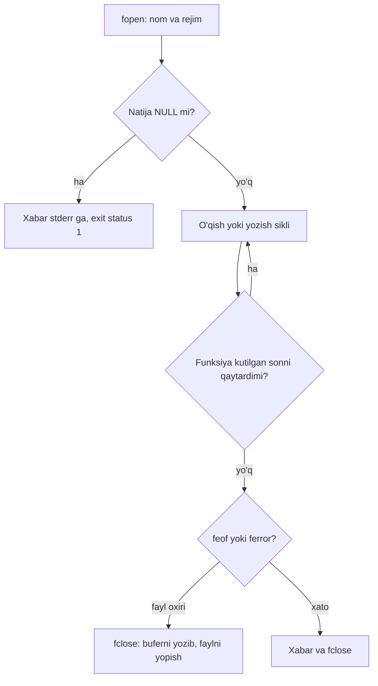

## Bu dars nima uchun kerak

Hozirgacha dasturlarimiz ma'lumotni klaviaturadan olib, ekranga chiqardi. Dastur tugashi bilan hamma narsa yo'qoladi: o'zgaruvchilar, massivlar, hisoblangan natijalar. Ma'lumot dastur ishlashidan uzoqroq yashashi uchun uni **faylga** yozish kerak. 20-darsda byulletenlarni fayldan o'qish uchun `fopen` va `fscanf` ni bir marta, ichiga kirmasdan ishlatgan edik. Bu dars fayllar bilan ishlashni to'liq ochadi.

Ikkinchi mavzu - **binary formatlar**. 2-3-darslarda rasm, ovoz va video oxir-oqibat baytlar ekanini, baytlarga ma'noni esa ularni o'qiydigan dastur va kelishuv berishini ko'rdik. Fayl formati - aynan shu kelishuvning yozilgan shakli. Bu darsda biz BMP rasmini dasturning o'zi bilan bayt-baytigacha yaratamiz, keyin uni o'qib, sarlavhasini tahlil qilamiz; JPEG faylini boshidagi uch baytdan taniymiz. Bu yerda 21-25-darslardagi hamma narsa ishlaydi: `FILE *` - pointer, `fread` ga bufer manzili beriladi, `fscanf` ga `&x` (25-dars), struct maydonlari va padding (20-dars).

Bu darsdan keyin siz:

- `fopen` rejimlarini (`r`, `w`, `a`, `rb`, `wb` va `+` variantlari) farqlay olasiz va natijani `NULL` ga tekshirasiz;
- matnli fayllarni `fprintf`, `fscanf`, `fgets`, `fputs` bilan yoza va o'qiy olasiz;
- `fread` va `fwrite` ning element o'lchami va soni parametrlarini hamda qaytish qiymatini to'g'ri ishlatasiz;
- `fseek` va `ftell` bilan fayl ichida yurish va fayl o'lchamini aniqlashni bilasiz;
- `while (!feof(f))` sikli nega oxirgi yozuvni ikki marta qayta ishlashini tushuntira olasiz;
- matnli va binary fayl farqini, little-endian tartibni va `uint8_t`, `uint16_t`, `uint32_t` tiplarini bilasiz;
- BMP sarlavhasining 14 va 40 baytli qismlarini maydonma-maydon o'qiy olasiz, qator padding'ini hisoblaysiz va struct packing muammosini tushunasiz;
- JPEG faylini imzosidan tanib, o'chirilgan fayllarni tiklash g'oyasini tushuntira olasiz.

## Fayl, stream va `FILE *`

Operatsion tizim uchun fayl - nomi bor baytlar ketma-ketligi. C standart kutubxonasi fayl bilan to'g'ridan-to'g'ri emas, **stream** (oqim) orqali ishlaydi: stream - baytlar manbai yoki qabul qiluvchisi ustidagi abstraction, uning holati `FILE` tipidagi obyektda saqlanadi. Unda joriy pozitsiya (fayl boshidan nechanchi baytdamiz), bufer, xato va fayl oxiri belgilari bor. Biz `FILE` ning ichini ko'rmaymiz: kutubxona bizga faqat unga pointer beradi, `FILE *`. Allaqachon tanish uchta stream ham shunday: `stdin`, `stdout`, `stderr` (13-dars). `printf(...)` aslida `fprintf(stdout, ...)` ning qisqa shakli.

Fayl bilan ishlash har doim uch bosqichli:



### `fopen` rejimlari

`FILE *fopen(const char *name, const char *mode)` faylni ochadi va muvaffaqiyatsizlikda `NULL` qaytaradi (fayl yo'q, ruxsat yo'q va h.k.). Rejim satri nima qilishni belgilaydi (cppreference `fopen` jadvali bo'yicha):

| Rejim | Ma'nosi | Fayl bor bo'lsa | Fayl yo'q bo'lsa |
|---|---|---|---|
| `"r"` | O'qish | Boshidan o'qiladi | `NULL` |
| `"w"` | Yozish | **Tarkibi o'chiriladi** (uzunlik 0) | Yaratiladi |
| `"a"` | Oxiriga qo'shish | Har yozuv oxiriga tushadi | Yaratiladi |
| `"r+"` | O'qish va yozish | Boshidan, tarkib saqlanadi | `NULL` |
| `"w+"` | Yozish va o'qish | Tarkibi o'chiriladi | Yaratiladi |
| `"a+"` | O'qish va oxiriga qo'shish | Yozuv oxiriga, o'qish istalgan joydan | Yaratiladi |
| `"wx"` (C11) | Faqat yangi fayl | `NULL` (ustiga yozmaydi) | Yaratiladi |

Har bir rejimga `b` qo'shish mumkin: `"rb"`, `"wb"`, `"ab"`, `"r+b"`. `b` - binary rejim: kutubxona baytlarni hech qanday o'zgartirishsiz o'qiydi va yozadi. Matn rejimida esa platforma qator oxirlarini o'girishi mumkin: Windows'da `"\n"` faylga `"\r\n"` bo'lib yoziladi va o'qishda qaytib `"\n"` ga aylanadi. POSIX tizimlarda (Linux, macOS) matn va binary rejim farq qilmaydi, `b` e'tiborga olinmaydi. Lekin rasm yoki boshqa binary ma'lumot uchun `b` ni doim yozing: kod Windows'da ham to'g'ri ishlaydi va o'quvchiga faylning turini aytadi.

`"w"` ning eng xavfli xususiyati - u mavjud faylni so'roqsiz bo'shatadi. O'qish uchun ochmoqchi bo'lgan faylni xato bilan `"w"` da ochsangiz, ma'lumot `fopen` qaytishi bilanoq yo'qoladi.

### `NULL` tekshiruvi va `fclose`

```c
FILE *in = fopen("scores.txt", "r");
if (in == NULL)
{
    perror("scores.txt");
    return 1;
}
```

`perror` xabarni `stderr` ga, sababi bilan chiqaradi (`scores.txt: No such file or directory`). `NULL` ni tekshirmasdan `fgets(line, size, in)` chaqirilsa, kutubxona NULL pointer bo'yicha o'qiydi: Linux da segmentation fault.

Ish tugagach `fclose(f)`. Bu uch ish qiladi: bufferda qolgan baytlarni faylga yozadi, operatsion tizim resursini (fayl deskriptorini) bo'shatadi va `FILE` obyektini o'chiradi. Yozish **buferlangan**: `fprintf` har chaqiruvda diskka bormaydi, baytlar xotiradagi buferda yig'iladi va bufer to'lganda yoki `fclose` / `fflush` da yoziladi. Dastur `fclose` siz to'satdan to'xtasa (masalan, crash), oxirgi yozuvlar faylga tushmasligi mumkin. Bundan tashqari, bitta jarayon bir vaqtda ochiq tuta oladigan fayllar soni cheklangan: Linux da `ulimit -n` odatda 1024 ni ko'rsatadi, siklda ochilib yopilmagan fayllar bu chegaraga yetadi.

Brauzer muhiti dastur oxirida yopilmagan fayllarni alohida aytadi: `fclose qilinmagan fayl: report.txt`. `FILE` tuzilmasi `malloc` bilan ajratilgani uchun u leak hisobotida ham ko'rinishi mumkin (23-dars).

## Matnli fayllar: `fprintf`, `fscanf`, `fgets`, `fputs`

Matnli funksiyalar konsoldagi tanish funksiyalarning fayl variantlari:

| Funksiya | Konsoldagi jufti | Nima qiladi | Qaytaradi |
|---|---|---|---|
| `fprintf(f, fmt, ...)` | `printf` | Formatlangan matn yozadi | Yozilgan belgilar soni, xatoda manfiy |
| `fscanf(f, fmt, ...)` | `scanf` (25-dars) | Formatlangan o'qish | O'zlashtirilgan qiymatlar soni yoki `EOF` |
| `fgets(buf, n, f)` | - | Bitta qatorni, ko'pi bilan n - 1 belgi, `'\n'` bilan birga | `buf` yoki `NULL` (oxir yoki xato) |
| `fputs(s, f)` | `puts` | Satrni yozadi, `'\n'` qo'shmaydi | Manfiy bo'lmagan son yoki `EOF` |
| `fgetc(f)` / `fputc(c, f)` | `getchar` / `putchar` | Bitta bayt | Bayt `int` sifatida yoki `EOF` |

`fgets` chegaralangan: `char line[64]` ga ko'pi bilan 63 belgi va NUL yozadi. Qator undan uzun bo'lsa, qolgani keyingi `fgets` ga qoladi. Shuning uchun 25-darsda aytilgan naqsh - qatorni `fgets` bilan o'qib, keyin `sscanf` bilan tahlil qilish - `fscanf` dan xavfsizroq: noto'g'ri qator faqat o'sha qatorni buzadi va keyingi qatorga sinxronlash o'z-o'zidan bo'ladi.

Quyidagi dastur ballar faylini o'qiydi, noto'g'ri qatorni o'tkazib yuboradi va hisobotni yangi faylga yozadi. Fayl tarkibini "scores.txt" maydonida o'zgartirib ko'ring; dastur yozgan `report.txt` natija ostida ko'rinadi.

```c run
#include <stdio.h>
#include <string.h>

int main(void)
{
    FILE *in = fopen("scores.txt", "r");
    if (in == NULL)
    {
        perror("scores.txt");
        return 1;
    }
    FILE *out = fopen("report.txt", "w");
    if (out == NULL)
    {
        perror("report.txt");
        fclose(in);
        return 1;
    }

    char line[64];
    char name[32];
    int score;
    int count = 0, sum = 0, line_no = 0;

    while (fgets(line, sizeof(line), in) != NULL)
    {
        line_no++;
        if (sscanf(line, "%31s %d", name, &score) != 2)
        {
            line[strcspn(line, "\n")] = '\0';
            printf("%d-qator o'tkazib yuborildi: \"%s\"\n", line_no, line);
            continue;
        }
        fprintf(out, "%-10s %3d %s\n", name, score, score >= 80 ? "a'lo" : "");
        count++;
        sum += score;
    }
    fprintf(out, "O'rtacha: %.1f\n", (double) sum / count);
    fputs("Hisobot tugadi.\n", out);

    fclose(in);
    fclose(out);
    printf("%d ta qator yozildi\n", count);
}
```

```text file scores.txt
Anvar 72
Barno 91
xato qator
Doniyor 85
Malika 64
```

Natija:

```text
3-qator o'tkazib yuborildi: "xato qator"
4 ta qator yozildi
```

`report.txt` tarkibi:

```text
Anvar       72 
Barno       91 a'lo
Doniyor     85 a'lo
Malika      64 
O'rtacha: 78.0
Hisobot tugadi.
```

Hisob: (72 + 91 + 85 + 64) / 4 = 312 / 4 = 78.0. `xato qator` da `sscanf` birinchi `%31s` ni o'qidi ("xato"), lekin `%d` "qator" ga urildi va 1 qaytardi. `strcspn(line, "\n")` qatordagi birinchi `'\n'` gacha bo'lgan uzunlikni beradi: `fgets` saqlagan yangi qator belgisini shu bilan kesamiz. `fclose(out)` ni o'chirib ishga tushirib ko'ring.

Bir eslatma: fayl bo'sh bo'lsa yoki hamma qator noto'g'ri bo'lsa, `count = 0` va `sum / count` nolga bo'lish bo'ladi (`double` ga aylantirilgani uchun NaN chiqadi). Haqiqiy dasturda buni tekshiring; misolni qisqa saqlash uchun tashlab ketdik.

## Fayl oxiri: `EOF` va `feof` ni to'g'ri ishlatish

`EOF` - `<stdio.h>` dagi manfiy `int` konstanta (odatda -1). O'qish funksiyalari uni "endi bayt yo'q" yoki xato belgisi sifatida qaytaradi. Shuning uchun `fgetc` natijasi `char` ga emas, `int` ga saqlanadi: `char` ga saqlansa, 0xFF bayti va `EOF` farqlanmay qoladi (6-darsda oddiy `char` signed ekanini ko'rgan edik, 0xFF unda -1).

`feof(f)` esa boshqa narsa: u fayl oxiri **belgisi** o'rnatilganmi, shuni aytadi. Belgi o'qish funksiyasi fayl oxiriga **urilib, muvaffaqiyatsiz bo'lganda** o'rnatiladi, oxirgi baytni o'qiganda emas. `feof` kelajakni bashorat qilmaydi: "keyingi o'qish muvaffaqiyatli bo'ladimi" savoliga u javob bermaydi. Shuning uchun klassik sikl xato:

```c run
#include <stdio.h>

int main(void)
{
    FILE *f = fopen("data.txt", "r");
    if (f == NULL)
    {
        return 1;
    }
    int x = 0, sum = 0, count = 0;

    // Noto'g'ri: feof o'qishdan oldin tekshiriladi
    while (!feof(f))
    {
        fscanf(f, "%d", &x);
        sum += x;
        count++;
    }
    printf("noto'g'ri: %d ta, yig'indi %d\n", count, sum);

    rewind(f);   // boshiga qaytish va belgilarni tozalash
    sum = 0;
    count = 0;

    // To'g'ri: o'qish funksiyasining natijasi tekshiriladi
    while (fscanf(f, "%d", &x) == 1)
    {
        sum += x;
        count++;
    }
    printf("to'g'ri: %d ta, yig'indi %d\n", count, sum);
    printf("to'xtash sababi: %s\n", feof(f) ? "fayl oxiri" : ferror(f) ? "o'qish xatosi" : "noto'g'ri ma'lumot");
    fclose(f);
}
```

```text file data.txt
10
20
30
```

Natija:

```text
noto'g'ri: 4 ta, yig'indi 90
to'g'ri: 3 ta, yig'indi 60
to'xtash sababi: fayl oxiri
```

Noto'g'ri siklning qadamlari:

| Aylanish | `feof` oldin | `fscanf` | `x` | `sum` |
|---|---|---|---|---|
| 1 | 0 | 1 qaytardi | 10 | 10 |
| 2 | 0 | 1 qaytardi | 20 | 30 |
| 3 | 0 | 1 qaytardi, `30` dan keyingi `'\n'` hali o'qilmagan | 30 | 60 |
| 4 | 0 | `EOF` qaytardi, endi belgi o'rnatildi | 30 (eski) | **90** |
| - | 1 | sikl tugaydi | | |

To'rtinchi aylanishda `fscanf` hech narsa o'qimadi va `x` ni o'zgartirmadi, lekin sikl tanasi baribir bajarildi. "data.txt" maydonida oxirgi `30` dan keyingi yangi qatorni o'chirib ko'ring: endi `30` ni o'qish fayl oxiriga urilib tugaydi, belgi 3-aylanishda o'rnatiladi va noto'g'ri sikl tasodifan to'g'ri javob beradi. Xato kirish faylining ko'rinmas tafsilotiga bog'liq - aynan shuning uchun u xavfli.

Qoida: siklni o'qish funksiyasining qaytish qiymati boshqarsin (`fscanf(...) == 1`, `fgets(...) != NULL`, `fread(...) == n`, `(c = fgetc(f)) != EOF`). `feof` va `ferror` faqat sikldan keyin, **nega** to'xtaganini aniqlash uchun.

## Binary fayllar: `fread`, `fwrite` va endianness

Matnli faylda son raqamlar ketma-ketligi sifatida saqlanadi: 1000 - to'rtta belgi `'1' '0' '0' '0'`, ya'ni baytlar `31 30 30 30`. Binary faylda esa sonning xotiradagi ko'rinishi to'g'ridan-to'g'ri yoziladi: 32 bitli `int` 1000 = 0x000003E8 - to'rt bayt. Binary format ixcham (2 147 483 647 matnda 10 bayt, binary'da baribir 4) va o'qish tez (tahlil kerak emas), lekin uni odam o'qiy olmaydi va baytlar tartibi kelishuvini talab qiladi.

### `fread` va `fwrite`

```c
size_t fread(void *buffer, size_t size, size_t count, FILE *f);
size_t fwrite(const void *buffer, size_t size, size_t count, FILE *f);
```

`size` - bitta elementning baytlardagi o'lchami, `count` - nechta element. Jami `size · count` bayt ko'chiriladi. `buffer` - xotiradagi manzil (25-darsdagi out-parametr: `fread` u yerga yozadi). Qaytish qiymati - **to'liq** o'qilgan yoki yozilgan **elementlar** soni, baytlar emas. Agar u `count` dan kichik bo'lsa, fayl oxiri yoki xato bo'lgan; qaysi biri ekanini `feof` / `ferror` aytadi. Shu sababli `fread(buf, 1, 400, f)` va `fread(buf, 400, 1, f)` bir xil baytlarni o'qiydi, lekin fayl 250 bayt bo'lsa, birinchisi 250, ikkinchisi 0 qaytaradi.

### Endianness

32 bitli son to'rt baytdan iborat, lekin ularni xotiraga qaysi tartibda qo'yish - protsessor kelishuvi. Bu kelishuv **endianness** deyiladi:

- **little-endian** - eng kichik (o'ng) bayt birinchi: 0x000003E8 → `e8 03 00 00`. x86, x86-64, ko'pchilik ARM tizimlari va WebAssembly shunday;
- **big-endian** - eng katta bayt birinchi: `00 00 03 e8`. Tarmoq protokollari ("network byte order") va JPEG ichidagi ko'p sonli maydonlar shunday.

`fwrite` xotiradagi baytlarni qanday bo'lsa shunday yozadi, shuning uchun little-endian mashinada yozilgan binary fayl big-endian mashinada noto'g'ri o'qiladi. Fayl formatlari shuning uchun tartibni aniq belgilaydi: BMP - little-endian.

9-darsda relocation baytlarini ko'rganda little-endian tartibga duch kelgan edik. Endi uni faylda ko'ramiz:

```c run
#include <stdint.h>
#include <stdio.h>

int main(void)
{
    int32_t numbers[4] = {1, 256, 1000, -1};

    FILE *f = fopen("nums.bin", "wb");
    if (f == NULL)
    {
        return 1;
    }
    size_t written = fwrite(numbers, sizeof(int32_t), 4, f);
    fclose(f);
    printf("yozildi: %zu ta element\n", written);

    f = fopen("nums.bin", "rb");
    if (f == NULL)
    {
        return 1;
    }
    fseek(f, 0, SEEK_END);
    long size = ftell(f);
    printf("fayl o'lchami: %ld bayt\n", size);
    rewind(f);

    int32_t back[10];
    size_t got = fread(back, sizeof(int32_t), 10, f);
    printf("10 ta so'raldi, %zu ta o'qildi; feof = %d\n", got, feof(f) != 0);

    // 1000 ning baytlarini ko'rish uchun 9-baytga o'tamiz
    uint8_t bytes[4];
    fseek(f, 2 * sizeof(int32_t), SEEK_SET);
    fread(bytes, 1, 4, f);
    printf("1000 baytlari: %02x %02x %02x %02x\n", bytes[0], bytes[1], bytes[2], bytes[3]);
    fclose(f);

    for (size_t i = 0; i < got; i++)
    {
        printf("%d ", back[i]);
    }
    printf("\n");
}
```

Natija:

```text
yozildi: 4 ta element
fayl o'lchami: 16 bayt
10 ta so'raldi, 4 ta o'qildi; feof = 1
1000 baytlari: e8 03 00 00
1 256 1000 -1 
```

Brauzer `nums.bin` ni binary deb taniydi va boshidagi baytlarni hex'da ko'rsatadi:

```text
01 00 00 00 00 01 00 00 e8 03 00 00 ff ff ff ff
```

Hisob: 256 = 0x00000100 → `00 01 00 00`; -1 two's complement'da (6-dars) 0xFFFFFFFF → `ff ff ff ff`. Fayl o'lchami 4 · 4 = 16 bayt. `fread` 10 ta so'radi, faqat 4 ta to'liq element bor edi, shuning uchun 4 qaytdi va fayl oxiri belgisi o'rnatildi.

### `fseek` va `ftell`

`fseek(f, offset, whence)` joriy pozitsiyani o'zgartiradi: `SEEK_SET` - fayl boshidan, `SEEK_CUR` - joriy joydan, `SEEK_END` - oxiridan. `ftell(f)` joriy pozitsiyani `long` sifatida qaytaradi. `fseek(f, 0, SEEK_END)` + `ftell(f)` - binary fayl o'lchamini bilishning oddiy usuli; `rewind(f)` esa boshiga qaytaradi va xato hamda fayl oxiri belgilarini tozalaydi. Matn rejimida `ftell` qiymati faqat `fseek` ga qaytarib berish uchun yaroqli va baytlar soni bo'lishi shart emas (Windows'dagi `"\r\n"` sababli); bayt aniqligi kerak bo'lsa, binary rejim.

### Aniq kenglikli tiplar: `stdint.h`

Binary formatda har maydon aniq bayt sonini egallaydi, `int` esa standartda "kamida 16 bit", `long` brauzerda 4, x86-64 Linux da 8 bayt (6-dars). Shuning uchun format bilan ishlashda `<stdint.h>` dagi **fixed-width integer** tiplari ishlatiladi:

| Tip | Bit | Oraliq | BMP da ishlatilishi |
|---|---|---|---|
| `uint8_t` | 8 | 0 ... 255 | Rang kanali (B, G, R) |
| `uint16_t` | 16 | 0 ... 65 535 | `bfType`, `biBitCount` |
| `uint32_t` | 32 | 0 ... 4 294 967 295 | `bfSize`, `bfOffBits`, `biSize` |
| `int32_t` | 32 | -2 147 483 648 ... 2 147 483 647 | `biWidth`, `biHeight` (manfiy bo'lishi mumkin) |

`uint8_t` baytlar uchun `char` dan yaxshiroq: oddiy `char` signed bo'lishi mumkin va 0xFF uni -1 qiladi, `uint8_t` esa doim 0 ... 255.

## BMP: eng oddiy rasm formati ichida

BMP (bitmap) - Windows'ning siqilmagan rasm formati. U o'rganish uchun qulay: sarlavhadan keyin piksellar 3-darsdagi RGB qiymatlari ko'rinishida to'g'ridan-to'g'ri yotadi. 24 bitli BMP fayl uch qismdan iborat: 14 baytli `BITMAPFILEHEADER`, 40 baytli `BITMAPINFOHEADER` va piksel massivi. Barcha sonlar little-endian. Maydonlar Microsoft hujjatlari bo'yicha:

**BITMAPFILEHEADER** (14 bayt):

| Siljish | Maydon | Tip | Ma'nosi |
|---|---|---|---|
| 0 | `bfType` | `uint16_t` | Imzo: `'B' 'M'` baytlari (0x42 0x4D) |
| 2 | `bfSize` | `uint32_t` | Butun fayl o'lchami, baytlarda |
| 6 | `bfReserved1` | `uint16_t` | Zahira, 0 |
| 8 | `bfReserved2` | `uint16_t` | Zahira, 0 |
| 10 | `bfOffBits` | `uint32_t` | Fayl boshidan piksellargacha siljish |

**BITMAPINFOHEADER** (40 bayt, faylda 14-baytdan boshlanadi):

| Siljish | Maydon | Tip | Ma'nosi |
|---|---|---|---|
| 14 | `biSize` | `uint32_t` | Shu sarlavha o'lchami: 40 |
| 18 | `biWidth` | `int32_t` | Kenglik, pikselda |
| 22 | `biHeight` | `int32_t` | Balandlik; musbat - qatorlar pastdan yuqoriga, manfiy - yuqoridan pastga |
| 26 | `biPlanes` | `uint16_t` | Doim 1 |
| 28 | `biBitCount` | `uint16_t` | Piksel uchun bit: 24 |
| 30 | `biCompression` | `uint32_t` | 0 = `BI_RGB`, siqilmagan |
| 34 | `biSizeImage` | `uint32_t` | Piksel massivi o'lchami (`BI_RGB` da 0 bo'lishi mumkin) |
| 38 | `biXPelsPerMeter` | `int32_t` | Gorizontal o'lcham, piksel/metr |
| 42 | `biYPelsPerMeter` | `int32_t` | Vertikal o'lcham |
| 46 | `biClrUsed` | `uint32_t` | Palitra ranglari soni (24 bitda 0) |
| 50 | `biClrImportant` | `uint32_t` | Muhim ranglar (0 - hammasi) |

Jami 14 + 40 = 54 bayt, shuning uchun oddiy 24 bitli BMP da `bfOffBits` = 54. Ikkita muhim tafsilot:

- **Rang tartibi BGR.** Har piksel 3 bayt, lekin tartib ko'k, yashil, qizil. Qizil piksel faylda `00 00 ff`.
- **Qatorlar pastdan yuqoriga.** `biHeight` musbat bo'lsa, fayldagi birinchi qator - rasmning **pastki** qatori.

### Qator padding'i

Har bir piksel qatori faylda 4 baytga karrali uzunlikka to'ldiriladi. Microsoft hujjatidagi stride formulasi (u yerda bitli amallar bilan yozilgan, natija bir xil):

qator baytlari = ((kenglik · bitlar + 31) / 32) · 4 (butun sonli bo'lish)

Misol: kenglik 3, 24 bit. Piksellar 3 · 3 = 9 bayt. Formula: (3 · 24 + 31) / 32 = 103 / 32 = 3, 3 · 4 = 12 bayt. Demak har qator oxirida 12 - 9 = 3 bayt padding (nollar). Kenglik 4 bo'lsa: 4 · 3 = 12 bayt, padding 0. Kenglik 5: 15 bayt → 16, padding 1. 24 bitli BMP uchun soddaroq ko'rinish: padding = (4 - (kenglik · 3) % 4) % 4.

Padding'ni unutish BMP bilan ishlashdagi eng keng tarqalgan xato: kengligi 4 ga karrali bo'lmagan rasmda har keyingi qator bir necha baytga siljiydi va rasm qiyshayadi.

### Struct packing muammosi

Sarlavhani struct qilib, bitta `fread` bilan o'qish tabiiy ko'rinadi:

```c
typedef struct
{
    uint16_t type;
    uint32_t size;
    uint16_t reserved1;
    uint16_t reserved2;
    uint32_t offset;
} file_header;
```

Lekin 20-darsdagi alignment qoidasi bo'yicha `uint32_t` 4 ga karrali siljishda turishi kerak. `type` 0-1 baytlarni egallaydi, keyin kompilyator 2 bayt padding qo'yadi va `size` 4-baytdan boshlanadi. Natijada `sizeof(file_header)` 14 emas, 16, va `fread(&h, sizeof h, 1, f)` maydonlarni noto'g'ri joylardan oladi. Ikki yechim bor:

1. **`#pragma pack(push, 1)` ... `#pragma pack(pop)`.** Kompilyatorga shu struct'larda padding qo'ymaslikni aytadi; GCC, clang va MSVC buni qo'llab-quvvatlaydi, lekin u C standartining qismi emas. Bundan tashqari bu yechim mashina little-endian ekaniga tayanadi va tekislanmagan maydonlarga murojaat ba'zi arxitekturalarda sekinroq.
2. **Maydonma-maydon o'qish.** Sarlavhani `uint8_t` massiviga o'qib, har bir maydonni siljishi bo'yicha baytlardan yig'ish. Ko'proq kod, lekin padding'ga ham, mashina endianness'iga ham bog'liq emas.

Quyidagi dastur ikkala yondashuvni ko'rsatadi: avval struct o'lchamlarini chiqaradi, keyin 3 × 2 pikselli BMP ni maydonma-maydon yozadi (`wb`), uni qayta ochib (`rb`) sarlavhani tahlil qiladi va piksellarni o'qiydi.

```c run
#include <stdint.h>
#include <stdio.h>

typedef struct
{
    uint16_t type;
    uint32_t size;
    uint16_t reserved1;
    uint16_t reserved2;
    uint32_t offset;
} naive_header;

#pragma pack(push, 1)
typedef struct
{
    uint16_t type;
    uint32_t size;
    uint16_t reserved1;
    uint16_t reserved2;
    uint32_t offset;
} packed_header;
#pragma pack(pop)

// Little-endian yozish: avval kichik bayt
void put_u16(FILE *f, uint16_t v)
{
    fputc(v & 0xFF, f);
    fputc(v >> 8, f);
}

void put_u32(FILE *f, uint32_t v)
{
    for (int i = 0; i < 4; i++)
    {
        fputc((v >> (8 * i)) & 0xFF, f);
    }
}

// Little-endian o'qish: baytlardan son yig'ish
uint16_t get_u16(const uint8_t *p)
{
    return p[0] | (p[1] << 8);
}

uint32_t get_u32(const uint8_t *p)
{
    return (uint32_t) p[0] | (uint32_t) p[1] << 8 | (uint32_t) p[2] << 16 | (uint32_t) p[3] << 24;
}

int main(void)
{
    printf("sizeof: naive %zu, packed %zu\n", sizeof(naive_header), sizeof(packed_header));

    const int width = 3, height = 2;
    // Rasm yuqoridan pastga: qizil, yashil, ko'k / oq, qora, sariq. Har piksel B, G, R.
    uint8_t pixels[2][3][3] = {
        {{0, 0, 255}, {0, 255, 0}, {255, 0, 0}},
        {{255, 255, 255}, {0, 0, 0}, {0, 255, 255}},
    };
    int row_size = (width * 24 + 31) / 32 * 4;
    int padding = row_size - width * 3;
    uint32_t image_size = row_size * height;

    FILE *f = fopen("tiny.bmp", "wb");
    if (f == NULL)
    {
        return 1;
    }
    // BITMAPFILEHEADER, 14 bayt
    fputc('B', f);
    fputc('M', f);
    put_u32(f, 14 + 40 + image_size);
    put_u16(f, 0);
    put_u16(f, 0);
    put_u32(f, 14 + 40);
    // BITMAPINFOHEADER, 40 bayt
    put_u32(f, 40);
    put_u32(f, width);
    put_u32(f, height);
    put_u16(f, 1);
    put_u16(f, 24);
    put_u32(f, 0);
    put_u32(f, image_size);
    put_u32(f, 2835);
    put_u32(f, 2835);
    put_u32(f, 0);
    put_u32(f, 0);
    // Piksellar: pastki qatordan boshlab, har qator oxirida padding
    for (int r = height - 1; r >= 0; r--)
    {
        fwrite(pixels[r], 3, width, f);
        for (int k = 0; k < padding; k++)
        {
            fputc(0, f);
        }
    }
    fclose(f);

    // Endi faylni boshqa dastur kabi o'qiymiz
    f = fopen("tiny.bmp", "rb");
    if (f == NULL)
    {
        return 1;
    }
    uint8_t header[54];
    if (fread(header, 1, 54, f) != 54 || header[0] != 'B' || header[1] != 'M')
    {
        printf("BMP emas\n");
        fclose(f);
        return 1;
    }
    uint32_t file_size = get_u32(&header[2]);
    uint32_t offset = get_u32(&header[10]);
    int32_t w = (int32_t) get_u32(&header[18]);
    int32_t h = (int32_t) get_u32(&header[22]);
    uint16_t bits = get_u16(&header[28]);
    printf("imzo BM, fayl %u bayt, piksellar %u-baytdan\n", file_size, offset);
    printf("%d x %d, %u bit, info sarlavha %u bayt\n", w, h, bits, get_u32(&header[14]));

    int stride = (w * bits + 31) / 32 * 4;
    printf("qator %d bayt, padding %d bayt\n", stride, stride - w * 3);

    fseek(f, offset, SEEK_SET);
    for (int r = 0; r < h; r++)
    {
        uint8_t row[16];
        fread(row, 1, stride, f);
        printf("fayldagi %d-qator (rasmda %d-qator):", r, h - 1 - r);
        for (int c = 0; c < w; c++)
        {
            printf(" R%3d G%3d B%3d |", row[c * 3 + 2], row[c * 3 + 1], row[c * 3]);
        }
        printf("\n");
    }
    printf("o'qish tugadi: pozitsiya %ld\n", ftell(f));
    fclose(f);
}
```

Natija:

```text
sizeof: naive 16, packed 14
imzo BM, fayl 78 bayt, piksellar 54-baytdan
3 x 2, 24 bit, info sarlavha 40 bayt
qator 12 bayt, padding 3 bayt
fayldagi 0-qator (rasmda 1-qator): R255 G255 B255 | R  0 G  0 B  0 | R255 G255 B  0 |
fayldagi 1-qator (rasmda 0-qator): R255 G  0 B  0 | R  0 G255 B  0 | R  0 G  0 B255 |
o'qish tugadi: pozitsiya 78
```

Brauzer natija ostida `tiny.bmp` ning (78 bayt) boshidagi 64 baytini ko'rsatadi:

```text
42 4d 4e 00 00 00 00 00 00 00 36 00 00 00 28 00 00 00 03 00 00 00 02 00 00 00 01 00 18 00 00 00 00 00 18 00 00 00 13 0b 00 00 13 0b 00 00 00 00 00 00 00 00 00 00 ff ff ff 00 00 00 00 ff ff 00
```

Baytlarni jadval bilan solishtiring: `42 4d` - "BM"; `4e 00 00 00` - 0x4E = 78, fayl o'lchami (14 + 40 + 12 · 2); `36 00 00 00` - 54; `28` - 40; `03` va `02` - kenglik va balandlik; `18 00` - 24 bit; `18 00 00 00` - 24 baytli piksel massivi; `13 0b` - 0x0B13 = 2835 piksel/metr (taxminan 72 DPI: 2835 · 0.0254 ≈ 72). 54-baytdan piksellar: `ff ff ff` (oq), `00 00 00` (qora), `00 ff ff` (BGR tartibida sariq), keyin uch baytli padding `00 00 00`. Fayldagi birinchi qator rasmning pastki qatori ekani ham ko'rinadi.

Yaratilgan fayl haqiqiy BMP: uni o'z kompyuteringizda shu dastur bilan yaratsangiz, istalgan rasm ko'ruvchi 3 × 2 pikselli rasmni ochadi.

## JPEG imzosi va fayllarni tiklash

BMP ning imzosi `BM` edi. Ko'p formatlar shunday boshlanadi: faylning boshidagi bir necha qat'iy bayt **magic number** (fayl imzosi) deyiladi va dastur faylni kengaytmasiga emas, shu baytlarga qarab taniydi. Bir nechta misol:

| Format | Boshidagi baytlar (hex) | Izoh |
|---|---|---|
| BMP | `42 4D` | ASCII "BM" |
| JPEG | `FF D8 FF` | SOI markeri `FF D8`, keyin keyingi markerning `FF` bayti |
| PNG | `89 50 4E 47 0D 0A 1A 0A` | Ichida ASCII "PNG" |
| PDF | `25 50 44 46` | ASCII "%PDF" |

JPEG fayli marker'lardan iborat: har marker `FF` bayti va turini bildiruvchi bayt. Fayl SOI (start of image, `FF D8`) bilan boshlanadi va EOI (end of image, `FF D9`) bilan tugaydi. SOI dan keyin odatda ilova segmenti keladi: `FF E0` (JFIF formati) yoki `FF E1` (Exif, kamera metama'lumoti), shuning uchun JPEG ning to'rtinchi bayti ko'pincha `E0`-`EF` oralig'ida. 3-darsda ko'rgan siqish (DCT, kvantlash) shu markerlar orasidagi segmentlarda yotadi. JPEG ichidagi ko'p baytli sonlar BMP dan farqli ravishda big-endian.

### Fayllarni tiklash g'oyasi

Xotira kartasidan fayl o'chirilganda yoki karta formatlanganda ko'pincha baytlarning o'zi o'chirilmaydi: fayl tizimi faqat "bu joy bo'sh" deb belgilab qo'yadi. Fayl tizimi ma'lumotlari yo'qolgan bo'lsa ham, butun karta tasvirini baytma-bayt o'qib, ichidan JPEG imzosini qidirish va har imzodan keyingi baytlarni yangi faylga yozish mumkin. Bu usul **file carving** deyiladi. U fayl bo'laklari kartada ketma-ket joylashganiga tayanadi (fragmentatsiya bo'lsa, natija buzilgan bo'ladi). Kartadagi joy odatda bloklar (masalan, 512 baytli sektorlar) bilan ajratiladi va yangi fayl blok boshidan boshlanadi, shuning uchun amaliy vositalar imzoni faqat blok chegaralarida tekshirib, tezlikni oshiradi. CS50 ning 4-haftadagi masalalaridan biri shu g'oyaga asoslangan; biz uning shartini takrorlamaymiz, faqat mexanikani ko'rsatamiz.

Quyidagi dastur avval sun'iy "karta tasvirini" yaratadi: tasodifiy axlat orasiga ikkita kichik JPEG'ga o'xshash bo'lak qo'yadi. Keyin tasvirni baytma-bayt skanerlab, `FF D8 FF` imzolarini topadi va har birini `FF D9` gacha alohida faylga ko'chiradi:

```c run
#include <stdint.h>
#include <stdio.h>
#include <string.h>

#define IMAGE_SIZE 2048

int main(void)
{
    // 1. Sun'iy karta tasviri: axlat + ikki JPEG bo'lagi
    uint8_t card[IMAGE_SIZE];
    for (int i = 0; i < IMAGE_SIZE; i++)
    {
        card[i] = (uint8_t) (i * 37 + 11);
    }
    const uint8_t jfif[] = {0xFF, 0xD8, 0xFF, 0xE0, 0x00, 0x10, 'J', 'F', 'I', 'F', 0x00, 0x12, 0x34, 0xFF, 0xD9};
    const uint8_t exif[] = {0xFF, 0xD8, 0xFF, 0xE1, 0x00, 0x08, 'E', 'x', 'i', 'f', 0x00, 0x00, 0x56, 0x78, 0x9A, 0xFF, 0xD9};
    memcpy(&card[512], jfif, sizeof(jfif));
    memcpy(&card[1536], exif, sizeof(exif));

    FILE *out = fopen("card.raw", "wb");
    if (out == NULL)
    {
        return 1;
    }
    fwrite(card, 1, IMAGE_SIZE, out);
    fclose(out);

    // 2. Tasvirni fayl sifatida o'qib, imzolarni qidirish
    FILE *in = fopen("card.raw", "rb");
    if (in == NULL)
    {
        return 1;
    }
    uint8_t data[IMAGE_SIZE];
    size_t n = fread(data, 1, IMAGE_SIZE, in);
    fclose(in);

    int found = 0;
    for (size_t i = 0; i + 3 < n; i++)
    {
        if (data[i] == 0xFF && data[i + 1] == 0xD8 && data[i + 2] == 0xFF)
        {
            // EOI markerini qidiramiz
            size_t end = i + 2;
            while (end + 1 < n && !(data[end] == 0xFF && data[end + 1] == 0xD9))
            {
                end++;
            }
            size_t length = end + 2 - i;
            found++;

            char name[16];
            snprintf(name, sizeof(name), "photo%d.jpg", found);
            FILE *photo = fopen(name, "wb");
            if (photo == NULL)
            {
                return 1;
            }
            fwrite(&data[i], 1, length, photo);
            fclose(photo);
            printf("%s: %zu-baytda, marker FF %02X, %zu bayt\n", name, i, data[i + 3], length);
            i = end + 1;
        }
    }
    printf("topildi: %d ta\n", found);
}
```

Natija:

```text
photo1.jpg: 512-baytda, marker FF E0, 15 bayt
photo2.jpg: 1536-baytda, marker FF E1, 17 bayt
topildi: 2 ta
```

Ikkala bo'lak topildi va har biri alohida faylga yozildi; brauzer `card.raw`, `photo1.jpg` va `photo2.jpg` ning baytlarini hex'da ko'rsatadi. `photo1.jpg` ning boshi `ff d8 ff e0`, oxiri `ff d9`. Axlat baytlar ketma-ket 37 ga farq qiladi, shuning uchun ular orasida tasodifiy `FF D8 FF` hosil bo'lmadi. Haqiqiy kartada esa bunday tasodif mumkin: JPEG ichidagi siqilgan ma'lumotda `FF` bayti uchrasa, undan keyin `00` qo'yiladi (byte stuffing), lekin boshqa formatdagi fayllarda yoki fayl o'rtasida soxta imzo bo'lishi mumkin. Shuning uchun amaliy vositalar imzodan tashqari markerlar tuzilmasini ham tekshiradi va topilganini to'liq dekoder bilan sinaydi.

`i = end + 1` qatoriga e'tibor bering: topilgan faylning ichini qayta skanerlamaymiz. Haqiqiy tasvirlar gigabaytlab bo'lgani uchun ularni bitta massivga emas, bufer bilan bo'lak-bo'lak (`fread` siklida) o'qish kerak; imzo bufer chegarasiga tushib qolishi esa alohida e'tibor talab qiladi.

### Mashq: little-endian va qator o'lchami

BMP sarlavhasini Python'da tahlil qiladigan ikki funksiya yozing. `le_u32(data, offset)` - `bytes` ichidagi `offset` dan boshlanadigan to'rt baytni little-endian ishorasiz son sifatida qaytarsin (`int.from_bytes` yoki `struct` ishlatmang, siljitish bilan yig'ing). `row_size(width, bits)` - BMP qatorining padding bilan birga baytlardagi o'lchamini qaytarsin.

```python run
def le_u32(data, offset):
    # Yechimingizni shu yerga yozing
    return 0


def row_size(width, bits):
    # Yechimingizni shu yerga yozing
    return 0


header = bytes.fromhex("424d4e000000000000003600000028000000030000000200")
print(le_u32(header, 2), le_u32(header, 10), le_u32(header, 18), row_size(3, 24))
```

```python test
h = bytes.fromhex("424d4e000000000000003600000028000000030000000200")
check("fayl o'lchami (2-bayt) 78", lambda: le_u32(h, 2) == 78)
check("piksellar siljishi (10-bayt) 54", lambda: le_u32(h, 10) == 54)
check("kenglik (18-bayt) 3", lambda: le_u32(h, 18) == 3)
check("kichik bayt birinchi: 01 02 03 04 = 0x04030201", lambda: le_u32(bytes([1, 2, 3, 4]), 0) == 0x04030201)
check("eng katta qiymat ff ff ff ff", lambda: le_u32(b"\xff\xff\xff\xff", 0) == 4294967295)
check("kenglik 3, 24 bit: 12 bayt", lambda: row_size(3, 24) == 12)
check("kenglik 4, 24 bit: 12 bayt (padding yo'q)", lambda: row_size(4, 24) == 12)
check("kenglik 5, 24 bit: 16 bayt", lambda: row_size(5, 24) == 16)
check("kenglik 1, 24 bit: 4 bayt", lambda: row_size(1, 24) == 4)
check("kenglik 10, 1 bit: 4 bayt", lambda: row_size(10, 1) == 4)
check("kenglik 7, 32 bit: 28 bayt", lambda: row_size(7, 32) == 28)
```

Namunaviy yechim (ochishdan oldin o'zingiz yozing):

```python
def le_u32(data, offset):
    return data[offset] | data[offset + 1] << 8 | data[offset + 2] << 16 | data[offset + 3] << 24


def row_size(width, bits):
    return (width * bits + 31) // 32 * 4
```

## Matnli va binary fayl: qachon qaysi biri

| Xususiyat | Matnli fayl (CSV, `scores.txt`) | Binary fayl (BMP, `nums.bin`) |
|---|---|---|
| Son 1000 | `31 30 30 30` - 4 bayt, raqamlar soniga bog'liq | `e8 03 00 00` - doim 4 bayt |
| O'qish | `fscanf`, `fgets` + tahlil, sekinroq | `fread`, tahlil yo'q, tez |
| Odam o'qiy oladimi | Ha, istalgan muharrirda | Yo'q, hex ko'ruvchi kerak |
| Platformaga bog'liqlik | Qator oxiri (`\n` / `\r\n`), kodlash (UTF-8, 2-dars) | Endianness, tip o'lchamlari, padding |
| Ichida yurish | Qator uzunligi har xil, `fseek` qiyin | Yozuv o'lchami qat'iy: n-yozuv n · size baytda |
| `fopen` rejimi | `"r"`, `"w"`, `"a"` | `"rb"`, `"wb"`, `"ab"` |

Oxirgi qatordan oldingi qator muhim: binary faylda har yozuv bir xil o'lchamda bo'lsa, 1000-yozuvga `fseek(f, 999 * sizeof(record), SEEK_SET)` bilan birdan o'tish mumkin - massivdagi random access (11-dars) ning disk varianti. Matnli faylda esa 1000-qatorga yetish uchun oldingi 999 qatorni o'qish kerak. Ma'lumotlar bazalari (36-dars) aynan shuning uchun ichkarida binary formatlardan foydalanadi.

## Ko'p uchraydigan xatolar

1. **`fopen` natijasini tekshirmaslik.** Fayl yo'q yoki nom xato bo'lsa `NULL` qaytadi va keyingi `fgets` / `fread` NULL pointer bo'yicha murojaat qiladi. Har doim `if (f == NULL)`, xabar `stderr` ga, exit status 1.
2. **O'qiladigan faylni `"w"` da ochish.** `"w"` faylni darhol bo'shatadi. O'qish uchun `"r"`, oxiriga qo'shish uchun `"a"`, ustiga yozmaslik kafolati uchun `"wx"`.
3. **`while (!feof(f))` sikli.** Fayl oxiri belgisi o'qish muvaffaqiyatsiz bo'lgandan keyin o'rnatiladi, shuning uchun oxirgi yozuv ikki marta qayta ishlanadi. Siklni o'qish funksiyasining qaytish qiymati boshqarsin.
4. **`fgetc` natijasini `char` ga saqlash.** `EOF` (-1) va 0xFF bayti farqlanmaydi. Natija `int` ga saqlanadi.
5. **`fread` qaytish qiymatini baytlar soni deb hisoblash.** U elementlar sonini qaytaradi: `fread(buf, 54, 1, f)` muvaffaqiyatda 1, 54 emas.
6. **Sarlavhani tekislangan struct bilan o'qish.** `sizeof` 14 emas 16 bo'ladi va maydonlar siljiydi. `#pragma pack(1)` yoki maydonma-maydon o'qish; imzo (`BM`), `biSize` = 40 va `biBitCount` ni tekshiring.
7. **BMP padding'ini va qatorlar tartibini unutish.** Qator uzunligi 4 ga karrali; musbat `biHeight` da birinchi qator - pastki qator; rang tartibi BGR.
8. **`fclose` ni unutish.** Bufer yozilmay qolishi va fayl deskriptorlari tugashi mumkin. Har `fopen` ga bitta `fclose`, xato bo'lib chiqib ketiladigan yo'llarda ham.

## Xulosa

- Fayl bilan ishlash `FILE *` stream orqali: `fopen` (rejim bilan), `NULL` tekshiruvi, o'qish/yozish, `fclose`. Yozish buferlangan, `fclose` buferni faylga tushiradi.
- `r` o'qiydi, `w` bo'shatib yozadi, `a` oxiriga qo'shadi, `+` ikkalasini beradi, `b` binary rejim (POSIX da farqsiz, Windows'da muhim).
- Matnli funksiyalar: `fprintf`, `fscanf`, `fgets` (chegaralangan, qator bo'yicha), `fputs`. Qatorni `fgets` bilan o'qib, `sscanf` bilan tahlil qilish xatolarga chidamliroq.
- `fread` / `fwrite` element o'lchami va sonini oladi va to'liq ko'chirilgan elementlar sonini qaytaradi. `fseek` / `ftell` fayl ichida yurish va o'lchamni aniqlash uchun.
- `feof` faqat o'qish muvaffaqiyatsiz bo'lgandan keyin rost bo'ladi: siklni o'qish funksiyasining natijasi boshqaradi, `feof` / `ferror` sabab uchun.
- Binary faylda son xotiradagi ko'rinishida yoziladi; tartib endianness'ga bog'liq. x86 va WebAssembly little-endian, BMP ham little-endian.
- 24 bitli BMP: 14 baytli `BITMAPFILEHEADER` (`BM`, o'lcham, siljish) + 40 baytli `BITMAPINFOHEADER` + BGR piksellar, qatorlar pastdan yuqoriga va 4 baytga to'ldirilgan: ((w · bits + 31) / 32) · 4.
- Fayl turini magic number aniqlaydi: JPEG `FF D8 FF` bilan boshlanib `FF D9` bilan tugaydi. File carving shu imzolarni xom baytlardan qidirib, o'chirilgan fayllarni tiklaydi.

## Amaliy topshiriq

Rasmning negativini (har bir rang kanali 255 - qiymat) yaratadigan dastur yozing. Kirish rasmini dasturning o'zi yaratadi, chunki brauzer muhitida faqat matnli kirish fayllari bor.

Topshiriq qadamlari:

1. **Kirish rasmini yaratish.** `void make_gradient(const char *name, int width, int height)` funksiyasi 24 bitli BMP yozsin: (x, y) pikselda R = x · 50, G = y · 100, B = 128. Kenglik 5, balandlik 3 bilan chaqiring. Qator o'lchami, padding, `biSizeImage` va `bfSize` ni oldindan qo'lda hisoblang.
2. **Sarlavhani tekshirish.** Dasturning ikkinchi qismi faylni `"rb"` da ochsin, 54 baytni `fread` bilan o'qisin (qaytish qiymatini tekshiring) va maydonma-maydon tahlil qilsin: imzo `BM`, `biSize` = 40, `biBitCount` = 24, `biCompression` = 0. Biror shart bajarilmasa, `stderr` ga xabar va exit status 2.
3. **Pikselni o'zgartirish.** `fseek(f, bfOffBits, SEEK_SET)` dan keyin har qatorni `fread` bilan o'qing, faqat piksel baytlarini o'zgartiring, padding'ni o'z holicha qoldiring va qatorni `fwrite` bilan `negative.bmp` ga yozing (sarlavha o'zgarmasdan nusxalanadi). `uint8_t` ishlating.
4. **Tekshirish.** Ikkala faylni qayta o'qib, ixtiyoriy bitta piksel uchun asl va negativ yig'indisi har kanalda 255 ekanini dastur o'zi tekshirsin. Brauzer ko'rsatgan hex'da `negative.bmp` ning 54-baytidan boshlab birinchi pikselni toping va qo'lda tekshiring.
5. **Xato yo'llari.** Mavjud bo'lmagan fayl nomi bilan, 54 baytdan qisqa fayl bilan va imzosi `BM` bo'lmagan fayl bilan (matnli fayl blokidan foydalaning) sinab, har birida qanday xabar chiqishini yozing. Hamma yo'llarda `fclose` chaqirilganini ko'rsating.

Boshlang'ich shablon:

```c run
#include <stdint.h>
#include <stdio.h>

void make_gradient(const char *name, int width, int height)
{
    // Yechimingizni shu yerga yozing
}

int main(void)
{
    make_gradient("in.bmp", 5, 3);

    FILE *in = fopen("in.bmp", "rb");
    if (in == NULL)
    {
        fprintf(stderr, "in.bmp ochilmadi\n");
        return 1;
    }
    // Sarlavhani o'qish, tekshirish va negative.bmp ni yozish
    fclose(in);
}
```

```text file notes.txt
Bu BMP emas, oddiy matn.
```

Yaxshi javobda bo'lishi kerak bo'lgan narsalar:

- hisoblar: qator 5 · 3 = 15 bayt, padding 1, qator 16 bayt; `biSizeImage` = 16 · 3 = 48; `bfSize` = 54 + 48 = 102; `bfOffBits` = 54;
- barcha binary fayllar `"rb"` / `"wb"` da ochilgan, har `fopen` `NULL` ga tekshirilgan va har yo'lda `fclose` bor (brauzer "fclose qilinmagan fayl" demaydi);
- `fread` / `fwrite` qaytish qiymati elementlar soni sifatida tekshirilgan;
- sarlavha maydonma-maydon little-endian o'qilgan yoki `#pragma pack(1)` ishlatilib, nega oddiy struct 16 bayt bo'lishi tushuntirilgan;
- padding baytlari o'zgartirilmagan, qatorlar tartibi (pastdan yuqoriga) va BGR tartibi to'g'ri;
- `negative.bmp` hex'ida 54-baytdan boshlanadigan birinchi piksel (rasmning pastki chap burchagi, x = 0, y = 2: R 0, G 200, B 128) negativda `7f 37 ff` (B 127, G 55, R 255) ekani ko'rsatilgan;
- `notes.txt` bilan sinovda "BM emas" xabari va exit status 2.

Javobingizni pastdagi maydonga yozing va yuqoridagi mezonlar bilan solishtiring.

## Manbalar

- CS50x. [Lecture 4 notes](https://cs50.harvard.edu/x/notes/4/) - "Pixel Art", "Hexadecimal" (BMP haqida) va "File I/O" bo'limlari: `fopen`, `NULL` tekshiruvi, `fprintf` bilan CSV yozish, faylni nusxalash; bu darsda chuqurroq ochilgan.
- cppreference. [fopen](https://en.cppreference.com/w/c/io/fopen) - rejimlar jadvali, `b` va `x` bayroqlari, `NULL` qaytishi.
- cppreference. [fread](https://en.cppreference.com/w/c/io/fread) va [fwrite](https://en.cppreference.com/w/c/io/fwrite) - element o'lchami va soni, qaytish qiymati, qisman o'qishda pozitsiya.
- cppreference. [feof](https://en.cppreference.com/w/c/io/feof) - fayl oxiri belgisi qachon o'rnatilishi va to'g'ri o'qish sikli misoli.
- cppreference. [fseek](https://en.cppreference.com/w/c/io/fseek) - `SEEK_SET`, `SEEK_CUR`, `SEEK_END`, matn rejimidagi cheklov.
- cppreference. [Fixed width integer types](https://en.cppreference.com/w/c/types/integer) - `uint8_t`, `uint16_t`, `uint32_t`, `int32_t`.
- Microsoft Learn. [BITMAPFILEHEADER](https://learn.microsoft.com/en-us/windows/win32/api/wingdi/ns-wingdi-bitmapfileheader) va [BITMAPINFOHEADER](https://learn.microsoft.com/en-us/windows/win32/api/wingdi/ns-wingdi-bitmapinfoheader) - maydonlar, `BM` imzosi, musbat va manfiy `biHeight`, qator (stride) formulasi va DWORD padding.
- ITU-T. [T.81 (JPEG standarti)](https://www.w3.org/Graphics/JPEG/itu-t81.pdf) - B ilovasi "Compressed data formats": marker'lar ro'yxati (SOI `FFD8`, EOI `FFD9`, APPn), siqilgan ma'lumotdagi `FF` dan keyin `00` qo'yilishi (byte stuffing), ko'p baytli parametrlarning big-endian tartibi.
