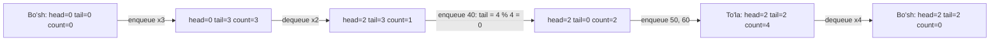

## Bu dars nima uchun kerak

Oldingi darslarda xotira bilan to'g'ridan-to'g'ri ishlashni o'rgandik: 11-darsda massiv, 20-darsda `struct`, 21-25-darslarda pointer, `malloc`/`free`, stack va heap, pointer orqali uzatish. Bular - qurilish materiallari. Endi savol boshqacha: dastur aslida qanday **amallar** bilan ishlaydi? Brauzerdagi "orqaga" tugmasi faqat oxirgi ochilgan sahifani bilishi kerak. Printer navbati hujjatlarni kelgan tartibida chop etishi kerak. Matn muharriridagi "undo" eng oxirgi o'zgarishni bekor qiladi. Bu vazifalarning hech biri "ixtiyoriy indeksdagi elementni o'qi" amalini talab qilmaydi: ularga faqat ikki-uchta qat'iy belgilangan amal kerak.

Shu darsda ikki fikrni ajratamiz: ma'lumot tuzilmasi **nima qila olishi** (interfeys) va u **qanday qurilgani** (implementatsiya). Bu ajratish **abstract data type** (ADT, abstrakt ma'lumot tipi) deyiladi. Ikki eng muhim ADT - stack va queue - ustida buni amalda ko'ramiz: avval belgilangan sig'imli massiv bilan, keyin `realloc` bilan o'sadigan massiv bilan. 28-darsda xuddi shu interfeyslarni linked list bilan ham qurish mumkinligini ko'ramiz, 29-30-darslardagi daraxt va hash table ham shu fikrga tayanadi.

Bu darsdan keyin siz:

- ADT nima ekanini va interfeysni implementatsiyadan ajratish nima beradi, tushuntira olasiz;
- stack (LIFO) va queue (FIFO) amallarini va ularning chegaraviy holatlarini (bo'sh, to'la) bilasiz;
- massiv asosidagi stack'ni `push`, `pop`, `peek`, `is_empty` bilan yoza olasiz;
- aylanma (circular) buffer asosidagi queue'da head/tail indekslarini modul arifmetikasi bilan yurgizasiz va to'la holatni bo'sh holatdan ajratasiz;
- `realloc` bilan ikki barobar o'sadigan massiv nega bitta qo'shish uchun o'rtacha O(1) ekanini hisob bilan isbotlay olasiz;
- stack va queue real dasturlarda qayerda ishlatilishini (call stack, qavslar balansi, BFS, undo) bilasiz.

## ADT: interfeys va implementatsiya

**Abstract data type** - qiymatlar to'plami va ular ustidagi amallar, faqat amallarning **xulq-atvori** orqali ta'riflangan. "Stack" deganda biz massivni ham, linked listni ham nazarda tutmaymiz: biz "oxirgi qo'yilgan element birinchi olinadi" degan va'dani nazarda tutamiz. Bu va'da qanday bajarilishi - implementatsiya masalasi.

4-darsdagi abstraction g'oyasi shu yerda yangi darajaga chiqadi. U yerda funksiya ichidagi tafsilotlarni nom ortiga yashirgan edik. ADT esa butun ma'lumot tuzilmasini yashiradi: foydalanuvchi kodi faqat amallarni chaqiradi va ichki maydonlarga tegmaydi.

| Daraja | Savol | Stack uchun javob |
|---|---|---|
| Interfeys (ADT) | Qaysi amallar bor, ular nima va'da qiladi? | `push(x)` tepaga qo'yadi, `pop()` tepadagini olib qaytaradi, `peek()` tepadagini o'zgartirmasdan ko'rsatadi, `is_empty()` |
| Implementatsiya | Ma'lumot xotirada qanday saqlanadi? | Massiv va `top` hisoblagichi, yoki linked list (28-dars) |
| Narx | Har amal qancha vaqt va xotira oladi? | Massivda `push`/`pop` O(1), xotira sig'imga teng |

Nega bu ajratish foydali:

1. **Almashtirish.** Interfeys o'zgarmasa, implementatsiyani almashtirish foydalanuvchi kodini buzmaydi. Belgilangan sig'imli massivdan o'sadigan massivga o'tish faqat stack fayli ichida bo'ladi.
2. **To'g'rilikni bir joyda ta'minlash.** `top` hisoblagichini faqat `push` va `pop` o'zgartirsa, uni noto'g'ri qiymatga olib boradigan kod faqat ikki funksiyada bo'lishi mumkin. Har joyda `s.items[s.top++] = x` yozilsa, xatoni butun dasturdan qidirish kerak.
3. **Fikrlash tili.** "Bu yerga stack kerak" degan qaror algoritmni tasvirlaydi; "bu yerga massiv va hisoblagich kerak" - yo'q.

C da interfeys odatda header faylda (9-dars) e'lon qilinadi: `stack.h` ichida tip nomi va funksiya prototiplari, `stack.c` ichida esa ularning tanasi. Bu darsdagi misollar bitta faylda, chunki brauzer muhitida bitta `main.c` bor, lekin funksiyalar xuddi alohida modulda turgandek yozilgan: `main` hech qachon `items` yoki `top` ga to'g'ridan-to'g'ri murojaat qilmaydi.

Misollarda funksiyalar struct'ga pointer oladi (`stack *s`), chunki ular chaqiruvchining struct'ini o'zgartirishi kerak (25-darsdagi pointer orqali uzatish). `s->top` yozuvi `(*s).top` ning qisqa shakli: "s ko'rsatgan struct'ning `top` maydoni". `->` operatori 28-darsda linked list tugunlari bilan ko'p ishlatiladi.

## Stack: LIFO

**Stack** - elementlar faqat bir uchdan (tepadan) qo'shiladigan va olinadigan ADT. Tartib **LIFO** (last in, first out): oxirgi kirgan birinchi chiqadi. 18-darsda call stack aynan shu tamoyil bilan ishlashini ko'rgan edik: chaqirilgan funksiyaning frame'i tepaga qo'yiladi va u `return` qilganda birinchi bo'lib olinadi. Endi shu tuzilmani o'zimiz dastur ichida yozamiz.

| Amal | Nima qiladi | Chegaraviy holat |
|---|---|---|
| `push(x)` | x ni tepaga qo'yadi | Stack to'la bo'lsa: xato qaytariladi (overflow) |
| `pop()` | Tepadagi elementni olib tashlaydi va qaytaradi | Stack bo'sh bo'lsa: xato qaytariladi (underflow) |
| `peek()` | Tepadagi elementni qaytaradi, o'chirmaydi | Bo'sh stack'da xato |
| `is_empty()` | Elementlar yo'qligini tekshiradi | - |

Chegaraviy holatlar interfeysning bir qismi. "Bo'sh stack'dan `pop` qilinsa nima bo'ladi?" degan savolga javob berilmagan interfeys chala. C da keng tarqalgan usul: amal muvaffaqiyatini `bool` bilan qaytarish, natijani esa pointer parametr orqali berish (25-dars, `scanf` dagi kabi).

### Massiv asosidagi stack

Eng oddiy implementatsiya: massiv va `top` - elementlar soni. Elementlar `items[0]` dan `items[top - 1]` gacha turadi, tepasi `items[top - 1]`. `push` keyingi bo'sh katakka (`items[top]`) yozadi va `top` ni oshiradi; `pop` `top` ni kamaytiradi va o'sha katakni o'qiydi. Hech qanday element surilmaydi, shuning uchun ikkala amal ham O(1): massiv uzunligiga bog'liq bo'lmagan doimiy qadamlar soni.

Nega elementlar massivning boshida qo'shilmaydi? Boshiga qo'shish uchun mavjud hamma elementni bitta katak o'ngga surish kerak: n element uchun n ta ko'chirish, ya'ni O(n). Tepani massiv oxirida ushlab turish shuni yo'q qiladi.

```c run
#include <stdbool.h>
#include <stdio.h>

#define CAPACITY 5

typedef struct
{
    int items[CAPACITY];
    int top; // elementlar soni; tepadagi element items[top - 1]
} stack;

bool is_empty(const stack *s)
{
    return s->top == 0;
}

bool push(stack *s, int value)
{
    if (s->top == CAPACITY)
    {
        return false; // stack to'la
    }
    s->items[s->top] = value;
    s->top++;
    return true;
}

bool pop(stack *s, int *out)
{
    if (is_empty(s))
    {
        return false; // olinadigan element yo'q
    }
    s->top--;
    *out = s->items[s->top];
    return true;
}

bool peek(const stack *s, int *out)
{
    if (is_empty(s))
    {
        return false;
    }
    *out = s->items[s->top - 1];
    return true;
}

int main(void)
{
    stack s = {.top = 0};
    int x;

    for (int i = 1; i <= 6; i++)
    {
        bool ok = push(&s, i * 10);
        printf("push(%d): %s, top=%d\n", i * 10, ok ? "ok" : "TO'LA", s.top);
    }

    peek(&s, &x);
    printf("peek: %d\n", x);

    while (pop(&s, &x))
    {
        printf("pop: %d\n", x);
    }
    printf("bo'shmi? %s\n", is_empty(&s) ? "ha" : "yo'q");
}
```

Natija:

```text
push(10): ok, top=1
push(20): ok, top=2
push(30): ok, top=3
push(40): ok, top=4
push(50): ok, top=5
push(60): TO'LA, top=5
peek: 50
pop: 50
pop: 40
pop: 30
pop: 20
pop: 10
bo'shmi? ha
```

Kuzatishlar:

- 6-`push` rad etildi, `top` 5 da qoldi. Agar `push` sig'imni tekshirmaganda, `items[5]` ga yozilardi - massivdan tashqarida (11-darsdagi `stack-buffer-overflow`). Interfeys darajasidagi tekshiruv bu xatoni foydalanuvchi kodiga yetkazmaydi.
- Elementlar kirgan tartibiga teskari chiqdi: 50, 40, 30, 20, 10. Bu LIFO.
- `pop` dan keyin `items[top]` dagi eski qiymat xotirada qoladi, lekin u endi stack'ning bir qismi emas: keyingi `push` uni ustidan yozadi. "O'chirish" - bu faqat hisoblagichni kamaytirish.
- `while (pop(&s, &x))` - bo'shatishning ixcham shakli: `pop` `false` qaytarguncha aylanadi.
- `is_empty` va `peek` `const stack *` oladi: ular stack'ni o'zgartirmasligini imzoning o'zi aytadi (11-darsdagi `const` qoidasi).

`CAPACITY` ni 3 ga tushirib yoki `pop` dagi `top--` va o'qish tartibini almashtirib ko'ring: ikkinchi holatda `items[top]` (massivdan bitta tashqarida) o'qiladi va brauzer muhiti xatoni aniq qatorda ko'rsatadi.

## Queue: FIFO va aylanma buffer

**Queue** (navbat) - elementlar bir uchdan (orqadan, tail) qo'shiladigan va boshqa uchdan (oldidan, head) olinadigan ADT. Tartib **FIFO** (first in, first out): birinchi kirgan birinchi chiqadi, xuddi do'kondagi navbat kabi.

| Amal | Nima qiladi | Chegaraviy holat |
|---|---|---|
| `enqueue(x)` | x ni navbat oxiriga qo'yadi | Navbat to'la |
| `dequeue()` | Navbat boshidagi elementni olib qaytaradi | Navbat bo'sh |
| `peek()` / `front()` | Boshidagi elementni ko'rsatadi | Navbat bo'sh |
| `is_empty()` | Elementlar yo'qligini tekshiradi | - |

### Oddiy massivning muammosi

Birinchi urinish: elementlar `items[0..count-1]` da turadi, `enqueue` oxiriga yozadi (O(1)), `dequeue` esa `items[0]` ni olib, qolganlarni bitta chapga suradi. Bu surish n - 1 ta ko'chirish: O(n). 1000 elementli navbatni to'liq bo'shatish 999 + 998 + ... + 1 + 0 = 999 · 1000 / 2 = 499 500 ta ko'chirish talab qiladi.

Ikkinchi urinish: surmaslik, faqat `head` indeksini oldinga siljitish. Endi `dequeue` O(1), lekin yangi muammo: `head` ham, `tail` ham faqat o'ngga yuradi. Bir necha ming `enqueue`/`dequeue` dan keyin `tail` massiv oxiriga yetadi, holbuki massiv boshida bo'sh joylar ko'p.

### Aylanma buffer

Yechim - massivni **aylana** deb hisoblash: oxirgi katakdan keyin yana 0-katak keladi. Bunday tuzilma **circular buffer** (aylanma bufer, ring buffer) deyiladi. Indeksni oldinga surish modul arifmetikasi bilan bajariladi:

keyingi(i) = (i + 1) % CAPACITY

CAPACITY = 4 bo'lsa: keyingi(0) = 1, keyingi(2) = 3, keyingi(3) = (3 + 1) % 4 = 0. `%` (qoldiq) operatori 6-darsda ko'rilgan; bu yerda u indeksni 0..CAPACITY-1 oralig'ida ushlab turadi. 7-darsdagi unsigned overflow ham aynan shunday "aylanadi", faqat 2^32 moduli bilan.

Ikki indeks:

- `head` - keyingi chiqadigan element indeksi;
- `tail` - keyingi kiradigan element yoziladigan indeks.

`enqueue`: `items[tail] = x; tail = (tail + 1) % CAPACITY;`. `dequeue`: `x = items[head]; head = (head + 1) % CAPACITY;`. Hech qanday surish yo'q, ikkalasi ham O(1).

### To'la yoki bo'sh: `head == tail` ikki ma'noli

Aylanma buferning nozik joyi: bo'sh navbatda `head == tail`, lekin navbat to'liq to'lganda ham `tail` aylanib kelib `head` ga yetadi va yana `head == tail` bo'ladi. Faqat ikki indeks bilan bu ikki holatni ajratib bo'lmaydi. Uchta keng tarqalgan yechim:

| Usul | To'la sharti | Bo'sh sharti | Narxi |
|---|---|---|---|
| Alohida `count` maydoni | `count == CAPACITY` | `count == 0` | Bitta qo'shimcha butun son, har amalda uni yangilash |
| Bitta katakni bo'sh qoldirish | `(tail + 1) % CAPACITY == head` | `head == tail` | Sig'im CAPACITY - 1 ga kamayadi |
| To'xtovsiz o'suvchi hisoblagichlar | `tail - head == CAPACITY` | `tail == head` | Indeks `% CAPACITY` bilan olinadi; unsigned tip va 2 ning darajasi bo'lgan sig'im bilan qulay |

Quyidagi implementatsiya birinchi usulni ishlatadi: u eng tushunarli va sig'imni yo'qotmaydi.

```c run
#include <stdbool.h>
#include <stdio.h>

#define CAPACITY 4

typedef struct
{
    int items[CAPACITY];
    int head;  // keyingi chiqadigan element indeksi
    int tail;  // keyingi kiradigan element yoziladigan indeks
    int count; // hozir nechta element bor
} queue;

bool enqueue(queue *q, int value)
{
    if (q->count == CAPACITY)
    {
        return false;
    }
    q->items[q->tail] = value;
    q->tail = (q->tail + 1) % CAPACITY;
    q->count++;
    return true;
}

bool dequeue(queue *q, int *out)
{
    if (q->count == 0)
    {
        return false;
    }
    *out = q->items[q->head];
    q->head = (q->head + 1) % CAPACITY;
    q->count--;
    return true;
}

void show(const queue *q, const char *what)
{
    printf("%-12s head=%d tail=%d count=%d  [", what, q->head, q->tail, q->count);
    for (int i = 0; i < q->count; i++)
    {
        printf(i ? " %d" : "%d", q->items[(q->head + i) % CAPACITY]);
    }
    printf("]\n");
}

int main(void)
{
    queue q = {.head = 0, .tail = 0, .count = 0};
    int x;

    enqueue(&q, 10);
    enqueue(&q, 20);
    enqueue(&q, 30);
    show(&q, "3 ta kirdi");

    dequeue(&q, &x);
    dequeue(&q, &x);
    show(&q, "2 ta chiqdi");

    enqueue(&q, 40);
    enqueue(&q, 50);
    enqueue(&q, 60);
    show(&q, "3 ta kirdi");

    printf("70 kiradimi? %s\n", enqueue(&q, 70) ? "ha" : "yo'q, navbat to'la");

    while (dequeue(&q, &x))
    {
        printf("chiqdi: %d\n", x);
    }
    show(&q, "bo'sh");
}
```

Natija:

```text
3 ta kirdi   head=0 tail=3 count=3  [10 20 30]
2 ta chiqdi  head=2 tail=3 count=1  [30]
3 ta kirdi   head=2 tail=2 count=4  [30 40 50 60]
70 kiradimi? yo'q, navbat to'la
chiqdi: 30
chiqdi: 40
chiqdi: 50
chiqdi: 60
bo'sh        head=2 tail=2 count=0  []
```

Uchinchi qatorni qadam-baqadam kuzating. `tail` 3 dan boshlandi: 40 `items[3]` ga yozildi va `tail` = (3 + 1) % 4 = 0. 50 `items[0]` ga (10 turgan joyga, u allaqachon chiqib ketgan) yozildi, `tail` = 1. 60 `items[1]` ga yozildi, `tail` = 2. Endi navbat to'la va `head == tail == 2`. Oxirgi qatorda navbat bo'sh va yana `head == tail == 2`. Ikki holatni faqat `count` ajratadi: 4 va 0.

`show` funksiyasi elementlarni massiv tartibida emas, navbat tartibida chiqaradi: i-element `items[(head + i) % CAPACITY]` da. Massivning o'zida 3-qatordan keyin [50, 60, 30, 40] turibdi, navbat esa [30, 40, 50, 60].



## Dinamik o'sish: realloc va amortized O(1)

Belgilangan sig'im ko'p hollarda noqulay: kerakli hajm oldindan ma'lum emas. 23-darsdagi `malloc` bilan massivni heap'da ajratish va kerak bo'lganda kattalashtirish mumkin. Buning uchun standart funksiya - `realloc(ptr, new_size)`. cppreference bo'yicha u ikki yo'l bilan ishlaydi: mavjud blokni joyida kengaytiradi, yoki yangi blok ajratib, eski tarkibni (eski va yangi o'lchamning kichigicha) unga nusxalaydi va eski blokni bo'shatadi. Ikkinchi holatda manzil o'zgaradi. Xotira yetmasa, `NULL` qaytaradi va **eski blok o'zgarmasdan qoladi**.

Oxirgi qoida muhim xatoni keltirib chiqaradi:

```c
s->items = realloc(s->items, new_capacity * sizeof(int)); // XATO
```

`realloc` `NULL` qaytarsa, `s->items` `NULL` bilan almashadi, eski blokning manzili esa yo'qoladi: uni na ishlatib, na `free` qilib bo'ladi (23-darsdagi memory leak). To'g'ri usul - natijani vaqtinchalik o'zgaruvchiga olish va tekshirish.

### Qancha o'stirish kerak?

Har o'sishda eng yomon holatda hamma elementlar ko'chiriladi. Shuning uchun o'sish strategiyasi butun narxni belgilaydi. n = 1000 ta `push` uchun ikki strategiyani solishtiramiz (bo'sh stack'dan boshlab, ko'chirishlarni sanaymiz):

**Har safar +1.** Har `push` da massiv to'la, shuning uchun i-push oldidan i ta element ko'chiriladi: 0 + 1 + 2 + ... + 999 = 999 · 1000 / 2 = 499 500 ta ko'chirish. Umumiy narx O(n²) (16-dars), bitta `push` ga o'rtacha ~500.

**Har safar ikki barobar.** Sig'im 1, 2, 4, 8, ..., 1024. O'sish faqat massiv to'lganda, ya'ni hajm 1, 2, 4, ..., 512 bo'lganda bo'ladi va o'shancha element ko'chiriladi: 1 + 2 + 4 + ... + 512 = 1023 ta ko'chirish. Geometrik qator yig'indisi: 1 + 2 + ... + 2^k = 2^(k+1) - 1, va 2^k < n bo'lgani uchun bu 2n dan kichik. Har bir `push` ning o'zi bitta yozish, demak umumiy ish n + 1023 < 3n. Bitta `push` ga o'rtacha 3 tadan kam amal - O(1).

Bu **amortized** (amortizatsiyalangan, taqsimlangan) tahlil: alohida bir `push` qimmat bo'lishi mumkin (512 ta ko'chirish), lekin har qanday n ta amal ketma-ketligining jami narxi O(n), ya'ni har biri o'rtacha O(1). Bu "o'rtacha holat" (15-dars) emas: kirish ma'lumotiga oid ehtimol yo'q, kafolat har qanday ketma-ketlik uchun. Intuitiv ko'rinish: har qimmat o'sish undan oldingi arzon `push` lar "to'plagan" vaqt hisobidan to'lanadi. Sig'im 512 dan 1024 ga o'sganda 512 ta ko'chirish kerak, lekin undan oldingi o'sishdan (256 -> 512) beri 255 ta arzon `push` bo'lgan (258-dan 512-gacha): har biri o'z ulushini, taxminan 2 ta ko'chirishni "oldindan to'lagan".

Ikki barobar o'rniga istalgan doimiy ko'paytuvchi (masalan, 1.5) ham amortized O(1) beradi, faqat ko'chirishlar va bo'sh turgan joy nisbati boshqacha bo'ladi. Muhimi - qo'shimcha doimiy son emas, hozirgi hajmga **proporsional** bo'lishi. Narxi - xotira: ikki barobar o'stirishda eng yomon holatda massivning deyarli yarmi bo'sh turadi (513 element uchun 1024 joy).

```c run
#include <stdio.h>
#include <stdlib.h>

typedef struct
{
    int *items;
    int top;
    int capacity;
} stack;

long copies = 0; // eski blokdan yangisiga ko'chirilgan elementlar soni (eng yomon holat)

int push(stack *s, int value)
{
    if (s->top == s->capacity)
    {
        int new_capacity = s->capacity == 0 ? 1 : s->capacity * 2;
        int *bigger = realloc(s->items, new_capacity * sizeof(int));
        if (bigger == NULL)
        {
            return 0; // eski blok joyida qoladi, stack buzilmaydi
        }
        copies += s->top;
        printf("o'sish: %4d -> %4d (ko'chirildi %d ta)\n", s->capacity, new_capacity, s->top);
        s->items = bigger;
        s->capacity = new_capacity;
    }
    s->items[s->top++] = value;
    return 1;
}

int main(void)
{
    stack s = {NULL, 0, 0};
    int n = 1000;

    for (int i = 0; i < n; i++)
    {
        if (!push(&s, i))
        {
            printf("xotira yetmadi\n");
            free(s.items);
            return 1;
        }
    }

    printf("n = %d, capacity = %d, ko'chirishlar = %ld\n", n, s.capacity, copies);
    printf("bitta push'ga o'rtacha: %.3f ta ko'chirish\n", (double) copies / n);
    printf("tepada: %d\n", s.items[s.top - 1]);
    free(s.items);
}
```

Natija:

```text
o'sish:    0 ->    1 (ko'chirildi 0 ta)
o'sish:    1 ->    2 (ko'chirildi 1 ta)
o'sish:    2 ->    4 (ko'chirildi 2 ta)
o'sish:    4 ->    8 (ko'chirildi 4 ta)
o'sish:    8 ->   16 (ko'chirildi 8 ta)
o'sish:   16 ->   32 (ko'chirildi 16 ta)
o'sish:   32 ->   64 (ko'chirildi 32 ta)
o'sish:   64 ->  128 (ko'chirildi 64 ta)
o'sish:  128 ->  256 (ko'chirildi 128 ta)
o'sish:  256 ->  512 (ko'chirildi 256 ta)
o'sish:  512 -> 1024 (ko'chirildi 512 ta)
n = 1000, capacity = 1024, ko'chirishlar = 1023
bitta push'ga o'rtacha: 1.023 ta ko'chirish
tepada: 999
```

1000 ta `push` uchun atigi 11 marta o'sish: ⌈log₂ 1000⌉ = 10 ta ikki barobar o'sish va 0 dan 1 ga birinchi ajratish. `realloc(NULL, n)` `malloc(n)` bilan bir xil ishlaydi, shuning uchun bo'sh stack uchun alohida `malloc` shart emas. Dastur oxirida `free(s.items)` bor; uni olib tashlasangiz, brauzer muhiti dastur tugaganda bo'shatilmagan xotira hisobotini chiqaradi (23-dars): 1024 · 4 = 4096 bayt, 1 ta blokda.

`s->capacity * 2` ni `s->capacity + 1` ga almashtirib, `n` ni 1000 da qoldirib ishga tushiring: ko'chirishlar soni 499 500 bo'ladi va 1000 qator "o'sish" chiqadi. Bu ikki strategiya orasidagi O(n) va O(n²) farqi.

Hisoblagich "eng yomon holat"ni sanaydi: `realloc` blokni joyida kengaytira olsa, haqiqiy nusxa olinmaydi. Lekin buni oldindan bilib bo'lmaydi, shuning uchun tahlil eng yomon holatga tayanadi.

Shu usulni queue'ga ham qo'llash mumkin, lekin bitta nozik joy bor: aylanma buferda elementlar massiv oxiridan boshiga "o'ralgan" bo'lishi mumkin ([50, 60, 30, 40]). `realloc` ularni o'sha tartibda nusxalaydi va yangi, kattaroq massivda tartib buziladi. Shuning uchun o'sishda elementlarni `head` dan boshlab navbat tartibida yangi massivning boshiga ko'chirish va `head = 0`, `tail = count` qilish kerak. Bu - amaliy topshiriqning bir qismi.

## Murakkablik va tanlov

| Amal | Massiv stack (belgilangan) | Massiv stack (ikki barobar) | Aylanma buffer queue | Oddiy massiv queue (surish bilan) |
|---|---|---|---|---|
| `push` / `enqueue` | O(1), to'lsa rad | Amortized O(1), eng yomoni O(n) | O(1), to'lsa rad | O(1) |
| `pop` / `dequeue` | O(1) | O(1) | O(1) | O(n) - surish |
| `peek` | O(1) | O(1) | O(1) | O(1) |
| `is_empty` | O(1) | O(1) | O(1) | O(1) |
| Xotira | CAPACITY · sizeof(element) | n dan 2n gacha joy | CAPACITY · sizeof(element) | CAPACITY · sizeof(element) |

Belgilangan sig'imning ham o'z joyi bor. Dastur yuklamasi oldindan cheklangan bo'lsa (masalan, qurilmadan kelayotgan oxirgi 256 ta o'lchov), aylanma buffer hech qachon `malloc` chaqirmaydi va xotira hech qachon o'smaydi. Navbat to'lganda nima qilish - siyosat masalasi: yangi elementni rad etish (yuqoridagi kod) yoki eng eskisini ustidan yozish (oxirgi N ta qiymatni saqlaydigan log uchun qulay).

Boshqa tillarda ham shu ajratish bor. Python'da `list` ning `append` va `pop()` amallari oxiridan ishlaydi va stack sifatida tez. Python rasmiy qo'llanmasi esa `list` ni queue sifatida ishlatishni tavsiya qilmaydi: boshidan `pop(0)` yoki `insert(0, x)` qolgan hamma elementni suradi. Buning uchun `collections.deque` bor: hujjatlarga ko'ra, uning ikkala uchidan qo'shish va olish taxminan O(1). 32-darsda Python tuzilmalarining narxi batafsil ko'riladi.

## Real qo'llanishlar

### Call stack

18-darsdagi call stack - apparat va kompilyator darajasidagi stack. Har chaqiruv frame'ni push qiladi, `return` pop qiladi. Rekursiv funksiyani o'z stack'imiz bilan iterativ funksiyaga aylantirish mumkin: rekursiya nimani avtomatik saqlasa, uni qo'lda `push` qilamiz. Bu chuqur rekursiyada stack overflow'dan qochish usuli, chunki heap'dagi o'sadigan massiv 1 MB yoki 8 MB call stack chegarasiga bog'liq emas.

### Qavslar balansi

Kompilyator `f(a[i]);` ni o'qiyotganda har yopuvchi qavs eng oxirgi ochilgan, hali yopilmagan qavsga mos kelishi kerak. "Eng oxirgi ochilgan" - LIFO. Algoritm: ochuvchi qavsni push qiling; yopuvchida stack bo'sh bo'lsa yoki pop qilingan qavs juftiga mos kelmasa - xato; oxirida stack bo'sh bo'lishi shart. Faqat hisoblagich bilan (ochilganlar soni) bu masalani yechib bo'lmaydi: `([)]` da har turdagi qavslar soni teng, lekin tartib noto'g'ri.

### BFS uchun queue

Grafda (tugunlar va ular orasidagi bog'lanishlar) bir tugundan boshlab qo'shnilarni "qatlam-qatlam" ko'rib chiqish - **breadth-first search** (kenglik bo'yicha qidiruv). Avval masofasi 1 bo'lgan tugunlar, keyin 2, keyin 3. Queue'ning FIFO tartibi aynan shuni kafolatlaydi: masofasi d bo'lgan hamma tugun navbatga masofasi d + 1 bo'lganlardan oldin kirgan. Natijada har tugunning boshlang'ich tugundan eng qisqa masofasi (qadamlar sonida) topiladi. Shu yerda queue o'rniga stack ishlatilsa, algoritm boshqa - depth-first search (chuqurlik bo'yicha qidiruv) - ga aylanadi va masofalar endi eng qisqa bo'lmaydi. Bu ikki algoritm 53-darsda (AI: qidiruv) qayta ko'riladi.

```c run
#include <stdbool.h>
#include <stdio.h>

#define N 6

// Qo'shnilik matritsasi: adj[a][b] = 1 bo'lsa, a va b orasida yo'l bor
int adj[N][N] = {
    {0, 1, 1, 0, 0, 0}, // 0: 1, 2
    {1, 0, 0, 1, 0, 0}, // 1: 0, 3
    {1, 0, 0, 1, 1, 0}, // 2: 0, 3, 4
    {0, 1, 1, 0, 0, 1}, // 3: 1, 2, 5
    {0, 0, 1, 0, 0, 1}, // 4: 2, 5
    {0, 0, 0, 1, 1, 0}, // 5: 3, 4
};

int main(void)
{
    int queue[N]; // har tugun bir marta kiradi, N ta joy yetadi
    int head = 0, tail = 0;
    int dist[N];
    bool seen[N] = {false};

    int start = 0;
    queue[tail++] = start; // enqueue
    seen[start] = true;
    dist[start] = 0;

    while (head < tail) // navbat bo'sh emas
    {
        int v = queue[head++]; // dequeue
        printf("tugun %d (masofa %d)\n", v, dist[v]);
        for (int u = 0; u < N; u++)
        {
            if (adj[v][u] && !seen[u])
            {
                seen[u] = true;
                dist[u] = dist[v] + 1;
                queue[tail++] = u; // enqueue
            }
        }
    }
}
```

Natija:

```text
tugun 0 (masofa 0)
tugun 1 (masofa 1)
tugun 2 (masofa 1)
tugun 3 (masofa 2)
tugun 4 (masofa 2)
tugun 5 (masofa 3)
```

Bu yerda aylanma buffer shart emas: har tugun `seen` tufayli navbatga ko'pi bilan bir marta kiradi, demak jami N ta `enqueue` bo'ladi va N ta joy yetadi. 2D massiv 11-darsdagi row-major qoidasi bilan saqlanadi. Har tugun uchun N ta qo'shni tekshiriladi, jami N · N = 36 ta tekshiruv: matritsali BFS O(N²).

### Undo va redo

Matn muharriri har o'zgarishni (nima, qayerda, eski qiymat) undo stack'iga push qiladi. "Undo" eng oxirgi o'zgarishni pop qilib bekor qiladi va uni redo stack'iga push qiladi. Foydalanuvchi yangi o'zgarish kiritsa, redo stack'i tozalanadi: bekor qilingan "kelajak" endi mavjud emas. Brauzerdagi "orqaga" va "oldinga" tugmalari ham shu ikki stack modeli bilan tasvirlanadi.

## Mashq: qavslar balansi

Quyidagi `is_balanced(text)` funksiyasini Python'da stack bilan yozing. Satrda `()`, `[]`, `{}` qavslari va boshqa belgilar bo'lishi mumkin; boshqa belgilar e'tiborsiz qoldiriladi. Funksiya qavslar to'g'ri juftlangan va ichma-ich joylashgan bo'lsa `True`, aks holda `False` qaytarsin. Python `list` ning `append` va `pop` amallari stack'ning `push` va `pop` iga mos. Bo'sh `list` dan `pop()` xato chiqaradi, shuning uchun avval bo'shligini tekshiring.

```python run
def is_balanced(text):
    # Yechimingizni shu yerga yozing
    return False


print(is_balanced("f(a[i]) { x; }"))
print(is_balanced("([)]"))
```

```python test
check("bo'sh satr muvozanatli", lambda: is_balanced("") is True)
check("oddiy juftlik: ()", lambda: is_balanced("()") is True)
check("ichma-ich: ([]{})", lambda: is_balanced("([]{})") is True)
check("boshqa belgilar e'tiborsiz: f(a[i]) { x; }", lambda: is_balanced("f(a[i]) { x; }") is True)
check("kesishgan juftlik: ([)] noto'g'ri", lambda: is_balanced("([)]") is False)
check("yopilmagan qavs: (( noto'g'ri", lambda: is_balanced("((") is False)
check("ochilmagan qavs: ()) noto'g'ri", lambda: is_balanced("())") is False)
check("bo'sh stack'dan pop: ) noto'g'ri, xato chiqmasin", lambda: is_balanced(")") is False)
check("uzun satr: 10000 ta ( va 10000 ta )", lambda: is_balanced("(" * 10000 + ")" * 10000) is True)
```

Ishonch hosil qilish uchun: yechimingiz bitta `for` sikl bilan har belgini bir marta ko'rishi va stack'da ko'pi bilan n ta belgi saqlashi kerak, ya'ni vaqt O(n), xotira O(n). Faqat hisoblagich ishlatsangiz, "kesishgan juftlik" testi o'tmaydi.

## Ko'p uchraydigan xatolar

1. **Bo'sh stack'dan `pop`.** Tekshiruvsiz `s->top--` hisoblagichni -1 ga tushiradi va keyingi o'qish `items[-1]` ga boradi - massivdan oldingi xotira. Har `pop` va `peek` bo'shlikni tekshirsin va natijani `bool` bilan qaytarsin.
2. **To'la holatni tekshirmaslik.** Belgilangan sig'imli stack yoki queue'da `push` ni tekshiruvsiz yozish 11-darsdagi chegaradan chiqishning aynan o'zi.
3. **Aylanma buferda to'la va bo'shni `head == tail` bilan ajratishga urinish.** Bu shart ikkala holatda ham rost. `count` qo'shing yoki bitta katakni bo'sh qoldiring.
4. **`%` siz indeksni oshirish.** `tail++` yozilib, `tail = (tail + 1) % CAPACITY` unutilsa, indeks CAPACITY ga yetib, massivdan chiqadi.
5. **`p = realloc(p, ...)`.** `NULL` qaytsa, eski blok manzili yo'qoladi va leak paydo bo'ladi. Natijani vaqtinchalik o'zgaruvchiga oling, tekshiring, keyin almashtiring.
6. **Doimiy qo'shimcha bilan o'stirish.** `capacity + 1` yoki `capacity + 10` n ta qo'shish uchun O(n²) ko'chirish beradi. Ko'paytirib o'stiring.
7. **Aylanma queue'ni oddiy `realloc` bilan kattalashtirish.** O'ralgan elementlar tartibi buziladi. Elementlarni navbat tartibida yangi massivga ko'chiring.
8. **ADT ichiga to'g'ridan-to'g'ri tegish.** `main` dan `s.items[s.top - 1]` o'qish implementatsiyani o'zgartirganda buziladi. Faqat interfeys funksiyalarini chaqiring.

## Xulosa

- Abstract data type - amallar va ularning va'dasi; implementatsiya bu va'dani bajarish usuli. Interfeysni ajratish implementatsiyani almashtirish va xatolarni bir joyda ushlab turish imkonini beradi.
- Stack - LIFO: `push`, `pop`, `peek`, `is_empty`. Massivda tepani oxirida ushlash har amalni O(1) qiladi.
- Queue - FIFO: `enqueue`, `dequeue`. Aylanma buffer `(i + 1) % CAPACITY` bilan ikki indeksni yurgizadi, hech narsani surmaydi va har amal O(1).
- Aylanma buferda `head == tail` ham bo'sh, ham to'la holatni bildiradi; ularni `count` yoki bitta bo'sh katak ajratadi.
- `realloc` bilan ikki barobar o'stirish n ta qo'shishda 2n dan kam ko'chirish beradi: amortized O(1). +1 bilan o'stirish esa n(n - 1)/2 ta ko'chirish, ya'ni O(n²).
- `realloc` natijasini avval vaqtinchalik o'zgaruvchiga oling: `NULL` da eski blok saqlanib qoladi.
- Stack: call stack, qavslar balansi, undo, rekursiyani iteratsiyaga aylantirish. Queue: BFS (eng qisqa masofa qadamlarda), buferlar, navbatlar.

## Amaliy topshiriq

Aylanma buffer asosidagi, **o'sadigan** queue yozing va uni "printer navbati" simulyatsiyasida sinang.

Topshiriq qadamlari:

1. **Interfeys.** `queue` tipi va beshta funksiya: `queue_init(queue *q)`, `enqueue(queue *q, int x)` (muvaffaqiyatni `bool` bilan qaytaradi), `dequeue(queue *q, int *out)`, `queue_size(const queue *q)`, `queue_free(queue *q)`. `main` struct maydonlariga murojaat qilmasin.
2. **Implementatsiya.** `int *items`, `head`, `tail`, `count`, `capacity` maydonlari. Boshlang'ich sig'im 2. Indekslar faqat `% capacity` bilan yurgiziladi.
3. **O'sish.** Navbat to'lganda yangi massiv `malloc` (yoki `realloc`) bilan ikki barobar ajratilsin, elementlar `head` dan boshlab navbat tartibida yangi massivning 0-katagidan joylashtirilsin, `head = 0`, `tail = count`. `NULL` holatida eski navbat buzilmasligi kerak.
4. **Simulyatsiya.** Hujjat raqamlari 1, 2, 3, ... bo'lsin. Quyidagi buyruqlar ketma-ketligini bajaring: 3 ta qo'shish, 1 ta chop etish, 4 ta qo'shish, 2 ta chop etish, 5 ta qo'shish, hammasini chop etish. Har chop etishda hujjat raqamini, har o'sishda eski va yangi sig'imni chiqaring. Chop etish tartibi 1 dan 12 gacha ketma-ket bo'lishi kerak.
5. **Hisob.** Shu ketma-ketlikda necha marta o'sish bo'ldi va jami nechta element ko'chirildi? Oxirgi sig'im qancha? Javobni qo'lda hisoblang va dastur natijasi bilan solishtiring.
6. **Xotira.** `queue_free` ni chaqirmasdan ishga tushiring va brauzerdagi leak hisobotini keltiring; keyin tuzating.

Yaxshi javobda bo'lishi kerak bo'lgan narsalar:

- `main` faqat interfeys funksiyalarini chaqiradi, maydonlarga tegmaydi;
- to'la va bo'sh holat `count` bilan ajratilgan, `head == tail` ga tayanilmagan;
- o'sishda elementlar navbat tartibida ko'chirilgan (`items[(head + i) % capacity]`), shuning uchun chop etish tartibi 1, 2, ..., 12;
- o'sishlar hisobi: sig'im 2 -> 4 -> 8 -> 16, jami 3 marta o'sish va 2 + 4 + 8 = 14 ta ko'chirish (simulyatsiyada navbatdagi elementlar soni eng ko'pi 9 ga yetadi);
- `realloc` yoki `malloc` natijasi tekshirilgan, `NULL` da eski massiv yo'qotilmagan;
- `queue_free` siz chiqqan leak hisoboti va tuzatilgan versiyada uning yo'qligi ko'rsatilgan.

Javobingizni pastdagi maydonga yozing va yuqoridagi mezonlar bilan solishtiring.

## Manbalar

- CS50x. [Lecture 5 notes](https://cs50.harvard.edu/x/notes/5/) - "Queues" va "Stacks" bo'limlari (FIFO, LIFO, enqueue/dequeue, push/pop) hamda "Linked Lists" bo'limi boshidagi massivni `malloc` va `realloc` bilan kattalashtirish misoli.
- cppreference. [realloc](https://en.cppreference.com/w/c/memory/realloc) - blokni joyida kengaytirish yoki yangi blokka nusxalash, `NULL` da eski blokning saqlanishi, `realloc(NULL, n)` ning `malloc` bilan tengligi.
- Linux man-pages. [malloc(3)](https://man7.org/linux/man-pages/man3/malloc.3.html) - "DESCRIPTION" bo'limidagi `realloc` tavsifi va "RETURN VALUE": muvaffaqiyatsizlikda asl blok o'zgarmasligi.
- Python. [Data Structures tutorial](https://docs.python.org/3/tutorial/datastructures.html) - "Using Lists as Stacks" va "Using Lists as Queues": `list` ning boshidan olish sekinligi va `collections.deque` tavsiyasi.
- Python. [collections.deque](https://docs.python.org/3/library/collections.html#collections.deque) - ikkala uchdan taxminan O(1) qo'shish va olish.
- Wikipedia. [Circular buffer](https://en.wikipedia.org/wiki/Circular_buffer) - ishlash mexanikasi bo'limi: start/end indekslari to'la va bo'sh holatni ajrata olmasligi, bitta katakni bo'sh qoldirish va `count` hisoblagichi yechimlari, to'lganda eski ma'lumot ustidan yozish yoki xato qaytarish.
- Wikipedia. [Amortized analysis](https://en.wikipedia.org/wiki/Amortized_analysis) - "Dynamic array" bo'limi: o'sadigan massivga push amalining amortized tahlili.
