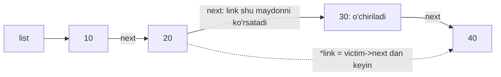

## Bu dars nima uchun kerak

11-darsdagi massivning asosiy kuchi - elementlar xotirada yonma-yon turadi va istalgan elementning manzili bitta formula bilan hisoblanadi. Shu xususiyat uning asosiy zaifligi ham. Massiv o'rtasiga yangi element qo'yish uchun undan keyingi hamma elementni bitta katak surish kerak. Massiv to'lsa, 27-darsda ko'rganimizdek, yangi, kattaroq blok ajratib, hammasini ko'chirish kerak. Elementlar tez-tez qo'shilib o'chiriladigan, soni oldindan noma'lum ma'lumot uchun bu qimmat.

**Linked list** (bog'langan ro'yxat) boshqa yo'lni tanlaydi: har bir element xotirada istalgan joyda yashaydi va o'zidan keyingi elementning manzilini o'zi bilan olib yuradi. Yangi element qo'shish - bitta `malloc` va bir-ikkita pointer'ni almashtirish. Hech narsa surilmaydi va hech narsa ko'chirilmaydi. Buning evaziga massivning random access xususiyati yo'qoladi: 500-elementga yetish uchun oldingi 499 tasidan o'tish kerak.

Bu dars 3-modulda o'rganilgan hamma narsani bir joyga yig'adi: 20-darsdagi `typedef struct`, 21-darsdagi pointer, 23-darsdagi `malloc`/`free` va memory leak, 24-darsdagi heap, 25-darsdagi pointer orqali uzatish. 27-darsdagi stack va queue ADT'lari ham linked list bilan qurilishi mumkin, 29-darsdagi daraxt esa "ikkita `next` li tugun", 30-darsdagi hash table chaining esa "linked list'lar massivi".

Bu darsdan keyin siz:

- tugun (node) struct'ini e'lon qilish va uning xotiradagi o'lchamini hisoblashni bilasiz;
- ro'yxat boshiga O(1) da, oxiriga esa tail pointer bilan O(1) da va usiz O(n) da qo'shishni yoza olasiz;
- ro'yxatda qidirish, saralangan joyga qo'shish va qiymatni o'chirishni ikki usulda (oldingi tugunni kuzatish va pointer-to-pointer) yoza olasiz;
- butun ro'yxatni `tmp` bilan to'g'ri `free` qilasiz va use-after-free hamda leak xatolarini taniysiz;
- massiv va linked list o'rtasida vazifaga qarab tanlov qila olasiz (murakkablik, xotira, cache locality);
- doubly linked list nima uchun kerakligini bilasiz.

## Tugun: qiymat va keyingisining manzili

Linked list'ning qurilish bloki - **tugun** (node): ma'lumot va keyingi tugunga ko'rsatkichdan iborat struct. Butun sonlar ro'yxati uchun:

```c
typedef struct node
{
    int number;
    struct node *next;
} node;
```

Bu yozuvda ikkita nom bor va ikkalasi ham kerak. 20-darsda `typedef struct { ... } candidate;` ko'rinishida nomsiz struct'ga nom bergan edik. Bu yerda struct o'z ichida o'ziga ko'rsatkich saqlaydi, lekin `typedef` nomi `node` faqat oxirgi qatorda, `}` dan keyin paydo bo'ladi. Shuning uchun maydon ichida `node *next` deb yozib bo'lmaydi: kompilyator hali bunday tipni bilmaydi. Yechim - struct'ning o'ziga teg nomi (`struct node`) berish: u birinchi qatordayoq ma'lum bo'ladi va `struct node *next` maydoni ishlaydi. Struct o'zini to'liq o'z ichida saqlay olmaydi (o'lchami cheksiz bo'lardi), lekin o'ziga **ko'rsatkich** saqlay oladi, chunki ko'rsatkich o'lchami doimiy.

Ro'yxatning o'zi - birinchi tugunga bitta ko'rsatkich, odatda `list` yoki `head` deb ataladi. Bo'sh ro'yxat - `NULL` (13-dars). Oxirgi tugunning `next` maydoni ham `NULL`: shu belgi ro'yxat tugaganini bildiradi, xuddi 12-darsdagi NUL terminator satr oxirini bildirgani kabi.

Tugun ichidagi maydonga ko'rsatkich orqali murojaat uchun `->` operatori ishlatiladi: `n->number` - bu `(*n).number`, ya'ni "n ko'rsatgan struct'ning `number` maydoni". Qavslar shart, chunki `.` operatori `*` dan kuchliroq bog'lanadi: `*n.number` "n.number ni dereference qil" deb o'qiladi va xato.

### Tugun xotirada qancha joy oladi

20-darsdagi padding va alignment qoidalari bilan:

| Muhit | `int number` | Padding | `node *next` | `sizeof(node)` |
|---|---|---|---|---|
| Brauzer (wasm32) | 4 bayt, 0-3 | yo'q | 4 bayt, 4-7 | 8 bayt |
| x86-64 (Linux, macOS) | 4 bayt, 0-3 | 4 bayt, 4-7 | 8 bayt, 8-15 | 16 bayt |

x86-64 da ko'rsatkich 8 ga karrali manzilda turishi kerak, shuning uchun `number` dan keyin 4 bayt bo'sh qoladi. Bundan tashqari, `malloc` har blok uchun o'zining xizmat ma'lumotini saqlaydi va blokni tekislaydi. Shu kursni yozishda Linux x86-64 (glibc 2.39) da ketma-ket uchta `malloc(16)` qaytargan manzillar orasidagi farq 32 bayt bo'ldi: 16 baytlik tugun amalda 32 bayt joy oladi.

Hisob: 1000 ta `int` uchun massiv 1000 · 4 = 4000 bayt. 1000 tugunli linked list x86-64 da 1000 · 16 = 16 000 bayt foydali ma'lumot va glibc bilan amalda taxminan 1000 · 32 = 32 000 bayt - massivdan 8 marta ko'p. Har bir 4 baytlik son uchun 12 bayt "yo'l xarajati". Brauzer muhitida tugun 8 bayt, ya'ni foydali qism massivdan 2 marta ko'p.

## Boshiga qo'shish, qidirish va butun ro'yxatni free qilish

### Boshiga qo'shish: O(1)

Yangi tugunni ro'yxat boshiga qo'shish uchun uch qadam kerak va ularning **tartibi muhim**:

1. `malloc` bilan tugun ajratish va `NULL` ni tekshirish;
2. yangi tugunning `next` ini hozirgi boshga ulash: `n->next = list;`
3. ro'yxat boshini yangi tugunga ko'chirish: `list = n;`

2- va 3-qadamlar almashtirilsa, `list = n` dan keyin eski boshning manzili hech qayerda qolmaydi va `n->next = list` tugunni o'ziga ulaydi. Butun eski ro'yxat yo'qoladi: unga ko'rsatkich yo'q, demak uni `free` qilib ham bo'lmaydi.

Qo'shish funksiyasi chaqiruvchining `list` o'zgaruvchisini o'zgartirishi kerak. 25-darsdagi qoida: funksiya o'zgaruvchini o'zgartirishi uchun uning manzilini olishi kerak. `list` ning tipi `node *`, demak uning manzili `node **` - **pointer-to-pointer** (ko'rsatkichga ko'rsatkich). `prepend(&list, 5)` chaqiruvida funksiya `*list = n` qilib, `main` dagi o'zgaruvchini yangilaydi.

### Qidirish: O(n)

Ro'yxat bo'ylab yurish (traversal) uchun vaqtinchalik ko'rsatkich boshdan boshlanadi va har qadamda `p = p->next` bilan keyingisiga o'tadi, `NULL` ga yetguncha. Bu 15-darsdagi linear search ning aynan o'zi: eng yomon holatda n ta tugun tekshiriladi. Saralangan ro'yxatda ham binary search ishlamaydi, chunki o'rtadagi tugunga sakrab bo'lmaydi: unga yetish uchun yarim ro'yxatni bosib o'tish kerak.

### Butun ro'yxatni free qilish

Har bir tugun alohida `malloc` bilan ajratilgan, demak har biri alohida `free` qilinishi kerak (23-darsdagi qoida: har `malloc` ga bitta `free`). Tugunni `free` qilgandan keyin uning maydonlarini o'qib bo'lmaydi, shuning uchun `next` ni **free dan oldin** vaqtinchalik o'zgaruvchiga olish kerak:

```c
while (list != NULL)
{
    node *tmp = list->next; // 1. keyingisini eslab qol
    free(list);             // 2. joriy tugunni bo'shat
    list = tmp;             // 3. keyingisiga o't
}
```

Uchala amal bitta dasturda:

```c run
#include <stdbool.h>
#include <stdio.h>
#include <stdlib.h>

typedef struct node
{
    int number;
    struct node *next;
} node;

// Yangi tugunni ro'yxat boshiga qo'shadi: O(1)
bool prepend(node **list, int number)
{
    node *n = malloc(sizeof(node));
    if (n == NULL)
    {
        return false;
    }
    n->number = number;
    n->next = *list; // yangi tugun eski boshga ko'rsatadi
    *list = n;       // endi ro'yxat boshi - yangi tugun
    return true;
}

// Qiymatni boshidan oxirigacha qidiradi: O(n)
bool contains(const node *list, int number)
{
    for (const node *p = list; p != NULL; p = p->next)
    {
        if (p->number == number)
        {
            return true;
        }
    }
    return false;
}

void print_list(const node *list)
{
    for (const node *p = list; p != NULL; p = p->next)
    {
        printf("%d -> ", p->number);
    }
    printf("NULL\n");
}

// Hamma tugunni bo'shatadi: next avval tmp ga olinadi
void free_list(node *list)
{
    while (list != NULL)
    {
        node *tmp = list->next;
        free(list);
        list = tmp;
    }
}

int main(void)
{
    node *list = NULL; // bo'sh ro'yxat

    for (int i = 1; i <= 3; i++)
    {
        if (!prepend(&list, i))
        {
            free_list(list);
            return 1;
        }
        print_list(list);
    }

    printf("2 bormi? %s\n", contains(list, 2) ? "ha" : "yo'q");
    printf("5 bormi? %s\n", contains(list, 5) ? "ha" : "yo'q");

    free_list(list);
}
```

Natija:

```text
1 -> NULL
2 -> 1 -> NULL
3 -> 2 -> 1 -> NULL
2 bormi? ha
5 bormi? yo'q
```

Boshiga qo'shish tartibni teskari qiladi: 1, 2, 3 kiritildi, ro'yxat 3, 2, 1. Bu 27-darsdagi stack: `prepend` - push, boshni olib tashlash - pop. Linked list asosidagi stack'da sig'im tushunchasi yo'q, faqat `malloc` muvaffaqiyatsiz bo'lishi mumkin.

`free_list` tugagach, dastur oxirida brauzer muhiti hech qanday leak hisobotini chiqarmaydi: 3 ta `malloc` ga 3 ta `free`.

### Xotira chizmasi

Uchinchi `prepend` dan keyin xotira shunday ko'rinadi (manzillar misol uchun, wasm32 da tugun 8 bayt). Tugunlar heap'da, `list` esa `main` ning stack frame'ida (24-dars):


Ko'rinib turibdiki, manzillar o'sib ham, kamayib ham borishi mumkin: tugunlarning xotiradagi joylashuvi `malloc` qayerdan joy topganiga bog'liq, ro'yxatdagi tartib esa faqat `next` maydonlari bilan belgilanadi.

## Oxiriga qo'shish: tail pointer bilan va siz

Ro'yxat boshigina ma'lum bo'lsa, oxiriga qo'shish uchun avval oxirgi tugunni topish kerak: boshdan `p->next != NULL` bo'lguncha yurish. k ta tugunli ro'yxatda bu k - 1 qadam. 1000 ta elementni shu usulda ketma-ket qo'shish:

0 + 0 + 1 + 2 + ... + 998 = 998 · 999 / 2 = 498 501 qadam - O(n²), 27-darsdagi "+1 bilan o'stirish" bilan bir xil manzara.

Yechim - oxirgi tugunga ikkinchi ko'rsatkichni (**tail pointer**) saqlash. Unda oxiriga qo'shish: `tail->next = n; tail = n;` - O(1). Narxi: yana bitta maydon va uni har o'zgarishda to'g'ri ushlab turish majburiyati. Masalan, bo'sh ro'yxatga birinchi tugun qo'shilganda u ham `head`, ham `tail` bo'ladi; oxirgi tugun o'chirilganda `tail` ni ham yangilash kerak.

```c run
#include <stdbool.h>
#include <stdio.h>
#include <stdlib.h>

typedef struct node
{
    int number;
    struct node *next;
} node;

typedef struct
{
    node *head;
    node *tail; // oxirgi tugun: oxiriga qo'shish uchun
} list;

long steps = 0; // oxirini qidirishda bosib o'tilgan tugunlar

// tail siz: oxirgi tugunni har safar boshidan qidiradi, O(n)
bool append_slow(node **head, int number)
{
    node *n = malloc(sizeof(node));
    if (n == NULL)
    {
        return false;
    }
    n->number = number;
    n->next = NULL;

    if (*head == NULL)
    {
        *head = n;
        return true;
    }
    node *p = *head;
    while (p->next != NULL)
    {
        p = p->next;
        steps++;
    }
    p->next = n;
    return true;
}

// tail bilan: oxirgi tugun ma'lum, O(1)
bool append_fast(list *l, int number)
{
    node *n = malloc(sizeof(node));
    if (n == NULL)
    {
        return false;
    }
    n->number = number;
    n->next = NULL;

    if (l->head == NULL)
    {
        l->head = n; // bo'sh ro'yxat: yangi tugun ham bosh, ham oxir
    }
    else
    {
        l->tail->next = n;
    }
    l->tail = n;
    return true;
}

void free_nodes(node *p)
{
    while (p != NULL)
    {
        node *tmp = p->next;
        free(p);
        p = tmp;
    }
}

int main(void)
{
    int n = 1000;
    node *slow = NULL;
    list fast = {NULL, NULL};

    for (int i = 0; i < n; i++)
    {
        if (!append_slow(&slow, i) || !append_fast(&fast, i))
        {
            break;
        }
    }

    printf("tail siz: %ld qadam\n", steps);
    printf("tail bilan: boshi %d, oxiri %d\n", fast.head->number, fast.tail->number);

    free_nodes(slow);
    free_nodes(fast.head);
}
```

Natija:

```text
tail siz: 498501 qadam
tail bilan: boshi 0, oxiri 999
```

`tail` bilan qo'shish 0 ta qo'shimcha qadam talab qildi. head va tail ga ega ro'yxat 27-darsdagi queue uchun tayyor implementatsiya: `enqueue` - oxiriga qo'shish (O(1)), `dequeue` - boshini olib tashlash (O(1)). Aylanma buferdagidek sig'im va to'la holat muammosi yo'q.

`n` ni 5000 ga oshirib ko'ring: "tail siz" qadamlar soni taxminan 25 marta (5² marta) ko'payadi, chunki u n² ga proporsional.

## Saralangan joyga qo'shish va o'chirish

### Saralangan joyga qo'shish: oldingi tugunni kuzatish

Ro'yxatni o'sish tartibida ushlab turish uchun yangi tugun birinchi o'zidan katta tugundan oldin qo'yilishi kerak. Bir yo'nalishli ro'yxatda tugun faqat keyingisini biladi, shuning uchun "oldiga qo'yish" uchun **oldingi** tugun kerak: aynan uning `next` ini o'zgartiramiz. Shu sababli ikkita ko'rsatkich bilan yuriladi: `prev` va `cur`.

To'rtta holat bor va hammasi to'g'ri ishlashi shart:

| Holat | `prev` | `cur` | Nima o'zgaradi |
|---|---|---|---|
| Bo'sh ro'yxat | `NULL` | `NULL` | `list = n` |
| Boshiga (eng kichik qiymat) | `NULL` | birinchi tugun | `n->next = cur; list = n` |
| O'rtaga | oldingi tugun | kattaroq tugun | `n->next = cur; prev->next = n` |
| Oxiriga (eng katta qiymat) | oxirgi tugun | `NULL` | `n->next = NULL; prev->next = n` |

Diqqat qiling: `n->next = cur` to'rtala holatda ham bir xil, faqat "kimni yangilash" farq qiladi - `prev == NULL` bo'lsa ro'yxat boshini, aks holda `prev->next` ni. Bu 17-darsdagi insertion sort'ning bitta qadami, faqat surish yo'q: joy topilgach, qo'shish O(1). Joyni topish esa baribir O(n).

### O'chirish: pointer-to-pointer usuli

O'chirishda ham oldingi tugun kerak: `prev->next = cur->next` bilan o'chirilayotgan tugunni "aylanib o'tamiz", keyin uni `free` qilamiz. Boshni o'chirish esa alohida holat: `list = cur->next`.

Bu alohida holatni yo'qotadigan usul bor. E'tibor bering, ikkala holatda ham biz **qandaydir ko'rsatkichni** o'zgartiryapmiz: yoki `list` ni, yoki biror tugunning `next` ini. `node **link` o'zgaruvchisi "o'zgartiriladigan ko'rsatkichning manzili"ni saqlaydi. U `&list` dan boshlanadi va har qadamda `link = &(*link)->next` bilan keyingi tugunning `next` maydoni manziliga o'tadi. Kerakli tugun topilganda `*link = victim->next` - bu bir yozuv boshni ham, o'rtani ham, oxirni ham bir xil hal qiladi.

`&(*link)->next` ni o'qish: `*link` - joriy tugunga ko'rsatkich, `(*link)->next` - shu tugunning `next` maydoni, `&` - shu maydonning manzili. Natija tipi `node **`, ya'ni `link` bilan bir xil.



```c run
#include <stdbool.h>
#include <stdio.h>
#include <stdlib.h>

typedef struct node
{
    int number;
    struct node *next;
} node;

// Saralangan tartibni saqlab qo'shadi: oldingi tugunni kuzatish usuli
bool insert_sorted(node **list, int number)
{
    node *n = malloc(sizeof(node));
    if (n == NULL)
    {
        return false;
    }
    n->number = number;

    node *prev = NULL;
    node *cur = *list;
    while (cur != NULL && cur->number < number)
    {
        prev = cur;
        cur = cur->next;
    }

    n->next = cur;    // yangi tugun o'zidan kattasiga ko'rsatadi
    if (prev == NULL) // boshiga qo'shilyapti
    {
        *list = n;
    }
    else
    {
        prev->next = n;
    }
    return true;
}

// Birinchi topilgan qiymatni o'chiradi: pointer-to-pointer usuli
bool remove_value(node **list, int number)
{
    node **link = list; // "qaysi ko'rsatkichni o'zgartiramiz?"
    while (*link != NULL && (*link)->number != number)
    {
        link = &(*link)->next;
    }
    if (*link == NULL)
    {
        return false; // topilmadi
    }
    node *victim = *link;
    *link = victim->next; // oldingi ko'rsatkich o'chirilayotgandan keyingisiga
    free(victim);
    return true;
}

void print_list(const node *list)
{
    for (const node *p = list; p != NULL; p = p->next)
    {
        printf("%d -> ", p->number);
    }
    printf("NULL\n");
}

void free_list(node *list)
{
    while (list != NULL)
    {
        node *tmp = list->next;
        free(list);
        list = tmp;
    }
}

int main(void)
{
    node *list = NULL;
    int values[] = {40, 10, 30, 50, 20};

    for (int i = 0; i < 5; i++)
    {
        insert_sorted(&list, values[i]);
    }
    print_list(list);

    remove_value(&list, 10); // bosh
    remove_value(&list, 30); // o'rta
    remove_value(&list, 50); // oxir
    printf("99 o'chdimi? %s\n", remove_value(&list, 99) ? "ha" : "yo'q, topilmadi");
    print_list(list);

    free_list(list);
}
```

Natija:

```text
10 -> 20 -> 30 -> 40 -> 50 -> NULL
99 o'chdimi? yo'q, topilmadi
20 -> 40 -> NULL
```

Tartibsiz kiritilgan 40, 10, 30, 50, 20 saralangan holda saqlandi. Keyin bosh (10), o'rta (30) va oxir (50) bir xil kod bilan o'chirildi, mavjud bo'lmagan 99 esa ro'yxatni buzmadi. `remove_value` ni `prev`/`cur` usulida qayta yozib ko'ring va qaysi qatorlar boshni o'chirish uchun alohida `if` talab qilishini solishtiring.

Ikkala `while` shartida tartib muhim: `cur != NULL && cur->number < number`. 8-darsdagi short-circuit evaluation tufayli `cur` `NULL` bo'lsa, ikkinchi qism bajarilmaydi. Shartlar almashtirilsa, ro'yxat oxirida `NULL->number` o'qiladi.

## Ataylab xatolar: use-after-free va leak

### free dan keyin next o'qish

Ro'yxatni bo'shatishning "qisqa" va noto'g'ri varianti:

```c run
#include <stdio.h>
#include <stdlib.h>

typedef struct node
{
    int number;
    struct node *next;
} node;

int main(void)
{
    node *list = NULL;
    for (int i = 1; i <= 3; i++)
    {
        node *n = malloc(sizeof(node));
        if (n == NULL)
        {
            return 1;
        }
        n->number = i;
        n->next = list;
        list = n;
    }

    // XATO: p->next free(p) dan keyin o'qiladi
    for (node *p = list; p != NULL; p = p->next)
    {
        free(p);
    }
    printf("tugadi\n");
}
```

`for` siklining uchinchi qismi (`p = p->next`) tana bajarilgandan **keyin** ishlaydi, ya'ni `free(p)` dan keyin. Endi `p` - **dangling** ko'rsatkich: manzil hali o'zgaruvchida turibdi, lekin u ko'rsatgan xotira dasturga tegishli emas. C standarti bo'yicha uni o'qish undefined behavior. Oddiy kompilyatsiyada bu ko'pincha "ishlaydi", chunki bo'shatilgan xotira hali ustidan yozilmagan bo'ladi, yoki allocator o'z xizmat ma'lumotini aynan shu baytlarga yozib qo'ygan bo'lsa, tasodifiy manzilga sakrab, crash beradi. Natija `malloc` implementatsiyasiga bog'liq: shu kursni yozishda Linux x86-64 (glibc) da oddiy `clang` bilan kompilyatsiya qilingan bu dastur segmentation fault bilan to'xtadi, chunki glibc bo'shatilgan blokka o'z xizmat ma'lumotini yozadi va `next` o'rnida boshqa qiymat o'qildi.

Brauzer muhiti bo'shatilgan bloklarni darhol qaytarmaydi, ularni "karantin"da ushlab, har bir murojaatni tekshiradi. Shu dastur birinchi `p = p->next` da to'xtaydi va taxminan quyidagini chiqaradi:

```text
XOTIRA XATOSI: heap-use-after-free: free() qilingan xotiraga murojaat
O'qish: 4 bayt, manzil 0x...
Manzil free() qilingan 8 baytlik blok ichida (boshidan 4-bayt).
```

Ostida xato yuz bergan qator va ustun ko'rsatiladi: `p = p->next` ifodasi. Hisob: wasm32 da tugun 8 bayt, `next` maydoni 4-baytdan boshlanadi va 4 bayt o'qiladi - xabardagi raqamlar aynan shular. Haqiqiy Linux muhitida xuddi shu xatoni Valgrind (23-dars) "Invalid read of size 8" ko'rinishida, blok qayerda `free` qilinganini ko'rsatib xabar qiladi (x86-64 da `next` 8 bayt). `clang -fsanitize=address` bilan esa AddressSanitizer `heap-use-after-free` hisobotini beradi. Tuzatish - yuqoridagi `tmp` usuli.

### Ro'yxatni free qilmaslik

Ikkinchi keng tarqalgan xato - faqat ro'yxat boshini bo'shatish: `free(list)` butun ro'yxatni emas, faqat bitta tugunni bo'shatadi. `free` blok ichidagi ko'rsatkichlar haqida hech narsa bilmaydi.

```c run
#include <stdio.h>
#include <stdlib.h>

typedef struct node
{
    int number;
    struct node *next;
} node;

int main(void)
{
    node *list = NULL;
    for (int i = 1; i <= 3; i++)
    {
        node *n = malloc(sizeof(node));
        if (n == NULL)
        {
            return 1;
        }
        n->number = i;
        n->next = list;
        list = n;
    }

    printf("boshi: %d\n", list->number);
    free(list); // XATO: faqat birinchi tugun bo'shaydi
}
```

Dastur xatosiz tugaydi va `boshi: 3` chiqaradi, lekin brauzer muhiti oxirida leak hisobotini qo'shadi:

```text
XOTIRA: 16 bayt bo'shatilmagan, 2 ta blokda (3 ta malloc, 1 ta free). Har malloc uchun free kerak.
```

Hisob: 3 ta tugun, 1 tasi bo'shatildi, qolgan 2 tasi · 8 bayt = 16 bayt (wasm32). x86-64 da xuddi shu dastur uchun Valgrind 2 · 16 = 32 bayt yo'qolganini ko'rsatadi. Bundan ham yomoni: `free(list)` dan keyin qolgan ikki tugunning manzili faqat bo'shatilgan tugunning `next` maydonida edi. Endi ularga yetishning qonuniy yo'li yo'q - hatto dastur ularni bo'shatmoqchi bo'lsa ham.

## Massiv yoki linked list

| Mezon | Massiv | Linked list (bir yo'nalishli) |
|---|---|---|
| i-elementga murojaat | O(1): base + i · sizeof | O(i): boshidan i qadam |
| Qidirish (tartibsiz) | O(n) | O(n) |
| Qidirish (saralangan) | O(log n), binary search | O(n): o'rtaga sakrab bo'lmaydi |
| Boshiga qo'shish | O(n): hammasini surish | O(1) |
| Oxiriga qo'shish | Amortized O(1) (27-dars) | O(1) tail bilan, O(n) usiz |
| Ma'lum tugundan keyin qo'shish/o'chirish | O(n): surish | O(1): ikki ko'rsatkich |
| Xotira (1000 ta `int`, x86-64) | 4000 bayt | 16 000 bayt + malloc xizmat ma'lumoti |
| Cache locality | Yaxshi: elementlar yonma-yon | Yomon: tugunlar heap bo'ylab sochilgan |
| `malloc` chaqiruvlari | 1 ta (yoki o'sishda bir necha) | Har element uchun 1 ta |

Jadvaldagi **cache locality** qatori amalda ko'pincha hal qiluvchi. Protsessor xotiradan baytlarni bittalab emas, kichik bloklar (cache line, zamonaviy x86-64 protsessorlarda odatda 64 bayt) bilan o'qiydi va ularni tez ichki xotirada (cache) saqlaydi. Massiv bo'ylab yurishda bitta o'qilgan blok keyingi 15 ta `int` ni ham olib keladi va keyingi murojaatlar tez bo'ladi. Linked list'da har tugun boshqa joyda bo'lishi mumkin: har `p = p->next` yangi, sekin xotira murojaati bo'lishi ehtimoli yuqori. Shu sababli bir xil O(n) traversal amalda massivda bir necha marta tez ishlashi mumkin. 56-darsda (mashina darajasi) bu mavzuga qaytamiz.

Qachon linked list tanlanadi: elementlar tez-tez boshidan yoki allaqachon topilgan joydan qo'shilib o'chirilsa, element soni oldindan noma'lum bo'lsa va katta blokni ko'chirish qimmat bo'lsa, yoki elementlarning manzili o'zgarmasligi kerak bo'lsa (boshqa tuzilmalar ularga ko'rsatkich saqlasa). Ko'p boshqa hollarda, ayniqsa indeks bo'yicha murojaat va ketma-ket o'qish ko'p bo'lsa, o'sadigan massiv yaxshiroq.

## Doubly linked list

**Doubly linked list** (ikki yo'nalishli ro'yxat) tugunida ikkinchi ko'rsatkich bor - `prev`, oldingi tugunga:

```c
typedef struct dnode
{
    int number;
    struct dnode *prev;
    struct dnode *next;
} dnode;
```

Bu nima beradi: tugunning o'ziga ko'rsatkich bo'lsa, uni O(1) da o'chirish mumkin, chunki oldingi tugunni qidirish kerak emas (`n->prev->next = n->next; n->next->prev = n->prev;`, chetki holatlar uchun `NULL` tekshiruvlari bilan). Ro'yxat bo'ylab ikki yo'nalishda yurish mumkin. head va tail bilan ikkala uchdan qo'shish va olish O(1) - bu deque (27-dars, Python'dagi `collections.deque`).

Narxi: har tugun bitta ko'rsatkichga katta (wasm32 da 4 + 4 + 4 = 12 bayt, x86-64 da 4 + 4 padding + 8 + 8 = 24 bayt) va har qo'shish/o'chirishda ikki baravar ko'p ko'rsatkichni to'g'ri yangilash kerak. Bittasi unutilsa, ro'yxat oldinga yurganda bir xil, orqaga yurganda boshqacha ko'rinadi - bunday xatoni topish qiyin.

## Mashq: ro'yxatni teskari aylantirish

Quyidagi `reverse(head)` funksiyasini Python'da yozing. Python'da `malloc` va `free` yo'q, lekin obyektlar ham ko'rsatkichlar orqali bog'lanadi: `node.next` boshqa `Node` obyektiga havola yoki `None` (C dagi `NULL`). Funksiya ro'yxatni **joyida** teskari aylantirsin: yangi `Node` yaratmasdan, har tugunning `next` ini o'zgartirib, va yangi boshni qaytarsin.

Maslahat: uchta o'zgaruvchi - `prev` (teskari qilingan qismning boshi, boshida `None`), `cur` (joriy tugun) va `nxt` (`cur.next` ni u o'zgartirilishidan oldin eslab qolish uchun, xuddi `free_list` dagi `tmp` kabi). Rekursiya ishlatmang: uzun ro'yxatda u 18-darsdagi recursion limit'ga yetadi.

```python run
class Node:
    def __init__(self, value, next=None):
        self.value = value
        self.next = next


def reverse(head):
    # Yechimingizni shu yerga yozing
    return head


head = Node(1, Node(2, Node(3)))
p = reverse(head)
while p is not None:
    print(p.value, end=" -> ")
    p = p.next
print("None")
```

```python test
def _build(values):
    head = None
    for v in reversed(values):
        head = Node(v, head)
    return head


def _values(head, limit=200000):
    out = []
    while head is not None and len(out) < limit:
        out.append(head.value)
        head = head.next
    return out


def _nodes(head):
    out = []
    while head is not None and len(out) < 10:
        out.append(head)
        head = head.next
    return out


def _same_nodes():
    head = _build([1, 2, 3, 4])
    before = _nodes(head)
    after = _nodes(reverse(head))
    return len(after) == 4 and all(a is b for a, b in zip(after, reversed(before)))


check("bo'sh ro'yxat: reverse(None) None qaytarsin", lambda: reverse(None) is None)
check("bitta tugun: [7] -> [7]", lambda: _values(reverse(_build([7]))) == [7])
check("uch tugun: [1, 2, 3] -> [3, 2, 1]", lambda: _values(reverse(_build([1, 2, 3]))) == [3, 2, 1])
check("ikki tugun: [1, 2] -> [2, 1], oxirgi tugun next=None bo'lsin (sikl yo'q)", lambda: _values(reverse(_build([1, 2])), 10) == [2, 1])
check("yangi Node yaratilmasin: o'sha tugunlar teskari tartibda", _same_nodes)
check("uzun ro'yxat: 100000 tugun (rekursiyasiz)", lambda: _values(reverse(_build(list(range(100000)))))[:3] == [99999, 99998, 99997])
```

To'g'ri yechim har tugunni bir marta ko'radi: vaqt O(n), qo'shimcha xotira O(1) - uchta o'zgaruvchi.

## Ko'p uchraydigan xatolar

1. **Boshiga qo'shishda tartibni almashtirish.** `list = n;` keyin `n->next = list;` - tugun o'ziga ulanadi va eski ro'yxat butunlay yo'qoladi. Avval yangi tugunni ulang, keyin boshni ko'chiring.
2. **`free(p)` dan keyin `p->next`.** `for (...; p = p->next) free(p);` - use-after-free. `next` ni free'dan oldin `tmp` ga oling.
3. **`free(list)` butun ro'yxatni bo'shatadi deb o'ylash.** U faqat bitta tugunni bo'shatadi. Har tugun uchun alohida `free` - sikl bilan.
4. **`malloc` natijasini tekshirmaslik.** `n->number = x` `NULL` ustida - crash. Har `malloc` dan keyin `if (n == NULL)`.
5. **Boshni o'zgartiradigan funksiyaga `node *` uzatish.** `prepend(node *list, ...)` ichidagi `list = n` faqat nusxani o'zgartiradi (8-darsdagi pass by value), `main` dagi ro'yxat o'zgarmaydi va yangi tugun leak bo'ladi. `node **` uzating yoki yangi boshni qaytaring.
6. **Chetki holatlarni unutish.** Bo'sh ro'yxat, bitta tugunli ro'yxat, boshni va oxirni o'chirish, tail pointer'ni yangilash. Har funksiyani shu holatlarda sinang.
7. **Shart tartibi: `cur->number < x && cur != NULL`.** Ro'yxat oxirida `NULL` dereference. `NULL` tekshiruvi birinchi turishi kerak.
8. **Linked list'ni indeks bilan aylanish.** `for (i = 0; i < n; i++) get(list, i)` - har `get` boshidan yuradi va jami O(n²). Ketma-ket yurish uchun `p = p->next`.

## Xulosa

- Linked list - har biri keyingisining manzilini saqlaydigan, heap'da alohida ajratilgan tugunlar zanjiri. Ro'yxat - birinchi tugunga ko'rsatkich, oxiri `NULL`.
- `typedef struct node { int number; struct node *next; } node;` - teg nomi struct o'ziga ko'rsatkich saqlashi uchun kerak. Tugun wasm32 da 8, x86-64 da 16 bayt.
- Boshiga qo'shish O(1); oxiriga qo'shish tail bilan O(1), usiz O(n); qidirish va indeks bo'yicha murojaat O(n).
- Saralangan qo'shish va o'chirish uchun oldingi tugun kerak: `prev`/`cur` juftligi yoki boshni ham bir xil hal qiladigan pointer-to-pointer (`node **link`).
- Ro'yxatni free qilish: `tmp = list->next; free(list); list = tmp;`. `free` dan keyin `next` o'qish - use-after-free, faqat boshini bo'shatish - leak.
- Massiv bilan solishtirganda linked list qo'shish/o'chirishda yutadi, lekin random access, xotira sarfi va cache locality'da yutqazadi.
- Doubly linked list `prev` ko'rsatkichi evaziga tugunni O(1) da o'chirish va ikki yo'nalishda yurish imkonini beradi.

## Amaliy topshiriq

Linked list asosida "telefon kontaktlari" ro'yxatini yozing: kontaktlar ism bo'yicha alifbo tartibida saqlanadi.

Topshiriq qadamlari:

1. **Tugun.** `typedef struct contact { char name[32]; char phone[16]; struct contact *next; } contact;`. Tugun o'lchamini wasm32 va x86-64 uchun hisoblang (padding bilan) va `sizeof` bilan tekshiring.
2. **Qo'shish.** `bool add_contact(contact **list, const char *name, const char *phone)` - ism bo'yicha saralangan joyga (`strcmp`, 12-dars). Ism allaqachon bo'lsa, yangi tugun yaratmasdan telefon raqamini yangilang. Satrlarni nusxalashda bufer hajmidan oshib ketmang.
3. **Qidirish va o'chirish.** `const contact *find(const contact *list, const char *name)` va pointer-to-pointer usulida `bool remove_contact(contact **list, const char *name)`.
4. **Bo'shatish.** `void free_contacts(contact *list)` - `tmp` usuli bilan.
5. **Sinov.** `main` da 5 ta kontakt qo'shing (tartibsiz, bittasi takroriy ism bilan), ro'yxatni chiqaring, bitta mavjud va bitta mavjud bo'lmagan kontaktni qidiring, bosh, o'rta va oxirgi kontaktni o'chiring, qolganini chiqaring va hammasini bo'shating. Brauzerda leak hisoboti chiqmasligi kerak.
6. **Tahlil.** n ta kontaktli ro'yxatda qo'shish, qidirish va o'chirishning eng yomon holatdagi murakkabligini yozing. Agar kontaktlar soni 100 000 bo'lsa va ko'pincha ism bo'yicha qidirilsa, saralangan massiv yaxshiroqmi yoki linked list? Javobni jadvaldagi mezonlar bilan asoslang.

Yaxshi javobda bo'lishi kerak bo'lgan narsalar:

- tugun o'lchami hisobi: wasm32 da 32 + 16 + 4 = 52 bayt, x86-64 da 32 + 16 = 48, keyin ko'rsatkich uchun 8 ga karrali manzil kerak, 48 allaqachon 8 ga karrali, demak 48 + 8 = 56 bayt;
- takroriy ism yangi tugun yaratmaydi, faqat telefonni yangilaydi;
- `malloc` natijasi tekshirilgan, satrlar bufer hajmini hisobga olib nusxalangan;
- o'chirish bosh, o'rta va oxir uchun bitta kod bilan ishlaydi;
- `free_contacts` `tmp` bilan yozilgan va leak hisoboti yo'qligi ko'rsatilgan;
- tahlilda: ro'yxatda uchala amal O(n); saralangan massivda qidirish O(log n) binary search bilan, qo'shish/o'chirish O(n) surish bilan; ko'p qidiriladigan 100 000 ta yozuv uchun massiv afzalroq (log₂ 100 000 ≈ 17 qadam va 100 000 qadam), 30-darsdagi hash table esa yanada yaxshiroq.

Javobingizni pastdagi maydonga yozing va yuqoridagi mezonlar bilan solishtiring.

## Manbalar

- CS50x. [Lecture 5 notes](https://cs50.harvard.edu/x/notes/5/) - "Linked Lists" bo'limi: `node` struct, `->` operatori, boshiga qo'shish, ro'yxatni `tmp` bilan bo'shatish, massiv bilan solishtirish.
- cppreference. [free](https://en.cppreference.com/w/c/memory/free) - bo'shatilgan ko'rsatkichdan foydalanish undefined behavior ekani, `free(NULL)` hech narsa qilmasligi.
- cppreference. [Struct declaration](https://en.cppreference.com/w/c/language/struct) - ta'rifi tugamagan struct nomi to'liq bo'lmagan (incomplete) tip, unga ko'rsatkich e'lon qilish mumkin, lekin to'liq bo'lmagan tipdagi maydon taqiqlangan; padding.
- cppreference. [Member access operators](https://en.cppreference.com/w/c/language/operator_member_access) - "Member access through pointer": `->` operatori.
- Valgrind. [Memcheck manual](https://valgrind.org/docs/manual/mc-manual.html) - "Illegal read / Illegal write errors" va "Memory leak detection" bo'limlari: use-after-free va yo'qolgan bloklar hisoboti.
- Clang. [AddressSanitizer](https://clang.llvm.org/docs/AddressSanitizer.html) - heap-use-after-free va memory leak aniqlash, `-fsanitize=address`.
- Wikipedia. [Linked list](https://en.wikipedia.org/wiki/Linked_list) - singly va doubly linked list, massiv bilan murakkablik taqqoslashi.
