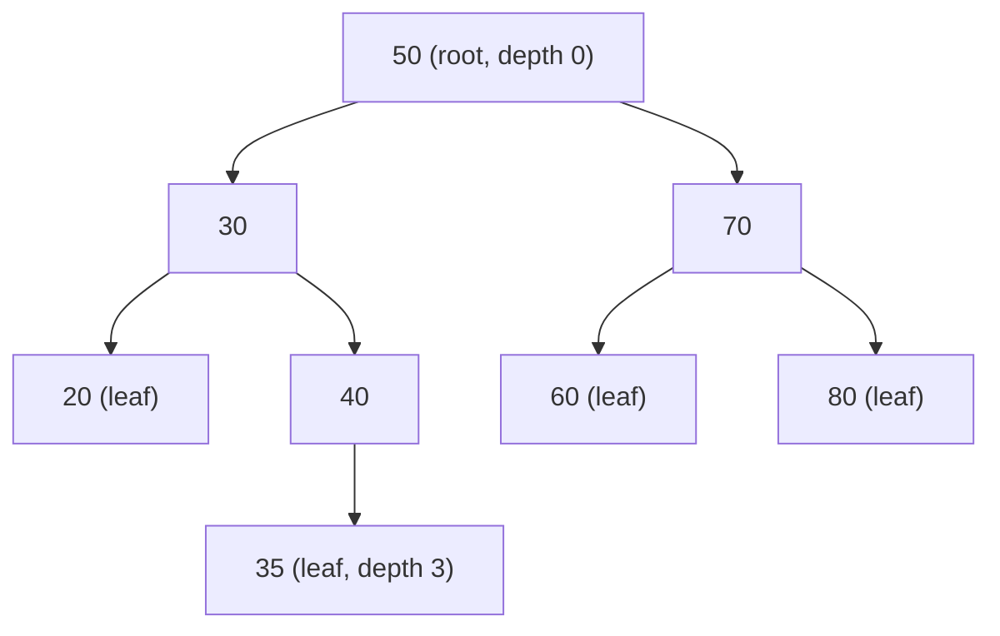
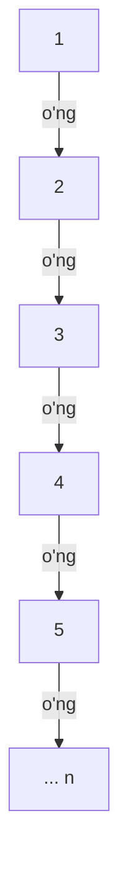

## Bu dars nima uchun kerak

Oldingi darslarda ikki xil to'plam bilan ishladik va ikkalasida ham bitta amal sekin qoldi. Saralangan massivda (11 va 15-darslar) qidirish tez: binary search n = 1 000 000 element ichida eng ko'pi bilan 20 qadamda javob beradi. Lekin yangi elementni o'z joyiga qo'yish uchun undan keyingi hamma elementni bir katak siljitish kerak, bu esa O(n) (16-dars). Linked list'da (28-dars) esa aksincha: kerakli joy topilgach, yangi tugunni ulash bir-ikki pointer o'zgartirish, lekin o'sha joyni topish uchun ro'yxat boshidan bittalab yurish kerak, yana O(n).

**Daraxt** (tree) shu ikki dunyoni birlashtirishga urinadi: elementlar linked list'dagi kabi alohida tugunlarda (node) saqlanadi va pointer'lar bilan bog'lanadi, lekin har tugundan bitta emas, ikki yo'l chiqadi. Agar tugunlar ma'lum bir tartib qoidasiga bo'ysunsa, har qadamda qidiruv sohasining bir qismini tashlab yuboramiz, xuddi binary search'dagi kabi. Natija - **binary search tree** (BST): yaxshi holatda qidirish, qo'shish va o'chirish O(log n).

"Yaxshi holatda" degan izoh bu darsning ikkinchi yarmi. BST faqat shakli muvozanatli bo'lsa tez. Kalitlar saralangan tartibda kelsa, daraxt bir tomonga cho'zilib, aslida linked list'ga aylanadi va hamma amallar yana O(n) bo'ladi. Buni o'z generatorimiz bilan haqiqiy o'lchab ko'ramiz va muammoni hal qiladigan o'z-o'zini balanslovchi daraxtlar (AVL, red-black) qanday kafolat berishini ko'ramiz.

Dars 18-darsdagi rekursiyaga to'liq tayanadi: daraxt rekursiv tuzilma, uning deyarli har bir algoritmi "ildiz bilan nima qilaman, qolganini chap va o'ng qism daraxtga topshiraman" ko'rinishida yoziladi. Shuningdek 20-darsdagi `struct`, 21-darsdagi pointer'lar va 23-darsdagi `malloc`/`free` kerak bo'ladi.

Bu darsdan keyin siz:

- daraxt atamalarini (root, leaf, parent, child, height, depth) aniq ta'riflay olasiz;
- BST xossasini va u nima uchun qidiruvni tezlashtirishini tushuntira olasiz;
- C da tugun `struct` ini yozib, qidirish va qo'shishni rekursiv va iterativ shaklda amalga oshira olasiz;
- in-order, pre-order va post-order aylanishlarni farqlay olasiz va nima uchun in-order saralangan tartib berishini isbotlay olasiz;
- o'chirishning uchta holatini (barg, bitta bola, ikki bola) in-order voris bilan bajara olasiz;
- daraxtni nima uchun aynan post-order bilan `free` qilish kerakligini bilasiz;
- balandlikni o'lchab, tasodifiy va saralangan kirish orasidagi farqni raqamlar bilan ko'rsata olasiz;
- AVL va red-black daraxtlar qanday balandlik kafolatini berishini bilasiz.

## Daraxt atamalari

Daraxt - tugunlar to'plami, ular orasida "ota-ona va bola" munosabati bor. Kompyuter fanida daraxt odatda teskari chiziladi: ildiz yuqorida, barglar pastda.

- **Root** (ildiz) - ota-onasi yo'q yagona tugun. Daraxtga kirish nuqtasi: dastur faqat ildizga pointer saqlaydi, qolgan hamma tugunga undan yetib boriladi.
- **Parent** (ota-ona) va **child** (bola) - A tugundan B ga to'g'ridan-to'g'ri bog'lanish bo'lsa, A - B ning parent'i, B - A ning child'i. Ildizdan boshqa har tugunning aniq bitta parent'i bor.
- **Leaf** (barg) - bolasi yo'q tugun. Bolasi bor tugunni ichki tugun deyiladi.
- **Qism daraxt** (subtree) - biror tugun va uning barcha avlodlari. Har tugun o'z qism daraxtining ildizi.
- **Depth** (chuqurlik) - tugundan ildizgacha bo'lgan yo'ldagi bog'lanishlar (qirralar) soni. Ildiz chuqurligi 0.
- **Height** (balandlik) - daraxtning eng chuqur bargining chuqurligi, ya'ni ildizdan barggacha eng uzun yo'ldagi qirralar soni. Bitta tugunli daraxt balandligi 0, bo'sh daraxt balandligi odatda -1 deb olinadi.

Diqqat: ba'zi kitoblar balandlikni qirralar emas, tugunlar soni bilan sanaydi (u holda bitta tugunli daraxt balandligi 1). Bu darsda hamma joyda qirralar soni ishlatiladi; boshqa manbadagi formulani o'qiganda qaysi ta'rif ekanini tekshiring.

**Binary tree** (ikkilik daraxt) - har tugunning eng ko'pi bilan ikkita bolasi bor daraxt, va bolalar nomlangan: chap (left) va o'ng (right). Faqat o'ng bolasi bor tugun bilan faqat chap bolasi bor tugun ikki xil daraxt hisoblanadi.

Balandlik va tugunlar soni orasida muhim bog'liqlik bor. h balandlikdagi binary tree'da har sathda eng ko'pi bilan 1, 2, 4, ..., 2^h tugun bo'ladi, jami:

1 + 2 + 4 + ... + 2^h = 2^(h+1) - 1

Masalan, h = 2 da eng ko'pi bilan 7 tugun, h = 19 da 2^20 - 1 = 1 048 575 tugun. Teskarisi: n tugunni sig'dirish uchun balandlik kamida ⌊log₂ n⌋ bo'lishi kerak. n = 1 000 000 uchun bu 19. Yuqoridan esa chegara yo'q: n tugunni bitta zanjirga terib, balandligi n - 1 bo'lgan daraxt ham qurish mumkin. Butun dars shu ikki chegara orasidagi farq haqida.

## BST xossasi va qidirish

**Binary search tree** - har tugunda kalit saqlanadigan binary tree, unda har bir tugun uchun quyidagi shart bajariladi:

- chap qism daraxtdagi barcha kalitlar shu tugun kalitidan kichik;
- o'ng qism daraxtdagi barcha kalitlar shu tugun kalitidan katta.

E'tibor bering: shart faqat bevosita bolalar haqida emas, **butun** qism daraxt haqida. `50` ildizining chap tomonida chuqur joylashgan `55` ham shartni buzadi, garchi u o'z parent'idan katta bo'lsa ham. Bu nozik farq pastdagi mashqda ko'p uchraydigan xatoga aylanadi. Bu darsda kalitlar takrorlanmaydi deb faraz qilamiz; takrorlarga ruxsat beriladigan variantlarda "chapda kichik yoki teng" kabi qoida qo'shiladi.

Quyidagi daraxt 50, 30, 70, 20, 40, 60, 80, 35 tartibida qo'shilgan kalitlardan quriladi:



Bu daraxtda 8 tugun, 4 barg (20, 35, 60, 80), balandlik 3 (50 dan 35 gacha: 50-30-40-35, uchta qirra).

Qidirish algoritmi xossadan to'g'ridan-to'g'ri kelib chiqadi. 35 ni qidiramiz:

1. Ildiz 50. 35 < 50, demak 35 faqat chap qism daraxtda bo'lishi mumkin. O'ng tomon (70, 60, 80) butunlay tashlab yuboriladi.
2. 30. 35 > 30, o'ngga.
3. 40. 35 < 40, chapga.
4. 35. Topildi, jami 4 ta tugun ko'rildi.

Har qadamda bitta taqqoslash va bitta pastga tushish. Shuning uchun qidiruv qadamlari soni **eng ko'pi bilan balandlik + 1**. Mavjud bo'lmagan 45 ni qidirsak: 50, 30, 40, keyin 40 ning o'ng bolasi `NULL` - 3 tugun ko'rildi va "yo'q" degan javob. Muvozanatli daraxtda balandlik taxminan log₂ n, demak qidiruv O(log n), saralangan massivdagi binary search bilan bir xil tartib. Farqi: endi qo'shish ham shunday tez bo'lishi mumkin.

## C da tugun, qo'shish va qidirish

Tugun - kalit va ikki bolaga pointer saqlaydigan `struct` (20-dars). Struct o'zini o'zi ichiga ololmaydi (cheksiz o'lcham bo'lardi), lekin o'ziga **pointer** saqlay oladi: pointer o'lchami doim bir xil.

```c
typedef struct node
{
    int key;
    struct node *left;
    struct node *right;
} node;
```

`typedef` ichida `struct node *left` deb to'liq yozilishi shart, chunki `node` qisqa nomi faqat e'lon tugagandan keyin paydo bo'ladi. Brauzer muhitida (wasm32) `sizeof(node)` = 4 + 4 + 4 = 12 bayt, 64-bitli x86-64 da esa 4 + 4 (padding, 20-dars) + 8 + 8 = 24 bayt. Ya'ni bitta `int` ni saqlash uchun ikki pointer narxini to'laymiz: x86-64 da foydali ma'lumot tugun hajmining atigi 1/6 qismi. Bu - daraxtning saralangan massivga nisbatan xotira narxi.

### Rekursiv qo'shish

Qo'shish qidiruv bilan bir xil yo'ldan yuradi va `NULL` ga yetganda o'sha joyga yangi tugun qo'yadi. Rekursiv yozuvning qulay usuli: funksiya qism daraxtning (ehtimol yangilangan) ildizini qaytaradi va chaqiruvchi uni o'z bolasi pointer'iga yozadi:

- base case: daraxt bo'sh (`root == NULL`) - yangi tugun yaratib, uni qaytaramiz;
- rekursiv qadam: kalit kichik bo'lsa `root->left = insert(root->left, key)`, katta bo'lsa o'ngga xuddi shunday; `root` ning o'zi o'zgarmaydi va qaytariladi.

Shu uslub tufayli bo'sh daraxtga birinchi qo'shish alohida holat talab qilmaydi: `root = insert(root, 50)` ildizni o'zi o'rnatadi.

### Iterativ qidirish

Qidiruv har qadamda faqat bitta yo'nalishga tushadi va orqaga qaytmaydi, shuning uchun uni rekursiyasiz `while` sikli bilan yozish oson. Bu tail recursion'ning (18-dars) tabiiy sikl shakli: har chaqiruvning oxirgi ishi keyingi chaqiruv edi.

Quyidagi dastur daraxtni quradi, uchta aylanish tartibini chiqaradi va qidiruvda nechta tugun ko'rilganini sanaydi:

```c run
#include <stdio.h>
#include <stdlib.h>

typedef struct node
{
    int key;
    struct node *left;
    struct node *right;
} node;

// Rekursiv qo'shish: yangi (yoki o'zgarmagan) qism daraxt ildizini qaytaradi
node *insert(node *root, int key)
{
    if (root == NULL)
    {
        node *n = malloc(sizeof(node));
        if (n == NULL)
        {
            return NULL;
        }
        n->key = key;
        n->left = NULL;
        n->right = NULL;
        return n;
    }
    if (key < root->key)
    {
        root->left = insert(root->left, key);
    }
    else if (key > root->key)
    {
        root->right = insert(root->right, key);
    }
    return root; // teng kalit qo'shilmaydi
}

// Iterativ qidirish: nechta tugun ko'rilganini ham sanaydi
node *search(node *root, int key, int *visited)
{
    *visited = 0;
    while (root != NULL)
    {
        (*visited)++;
        if (key == root->key)
        {
            return root;
        }
        root = (key < root->key) ? root->left : root->right;
    }
    return NULL;
}

void inorder(const node *t)
{
    if (t == NULL)
    {
        return;
    }
    inorder(t->left);
    printf("%d ", t->key);
    inorder(t->right);
}

void preorder(const node *t)
{
    if (t == NULL)
    {
        return;
    }
    printf("%d ", t->key);
    preorder(t->left);
    preorder(t->right);
}

void postorder(const node *t)
{
    if (t == NULL)
    {
        return;
    }
    postorder(t->left);
    postorder(t->right);
    printf("%d ", t->key);
}

// Post-order: avval bolalar, keyin tugunning o'zi
void free_tree(node *t)
{
    if (t == NULL)
    {
        return;
    }
    free_tree(t->left);
    free_tree(t->right);
    free(t);
}

int main(void)
{
    int keys[] = {50, 30, 70, 20, 40, 60, 80, 35};
    int n = sizeof(keys) / sizeof(keys[0]);
    node *root = NULL;
    for (int i = 0; i < n; i++)
    {
        root = insert(root, keys[i]);
    }

    printf("in-order:   ");
    inorder(root);
    printf("\npre-order:  ");
    preorder(root);
    printf("\npost-order: ");
    postorder(root);
    printf("\n");

    int targets[] = {35, 80, 45};
    for (int i = 0; i < 3; i++)
    {
        int visited;
        node *found = search(root, targets[i], &visited);
        printf("qidiruv %d: %s, %d ta tugun ko'rildi\n", targets[i], found ? "topildi" : "yo'q", visited);
    }

    free_tree(root);
}
```

Natija:

```text
in-order:   20 30 35 40 50 60 70 80 
pre-order:  50 30 20 40 35 70 60 80 
post-order: 20 35 40 30 60 80 70 50 
qidiruv 35: topildi, 4 ta tugun ko'rildi
qidiruv 80: topildi, 3 ta tugun ko'rildi
qidiruv 45: yo'q, 3 ta tugun ko'rildi
```

Bir nechta tafsilot. `malloc` muvaffaqiyatsiz bo'lsa `NULL` qaytaramiz (23-dars). `insert` ichida teng kalit uchun hech narsa qilinmaydi: takror qo'shilmaydi. Dastur oxirida `free_tree` hamma 8 tugunni bo'shatadi, shuning uchun brauzer muhiti leak hisobotini chiqarmaydi. `free_tree(root)` qatorini o'chirib ishga tushirsangiz, hisobot 8 ta blokda bo'shatilmagan xotirani ko'rsatadi: wasm32 da 8 · 12 = 96 bayt.

### Iterativ qo'shish: pointer'ga pointer

Qo'shishni ham siklga aylantirish mumkin, lekin bitta muammo bor: `NULL` ga yetganimizda, yangi tugunni **qaysi pointer'ga** yozishni bilishimiz kerak - parent'ning `left` igami, `right` igami yoki daraxt bo'sh bo'lsa `root` ning o'zigami. Eng toza yechim - tugunga emas, **tugunga ishora qiluvchi pointer'ga** pointer saqlash (`node **link`, 21-dars):

```c
node **link = &root;
while (*link != NULL)
{
    link = (key < (*link)->key) ? &(*link)->left : &(*link)->right;
}
*link = fresh; // root, left yoki right - qaysi biri bo'lsa ham
```

`link` har doim "keyingi tugun manzili yozilgan joy" ni ko'rsatadi. Sikl tugaganda `*link` - `NULL` turgan aniq o'sha joy, va unga yozish bo'sh daraxt holatini ham, chap va o'ng holatlarni ham bitta qatorda hal qiladi. 28-darsda linked list'ga qo'shishda ham xuddi shu usul ishlaydi.

Iterativ shaklning amaliy afzalligi keyinroq ko'rinadi: rekursiv `insert` chuqurligi daraxt balandligiga teng, va daraxt 10 000 qavatli zanjirga aylansa, 10 000 ta stack frame kerak bo'ladi (18-darsdagi stack overflow xavfi).

## Aylanishlar: in-order, pre-order, post-order

Daraxtni **aylanish** (traversal) - har tugunga aniq bir marta tashrif buyurish. Binary tree uchun uchta klassik rekursiv tartib bor, ular faqat "tugunning o'zi" qachon qayta ishlanishi bilan farq qiladi:

| Tartib | Qadamlar | Misol daraxtda | Asosiy ishlatilishi |
|---|---|---|---|
| In-order | chap, tugun, o'ng | 20 30 35 40 50 60 70 80 | BST kalitlarini saralangan tartibda olish |
| Pre-order | tugun, chap, o'ng | 50 30 20 40 35 70 60 80 | Daraxtni nusxalash, faylga saqlash va qayta qurish |
| Post-order | chap, o'ng, tugun | 20 35 40 30 60 80 70 50 | Daraxtni `free` qilish, qism daraxt hajmi yoki balandligini hisoblash |

Uchalasi ham n tugunli daraxtda O(n) vaqt oladi: har tugun bir marta, va har `NULL` bola bir marta tekshiriladi (n tugunda aniq n + 1 ta `NULL` pointer bor: 2n pointer'dan n - 1 tasi haqiqiy bolalarga ishora qiladi). Qo'shimcha xotira - rekursiya chuqurligi, ya'ni O(h).

### Nima uchun in-order saralangan tartib beradi

Bu tasodif emas, BST xossasining to'g'ridan-to'g'ri natijasi. Isbot daraxt balandligi bo'yicha induksiya bilan (18-darsdagi "ishonch sakrashi" ning rasmiy shakli):

- Base case: bo'sh daraxt hech narsa chiqarmaydi - bo'sh ketma-ketlik saralangan.
- Rekursiv qadam: ildiz kaliti k bo'lsin. Induksiya farazi bo'yicha `inorder(left)` chap qism daraxt kalitlarini o'sish tartibida chiqaradi, `inorder(right)` esa o'ng qism daraxtnikini. BST xossasi bo'yicha chapdagi hamma kalit k dan kichik, o'ngdagi hammasi katta. Demak "chap kalitlar, k, o'ng kalitlar" ketma-ketligi butunlay o'sish tartibida.

Shu sababli BST - n elementni O(n) da saralangan tartibda bera oladigan tuzilma. Bundan bitta amaliy natija: n kalitni bo'sh BST ga qo'shib, keyin in-order o'qish - saralash algoritmi (tree sort). Muvozanatli daraxtda u O(n log n), lekin saralangan kirishda O(n^2), xuddi pastda ko'radigan balans muammosi tufayli.

Pre-order chiqishning xossasi boshqa: birinchi element har doim ildiz. Pre-order ketma-ketlikni (50 30 20 40 35 70 60 80) bo'sh BST ga shu tartibda qo'shsangiz, aynan o'sha shakldagi daraxt qayta quriladi. In-order bilan bu ishlamaydi: saralangan ketma-ketlikni qo'shish butunlay boshqa (zanjir) daraxt beradi.

### free nima uchun post-order bilan

Daraxtni bo'shatishda tugunning o'zi oxirida bo'shatilishi shart. Agar pre-order kabi avval tugunni bo'shatsak:

```c
// NOTO'G'RI
free(t);
free_tree(t->left);  // t allaqachon bo'shatilgan: use-after-free
free_tree(t->right);
```

`free(t)` dan keyin `t->left` ni o'qish - bo'shatilgan xotiraga murojaat (use-after-free, 23-24-darslar). Oddiy kompilyatsiyada bu ko'pincha "ishlab ketadi", chunki eski baytlar hali o'chirilmagan bo'ladi, lekin bu undefined behavior. Brauzer muhiti bunday murojaatni darhol to'xtatadi va xato turi (heap-use-after-free) hamda qatorni ko'rsatadi; haqiqiy Linux'da Valgrind "Invalid read" xabarini beradi. Post-order'da bunday muammo yo'q: tugun bo'shatilayotganda uning bolalari allaqachon bo'shatilgan va unga boshqa hech kim murojaat qilmaydi.

## O'chirish: uch holat

O'chirish BST amallarining eng murakkabi, chunki tugunni olib tashlagandan keyin ham daraxt BST bo'lib qolishi kerak. Avval tugun odatdagi qidiruv bilan topiladi, keyin uning bolalari soniga qarab uch holatdan biri:

1. **Barg (bolasi yo'q).** Tugunni bo'shatib, parent'idagi pointer'ni `NULL` qilamiz. Xossa buzilmaydi.
2. **Bitta bola.** Tugunni bo'shatib, uning yagona bolasini (butun qism daraxti bilan) parent'ga ulaymiz. Masalan 40 ning faqat chap bolasi 35 bor: 40 o'rniga 35 qo'yiladi. Xossa saqlanadi, chunki 35 ning butun qism daraxti avval ham 30 ning o'ng tomonida edi va 30 dan katta.
3. **Ikki bola.** Bu yerda ikki qism daraxtni bitta pointer'ga ulab bo'lmaydi. Klassik yechim: tugunning **in-order vorisini** (successor) topamiz - o'ng qism daraxtdagi eng kichik kalit, ya'ni o'ng bolaga o'tib, keyin chapga `NULL` gacha yurish. Vorisning kalitini o'chirilayotgan tugunga ko'chiramiz, keyin vorisning o'zini o'ng qism daraxtdan o'chiramiz.

Nima uchun voris mos keladi: u o'ng qism daraxtdagi eng kichik kalit, demak o'ng tomondagi qolgan hammasidan kichik, va o'ng tomonda bo'lgani uchun chapdagi hammasidan katta - u aynan o'chirilgan kalitning o'rnini egallay oladi. Ikkinchi muhim fakt: vorisning **chap bolasi yo'q** (bo'lsa, u kichikroq bo'lardi va voris o'sha bo'lardi). Demak vorisni o'chirish har doim 1 yoki 2-holat, rekursiya bir qadamda tugaydi. Simmetrik variant - in-order oldingi (predecessor, chap qism daraxtdagi eng katta kalit) ham to'g'ri.

C da rekursiv shakl qo'shishdagi kabi "yangi ildizni qaytar" uslubida yoziladi:

```c run
#include <stdio.h>
#include <stdlib.h>

typedef struct node
{
    int key;
    struct node *left;
    struct node *right;
} node;

node *insert(node *root, int key)
{
    if (root == NULL)
    {
        node *n = malloc(sizeof(node));
        if (n == NULL)
        {
            return NULL;
        }
        n->key = key;
        n->left = n->right = NULL;
        return n;
    }
    if (key < root->key)
    {
        root->left = insert(root->left, key);
    }
    else if (key > root->key)
    {
        root->right = insert(root->right, key);
    }
    return root;
}

// key ni o'chiradi va qism daraxtning yangi ildizini qaytaradi
node *delete(node *root, int key)
{
    if (root == NULL)
    {
        return NULL; // kalit yo'q
    }
    if (key < root->key)
    {
        root->left = delete(root->left, key);
        return root;
    }
    if (key > root->key)
    {
        root->right = delete(root->right, key);
        return root;
    }

    // 1 va 2-holat: bola 0 yoki 1 ta - borini (yoki NULL ni) ota-onaga ulaymiz
    if (root->left == NULL)
    {
        node *child = root->right;
        free(root);
        return child;
    }
    if (root->right == NULL)
    {
        node *child = root->left;
        free(root);
        return child;
    }

    // 3-holat: ikki bola. In-order voris - o'ng qism daraxtdagi eng kichik kalit
    node *succ = root->right;
    while (succ->left != NULL)
    {
        succ = succ->left;
    }
    root->key = succ->key;                          // vorisning kalitini ko'chiramiz
    root->right = delete(root->right, succ->key);   // vorisni o'ng tomondan o'chiramiz
    return root;
}

void print(const node *t)
{
    if (t == NULL)
    {
        printf("-");
        return;
    }
    if (t->left == NULL && t->right == NULL)
    {
        printf("%d", t->key);
        return;
    }
    printf("%d(", t->key);
    print(t->left);
    printf(" ");
    print(t->right);
    printf(")");
}

void free_tree(node *t)
{
    if (t != NULL)
    {
        free_tree(t->left);
        free_tree(t->right);
        free(t);
    }
}

int main(void)
{
    int keys[] = {50, 30, 70, 20, 40, 60, 80, 35};
    node *root = NULL;
    for (int i = 0; i < 8; i++)
    {
        root = insert(root, keys[i]);
    }
    printf("boshida:       ");
    print(root);
    printf("\n");

    int victims[] = {20, 40, 50};
    for (int i = 0; i < 3; i++)
    {
        root = delete(root, victims[i]);
        printf("%d o'chirildi: ", victims[i]);
        print(root);
        printf("\n");
    }

    free_tree(root);
}
```

`print` daraxtni `kalit(chap o'ng)` ko'rinishida chiqaradi, `-` bo'sh bolani bildiradi. Natija:

```text
boshida:       50(30(20 40(35 -)) 70(60 80))
20 o'chirildi: 50(30(- 40(35 -)) 70(60 80))
40 o'chirildi: 50(30(- 35) 70(60 80))
50 o'chirildi: 60(30(- 35) 70(- 80))
```

Uchala holat ketma-ket ko'rinadi: 20 - barg, shunchaki yo'qoladi. 40 - bitta bola, uning o'rniga 35 ko'tariladi. 50 - ikki bola: voris 70 dan chapga yurib topilgan 60; ildiz kaliti 60 ga almashdi, 60 ning eski tuguni (barg) esa o'ng qism daraxtdan o'chirildi. Har qadamdan keyin in-order o'qisangiz, ketma-ketlik saralangan bo'lib qoladi: oxirida 30 35 60 70 80.

O'chirish narxi: tugunni topish O(h), vorisni topish yana O(h) gacha, demak umumiy O(h). Bunda h - balandlik, n emas. Shu sababli BST ning barcha asosiy amallari tezligi bitta savolga keladi: balandlik qancha?

## Balans muammosi: daraxt linked list'ga aylanganda

Qo'shish algoritmi daraxt shaklini **kalitlar kelish tartibi** bo'yicha belgilaydi. 1, 2, 3, 4, 5 ni ketma-ket qo'shamiz: 1 ildiz, 2 uning o'ng bolasi, 3 - 2 ning o'ng bolasi va hokazo. Hech bir tugunda chap bola yo'q:



Bunday daraxt **degenerate daraxt** deyiladi: shakli bo'yicha u linked list, balandligi n - 1. Qidiruv endi binary search emas, chiziqli qidiruv (15-dars). Xuddi shu holat kamayish tartibida (hamma bola chapda) va "arra" shaklidagi (1, 100, 2, 99, 3, ...) kirishda ham yuz beradi. Real hayotda saralangan kirish kam emas: vaqt bo'yicha o'sib boruvchi ID'lar, alifbo tartibidagi lug'at fayli, avval saralab, keyin yuklangan ma'lumot.

Qo'shishning umumiy narxi ham o'zgaradi. i-kalit (0 dan sanaganda) degenerate daraxtda i chuqurlikka tushadi, ya'ni i ta tugundan o'tadi. n kalit uchun:

0 + 1 + 2 + ... + (n - 1) = n(n - 1) / 2

n = 10 000 da 10 000 · 9 999 / 2 = 49 995 000 qadam. Muvozanatli daraxtda esa har qo'shish taxminan log₂ n ≈ 13 qadam, jami 130 000 atrofida.

### O'lchab ko'ramiz

Nazariya o'rniga haqiqiy daraxtlarni quramiz. Tasodifiy kalitlar uchun kutubxonadagi `rand` ga tayanmaymiz (uning algoritmi platformaga bog'liq va natija har muhitda boshqacha bo'lardi), o'zimizning **LCG** (linear congruential generator, chiziqli kongruent generator) ni yozamiz:

x(k+1) = (a · x(k) + c) mod 2^32, a = 1664525, c = 1013904223

`uint32_t` (o'lchami har platformada aniq 32 bit) da ko'paytirish va qo'shish avtomatik ravishda 2^32 bo'yicha qoldiq bilan bajariladi: unsigned overflow C da aniqlangan xatti-harakat (7-dars), signed overflow esa yo'q. Natija - har muhitda bir xil ketma-ketlik. Knuth TAOCP 2-jildidagi teoremaga ko'ra, 2^32 modulli LCG c toq va a - 1 soni 4 ga bo'linganda to'liq davrga ega: 2^32 ta qiymatning har biri bir martadan chiqadi. Bizda c toq, a - 1 = 1664524 = 4 · 416131. Demak birinchi 10 000 ta son ichida takror yo'q va daraxtga hamma kalit qo'shiladi.

Dastur ikki yaxshilanishni ishlatadi. Birinchisi, qo'shish iterativ (pointer'ga pointer bilan) va yangi tugun chuqurligini qaytaradi: balandlik shu chuqurliklarning maksimumi, o'rtacha chuqurlik esa ularning o'rtachasi. Ikkinchisi, hamma tugunlar bitta `malloc` qilingan massivdan (pool) olinadi va bitta `free` bilan qaytariladi: 10 000 qavatli zanjirni rekursiv `free_tree` bilan bo'shatish yana chuqur rekursiya bo'lardi.

```c run
#include <stdint.h>
#include <stdio.h>
#include <stdlib.h>

typedef struct node
{
    uint32_t key;
    struct node *left;
    struct node *right;
} node;

// O'z LCG generatorimiz: x = (a * x + c) mod 2^32
static uint32_t state = 2026;

uint32_t next_random(void)
{
    state = 1664525u * state + 1013904223u; // uint32_t da mod 2^32 avtomatik
    return state;
}

// Iterativ qo'shish (rekursiyasiz, chuqur daraxtda stack to'lmasin).
// Yangi tugun qaysi chuqurlikka tushganini qaytaradi (ildiz chuqurligi 0).
int insert(node **root, node *fresh)
{
    int depth = 0;
    node **link = root;
    while (*link != NULL)
    {
        link = (fresh->key < (*link)->key) ? &(*link)->left : &(*link)->right;
        depth++;
    }
    *link = fresh;
    return depth;
}

void experiment(const char *name, int n, int sorted)
{
    // Barcha tugunlar bitta massivdan: free ham bitta
    node *pool = malloc(n * sizeof(node));
    if (pool == NULL)
    {
        return;
    }
    node *root = NULL;
    int height = 0;
    long sum_depth = 0;
    for (int i = 0; i < n; i++)
    {
        pool[i].key = sorted ? (uint32_t) i : next_random();
        pool[i].left = pool[i].right = NULL;
        int d = insert(&root, &pool[i]);
        sum_depth += d;
        if (d > height)
        {
            height = d;
        }
    }
    printf("%-10s n = %5d   balandlik = %4d   o'rtacha chuqurlik = %8.2f\n", name, n, height,
           (double) sum_depth / n);
    free(pool);
}

int main(void)
{
    int sizes[] = {100, 1000, 10000};
    for (int i = 0; i < 3; i++)
    {
        experiment("tasodifiy", sizes[i], 0);
    }
    for (int i = 0; i < 3; i++)
    {
        experiment("saralangan", sizes[i], 1);
    }
}
```

Natija (har muhitda bir xil, chunki generator o'zimizniki):

```text
tasodifiy  n =   100   balandlik =   15   o'rtacha chuqurlik =     8.21
tasodifiy  n =  1000   balandlik =   20   o'rtacha chuqurlik =    10.46
tasodifiy  n = 10000   balandlik =   28   o'rtacha chuqurlik =    15.25
saralangan n =   100   balandlik =   99   o'rtacha chuqurlik =    49.50
saralangan n =  1000   balandlik =  999   o'rtacha chuqurlik =   499.50
saralangan n = 10000   balandlik = 9999   o'rtacha chuqurlik =  4999.50
```

Raqamlarni tahlil qilamiz:

- **Saralangan kirish** aniq formulaga bo'ysunadi: balandlik n - 1, o'rtacha chuqurlik (0 + 1 + ... + (n - 1)) / n = (n - 1) / 2. n = 10 000 da 4999.5. Har o'n baravar n o'n baravar ko'p qadam - chiziqli o'sish.
- **Tasodifiy kirishda** n 100 dan 10 000 ga (100 baravar) oshganda balandlik 15 dan 28 ga, o'rtacha chuqurlik 8.21 dan 15.25 ga oshdi - logarifmik o'sish. Mukammal muvozanatli daraxtning minimal balandligi ⌊log₂ 10 000⌋ = 13, tasodifiy daraxt undan taxminan ikki baravar baland, lekin baribir 9999 dan 357 baravar past.
- n = 10 000 da kalitni topish uchun o'rtacha (chuqurlik + 1) taqqoslash: tasodifiy daraxtda 16.25, saralangan kirishdan qurilganida 5000.5. Farq 300 baravardan ko'p.

Nazariya bilan solishtirish. Tasodifiy tartibda qurilgan BST bo'yicha ma'lum natijalar: bitta tugunning kutilgan chuqurligi eng ko'pi bilan 2 ln n + O(1), eng uzun yo'l esa katta ehtimol bilan taxminan 4.311 ln n. n = 10 000 da 2 ln n ≈ 18.4 (bizning o'rtacha 15.25 undan past, chegaraga mos), 4.311 ln n ≈ 39.7 (bizning 28). Ikkinchi baho asimptotik, ya'ni n cheksizga intilgandagi xatti-harakat; amaliy n larda haqiqiy balandlik undan sezilarli past bo'ladi. Muhimi tartib: ikkalasi ham O(log n).

Xulosa: BST "o'rtacha holatda" (16-dars) yaxshi, lekin bu o'rtacha kirish tartibi tasodifiy bo'lishiga bog'liq. Kirishni biz emas, foydalanuvchi yoki tashqi tizim tanlaydi, va eng yomon holat - oddiy saralangan fayl.

## O'z-o'zini balanslovchi daraxtlar

Muammoni kirishga emas, daraxtning o'ziga yuklash mumkin: har qo'shish va o'chirishdan keyin daraxt shaklini tekshirib, kerak bo'lsa, qayta tartibga solish. Bunday tuzilmalar **self-balancing** (o'z-o'zini balanslovchi) BST deyiladi. Ularning asosiy vositasi - **rotatsiya** (rotation): ikki tugun orasidagi parent-child munosabatini almashtiradigan, BST xossasini (in-order tartibni) saqlaydigan va O(1) pointer o'zgartirish talab qiladigan amal. Masalan, 1, 2, 3 zanjirida 2 atrofida chapga rotatsiya qilinsa, 2 ildizga ko'tariladi, 1 uning chap, 3 o'ng bolasi bo'ladi: balandlik 2 dan 1 ga tushadi, in-order esa baribir 1 2 3.

Ikki eng mashhur oila:

**AVL daraxti.** 1962-yilda Adelson-Velsky va Landis taklif qilgan, birinchi o'z-o'zini balanslovchi BST. Qoida: har tugunda chap va o'ng qism daraxt balandliklari farqi (balance factor) eng ko'pi bilan 1. Qo'shish yoki o'chirishdan keyin bu farq 2 ga yetsa, bir yoki ikki rotatsiya bilan tiklanadi. Kafolat: n tugunli AVL daraxt balandligi taxminan 1.44 · log₂(n + 2) - 0.328 dan oshmaydi. Bu formulada (Wikipedia, Knuth) balandlik sathlar, ya'ni tugunlar soni bilan sanaladi; bu darsdagi qirralar ta'rifida undan yana 1 ayiriladi: 1.44 · log₂(n + 2) - 1.328.

**Red-black tree.** Har tugun qizil yoki qora rang oladi, va ranglar ustida bir nechta qoida bor: ildiz qora, qizil tugunning bolasi qizil bo'lmaydi, ildizdan istalgan `NULL` gacha bo'lgan har bir yo'lda qora tugunlar soni bir xil. Natijada eng uzun yo'l eng qisqasidan ikki baravardan uzun bo'la olmaydi. Kafolat (CLRS, 13-bob "Red-Black Trees"): balandlik eng ko'pi bilan 2 · log₂(n + 1).

n = 10 000 uchun hisoblaymiz (log₂ 10 001 ≈ 13.29):

| Daraxt | Balandlik chegarasi | n = 10 000 da | Qidirish (eng yomon) |
|---|---|---|---|
| Mukammal muvozanatli | ⌊log₂ n⌋ (minimum) | 13 | O(log n) |
| AVL | < 1.44 · log₂(n + 2) - 1.328 | 17 dan oshmaydi | O(log n) |
| Red-black | ≤ 2 · log₂(n + 1) | 26 dan oshmaydi | O(log n) |
| Oddiy BST, tasodifiy kirish | kafolat yo'q, o'rtacha O(log n) | bizda 28 | O(n) |
| Oddiy BST, saralangan kirish | n - 1 | 9999 | O(n) |

Jadvaldan ikki trade-off ko'rinadi. AVL qattiqroq muvozanatlangan (maksimal balandliklar nisbati taxminan 0.72), shuning uchun qidiruv biroz tezroq. Red-black esa qoidalari yumshoqroq bo'lgani uchun qo'shish va o'chirishda kamroq qayta tartiblash talab qiladi. Shu sababli o'zgarishlar ko'p bo'ladigan tartiblangan lug'atlar uchun ko'pincha red-black tree tanlanadi, qidiruv ustun bo'lgan joyda esa AVL. Ikkalasi ham "o'rtacha" emas, **eng yomon holatda** O(log n) kafolat beradi: saralangan kirish ham endi xavfli emas.

Balanslovchi daraxtlarni amalga oshirish (rotatsiyalarning barcha holatlari bilan) bu kurs doirasidan tashqarida; muhimi g'oya: balandlik nazorat ostida bo'lsa, BST ning barcha amallari O(log n).

Muqobil yondashuv ham bor: daraxt qayta-qayta o'zgarmasa, hamma kalitlarni saralab, o'rtadagi elementni ildiz qilib, chap va o'ng yarmini rekursiv quring. Natija balandligi ⌊log₂ n⌋ bo'lgan daraxt. Bu amaliy topshiriqning bir qismi.

## Mashq: BST to'g'riligini tekshirish va k-chi eng kichik element

Ikki funksiya yozing (Python'da, `Node` sinfi berilgan):

1. `is_bst(root)` - daraxt BST xossasini **butun qism daraxtlar bo'yicha** qanoatlantirsa `True`, aks holda `False`. Bo'sh daraxt (`None`) - BST. Faqat bevosita bolalarni tekshirish yetarli emas: ruxsat etilgan oraliqni (`lo`, `hi`) rekursiya bo'ylab pastga uzating. Takror kalitlar BST emas deb hisoblansin.
2. `kth_smallest(root, k)` - k-chi eng kichik kalit (k = 1 eng kichigi). k noto'g'ri bo'lsa (k < 1 yoki tugunlar sonidan katta) `None` qaytaring. Maslahat: in-order tartib saralangan.

```python run
class Node:
    def __init__(self, key, left=None, right=None):
        self.key = key
        self.left = left
        self.right = right


def is_bst(root):
    # Yechimingizni shu yerga yozing
    return False


def kth_smallest(root, k):
    # Yechimingizni shu yerga yozing
    return None


#        50
#      /    \
#    30      70
#   /  \    /  \
#  20  40  60  80
tree = Node(50, Node(30, Node(20), Node(40)), Node(70, Node(60), Node(80)))
print(is_bst(tree), kth_smallest(tree, 3))
```

```python test
def _sample():
    return Node(50, Node(30, Node(20), Node(40, Node(35))), Node(70, Node(60), Node(80)))


check("bo'sh daraxt BST hisoblanadi", lambda: is_bst(None) is True)
check("bitta tugun BST", lambda: is_bst(Node(7)) is True)
check("to'g'ri BST uchun True", lambda: is_bst(_sample()) is True)
check("chap bola ildizdan katta - False", lambda: is_bst(Node(10, Node(15), Node(20))) is False)
check("nevara buzadi: 50 ning chap tomonidagi 55 - False (faqat bolalarni tekshirish yetmaydi)",
      lambda: is_bst(Node(50, Node(30, None, Node(55)), Node(70))) is False)
check("o'ng tomonda chuqurdagi 45 < 50 - False",
      lambda: is_bst(Node(50, Node(30), Node(70, Node(45), Node(80)))) is False)
check("takror kalit - False", lambda: is_bst(Node(5, Node(5))) is False)
check("degenerate (zanjir) daraxt ham BST", lambda: is_bst(Node(1, None, Node(2, None, Node(3)))) is True)
check("kth_smallest(..., 1) == 20", lambda: kth_smallest(_sample(), 1) == 20)
check("kth_smallest(..., 3) == 35", lambda: kth_smallest(_sample(), 3) == 35)
check("kth_smallest(..., 8) == 80 (oxirgisi)", lambda: kth_smallest(_sample(), 8) == 80)
check("k = 0 yoki k > n uchun None",
      lambda: kth_smallest(_sample(), 0) is None and kth_smallest(_sample(), 9) is None)
check("bo'sh daraxtda None", lambda: kth_smallest(None, 1) is None)
```

## Ko'p uchraydigan xatolar

1. **BST xossasini faqat bolalar bo'yicha tekshirish.** `left.key < key < right.key` har tugunda bajarilsa ham daraxt BST bo'lmasligi mumkin: chuqurdagi tugun ajdodining chegarasini buzishi mumkin. To'g'ri tekshiruv oraliqni (`lo`, `hi`) pastga uzatadi.
2. **Rekursiv `insert` natijasini e'tiborsiz qoldirish.** `insert(root, 5);` yozilsa, bo'sh daraxtda yangi tugun hech qayerga ulanmaydi va yo'qoladi (leak). To'g'risi: `root = insert(root, 5);`, ichkarida ham `root->left = insert(root->left, key);`.
3. **Daraxtni pre-order bilan `free` qilish.** `free(t)` dan keyin `t->left` ni o'qish - use-after-free. Bo'shatish faqat post-order: avval ikki bola, keyin tugun.
4. **Ikki bolali tugunni o'chirishda vorisni ham, uning eski tugunini ham qoldirish.** Kalitni ko'chirgandan keyin vorisni o'ng qism daraxtdan o'chirish unutilsa, kalit daraxtda ikki marta qoladi.
5. **"BST doim O(log n)" deb ishonish.** Oddiy BST faqat muvozanatli bo'lsa tez. Saralangan yoki deyarli saralangan kirishda balandlik n - 1, hamma amallar O(n). Kafolat kerak bo'lsa - AVL yoki red-black.
6. **Chuqur daraxtda rekursiya.** Degenerate daraxtda rekursiv `insert`, `search` yoki `free_tree` chuqurligi n ga teng va stack to'lishi mumkin (18-dars). Qidirish va qo'shishni iterativ yozing.
7. **Balandlik ta'riflarini aralashtirish.** Qirralar soni (bitta tugun - 0) yoki tugunlar soni (bitta tugun - 1): formulalar 1 ga farq qiladi. Manbadagi ta'rifni tekshiring.
8. **`malloc` natijasini tekshirmaslik.** `NULL` qaytsa, `n->key = key` dastur yiqilishiga olib keladi.

## Xulosa

- Daraxt - parent-child munosabatli tugunlar; root yagona, barg bolasiz, depth ildizgacha qirralar soni, height eng chuqur barg chuqurligi.
- BST: har tugunda chap qism daraxtdagi hamma kalit kichik, o'ngdagi hammasi katta. Qidirish, qo'shish va o'chirish O(h).
- C da tugun - kalit va ikki `struct node *`; qo'shish rekursiv ("yangi ildizni qaytar") yoki iterativ (pointer'ga pointer) yoziladi.
- In-order aylanish BST kalitlarini saralangan tartibda beradi (induksiya bilan isbotlanadi), pre-order daraxt shaklini saqlaydi, post-order bilan daraxt bo'shatiladi.
- O'chirish: barg - shunchaki olib tashlash, bitta bola - bolani ko'tarish, ikki bola - in-order voris kaliti bilan almashtirish va vorisni o'chirish.
- Saralangan kirish degenerate daraxt beradi: balandlik n - 1, qo'shish jami n(n - 1)/2 qadam. O'lchovda n = 10 000 uchun balandlik 9999, tasodifiy kirishda esa 28.
- AVL (balandlik < 1.44 · log₂(n + 2)) va red-black (≤ 2 · log₂(n + 1)) daraxtlar rotatsiyalar orqali eng yomon holatda ham O(log n) kafolatlaydi.

## Amaliy topshiriq

Oddiy BST ni kengaytirib, uning shaklini o'lchaydigan va saralangan massivdan muvozanatli daraxt quradigan dastur yozing.

Topshiriq qadamlari:

1. **Balandlik va barglar.** Rekursiv `int height(const node *t)` (bo'sh daraxt -1, bitta tugun 0) va `int count_leaves(const node *t)` yozing. Ular qaysi aylanish tartibida ishlaydi va nima uchun?
2. **Oraliq so'rovi.** `void print_range(const node *t, int lo, int hi)` - [lo, hi] oraliqdagi kalitlarni o'sish tartibida chiqarsin va oraliqdan tashqaridagi qism daraxtlarga **tushmasin** (masalan, `t->key < lo` bo'lsa chap qism daraxtga kirish shart emas). Necha tugun ko'rilganini sanang.
3. **Muvozanatli qurish.** `node *build_balanced(const int a[], int lo, int hi)` - saralangan massivning o'rta elementini ildiz qilib, chap va o'ng yarmini rekursiv quradi. 1 dan 15 gacha sonlar uchun balandlik 3 chiqishini tekshiring; n = 1000 uchun nima chiqadi va nega ⌊log₂ n⌋?
4. **Taqqoslash.** Xuddi shu 1000 ta saralangan kalitni `insert` bilan ketma-ket qo'shib quring va ikkala daraxtning balandligini hamda 1000 ta kalitni qidirishdagi jami taqqoslashlar sonini chiqaring. Farqni formula bilan tushuntiring.
5. **Xotira.** Ikkala daraxtni post-order `free_tree` bilan bo'shating va brauzerda leak hisoboti chiqmasligini tekshiring. 1000 tugun wasm32 da va x86-64 da necha bayt egallaydi?

Boshlang'ich shablon (funksiyalar hozircha noto'g'ri qiymat qaytaradi):

```c run
#include <stdio.h>
#include <stdlib.h>

typedef struct node
{
    int key;
    struct node *left;
    struct node *right;
} node;

node *new_node(int key)
{
    node *n = malloc(sizeof(node));
    if (n != NULL)
    {
        n->key = key;
        n->left = n->right = NULL;
    }
    return n;
}

int height(const node *t)
{
    // Yechimingizni shu yerga yozing
    return 0;
}

node *build_balanced(const int a[], int lo, int hi)
{
    // a[lo..hi] (ikkala chegara ham kiradi) dan muvozanatli daraxt
    // Yechimingizni shu yerga yozing
    return NULL;
}

void free_tree(node *t)
{
    if (t != NULL)
    {
        free_tree(t->left);
        free_tree(t->right);
        free(t);
    }
}

int main(void)
{
    int a[15];
    for (int i = 0; i < 15; i++)
    {
        a[i] = i + 1;
    }
    node *root = build_balanced(a, 0, 14);
    printf("balandlik: %d\n", height(root));
    free_tree(root);
}
```

Yaxshi javobda bo'lishi kerak bo'lgan narsalar:

- `height` va `count_leaves` post-order (avval bolalar natijasi, keyin tugun), bo'sh daraxt uchun -1 va 0 to'g'ri qaytariladi;
- `print_range` faqat kerakli qism daraxtlarga tushadi, natija saralangan, ko'rilgan tugunlar soni butun daraxtdan kam;
- `build_balanced` o'rta indeksni `lo + (hi - lo) / 2` bilan hisoblaydi (15-darsdagi overflow'siz shakl), 15 element uchun balandlik 3, 1000 element uchun 9 = ⌊log₂ 1000⌋;
- `insert` bilan qurilgan daraxt balandligi 999, qidiruvdagi jami taqqoslashlar 1 + 2 + ... + 1000 = 500 500; muvozanatli daraxtda esa 8 987 (har kalit o'rtacha 9 taqqoslashdan kam);
- xotira hisobi: 1000 · 12 = 12 000 bayt (wasm32), 1000 · 24 = 24 000 bayt (x86-64), leak hisoboti yo'q.

Javobingizni pastdagi maydonga yozing va yuqoridagi mezonlar bilan solishtiring.

## Manbalar

- CS50x. [Lecture 5 notes](https://cs50.harvard.edu/x/notes/5/) - "Trees" bo'limi: binary search tree g'oyasi, C dagi tugun tuzilmasi, rekursiv qidiruv va balans haqida.
- Wikipedia. [Binary search tree](https://en.wikipedia.org/wiki/Binary_search_tree) - ta'rif va tarix (1960, Windley, Booth, Colin, Hibbard), "Searching", "Insertion", "Deletion" (in-order successor bilan uch holat), "Traversal".
- Wikipedia. [Random binary tree](https://en.wikipedia.org/wiki/Random_binary_tree) - "Binary trees from random permutations": kutilgan chuqurlik 2 ln n + O(1) va eng uzun yo'l ≈ 4.311 ln n.
- Wikipedia. [AVL tree](https://en.wikipedia.org/wiki/AVL_tree) - 1962-yil, Adelson-Velsky va Landis; balance factor, rotatsiyalar, "Comparison to other structures": AVL balandlik chegarasi 1.44 · log₂(n + 2) - 0.328 va red-black uchun 2 · log₂(n + 1).
- Wikipedia. [Red-black tree](https://en.wikipedia.org/wiki/Red%E2%80%93black_tree) - "Properties": rang qoidalari, black height, eng uzun va eng qisqa yo'l nisbati.
- Cormen, Leiserson, Rivest, Stein. [Introduction to Algorithms](https://mitpress.mit.edu/9780262046305/introduction-to-algorithms/) - 12-bob "Binary Search Trees" (aylanish, qo'shish, o'chirish) va 13-bob "Red-Black Trees" (balandlik chegarasi 2 · lg(n + 1)).
- Knuth. [The Art of Computer Programming](https://www-cs-faculty.stanford.edu/~knuth/taocp.html) - 2-jild, 3.2.1 "The Linear Congruential Method": to'liq davr sharti (c toq, a - 1 soni 4 ga karrali); 3-jild, 6.2.2 "Binary Tree Searching".
