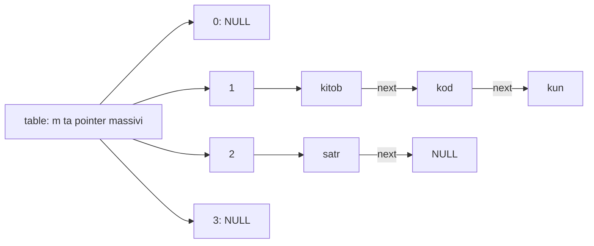
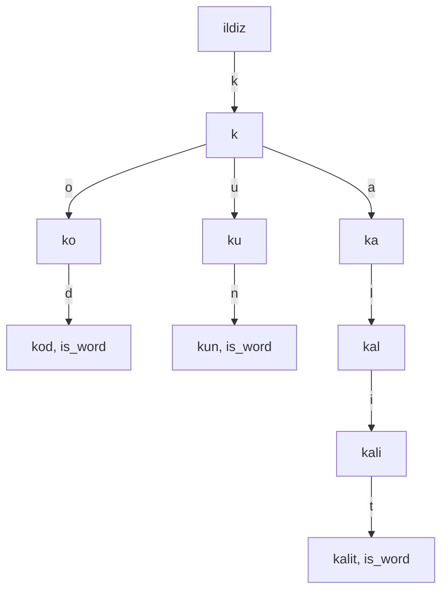

## Bu dars nima uchun kerak

Ko'p dasturlarning markazida bitta savol turadi: "shu kalit to'plamda bormi va unga bog'langan qiymat nima?" Imlo tekshiruvchi har so'z uchun lug'atdan qidiradi, kompilyator har identifikator uchun belgilar jadvaliga (9-dars) murojaat qiladi, veb-server har so'rovda sessiya identifikatori bo'yicha foydalanuvchini topadi. Bunday tuzilma **lug'at** (dictionary, boshqa nomlari map yoki associative array) deyiladi va uning uchta asosiy amali bor: kalit-qiymat juftini qo'shish, kalit bo'yicha qidirish va o'chirish. Bu - abstract data type (27-dars): nima qilishi aniq, qanday amalga oshirilishi ochiq.

Hozirgacha bu amallarni uch xil tuzilma bilan bajara olardik. Saralangan massiv (15-dars) - qidirish O(log n), lekin qo'shish O(n). Linked list (28-dars) - qidirish O(n). Muvozanatli BST (29-dars) - hammasi O(log n). n = 1 000 000 da log₂ n ≈ 20 qadam - yomon emas. Lekin qidiruv sekundiga millionlab marta bajarilsa, 20 va 1 orasidagi farq sezilarli.

Bu darsda ikki tuzilmani ko'ramiz. **Hash table** kalitning o'zidan hisoblangan son bo'yicha to'g'ridan-to'g'ri massiv katagiga sakraydi va o'rtacha holatda O(1) vaqtda ishlaydi. **Trie** esa satr kalitlarni harfma-harf daraxt bo'ylab joylaydi va qidiruv vaqti to'plamdagi so'zlar soniga emas, faqat so'z uzunligiga bog'liq. Ikkalasining ham o'z narxi bor: hash table'da tartib yo'q va eng yomon holat O(n), trie esa juda ko'p xotira yeydi. Bu narxlarni raqamlar bilan, haqiqiy o'lchov orqali ko'ramiz.

Bu darsdan keyin siz:

- hash funksiyadan nima talab qilinishini (deterministik, tez, bir tekis) va nima uchun ekanini tushuntira olasiz;
- birinchi harf bo'yicha oddiy hash, djb2 va FNV-1a ni C da yozib, ularning taqsimotini solishtira olasiz;
- collision'ni separate chaining (linked list'lar massivi) va linear probing bilan hal qila olasiz;
- load factor'ni hisoblab, uning qidiruv narxiga ta'sirini formula va o'lchov bilan ko'rsata olasiz;
- resize va qayta hashlash nima uchun kerakligini va nega u o'rtacha O(1) ni buzmasligini bilasiz;
- trie qurib, qidiruv O(k) ekanini va bir tugun xotira narxini `sizeof` bilan hisoblay olasiz;
- hash table, trie, BST va saralangan massivni vazifaga qarab tanlay olasiz.

## Hash funksiya: kalitdan indeksgacha

G'oya oddiy. Agar kalitlar 0 dan 999 gacha butun sonlar bo'lsa, ularni 1000 elementli massivda saqlash mumkin: `table[key]`. Qidirish - bitta indekslash (11-dars), O(1). Muammo shundaki, real kalitlar bunday emas: satrlar, katta sonlar, ID'lar. "kompyuter" so'zi uchun massiv indeksi qayerda?

**Hash funksiya** (hash function) har qanday kalitni butun songa aylantiradi; keyin bu son massiv o'lchamiga (m ta katak, ular **bucket** deyiladi) qoldiq bilan keltiriladi:

indeks = hash(kalit) mod m

Yaxshi hash funksiyadan uchta narsa talab qilinadi:

1. **Deterministik.** Bir xil kalit har doim bir xil son beradi. Aks holda qo'shilgan kalit qidirilganda boshqa bucket'ga qaraladi va "topilmaydi". Shu sababli hash funksiya tasodifiy son yoki vaqtga bog'liq bo'lmaydi (bitta dastur ishlashi davomida).
2. **Tez.** Hash har qo'shish va har qidiruvda hisoblanadi. Kalit uzunligi k bo'lsa, odatda O(k): har baytni bir marta qayta ishlash.
3. **Bir tekis** (uniform). Kalitlar bucket'lar bo'ylab imkon qadar teng taqsimlanishi kerak. Hamma kalit bitta bucket'ga tushsa, tuzilma oddiy ro'yxatga aylanadi.

Hash funksiya **bir tomonlama**: son kalitni to'liq saqlamaydi, shuning uchun bucket'da topilgan elementning kaliti baribir `strcmp` bilan solishtiriladi. Ikki xil kalit bir xil indeks olishi muqarrar: "kitob" va "kompyuter" uchun ham, cheksiz ko'p mumkin bo'lgan satrlar uchun ham bucket'lar soni chekli. Bu hodisa **collision** (to'qnashuv) deyiladi va keyingi bo'limning mavzusi.

### Uch hash funksiya

**Birinchi harf.** `hash("kitob") = 'k' - 'a' = 10`. 26 bucket, har harfga bittadan. Tez va deterministik, lekin bir tekis emas: tabiiy tilda harflar chastotasi juda notekis (14-darsdagi chastota tahlili), "k" va "s" bilan boshlanadigan so'zlar ko'p, "w" bilan deyarli yo'q. Bundan tashqari, 26 dan ortiq bucket ishlatib bo'lmaydi.

**djb2.** Dan Bernstein taklif qilgan va comp.lang.c guruhida e'lon qilingan funksiya:

h₀ = 5381, h(i+1) = h(i) · 33 + c(i)

Kodda ko'pincha `((h << 5) + h) + c` deb yoziladi: 5 bitga chapga surish 32 ga ko'paytirish, yana bitta `h` qo'shilsa 33. Har harf butun oldingi natijaga ta'sir qiladi, shuning uchun "kod" va "dok" turli son beradi. Qo'lda hisoblaymiz ('k' = 107, 'o' = 111, 'd' = 100):

- 5381 · 33 + 107 = 177 680
- 177 680 · 33 + 111 = 5 863 551
- 5 863 551 · 33 + 100 = 193 497 283

**FNV-1a** (Fowler, Noll, Vo). 32-bitli varianti:

- h = 2 166 136 261 (offset basis);
- har bayt uchun: avval `h = h xor bayt`, keyin `h = h · 16 777 619 mod 2^32`.

16 777 619 = 2^24 + 2^8 + 0x93 - FNV prime. FNV-1 dan farqi faqat tartibda: FNV-1 avval ko'paytiradi, keyin xor qiladi; mualliflar 1a variantini tavsiya qiladi.

Ikkala funksiyada ham `uint32_t` ishlatamiz: unsigned arifmetika 2^32 bo'yicha qoldiq bilan aniqlangan (7-dars), va natija brauzerda (wasm32) ham, x86-64 da ham bir xil. Asl djb2 kodi `unsigned long` ishlatadi; u x86-64 Linux'da 64 bit, wasm32 da 32 bit, shuning uchun uzun satrlar uchun ikki muhitda turli qiymat chiqardi.

### Taqsimotni o'lchaymiz

Quyidagi dastur `words.txt` faylidan 30 ta so'z o'qiydi va har hash funksiya uchun hisoblaydi: nechta bucket bo'sh qoldi, eng uzun zanjir qancha va bitta so'zni topish uchun o'rtacha nechta `strcmp` kerak (zanjirda k-o'rinda turgan so'z k ta taqqoslash talab qiladi, demak c so'zli zanjir jami 1 + 2 + ... + c = c(c + 1)/2 taqqoslash beradi):

```c run
#include <stdint.h>
#include <stdio.h>
#include <stdlib.h>
#include <string.h>

#define MAXWORDS 100
#define MAXLEN 32

// 1) Birinchi harf: 'a' -> 0, 'b' -> 1, ...
uint32_t hash_first(const char *s)
{
    return (uint32_t) (s[0] - 'a');
}

// 2) djb2: h = h * 33 + c, boshlang'ich 5381
uint32_t hash_djb2(const char *s)
{
    uint32_t h = 5381;
    for (const unsigned char *p = (const unsigned char *) s; *p != '\0'; p++)
    {
        h = h * 33 + *p;
    }
    return h;
}

// 3) FNV-1a (32-bit): avval xor, keyin ko'paytirish
uint32_t hash_fnv1a(const char *s)
{
    uint32_t h = 2166136261u;
    for (const unsigned char *p = (const unsigned char *) s; *p != '\0'; p++)
    {
        h ^= *p;
        h *= 16777619u;
    }
    return h;
}

void report(const char *name, uint32_t (*hash)(const char *), char words[][MAXLEN], int n,
            int buckets)
{
    int count[1024] = {0};
    for (int i = 0; i < n; i++)
    {
        count[hash(words[i]) % buckets]++;
    }
    int empty = 0, longest = 0, compares = 0;
    for (int b = 0; b < buckets; b++)
    {
        if (count[b] == 0)
        {
            empty++;
        }
        if (count[b] > longest)
        {
            longest = count[b];
        }
        // zanjirdagi k-so'zni topish uchun k ta taqqoslash: 1 + 2 + ... + count
        compares += count[b] * (count[b] + 1) / 2;
    }
    printf("%-6s %3d bucket: bo'sh %3d, eng uzun zanjir %2d, topishga o'rtacha %.2f taqqoslash\n",
           name, buckets, empty, longest, (double) compares / n);
}

int main(void)
{
    FILE *f = fopen("words.txt", "r");
    if (f == NULL)
    {
        printf("words.txt ochilmadi\n");
        return 1;
    }
    char words[MAXWORDS][MAXLEN];
    int n = 0;
    while (n < MAXWORDS && fscanf(f, "%31s", words[n]) == 1)
    {
        n++;
    }
    fclose(f);
    printf("%d ta so'z o'qildi\n", n);

    report("first", hash_first, words, n, 26);
    report("djb2", hash_djb2, words, n, 26);
    report("fnv1a", hash_fnv1a, words, n, 26);
    report("djb2", hash_djb2, words, n, 61);
    report("fnv1a", hash_fnv1a, words, n, 61);
    printf("djb2(\"kod\") = %u, fnv1a(\"kod\") = %u\n", hash_djb2("kod"), hash_fnv1a("kod"));
}
```

```text file words.txt
kitob
kompyuter
kalit
kod
kun
kecha
sinf
satr
son
sikl
signal
bayt
bit
bola
bufer
massiv
manzil
maydon
tugun
tartib
tizim
xotira
xato
fayl
funksiya
daraxt
dastur
qator
qiymat
jadval
```

`report` funksiyasi hash funksiyani parametr sifatida oladi: `uint32_t (*hash)(const char *)` - funksiyaga pointer, ya'ni bitta hisobot kodi uchala funksiya bilan ishlaydi. Natija:

```text
30 ta so'z o'qildi
first   26 bucket: bo'sh  16, eng uzun zanjir  6, topishga o'rtacha 2.37 taqqoslash
djb2    26 bucket: bo'sh  10, eng uzun zanjir  6, topishga o'rtacha 1.87 taqqoslash
fnv1a   26 bucket: bo'sh  10, eng uzun zanjir  3, topishga o'rtacha 1.60 taqqoslash
djb2    61 bucket: bo'sh  39, eng uzun zanjir  4, topishga o'rtacha 1.40 taqqoslash
fnv1a   61 bucket: bo'sh  38, eng uzun zanjir  3, topishga o'rtacha 1.30 taqqoslash
djb2("kod") = 193497283, fnv1a("kod") = 2164021217
```

djb2("kod") qo'lda hisoblaganimiz bilan bir xil. Natijalarni ideal bilan solishtiramiz. Agar hash haqiqatan bir tekis bo'lsa, n kalitni m bucket'ga tashlaganda bo'sh bucket'lar soni o'rtacha m · (1 - 1/m)^n, topish narxi esa taxminan 1 + (n - 1) / (2m) bo'ladi. n = 30, m = 26 uchun: taxminan 8 bo'sh bucket va 1.56 taqqoslash. m = 61 uchun: taxminan 37 bo'sh va 1.24 taqqoslash.

- **Birinchi harf** 16 bucket'ni bo'sh qoldirdi: 30 so'z atigi 10 xil harf bilan boshlanadi (k bilan 6 ta, s bilan 5 ta). Narx 2.37 - idealdan ancha yomon, va bucket'lar sonini oshirish yordam bermaydi.
- **FNV-1a** idealga juda yaqin: 10 bo'sh, 1.60 taqqoslash.
- **djb2** 26 bucket'da 1.87 - bu kichik namunadagi tasodif ta'siri: 30 so'z statistika uchun juda kam. 61 bucket'da u yana idealga yaqinlashdi.

Fayldagi so'zlarni o'zgartirib ko'ring: "k" bilan boshlanadigan 20 ta so'z qo'shsangiz, birinchi harf hash'i bitta 26 so'zli zanjir beradi, qolgan ikkalasining natijasi deyarli o'zgarmaydi.

## Collision va separate chaining

Collision muqarrar ekan, uni hal qilish usuli kerak. Eng keng tarqalgani - **separate chaining**: har bucket - linked list boshi (28-dars). Bir xil indeksga tushgan hamma kalit shu ro'yxatda turadi. Hash table shunday qilib "linked list'lar massivi" bo'ladi:



Amallar:

- **Qo'shish:** indeksni hisoblash va yangi tugunni zanjir **boshiga** ulash, O(1). Boshiga, chunki oxirigacha yurish zanjir uzunligiga bog'liq bo'lardi. (Takror kalitga ruxsat berilmasa, avval zanjirni tekshirish kerak.)
- **Qidirish:** indeksni hisoblash va zanjir bo'ylab `strcmp` bilan yurish. Narx - zanjir uzunligi.
- **O'chirish:** zanjirdan linked list'dagi kabi uzib olish va `free`.

Har bucket - bitta pointer: wasm32 da 4 bayt, x86-64 da 8 bayt. Bo'sh 1000 bucket'li jadval brauzerda 4000 bayt, kalitlar esa alohida tugunlarda.

## Load factor: qidiruv narxi nimaga bog'liq

**Load factor** (to'lish koeffitsiyenti) - saqlangan elementlar sonining bucket'lar soniga nisbati:

α = n / m

Separate chaining'da α - o'rtacha zanjir uzunligi. Hash bir tekis deb faraz qilinsa (CLRS, hash table bobidagi chaining tahlili):

- mavjud bo'lmagan kalitni qidirish butun zanjirni ko'rib chiqadi: o'rtacha α taqqoslash (va hash hisoblash);
- mavjud kalitni qidirish o'rtacha zanjirning yarmigacha boradi: taxminan 1 + α/2 taqqoslash.

Ikkalasi ham Θ(1 + α). Demak α ni o'zgarmas chegarada ushlasak (masalan, α ≤ 1), qidiruv elementlar sonidan qat'i nazar O(1). Buni 10 000 ta kalit (`user0` ... `user9999`) va turli bucket soni bilan o'lchaymiz:

```c run
#include <stdint.h>
#include <stdio.h>
#include <stdlib.h>
#include <string.h>

#define N 10000

typedef struct entry
{
    char key[16];
    struct entry *next;
} entry;

uint32_t fnv1a(const char *s)
{
    uint32_t h = 2166136261u;
    for (const unsigned char *p = (const unsigned char *) s; *p != '\0'; p++)
    {
        h ^= *p;
        h *= 16777619u;
    }
    return h;
}

long compares = 0; // strcmp chaqiruvlari soni

int contains(entry **table, int buckets, const char *key)
{
    for (entry *e = table[fnv1a(key) % buckets]; e != NULL; e = e->next)
    {
        compares++;
        if (strcmp(e->key, key) == 0)
        {
            return 1;
        }
    }
    return 0;
}

void experiment(int buckets)
{
    entry **table = calloc(buckets, sizeof(entry *));
    entry *pool = malloc(N * sizeof(entry));
    if (table == NULL || pool == NULL)
    {
        free(table);
        free(pool);
        return;
    }
    for (int i = 0; i < N; i++)
    {
        snprintf(pool[i].key, sizeof(pool[i].key), "user%d", i);
        uint32_t b = fnv1a(pool[i].key) % buckets;
        pool[i].next = table[b]; // zanjir boshiga qo'shish: O(1)
        table[b] = &pool[i];
    }

    char key[16];
    compares = 0;
    for (int i = 0; i < N; i++)
    {
        snprintf(key, sizeof(key), "user%d", i);
        contains(table, buckets, key);
    }
    double hit = (double) compares / N;

    compares = 0;
    for (int i = 0; i < N; i++)
    {
        snprintf(key, sizeof(key), "guest%d", i); // jadvalda yo'q kalitlar
        contains(table, buckets, key);
    }
    double miss = (double) compares / N;

    double alpha = (double) N / buckets;
    printf("%6d bucket  alpha = %7.2f   topildi: %7.2f (1 + a/2 = %7.2f)   yo'q: %7.2f\n", buckets,
           alpha, hit, 1 + alpha / 2, miss);
    free(table);
    free(pool);
}

int main(void)
{
    int sizes[] = {10, 100, 1000, 10000, 20000};
    for (int i = 0; i < 5; i++)
    {
        experiment(sizes[i]);
    }
}
```

`calloc` (23-dars) bucket'larni `NULL` bilan to'ldiradi. Tugunlar bitta `pool` massividan olinadi: bu tajriba uchun qulay, chunki hammasi bitta `free` bilan qaytadi. Natija:

```text
    10 bucket  alpha = 1000.00   topildi:  500.61 (1 + a/2 =  501.00)   yo'q:  999.86
   100 bucket  alpha =  100.00   topildi:   50.74 (1 + a/2 =   51.00)   yo'q:  100.03
  1000 bucket  alpha =   10.00   topildi:    6.02 (1 + a/2 =    6.00)   yo'q:   10.29
 10000 bucket  alpha =    1.00   topildi:    1.44 (1 + a/2 =    1.50)   yo'q:    1.01
 20000 bucket  alpha =    0.50   topildi:    1.19 (1 + a/2 =    1.25)   yo'q:    0.55
```

O'lchov formulaga deyarli aynan mos keldi. Uch kuzatish:

- **10 bucket** - 10 ta linked list, har birida ~1000 element. Bu hash table emas, 10 baravar tezlashtirilgan chiziqli qidiruv: O(n/10), ya'ni baribir O(n).
- **10 000 bucket** (α = 1) da mavjud kalit o'rtacha 1.44 taqqoslashda topiladi - n = 10 000 bo'lsa ham. Muvozanatli BST da bu taxminan 14 taqqoslash bo'lardi (log₂ 10 000 ≈ 13.3).
- α ni 1 dan 0.5 ga tushirish (xotirani ikki baravar oshirish) narxni atigi 1.44 dan 1.19 ga kamaytirdi. α ≈ 1 atrofida qo'shimcha xotira kam foyda beradi.

### Eng yomon holat: O(n)

O(1) faqat **o'rtacha** va faqat hash bir tekis bo'lsa. Agar hamma kalit bitta bucket'ga tushsa (yomon hash, masalan birinchi harf va hamma so'z "k" bilan boshlansa), jadval bitta linked list'ga aylanadi va qidiruv O(n). Bu nazariy xavf emas: agar hujumchi hash funksiyani bilsa, u ataylab bir xil indeksli kalitlar yuborib, serverni sekinlashtirishi mumkin (hash flooding). Shuning uchun zamonaviy tillar satr hash'iga har ishga tushirishda tasodifiy "tuz" qo'shadi. Python hujjatlariga ko'ra, `str` va `bytes` hash qiymatlari sukut bo'yicha tasodifiy qiymat bilan "tuzlanadi": bitta jarayon ichida o'zgarmaydi (deterministiklik talabi bajariladi), lekin turli ishga tushirishlar orasida oldindan aytib bo'lmaydi.

## Resize va qayta hashlash

α = n / m, va n o'sib boradi. Bucket'lar soni o'zgarmasa, α ham o'sadi va O(1) asta-sekin O(n) ga aylanadi. Yechim: α chegaradan oshganda bucket'lar sonini oshirish (odatda ikki baravar). Masalan, Java'ning `HashMap` hujjatida sukut bo'yicha boshlang'ich sig'im 16 va load factor 0.75: elementlar soni sig'im · 0.75 dan oshganda jadval kattalashtiriladi.

Muhim nozik tomon: m o'zgarsa, `hash mod m` ham o'zgaradi. Kalitni eski indeksida qoldirib bo'lmaydi - u yangi m bo'yicha qidirilganda boshqa bucket'ga qaraladi. Shuning uchun resize'da **har bir element yangi indeks bo'yicha qayta joylanadi** - bu **rehashing** (qayta hashlash). Bitta resize O(n) vaqt oladi.

Lekin resize kam yuz beradi. 4 bucket'dan boshlab, har safar α > 0.75 bo'lganda ikki baravar oshiradigan jadvalga 1000 ta kalit qo'shamiz va ko'chirishlarni sanaymiz:

```c run
#include <stdint.h>
#include <stdio.h>
#include <stdlib.h>
#include <string.h>

typedef struct entry
{
    char key[16];
    struct entry *next;
} entry;

typedef struct
{
    entry **buckets;
    int nbuckets;
    int size;
    long moved; // qayta hashlashda ko'chirilgan elementlar jami
} table;

uint32_t fnv1a(const char *s)
{
    uint32_t h = 2166136261u;
    for (const unsigned char *p = (const unsigned char *) s; *p != '\0'; p++)
    {
        h ^= *p;
        h *= 16777619u;
    }
    return h;
}

// Bucketlar sonini ikki baravar oshirib, har elementni yangi joyiga ko'chiradi
int grow(table *t)
{
    int m = t->nbuckets * 2;
    entry **fresh = calloc(m, sizeof(entry *));
    if (fresh == NULL)
    {
        return 0;
    }
    for (int b = 0; b < t->nbuckets; b++)
    {
        entry *e = t->buckets[b];
        while (e != NULL)
        {
            entry *next = e->next;
            uint32_t nb = fnv1a(e->key) % m; // indeks yangi m bo'yicha qayta hisoblanadi
            e->next = fresh[nb];
            fresh[nb] = e;
            t->moved++;
            e = next;
        }
    }
    free(t->buckets);
    t->buckets = fresh;
    t->nbuckets = m;
    return 1;
}

int put(table *t, const char *key)
{
    entry *e = malloc(sizeof(entry));
    if (e == NULL)
    {
        return 0;
    }
    snprintf(e->key, sizeof(e->key), "%s", key);
    uint32_t b = fnv1a(key) % t->nbuckets;
    e->next = t->buckets[b];
    t->buckets[b] = e;
    t->size++;
    if (t->size > 0.75 * t->nbuckets)
    {
        int old = t->nbuckets;
        if (!grow(t))
        {
            return 0;
        }
        printf("size = %4d: %4d -> %4d bucket\n", t->size, old, t->nbuckets);
    }
    return 1;
}

void destroy(table *t)
{
    for (int b = 0; b < t->nbuckets; b++)
    {
        entry *e = t->buckets[b];
        while (e != NULL)
        {
            entry *next = e->next;
            free(e);
            e = next;
        }
    }
    free(t->buckets);
}

int main(void)
{
    table t = {calloc(4, sizeof(entry *)), 4, 0, 0};
    if (t.buckets == NULL)
    {
        return 1;
    }
    char key[16];
    for (int i = 0; i < 1000; i++)
    {
        snprintf(key, sizeof(key), "user%d", i);
        if (!put(&t, key))
        {
            break;
        }
    }
    printf("jami: %d element, %d bucket, load factor %.3f\n", t.size, t.nbuckets,
           (double) t.size / t.nbuckets);
    printf("qayta hashlashda ko'chirishlar: %ld (har elementga %.2f)\n", t.moved,
           (double) t.moved / t.size);
    destroy(&t);
}
```

Natija:

```text
size =    4:    4 ->    8 bucket
size =    7:    8 ->   16 bucket
size =   13:   16 ->   32 bucket
size =   25:   32 ->   64 bucket
size =   49:   64 ->  128 bucket
size =   97:  128 ->  256 bucket
size =  193:  256 ->  512 bucket
size =  385:  512 -> 1024 bucket
size =  769: 1024 -> 2048 bucket
jami: 1000 element, 2048 bucket, load factor 0.488
qayta hashlashda ko'chirishlar: 1542 (har elementga 1.54)
```

1000 qo'shishda atigi 9 ta resize bo'ldi. Ko'chirishlar yig'indisi 4 + 7 + 13 + 25 + 49 + 97 + 193 + 385 + 769 = 1542. Har resize oldingisidan taxminan ikki baravar ko'p ko'chiradi, va bunday geometrik qator yig'indisi taxminan oxirgi hadning ikki baravari: 1542 ≈ 2 · 769 = 1538, va 2n = 2000 dan kam. Demak n ta qo'shishning **umumiy** narxi O(n), bitta qo'shishga o'rtacha O(1). Bu tahlil **amortized** (taqsimlangan) narx deyiladi: alohida qo'shish ba'zan qimmat (769 ko'chirish), lekin uzun ketma-ketlikda o'rtacha arzon. Bucket'larni ikki baravar emas, har safar +10 ga oshirsak, resize'lar soni n/10 bo'lar va umumiy narx O(n^2) ga ko'tarilardi.

Shablonda ikki soddalashtirish bor: `put` takror kalitni tekshirmaydi (kalitlar bu yerda noyob) va jadval faqat kattalashadi. Pastdagi mashqda takror kalit holatini o'zingiz hal qilasiz.

## Open addressing va linear probing

Collision'ni hal qilishning ikkinchi oilasi - **open addressing**: zanjirlar yo'q, har katakda eng ko'pi bilan bitta element, hammasi massivning o'zida. Indeks band bo'lsa, ma'lum qoida bo'yicha boshqa katak qidiriladi. Eng soddasi - **linear probing**: keyingi katakka o'tish (i, i + 1, i + 2, ... mod m) va birinchi bo'shiga yozish. Uni 1954-yilda Amdahl, McGraw va Samuel taklif qilgan, birinchi tahlilini 1963-yilda Knuth bergan.

Kichik misol: m = 7, hash(x) = x mod 7. 10, 17, 24, 4 ni qo'shamiz:

| Kalit | hash | Tekshirilgan kataklar | Joylashgan katak |
|---|---|---|---|
| 10 | 3 | 3 | 3 |
| 17 | 3 | 3 (band), 4 | 4 |
| 24 | 3 | 3, 4 (band), 5 | 5 |
| 4 | 4 | 4, 5 (band), 6 | 6 |

4 ning o'zi hech kim bilan to'qnashmagan (uning hash'i 4), lekin 3-katakda boshlangan klaster uning joyini egallagan. Bu **primary clustering**: band kataklar uzun bloklarga yopishadi va blok uzaygan sari unga tushgan har yangi kalit uni yana uzaytiradi. Endi jadvalda yo'q 31 ni qidirsak (31 mod 7 = 3): 3, 4, 5, 6 band, 0 bo'sh - 5 ta katak tekshiriladi.

Knuth tahliliga ko'ra, linear probing'da mavjud kalitni qidirish taxminan (1 + 1/(1 - α)) / 2, yo'q kalitni esa (1 + 1/(1 - α)^2) / 2 katak tekshiradi. α = 0.5 da 1.5 va 2.5, α = 0.75 da 2.5 va 8.5, α = 0.9 da esa 5.5 va 50.5. Ya'ni open addressing'da α hech qachon 1 ga yetmasligi kerak (jadval to'lsa, joy umuman qolmaydi) va 0.9 atrofida narx keskin o'sadi, chaining'da esa α = 1 dan keyin ham narx bir tekis o'sadi.

O'chirish ham murakkablashadi: 17 ni o'chirib, 4-katakni shunchaki bo'shatsak, 24 ni qidirish 3-katakdan boshlanib, 4-katakdagi bo'shliqda to'xtaydi va "yo'q" deydi. Shuning uchun o'chirilgan katak maxsus belgi (tombstone) bilan belgilanadi yoki klasterning qolgan qismi qayta joylanadi. Evaziga linear probing pointer'larsiz, ixcham va xotirada ketma-ket ishlaydi: qo'shni kataklarni o'qish protsessor keshi uchun juda qulay.

## Trie: harfma-harf daraxt

Hash table kalitni bitta son sifatida ko'radi. **Trie** (prefiks daraxt, nomi "retrieval" so'zidan) esa satr kalitni harflarga ajratadi: har tugun bitta prefiks, tugunning i-bolasi "shu prefiks + i-harf". Ildiz - bo'sh prefiks. So'z tugaydigan tugunda maxsus belgi (`is_word`) turadi. "kod", "kun", "kalit" kabi umumiy boshli so'zlar umumiy yo'lni bo'lishadi:



Faqat kichik lotin harflari (a-z) bo'lsa, har tugunda 26 ta bola pointer'i bo'ladi, va harf bolani to'g'ridan-to'g'ri indekslaydi: `children[c - 'a']`. Qidirish: ildizdan boshlab har harf uchun bitta indekslash va bitta pointer o'tish. Yo'lda `NULL` uchrasa yoki oxirgi tugunda `is_word` false bo'lsa - so'z yo'q.

Narx **O(k)**, bu yerda k - so'z uzunligi, n ga umuman bog'liq emas: lug'atda 30 ta yoki 1 000 000 ta so'z bo'lsa ham "kod" 3 qadamda topiladi. Hash table ham aslida kalitga O(k) sarflaydi (hash hisoblash va `strcmp` har harfni o'qiydi), lekin collision'lar va resize'lar yo'q; BST da esa har taqqoslash O(k) gacha, jami O(k log n).

```c run
#include <stdbool.h>
#include <stdio.h>
#include <stdlib.h>

#define ALPHABET 26

typedef struct trie
{
    bool is_word;
    struct trie *children[ALPHABET];
} trie;

int nodes = 0;

trie *new_node(void)
{
    trie *t = calloc(1, sizeof(trie)); // hamma bola NULL, is_word false
    if (t != NULL)
    {
        nodes++;
    }
    return t;
}

// Faqat 'a'-'z' harflaridan iborat so'zni qo'shadi
bool add(trie *root, const char *word)
{
    trie *cur = root;
    for (const char *p = word; *p != '\0'; p++)
    {
        int i = *p - 'a';
        if (i < 0 || i >= ALPHABET)
        {
            return false;
        }
        if (cur->children[i] == NULL)
        {
            cur->children[i] = new_node();
            if (cur->children[i] == NULL)
            {
                return false;
            }
        }
        cur = cur->children[i];
    }
    cur->is_word = true;
    return true;
}

// Har harf uchun bitta qadam: O(k), k - so'z uzunligi
bool lookup(const trie *root, const char *word, int *steps)
{
    *steps = 0;
    const trie *cur = root;
    for (const char *p = word; *p != '\0'; p++)
    {
        int i = *p - 'a';
        if (i < 0 || i >= ALPHABET || cur->children[i] == NULL)
        {
            return false;
        }
        cur = cur->children[i];
        (*steps)++;
    }
    return cur->is_word;
}

void free_trie(trie *t)
{
    if (t == NULL)
    {
        return;
    }
    for (int i = 0; i < ALPHABET; i++)
    {
        free_trie(t->children[i]);
    }
    free(t);
}

int main(void)
{
    FILE *f = fopen("words.txt", "r");
    if (f == NULL)
    {
        printf("words.txt ochilmadi\n");
        return 1;
    }
    trie *root = new_node();
    if (root == NULL)
    {
        fclose(f);
        return 1;
    }
    char word[32];
    int words = 0, letters = 0;
    while (fscanf(f, "%31s", word) == 1)
    {
        if (add(root, word))
        {
            words++;
            for (const char *p = word; *p != '\0'; p++)
            {
                letters++;
            }
        }
    }
    fclose(f);

    printf("sizeof(trie) = %zu bayt\n", sizeof(trie));
    printf("%d so'z, %d harf, %d tugun, %zu bayt\n", words, letters, nodes, nodes * sizeof(trie));

    const char *queries[] = {"kod", "ko", "kompyuter", "daraxtlar"};
    for (int i = 0; i < 4; i++)
    {
        int steps;
        bool found = lookup(root, queries[i], &steps);
        printf("%-10s %-4s (%d qadam)\n", queries[i], found ? "bor" : "yo'q", steps);
    }
    free_trie(root);
}
```

```text file words.txt
kitob
kompyuter
kalit
kod
kun
kecha
sinf
satr
son
sikl
signal
bayt
bit
bola
bufer
massiv
manzil
maydon
tugun
tartib
tizim
xotira
xato
fayl
funksiya
daraxt
dastur
qator
qiymat
jadval
```

Natija (brauzer muhitida, wasm32):

```text
sizeof(trie) = 108 bayt
30 so'z, 152 harf, 127 tugun, 13716 bayt
kod        bor  (3 qadam)
ko         yo'q (2 qadam)
kompyuter  bor  (9 qadam)
daraxtlar  yo'q (6 qadam)
```

x86-64 kompyuterda birinchi ikki qator `sizeof(trie) = 216 bayt` va `... 127 tugun, 27432 bayt` bo'ladi, qolgani bir xil.

Kuzatishlar:

- "ko" yo'li mavjud ("kod" va "kompyuter" ning prefiksi), lekin `is_word` false, shuning uchun "yo'q". Bu belgi bo'lmasa, trie har prefiksni so'z deb hisoblardi.
- "daraxtlar" 6 qadamdan keyin to'xtadi: "daraxt" tugunining "l" bolasi `NULL`. Mavjud bo'lmagan so'z uchun qidiruv ko'pincha k dan ham erta tugaydi.
- 30 so'zda 152 harf, lekin tugunlar 127 (ildiz bilan): umumiy prefikslar (ka-, ko-, si-, ma-, da-, ...) 26 ta tugunni tejadi.

### Xotira narxi

Tugun o'lchamini hisoblaymiz. wasm32: `bool` 1 bayt, 3 bayt padding (20-dars: pointer 4 ga tekislanadi), 26 · 4 = 104 bayt pointer'lar: jami 108. x86-64: 1 + 7 padding + 26 · 8 = 216 bayt. 30 so'z uchun 13 716 bayt (wasm32), har so'zga taxminan 457 bayt, holbuki so'zlarning o'zi jami 152 bayt harf.

Taqqoslash uchun, xuddi shu 30 so'z separate chaining jadvalida: tugun `char key[16]` va `next` pointer, wasm32 da 16 + 4 = 20 bayt; 30 tugun = 600 bayt, plyus 61 bucket · 4 = 244 bayt, jami 844 bayt. Trie bu misolda 16 baravar ko'p xotira oldi. Sababi: 127 tugundagi 127 · 26 = 3302 pointer'dan faqat 126 tasi haqiqiy bolaga ishora qiladi (ildizdan boshqa har tugunning bitta parent'i bor), qolgan 96 foizi `NULL`.

Katta lug'atda umumiy prefikslar ko'proq bo'ladi va nisbat yaxshilanadi, lekin har tugunda 26 slot bo'lishi - asosiy narx. Amalda bu narxni kamaytirish uchun bolalarni massiv o'rniga ro'yxatda yoki saralangan juftliklarda saqlash, yoki bitta bolali zanjirlarni bitta tugunga siqish (radix tree) ishlatiladi.

Alifbo masalasi ham bor. O'zbek lotin yozuvida o', g' va tutuq belgisi (') bor; "ro'yxat" so'zini bu trie qo'sha olmaydi (`add` false qaytaradi). Apostrof uchun 27-bola qo'shish kerak, bu esa har tugunni yana 4 (yoki 8) baytga kattalashtiradi. Hash table esa har qanday baytlar ketma-ketligini muammosiz qabul qiladi.

Trie'ning hash table'da yo'q kuchli tomonlari: so'zlarni alifbo tartibida aylanish (bolalarni 0 dan 25 gacha ko'rib chiqadigan pre-order, 29-dars) va **prefiks qidiruv** - "ko" bilan boshlanadigan hamma so'z "ko" tugunining qism daraxtida. Avtoto'ldirish (autocomplete) va imlo tavsiyalari aynan shunga tayanadi.

## Qaysi tuzilmani tanlash kerak

n - elementlar soni, k - kalit (so'z) uzunligi. Hash table uchun hash va `strcmp` narxi (O(k)) qo'shilmagan, chunki u hamma satr tuzilmalarida bor.

| Tuzilma | Qidirish | Qo'shish | O'chirish | Tartibda aylanish | Prefiks qidiruv | Xotira |
|---|---|---|---|---|---|---|
| Saralangan massiv | O(log n) | O(n) | O(n) | Ha, O(n) | Ha, binary search bilan | Eng kam: faqat kalitlar |
| Muvozanatli BST | O(log n) | O(log n) | O(log n) | Ha, in-order | Ha, O(log n + javoblar) | Har kalitga 2 pointer |
| Hash table (chaining) | O(1) o'rtacha, O(n) eng yomon | O(1) amortized | O(1) o'rtacha | Yo'q | Yo'q | Har kalitga 1 pointer + bucket massivi |
| Trie (26 bolali) | O(k) | O(k) | O(k) | Ha, alifbo tartibida | Ha, tabiiy | Eng ko'p: tugun boshiga 26 pointer |

Qisqa qoidalar:

- **Faqat "bormi?" va "qiymati nima?"** savollari bo'lsa - hash table. Python'ning o'rnatilgan `dict` turi ham hash table.
- **Tartib kerak bo'lsa** (eng kichik, oraliq, "keyingi kalit") - muvozanatli BST yoki saralangan massiv. Hash table tartibni yo'qotadi: `user1` va `user2` mutlaqo boshqa bucket'larda.
- **Ma'lumot bir marta yuklanib, keyin faqat o'qilsa** - saralangan massiv: eng ixcham va binary search bilan yetarlicha tez.
- **Prefiks bo'yicha so'rovlar** (avtoto'ldirish) va kichik alifbo - trie, xotira narxini hisobga olib.

## Mashq: resize qiladigan hash table

Python'da separate chaining bilan `ChainedTable` sinfini yozing. Bucket'lar - ro'yxatlar ro'yxati, har bucket'da `[kalit, qiymat]` juftlari. `fnv1a` funksiyasi berilgan va C dagi bilan bir xil natija beradi.

1. `put(key, value)`: kalit bucket'da bor bo'lsa, qiymatini yangilang (o'lcham o'zgarmaydi). Yo'q bo'lsa, qo'shing va `size` ni oshiring. Qo'shgandan keyin `size / len(buckets) > 0.75` bo'lsa, bucket'lar sonini ikki baravar oshiring va **hamma** elementni yangi indeks bo'yicha qayta joylang.
2. `get(key)`: qiymatni qaytaring, kalit yo'q bo'lsa `None`.
3. Indeks har doim `fnv1a(key) % len(self.buckets)` bo'lsin. Boshlang'ich bucket'lar soni 8.

```python run
def fnv1a(key):
    h = 2166136261
    for b in key.encode("utf-8"):
        h ^= b
        h = (h * 16777619) & 0xFFFFFFFF  # mod 2^32, C dagi uint32_t kabi
    return h


class ChainedTable:
    def __init__(self):
        self.buckets = [[] for _ in range(8)]
        self.size = 0

    def _index(self, key):
        return fnv1a(key) % len(self.buckets)

    def put(self, key, value):
        # Yechimingizni shu yerga yozing
        pass

    def get(self, key):
        # Yechimingizni shu yerga yozing
        return None


t = ChainedTable()
for i in range(13):
    t.put(f"user{i}", i)
print(t.size, len(t.buckets), t.get("user7"))
```

```python test
def _filled(n):
    t = ChainedTable()
    for i in range(n):
        t.put(f"user{i}", i * 10)
    return t


def _placed_correctly(t):
    m = len(t.buckets)
    return all(fnv1a(k) % m == b for b, chain in enumerate(t.buckets) for k, _ in chain)


check("fnv1a('kod') C dagi bilan bir xil: 2164021217", lambda: fnv1a("kod") == 2164021217)
check("put/get: qo'shilgan qiymat topiladi", lambda: _filled(3).get("user2") == 20)
check("yo'q kalit uchun None", lambda: _filled(3).get("guest1") is None)
check("bo'sh jadvalda get None", lambda: ChainedTable().get("user0") is None)


def _update():
    t = _filled(3)
    t.put("user1", 999)
    return t.get("user1") == 999 and t.size == 3


check("mavjud kalitni put qilish qiymatni yangilaydi, size o'zgarmaydi", _update)
check("6 ta element: 6/8 = 0.75, hali resize yo'q (8 bucket)", lambda: len(_filled(6).buckets) == 8)
check("7-element: 7/8 > 0.75, bucket'lar 16 ga oshadi", lambda: len(_filled(7).buckets) == 16)
check("12 ta element: 12/16 = 0.75, hali 16", lambda: len(_filled(12).buckets) == 16)
check("13-element: bucket'lar 32 ga oshadi", lambda: len(_filled(13).buckets) == 32)
check("resize'dan keyin har kalit fnv1a(k) % m bucket'ida (qayta hashlangan)",
      lambda: _placed_correctly(_filled(100)))
check("1000 ta kalitning hammasi topiladi", lambda: all(_filled(1000).get(f"user{i}") == i * 10 for i in range(1000)))
check("1000 ta kalitdan keyin load factor 0.75 dan oshmaydi",
      lambda: (lambda t: t.size == 1000 and t.size / len(t.buckets) <= 0.75)(_filled(1000)))
```

## Ko'p uchraydigan xatolar

1. **Resize'da elementlarni eski indeksida qoldirish.** Bucket massivini kattalashtirib, eski zanjirlarni o'sha raqamli bucket'larga ko'chirish - xato. m o'zgargach `hash mod m` o'zgaradi; har element qayta hashlanishi kerak, aks holda qidiruv ularni topmaydi.
2. **Bucket'lar sonini o'zgarmas kichik qilib qo'yish.** 26 yoki 100 bucket va million so'z - α = 10 000 yoki undan katta, ya'ni amalda linked list. Bucket'lar soni n bilan birga o'sishi kerak.
3. **Hash qiymatni topilgan kalit belgisi deb hisoblash.** Bir xil hash - bir xil kalit emas. Bucket'da kalitlarni `strcmp` bilan solishtirish shart.
4. **Ishorali `char` ni indeks qilish.** `s[0] - 'a'` katta harf, raqam yoki UTF-8 bayti (128 yoki undan katta, ishorali `char` da manfiy) uchun manfiy yoki 25 dan katta indeks beradi - massiv chegarasidan chiqish. Kirishni tekshiring, hash'da `unsigned char` orqali o'qing.
5. **`unsigned long` ga tayanib, platformalararo bir xil hash kutish.** `unsigned long` x86-64 Linux'da 64 bit, wasm32 da 32 bit. Aniq kenglik kerak bo'lsa, `uint32_t` yoki `uint64_t`.
6. **Linear probing'da o'chirishni shunchaki katakni bo'shatish bilan qilish.** Klaster uziladi va undan keyingi kalitlar "yo'qoladi". Tombstone yoki klasterni qayta joylash kerak.
7. **Trie'da `is_word` belgisini unutish.** Belgisiz har prefiks ("ko", "kom") so'z sifatida topiladi.
8. **Trie'ni bo'shatishni unutish yoki noto'g'ri tartibda bo'shatish.** Har tugun 26 bolasidan keyin, post-order bilan bo'shatiladi (29-dars). Aks holda brauzer muhiti leak hisobotida yuzlab bloklarni ko'rsatadi.

## Xulosa

- Lug'at (dictionary) - kalit bo'yicha qo'shish, qidirish va o'chirish; hash table, trie, BST va saralangan massiv - uning turli amalga oshirilishi.
- Hash funksiya deterministik, tez va bir tekis bo'lishi kerak. Birinchi harf bo'yicha hash notekis; djb2 (h · 33 + c, 5381 dan) va FNV-1a (xor, keyin 16 777 619 ga ko'paytirish, 2 166 136 261 dan) ancha yaxshi taqsimlaydi.
- Collision muqarrar. Separate chaining - linked list'lar massivi; open addressing (linear probing) - hammasi massivning o'zida, lekin klasterlar va murakkab o'chirish bilan.
- Load factor α = n / m. Chaining'da topish ≈ 1 + α/2, topmaslik ≈ α taqqoslash; o'lchov 10 000 kalitda formulaga deyarli aynan mos keldi.
- α ni chegarada ushlash uchun bucket'lar soni ikki baravar oshiriladi va hamma element qayta hashlanadi; umumiy narx O(n), har qo'shishga amortized O(1).
- O(1) - o'rtacha holat; yomon hash yoki ataylab tanlangan kalitlarda eng yomon holat O(n).
- Trie'da qidirish O(k), n ga bog'liq emas, prefiks qidiruv va alifbo tartibi bepul; narxi - tugun boshiga 26 pointer (wasm32 da 108, x86-64 da 216 bayt).

## Amaliy topshiriq

Ikki fayldagi so'zlarni solishtiradigan dastur yozing: `dictionary.txt` (har qatorda bitta so'z, faqat a-z) va `text.txt` (oddiy matn). Dastur matndagi lug'atda yo'q so'zlarni chiqaradi. Bu CS50 dagi imlo tekshiruvchi g'oyasiga yaqin, lekin vazifa va interfeys o'zimizniki; ikkita turli tuzilmani yozib, ularni o'lchash maqsad.

Topshiriq qadamlari:

1. **Hash table.** Separate chaining bilan, FNV-1a hash va `uint32_t` arifmetikasi. `load`, `contains` va `unload` funksiyalari. Bucket'lar soni load factor 0.75 dan oshganda ikki baravar oshsin (qayta hashlash bilan).
2. **Trie.** Xuddi shu uchta funksiya 26 bolali trie bilan. `unload` post-order.
3. **Matnni o'qish.** `text.txt` dan so'zlarni o'qing, katta harflarni kichikka aylantiring (`tolower`), harf bo'lmagan belgilarni ajratuvchi deb hisoblang.
4. **O'lchov.** Har tuzilma uchun chiqaring: lug'atdagi so'zlar soni, `contains` dagi jami `strcmp` (hash) yoki pointer o'tishlar (trie) soni, ishlatilgan xotira (tugunlar soni · `sizeof`, plyus bucket massivi). wasm32 va x86-64 uchun xotirani alohida hisoblang.
5. **Tahlil.** Natijani darsdagi jadval bilan solishtiring: qaysi tuzilma tezroq, qaysi biri ixchamroq, va lug'at 100 baravar kattalashsa, har bir ko'rsatkich qanday o'zgaradi (formula bilan)?

Yaxshi javobda bo'lishi kerak bo'lgan narsalar:

- hash indeksi `fnv1a(word) % m`, resize'da har element yangi m bo'yicha qayta joylangan, load factor oxirida 0.75 dan oshmaydi;
- `contains` hash table'da bucket zanjirini `strcmp` bilan tekshiradi, trie'da har harf uchun bitta qadam va oxirida `is_word`;
- harf bo'lmagan belgilar va katta harflar xavfsiz qayta ishlangan, massiv chegarasidan chiqish yo'q (`unsigned char` va `tolower`);
- xotira hisobi ochiq formulalar bilan: trie tuguni 108 / 216 bayt, hash tuguni va bucket massivi alohida;
- ikkala `unload` dan keyin brauzerda leak hisoboti chiqmaydi;
- 100 baravar katta lug'at uchun: hash table'da α saqlanadi va taqqoslashlar soni deyarli o'zgarmaydi, trie'da qidiruv qadamlari o'zgarmaydi, xotira esa ikkalasida taxminan chiziqli o'sadi.

Javobingizni pastdagi maydonga yozing va yuqoridagi mezonlar bilan solishtiring.

## Manbalar

- CS50x. [Lecture 5 notes](https://cs50.harvard.edu/x/notes/5/) - "Hashing and Hash Tables" va "Tries" bo'limlari: lug'at, hash funksiya, collision, linked list'lar massivi va trie g'oyasi.
- Ozan Yigit. [Hash functions](http://www.cse.yorku.ca/~oz/hash.html) - "djb2": h · 33 + c formulasi, boshlang'ich qiymat 5381, Bernstein va comp.lang.c, xor varianti.
- Landon Curt Noll. [FNV Hash](http://www.isthe.com/chongo/tech/comp/fnv/index.html) - "The FNV-1a hash minor variation" (xor, keyin ko'paytirish) va "FNV-1/FNV-1a hash parameters": 32-bit offset basis 2166136261, FNV prime 16777619.
- Wikipedia. [Hash table](https://en.wikipedia.org/wiki/Hash_table) - "Load factor", "Separate chaining", "Open addressing" (linear probing, quadratic probing, double hashing).
- Wikipedia. [Linear probing](https://en.wikipedia.org/wiki/Linear_probing) - tarix (1954, Amdahl, McGraw, Samuel; 1963, Knuth tahlili), "Analysis": O(1 + 1/(1 - α)) va O(1 + 1/(1 - α)^2), "Primary clustering".
- Oracle. [HashMap (Java SE 21)](https://docs.oracle.com/en/java/javase/21/docs/api/java.base/java/util/HashMap.html) - sinf tavsifi: boshlang'ich sig'im 16, sukut bo'yicha load factor 0.75, rehash.
- Python. [Command line and environment](https://docs.python.org/3/using/cmdline.html) - `-R` va `PYTHONHASHSEED`: `str` va `bytes` hash qiymatlarining tasodifiy "tuzlanishi".
- Cormen, Leiserson, Rivest, Stein. [Introduction to Algorithms](https://mitpress.mit.edu/9780262046305/introduction-to-algorithms/) - 11-bob "Hash Tables": chaining tahlili (muvaffaqiyatli va muvaffaqiyatsiz qidiruv, Θ(1 + α)), open addressing; amortized tahlil bobidagi dinamik jadvallar.
