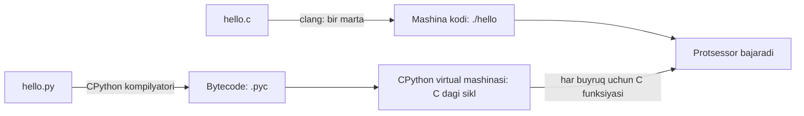
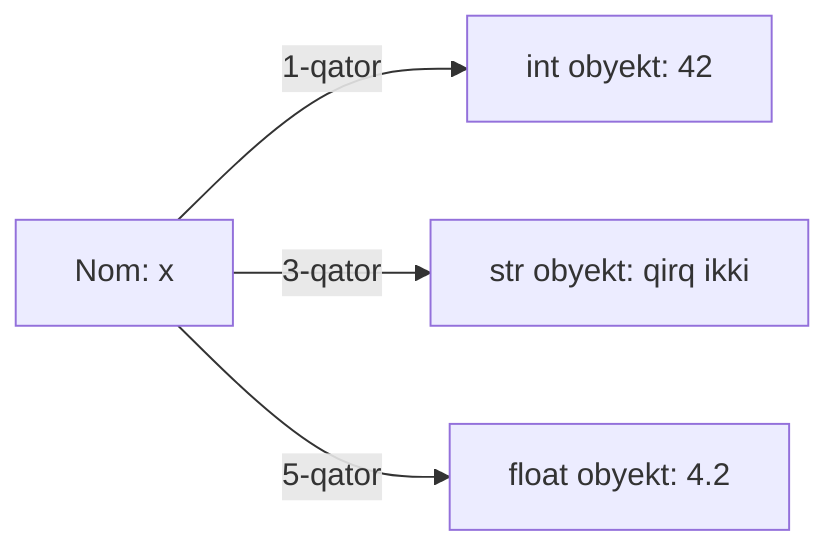

## Bu dars nima uchun kerak

30 ta dars davomida C da yozdik. C bizga kompyuter qanday ishlashini ko'rsatdi: har bir o'zgaruvchining tipi va o'lchami (6-dars), sonning chegarasi va overflow (7-dars), xotira manzillari (21-dars), `malloc` va `free` (23-dars), massivni qo'lda o'stirish (27-dars), hash table'ni noldan yozish (30-dars). Bu bilimlarning narxi - kod hajmi. 30-darsdagi hash table taxminan 100 qator C kodi edi; Python'da xuddi shu ish bitta qator: `d = {}`.

Endi kursning 4-moduli boshlanadi: Python va SQL. Python - yuqori darajali til: xotirani o'zi boshqaradi, sonlar overflow bo'lmaydi, satr, ro'yxat va lug'at tilning o'zida bor. Lekin "yuqori darajali" degani "sehrli" degani emas. Python ham oxir-oqibat C dagi kabi mashina buyruqlarini bajaradi, va eng keng tarqalgan Python dasturi - **CPython** - aynan C da yozilgan. Shuning uchun C dan kelgan dasturchi Python'ni boshqalardan chuqurroq tushunadi: `list` ortida 27-darsdagi o'suvchi massiv, `dict` ortida 30-darsdagi hash table turibdi (32-dars).

Bu dars C va Python orasidagi ko'prik. Bir xil dasturlarni ikki tilda yonma-yon yozamiz va har bir farqning sababini ko'ramiz.

Bu darsdan keyin siz:

- compiler va interpreter farqini va CPython'ning oraliq yo'lini (source, bytecode, virtual mashina) tushuntira olasiz;
- `dis` moduli bilan funksiyaning bytecode'ini ko'ra olasiz va u nima uchun versiyaga bog'liq ekanini bilasiz;
- C dagi `printf`, `for`, `if`, funksiya va satr bilan ishlashni Python'ga o'tkaza olasiz;
- indentatsiya Python'da sintaksisning bir qismi ekanini va uning xatolarini bilasiz;
- dinamik tiplashni ("tip qiymatda, nomda emas") `type()` bilan ko'rsata olasiz;
- `int` nima uchun overflow bo'lmasligini va `float` nima uchun baribir 0.1 + 0.2 da xato qilishini tushuntira olasiz;
- `/`, `//` va `%` ning manfiy sonlardagi xatti-harakatini bilasiz;
- satrlar o'zgarmasligini (immutable), asosiy string metodlarini va f-string'ni ishlata olasiz;
- bir xil sikl C va Python'da qancha vaqt olishini o'lchab, qachon qaysi tilni tanlashni asoslay olasiz.

## Compiler va interpreter: CPython qanday ishlaydi

5-darsda C dasturi qanday ishga tushishini ko'rgan edik: `clang hello.c -o hello` - **compiler** butun manba kodni bir marta mashina kodiga tarjima qiladi, natijada mustaqil bajariladigan fayl hosil bo'ladi. Keyin `./hello` ishga tushganda kompilyator kerak emas: protsessor tayyor buyruqlarni bajaradi.

**Interpreter** (tarjimon-bajaruvchi) boshqacha ishlaydi: u dasturni oldindan mashina kodiga aylantirmaydi, balki uni o'qib, o'zi bajaradi. Python dasturini `python3 hello.py` bilan ishga tushirasiz: bu yerda bajariladigan fayl - `python3` ning o'zi, sizning `hello.py` esa uning uchun kirish ma'lumoti.

Amalda CPython bu ikki qutb orasida turadi. Python glossariysi ham shuni aytadi: Python interpreted til, lekin bytecode kompilyatori borligi sababli chegara xira. Jarayon uch bosqichli:

1. **Kompilyatsiya bytecode'ga.** CPython manba kodni tahlil qiladi (9-darsdagi kompilyator bosqichlariga o'xshash: tokenlar, sintaksis daraxti) va uni **bytecode**'ga aylantiradi. Bytecode - mashina kodi emas, balki CPython'ning o'z virtual mashinasi uchun yozilgan oddiy buyruqlar ketma-ketligi: "lokal o'zgaruvchini stack'ka qo'y", "ikki qiymatni qo'sh", "natijani qaytar".
2. **Kesh.** Import qilingan modullarning bytecode'i `__pycache__` papkasidagi `.pyc` fayllarga yoziladi, keyingi safar manba o'zgarmagan bo'lsa, kompilyatsiya qayta qilinmaydi.
3. **Virtual mashina.** CPython'ning C da yozilgan asosiy sikli bytecode buyruqlarini birma-bir o'qiydi va har biri uchun tegishli C kodini bajaradi.



Diagrammadan tezlik farqining sababi ko'rinadi: C da `a + b` bitta yoki ikkita protsessor buyrug'iga aylanadi. Python'da esa virtual mashina avval `BINARY_OP` buyrug'ini o'qiydi, keyin ikkala operandning tipini tekshiradi (ular `int` mi, `str` mi, `list` mi?), tipga mos qo'shish funksiyasini chaqiradi va natija uchun yangi obyekt hosil qiladi. Har qadamda qo'shimcha ish bor.

### `dis`: bytecode'ni ko'rish

Standart kutubxonadagi `dis` (disassembler) moduli funksiyaning bytecode'ini o'qiladigan ko'rinishda chiqaradi:

```python run
import dis
import sys

def add(a, b):
    c = a + b
    return c

print(sys.version)
dis.dis(add)
```

Python 3.14 da (kursning brauzer muhiti) natija (birinchi qatordagi versiya satri va kompilyator nomi sizda boshqacha bo'ladi):

```text
  4           RESUME                   0

  5           LOAD_FAST_BORROW_LOAD_FAST_BORROW 1 (a, b)
              BINARY_OP                0 (+)
              STORE_FAST               2 (c)

  6           LOAD_FAST_BORROW         2 (c)
              RETURN_VALUE
```

O'qish tartibi: chapdagi raqam - manba kodning qatori, keyin buyruq nomi va argumenti. `LOAD_FAST_BORROW_LOAD_FAST_BORROW` `a` va `b` ni virtual mashinaning stack'iga qo'yadi (27-darsdagi stack), `BINARY_OP 0 (+)` ikkalasini olib, yig'indini qaytarib qo'yadi, `STORE_FAST` uni `c` ga yozadi. CPython virtual mashinasi - **stack mashina**: deyarli hamma buyruq operandlarini stack'dan oladi va natijani stack'ka qo'yadi.

Muhim ogohlantirish: bytecode - CPython'ning ichki tafsiloti. `dis` hujjatida aniq yozilgan: bytecode Python versiyalari orasida qo'shilishi, olib tashlanishi yoki o'zgarishi mumkin, hech qanday kafolat yo'q. Buni o'zimiz ko'ramiz: xuddi shu funksiya Python 3.11 va 3.12 da alohida `LOAD_FAST a` va `LOAD_FAST b` bilan, har buyruq oldida offset raqami bilan chiqadi. 3.13 da ikki yuklash bitta `LOAD_FAST_LOAD_FAST` ga birlashtirilgan, 3.14 da esa uning o'rnini yuqoridagi `LOAD_FAST_BORROW_LOAD_FAST_BORROW` egallagan ("borrow" - reference count'ni oshirmasdan yuklash). Shuning uchun yuqoridagi blokni boshqa versiyada ishga tushirsangiz, natija boshqacha bo'ladi. Bytecode'ga tayanib dastur yozmang; uni faqat "ichkarida nima bo'layapti" degan savolga javob uchun o'qing.

Yana bir farq: C kompilyatori xatolarning ko'pini (tip mos kelmasligi, e'lon qilinmagan nom) dastur ishga tushishidan oldin topadi. CPython kompilyatori faqat sintaksis xatolarini oldindan topadi; noto'g'ri tip yoki mavjud bo'lmagan nom faqat shu qator **bajarilganda** xato beradi. Bu keyingi bo'limlarda bir necha marta ko'rinadi.

## Bir xil dastur ikki tilda

Eng oddiy dasturdan boshlaymiz. C da:

```c run
#include <stdio.h>

int main(void)
{
    printf("salom, dunyo\n");
}
```

Python'da:

```python run
print("salom, dunyo")
```

Uchta narsa yo'qoldi. `#include` kerak emas: `print` o'rnatilgan (built-in) funksiya. `main` kerak emas: Python fayli yuqoridan pastga bajariladi. `\n` kerak emas: `print` qator oxiriga o'zi qo'shadi (`print("a", end="")` bilan o'chirsa bo'ladi). Nuqtali vergul ham yo'q: Python'da gap qator oxirida tugaydi.

### Sikl, shart va funksiya

Endi kattaroq misol: 1 dan n gacha sonlarni tekshirib, juftlarini sanaydigan va har birini kvadrati bilan chiqaradigan dastur. C versiyasi:

```c run
#include <stdio.h>

int square(int x)
{
    return x * x;
}

int main(void)
{
    int n = 5;
    int evens = 0;

    for (int i = 1; i <= n; i++)
    {
        if (i % 2 == 0)
        {
            printf("%d juft, kvadrati %d\n", i, square(i));
            evens++;
        }
        else
        {
            printf("%d toq\n", i);
        }
    }
    printf("Juftlar soni: %d\n", evens);
}
```

Python versiyasi:

```python run
def square(x):
    return x * x


n = 5
evens = 0

for i in range(1, n + 1):
    if i % 2 == 0:
        print(f"{i} juft, kvadrati {square(i)}")
        evens += 1
    else:
        print(f"{i} toq")

print(f"Juftlar soni: {evens}")
```

Ikkalasining natijasi bir xil:

```text
1 toq
2 juft, kvadrati 4
3 toq
4 juft, kvadrati 16
5 toq
Juftlar soni: 2
```

Farqlarni qatorma-qator ko'ramiz:

| C | Python | Izoh |
|---|---|---|
| `int square(int x) { ... }` | `def square(x):` | Parametr va qaytish tipi yozilmaydi; prototip kerak emas, faqat funksiya chaqirilishidan oldin `def` bajarilgan bo'lishi kerak |
| `int n = 5;` | `n = 5` | Tip e'lon qilinmaydi, birinchi o'zlashtirish nomni yaratadi |
| `for (int i = 1; i <= n; i++)` | `for i in range(1, n + 1):` | `range(start, stop)` yarim ochiq oraliq: stop kirmaydi (15-darsdagi yarim ochiq `[lo, hi)`) |
| `if (...) { ... } else { ... }` | `if ...:` va `else:` | Qavs ixtiyoriy, blok `:` va indentatsiya bilan |
| `else if` | `elif` | Bitta kalit so'z |
| `evens++` | `evens += 1` | Python'da `++` operatori yo'q |
| `&&`, `\|\|`, `!` | `and`, `or`, `not` | So'zlar, short-circuit xuddi C dagidek (8-dars) |
| `printf("%d", x)` | `print(f"{x}")` | Format belgisi o'rniga f-string |
| `true`, `false` | `True`, `False` | Katta harf bilan |
| `NULL` | `None` | "Qiymat yo'q" obyekti |

`range(1, n + 1)` ga e'tibor bering. C dagi `i <= n` Python'da `n + 1` ga aylanadi, chunki `range` ning yuqori chegarasi kirmaydi. Bu 10-darsdagi off-by-one xatosining Python'dagi eng ko'p uchraydigan shakli. Qoida bir xil: `range(a, b)` da b - a ta element bor, `range(1, 6)` da 5 ta.

### Indentatsiya - sintaksisning bir qismi

C da bloklar `{` va `}` bilan belgilanadi, indentatsiya (qator boshidagi bo'shliqlar) faqat o'quvchi uchun: kompilyator uni e'tiborga olmaydi. CS50 style guide indentatsiyani talab qilsa ham, noto'g'ri indentatsiyali C kodi baribir kompilyatsiya bo'ladi va mantiqiy xatoni yashirishi mumkin.

Python'da jingalak qavslar yo'q: blok `:` dan keyingi, ko'proq surilgan qatorlardan iborat. Python tili ma'lumotnomasining leksik tahlil bo'limida aniq yozilgan: mantiqiy qator boshidagi bo'shliqlar indentatsiya darajasini hisoblash uchun ishlatiladi, u esa gaplarning guruhlanishini belgilaydi. Tokenizator bo'shliqlar soni o'sganda INDENT, kamayganda DEDENT tokenini chiqaradi - bular C dagi `{` va `}` ning vazifasini bajaradi.

Oqibatlari:

- Indentatsiya bo'lmasa, sintaksis xatosi: `if True:` dan keyin surilmagan `print(1)` - `IndentationError: expected an indented block after 'if' statement on line 1`.
- Indentatsiya mantiqni o'zgartiradi. Quyidagi ikki kodda faqat oxirgi qatorning surilishi farq qiladi:

```python run
total = 0
for i in range(3):
    total += i
    print("ichida", total)
print("tashqarida", total)
```

`print("ichida", ...)` sikl tanasida, uch marta bajariladi; oxirgi `print` sikldan keyin, bir marta. `print("ichida", total)` qatorini chapga sursangiz, u ham sikldan keyin bir marta bajariladi.

- PEP 8 (Python'ning rasmiy uslub qo'llanmasi) har daraja uchun 4 bo'shliq tavsiya qiladi. Tab va bo'shliqlarni aralashtirmang: Python 3 bunday noaniq indentatsiyani `TabError` bilan rad etadi.

### Satrlar bilan ishlash

C da satr - `char` massivi va NUL bilan tugaydigan bayt ketma-ketligi edi (12-dars): uzunlik uchun `strlen`, solishtirish uchun `strcmp`, nusxa uchun `malloc` va sikl kerak edi. Python'da `str` - alohida tip: uzunlik obyekt ichida saqlanadi, solishtirish `==` bilan, birlashtirish `+` bilan.

```c run
#include <ctype.h>
#include <stdio.h>
#include <string.h>

int main(void)
{
    char name[] = "ali";
    char upper[sizeof(name)];

    for (int i = 0, n = strlen(name); i <= n; i++)
    {
        upper[i] = toupper((unsigned char) name[i]);
    }
    printf("%s -> %s, uzunlik %zu\n", name, upper, strlen(name));
    printf("teng: %d\n", strcmp(name, "ali") == 0);
}
```

```python run
name = "ali"
upper = name.upper()
print(f"{name} -> {upper}, uzunlik {len(name)}")
print("teng:", name == "ali")
```

C natijasi:

```text
ali -> ALI, uzunlik 3
teng: 1
```

Python natijasi:

```text
ali -> ALI, uzunlik 3
teng: True
```

C versiyasida biz yangi massiv ajratdik va NUL'ni ham ko'chirish uchun `i <= n` yozdik (22-darsdagi nusxa sikli). Python'da `name.upper()` yangi satr qaytaradi - xotira avtomatik ajratiladi. Bu "avtomatik" qanday ishlashi (reference counting) 35-darsda ochiladi.

## Dinamik tiplash: tip qiymatda, nomda emas

C da `int n = 5;` ikki narsani bildiradi: `n` nomli 4 baytlik joy ajratiladi va unga faqat `int` sig'adi. Tip **o'zgaruvchiga** yopishgan: `n = "salom";` kompilyatsiya xatosi. Bu **statik tiplash**: tiplar dastur ishga tushishidan oldin, kompilyatsiya vaqtida tekshiriladi.

Python'da **dinamik tiplash**: tip **qiymatga** (obyektga) tegishli, nom esa shunchaki obyektga qaratilgan yorliq. Bitta nom navbatma-navbat har xil tipdagi obyektlarga qarashi mumkin. Obyektning tipini o'rnatilgan `type()` funksiyasi qaytaradi:

```python run
x = 42
print(type(x), x)

x = "qirq ikki"
print(type(x), x)

x = 4.2
print(type(x), x)

x = [4, 2]
print(type(x), x)

x = None
print(type(x), x)
```

Natija:

```text
<class 'int'> 42
<class 'str'> qirq ikki
<class 'float'> 4.2
<class 'list'> [4, 2]
<class 'NoneType'> None
```

Python til ma'lumotnomasining "Objects, values and types" bo'limi buni shunday ifodalaydi: har bir obyektning identifikatori, tipi va qiymati bor; obyekt yaratilgach uning tipi o'zgarmaydi. O'zgaradigan narsa - nomning qaysi obyektga qarab turgani. C tilidagi tasavvurga o'tkazsak: Python nomi - 21-darsdagi pointer'ga o'xshaydi, obyekt esa heap'dagi struct, uning ichida tipi yozilgan. `x = "qirq ikki"` qatori eski `int` obyektini o'zgartirmaydi, balki `x` ni boshqa obyektga "qaratadi".



### Dinamik, lekin kuchli

Dinamik tiplash "tiplar yo'q" degani emas. Python tiplarni bajarilish vaqtida qat'iy tekshiradi va mos kelmaydigan amalni rad etadi:

```python
print("1" + 2)
```

```text
TypeError: can only concatenate str (not "int") to str
```

JavaScript'da `"1" + 2` jim `"12"` beradi (yashirin aylantirish), C da esa `"1" + 2` umuman boshqa narsa - satr manzilini 2 baytga surish (22-darsdagi pointer arifmetikasi). Python ikkalasidan farqli: aylantirishni o'zingiz aniq yozishingiz kerak - `int("1") + 2` = 3 yoki `"1" + str(2)` = `"12"`. Bu xususiyat ko'pincha **strong typing** (kuchli tiplash) deyiladi: "dinamik" tekshiruv qachon bo'lishini, "kuchli" esa yashirin aylantirish yo'qligini bildiradi.

Narxi bor: bu xato faqat shu qator bajarilganda chiqadi. C kompilyatori xuddi shunday xatoni dastur ishga tushishidan oldin topadi. Python'da kamdan-kam bajariladigan tarmoqdagi tip xatosi oylab sezilmasligi mumkin. Shuning uchun Python'da testlar (va ixtiyoriy tip izohlari, masalan `def square(x: int) -> int:`, ularni tashqi vositalar tekshiradi) C dagidan ham muhimroq. Tip izohlari interpreter tomonidan majburlanmaydi: `square("a")` baribir chaqiriladi.

| Xususiyat | C | Python |
|---|---|---|
| Tip qayerda | O'zgaruvchida | Obyektda (qiymatda) |
| Tip tekshiruvi qachon | Kompilyatsiyada | Bajarilishda |
| Bitta nomga boshqa tip berish | Kompilyatsiya xatosi | Ruxsat |
| Yashirin aylantirish | Ko'p (`int` dan `double` ga, `char` dan `int` ga) | Kam (`int` va `float` aralash arifmetikasi, `bool` dan `int` ga) |
| Tip xatosi topilmasa | Kod kompilyatsiya bo'lmaydi | Faqat shu qator bajarilganda `TypeError` |
| O'zgaruvchi xotirasi | Tipga qarab qat'iy (`int` 4 bayt) | Nom - havola, obyekt alohida |

## Sonlar: cheksiz int, cheklangan float

### `int` overflow bo'lmaydi

7-darsda 32-bitli `int` ning chegarasini ko'rgan edik: 2 147 483 647 dan keyin signed overflow - undefined behavior. 64-bitli `long long` ham 2⁶³ - 1 = 9 223 372 036 854 775 807 da tugaydi. Python hujjati esa qisqa aytadi: butun sonlar cheksiz aniqlikka (unlimited precision) ega. Chegara faqat kompyuter xotirasi.

```python run
print(2 ** 31 - 1)       # C dagi INT_MAX
print(2 ** 63 - 1)       # C dagi LLONG_MAX
print(2 ** 64)           # 64 bitga sig'maydi
print(2 ** 100)

big = 2 ** 100
print(len(str(big)), "xonali")
print(sum(int(d) for d in str(big)), "- raqamlar yig'indisi")
```

Natija:

```text
2147483647
9223372036854775807
18446744073709551616
1267650600228229401496703205376
31 xonali
115 - raqamlar yig'indisi
```

`**` - darajaga ko'tarish operatori (C da `pow` funksiyasi edi va u `double` qaytarardi). Hisob bilan tekshirish: 2¹⁰ = 1024 ≈ 10³, demak 2¹⁰⁰ = (2¹⁰)¹⁰ ≈ 10³⁰, ya'ni 31 xonali son - natija bilan mos.

Bu qanday mumkin? CPython katta butun sonni bitta registrda emas, "raqamlar" massivida saqlaydi (odatda har bir "raqam" 30 bitlik bo'lak, ya'ni 2³⁰ asosli sanoq tizimi) va qo'shish, ko'paytirishni maktabdagi ustun usuliga o'xshab bo'lakma-bo'lak bajaradi. Bu ichki tafsilot, lekin oqibati muhim: katta son ustidagi amal arzon emas. Ikkita 31 xonali sonni qo'shish bir necha bo'lakni qayta ishlaydi, million xonali sonlarni ko'paytirish esa sezilarli vaqt oladi. Overflow yo'qligi tezlik hisobidan to'lanadi: C dagi `a + b` bitta protsessor buyrug'i, Python'da esa tip tekshiruvi, bo'laklar soni tekshiruvi va yangi obyekt yaratish.

### `float` - baribir IEEE 754

Butun sonlardan farqli, kasr sonlar uchun Python hech qanday sehr qilmaydi. Python hujjatida yozilganidek, `float` odatda C dagi `double` bilan amalga oshiriladi - ya'ni 7-darsdagi 64-bitli IEEE 754 formati. Demak 7-darsdagi barcha muammolar shu yerda ham bor:

```python run
print(0.1 + 0.2)
print(0.1 + 0.2 == 0.3)
print(f"{0.1:.20f}")

import math
print(math.isclose(0.1 + 0.2, 0.3))

import sys
print(sys.float_info.max, sys.float_info.epsilon)
```

Natija:

```text
0.30000000000000004
False
0.10000000000000000555
True
1.7976931348623157e+308 2.220446049250313e-16
```

Uchinchi qator 7-darsdagi `printf("%.20f", 0.1)` bilan bir xil raqamlarni beradi - chunki ostida o'sha `double`. `sys.float_info.epsilon` = 2⁻⁵² ≈ 2.22 · 10⁻¹⁶ - 7-darsdagi `DBL_EPSILON`. `==` o'rniga tolerance bilan solishtirish qoidasi o'zgarmaydi; Python'da buning uchun tayyor `math.isclose` funksiyasi bor (sukut bo'yicha nisbiy tolerance 10⁻⁹). Pul uchun 7-darsdagi maslahat ham amalda: tiyinlarda butun son (`int`) yoki standart kutubxonadagi `decimal` moduli.

### Bo'lish: `/`, `//` va `%`

C da `7 / 2` ikki `int` uchun 3 edi (kasr qismi tashlanadi), kasrli natija uchun `(float) 7 / 2` yozish kerak edi (6-dars). Python'da ikki xil operator bor:

- `/` - **haqiqiy bo'lish**: har doim `float` qaytaradi, hatto `6 / 2` ham `3.0`.
- `//` - **floor division** (pastga yaxlitlab bo'lish): natija matematik bo'linmadan katta bo'lmagan eng katta butun son.
- `%` - qoldiq, `//` bilan mos: har doim `a == (a // b) * b + a % b`.

Musbat sonlarda `//` C dagi butun bo'lish bilan bir xil. Manfiy sonlarda farq qiladi: C butun bo'lishni nolga qarab kesadi (truncation), Python esa pastga (manfiy cheksizlikka qarab) yaxlitlaydi.

```python run
print(7 / 2, 6 / 2)
print(7 // 2, 7 % 2)
print(-7 // 2, -7 % 2)
print(7 // -2, 7 % -2)
print(-7 // 2 * 2 + -7 % 2)
```

Natija:

```text
3.5 3.0
3 1
-4 1
-4 -1
-7
```

C da esa `-7 / 2` = -3 va `-7 % 2` = -1 bo'ladi. Hisob: -7 / 2 = -3.5; nolga qarab kesish -3 beradi, pastga yaxlitlash -4. Python qoldig'ining ishorasi bo'luvchi bilan bir xil, shuning uchun `x % 2` manfiy x da ham 0 yoki 1 - "juftmi?" tekshiruvi har doim to'g'ri ishlaydi. C da `-7 % 2 == 1` yolg'on (natija -1), bu C dan Python'ga (yoki aksincha) ko'chirilgan kodda yashirin xato manbai.

| Ifoda | C (`int`) | Python |
|---|---|---|
| `7 / 2` | 3 | 3.5 |
| `7 // 2` | (operator yo'q) | 3 |
| `-7 / 2` | -3 | -3.5 |
| `-7 // 2` | (operator yo'q) | -4 |
| `-7 % 2` | -1 | 1 |
| `2147483647 + 1` | Undefined behavior | 2147483648 |
| `0.1 + 0.2` | 0.30000000000000004 | 0.30000000000000004 |

## Satrlar o'zgarmas, metodlar va f-string

### Immutable: satrni joyida o'zgartirib bo'lmaydi

C da `char s[] = "olma"; s[0] = 'O';` - oddiy amal (22-dars). Python'da:

```python
s = "olma"
s[0] = "O"
```

```text
TypeError: 'str' object does not support item assignment
```

Python hujjatiga ko'ra satrlar - Unicode code point'larning o'zgarmas (immutable) ketma-ketligi. Yaratilgan `str` obyekti umrining oxirigacha bir xil qoladi. "O'zgartirish" degani - yangi satr yaratish:

```python run
s = "olma"
t = s
s = "O" + s[1:]
print(s, t)
```

Natija: `Olma olma`. `s[1:]` - **slice** (kesim): 1-indeksdan oxirigacha bo'lgan qism, yangi satr sifatida. `s` endi yangi obyektga qaraydi, `t` esa eski `"olma"` ga - eski obyekt o'zgarmagan. 22-darsda C da `t = s` dan keyin `t[0] = 'O'` `s` ni ham o'zgartirgan edi, chunki ikkalasi bitta xotiraga qaragan. Python'da satr bilan bunday kutilmagan hodisa bo'lishi mumkin emas: obyektni hech kim o'zgartira olmaydi. (O'zgaruvchan obyektlarda, masalan `list` da, aynan shu muammo qaytadi - 32-darsda.)

Nega shunday qilingan? Python dizayn FAQ'i ikki sabab keltiradi: tezlik (satr uchun joyni yaratishda bir marta ajratish mumkin, hajmi o'zgarmaydi) va satrlarning sonlar kabi "elementar" qiymat sifatida ko'rilishi - 8 sonini hech narsa boshqa songa aylantira olmaganidek, `"sakkiz"` satrini ham. Uchinchi muhim oqibat: o'zgarmas satrni `dict` kaliti qilish mumkin, chunki uning hash qiymati o'zgarmaydi (30-dars va 32-dars).

Immutable'likning narxi ham bor. Siklda `s = s + harf` har safar butun satrni yangi joyga nusxalaydi. n ta harfdan satr yig'ish: 1 + 2 + ... + n = n(n + 1) / 2 nusxa - O(n²) (27-darsdagi "har safar +1" o'sish bilan bir xil hisob). Python hujjati ham o'zgarmas ketma-ketliklarni takroran birlashtirish kvadratik vaqt olishini ogohlantiradi. To'g'ri usul - qismlarni ro'yxatga yig'ib, oxirida bitta `"".join(parts)` chaqirish: u umumiy uzunlikni bir marta hisoblab, bir marta nusxalaydi.

### Asosiy string metodlari

Metod - obyektga tegishli funksiya, nuqta orqali chaqiriladi: `s.upper()`. Satr o'zgarmas bo'lgani uchun hamma metodlar yangi satr (yoki boshqa qiymat) qaytaradi, asl satr o'zgarmaydi.

```python run
s = "  Toshkent, Samarqand, Buxoro  "

clean = s.strip()
print(repr(clean))
print(clean.lower())
print(clean.split(", "))
print(" | ".join(clean.split(", ")))
print(clean.replace("Samarqand", "Xiva"))
print(clean.startswith("Tosh"), "kent" in clean, clean.find("Buxoro"))
print(clean.count("a"), "Buxoro".isalpha(), "2026".isdigit())
print(s)
```

Natija:

```text
'Toshkent, Samarqand, Buxoro'
toshkent, samarqand, buxoro
['Toshkent', 'Samarqand', 'Buxoro']
Toshkent | Samarqand | Buxoro
Toshkent, Xiva, Buxoro
True True 21
3 True True
  Toshkent, Samarqand, Buxoro  
```

| Metod | Nima qiladi | C dagi ekvivalent |
|---|---|---|
| `s.strip()` | Bosh va oxiridagi bo'shliqlarni olib tashlaydi | Qo'lda sikl |
| `s.lower()`, `s.upper()` | Harf registrini o'zgartiradi | Har harfga `tolower`, `toupper` |
| `s.split(sep)` | Satrni ro'yxatga bo'ladi | `strtok` (asl satrni buzadi) |
| `sep.join(list)` | Ro'yxatni satrga yig'adi | `strcat` bilan sikl |
| `s.replace(a, b)` | Barcha a larni b ga almashtiradi | Qo'lda |
| `s.find(sub)` | Birinchi uchragan indeks yoki -1 | `strstr` (pointer yoki NULL) |
| `sub in s` | Bormi? `True` yoki `False` | `strstr(s, sub) != NULL` |
| `len(s)` | Uzunlik, O(1) | `strlen`, O(n) |

Oxirgi qator muhim: C da `strlen` NUL ni topguncha har baytni o'qiydi (12-dars), Python'da uzunlik obyekt ichida saqlanadi va `len` uni darhol qaytaradi.

### f-string

`printf` ning formatlash qobiliyati Python'da **f-string** (formatted string literal) orqali keladi. Python 3.6 da (PEP 498) qo'shilgan: satr oldiga `f` yoziladi va jingalak qavslar ichiga istalgan ifoda qo'yiladi. Ikki nuqtadan keyin format belgisi (format specifier) - `printf` dagi `%.2f` ning davomchisi:

```python run
name = "Ali"
score = 87.456
count = 7
print(f"{name} ning bali {score:.2f}")
print(f"|{name:>8}|{name:<8}|{count:03d}|")
print(f"{count} x {count} = {count * count}")
print(f"{1234567:,}")
print(f"{count=}")
```

Natija:

```text
Ali ning bali 87.46
|     Ali|Ali     |007|
7 x 7 = 49
1,234,567
count=7
```

`:.2f` - 2 kasr xona, `:>8` - 8 belgilik maydonning o'ng chetiga taqab yozish, `:03d` - 3 xonali, oldi nol bilan to'ldirilgan butun son, `:,` - minglik ajratgich, `{count=}` - ifoda va uning qiymati (debug uchun qulay, Python 3.8 dan). C dagi kabi format belgisi va argument tartibini moslashtirish kerak emas: qiymat to'g'ridan-to'g'ri o'z joyida yoziladi, shuning uchun `printf("%d", 3.5)` kabi xato bu yerda bo'lmaydi.

## Tezlik: bir xil sikl ikki tilda

Interpreter'ning narxini raqam bilan ko'ramiz. Bir xil vazifa: 0 dan n - 1 gacha har bir i uchun `i % 7` ni yig'ish. C versiyasi `clock()` bilan vaqtni o'lchaydi:

```c run
#include <stdio.h>
#include <time.h>

int main(void)
{
    const long long n = 3000000;
    clock_t start = clock();

    long long total = 0;
    for (long long i = 0; i < n; i++)
    {
        total += i % 7;
    }

    double seconds = (double) (clock() - start) / CLOCKS_PER_SEC;
    printf("total = %lld\n", total);
    printf("vaqt: %.4f s, bir aylanish: %.1f ns\n", seconds, seconds / n * 1e9);
}
```

Python versiyasi `time.perf_counter()` bilan:

```python run
import time

n = 3_000_000
start = time.perf_counter()

total = 0
for i in range(n):
    total += i % 7

seconds = time.perf_counter() - start
print(f"total = {total}")
print(f"vaqt: {seconds:.4f} s, bir aylanish: {seconds / n * 1e9:.1f} ns")
```

Ikkalasida `total = 8999994` chiqadi. Hisob bilan tekshirish: 3 000 000 = 7 · 428 571 + 3. Har to'liq 7 talik guruhda qoldiqlar 0 + 1 + ... + 6 = 21, jami 428 571 · 21 = 8 999 991; oxirgi uchta son qoldiqlari 0, 1, 2, ya'ni yana 3. Natija 8 999 994. `3_000_000` dagi pastki chiziq faqat o'qish uchun, son qiymatiga ta'sir qilmaydi.

Vaqt esa juda farq qiladi. Muallifning Linux x86-64 kompyuterida, 10 million aylanish bilan o'lchanganda taxminan quyidagi natijalar chiqdi:

| Variant | Bir aylanish | Nisbatan |
|---|---|---|
| C, `clang -O0` (optimizatsiyasiz) | taxminan 3.5 ns | 1x |
| C, `clang -O2` | taxminan 1 ns | taxminan 3.5 barobar tezroq |
| CPython 3.13 | taxminan 70 ns | taxminan 20 barobar sekinroq (`-O2` ga nisbatan 70) |

Bu raqamlar protsessor, Python versiyasi va kompilyator flaglariga qarab sezilarli o'zgaradi, shuning uchun ularni o'zingizda o'lchang. Brauzer muhitida ikkalasi ham WebAssembly ichida ishlaydi va Python yana bir necha barobar sekinroq bo'lishi mumkin. Asosiy xulosa raqamning o'zi emas, tartibi: oddiy arifmetik siklda CPython C dan **o'nlab barobar** sekin. Sababi yuqoridagi diagrammada: har aylanishda bir nechta bytecode buyrug'i, har biri uchun tip tekshiruvi va yangi `int` obyekti.

Hisob bilan his qilaylik: 10⁹ aylanishli sikl C da (`-O2`, 1 ns) taxminan 1 soniya, Python'da (70 ns) taxminan 70 soniya.

Lekin bu Python'ni "sekin til" deb tashlash uchun asos emas. Uch muhim tuzatish:

1. **O'rnatilgan funksiyalar C da yozilgan.** `sum(range(n))`, `sorted(lst)`, `"".join(parts)`, `x in some_set` ichidagi sikl CPython'ning C kodida bajariladi, bytecode'da emas. Python siklini o'rnatilgan funksiya bilan almashtirish ko'pincha bir necha barobar tezlashtiradi.
2. **Algoritm tildan muhimroq.** O(n²) C dasturi O(n log n) Python dasturidan katta n da baribir yutqazadi (16-17-darslar). 32-darsda `list` va `set` da qidiruv farqi minglab barobar ekanini ko'ramiz - bu C va Python farqidan ancha katta.
3. **Dasturchi vaqti ham vaqt.** 30-darsdagi hash table C da yuzlab qator va soatlab debugging edi; Python'da u tayyor va sinalgan.

### Qachon qaysi til

| Vazifa | Yaxshiroq tanlov | Sabab |
|---|---|---|
| Operatsion tizim, drayver, mikrokontroller | C | Xotira va apparatni to'liq boshqarish, runtime yo'q |
| Bitta qaynoq siklda milliardlab amal (video kodek, o'yin dvigateli) | C | Har nanosekund muhim |
| Fayl, matn, CSV qayta ishlash, avtomatlashtirish skriptlari | Python | Kod 5-10 barobar qisqa, tezlik odatda disk yoki tarmoqqa bog'liq |
| Veb backend, ma'lumotlar bazasi bilan ishlash | Python | Vaqtning ko'pi kutishda (tarmoq, SQL), interpreter narxi sezilmaydi |
| Prototip, tajriba, ma'lumot tahlili | Python | Tez yozish va o'zgartirish |
| Python'da sekin qism topildi | Ikkalasi | Qaynoq qism C da yoziladi va Python'dan chaqiriladi (ko'p ilmiy kutubxonalar shunday qurilgan) |

## Mashq: C dan Python'ga ko'chirish

To'rtta kichik funksiyani yozing. Har biri bu darsdagi bitta g'oyani mashq qildiradi.

1. `hms(seconds)` - sekundlar sonini `"soat:daqiqa:sekund"` ko'rinishidagi satrga aylantiradi, har bo'lak 2 xonali: `hms(3725)` -> `"01:02:05"`. `//` va `%` hamda f-string format belgisi (`:02d`) bilan.
2. `digit_sum(n)` - manfiy bo'lmagan butun sonning raqamlari yig'indisi. Juda katta son uchun ham ishlashi kerak: `digit_sum(2 ** 100)` = 115. Satrga aylantirmasdan, `% 10` va `// 10` bilan yozing (testlar natijani tekshiradi; usulni o'zingiz tanlang, lekin ikkalasini sinab ko'ring).
3. `initials(full_name)` - ism-familiyadan bosh harflar: `"ali valiyev"` -> `"A.V."`, ortiqcha bo'shliqlar e'tiborga olinmaydi: `"  nodira   karimova "` -> `"N.K."`.
4. `is_even(n)` - n juftmi? Manfiy sonlar uchun ham to'g'ri ishlasin. (C dagi `n % 2 == 1` toq tekshiruvi -7 uchun nima qaytarardi, o'ylab ko'ring.)

```python run
def hms(seconds):
    # Yechimingizni shu yerga yozing
    return ""


def digit_sum(n):
    # Yechimingizni shu yerga yozing
    return 0


def initials(full_name):
    # Yechimingizni shu yerga yozing
    return ""


def is_even(n):
    # Yechimingizni shu yerga yozing
    return False


print(hms(3725), digit_sum(2 ** 100), initials("ali valiyev"), is_even(-4))
```

```python test
check("hms(3725) == '01:02:05'", lambda: hms(3725) == "01:02:05")
check("hms(0) == '00:00:00'", lambda: hms(0) == "00:00:00")
check("hms(86399) == '23:59:59'", lambda: hms(86399) == "23:59:59")
check("hms 100 soatdan ko'p bo'lsa ham soatni to'liq chiqaradi: hms(360000) == '100:00:00'", lambda: hms(360000) == "100:00:00")
check("digit_sum(0) == 0", lambda: digit_sum(0) == 0)
check("digit_sum(9875) == 29", lambda: digit_sum(9875) == 29)
check("digit_sum(2 ** 100) == 115 (int cheksiz)", lambda: digit_sum(2 ** 100) == 115)
check("digit_sum(10 ** 50) == 1", lambda: digit_sum(10 ** 50) == 1)
check("initials('ali valiyev') == 'A.V.'", lambda: initials("ali valiyev") == "A.V.")
check("initials ortiqcha bo'shliqlarni e'tiborsiz qoldiradi", lambda: initials("  nodira   karimova ") == "N.K.")
check("initials bitta so'z: 'bobur' -> 'B.'", lambda: initials("bobur") == "B.")
check("is_even(-4) True", lambda: is_even(-4) is True)
check("is_even(-7) False", lambda: is_even(-7) is False)
check("is_even(0) True", lambda: is_even(0) is True)
check("is_even(2 ** 100 + 1) False", lambda: is_even(2 ** 100 + 1) is False)
```

Ishora: `initials` uchun `split()` ni argumentsiz chaqiring - u har qanday bo'shliqlar ketma-ketligi bo'yicha bo'ladi va bo'sh bo'laklarni tashlaydi; `split(" ")` esa bo'sh satrlarni qaytaradi.

## Ko'p uchraydigan xatolar

1. **`range` ning yuqori chegarasini unutish.** C dagi `i <= n` Python'da `range(1, n + 1)`. `range(1, n)` oxirgi elementni tashlab ketadi - off-by-one.
2. **Indentatsiyani aralashtirish.** Tab va bo'shliqlar aralash fayl `TabError` beradi; noto'g'ri surilgan qator esa xato bermasdan mantiqni o'zgartiradi (sikldan tashqariga chiqib qoladi). Har daraja 4 bo'shliq.
3. **`/` dan butun son kutish.** `len(a) / 2` `float` qaytaradi va uni indeks qilib bo'lmaydi: `a[len(a) / 2]` - `TypeError`. Indeks uchun `//`.
4. **Manfiy sonlarda C qoidasini kutish.** Python'da `-7 // 2` = -4, `-7 % 2` = 1. C dan ko'chirilgan formulalarni manfiy kirishda sinab ko'ring.
5. **`float` ni `==` bilan solishtirish.** Python `float` - IEEE 754 `double`, `0.1 + 0.2 == 0.3` yolg'on. `math.isclose` yoki butun sonli birliklar.
6. **Satrni joyida o'zgartirishga urinish.** `s[0] = "A"` - `TypeError`. Yangi satr yasang: `"A" + s[1:]`, yoki metod natijasini o'zlashtiring: `s = s.upper()` (`s.upper()` ning o'zi `s` ni o'zgartirmaydi).
7. **Siklda satrni `+` bilan yig'ish.** n qism uchun O(n²) nusxa. Qismlarni ro'yxatga `append` qilib, oxirida `"".join(parts)`.
8. **Dinamik tiplashni "tip xatosi yo'q" deb tushunish.** `"1" + 2` - `TypeError`, va u faqat shu qator bajarilganda chiqadi. Har tarmoqni test bilan bajaring.

## Xulosa

- C kompilyatori dasturni bir marta mashina kodiga aylantiradi; CPython esa manbani bytecode'ga kompilyatsiya qiladi va uni C da yozilgan virtual mashina (stack mashina) buyruqma-buyruq bajaradi.
- `dis` moduli bytecode'ni ko'rsatadi; bytecode CPython'ning ichki tafsiloti va versiyalar orasida o'zgaradi (3.12 dagi ikki `LOAD_FAST` 3.13 da bitta `LOAD_FAST_LOAD_FAST`, 3.14 da `LOAD_FAST_BORROW_LOAD_FAST_BORROW`).
- Python sintaksisi: `def`, `for ... in range(...)`, `if`/`elif`/`else`, `and`/`or`/`not`, `True`/`False`/`None`; bloklar `:` va indentatsiya bilan, PEP 8 bo'yicha 4 bo'shliq.
- Dinamik tiplash: tip obyektda, nom esa obyektga havola; `type()` uni ko'rsatadi. Tiplar baribir kuchli tekshiriladi, lekin bajarilish vaqtida.
- `int` cheksiz aniqlikda: `2 ** 100` overflow bo'lmaydi, narxi - har amal sekinroq. `float` esa C dagi `double`: `0.1 + 0.2` = 0.30000000000000004.
- `/` doim `float`, `//` pastga yaxlitlaydi, `%` ning ishorasi bo'luvchi bilan bir xil: `-7 // 2` = -4, `-7 % 2` = 1.
- Satrlar immutable: metodlar yangi satr qaytaradi, `len` O(1), siklda yig'ish uchun `"".join`. f-string - `printf` ning xavfsizroq davomchisi.
- Oddiy arifmetik siklda CPython C dan taxminan o'nlab barobar sekin; o'rnatilgan funksiyalar, to'g'ri algoritm va dasturchi vaqti bu farqni ko'pincha qoplaydi.

## Amaliy topshiriq

C da yozgan dasturlaringizdan birini Python'ga ko'chiring va ikki tilni solishtiring. Tavsiya: 11-darsdagi haftalik harorat statistikasi yoki 15-darsdagi binary search. Problem set yechimini emas, o'zingizning dasturingizni oling.

Topshiriq qadamlari:

1. **Ko'chirish.** Dasturni Python'ga qatorma-qator ko'chiring: funksiyalar `def` bilan, sikllar `range` bilan, chiqish f-string bilan. Kirishni kod ichida ro'yxat sifatida bering (brauzerda `input()` yo'q).
2. **Farqlar ro'yxati.** Kamida 6 ta sintaktik va semantik farqni yozing (masalan: uzunlik alohida parametr emas, `len()`; `/` va `//`; tip e'loni yo'q). Har biri uchun "C da nima xato bo'lishi mumkin edi, Python'da nima bo'ladi" degan bir gap.
3. **Bytecode.** Dasturingizdagi eng kichik funksiyani `dis.dis` bilan chiqaring. Har bir buyruq qaysi manba qatoriga mos kelishini izohlang va qaysi Python versiyasida ishga tushirganingizni yozing.
4. **Chegaralar.** Ikki tajriba: (a) C dagi `int` overflow beradigan hisobni (masalan, 20! yoki 2³¹) Python'da hisoblang va natijani C natijasi bilan solishtiring; (b) manfiy sonlar bilan `//` va `%` natijasini C dagi `/` va `%` bilan solishtiring.
5. **O'lchov.** Dasturning asosiy siklini ikki tilda bir xil n uchun o'lchang (`clock()` va `time.perf_counter()`), bir aylanish narxini nanosekundda hisoblang va nisbatni yozing. Keyin Python siklini o'rnatilgan funksiya (`sum`, `min`, `max`) bilan almashtirib, qayta o'lchang.

Yaxshi javobda bo'lishi kerak bo'lgan narsalar:

- Python versiyasi C versiyasi bilan bir xil natija beradi, `range` chegaralari to'g'ri (off-by-one yo'q);
- farqlar ro'yxatida kamida: dinamik tiplash, indentatsiya bloklari, `/` va `//`, cheksiz `int`, immutable satr, `len()` O(1);
- `dis` natijasi Python versiyasi ko'rsatilgan holda keltirilgan va bu natija boshqa versiyada boshqacha bo'lishi mumkinligi aytilgan;
- overflow tajribasida C natijasi (yoki UB ekani) va Python'ning aniq natijasi, manfiy bo'lish tajribasida truncation va floor farqi formula bilan tushuntirilgan;
- o'lchovda raqamlar "taxminan" deb berilgan, nisbat hisoblangan, o'rnatilgan funksiya bilan tezlashuv ko'rsatilgan va sababi (sikl C ichida bajariladi) yozilgan.

Javobingizni pastdagi maydonga yozing va yuqoridagi mezonlar bilan solishtiring.

## Manbalar

- CS50x. [Lecture 6 notes](https://cs50.harvard.edu/x/notes/6/) - "Hello Python!", "Variables", "Types", "Conditionals", "Loops", "Truncation and Floating Point Imprecision" bo'limlari: C dan Python'ga o'tish g'oyasi.
- Python. [dis - Disassembler for Python bytecode](https://docs.python.org/3/library/dis.html) - `dis.dis`, buyruqlar ro'yxati (`BINARY_OP`, `RESUME`, `LOAD_FAST_BORROW`) va "CPython implementation detail": bytecode versiyalar orasida o'zgarishi mumkin.
- Python. [Glossary](https://docs.python.org/3/glossary.html) - "bytecode", "interpreted", "hashable" ta'riflari.
- Python. [Built-in Types](https://docs.python.org/3/library/stdtypes.html) - "Numeric Types": `int` cheksiz aniqlik, `float` odatda C `double`, `/`, `//`, `%` jadvali; "Text Sequence Type - str": satrlar immutable; o'zgarmas ketma-ketliklarni takroran birlashtirishning kvadratik narxi.
- Python. [Lexical analysis](https://docs.python.org/3/reference/lexical_analysis.html) - "Indentation": bo'shliqlar, INDENT va DEDENT tokenlari, tab qoidasi.
- Python. [Input and Output](https://docs.python.org/3/tutorial/inputoutput.html) - "Formatted String Literals" (f-strings) va format belgilari.
- Python. [Design and History FAQ](https://docs.python.org/3/faq/design.html) - "Why are Python strings immutable?" bo'limi.
- PEP 8. [Style Guide for Python Code](https://peps.python.org/pep-0008/) - "Indentation": har daraja uchun 4 bo'shliq; PEP 498 ([Literal String Interpolation](https://peps.python.org/pep-0498/)) - f-string, Python 3.6.
