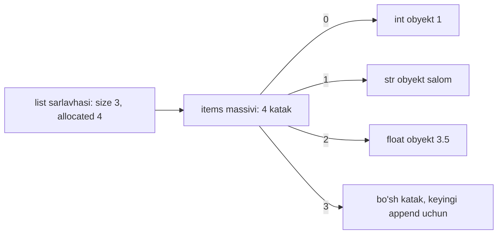
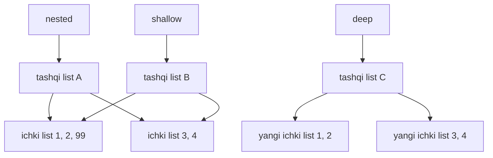

## Bu dars nima uchun kerak

27-30-darslarda C da to'rtta tuzilmani noldan qurdik: o'suvchi massiv (stack va queue ostida), linked list, binary search tree va hash table. Har birining narxini hisobladik: qayerda O(1), qayerda O(n), qayerda amortized O(1). Python bu tuzilmalarning ko'pini tilning o'ziga qurib bergan: `list`, `tuple`, `dict`, `set`. Ularni ishlatish uchun bitta qator yetarli, va aynan shu sabab xavfli: `x in items` C dagi bitta `if` kabi ko'rinadi, lekin `items` ro'yxat bo'lsa, u 100 000 ta elementni birma-bir tekshiradi.

Bu darsda har bir o'rnatilgan tuzilmaning ostida C dagi qaysi tuzilma turganini ochamiz va narxini o'lchaymiz. Bu bilim bilan Python kodini o'qiganda har bir qatorning narxini ko'ra olasiz: `lst.insert(0, x)` - O(n), `d[key]` - o'rtacha O(1), `key in lst` - O(n).

31-darsda Python'da nom - obyektga havola ekanini ko'rdik. O'zgarmas `str` bilan bu xavfsiz edi. O'zgaruvchan (mutable) `list` va `dict` bilan esa 22-darsdagi shallow copy muammosi qaytadi: ikki nom bitta obyektga qaraydi va bittasi orqali o'zgartirish ikkinchisida ham ko'rinadi.

Bu darsdan keyin siz:

- `list` - pointerlarning dinamik massivi ekanini va `sys.getsizeof` bilan uning sig'im qadamlarini ko'rsata olasiz;
- `append`, `insert(0, x)`, `x in lst`, `lst[i]` narxini bilasiz va nima uchun shunday ekanini 27-dars orqali tushuntira olasiz;
- `tuple` ning `list` dan farqini (immutable, hashable) va qachon tuple tanlashni bilasiz;
- `dict` va `set` ostidagi hash table'ni 30-dars bilan bog'lay olasiz, kalit nima uchun hashable bo'lishi kerakligini bilasiz;
- `dict` qo'shilish tartibini qachondan va qaysi hujjat asosida saqlashini bilasiz;
- `timeit` bilan `list` va `set` dagi qidiruvni o'lchay olasiz;
- list comprehension yoza olasiz;
- mutable aliasing (o'zgaruvchan obyektga bir nechta nom), `copy.copy` va `copy.deepcopy` farqini ko'rsata olasiz;
- `collections` modulidagi `deque`, `Counter` va `defaultdict` ni vazifaga qarab tanlay olasiz.

## list: pointerlarning dinamik massivi

### Ichki tuzilma

Python dizayn FAQ'i buni to'g'ridan-to'g'ri aytadi: CPython'dagi `list` - Lisp uslubidagi linked list emas, balki o'zgaruvchan uzunlikdagi massiv. Ichida boshqa obyektlarga havolalar (pointerlar) massivi yotadi, ro'yxat sarlavhasi (head) esa shu massivga pointer va uzunlikni saqlaydi. Qo'shimcha ravishda sarlavhada **sig'im** (allocated) ham bor - 27-darsdagi `capacity` aynan shu.

C tilida taxminan shunday tasavvur qilish mumkin (soddalashtirilgan):

```c
typedef struct
{
    // ... obyekt sarlavhasi: tip va reference count (35-dars)
    Py_ssize_t size;        // len(lst)
    PyObject **items;       // pointerlar massivi, heap'da
    Py_ssize_t allocated;   // sig'im: nechta pointerga joy bor
} PyListObject;
```

Ikki muhim oqibat:

1. **Ro'yxat elementlarning o'zini emas, ularga pointerlarni saqlaydi.** `[1, "salom", 3.5]` uchta har xil tipdagi obyekt, lekin massivdagi har katak bir xil o'lchamda - bitta pointer (x86-64 da 8 bayt, kursning brauzer muhiti wasm32 da 4 bayt). Shuning uchun Python ro'yxatida har xil tiplar aralashishi mumkin, C massivida esa yo'q (11-dars).
2. **Indekslash O(1).** `lst[i]` - 11-darsdagi formula: `items + i · sizeof(pointer)` manzilidan pointerni o'qish. Ro'yxat uzunligiga bog'liq emas.



### Sig'im qanday o'sadi

27-darsda massivni ikki barobar o'stirish har `push` ga amortized O(1) berishini isbotlagan edik. CPython ham ortiqcha joy ajratadi (over-allocation), lekin ikki barobar emas. CPython manba kodidagi `list_resize` funksiyasining izohida formula va o'sish ketma-ketligi yozilgan: yangi sig'im taxminan `newsize + newsize / 8 + 6`, 4 ga karrali qilib yaxlitlangan, va ketma-ketlik 0, 4, 8, 16, 24, 32, 40, 52, 64, 76, ... Ya'ni katta ro'yxatlarda har o'sish atigi taxminan 12.5 %.

Buni o'zimiz ko'ramiz. `sys.getsizeof` obyektning o'zi egallagan baytlarni qaytaradi; Python hujjatiga ko'ra u faqat obyektga bevosita tegishli xotirani hisoblaydi, u havola qilgan obyektlarni emas. Ro'yxat uchun bu - sarlavha plyus pointerlar massivi. Bo'sh ro'yxat o'lchamini ayirib, pointer o'lchamiga bo'lsak, sig'im chiqadi:

```python run
import struct
import sys

P = struct.calcsize("P")       # bitta pointer necha bayt
a = []
base = sys.getsizeof(a)
print("pointer:", P, "bayt, bo'sh ro'yxat:", base, "bayt")

prev = None
for i in range(80):
    cap = (sys.getsizeof(a) - base) // P
    if cap != prev:
        print(f"len={len(a):2d}  sig'im={cap:2d}")
        prev = cap
    a.append(i)
```

Linux x86-64, Python 3.13 da natija:

```text
pointer: 8 bayt, bo'sh ro'yxat: 56 bayt
len= 0  sig'im= 0
len= 1  sig'im= 4
len= 5  sig'im= 8
len= 9  sig'im=16
len=17  sig'im=24
len=25  sig'im=32
len=33  sig'im=40
len=41  sig'im=52
len=53  sig'im=64
len=65  sig'im=76
len=77  sig'im=92
```

Bu raqamlar CPython'ning ichki tafsiloti va versiyaga bog'liq: bayt o'lchamlari brauzer muhitida (wasm32, pointer 4 bayt) boshqacha chiqadi, formula esa kelajak versiyalarda o'zgarishi mumkin. Sig'im ustuni esa manba kodidagi izoh bilan aynan mos. Formulani qo'lda tekshiramiz: 5-element qo'shilganda newsize = 5, 5 + 5/8 + 6 = 5 + 0 + 6 = 11, 4 ga karrali pastga yaxlitlash - 8. 41-elementda: 41 + 5 + 6 = 52.

### Ikki barobar o'rniga 1.125 - nima o'zgaradi?

Kichikroq o'sish koeffitsiyenti kamroq bo'sh joy qoldiradi, lekin ko'proq resize qiladi. Amortized narx baribir O(1): geometrik qator yig'indisi koeffitsiyent 2 bo'lmasa ham chegaralangan. Koeffitsiyent r bo'lsa, n ta append'dagi ko'chirishlar soni taxminan n / (r - 1): r = 2 da taxminan n, r = 1.125 da taxminan 8n. Ikkala holda ham n ga proporsional, ya'ni append boshiga o'zgarmas son. Buni C da hisoblab ko'ramiz (har resize'da eski elementlarning hammasi ko'chiriladi deb faraz qilamiz - eng yomon holat):

```c run
#include <stdio.h>

// CPython list_resize formulasi: newsize + newsize / 8 + 6, 4 ga karrali
long cpython_capacity(long newsize)
{
    return (newsize + (newsize >> 3) + 6) & ~3L;
}

int main(void)
{
    long n = 1000000;

    long cap = 0, copies = 0, resizes = 0;
    for (long len = 0; len < n; len++)
    {
        if (len == cap)
        {
            copies += len;
            cap = cpython_capacity(len + 1);
            resizes++;
        }
    }
    printf("CPython formulasi: %ld resize, %ld ko'chirish, append boshiga %.2f\n",
           resizes, copies, (double) copies / n);

    cap = 0, copies = 0, resizes = 0;
    for (long len = 0; len < n; len++)
    {
        if (len == cap)
        {
            copies += len;
            cap = cap == 0 ? 1 : cap * 2;
            resizes++;
        }
    }
    printf("Ikki barobar:      %ld resize, %ld ko'chirish, append boshiga %.2f\n",
           resizes, copies, (double) copies / n);
}
```

Natija:

```text
CPython formulasi: 86 resize, 8445096 ko'chirish, append boshiga 8.45
Ikki barobar:      21 resize, 1048575 ko'chirish, append boshiga 1.05
```

Million append'da CPython formulasi har append'ga o'rtacha taxminan 8.45 ko'chirish beradi - nazariy n / (r - 1) = 8n bilan mos. Ikki barobar strategiya 8 barobar kam ko'chiradi, lekin o'rtacha 25 % (eng yomon holatda 50 %) bo'sh joy qoldiradi. CPython xotirani tejashni tanlagan. Amalda ko'chirishlar bundan ham kam: `realloc` ko'pincha blokni joyida kengaytira oladi (27-dars), unda ko'chirish umuman bo'lmaydi.

### list amallarining narxi

Python hujjatida endi alohida sahifa bor: "Time complexity of operations on built-in types" (avval bu jadval wiki.python.org dagi TimeComplexity sahifasida edi, hozir u rasmiy hujjatga ko'chirilgan). Undagi asosiy qatorlar, 27-28-darslar bilan bog'lab:

| Amal | Narx | Nima uchun |
|---|---|---|
| `lst[i]`, `lst[i] = x` | O(1) | Massiv indekslash formulasi |
| `len(lst)` | O(1) | Uzunlik sarlavhada saqlanadi |
| `lst.append(x)` | O(1) amortized | Ko'pincha bo'sh katak bor; ba'zan resize O(n) |
| `lst.pop()` (oxiridan) | O(1) | Hech narsa surilmaydi |
| `lst.insert(0, x)`, `lst.pop(0)` | O(n) | Qolgan n ta pointer bir katak suriladi (27-darsdagi queue muammosi) |
| `lst.insert(k, x)`, `lst.pop(k)` | O(n - k) | k dan keyingilar suriladi |
| `x in lst`, `lst.index(x)` | O(n) | Chiziqli qidiruv (15-dars) |
| `lst[i:j]` | O(j - i) | Yangi ro'yxatga nusxa |
| `lst.sort()` | O(n log n) | Timsort (19-dars), saralangan kirishda O(n) |
| `lst1 + lst2` | O(len1 + len2) | Yangi ro'yxat |

`insert(0, x)` va `append(x)` farqini o'lchaymiz:

```python run
import time

n = 50_000

a = []
start = time.perf_counter()
for i in range(n):
    a.append(i)
t_append = time.perf_counter() - start

b = []
start = time.perf_counter()
for i in range(n):
    b.insert(0, i)
t_insert = time.perf_counter() - start

print(f"append:    {t_append * 1000:.1f} ms")
print(f"insert(0): {t_insert * 1000:.1f} ms")
print(f"nisbat:    taxminan {t_insert / t_append:.0f} barobar")
```

Muallif kompyuterida (100 000 element bilan) `append` taxminan 9 ms, `insert(0, ...)` esa taxminan 1100 ms oldi - taxminan 120 barobar farq. Raqamlar sizda boshqacha bo'ladi, lekin n ni ikki barobar oshirsangiz, `append` vaqti taxminan ikki barobar, `insert(0)` vaqti esa taxminan to'rt barobar o'sadi: 1 + 2 + ... + n = n(n + 1) / 2 surilish, O(n²). Ikki uchdan qo'shish va olish kerak bo'lsa, `collections.deque` ishlating (pastda).

## tuple: o'zgarmas ketma-ketlik

`tuple` - `list` ga o'xshash ketma-ketlik, lekin **immutable**: yaratilgandan keyin elementlarini qo'shib, olib yoki almashtirib bo'lmaydi. Python hujjati uni odatda har xil tipdagi ma'lumotlar to'plami uchun ishlatiladigan o'zgarmas ketma-ketlik deb ta'riflaydi - masalan, `enumerate` qaytaradigan `(indeks, qiymat)` juftlari.

```python run
point = (41.3, 69.2)          # kenglik, uzunlik
lat, lon = point              # unpacking: ikki nomga ajratish
print(lat, lon, len(point), point[0])

single = (5,)                 # bitta elementli tuple: vergul shart
not_tuple = (5)               # bu shunchaki 5 soni qavsda
print(type(single), type(not_tuple))

try:
    point[0] = 0.0
except TypeError as e:
    print("TypeError:", e)

a, b = 1, 2
a, b = b, a                   # tuple orqali almashtirish, vaqtinchalik o'zgaruvchisiz
print(a, b)
```

Natija:

```text
41.3 69.2 2 41.3
<class 'tuple'> <class 'int'>
TypeError: 'tuple' object does not support item assignment
2 1
```

Tuple'ni nima uchun tanlash kerak:

- **Ma'no.** Tuple "tuzilmasi o'zgarmaydigan yozuv" ni bildiradi: koordinata `(lat, lon)`, sana `(yil, oy, kun)`. Ro'yxat "bir xil turdagi narsalarning o'zgaruvchan to'plami".
- **Hashable.** Elementlari ham hashable bo'lsa, tuple `dict` kaliti va `set` elementi bo'la oladi; `list` esa hech qachon (keyingi bo'lim).
- **Narx.** Hujjatdagi jadvalga ko'ra tuple nusxasi O(1): `tuple(t)` yangi obyekt yaratmaydi, chunki o'zgarmas obyektni nusxalashning ma'nosi yo'q - o'sha obyekt qaytariladi. Tuple ortiqcha sig'im ham saqlamaydi: hajmi yaratilganda aniq.

Ehtiyot bo'ling: tuple'ning o'zgarmasligi "sayoz". `t = (1, [2, 3])` da tuple ikkinchi katakdagi pointerni almashtirishga ruxsat bermaydi, lekin shu pointer qaragan ro'yxatni `t[1].append(4)` bilan o'zgartirish mumkin. Bunday tuple hashable emas.

## dict: Python ichidagi hash table

### 30-darsdagi tuzilma, tayyor holda

Dizayn FAQ'iga ko'ra CPython lug'atlari o'lchami o'zgaradigan hash table sifatida amalga oshirilgan: har kalit uchun o'rnatilgan `hash()` funksiyasi hash kodini hisoblaydi va u ichki massivdagi joyni topish uchun ishlatiladi. Bu 30-darsdagi g'oyaning o'zi: hash -> indeks -> solishtirish. Farqlar tafsilotda: CPython separate chaining emas, open addressing ishlatadi (30-darsda linear probing'ni ko'rgan edik; CPython murakkabroq probing ketma-ketligidan foydalanadi), load factor chegarasi oshganda jadval kattalashtiriladi va kalitlar qayta joylanadi.

```python run
ages = {"ali": 20, "vali": 25}
ages["nodira"] = 22                # qo'shish: O(1) o'rtacha
ages["ali"] = 21                   # yangilash: o'sha kalit, tartib o'zgarmaydi
print(ages)
print(ages["vali"], ages.get("guest"), ages.get("guest", 0))
print("nodira" in ages, 22 in ages)

del ages["vali"]
ages["vali"] = 30                  # o'chirib qayta qo'shilgan kalit oxiriga tushadi
print(list(ages))

for name, age in ages.items():
    print(f"{name}: {age}")
```

Natija:

```text
{'ali': 21, 'vali': 25, 'nodira': 22}
25 None 0
True False
['ali', 'nodira', 'vali']
ali: 21
nodira: 22
vali: 30
```

E'tibor bering: `22 in ages` - `False`. `in` lug'atda **kalitlar** bo'yicha qidiradi (hash bilan, O(1)), qiymatlar bo'yicha emas. Qiymat bo'yicha qidirish `22 in ages.values()` - O(n) chiziqli o'tish. `ages["guest"]` yo'q kalit uchun `KeyError` beradi, `get` esa `None` yoki berilgan sukut qiymatni.

### Qo'shilish tartibi

30-darsda hash table "tartibni yo'qotadi" degan edik: `user1` va `user2` mutlaqo boshqa bucket'larga tushadi. Lekin yuqoridagi natijada `dict` kalitlarni aynan qo'shilgan tartibda chiqardi. Bu tasodif emas, til kafolati: Python hujjatida "Changed in version 3.7: Dictionary order is guaranteed to be insertion order" deb yozilgan, va bu xatti-harakat 3.6 da CPython'ning ichki tafsiloti bo'lgan. "What's New in Python 3.7" ham dict'larning qo'shilish tartibini saqlashi rasmiy til spetsifikatsiyasining bir qismi deb e'lon qilinganini aytadi. Hujjatdagi qoidalar: kalitning qiymatini yangilash tartibga ta'sir qilmaydi, o'chirib qayta qo'shilgan kalit oxiriga tushadi - yuqoridagi `vali` aynan shunday.

Qanday qilib? CPython 3.6 dan beri lug'atni ikki qismda saqlaydi: zich (dense) yozuvlar massivi (hash, kalit, qiymat) qo'shilish tartibida to'ldiriladi, hash table'ning o'zi esa faqat shu massivdagi kichik indekslarni saqlaydi. Aylanish zich massiv bo'ylab yuradi, shuning uchun tartib saqlanadi. Buni dizayn ma'lumoti sifatida biling, lekin unga tayanmang: kafolat - tartib, ichki tuzilma emas.

Muhim: "qo'shilish tartibi" "saralangan tartib" emas. Eng kichik kalit yoki oraliq so'rovlar uchun `dict` hali ham yaramaydi - 29-darsdagi muvozanatli daraxt yoki saralangan ro'yxat kerak.

### Kalit hashable bo'lishi kerak

Python glossariysi ta'rifi: obyekt **hashable**, agar uning hash qiymati butun umri davomida o'zgarmasa (`__hash__` metodi) va uni boshqa obyektlar bilan solishtirish mumkin bo'lsa (`__eq__` metodi); teng obyektlarning hash qiymati bir xil bo'lishi shart. Barcha o'zgarmas o'rnatilgan tiplar (`int`, `float`, `str`, `tuple` - elementlari ham hashable bo'lsa) hashable, o'zgaruvchan konteynerlar (`list`, `dict`, `set`) - yo'q.

```python run
d = {}
d[(41, 69)] = "Toshkent"          # tuple kalit - mumkin
print(d)

for key in ([41, 69], (1, [2])):
    try:
        d[key] = "?"
    except TypeError as e:
        print(type(key).__name__, "->", "TypeError:", e)
```

Natija:

```text
{(41, 69): 'Toshkent'}
list -> TypeError: unhashable type: 'list'
tuple -> TypeError: unhashable type: 'list'
```

Nima uchun bunday qat'iy? Dizayn FAQ'idagi "Why must dictionary keys be immutable?" javobi 30-darsdagi mexanikadan kelib chiqadi. Faraz qilaylik, ro'yxat kalit bo'la oldi. U hash qiymatiga qarab k-katakka joylandi. Keyin kimdir ro'yxatga element qo'shdi - mazmuni, demak hash'i ham o'zgardi. Endi uni qidirsangiz, yangi hash boshqa katakni ko'rsatadi va kalit topilmaydi; eski mazmun bilan qidirsangiz, o'sha katakdagi obyekt endi teng emas. Kalit lug'at ichida "yo'qoladi". Python buni oldini olish uchun o'zgaruvchan obyektlarni kalit qilishni umuman taqiqlaydi; ro'yxat bilan indekslash kerak bo'lsa, FAQ uni `tuple(lst)` ga aylantirishni maslahat beradi.

Narxlar haqida ikki eslatma (hujjatdagi jadval izohlaridan). Birinchidan, `dict` va `set` dagi O(1) - **o'rtacha holat**: hash funksiya kalitlarni yaxshi taqsimlaydi deb faraz qilinadi. Hamma kalit bitta hash'ga tushsa, har amal O(n) bo'ladi (30-darsdagi eng yomon holat). Ikkinchidan, O(1) hash va solishtirish O(1) deb faraz qiladi; uzun satr kalitda hash'ni hisoblash satr uzunligiga proporsional (CPython satr hash'ini bir marta hisoblab, obyekt ichida saqlab qo'yadi).

## set: faqat kalitlardan iborat hash table

`set` - takrorlanmaydigan, hashable elementlar to'plami. Hujjat bo'yicha uning amalga oshirilishi `dict` ga o'xshash va bir xil shartlar amal qiladi: `x in s`, `s.add(x)`, `s.discard(x)` o'rtacha O(1). Qiymat yo'q - faqat kalitlar. Tartib kafolatlanmaydi (dict'dan farqli).

```python run
a = {"python", "c", "sql"}
b = {"c", "go", "python"}
print(sorted(a & b))      # kesishma
print(sorted(a | b))      # birlashma
print(sorted(a - b))      # ayirma
print("go" in b, "js" in b)

nums = [3, 1, 3, 2, 1, 3]
print(len(set(nums)), sorted(set(nums)))
```

Natija:

```text
['c', 'python']
['c', 'go', 'python', 'sql']
['sql']
True False
3 [1, 2, 3]
```

To'plamni chiqarishda `sorted` ishlatdik, chunki `set` ning aylanish tartibi kafolatlanmagan; satrlar uchun u hatto har ishga tushirishda o'zgarishi mumkin (30-darsda aytilgan hash "tuzlanishi" - `PYTHONHASHSEED`).

Bo'sh to'plam `set()` bilan yaratiladi: `{}` - bo'sh `dict`.

### list va set'da `in`: o'lchov

Endi darsning eng muhim raqami. Bir xil 100 000 ta son ro'yxatda va to'plamda. Ikkalasida yo'q elementni (eng yomon holat) qidiramiz. `timeit` moduli kichik kod bo'lagini ko'p marta bajarib, umumiy vaqtni qaytaradi:

```python run
import timeit

n = 100_000
data_list = list(range(n))
data_set = set(data_list)
missing = -1
repeats = 200

t_list = timeit.timeit(lambda: missing in data_list, number=repeats)
t_set = timeit.timeit(lambda: missing in data_set, number=repeats)

print(f"list: {t_list / repeats * 1e6:10.1f} mikrosekund bitta qidiruvga")
print(f"set:  {t_set / repeats * 1e6:10.3f} mikrosekund bitta qidiruvga")
print(f"farq: taxminan {t_list / t_set:,.0f} barobar")
```

Muallifning Linux x86-64 kompyuterida (Python 3.13) bitta qidiruv ro'yxatda taxminan 500-700 mikrosekund, to'plamda taxminan 0.07-0.1 mikrosekund oldi - farq taxminan 5 000 dan 10 000 barobargacha. Aniq raqamlar sizda, ayniqsa brauzer muhitida, boshqacha bo'ladi; tartibi esa bir xil. Hisob bilan: ro'yxat 100 000 ta elementni birma-bir solishtiradi (har solishtirish bir necha nanosekund, jami yuzlab mikrosekund), to'plam esa bitta hash hisoblab, bitta yoki ikkita katakni tekshiradi. n ni 10 barobar oshirsangiz, ro'yxat vaqti taxminan 10 barobar o'sadi, to'plam vaqti deyarli o'zgarmaydi.

Amaliy qoida: bitta qidiruv uchun ro'yxatdan to'plam qurish ma'nosiz (qurishning o'zi O(n)). Lekin bir xil to'plamda ko'p marta `in` qilinadigan bo'lsa (siklda), to'plamga bir marta aylantirish dasturni O(n · m) dan O(n + m) ga tushiradi. Bu 31-darsdagi "algoritm tildan muhimroq" tezisining eng aniq namunasi: C va Python farqi o'nlab barobar edi, bu yerdagi farq minglab barobar.

### Murakkablik jadvali

Python hujjatidagi "Time complexity of operations on built-in types" sahifasidan asosiy qatorlar (dict va set uchun - o'rtacha holat):

| Amal | `list` | `tuple` | `dict` | `set` |
|---|---|---|---|---|
| Indeks bo'yicha olish `c[i]` | O(1) | O(1) | - | - |
| Kalit bo'yicha olish `d[k]` | - | - | O(1) | - |
| `x in c` | O(n) | O(n) | O(1) (kalitlar) | O(1) |
| Oxiriga qo'shish | O(1) amortized | - (immutable) | O(1) amortized | O(1) amortized |
| Boshiga qo'shish / o'chirish | O(n) | - | - | - |
| Element o'chirish | O(n - k) | - | O(1) | O(1) |
| Nusxa | O(n) | O(1) | O(n) | O(n) |
| `len(c)` | O(1) | O(1) | O(1) | O(1) |
| Aylanish | O(n) | O(n) | O(n) | O(n) |
| Tartib | Siz belgilaysiz | Siz belgilaysiz | Qo'shilish tartibi | Kafolat yo'q |
| Element hashable bo'lishi kerakmi | Yo'q | Yo'q | Kalit - ha | Ha |

## List comprehension

Ro'yxatni sikl bilan qurish Python'da shunchalik ko'p uchraydiki, buning uchun alohida sintaksis bor - **list comprehension**:

```python run
nums = [5, 12, 7, 20, 3, 18]

# Oddiy sikl
squares = []
for x in nums:
    if x % 2 == 0:
        squares.append(x * x)
print(squares)

# List comprehension: xuddi shu natija
print([x * x for x in nums if x % 2 == 0])

# Shu sintaksis dict va set uchun ham
print({x: x % 7 for x in nums})
print({x % 7 for x in nums})

# Ikki o'lchovli jadval: har qator alohida ro'yxat
grid = [[r * 10 + c for c in range(3)] for r in range(2)]
print(grid)
```

Natija:

```text
[144, 400, 324]
[144, 400, 324]
{5: 5, 12: 5, 7: 0, 20: 6, 3: 3, 18: 4}
{0, 3, 4, 5, 6}
[[0, 1, 2], [10, 11, 12]]
```

O'qish tartibi: `[ifoda for nom in manba if shart]` - "manbadagi har nom uchun, shart bajarilsa, ifodani ol". Narxi oddiy sikl bilan bir xil - O(n), lekin u qisqa, "ro'yxat qurilyapti" degan niyatni darhol ko'rsatadi va CPython'da odatda `append` chaqiruvli sikldan biroz tezroq. Chegara: comprehension ichiga murakkab mantiq (ko'p `if`, ichma-ich sikllar, side effect) joylamang - oddiy sikl o'qilishi osonroq. To'plam natijasi `{0, 3, 4, 5, 6}` kichik butun sonlarda tartibli ko'rinadi, lekin bunga tayanib bo'lmaydi.

## Mutable aliasing, copy va deepcopy

### Bitta obyekt, ikki nom

`copy` modulining hujjati birinchi gapdayoq ogohlantiradi: Python'da o'zlashtirish obyektlarni nusxalamaydi, u nom va obyekt orasida bog'lanish yaratadi. 31-darsda o'zgarmas satr uchun bu muammo emas edi. O'zgaruvchan ro'yxat uchun esa 22-darsdagi `t = s` holati qaytadi:

```python run
import copy

a = [1, 2, 3]
b = a                    # nusxa emas: ikkinchi nom
b.append(4)
print(a, b, a is b)

c = a.copy()             # yangi ro'yxat (shallow copy)
c.append(5)
print(a, c, a is c)

nested = [[1, 2], [3, 4]]
shallow = copy.copy(nested)
deep = copy.deepcopy(nested)
nested[0].append(99)
print("asl:    ", nested)
print("shallow:", shallow, shallow[0] is nested[0])
print("deep:   ", deep, deep[0] is nested[0])
```

Natija:

```text
[1, 2, 3, 4] [1, 2, 3, 4] True
[1, 2, 3, 4] [1, 2, 3, 4, 5] False
asl:     [[1, 2, 99], [3, 4]]
shallow: [[1, 2, 99], [3, 4]] True
deep:    [[1, 2], [3, 4]] False
```

`is` operatori ikki nom aynan bitta obyektga qarashini tekshiradi (C dagi pointerlarni `==` bilan solishtirish), `==` esa mazmunni (C dagi `strcmp`).

- `b = a` - **mutable aliasing**: bitta obyektga ikki nom. 22-darsdagi `char *t = s`.
- `a.copy()`, `list(a)`, `a[:]`, `copy.copy(a)` - **shallow copy**: yangi ro'yxat, lekin ichidagi pointerlar eski obyektlarga qaraydi. Tashqi ro'yxatni o'zgartirish (`append`) nusxaga ta'sir qilmaydi, ichki ro'yxatni o'zgartirish esa ikkalasida ko'rinadi.
- `copy.deepcopy(a)` - **deep copy**: ichma-ich obyektlar ham rekursiv nusxalanadi. Narxi - butun daraxt bo'ylab O(umumiy obyektlar soni) va qo'shimcha xotira.



C dagi ekvivalentni ko'rish foydali: ichida pointer bo'lgan struct'ni `=` bilan nusxalash aynan Python'dagi shallow copy - struct'ning maydonlari (pointer ham) nusxalanadi, pointer qaragan massiv esa yo'q.

```c run
#include <stdio.h>

typedef struct
{
    int *items;
    int size;
} intlist;

int main(void)
{
    int storage[3] = {1, 2, 3};
    intlist a = {storage, 3};

    intlist b = a;          // struct nusxasi: items pointeri ham nusxalanadi
    b.items[0] = 99;        // umumiy massivni o'zgartiradi
    b.size = 1;             // faqat b ning o'z maydoni

    printf("a: size=%d, items[0]=%d\n", a.size, a.items[0]);
    printf("b: size=%d, items[0]=%d\n", b.size, b.items[0]);
    printf("bir xil massiv: %d\n", a.items == b.items);
}
```

Natija:

```text
a: size=3, items[0]=99
b: size=1, items[0]=99
bir xil massiv: 1
```

`size` mustaqil (har struct'ning o'z maydoni), `items[0]` esa umumiy - Python'dagi `shallow[0] is nested[0]` holatining o'zi. C da deep copy uchun yangi massivni `malloc` qilib, elementlarni ko'chirish kerak edi; Python'da buni `copy.deepcopy` qiladi.

### Klassik tuzoq: `[[0] * 3] * 3`

```python run
bad = [[0] * 3] * 3
bad[0][0] = 9
print(bad)

good = [[0] * 3 for _ in range(3)]
good[0][0] = 9
print(good)
```

Natija:

```text
[[9, 0, 0], [9, 0, 0], [9, 0, 0]]
[[9, 0, 0], [0, 0, 0], [0, 0, 0]]
```

`* 3` ro'yxatni ko'paytirganda ichidagi **pointerlarni** takrorlaydi: tashqi ro'yxatning uchala katagi bitta ichki ro'yxatga qaraydi. List comprehension esa har qadamda `[0] * 3` ni qayta bajaradi va uchta alohida ro'yxat yaratadi. `[0] * 3` ning o'zi xavfsiz: `0` o'zgarmas.

## collections: deque, Counter, defaultdict

Standart kutubxonadagi `collections` moduli o'rnatilgan tuzilmalar yetmagan joylar uchun ixtisoslashgan konteynerlar beradi.

### deque: ikki uchli navbat

`deque` (double-ended queue, "dek" deb o'qiladi) - ikkala uchidan qo'shish va olish uchun. Hujjatga ko'ra `deque` har ikki tomondan qo'shish va olishni taxminan O(1) da bajaradi, `list` esa `pop(0)` va `insert(0, v)` da O(n) xotira surilishiga duch keladi. Bu 27-darsdagi queue muammosining tayyor yechimi: CPython `deque` ni bloklardan iborat ikki tomonlama bog'langan ro'yxat sifatida quradi (28-darsdagi doubly linked list g'oyasi, lekin har tugunda bitta emas, ko'p element). Narxi: o'rtadagi elementga indeks bo'yicha murojaat endi O(1) emas.

```python run
from collections import deque

q = deque()
q.append("A")          # oxiriga
q.append("B")
q.appendleft("Z")      # boshiga, O(1)
print(q)
first = q.popleft()    # boshidan, O(1)
print(first, q)

last3 = deque(maxlen=3)   # faqat oxirgi 3 ta element saqlanadi
for x in range(1, 7):
    last3.append(x)
print(list(last3))
```

Natija:

```text
deque(['Z', 'A', 'B'])
Z deque(['A', 'B'])
[4, 5, 6]
```

`maxlen` berilgan deque to'lganda yangi element qo'shilsa, qarama-qarshi uchidagi eng eski element tashlanadi - 27-darsdagi aylanma buffer'ning tayyor shakli (oxirgi N ta o'lchov, oxirgi N ta log qatori).

### Counter: sanash uchun dict

```python run
from collections import Counter

text = "olma anor olma uzum olma anor"
counts = Counter(text.split())
print(counts)
print(counts["olma"], counts["banan"])
print(counts.most_common(2))
```

Natija:

```text
Counter({'olma': 3, 'anor': 2, 'uzum': 1})
3 0
[('olma', 3), ('anor', 2)]
```

`Counter` - `dict` ning kichik sinfi: kalit - element, qiymat - soni. Yo'q kalit uchun `KeyError` emas, 0 qaytaradi. `most_common(k)` eng ko'p uchraganlarini kamayish tartibida beradi; hujjatga ko'ra teng sonli elementlar birinchi uchragan tartibida keladi.

### defaultdict: yo'q kalit uchun avtomatik qiymat

```python run
from collections import defaultdict

words = ["olma", "anor", "uzum", "anjir", "o'rik", "un"]
by_letter = defaultdict(list)
for w in words:
    by_letter[w[0]].append(w)     # kalit yo'q bo'lsa, avval list() yaratiladi
print(dict(by_letter))
```

Natija:

```text
{'o': ['olma', "o'rik"], 'a': ['anor', 'anjir'], 'u': ['uzum', 'un']}
```

Oddiy `dict` da har safar "kalit bormi?" deb tekshirish kerak edi (`if w[0] not in d: d[w[0]] = []`). `defaultdict(list)` yo'q kalitga birinchi murojaatda `list()` ni chaqirib, bo'sh ro'yxat yaratadi. Bu 30-darsdagi separate chaining'dagi "bucket bo'sh bo'lsa, yangi zanjir boshlash" mantig'ining umumiy shakli.

| Vazifa | Tanlov | Narx |
|---|---|---|
| Indeks bo'yicha tez murojaat, oxiriga qo'shish | `list` | O(1), append amortized O(1) |
| Ikki uchli navbat, BFS (27-dars) | `deque` | Ikki uchda O(1) |
| O'zgarmas yozuv, dict kaliti | `tuple` | Hashable, nusxa O(1) |
| Kalit bo'yicha qidiruv | `dict` | O(1) o'rtacha |
| "Bormi?" savoli, takrorlarni olib tashlash | `set` | O(1) o'rtacha |
| Sanash | `Counter` | Har element O(1) o'rtacha |
| Guruhlash | `defaultdict(list)` | Har element O(1) o'rtacha |
| Tartibli kalitlar, oraliq so'rovlar | Saralangan `list` + `bisect` | Qidiruv O(log n), qo'shish O(n) |

## Mashq: to'g'ri tuzilmani tanlash

Uchta funksiya yozing. Testlar faqat natijani emas, usulni ham tekshiradi: birinchi funksiyada elementlarni solishtirishlar soni sanaladi va `in` ni ro'yxatda ishlatadigan O(n²) yechim o'tmaydi.

1. `unique_in_order(items)` - takrorlarni olib tashlab, **birinchi uchragan tartibni saqlagan** holda yangi ro'yxat qaytaradi: `[3, 1, 3, 2, 1]` -> `[3, 1, 2]`. Ko'rilgan elementlarni `set` da saqlang (O(n)).
2. `group_by_length(words)` - so'zlarni uzunligi bo'yicha guruhlaydi: `{uzunlik: [so'zlar]}`, ichidagi so'zlar kirish tartibida, kalitlar birinchi uchragan tartibda (dict kafolati). `defaultdict(list)` dan foydalaning va oxirida oddiy `dict` qaytaring.
3. `top_words(text, k)` - matndagi eng ko'p uchragan k ta so'zni `[(so'z, soni), ...]` ko'rinishida qaytaradi. So'zlar bo'shliq bilan ajratilgan, katta-kichik harf farqlanmaydi (`lower`). `Counter` dan foydalaning.

```python run
from collections import Counter, defaultdict


def unique_in_order(items):
    # Yechimingizni shu yerga yozing
    return []


def group_by_length(words):
    # Yechimingizni shu yerga yozing
    return {}


def top_words(text, k):
    # Yechimingizni shu yerga yozing
    return []


print(unique_in_order([3, 1, 3, 2, 1]))
print(group_by_length(["olma", "un", "anor", "uzum", "ot"]))
print(top_words("Olma anor olma uzum OLMA anor", 2))
```

```python test
class _Item:
    eq_calls = 0

    def __init__(self, v):
        self.v = v

    def __hash__(self):
        return hash(self.v)

    def __eq__(self, other):
        _Item.eq_calls += 1
        return isinstance(other, _Item) and self.v == other.v


def _uses_set():
    items = [_Item(i) for i in range(3000)] + [_Item(i) for i in range(0, 3000, 2)]
    _Item.eq_calls = 0
    out = unique_in_order(items)
    return len(out) == 3000 and _Item.eq_calls < 10 * len(items)


check("unique_in_order([3, 1, 3, 2, 1]) == [3, 1, 2]", lambda: unique_in_order([3, 1, 3, 2, 1]) == [3, 1, 2])
check("unique_in_order([]) == []", lambda: unique_in_order([]) == [])
check("unique_in_order satrlar bilan ham ishlaydi", lambda: unique_in_order(list("abracadabra")) == ["a", "b", "r", "c", "d"])
check("unique_in_order asl ro'yxatni o'zgartirmaydi", lambda: (lambda a: (unique_in_order(a), a)[1] == [2, 2, 1])([2, 2, 1]))
check("unique_in_order set bilan ishlaydi: solishtirishlar soni O(n), O(n^2) emas", _uses_set)
check("group_by_length natijasi", lambda: group_by_length(["olma", "un", "anor", "uzum", "ot"]) == {4: ["olma", "anor", "uzum"], 2: ["un", "ot"]})
check("group_by_length kalitlar birinchi uchragan tartibda", lambda: list(group_by_length(["un", "olma", "a"])) == [2, 4, 1])
check("group_by_length oddiy dict qaytaradi", lambda: type(group_by_length(["a"])) is dict)
check("group_by_length([]) == {}", lambda: group_by_length([]) == {})
check("top_words katta-kichik harfni farqlamaydi", lambda: top_words("Olma anor olma uzum OLMA anor", 2) == [("olma", 3), ("anor", 2)])
check("top_words k = 1", lambda: top_words("a b b c c c", 1) == [("c", 3)])
check("top_words teng sonlilar birinchi uchragan tartibda", lambda: top_words("x y z", 3) == [("x", 1), ("y", 1), ("z", 1)])
```

## Ko'p uchraydigan xatolar

1. **Siklda `x in big_list`.** Har tekshiruv O(n), sikl bilan O(n · m). Qidiruv ko'p bo'lsa, bir marta `set(big_list)` qiling.
2. **Ro'yxatni navbat sifatida ishlatish.** `lst.pop(0)` va `lst.insert(0, x)` - O(n), siklda O(n²). Navbat uchun `collections.deque` va `popleft`.
3. **`b = a` ni nusxa deb hisoblash.** O'zlashtirish nusxa yaratmaydi: `b.append(x)` `a` ni ham o'zgartiradi. Nusxa uchun `a.copy()` yoki `list(a)`; ichma-ich tuzilmalar uchun `copy.deepcopy`.
4. **`[[0] * m] * n` bilan ikki o'lchovli jadval.** n ta qator bitta ro'yxat. To'g'risi: `[[0] * m for _ in range(n)]`.
5. **Ro'yxat yoki lug'atni kalit qilish.** `TypeError: unhashable type: 'list'`. Kalit uchun `tuple` yoki `frozenset`; bu cheklov 30-darsdagi "kalit hash'i o'zgarsa, u topilmaydi" muammosidan himoya.
6. **`dict` ni saralangan deb hisoblash.** U qo'shilish tartibini saqlaydi, lekin kalitlar bo'yicha saralamaydi. Saralangan chiqish uchun `sorted(d)` yoki `sorted(d.items())`.
7. **`set` ning tartibiga tayanish.** Kichik sonlarda tartibli ko'rinishi tasodif; satrlarda u ishga tushirishdan ishga tushirishga o'zgaradi. Tartib kerak bo'lsa - `sorted`, yoki takrorlarni olib tashlash uchun `dict.fromkeys(items)`.
8. **`sys.getsizeof` ni "jami xotira" deb o'qish.** U faqat obyektning o'zini o'lchaydi: ro'yxat uchun pointerlar massivini, elementlarni emas. 1000 ta katta satrdan iborat ro'yxatning `getsizeof` i satrlarsiz hisoblanadi.

## Xulosa

- `list` - pointerlarning dinamik massivi: indekslash O(1), oxiriga `append` amortized O(1), boshiga qo'shish va `x in lst` O(n).
- CPython sig'imni taxminan 1.125 koeffitsiyent bilan o'stiradi (0, 4, 8, 16, 24, 32, 40, 52, ...); bu ikki barobardan ko'proq ko'chiradi, lekin kamroq xotira yo'qotadi va amortized O(1) baribir saqlanadi. Aniq raqamlar versiyaga bog'liq.
- `tuple` - o'zgarmas ketma-ketlik: elementlari hashable bo'lsa, o'zi ham hashable va `dict` kaliti bo'la oladi; nusxasi O(1).
- `dict` va `set` - hash table (30-dars): qidiruv, qo'shish, o'chirish o'rtacha O(1), eng yomon holatda O(n). Kalitlar hashable bo'lishi shart.
- Python 3.7 dan `dict` qo'shilish tartibini saqlashi til kafolati; `set` uchun tartib kafolati yo'q.
- `x in list` va `x in set` farqi 100 000 elementda minglab barobar - tanlangan tuzilma interpreter narxidan ancha muhim.
- O'zlashtirish nusxa emas (mutable aliasing); `copy` - shallow, `deepcopy` - ichma-ich obyektlar bilan; `[[0] * 3] * 3` - bitta ichki ro'yxatga uch havola.
- `deque` ikki uchda O(1), `Counter` sanaydi, `defaultdict` yo'q kalit uchun qiymatni o'zi yaratadi.

## Amaliy topshiriq

Kichik kutubxona tizimi uchun ma'lumot tuzilmalarini tanlang va har tanlovni narx bilan asoslang. Ma'lumot: 50 000 ta kitob (ISBN, nom, muallif, yil), 5 000 ta o'quvchi, kitob berish va qaytarish yozuvlari.

Topshiriq qadamlari:

1. **Kitob katalogi.** ISBN bo'yicha kitobni topish kerak. Ikki variantni yozing: kitoblar `list` da (har biri `tuple`) va `dict` da (kalit - ISBN). Har birida 10 000 ta qidiruvning umumiy narxini O(...) va taxminiy amallar soni bilan hisoblang, keyin `timeit` bilan o'lchang (natijani "taxminan" deb bering).
2. **Navbat.** Mashhur kitobga navbat turgan o'quvchilar: oxiriga qo'shiladi, boshidan olinadi. `list` (`pop(0)`) va `deque` (`popleft`) bilan 20 000 ta amalni o'lchang va farqni 27-darsdagi queue muammosi bilan tushuntiring.
3. **Statistika.** Berish yozuvlaridan eng ko'p o'qilgan 5 ta muallifni toping (`Counter`) va kitoblarni yil bo'yicha guruhlang (`defaultdict(list)`). Natijadagi tartib qayerdan kelishini yozing.
4. **Kalit tanlash.** "O'quvchi + kitob" juftligi bo'yicha qaytarish sanasini saqlash kerak. Kalit uchun nima ishlatasiz va nega `list` emas? `(reader_id, isbn)` kalitini yozib, `[reader_id, isbn]` bilan nima bo'lishini ko'rsating.
5. **Nusxa.** Katalogning zaxira nusxasini oling, keyin asl katalogdagi bitta kitob yozuvining ichidagi ro'yxatni (masalan, teglar ro'yxati) o'zgartiring. `copy.copy` va `copy.deepcopy` bilan natijani solishtiring va `is` bilan tekshiring.

Yaxshi javobda bo'lishi kerak bo'lgan narsalar:

- katalog qidiruvi: `list` da O(n) har qidiruvga, 10 000 · 50 000 = 5 · 10⁸ solishtirishgacha; `dict` da o'rtacha O(1), taxminan 10 000 ta hash amali; o'lchov natijasi "taxminan" deb berilgan va bu tartibga mos;
- navbat: `pop(0)` jami O(n²), `deque.popleft` jami O(n), o'lchovda n oshganda farq kattalashishi ko'rsatilgan;
- `Counter.most_common` va `defaultdict(list)` ishlatilgan, dict tartibi qo'shilish tartibi ekani (Python 3.7+) va `most_common` dagi teng sonlar tartibi aytilgan;
- kalit `tuple`, `list` kalit `TypeError: unhashable type: 'list'` berishi va uning sababi (hash o'zgarsa, kalit yo'qoladi) tushuntirilgan;
- shallow copy'da ichki ro'yxat umumiy (`is` - `True`), deep copy'da alohida (`is` - `False`), deepcopy'ning xotira va vaqt narxi aytilgan.

Javobingizni pastdagi maydonga yozing va yuqoridagi mezonlar bilan solishtiring.

## Manbalar

- CS50x. [Lecture 6 notes](https://cs50.harvard.edu/x/notes/6/) - "Speller", "Types" va "Loops" bo'limlari: Python'ning o'rnatilgan list, dict va set tuzilmalari, C dagi hash table bilan taqqoslash.
- Python. [Time complexity of operations on built-in types](https://docs.python.org/3/builtins/time-complexity.html) - list, tuple, dict, set jadvallari va izohlar: amortized append, `insert(k)` narxi, dict/set uchun o'rtacha va eng yomon holat. Avvalgi manzil: [wiki.python.org TimeComplexity](https://wiki.python.org/moin/TimeComplexity) (hozir rasmiy hujjatga yo'naltiradi).
- Python. [Design and History FAQ](https://docs.python.org/3/faq/design.html) - "How are lists implemented in CPython?", "How are dictionaries implemented in CPython?", "Why must dictionary keys be immutable?" bo'limlari.
- Python. [Built-in Types](https://docs.python.org/3/library/stdtypes.html) - "Mapping Types - dict": qo'shilish tartibi va "Changed in version 3.7"; "Tuples"; "Set Types".
- Python. [Glossary](https://docs.python.org/3/glossary.html) - "hashable" ta'rifi.
- Python. [copy - Shallow and deep copy operations](https://docs.python.org/3/library/copy.html) - o'zlashtirish nusxa emasligi, `copy.copy` va `copy.deepcopy`.
- Python. [collections - Container datatypes](https://docs.python.org/3/library/collections.html) - "deque objects" (ikki uchda O(1), `maxlen`), "Counter objects" (`most_common`), "defaultdict objects".
- CPython. [Objects/listobject.c](https://github.com/python/cpython/blob/main/Objects/listobject.c) - `list_resize` izohi: over-allocation formulasi va o'sish ketma-ketligi 0, 4, 8, 16, 24, 32, 40, 52, 64, 76; shuningdek [sys.getsizeof](https://docs.python.org/3/library/sys.html#sys.getsizeof) va [timeit](https://docs.python.org/3/library/timeit.html) hujjatlari.
