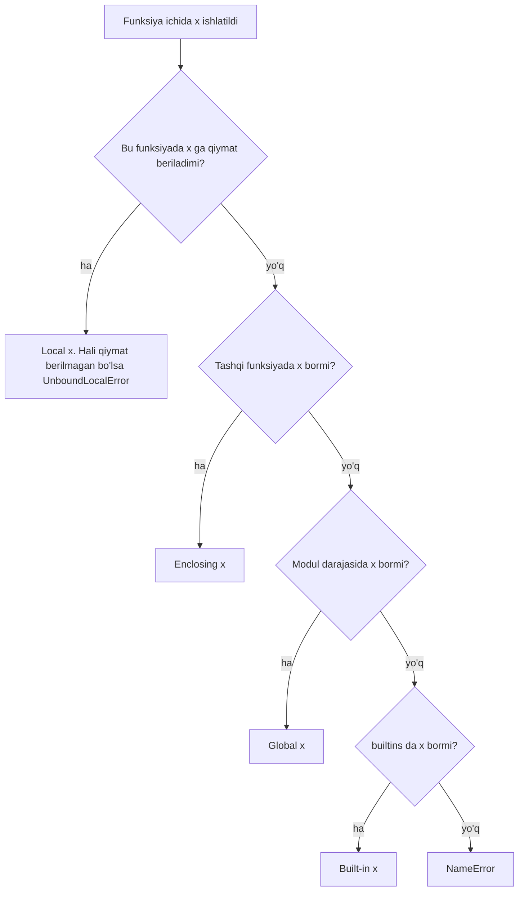
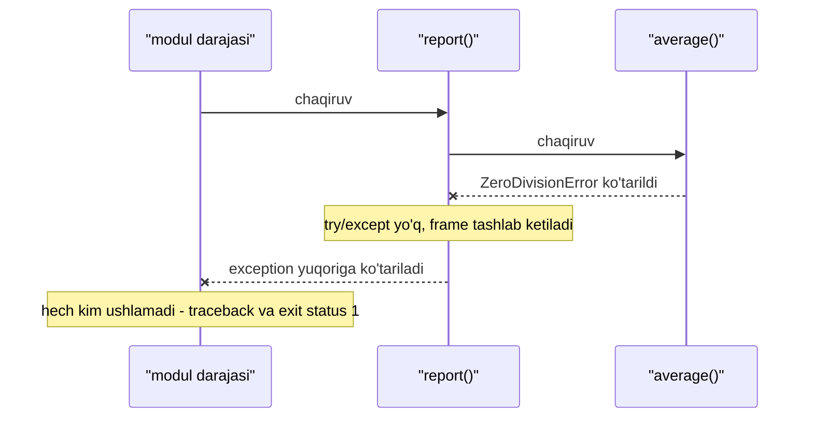
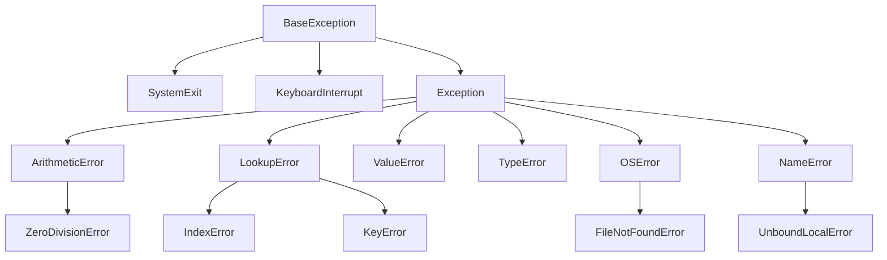

## Bu dars nima uchun kerak

31-darsda Python dasturi kompilyatsiyasiz, interpreter orqali bajarilishini va o'zgaruvchining tipi qiymatga bog'liq ekanini ko'rdik, 32-darsda list, tuple, dict va set bilan ishladik. Endi kodni katta qismlarga ajratish va xatolarga to'g'ri munosabatda bo'lish navbati. Bu uch savolga javob beradi:

1. **Funksiya qanday argument oladi?** C da argumentlar faqat tartib bo'yicha uzatiladi va har birining tipi qat'iy. Python'da argumentni nomi bilan berish, standart qiymat qo'yish va istalgancha argument qabul qilish mumkin. Bu qulaylikning bitta mashhur tuzog'i ham bor: o'zgaruvchan (mutable) standart qiymat.
2. **Kod qanday fayllarga bo'linadi?** 9-darsda C dagi `#include` va linker ko'rilgan edi. Python'da buning o'rnida `import` va modul tizimi turadi.
3. **Xato qanday bildiriladi?** 13-darsda C dasturi xatoni qaytarish kodi (`return 1`) bilan bildirishini ko'rdik: har bir chaqiruvdan keyin natijani tekshirish kerak, unutsangiz xato jim o'tib ketadi. Python'da xato **exception** (istisno) obyekti sifatida "otiladi" va uni ushlamaguncha dastur davom etmaydi.

Bu darsdan keyin siz:

- positional, keyword, keyword-only argumentlar, `*args` va `**kwargs` bilan funksiya yoza olasiz;
- `def f(x, items=[])` nima uchun xato ekanini va uni qanday tuzatishni tushuntira olasiz;
- nom qaysi scope'dan topilishini LEGB qoidasi bilan aniqlay olasiz, `global` va `nonlocal` ni qachon ishlatishni bilasiz;
- funksiyani qiymat sifatida uzatib, `sorted(key=...)` va `lambda` bilan saralay olasiz;
- `import` qanday ishlashini, `if __name__ == "__main__":` nima uchun kerakligini va `sys.exit` exit status ga qanday aylanishini bilasiz;
- `try/except/else/finally` bajarilish tartibini, exception ierarxiyasini, `raise ... from` va o'z exception klassingizni yoza olasiz;
- traceback'ni pastdan yuqoriga o'qib, xato joyini topa olasiz;
- C ning qaytish kodlari bilan Python exception'larini, EAFP va LBYL uslublarini taqqoslay olasiz;
- `with` va context manager resursni qanday kafolatli yopishini tushuntira olasiz.

## Funksiya va argumentlar

Python'da funksiya `def` bilan e'lon qilinadi. C dagidan farqli, parametr va qaytish tipi yozilmaydi (31-darsdagi dinamik tiplar), prototip ham kerak emas: funksiya chaqirilgunga qadar `def` bajarilgan bo'lsa yetarli. `return` yozilmasa yoki qiymatsiz `return` bo'lsa, funksiya `None` qaytaradi.

Muhim nozik joy: `def` - bu e'lon emas, **bajariladigan buyruq**. Interpreter `def` qatoriga yetganda funksiya obyektini yaratadi va uni nomga bog'laydi. Shu sababli funksiya ham boshqa qiymatlar kabi o'zgaruvchiga yoziladi, ro'yxatga solinadi va argument sifatida uzatiladi. Bu xususiyatga pastda qaytamiz.

### Argument turlari

Chaqiruvda argument ikki xil beriladi:

- **positional** - tartib bo'yicha: `greet("Ali", "Salom")` da birinchi qiymat birinchi parametrga tushadi;
- **keyword argument** - nomi bilan: `greet(name="Ali", greeting="Salom")`. Tartib endi ahamiyatsiz, chaqiruv esa o'zini tushuntiradi.

Parametrga standart qiymat (default) berilsa, u ixtiyoriy bo'ladi. Python tutorial'i parametr ro'yxatida ikki maxsus belgini ham tasvirlaydi: `/` dan oldingi parametrlar faqat positional, `*` dan keyingilari faqat keyword bilan beriladi. Keyword-only parametr chaqiruvchini nomni yozishga majburlaydi: `copy(src, dst, True)` dan ko'ra `copy(src, dst, overwrite=True)` ancha tushunarli.

`*args` va `**kwargs` istalgancha argument yig'adi: ortiqcha positional argumentlar `args` tuple'iga, ortiqcha keyword argumentlar `kwargs` dict'iga tushadi (32-dars). Nomlar an'anaviy, muhimi yulduzchalar. Chaqiruvda esa teskari amal bor: `f(*lst)` ro'yxatni positional argumentlarga, `f(**d)` dict'ni keyword argumentlarga yoyadi.

```python run
def greet(name, greeting="Salom", *, punct="!"):
    return f"{greeting}, {name}{punct}"


print(greet("Ali"))
print(greet("Ali", "Assalomu alaykum"))
print(greet(greeting="Xayr", name="Vali"))
print(greet("Ali", punct="."))


def total(*args, **kwargs):
    print("args =", args, " kwargs =", kwargs)
    return sum(args)


print(total(1, 2, 3, unit="so'm"))
nums = [4, 5, 6]
options = {"unit": "kg"}
print(total(*nums, **options))

try:
    greet("Ali", "Salom", ".")
except TypeError as e:
    print("TypeError:", e)
```

Natija:

```text
Salom, Ali!
Assalomu alaykum, Ali!
Xayr, Vali!
Salom, Ali.
args = (1, 2, 3)  kwargs = {'unit': "so'm"}
6
args = (4, 5, 6)  kwargs = {'unit': 'kg'}
15
TypeError: greet() takes from 1 to 2 positional arguments but 3 were given
```

Oxirgi qatorga e'tibor bering: `punct` keyword-only, shuning uchun uchinchi positional argument uchun joy yo'q. Interpreter buni chaqiruv paytida, ish vaqtida aniqlaydi. C da shunga o'xshash xatoni kompilyator prototip bo'yicha oldindan topardi (8-dars).

| Parametr turi | E'lon | Chaqiruv | Qachon kerak |
|---|---|---|---|
| Positional-or-keyword | `def f(a, b)` | `f(1, 2)` yoki `f(a=1, b=2)` | Oddiy holat |
| Standart qiymatli | `def f(a, b=10)` | `f(1)` | Ko'pincha o'zgarmaydigan sozlama |
| Positional-only | `def f(a, b, /)` | faqat `f(1, 2)` | Nom API ning qismi bo'lmasin |
| Keyword-only | `def f(a, *, flag=False)` | `f(1, flag=True)` | Bool va sozlama parametrlar |
| Ortiqcha positional | `def f(*args)` | `f(1, 2, 3)` | O'zgaruvchan sonli kirish |
| Ortiqcha keyword | `def f(**kwargs)` | `f(x=1, y=2)` | Sozlamalarni boshqa funksiyaga uzatish |

### Mutable default argument tuzog'i

Python tutorial'ida "Important warning" deb belgilangan qoida: standart qiymat **funksiya e'lon qilinganda bir marta** hisoblanadi, har chaqiruvda emas. Qiymat o'zgarmas (son, satr, `None`) bo'lsa, farqi yo'q. Lekin list, dict yoki set kabi o'zgaruvchan obyekt bo'lsa, barcha chaqiruvlar **bitta obyektni** bo'lishadi:

```python run
def add_item(item, basket=[]):
    basket.append(item)
    return basket


print(add_item("olma"))
print(add_item("nok"))
print("saqlangan default:", add_item.__defaults__)


def add_item_fixed(item, basket=None):
    if basket is None:
        basket = []
    basket.append(item)
    return basket


print(add_item_fixed("olma"))
print(add_item_fixed("nok"))
```

Natija:

```text
['olma']
['olma', 'nok']
saqlangan default: (['olma', 'nok'],)
['olma']
['nok']
```

Kutganimiz ikkinchi qatorda `['nok']` edi. Mexanika: `def` bajarilganda `[]` bitta list obyektini yaratadi va u funksiya obyektining `__defaults__` atributida saqlanadi. Har chaqiruvda `basket` aynan shu obyektga bog'lanadi, `append` esa uni joyida o'zgartiradi. 22-darsdagi tilda aytsak, barcha chaqiruvlar bitta manzilni ko'rsatadi. Tuzatish - `None` ni belgi (sentinel) sifatida ishlatib, yangi list'ni funksiya ichida yaratish. `basket=None` ning o'zi o'zgarmas, `[]` esa har chaqiruvda yangidan bajariladi.

## Scope: nom qayerdan topiladi (LEGB)

8-darsda C dagi block scope'ni ko'rdik: `{ }` ichida e'lon qilingan o'zgaruvchi shu blokdan tashqarida ko'rinmaydi. Python'da qoida boshqacha: scope'ni faqat **funksiya**, **modul** va klass yaratadi. `if`, `for` va `while` bloklari yangi scope ochmaydi:

```python
for i in range(3):
    last = i * 10
print(i, last)   # 2 20 - sikl o'zgaruvchilari sikldan keyin ham yashaydi
```

Funksiya ichida nom ishlatilganda Python uni to'rt joyda, ma'lum tartibda qidiradi. Bu tartib qisqacha **LEGB** deb ataladi:

1. **L - Local**: joriy funksiyaning lokal nomlari (parametrlar ham shu yerda).
2. **E - Enclosing**: tashqi funksiya(lar)ning nomlari, agar funksiya boshqa funksiya ichida e'lon qilingan bo'lsa.
3. **G - Global**: modul darajasidagi nomlar (fayl ichida, funksiyalardan tashqarida).
4. **B - Built-in**: `print`, `len`, `ValueError` kabi o'rnatilgan nomlar (`builtins` moduli).

Python hujjatidagi "Execution model" bo'limi buni boshqacha so'zlar bilan aytadi: nom eng yaqin o'rab turgan scope'dan topiladi, modul darajasida esa avval global, keyin builtins nomlar fazosi qidiriladi. Hech qayerda topilmasa, `NameError`.



Diagrammaning birinchi tuguni eng ko'p chalg'itadigan joy. Nom lokal yoki lokal emasligini Python **kompilyatsiya paytida**, funksiya tanasini butunlay ko'rib aniqlaydi: funksiyaning istalgan joyida `x = ...` (yoki `x += ...`) bo'lsa, `x` butun funksiya bo'ylab lokal. Shuning uchun quyidagi kod global `counter` ni o'qimaydi, balki hali qiymat berilmagan lokal `counter` ni o'qishga urinadi:

```python run
x = "global"


def outer():
    x = "enclosing"

    def inner():
        print("inner ko'radi:", x)

    inner()


outer()
print("len builtins'dan:", len("salom"))

counter = 0


def bad_increment():
    counter += 1


try:
    bad_increment()
except UnboundLocalError as e:
    print(type(e).__name__, "-", e)


def make_counter():
    count = 0

    def step():
        nonlocal count
        count += 1
        return count

    return step


tick = make_counter()
print(tick(), tick(), tick())
```

Natija:

```text
inner ko'radi: enclosing
len builtins'dan: 5
UnboundLocalError - cannot access local variable 'counter' where it is not associated with a value
1 2 3
```

Ikki kalit so'z bu qoidani o'zgartiradi: `global counter` nomni modul darajasidagisiga bog'laydi, `nonlocal count` esa eng yaqin tashqi funksiyadagisiga. `make_counter` misolida `step` funksiyasi tashqi `count` ni "eslab qoladi": `make_counter` allaqachon qaytgan bo'lsa ham, `count` yashashda davom etadi, chunki unga `step` havola qiladi. C da lokal o'zgaruvchi funksiya qaytishi bilan stack frame bilan birga yo'qolardi (18-dars), Python'da esa obyekt unga havola bor ekan yashaydi (35-darsda reference counting chuqur ko'riladi).

Amaliy maslahat: `global` ni kamdan-kam ishlating. Holatni o'zgartiradigan funksiya qiymatni parametr sifatida olib, natijani `return` qilsa, uni tekshirish va qayta ishlatish osonroq.

## Funksiya - birinchi darajali obyekt

Python'da funksiya **first-class function**: u son yoki satr kabi oddiy qiymat. Uni o'zgaruvchiga yozish, dict ichida saqlash, argument sifatida uzatish va boshqa funksiyadan qaytarish mumkin. `make_counter` funksiyani qaytargan edi; endi funksiyani argument sifatida uzatamiz.

Eng ko'p uchraydigan holat - saralash. `sorted(iterable, key=f)` har bir element uchun `f(element)` ni hisoblaydi va elementlarni shu **kalit** bo'yicha tartiblaydi. Python'ning Sorting HOWTO hujjati ikki muhim kafolat beradi: key funksiya har bir element uchun **aniq bir marta** chaqiriladi va saralash **stable** (teng kalitli elementlar asl tartibini saqlaydi, 19-dars). Ichida 17-darsda tilga olingan Timsort ishlaydi.

Kichik, bir martalik funksiya uchun alohida `def` yozmasdan **lambda** ishlatiladi: `lambda s: s[1]` - bitta parametrli, bitta ifodani qaytaradigan nomsiz funksiya. Lambda ichida faqat bitta ifoda bo'ladi, `return`, sikl yoki bir nechta buyruq yozib bo'lmaydi.

```python run
students = [("Malika", 92, 19), ("Bobur", 85, 21), ("Aziz", 92, 18), ("Dilnoza", 78, 20)]

print(sorted(students, key=lambda s: s[1], reverse=True))
print(sorted(students, key=lambda s: (-s[1], s[0])))

calls = 0


def by_age(s):
    global calls
    calls += 1
    return s[2]


youngest_first = sorted(students, key=by_age)
print([s[0] for s in youngest_first], "key chaqiruvlari:", calls)

operations = {"+": lambda a, b: a + b, "*": lambda a, b: a * b, "max": max}
for name, fn in operations.items():
    print(name, fn(6, 7))
```

Natija:

```text
[('Malika', 92, 19), ('Aziz', 92, 18), ('Bobur', 85, 21), ('Dilnoza', 78, 20)]
[('Aziz', 92, 18), ('Malika', 92, 19), ('Bobur', 85, 21), ('Dilnoza', 78, 20)]
['Aziz', 'Malika', 'Dilnoza', 'Bobur'] key chaqiruvlari: 4
+ 13
* 42
max 7
```

Kuzatishlar:

1. Birinchi qatorda Malika va Aziz ikkalasining bali 92. Stable saralash tufayli ular asl tartibda qoldi: avval Malika.
2. Ikkinchi qatorda kalit tuple: `(-ball, ism)`. Tuple'lar elementma-element solishtiriladi: avval ball kamayish bo'yicha (minus belgisi tufayli), teng bo'lsa ism alifbo bo'yicha.
3. Key funksiya 4 ta element uchun aniq 4 marta chaqirildi. Bu taqqoslashlar sonidan kam: n log₂ n ≈ 4 · 2 = 8. Qimmat kalitni (masalan, faylni o'qish) har taqqoslashda emas, bir marta hisoblash - key yondashuvining asosiy afzalligi.

C da xuddi shu g'oya **funksiya pointeri** orqali amalga oshadi: standart kutubxonadagi `qsort` taqqoslash funksiyasining manzilini oladi. Farq shundaki, C funksiyasi ikki elementni solishtiradi (`key` emas, `cmp`), va u har taqqoslashda chaqiriladi:

```c run
#include <stdio.h>
#include <stdlib.h>

typedef struct
{
    const char *name;
    int score;
}
student;

// Ball bo'yicha kamayish tartibi: manfiy - a oldin, musbat - b oldin
int by_score_desc(const void *a, const void *b)
{
    const student *x = a;
    const student *y = b;
    return y->score - x->score;
}

int main(void)
{
    student s[] = {{"Malika", 92}, {"Bobur", 85}, {"Aziz", 92}, {"Dilnoza", 78}};
    int n = sizeof(s) / sizeof(s[0]);

    qsort(s, n, sizeof(student), by_score_desc);

    for (int i = 0; i < n; i++)
    {
        printf("%s %d\n", s[i].name, s[i].score);
    }
}
```

Bu yerda `by_score_desc` nomi qavssiz uzatildi: bu funksiyaning manzili (21-dars). Natijada ballar tartibi 92, 92, 85, 78 bo'ladi, lekin Malika va Aziz qaysi tartibda chiqishi kafolatlanmagan: C standarti `qsort` stable bo'lishini talab qilmaydi, natija kutubxona implementatsiyasiga bog'liq. Python'da esa stable'lik til kafolati.

## Modullar va import

C da kodni bir nechta faylga bo'lish uchun header, `#include` va linker kerak edi (9-dars). Python'da har bir `.py` fayl **modul**. Boshqa fayldagi kodni ishlatish uchun `import` yoziladi:

```python
# geometry.py
PI = 3.14159

def circle_area(r):
    return PI * r * r
```

```python
# main.py
import geometry
from geometry import circle_area
import geometry as geo

print(geometry.circle_area(2))
print(circle_area(2))
print(geo.PI)
```

`import geometry` uchun interpreter quyidagi ishlarni bajaradi:

1. `sys.modules` lug'atini tekshiradi. Modul allaqachon yuklangan bo'lsa, tayyor obyektni oladi va 2-3-qadamlar o'tkazib yuboriladi.
2. Modulni `sys.path` ro'yxatidagi papkalarda qidiradi: ishga tushirilgan skript papkasi, standart kutubxona, o'rnatilgan paketlar.
3. Yangi modul obyektini yaratadi va **faylni boshidan oxirigacha bajaradi**. Fayldagi `def`, o'zgaruvchilar va klasslar modul obyektining atributlariga aylanadi. Natija `sys.modules` ga yoziladi.
4. Joriy scope'da `geometry` nomini modul obyektiga bog'laydi.

Ikki muhim oqibat bor. Birinchisi: modul faqat birinchi `import` da bajariladi. Ikkinchi `import geometry` arzon, u keshdan oladi. Ikkinchisi: modul darajasidagi har qanday kod (masalan, `print`) import paytida bajariladi. `from geometry import circle_area` ham butun faylni bajaradi, faqat joriy scope'ga bitta nomni qo'shadi.

Brauzerdagi muhitda bitta blok bitta fayl, shuning uchun o'z modulingizni yaratib bo'lmaydi, lekin standart kutubxona modullari bilan mexanikani ko'rish mumkin:

```python run
import sys
import math
import json
import json as j2

print("bu blokdagi __name__:", __name__)
print("math.__name__:", math.__name__)
print("json va j2 bitta obyekt:", json is j2, j2 is sys.modules["json"])
print("math keshda:", "math" in sys.modules)
```

Natija:

```text
bu blokdagi __name__: __main__
math.__name__: math
json va j2 bitta obyekt: True True
math keshda: True
```

### `if __name__ == "__main__":`

Har modulda `__name__` o'zgaruvchisi bor. Fayl import qilinganda u modul nomiga teng (`"geometry"`), fayl to'g'ridan-to'g'ri ishga tushirilganda (`python geometry.py`) esa `"__main__"` ga teng. Python hujjati buni "top-level code environment" deb ataydi. Shu shart bilan bitta fayl ham modul, ham dastur bo'la oladi:

```python
# geometry.py
import sys

PI = 3.14159


def circle_area(r):
    return PI * r * r


def main():
    if len(sys.argv) != 2:
        print("Ishlatish: python geometry.py RADIUS", file=sys.stderr)
        return 2
    try:
        r = float(sys.argv[1])
    except ValueError:
        print(f"Son emas: {sys.argv[1]!r}", file=sys.stderr)
        return 1
    print(f"{circle_area(r):.2f}")
    return 0


if __name__ == "__main__":
    sys.exit(main())
```

```text
$ python geometry.py 2
12.57
$ python geometry.py abc; echo $?
Son emas: 'abc'
1
$ python geometry.py; echo $?
Ishlatish: python geometry.py RADIUS
2
```

`import geometry` qilgan boshqa fayl esa `circle_area` ni oladi va `main()` bajarilmaydi. Shartsiz yozilgan `main()` bo'lsa, import qilgan dastur kutilmaganda buyruq qatorini tekshira boshlardi.

13-darsdagi tushunchalar shu yerda Python ko'rinishini oladi:

- `sys.argv` - C dagi `argv` ning list ko'rinishi: `sys.argv[0]` skript nomi, keyingilari argumentlar, hammasi satr. `argc` kerak emas: `len(sys.argv)`.
- `print(..., file=sys.stderr)` - `fprintf(stderr, ...)` ning o'rni.
- `sys.exit(n)` - butun son exit status bo'ladi: 0 muvaffaqiyat, boshqasi xato. Python hujjati an'anani ham eslatadi: Unix dasturlari buyruq qatori sintaksisi xatosi uchun odatda 2, boshqa xatolar uchun 1 qaytaradi. `sys.exit("xabar")` ko'rinishida satr berilsa, u `stderr` ga chiqariladi va exit status 1 bo'ladi.
- Ushlanmagan exception bilan tugagan dastur traceback chiqaradi va exit status 1 bilan tugaydi.

`sys.exit` aslida dasturni darhol "o'ldirmaydi": u `SystemExit` exception'ini ko'taradi. Shuning uchun `finally` bloklari baribir bajariladi, va (pastda ko'ramiz) haddan tashqari keng `except` uni tasodifan ushlab qolishi mumkin.

## Exceptions: xatoni otish va ushlash

C da funksiya xatoni qaytish qiymati orqali bildiradi, chaqiruvchi esa uni tekshirishi kerak. Python'da xato holatida **exception** obyekti "ko'tariladi" (raise). Shu paytdan boshlab oddiy bajarilish to'xtaydi: interpreter joriy funksiyadan chiqib, chaqiruvchiga, undan keyingi chaqiruvchiga - call stack bo'ylab yuqoriga (18-dars) - mos `except` ni qidiradi. Topsa, o'sha yerda davom etadi. Topmasa, `main` darajasigacha chiqadi, traceback chiqaradi va dastur exit status 1 bilan tugaydi.



### try, except, else, finally

To'liq shakl to'rt qismdan iborat:

- `try:` - xato chiqishi mumkin bo'lgan kod;
- `except Tip as e:` - shu tipdagi (yoki uning avlodi bo'lgan) exception ushlansa bajariladi; bir nechta `except` bo'lishi mumkin, birinchi mos kelgani ishlaydi;
- `else:` - `try` bloki **xatosiz** tugasa bajariladi;
- `finally:` - har qanday holatda bajariladi: xato bo'lsa ham, bo'lmasa ham, `return` bo'lsa ham.

```python run
def divide(a, b):
    try:
        result = a / b
    except ZeroDivisionError:
        print("  except: nolga bo'lish")
        return None
    else:
        print("  else: xato bo'lmadi")
        return result
    finally:
        print("  finally: har doim")


for b in (4, 0):
    print(f"divide(10, {b}):")
    print("  natija:", divide(10, b))
```

Natija:

```text
divide(10, 4):
  else: xato bo'lmadi
  finally: har doim
  natija: 2.5
divide(10, 0):
  except: nolga bo'lish
  finally: har doim
  natija: None
```

`else` va `finally` dagi `return` bilan nima bo'lishiga qarang: `return result` bajarildi, lekin funksiyadan chiqishdan oldin `finally` ishladi, va faqat shundan keyin chaqiruvchi natijani oldi. `else` nima uchun kerak, agar kodni `try` ichiga yozish ham mumkin bo'lsa? Python tutorial'i javobini beradi: `try` ichidagi kod qancha qisqa bo'lsa, siz kutmagan joydagi xatoni tasodifan ushlab qolish ehtimoli shuncha kam. `try` ichida faqat xato kutilgan qator turadi.

`finally` ichida `return`, `break` yoki `continue` yozmang: ular ko'tarilgan exception'ni jimgina yo'q qiladi. Python 3.14 dan boshlab kompilyator bunday kod uchun `SyntaxWarning` chiqaradi (PEP 765).

### Exception ierarxiyasi

Exception'lar klasslar, va ular meros (inheritance) daraxtini tashkil qiladi. Python hujjatiga ko'ra barcha exception'lar `BaseException` dan kelib chiqadi, va `except X` X ning o'zini ham, undan meros olgan barcha klasslarni ham ushlaydi. Daraxtning bir qismi:



Amaliy xulosalar:

- **Aniqrog'ini birinchi yozing.** `except LookupError:` dan keyin yozilgan `except KeyError:` hech qachon ishlamaydi: `KeyError` ni birinchi blok ushlab bo'lgan.
- **`SystemExit` va `KeyboardInterrupt` `Exception` emas.** Hujjat sababini aytadi: ular `except Exception` bilan tasodifan ushlanib, interpreterning chiqishiga to'sqinlik qilmasligi kerak. Shuning uchun yalang'och `except:` (yoki `except BaseException:`) xavfli: u `sys.exit()` va Ctrl+C ni ham yutib yuboradi.
- **Bir nechta tip:** `except (KeyError, IndexError) as e:`. Python 3.14 dan `as` bo'lmasa qavssiz `except KeyError, IndexError:` ham yoziladi (PEP 758), lekin eski versiyalarga mos kod uchun qavsli shakl xavfsiz.

```python run
print([c.__name__ for c in KeyError.__mro__])
print("SystemExit Exception'mi?", issubclass(SystemExit, Exception))

data = {"a": 1}
for action in (lambda: data["b"], lambda: [1, 2][5], lambda: int("x")):
    try:
        action()
    except LookupError as e:
        print("LookupError ushladi:", type(e).__name__, e)
    except Exception as e:
        print("Exception ushladi:", type(e).__name__, e)
```

Natija:

```text
['KeyError', 'LookupError', 'Exception', 'BaseException', 'object']
SystemExit Exception'mi? False
LookupError ushladi: KeyError 'b'
LookupError ushladi: IndexError list index out of range
Exception ushladi: ValueError invalid literal for int() with base 10: 'x'
```

`__mro__` (method resolution order) klassning ota-bobolari ro'yxati: `except` aynan shu zanjir bo'yicha moslikni tekshiradi.

### raise, o'z exception klassingiz va chaining

Xatoni o'zingiz ko'tarish uchun `raise` yoziladi: `raise ValueError("port 1-65535 oralig'ida bo'lishi kerak")`. `except` ichida yalang'och `raise` ushlangan exception'ni o'zgartirmasdan qayta ko'taradi: qisman qayta ishlab (masalan, log yozib), xatoni yuqoriga uzatish uchun.

Kutubxona yoki katta dastur o'z xatolarini **o'z exception klassi** bilan bildiradi. Yangi klass `Exception` (yoki mos keladigan `ValueError` kabi avlod) dan meros oladi. Bu chaqiruvchiga "bizning modulimizdan kelgan har qanday xato"ni bitta `except` bilan ushlash imkonini beradi.

Past darajadagi xatoni yuqori darajadagi ma'noli xatoga aylantirganda `raise Yangi(...) from asl` yoziladi. Bu **exception chaining**: asl xato yangi exception'ning `__cause__` atributida saqlanadi va traceback ikkalasini ham ko'rsatadi ("The above exception was the direct cause of the following exception").

```python run
class ConfigError(Exception):
    """Sozlama faylidagi xato."""


def parse_port(text, line):
    try:
        port = int(text)
    except ValueError as e:
        raise ConfigError(f"{line}-qator: port son emas: {text!r}") from e
    if not 1 <= port <= 65535:
        raise ConfigError(f"{line}-qator: port oraliqdan tashqarida: {port}")
    return port


for text in ("8080", "80a", "70000"):
    try:
        print("port =", parse_port(text, 3))
    except ConfigError as e:
        print("ConfigError:", e, "| sabab:", repr(e.__cause__))
```

Natija:

```text
port = 8080
ConfigError: 3-qator: port son emas: '80a' | sabab: ValueError("invalid literal for int() with base 10: '80a'")
ConfigError: 3-qator: port oraliqdan tashqarida: 70000 | sabab: None
```

Chaqiruvchi `int()` ning ichki xabarini emas, qator raqami bilan tushunarli xabarni oladi, debugging uchun esa asl sabab yo'qolmaydi.

### Traceback o'qish

Ushlanmagan exception traceback chiqaradi. Quyidagi fayl (`tb.py`) bo'sh guruh uchun o'rtachani hisoblashga urinadi:

```python
def average(values):
    return sum(values) / len(values)


def report(groups):
    for name, values in groups.items():
        print(name, average(values))


report({"A": [4, 5], "B": []})
```

Linux terminalida Python 3.13 bilan natija (fayl yo'li qisqartirilgan; 3.11 dan boshlab xato ifodasi `~` va `^` belgilari bilan ajratiladi, ko'rinishi versiyaga qarab biroz farq qiladi):

```text
A 4.5
Traceback (most recent call last):
  File "tb.py", line 10, in <module>
    report({"A": [4, 5], "B": []})
    ~~~~~~^^^^^^^^^^^^^^^^^^^^^^^^
  File "tb.py", line 7, in report
    print(name, average(values))
                ~~~~~~~^^^^^^^^
  File "tb.py", line 2, in average
    return sum(values) / len(values)
           ~~~~~~~~~~~~^~~~~~~~~~~~~
ZeroDivisionError: division by zero
```

O'qish tartibi:

1. **Eng pastki qator** - nima bo'ldi: exception tipi va xabari. `ZeroDivisionError: division by zero`.
2. **Undan yuqoridagi blok** - qayerda bo'ldi: `tb.py` ning 2-qatori, `average` funksiyasi. `^` belgisi aynan `/` operatorini ko'rsatadi.
3. **Yana yuqoriga** - qanday yetib keldik: `average` ni `report` 7-qatorda chaqirgan, `report` ni esa modul darajasi (`<module>`) 10-qatorda. "most recent call last" degani: eng oxirgi chaqiruv eng pastda.

Traceback - 18-darsdagi call stack'ning xato paytidagi surati. Xato qayerda **paydo bo'lgani** (2-qator) va qayerda **tuzatilishi kerak** (balki 10-qatordagi bo'sh ro'yxat) har doim bir joy emas. `A 4.5` qatori chiqqaniga ham e'tibor bering: xato chiqquncha bajarilgan ish bekor bo'lmaydi.

## C dagi qaytish kodlari va exceptions: EAFP va LBYL

C da xatoni qaytish kodi bilan bildirish qanday ko'rinishini eslaylik. Port satrini songa aylantiradigan funksiya (13-darsdagi `strtol` usuli) xato kodini qaytaradi, natijani esa pointer orqali yozadi (25-dars). Har bir chaqiruvchi kodni tekshirib, yuqoriga qo'lda uzatishi kerak:

```c run
#include <errno.h>
#include <stdio.h>
#include <stdlib.h>

// 0 - muvaffaqiyat, 1 - son emas, 2 - oraliqdan tashqarida
int parse_port(const char *text, int *out)
{
    char *end;
    errno = 0;
    long value = strtol(text, &end, 10);
    if (end == text || *end != '\0')
    {
        return 1;
    }
    if (errno == ERANGE || value < 1 || value > 65535)
    {
        return 2;
    }
    *out = (int) value;
    return 0;
}

// Har bir qatlam xato kodini o'zi tekshirib, yuqoriga uzatadi
int load_config(const char *text, int *port)
{
    int status = parse_port(text, port);
    if (status != 0)
    {
        return status;
    }
    return 0;
}

int main(void)
{
    const char *inputs[] = {"8080", "80a", "70000"};
    for (int i = 0; i < 3; i++)
    {
        int port = 0;
        int status = load_config(inputs[i], &port);
        if (status == 0)
        {
            printf("%s -> port %d\n", inputs[i], port);
        }
        else
        {
            printf("%s -> xato kodi %d\n", inputs[i], status);
        }
    }
}
```

Natija:

```text
8080 -> port 8080
80a -> xato kodi 1
70000 -> xato kodi 2
```

Python'dagi `parse_port` bilan taqqoslang: u erda `load_config` kabi oraliq qatlam hech narsa qilmasdan xatoni o'tkazib yuboradi, xato esa tushunarli xabar va sabab bilan keladi.

| Jihat | C: qaytish kodi | Python: exception |
|---|---|---|
| Xatoni bildirish | `return -1`, `NULL` yoki `errno` | `raise ValueError(...)` |
| Natijani qaytarish | Ko'pincha pointer orqali (`int *out`) | Oddiy `return` |
| Tekshirishni unutsa | Xato jim o'tadi, keyin noto'g'ri qiymat bilan ishlanadi | Dastur traceback bilan to'xtaydi |
| Oraliq qatlamlar | Har biri `if (status != 0) return status;` yozadi | Hech narsa yozmaydi, exception o'zi ko'tariladi |
| Xato haqida ma'lumot | Bitta son, ma'nosi hujjatda | Tip, xabar, traceback, `__cause__` |
| Narxi | Har chaqiruvdan keyin bitta taqqoslash | 3.11 dan `try` xatosiz holatda deyarli bepul; ko'tarish va ushlash qimmatroq |

Oxirgi qator haqida: Python 3.11 ning "What's New" sahifasi "zero-cost" exceptions joriy qilinganini yozadi - xato ko'tarilmasa, `try` bloki qo'shimcha xarajat qilmaydi. Exception'ni ko'tarish va ushlash esa oddiy `if` dan ancha qimmat, shuning uchun u kamdan-kam holatlar uchun.

### EAFP va LBYL

Ikki uslub bor, va Python glossariysi ikkalasini ham nomlaydi:

- **LBYL** (look before you leap, "sakrashdan oldin qara"): avval shartni tekshirish, keyin amal. Glossariy buni C kabi tillarga xos uslub deb ta'riflaydi.
- **EAFP** (easier to ask for forgiveness than permission, "ruxsat so'ragandan kechirim so'rash osonroq"): kalit yoki fayl bor deb faraz qilib amal qilish, faraz noto'g'ri bo'lsa exception'ni ushlash. Glossariy buni Python uchun odatiy uslub deydi.

```python run
prices = {"olma": 12000, "nok": 15000}

# LBYL
if "uzum" in prices:
    print(prices["uzum"])
else:
    print("LBYL: uzum yo'q")

# EAFP
try:
    print(prices["uzum"])
except KeyError:
    print("EAFP: uzum yo'q")

# Ko'pincha eng toza yo'l - maxsus metod
print("get:", prices.get("uzum", 0))
```

EAFP ning kuchli tomoni tekshirish va amal orasidagi poyga holatida ko'rinadi. `if os.path.exists(path): open(path)` kodida tekshiruv va `open` orasida boshqa jarayon faylni o'chirib qo'yishi mumkin (time-of-check to time-of-use). `try: open(path) except FileNotFoundError:` esa bitta atomar urinish. Fayllar bilan bu 34-darsda ko'riladi; ma'lumotlar bazasidagi race condition 39-darsda.

Lekin EAFP hamma joyda yaxshi emas. Xato tez-tez bo'ladigan joyda (masalan, kirishning yarmi noto'g'ri) `if` arzonroq va aniqroq. Qoida: exception - kamdan-kam, kutilmagan holat uchun; oddiy tarmoqlanish uchun `if`.

## with va context manager

Resursni (fayl, tarmoq ulanishi, qulf) olgandan keyin uni **har qanday holatda** bo'shatish kerak. C da `fopen` dan keyin har bir chiqish yo'lida `fclose` yozilishi kerak edi (26-dars), bitta `return` unutilsa - fayl ochiq qoladi. Python'da buni `try/finally` hal qiladi, `with` esa uni qisqa shaklga keltiradi.

`with X as y:` blokini qo'llab-quvvatlaydigan obyekt **context manager** deb ataladi. U ikki metodga ega:

- `__enter__()` - blokka kirishda chaqiriladi, qaytargan qiymati `as` dan keyingi nomga bog'lanadi;
- `__exit__(exc_type, exc, tb)` - blokdan **har qanday yo'l bilan** chiqishda chaqiriladi: oddiy tugash, `return`, yoki exception. Xato bo'lmasa uchala argument `None`. `True` qaytarsa, exception yutib yuboriladi; odatda `False` (yoki `None`) qaytariladi va exception yuqoriga ketadi.

```python run
from contextlib import contextmanager


class Section:
    def __init__(self, name):
        self.name = name

    def __enter__(self):
        print(f"[{self.name}] boshlandi")
        return self

    def __exit__(self, exc_type, exc, tb):
        print(f"[{self.name}] tugadi, xato: {exc_type.__name__ if exc_type else None}")
        return False


with Section("A"):
    print("  ish bajarilmoqda")

try:
    with Section("B"):
        print("  nolga bo'lamiz")
        1 / 0
except ZeroDivisionError:
    print("tashqarida ushlandi")


@contextmanager
def section(name):
    print(f"<{name}>")
    try:
        yield name.upper()
    finally:
        print(f"</{name}>")


with section("c") as value:
    print("  ichida:", value)
```

Natija:

```text
[A] boshlandi
  ish bajarilmoqda
[A] tugadi, xato: None
[B] boshlandi
  nolga bo'lamiz
[B] tugadi, xato: ZeroDivisionError
tashqarida ushlandi
<c>
  ichida: C
</c>
```

B blokida `1 / 0` dan keyin ham `__exit__` ishladi va xato tipini ko'rdi, keyin exception tashqariga chiqdi. `@contextmanager` (funksiya ustidagi `@` - decorator sintaksisi, u funksiyani o'rab, yangi xatti-harakat qo'shadi) klass yozmasdan context manager yaratadi: `yield` dan oldingi kod `__enter__`, `finally` dagi kod `__exit__` vazifasini bajaradi.

Fayl obyekti ham context manager: `with open("data.csv") as f:` blokdan chiqishda faylni avtomatik yopadi. Fayllar, CSV va regular expressions 34-darsda.

### Testli mashq: o'lchovlarni o'qish

Datchik har qatorga `harorat=21.5` ko'rinishida o'lchov yozadi, lekin ba'zi qatorlar buzilgan. Ikki funksiya va bitta exception klassini yozing:

1. `ReadingError` - `ValueError` dan meros oladigan klass.
2. `parse_reading(line)` - `"harorat=21.5"` dan `21.5` ni `float` sifatida qaytaradi. Qatorda `=` bo'lmasa, kalit `harorat` bo'lmasa yoki qiymat son bo'lmasa, `ReadingError` ko'taradi. Son emas holatida asl `ValueError` `raise ... from` bilan saqlansin. Qator boshidagi va oxiridagi bo'shliqlar hisobga olinmaydi.
3. `average(lines, *, skip_bad=False)` - qatorlar o'rtachasi. `skip_bad` keyword-only. `False` bo'lsa, birinchi buzilgan qatorda `ReadingError` ko'tariladi va xabarda qator raqami bo'ladi (1 dan, masalan `"2-qator: ..."`). `True` bo'lsa, buzilgan qatorlar tashlab ketiladi. Bitta ham yaroqli qator bo'lmasa, `ZeroDivisionError` emas, `ReadingError` ko'tariladi.

```python run
class ReadingError(ValueError):
    """Noto'g'ri o'lchov qatori."""


def parse_reading(line):
    """'harorat=21.5' kabi qatordan float qaytaradi."""
    # Yechimingizni shu yerga yozing
    return 0.0


def average(lines, *, skip_bad=False):
    """Yaroqli o'lchovlarning o'rta arifmetigi."""
    # Yechimingizni shu yerga yozing
    return 0.0


print(parse_reading("harorat=21.5"))
print(average(["harorat=20", "harorat=22"]))
```

```python test
def raises(exc, fn):
    try:
        fn()
    except exc:
        return True
    return False


def cause_is_value_error():
    try:
        parse_reading("harorat=abc")
    except ReadingError as e:
        return isinstance(e.__cause__, ValueError)
    return False


def message_has_line():
    try:
        average(["harorat=1", "buzilgan", "harorat=3"])
    except ReadingError as e:
        return "2-qator" in str(e)
    return False


check("ReadingError ValueError dan meros oladi", lambda: issubclass(ReadingError, ValueError))
check("parse_reading('harorat=21.5') == 21.5", lambda: parse_reading("harorat=21.5") == 21.5)
check("bo'shliqlar hisobga olinmaydi", lambda: parse_reading("  harorat=-3 \n") == -3.0)
check("son emas - ReadingError", lambda: raises(ReadingError, lambda: parse_reading("harorat=abc")))
check("'=' yo'q - ReadingError", lambda: raises(ReadingError, lambda: parse_reading("harorat 21")))
check("boshqa kalit - ReadingError", lambda: raises(ReadingError, lambda: parse_reading("namlik=40")))
check("raise ... from: __cause__ ValueError", cause_is_value_error)
check("o'rtacha to'g'ri", lambda: average(["harorat=20", "harorat=22", "harorat=27"]) == 23.0)
check("skip_bad=False - xabarda qator raqami", message_has_line)
check("skip_bad=True - buzilganlar tashlanadi", lambda: average(["harorat=1", "xato", "harorat=3"], skip_bad=True) == 2.0)
check("skip_bad keyword-only", lambda: raises(TypeError, lambda: average(["harorat=1"], True)))
check("yaroqli qator yo'q - ReadingError", lambda: raises(ReadingError, lambda: average(["xato"], skip_bad=True)))
check("bo'sh ro'yxat - ReadingError", lambda: raises(ReadingError, lambda: average([])))
```

## Ko'p uchraydigan xatolar

1. **O'zgaruvchan standart qiymat.** `def f(x, items=[])` yoki `def f(x, cache={})`: obyekt bir marta yaratiladi va barcha chaqiruvlarga umumiy bo'ladi. `None` ni sentinel qiling va ichida yangi obyekt yarating.
2. **Yalang'och `except:` yoki `except Exception: pass`.** Xatoni yo'q qilish uni tuzatish emas. Yalang'och `except` hatto `SystemExit` va `KeyboardInterrupt` ni ham yutadi. Faqat kutgan va qayta ishlay oladigan tipni ushlang.
3. **`try` ichiga haddan tashqari ko'p kod.** Kutilmagan joydagi `KeyError` "kalit yo'q" deb noto'g'ri talqin qilinadi. `try` da faqat xavfli qator, qolgani `else` da.
4. **`except` tartibi.** Umumiy tip (`Exception`, `LookupError`) aniq tipdan (`KeyError`) oldin yozilsa, aniq blok hech qachon ishlamaydi.
5. **Funksiya ichida global nomga qiymat berish.** `counter += 1` `counter` ni butun funksiya uchun lokal qiladi va `UnboundLocalError` beradi. Qiymatni parametr va `return` orqali uzating; zarur bo'lsa `global` yoki `nonlocal`.
6. **`__name__` shartisiz skript.** Modul darajasidagi kod import paytida bajariladi: boshqa fayl `import` qilganda dastur ishga tushib ketadi.
7. **Xato kodi o'rniga `print`.** Xato bo'lganda faqat xabar chiqarib, `return` qilish chaqiruvchiga hech narsa bildirmaydi va exit status 0 bo'lib qoladi. Xatoni `raise` qiling yoki `sys.exit` ga nol emas kod bering.
8. **Traceback'ni yuqoridan o'qish.** Eng muhim ma'lumot - eng pastki qator (nima bo'ldi) va uning ustidagi blok (qayerda). Yuqoridagi qatorlar faqat yo'lni ko'rsatadi.

## Xulosa

- `def` bajariladigan buyruq: u funksiya obyektini yaratadi. Funksiya first-class qiymat: uni o'zgaruvchiga yozish, uzatish va qaytarish mumkin; `sorted(key=...)` key funksiyani har element uchun bir marta chaqiradi va stable saralaydi.
- Argumentlar positional yoki keyword bo'ladi; `*` dan keyingi parametrlar keyword-only, `/` dan oldingilari positional-only; `*args` tuple, `**kwargs` dict yig'adi.
- Standart qiymat e'lon paytida bir marta hisoblanadi: o'zgaruvchan default barcha chaqiruvlarga umumiy. `None` sentinel ishlating.
- Nom LEGB tartibida qidiriladi; scope'ni faqat funksiya, modul va klass yaratadi. Funksiya ichida qiymat berilgan nom butun funksiya bo'ylab lokal.
- `import` modulni bir marta bajaradi va `sys.modules` da keshlaydi; `if __name__ == "__main__":` faylni ham modul, ham dastur qiladi; `sys.exit(n)` - exit status, `sys.argv` - 13-darsdagi `argv`.
- Exception call stack bo'ylab mos `except` topilguncha ko'tariladi; ushlanmasa traceback va exit status 1. `else` - xatosiz holat, `finally` - har doim.
- Ierarxiya muhim: `except` avlodlarni ham ushlaydi, `SystemExit` va `KeyboardInterrupt` `Exception` emas. O'z exception klassingiz va `raise ... from` xatoga ma'no va sabab beradi.
- C da xato qaytish kodi bilan qo'lda uzatiladi (LBYL), Python'da exception o'zi ko'tariladi (EAFP). `with` va context manager resursni har qanday chiqish yo'lida bo'shatadi.

## Amaliy topshiriq

Buyruq qatoridan narxlar ro'yxatini olib, chegirmali jami summani hisoblaydigan `cart.py` dasturini yozing. Ishlatish: `python cart.py [--discount FOIZ] NARX...`, masalan `python cart.py --discount 10 12000 15000 8000`.

Topshiriq qadamlari:

1. **Modul tuzilmasi.** Hisob funksiyalarini (`parse_price`, `apply_discount`, `total`) va `main()` ni alohida yozing. Fayl oxirida `if __name__ == "__main__": sys.exit(main())`. Boshqa fayl `from cart import total` qilganda hech narsa chop etilmasligini tekshiring.
2. **O'z exception'ingiz.** `CartError(Exception)` va undan meros oluvchi `PriceError` hamda `DiscountError` klasslarini yarating. `parse_price("12a")` `int()` ning `ValueError` ini `raise PriceError(...) from e` bilan o'rab, xabarda nechanchi argument ekanini ko'rsatsin. Manfiy narx ham `PriceError`.
3. **Argumentlar.** `total(prices, *, discount=0)` - `discount` keyword-only, foiz 0-100 oralig'ida, aks holda `DiscountError`. Standart qiymat sifatida list yoki dict ishlatmang; nima uchun - izohda yozing.
4. **Exit statuslar.** Argument yo'q yoki `--discount` dan keyin son yo'q - usage xabari `stderr` ga va status 2. `CartError` - xabar `stderr` ga va status 1. Muvaffaqiyat - status 0. `main` ichida faqat `CartError` ni ushlang; boshqa kutilmagan xato traceback bilan chiqsin. 13-darsdagi `&&` va `||` bilan uchala holatni sinab, `echo $?` natijalarini yozing.
5. **Saralash.** `--verbose` bayrog'i berilsa, narxlarni `sorted(..., key=..., reverse=True)` bilan kamayish tartibida chiqaring.
6. **Traceback tahlili.** Ataylab `total` ga satrlar ro'yxatini (`["12000"]`) bering, chiqqan traceback'ni ko'chiring va har qatorini pastdan yuqoriga izohlang: qaysi tip, qaysi funksiya, qaysi qator.

Yaxshi javobda bo'lishi kerak bo'lgan narsalar:

- `CartError` ierarxiyasi bor, `main` uni bitta `except CartError` bilan ushlaydi, `PriceError` da `__cause__` asl `ValueError`;
- `discount` keyword-only, `total(prices, 10)` `TypeError` beradi; mutable default yo'q va sababi izohlangan;
- exit statuslar 0, 1, 2 va ular `echo $?` bilan ko'rsatilgan; xato xabarlari `stderr` da;
- yalang'och `except:` yoki `except Exception: pass` yo'q;
- `import cart` hech narsa chop etmaydi (`__name__` sharti);
- 6-qadamdagi traceback to'g'ri o'qilgan: eng pastki qator tip va xabar, uning ustidagi blok xato qatori.

Javobingizni pastdagi maydonga yozing va yuqoridagi mezonlar bilan solishtiring.

## Manbalar

- CS50x. [Lecture 6 notes](https://cs50.harvard.edu/x/notes/6/) - "Functions", "Libraries, Modules, and Packages", "Positional Parameters and Named Parameters", "Exceptions", "Command-Line Arguments" va "Exit Status" bo'limlari.
- Python tutorial. [More Control Flow Tools](https://docs.python.org/3/tutorial/controlflow.html) - "Default Argument Values" (Important warning: default bir marta hisoblanadi), "Keyword Arguments", "Special parameters" (`/` va `*`), "Arbitrary Argument Lists", "Unpacking Argument Lists", "Lambda Expressions".
- Python reference. [Execution model](https://docs.python.org/3/reference/executionmodel.html) - "Naming and binding", "Resolution of names": eng yaqin scope, global va builtins nomlar fazosi, `UnboundLocalError`.
- Python tutorial. [Errors and Exceptions](https://docs.python.org/3/tutorial/errors.html) - "Handling Exceptions" (`else` nima uchun kerak), "Raising Exceptions", "Exception Chaining", "User-defined Exceptions", "Defining Clean-up Actions".
- Python library. [Built-in Exceptions](https://docs.python.org/3/library/exceptions.html) - `BaseException`, `KeyboardInterrupt` nima uchun `Exception` emasligi, "Exception hierarchy".
- Python library. [sys](https://docs.python.org/3/library/sys.html) - `sys.exit` (`SystemExit`, 0/2/1 an'anasi, satr argument stderr va status 1), `sys.argv`, `sys.modules`; [__main__](https://docs.python.org/3/library/__main__.html) - `__name__ == '__main__'` va "Idiomatic Usage".
- Python. [Glossary](https://docs.python.org/3/glossary.html) - "EAFP" va "LBYL"; [Sorting Techniques](https://docs.python.org/3/howto/sorting.html) - key funksiya har element uchun bir marta, "Sort Stability".
- Python. [What's New in Python 3.11](https://docs.python.org/3/whatsnew/3.11.html) - "zero-cost" exceptions; [What's New in Python 3.14](https://docs.python.org/3.14/whatsnew/3.14.html) - PEP 758 (qavssiz `except`) va PEP 765 (`finally` dagi `return` uchun `SyntaxWarning`); [contextlib](https://docs.python.org/3/library/contextlib.html) - `@contextmanager`.
