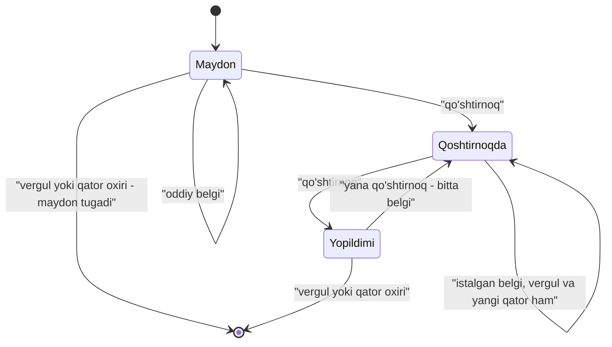
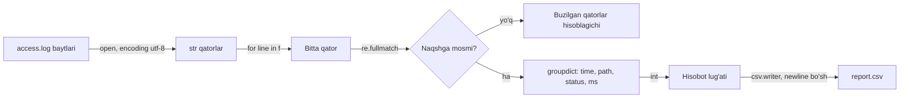

## Bu dars nima uchun kerak

Dasturlar ma'lumotni kamdan-kam faqat klaviaturadan oladi. Ko'pincha u faylda turadi: jadval eksporti, server logi, sozlamalar. 26-darsda C da fayl bilan ishlashni ko'rdik: `fopen`, `fgets`, `fread`, `fclose`, `NULL` tekshiruvi va `EOF`. Python xuddi shu operatsion tizim imkoniyatlari ustida ishlaydi, lekin uch narsani o'z zimmasiga oladi: baytlarni matnga aylantirish (encoding), faylni kafolatli yopish (`with`, 33-dars) va qatorlarga bo'lish.

Faylni o'qish yarim ish. Uning ichidagi tuzilmani ham ajratish kerak. Ikkita keng tarqalgan holat:

1. **Jadval ma'lumoti.** CSV formati sodda ko'rinadi ("vergul bilan ajratilgan"), lekin maydon ichida vergul, qo'shtirnoq yoki yangi qator bo'lsa, `split(",")` buziladi. Buning uchun `csv` moduli bor.
2. **Erkin matndagi naqshlar.** Log qatoridan vaqt va status kodini ajratish, telefon raqamini tekshirish, matndagi barcha sanalarni topish. Buning uchun **regular expression** (regex) - satr naqshini ta'riflaydigan kichik til.

Bu darsdan keyin siz:

- `open()` rejimlarini (`r`, `w`, `a`, `x`, `b`, `+`) C dagi `fopen` bilan solishtira olasiz;
- matn va binary rejim farqini, `encoding="utf-8"` nima uchun har doim yozilishi kerakligini tushuntira olasiz;
- katta faylni qatorma-qator, xotirani tejab o'qiy olasiz;
- `csv.reader`, `csv.DictReader` va `csv.writer` bilan qo'shtirnoqli maydonlarni to'g'ri o'qib-yoza olasiz;
- `re.search`, `re.match`, `re.fullmatch`, `re.findall`, `re.sub` farqini bilasiz;
- belgilar sinflari, kvantifikatorlar, guruhlar, greedy va lazy rejimlar bilan naqsh yoza olasiz;
- telefon raqami va email validatsiyasida regex qayerda yordam berishini va qayerda yetmasligini halol baholay olasiz;
- catastrophic backtracking nima ekanini va undan qanday qochishni bilasiz.

## open(): fayl, rejim va encoding

Python'da fayl `open(nom, rejim, encoding=...)` bilan ochiladi va **fayl obyekti** qaytadi. U 33-darsdagi context manager, shuning uchun `with` bilan ishlatiladi: blokdan har qanday yo'l bilan chiqilganda fayl yopiladi.

```python
with open("data.txt", "w", encoding="utf-8") as f:
    f.write("salom\n")
# bu yerda fayl allaqachon yopilgan, hatto write xato bergan bo'lsa ham
```

Rejim satri C dagi `fopen` rejimlariga juda yaqin (26-dars):

| Rejim | Ma'nosi | Fayl yo'q bo'lsa | Fayl bor bo'lsa | C dagi `fopen` |
|---|---|---|---|---|
| `"r"` (standart) | O'qish | `FileNotFoundError` | Boshidan o'qiladi | `"r"`, lekin xatoda `NULL` |
| `"w"` | Yozish | Yaratiladi | **Tozalab** yoziladi | `"w"` |
| `"a"` | Oxiriga qo'shish | Yaratiladi | Oxiriga yoziladi | `"a"` |
| `"x"` | Faqat yangi fayl | Yaratiladi | `FileExistsError` | C11 dagi `"wx"` |
| `"b"` qo'shimchasi | Binary: `bytes` o'qiladi | - | - | `"rb"`, `"wb"` |
| `"+"` qo'shimchasi | O'qish va yozish | Rejimga bog'liq | Rejimga bog'liq | `"r+"`, `"w+"` |

Asosiy farq xatoda: C da `fopen` `NULL` qaytaradi va uni tekshirishni unutish mumkin; Python'da `open` exception ko'taradi (`FileNotFoundError`, `PermissionError` - ikkalasi ham `OSError` avlodi, 33-darsdagi ierarxiya). `"x"` rejimi "fayl bormi?" tekshiruvi va yaratishni bitta atomar amalga birlashtiradi: bu 33-darsdagi EAFP ning fayl tizimidagi ko'rinishi.

### Matn va binary rejim

Diskda faqat baytlar bor. **Binary rejimda** (`"rb"`) Python ularni o'zgartirmasdan `bytes` obyekti sifatida beradi: rasm, arxiv yoki 26-darsdagi BMP kabi fayllar uchun. **Matn rejimida** (standart) ikki qo'shimcha ish bajariladi:

1. **Dekodlash**: baytlar berilgan encoding bo'yicha `str` belgilariga aylantiriladi (yozishda teskarisi).
2. **Qator oxirini moslash**: o'qishda `\n`, `\r\n` (Windows) va `\r` (eski Mac) - hammasi `\n` ga aylanadi. Python glossariysi buni **universal newlines** deb ataydi.

### Nega `encoding="utf-8"` yozish kerak

2-darsda UTF-8 ni ko'rdik: lotin harflari 1 bayt, kirill harflari 2 bayt, ba'zi belgilar 3-4 bayt. Encoding berilmasa nima bo'ladi? Python 3.14 hujjatiga ko'ra matn rejimida standart encoding **platformaga bog'liq**: `locale.getencoding()` qaytargan qiymat olinadi. Linux va macOS da bu odatda UTF-8, lekin ba'zi Windows tizimlarida eski kod sahifasi (masalan, cp1251 yoki cp1252) bo'lishi mumkin. Natija: bir kompyuterda ishlagan dastur boshqasida buzilgan matn (2-darsdagi mojibake) yoki `UnicodeDecodeError` beradi. Python 3.15 da bu o'zgardi: PEP 686 bo'yicha UTF-8 mode sukut bo'yicha yoqildi va encoding berilmasa ham UTF-8 ishlatiladi. Lekin eski versiyalarda ishlaydigan kod uchun (kursning brauzer muhiti 3.14) qoida oddiy: **matnli faylni har doim `encoding="utf-8"` bilan oching**.

Brauzerdagi Python virtual fayl tizimida ishlaydi: fayl shu blok ichida yaratiladi va o'qiladi, bloklar orasida saqlanmaydi.

```python run
text = "Salom, O'zbekiston!\nЎзбекистон\n"

with open("greet.txt", "w", encoding="utf-8") as f:
    written = f.write(text)
print("yozilgan belgilar:", written)

with open("greet.txt", "rb") as f:
    raw = f.read()
print("fayldagi baytlar:", len(raw))
print(raw[20:32])

with open("greet.txt", encoding="utf-8") as f:
    print(repr(f.read()))

with open("greet.txt", encoding="cp1251") as f:
    print("cp1251:", f.read().splitlines()[1])

try:
    with open("greet.txt", encoding="ascii") as f:
        f.read()
except UnicodeDecodeError as e:
    print("UnicodeDecodeError:", e)
```

Natija:

```text
yozilgan belgilar: 31
fayldagi baytlar: 41
b'\xd0\x8e\xd0\xb7\xd0\xb1\xd0\xb5\xd0\xba\xd0\xb8'
"Salom, O'zbekiston!\nЎзбекистон\n"
cp1251: Ўзбекистон
UnicodeDecodeError: 'ascii' codec can't decode byte 0xd0 in position 20: ordinal not in range(128)
```

Hisob: birinchi qator `Salom, O'zbekiston!` 19 belgi va `\n` - 20 bayt (hammasi ASCII). Ikkinchi qator `Ўзбекистон` 10 ta kirill harfi, har biri UTF-8 da 2 bayt, ya'ni 20 bayt, va `\n` - 1 bayt. Jami 20 + 20 + 1 = 41 bayt, belgilar esa 20 + 10 + 1 = 31. `f.write` belgilar sonini qaytaradi, `len(raw)` baytlar sonini. `Ў` ning ikki bayti `d0 8e` (U+040E, 2-darsdagi kodlash qoidasi bilan tekshirsa bo'ladi).

Bir xil baytlar cp1251 bilan o'qilganda xato bermadi, lekin har bir 2 baytli harf ikkita boshqa harfga aylandi: bu mojibake. ASCII esa 0x7F dan katta baytni umuman qabul qilmaydi va 20-pozitsiyada (ikkinchi qatorning birinchi bayti) to'xtadi. Eng xavflisi - birinchi holat: dastur yiqilmaydi, ma'lumot jimgina buziladi.

## Qatorma-qator o'qish

Fayl obyekti iterator: `for line in f:` faylni bitta-bitta qator qilib beradi. Har qator oxirida `\n` qoladi (oxirgisida bo'lmasligi mumkin), shuning uchun odatda `line.rstrip("\n")` yoki `line.strip()` qilinadi.

Uchta o'qish usulining xotira narxi har xil:

| Usul | Qaytaradi | Xotira | Qachon |
|---|---|---|---|
| `f.read()` | Butun fayl bitta `str` | Fayl hajmi | Kichik fayllar |
| `f.readlines()` | Barcha qatorlar `list` | Fayl hajmi + har qator uchun obyekt | Qatorlarga qayta-qayta murojaat kerak bo'lsa |
| `for line in f` | Navbatdagi qator | Bitta qator + ichki bufer | Katta fayllar, log tahlili |

Hisob: 2 GB log faylni `read()` bilan o'qish kamida 2 GB xotira talab qiladi (Python `str` obyektlarining ichki ko'rinishi bilan undan ham ko'p, 35-dars). `for line in f` esa bir vaqtda faqat joriy qator va bir necha kilobaytlik buferni ushlaydi: 100 baytlik qatorlar uchun xotira fayl hajmidan qat'i nazar deyarli bir xil. Bu 26-darsdagi `fgets` sikli bilan bir xil g'oya.

Avval C dagi ko'rinishni eslaymiz. Dastur log fayldan 500 status kodli qatorlarni topadi:

```c run
#include <stdio.h>
#include <string.h>

int main(void)
{
    FILE *f = fopen("access.log", "r");
    if (f == NULL)
    {
        printf("access.log ochilmadi\n");
        return 1;
    }

    char line[256];
    int count = 0;
    int errors = 0;
    while (fgets(line, sizeof(line), f) != NULL)
    {
        count++;
        line[strcspn(line, "\n")] = '\0';
        if (strstr(line, " 500 ") != NULL)
        {
            errors++;
            printf("%d: %s\n", count, line);
        }
    }
    fclose(f);
    printf("jami %d qator, %d ta xato\n", count, errors);
}
```

```text file access.log
08:15:03 GET /index.html 200 12ms
08:15:04 GET /api/users 500 340ms
08:15:09 POST /api/login 200 95ms
08:16:11 GET /api/users 500 410ms
08:16:12 GET /favicon.ico 404 3ms
```

Natija:

```text
2: 08:15:04 GET /api/users 500 340ms
4: 08:16:11 GET /api/users 500 410ms
jami 5 qator, 2 ta xato
```

C versiyasida qo'lda qilinadigan ishlar: `NULL` tekshiruvi, bufer o'lchami (255 belgidan uzun qator ikkiga bo'linib qoladi), `\n` ni olib tashlash, `fclose`. Python'dagi ekvivalent:

```python run
log = """08:15:03 GET /index.html 200 12ms
08:15:04 GET /api/users 500 340ms
08:15:09 POST /api/login 200 95ms
08:16:11 GET /api/users 500 410ms
08:16:12 GET /favicon.ico 404 3ms
"""
with open("access.log", "w", encoding="utf-8") as f:
    f.write(log)

errors = 0
with open("access.log", encoding="utf-8") as f:
    for number, line in enumerate(f, start=1):
        line = line.rstrip("\n")
        if " 500 " in line:
            errors += 1
            print(f"{number}: {line}")
print(f"jami {number} qator, {errors} ta xato")
```

Natija C dagi bilan bir xil. Qator uzunligi cheklanmagan, `fclose` ni `with` bajaradi, fayl yo'q bo'lsa `FileNotFoundError` traceback bilan to'xtatadi. `" 500 "` ni bo'shliqlar bilan qidirish - qo'pol usul: `/api/v500` yoki `1500ms` kabi qatorlarda adashadi. Bunday ajratish uchun pastda regex ishlatamiz.

## CSV: oddiy ko'rinadigan murakkab format

CSV (comma-separated values) jadvalni matn sifatida saqlaydi: har qator - yozuv, maydonlar vergul bilan ajratiladi, birinchi qator odatda ustun nomlari. Format ko'p yillar standartsiz ishlatilgan; RFC 4180 (2005) amaldagi umumiy qoidalarni yozib qo'ygan. Muhim qoidalar:

- vergul, qo'shtirnoq yoki qator uzilishi bor maydon qo'shtirnoq ichiga olinadi: `"Toshkent, Chilonzor"`;
- qo'shtirnoqli maydon ichidagi qo'shtirnoq ikkilantiriladi: `"u ""a'lo"" dedi"` maydoni `u "a'lo" dedi` degani;
- qatorlar `CRLF` (`\r\n`) bilan tugaydi.

Shuning uchun `line.split(",")` faqat eng oddiy fayllarda ishlaydi. C da `strtok` bilan xuddi shu xato qilinadi:

```c run
#include <stdio.h>
#include <string.h>

int main(void)
{
    char line[] = "Vali,Samarqand,\"keyin, ertaga\"";
    int n = 0;
    for (char *field = strtok(line, ","); field != NULL; field = strtok(NULL, ","))
    {
        n++;
        printf("maydon %d: [%s]\n", n, field);
    }
    printf("jami %d maydon, kutilgani 3\n", n);
}
```

Natija:

```text
maydon 1: [Vali]
maydon 2: [Samarqand]
maydon 3: ["keyin]
maydon 4: [ ertaga"]
jami 4 maydon, kutilgani 3
```

To'g'ri CSV parseri qo'shtirnoq ichida ekanini kuzatib boradigan kichik holat mashinasi: qo'shtirnoq ichidagi vergul ajratuvchi emas, ikkita qo'shtirnoq esa bitta belgi.



Python'ning `csv` moduli shu mexanikani bajaradi. Asosiy vositalar:

- `csv.reader(f)` - har qatorni `list[str]` sifatida beradi;
- `csv.DictReader(f)` - birinchi qatorni ustun nomlari deb oladi va har yozuvni `dict` sifatida beradi (32-dars);
- `csv.writer(f)` va `csv.DictWriter(f, fieldnames=...)` - kerakli joyda qo'shtirnoq qo'yib yozadi.

Bitta majburiy tafsilot: `csv` hujjati faylni `newline=""` bilan ochishni talab qiladi. Sababi hujjatning izohida: aks holda qo'shtirnoq ichidagi qator uzilishlari noto'g'ri talqin qilinadi, `\r\n` ishlatadigan platformalarda esa yozishda ortiqcha `\r` qo'shiladi. `csv` moduli qator oxirlarini o'zi boshqaradi, shuning uchun matn rejimining universal newlines almashtirishini o'chirish kerak.

```python run
import csv

rows = [
    ["ism", "shahar", "izoh"],
    ["Ali", "Toshkent", "oddiy"],
    ["Vali", "Samarqand", "keyin, ertaga"],
    ["Gul", "Buxoro", 'u "a\'lo" dedi'],
    ["Nodir", "Xiva", "ikki\nqatorli"],
]

with open("people.csv", "w", newline="", encoding="utf-8") as f:
    csv.writer(f).writerows(rows)

with open("people.csv", "rb") as f:
    for raw in f.read().split(b"\r\n"):
        print(raw)

print("--- split(',') ---")
with open("people.csv", newline="", encoding="utf-8") as f:
    for line in f:
        print(len(line.rstrip("\r\n").split(",")), line.rstrip("\r\n").split(","))

print("--- csv.DictReader ---")
with open("people.csv", newline="", encoding="utf-8") as f:
    for row in csv.DictReader(f):
        print(row["ism"], "|", row["shahar"], "|", repr(row["izoh"]))
```

Natija:

```text
b'ism,shahar,izoh'
b'Ali,Toshkent,oddiy'
b'Vali,Samarqand,"keyin, ertaga"'
b'Gul,Buxoro,"u ""a\'lo"" dedi"'
b'Nodir,Xiva,"ikki\nqatorli"'
b''
--- split(',') ---
3 ['ism', 'shahar', 'izoh']
3 ['Ali', 'Toshkent', 'oddiy']
4 ['Vali', 'Samarqand', '"keyin', ' ertaga"']
3 ['Gul', 'Buxoro', '"u ""a\'lo"" dedi"']
3 ['Nodir', 'Xiva', '"ikki']
1 ['qatorli"']
--- csv.DictReader ---
Ali | Toshkent | 'oddiy'
Vali | Samarqand | 'keyin, ertaga'
Gul | Buxoro | 'u "a\'lo" dedi'
Nodir | Xiva | 'ikki\nqatorli'
```

Kuzatishlar:

1. `csv.writer` faqat kerakli maydonlarni qo'shtirnoqqa oldi, ichki qo'shtirnoqni ikkilantirdi va qatorlarni `\r\n` bilan tugatdi (RFC 4180 dagi kabi).
2. `split(",")` uch xil xato qildi: vergulli maydonni ikkiga bo'ldi, qo'shtirnoqlarni olib tashlamadi va ikki qatorli yozuvni ikkita yozuvga aylantirdi.
3. `DictReader` to'rtala yozuvni to'g'ri qaytardi, maydonga ustun nomi bilan murojaat qilinadi: ustunlar tartibi o'zgarsa ham kod buzilmaydi.

Esda tuting: CSV'da **tip yo'q**. `csv` har qiymatni `str` sifatida beradi; `"92"` ni son qilish uchun `int(row["ball"])` kerak, va bu 33-darsdagi `ValueError` ni ko'tarishi mumkin. Excel kabi dasturlar nuqtali vergul (`;`) yoki boshqa ajratuvchi ishlatishi mumkin: `csv.reader(f, delimiter=";")`.

## Regular expressions: naqsh tili

**Regular expression** (regex) - satrlar to'plamini ta'riflaydigan naqsh. `[0-9]{4}-[0-9]{2}-[0-9]{2}` naqshi "4 raqam, chiziqcha, 2 raqam, chiziqcha, 2 raqam" ko'rinishidagi har qanday satrga mos keladi: `2026-11-03`. Python'da regex `re` modulida.

### Raw string

Regex'da `\` ko'p ishlatiladi (`\d` - raqam, `\.` - aynan nuqta), Python satrlarida esa `\` ning o'zi escape belgisi (`\n` - yangi qator, 5-dars). `re` hujjati yechimni aytadi: naqshlarni **raw string** sifatida yozing, ya'ni `r"..."`. Raw string'da `\` oddiy belgi: `r"\n"` ikki belgili satr (`\` va `n`), `"\n"` esa bitta yangi qator belgisi. Raw string'siz `"\\d+\\.\\d+"` yozishga to'g'ri keladi; `r"\d+\.\d+"` ancha o'qiladi. Qoida: har bir regex `r"` bilan boshlanadi.

### Asosiy funksiyalar

| Funksiya | Nima qiladi | Topilmasa |
|---|---|---|
| `re.search(p, s)` | Satrning **istalgan joyida** birinchi moslikni topadi | `None` |
| `re.match(p, s)` | Faqat satr **boshidan** moslik | `None` |
| `re.fullmatch(p, s)` | **Butun satr** naqshga mos bo'lishi kerak | `None` |
| `re.findall(p, s)` | Barcha mosliklar ro'yxati (guruh bo'lsa - guruhlar) | `[]` |
| `re.finditer(p, s)` | Barcha mosliklar, `Match` obyektlari iteratori | Bo'sh iterator |
| `re.sub(p, r, s)` | Mosliklarni `r` bilan almashtiradi | O'zgarmagan satr |

Validatsiya uchun deyarli har doim `fullmatch` kerak. `re.match(r"[0-9]{9}", "1234567890abc")` muvaffaqiyatli, chunki boshidagi 9 raqam mos keldi, qolgani tekshirilmadi. Python 3.15 hujjati shu chalkashlik tufayli `re.match` ga aniqroq `re.prefixmatch` nomini qo'shdi; brauzerdagi 3.14 da esa `re.match` ishlatiladi.

```python run
import re

text = "Buyurtma #1042: 3 dona, jami 45000 so'm, sana 2026-11-03"

print(re.search(r"[0-9]+", text))
print(re.match(r"[0-9]+", text))
print(re.findall(r"[0-9]+", text))
print(re.fullmatch(r"[0-9]{4}-[0-9]{2}-[0-9]{2}", "2026-11-03"))
print(re.fullmatch(r"[0-9]{4}-[0-9]{2}-[0-9]{2}", "2026-11-03 ertalab"))
print(re.sub(r"[0-9]", "*", "karta 8600 1234 5678 9012"))

m = re.search(r"([0-9]{4})-([0-9]{2})-([0-9]{2})", text)
print(m.group(0), "|", m.group(1), m.group(2), m.group(3), "|", m.span())
```

Natija:

```text
<re.Match object; span=(10, 14), match='1042'>
None
['1042', '3', '45000', '2026', '11', '03']
<re.Match object; span=(0, 10), match='2026-11-03'>
None
karta **** **** **** ****
2026-11-03 | 2026 11 03 | (46, 56)
```

`Match` obyekti moslikning o'zini (`group(0)`), qavslar ichidagi qismlarni (`group(1)`, ...) va joylashuvini (`span()`, yarim ochiq oraliq, 15-dars) saqlaydi.

### Sintaksis: belgilar sinflari, kvantifikatorlar, langarlar

| Naqsh | Mos keladi | Misol |
|---|---|---|
| `.` | Yangi qatordan boshqa istalgan belgi | `a.c`: `abc`, `a-c` |
| `[abc]` | Ro'yxatdagi bitta belgi | `[aeiou]` unli |
| `[a-z0-9]` | Oraliqdagi bitta belgi | Kichik lotin harfi yoki raqam |
| `[^0-9]` | Ro'yxatda **bo'lmagan** bitta belgi | Raqam emas |
| `\d`, `\w`, `\s` | Raqam, so'z belgisi, bo'shliq (Unicode bo'yicha) | `\s+` bir nechta bo'shliq |
| `\D`, `\W`, `\S` | Yuqoridagilarning teskarisi | `\S+` bo'shliqsiz bo'lak |
| `*`, `+`, `?` | 0 yoki ko'p, 1 yoki ko'p, 0 yoki 1 | `colou?r` |
| `{n}`, `{m,n}` | Aniq n marta, m dan n gacha | `[0-9]{2,4}` |
| `^`, `$` | Satr boshi, satr oxiri | `^GET` |
| `\b` | So'z chegarasi | `\b500\b` |
| `a\|b` | a yoki b | `GET\|POST` |
| `( )` | Guruh: birlashtirish va ajratib olish | `(ab)+` |
| `(?:...)` | Ajratib olmaydigan guruh | `(?:\+998)?` |
| `(?P<nom>...)` | Nomli guruh | `m["nom"]` |

Kvadrat qavsdagi to'plam **belgilar sinfi** (character class) deyiladi: u har doim **bitta** belgiga mos keladi. `*`, `+`, `?`, `{m,n}` - **kvantifikator**: o'zidan oldingi element necha marta takrorlanishini belgilaydi. Maxsus belgining o'zini izlash uchun oldiga `\` qo'yiladi: `\.`, `\+`, `\(`.

`\d` haqida nozik joy. `re` hujjatiga ko'ra Unicode satrlarda `\d` istalgan Unicode o'nlik raqamiga (Nd toifasi) mos keladi, faqat `[0-9]` ga emas. Ya'ni `re.fullmatch(r"\d+", "١٢٣")` (arab-hind raqamlari) muvaffaqiyatli, keyin esa `int()` uni songa aylantira oladi, lekin bazaga yoki tashqi tizimga bunday satr kutilmagan holda ketishi mumkin. Faqat lotin raqamlari kerak bo'lsa, `[0-9]` yozing yoki `re.ASCII` bayrog'ini bering.

### Guruhlar va greedy/lazy kvantifikatorlar

Kvantifikatorlar sukut bo'yicha **greedy** (ochko'z): iloji boricha ko'p belgini oladi, keyin naqshning qolgani mos kelmasa, bittadan qaytaradi. `re` hujjatidagi misol: `<.*>` naqshi `<a> b <c>` satrida faqat `<a>` ni emas, butun satrni oladi. Kvantifikatordan keyin `?` qo'yilsa (`*?`, `+?`, `??`), u **lazy** (non-greedy) bo'ladi: iloji boricha kam oladi.

```python run
import re

html = "<b>qalin</b> va <i>qiya</i>"
print("greedy:", re.findall(r"<.*>", html))
print("lazy:  ", re.findall(r"<.*?>", html))
print("sinf:  ", re.findall(r"<[^>]*>", html))

line = "08:15:04 GET /api/users 500 340ms"
pattern = r"(?P<time>[0-9]{2}:[0-9]{2}:[0-9]{2}) (?P<method>[A-Z]+) (?P<path>\S+) (?P<status>[0-9]{3}) (?P<ms>[0-9]+)ms"
m = re.fullmatch(pattern, line)
print(m.groupdict())
print(int(m["status"]) >= 500, int(m["ms"]))
```

Natija:

```text
greedy: ['<b>qalin</b> va <i>qiya</i>']
lazy:   ['<b>', '</b>', '<i>', '</i>']
sinf:   ['<b>', '</b>', '<i>', '</i>']
{'time': '08:15:04', 'method': 'GET', 'path': '/api/users', 'status': '500', 'ms': '340'}
True 340
```

Uchinchi qator ko'pincha eng yaxshi yechim: `[^>]*` "`>` dan boshqa istalgan belgi" degani, u `>` dan o'tib keta olmaydi, shuning uchun lazy rejim ham, ortga qaytish ham kerak emas. Nomli guruhlar naqshni hujjatlashtiradi: `m["status"]` `m.group(4)` dan ko'ra tushunarli. Guruh qiymatlari har doim `str`: son kerak bo'lsa `int()`.

Bitta ogohlantirish: HTML'ni regex bilan to'liq ajratib bo'lmaydi (ichma-ich teglar, atributlardagi `>`). Yuqoridagi misol faqat greedy va lazy farqini ko'rsatish uchun; haqiqiy HTML uchun parser ishlatiladi.

## Validatsiya: telefon raqami va email

### O'zbekiston telefon raqami

ITU ma'lumotiga asoslangan raqamlash rejasi bo'yicha O'zbekiston davlat kodi +998, milliy raqam esa 9 xonali: 2 xonali kod (operator yoki hudud) va 7 xonali abonent raqami. Foydalanuvchilar uni turlicha yozadi: `+998 90 123-45-67`, `998901234567`, `(90) 123 45 67`. Yaxshi yondashuv ikki bosqichli: avval bezak belgilarini olib tashlash (**normalizatsiya**), keyin qat'iy naqsh bilan `fullmatch`.

```python run
import re

PHONE = re.compile(r"(?:\+?998)?([0-9]{2})([0-9]{7})")


def normalize_phone(text):
    """Raqamni +998XXXXXXXXX ko'rinishiga keltiradi yoki None qaytaradi."""
    compact = re.sub(r"[\s()-]", "", text)
    m = PHONE.fullmatch(compact)
    if m is None:
        return None
    return "+998" + m.group(1) + m.group(2)


for raw in ["+998 90 123-45-67", "998901234567", "(90) 123 45 67",
            "+998 90 123 45 6", "+7 900 123 45 67", "90 123 45 67 ext 5", "+998 ٩٠ ١٢٣ ٤٥ ٦٧"]:
    print(f"{raw!r:24} -> {normalize_phone(raw)}")
```

Natija:

```text
'+998 90 123-45-67'      -> +998901234567
'998901234567'           -> +998901234567
'(90) 123 45 67'         -> +998901234567
'+998 90 123 45 6'       -> None
'+7 900 123 45 67'       -> None
'90 123 45 67 ext 5'     -> None
'+998 ٩٠ ١٢٣ ٤٥ ٦٧'      -> None
```

`re.compile` naqshni bir marta kompilyatsiya qilib, obyekt sifatida saqlaydi: naqsh ko'p marta ishlatilsa, bu kodni tushunarliroq qiladi (`re` moduli ichki keshga ham ega, shuning uchun tezlikdagi farq odatda kichik). Oxirgi qatorda `[0-9]` arab-hind raqamlarini rad etdi; `\d` bo'lganda u o'tib ketardi.

Regex faqat **shakl**ni tekshiradi. U raqam haqiqatan mavjudligini, kimga tegishli ekanini yoki 2 xonali kod hozir ishlatilishini aytmaydi. Kodlar ro'yxati vaqt o'tishi bilan o'zgaradi, shuning uchun uni regex ichiga qattiq yozish (`(?:90|91|93|...)`) keyin xatoga aylanadi. Raqam egasini tekshirishning yagona ishonchli yo'li - SMS kod yuborish.

### Email: mukammal regex yo'q

Email uchun "to'g'ri regex" ni qidirish keng tarqalgan xato. Email manzil sintaksisini RFC 5322 belgilaydi, va u odatiy tasavvurdan ancha keng: qo'shtirnoqli lokal qism (`"ism familiya"@example.com`), izohlar va boshqa kam ishlatiladigan shakllar. HTML standartidagi `<input type="email">` ta'rifi buni ochiq tan oladi: u RFC 5322 ni ataylab buzadi (hujjat iborasi "willful violation"), chunki RFC sintaksisi bir vaqtning o'zida `@` dan oldin juda qat'iy, `@` dan keyin juda noaniq va amaliyot uchun juda erkin. Ya'ni hatto web standarti ham "to'g'ri" emailni emas, amaliy qisqartmani tekshiradi.

Amaliy xulosa:

1. Regex bilan faqat **qo'pol xatolarni** ushlang: bo'shliq, `@` yo'qligi, domen qismida nuqta yo'qligi.
2. Manzil haqiqiyligini **tasdiqlash xati** bilan tekshiring: foydalanuvchi havolani bossa, manzil ishlaydi va unga tegishli.

```python run
import re

EMAIL = re.compile(r"[^@\s]+@[^@\s]+\.[^@\s]+")

for addr in ["ali@example.com", "a.b+tag@mail.example.uz", "ali@example", "ali @example.com",
             "ali@@example.com", "a..b@example.com"]:
    print(f"{addr:26} {bool(EMAIL.fullmatch(addr))}")
```

Natija:

```text
ali@example.com            True
a.b+tag@mail.example.uz    True
ali@example                False
ali @example.com           False
ali@@example.com           False
a..b@example.com           True
```

Oxirgi qator ataylab: `a..b@example.com` RFC bo'yicha ham, HTML ta'rifi bo'yicha ham yaroqsiz (lokal qismda ketma-ket nuqta), lekin bizning sodda naqsh uni o'tkazdi. Buni ham tuzatish mumkin, lekin har tuzatish naqshni murakkablashtiradi va yangi chegaraviy holatlar ochadi. Qo'pol filtr va tasdiqlash xati - halol va yetarli yechim.

## Catastrophic backtracking

Python'ning `re` dvigateli (Perl, JavaScript va ko'p boshqa tillardagi kabi) **backtracking** usulida ishlaydi: kvantifikator iloji boricha ko'p oladi, naqshning davomi mos kelmasa, orqaga qaytib boshqa bo'linishni sinaydi. Odatda bu tez. Lekin ichma-ich kvantifikatorlar bir satrni juda ko'p usulda bo'lishga imkon bersa, moslik **yo'q** bo'lganda dvigatel hammasini sinab chiqadi.

regular-expressions.info sahifasidagi klassik misol: `(x+x+)+y` naqshi `xxxx...x` (oxirida `y` yo'q) satrida. n ta `x` ni ichki `x+x+` bo'laklarga bo'lish usullari soni n bilan eksponensial o'sadi: sahifa 10 ta `x` uchun 2557, 11 ta uchun 5117, 12 ta uchun 10237 qadam sanaydi, ya'ni har bir qo'shimcha `x` ishni taxminan ikki baravar oshiradi, O(2ⁿ) (16-dars). Bu **catastrophic backtracking**.

```python run
import re
import time

for pattern in (r"(x+x+)+y", r"x{2,}y"):
    print(pattern)
    for n in (14, 16, 18, 20):
        start = time.perf_counter()
        re.search(pattern, "x" * n)
        print(f"  n={n:2}  {time.perf_counter() - start:.4f} s")
```

Linux kompyuterda Python 3.13 bilan bir ishga tushirishdagi natija (vaqtlar kompyuter va versiyaga qarab o'zgaradi, brauzerda bir necha marta sekinroq bo'ladi, lekin nisbat saqlanadi):

```text
(x+x+)+y
  n=14  0.0011 s
  n=16  0.0036 s
  n=18  0.0181 s
  n=20  0.0703 s
x{2,}y
  n=14  0.0001 s
  n=16  0.0000 s
  n=18  0.0000 s
  n=20  0.0000 s
```

Har 2 ta qo'shimcha `x` vaqtni taxminan 4 baravar oshiradi (2² = 4; o'lchovda 3.3 dan 5 gacha, chunki kichik vaqtlar shovqinli). Shu sur'atda n = 30 uchun 0.07 · 2¹⁰ ≈ 72 soniya, n = 40 uchun soatlar kerak bo'ladi. Ikkinchi naqsh xuddi shu satrlar to'plamini taniydi, lekin bo'linish yagona, shuning uchun vaqt chiziqli.

Bu nazariy muammo emas: foydalanuvchi kiritgan matn ustida ishlaydigan zaif regex serverni bitta so'rov bilan band qilib qo'yishi mumkin. Bu hujum turi ReDoS (regular expression denial of service) deb ataladi. Himoya:

1. **Ichma-ich kvantifikatorlardan qoching**: `(a+)+`, `(a|aa)*`, `(\w+\s?)*` kabi naqshlar xavfli. Ichki va tashqi qism bir xil belgilarni talashmasin.
2. **Aniq belgilar sinfi**: `.*` o'rniga `[^,]*` yoki `[^>]*` - ortga qaytish uchun kam variant.
3. **Possessive kvantifikator va atomic guruh**: `re` hujjatiga ko'ra Python 3.11 dan `*+`, `++`, `?+` va `(?>...)` qo'llab-quvvatlanadi; ular olganini qaytarib bermaydi, shuning uchun `(?>(x+x+)+)y` bir zumda "moslik yo'q" deydi.
4. **Kirish uzunligini cheklang**: 100 belgilik maydon uchun 1 MB satrni regex'ga bermang.



Diagrammadagi quvur quyidagi mashqning o'zi: fayl, regex va CSV bir zanjirda.

### Testli mashq: sekin so'rovlar hisoboti

Yuqoridagi `access.log` formatidagi qatorlar berilgan: `VAQT METOD YO'L STATUS DAVOMIYLIKms`. Ikki funksiya yozing:

1. `parse_line(line)` - qator boshi va oxiridagi bo'shliqlarni olib tashlab, `re.fullmatch` bilan tekshiradi. Mos kelsa `{"time": "08:15:04", "method": "GET", "path": "/api/users", "status": 500, "ms": 340}` kabi dict qaytaradi (`status` va `ms` - `int`), mos kelmasa `None`. Vaqt `HH:MM:SS`, metod faqat katta lotin harflari, yo'l bo'shliqsiz bo'lak, status aynan 3 raqam, davomiylik raqamlar va `ms`. Raqamlar uchun `[0-9]` ishlating.
2. `slow_report(lines, threshold_ms)` - davomiyligi `threshold_ms` dan katta yoki teng so'rovlarni yo'l bo'yicha guruhlab, CSV matnini (`str`) qaytaradi. Sarlavha `path,count,max_ms`, keyin har yo'l uchun so'rovlar soni va eng katta davomiylik. Tartib: `count` kamayish bo'yicha, teng bo'lsa `path` alifbo bo'yicha (33-darsdagi `sorted(key=...)`). Yaroqsiz qatorlar o'tkazib yuboriladi. CSV `csv.writer` bilan `io.StringIO` ga, `lineterminator="\n"` bilan yozilsin: vergulli yo'l qo'shtirnoqqa olinishi shart.

```python run
import csv
import io
import re


def parse_line(line):
    """Log qatorini dict ga aylantiradi yoki None qaytaradi."""
    # Yechimingizni shu yerga yozing
    return None


def slow_report(lines, threshold_ms):
    """Sekin so'rovlar bo'yicha CSV matn: path,count,max_ms."""
    # Yechimingizni shu yerga yozing
    return ""


log = [
    "08:15:03 GET /index.html 200 12ms",
    "08:15:04 GET /api/users 500 340ms",
    "08:16:11 GET /api/users 500 410ms",
    "buzilgan qator",
]
print(parse_line(log[1]))
print(slow_report(log, 300))
```

```python test
LOG = [
    "08:15:03 GET /index.html 200 12ms",
    "08:15:04 GET /api/users 500 340ms",
    "08:15:09 POST /api/login 200 95ms",
    "08:16:11 GET /api/users 500 410ms",
    "08:17:00 GET /search?q=a,b 200 700ms",
    "08:17:05 GET /api/orders 200 300ms",
    "buzilgan qator",
    "08:18:00 GET /api/orders 200 299ms",
]

check("to'g'ri qator dict ga aylanadi", lambda: parse_line("08:15:04 GET /api/users 500 340ms")
      == {"time": "08:15:04", "method": "GET", "path": "/api/users", "status": 500, "ms": 340})
check("status va ms int", lambda: isinstance(parse_line(LOG[0])["status"], int) and isinstance(parse_line(LOG[0])["ms"], int))
check("bo'shliq va \\n hisobga olinmaydi", lambda: parse_line("  08:15:03 GET / 200 1ms\n") is not None)
check("buzilgan qator - None", lambda: parse_line("buzilgan qator") is None)
check("oxirida ortiqcha matn - None (fullmatch)", lambda: parse_line("08:15:03 GET /x 200 12ms extra") is None)
check("4 xonali status - None", lambda: parse_line("08:15:03 GET /x 2000 12ms") is None)
check("kichik harfli metod - None", lambda: parse_line("08:15:03 get /x 200 12ms") is None)
check("arab-hind raqamlari - None", lambda: parse_line("08:15:03 GET /x ٢٠٠ 12ms") is None)
check("sarlavha path,count,max_ms", lambda: slow_report(LOG, 300).splitlines()[0] == "path,count,max_ms")
check("tartib: count kamayish, keyin path", lambda: slow_report(LOG, 300).splitlines()[1:]
      == ["/api/users,2,410", "/api/orders,1,300", '"/search?q=a,b",1,700'])
check("chegara: >= threshold", lambda: "/api/orders,2,300" in slow_report(LOG, 299))
check("hech narsa topilmasa faqat sarlavha", lambda: slow_report(LOG, 10000) == "path,count,max_ms\n")
```

## Ko'p uchraydigan xatolar

1. **`encoding` siz `open`.** Kod sizning kompyuteringizda ishlaydi, boshqa tizimda mojibake yoki `UnicodeDecodeError` beradi. Matnli fayl uchun doim `encoding="utf-8"`.
2. **`"w"` rejimi bilan mavjud faylni ochish.** U faylni darhol tozalaydi. Qo'shish uchun `"a"`, faqat yangi fayl uchun `"x"`.
3. **CSV ni `split(",")` bilan ajratish.** Vergulli, qo'shtirnoqli va ko'p qatorli maydonlarda buziladi. `csv` moduli va `newline=""` ishlating.
4. **CSV qiymatini son deb hisoblash.** `row["ball"] + 1` `TypeError` beradi: CSV'da hamma narsa `str`. Aniq `int()`/`float()` va 33-darsdagi xato ishlovi.
5. **Validatsiyada `re.match` yoki `re.search`.** Ular satrning bir qismi mos kelsa ham muvaffaqiyat qaytaradi. Butun satrni tekshirish uchun `re.fullmatch`.
6. **Raw string'siz naqsh.** `"\b"` Python satrida backspace belgisi, `r"\b"` esa regex'dagi so'z chegarasi. Naqshlar doim `r"..."`.
7. **`\d` faqat 0-9 deb o'ylash.** Unicode satrlarda u boshqa yozuvlardagi raqamlarni ham qabul qiladi. `[0-9]` yoki `re.ASCII`.
8. **Greedy `.*` va ichma-ich kvantifikatorlar.** Birinchisi kerakdan ko'p oladi, ikkinchisi moslik yo'q satrda eksponensial vaqt sarflaydi. Aniq belgilar sinfi (`[^,]*`), lazy rejim yoki atomic guruh.

## Xulosa

- `open()` exception bilan xato beradi (`FileNotFoundError`, `FileExistsError`); `with` faylni har qanday chiqishda yopadi. Rejimlar `fopen` ga yaqin, `"x"` yaratishni atomar qiladi.
- Matn rejimi baytlarni dekodlaydi va qator oxirlarini `\n` ga keltiradi; binary rejim `bytes` beradi. 3.14 gacha standart encoding platformaga bog'liq, shuning uchun `encoding="utf-8"` doim yoziladi (3.15 da UTF-8 sukut bo'yicha).
- `for line in f` katta faylni bitta qator xotirasi bilan o'qiydi; `read()` va `readlines()` butun faylni xotiraga oladi.
- CSV qo'shtirnoq, ikkilangan qo'shtirnoq va ko'p qatorli maydonlarga ega; `csv.reader`, `DictReader`, `writer` ularni to'g'ri ishlaydi, fayl `newline=""` bilan ochiladi, qiymatlar `str`.
- Regex: `search` istalgan joyda, `match` boshidan, `fullmatch` butun satr; `findall` va `sub` barcha mosliklar uchun. Naqshlar raw string'da.
- Belgilar sinfi bitta belgini, kvantifikator takrorlanishni belgilaydi; guruhlar qismlarni ajratadi; greedy ko'p, lazy (`*?`) kam oladi.
- Regex shaklni tekshiradi, ma'noni emas: telefon uchun normalizatsiya va `fullmatch`, email uchun qo'pol filtr va tasdiqlash xati. Email uchun mukammal regex yo'q.
- Ichma-ich kvantifikatorlar moslik yo'q satrda O(2ⁿ) backtracking beradi; aniq sinflar, possessive/atomic konstruksiyalar va uzunlik chegarasi bilan himoyalaning.

## Amaliy topshiriq

Talabalar baholari CSV faylidan hisobot tuzadigan va kontakt ma'lumotlarini tekshiradigan `grades.py` dasturini yozing. Kirish fayli (`students.csv`, UTF-8):

```text
ism,guruh,telefon,email,ball
Ali Valiyev,A-1,+998 90 123-45-67,ali@example.com,87
"Karimova, Gulnora",A-1,(91) 765 43 21,gul@example.uz,92
Bobur,B-2,998 93 111 22 3,bobur@example,75
Dilnoza,B-2,+998 94 555 66 77,dilnoza@example.com,abc
```

Topshiriq qadamlari:

1. **O'qish.** Faylni `with`, `encoding="utf-8"` va `newline=""` bilan oching, `csv.DictReader` bilan o'qing. Ikkinchi qatordagi vergulli ism bitta maydon bo'lib o'qilishini ko'rsating. Fayl nomi `sys.argv[1]` dan olinsin, yo'q bo'lsa usage va exit status 2 (33-dars).
2. **Ball.** `int(row["ball"])` ni `try/except ValueError` bilan o'rang. Yaroqsiz ball qatorini o'tkazib yuboring va `stderr` ga qator raqami bilan xabar chiqaring (`DictReader.line_num` yoki `enumerate`).
3. **Telefon.** Darsdagi `normalize_phone` ni ishlating. Yaroqsiz raqamli talabalar ro'yxatini chiqaring.
4. **Email.** Qo'pol regex filtri bilan tekshiring va izohda nima uchun bu filtr yetarli emasligini, haqiqiy tekshiruv qanday bo'lishini 2-3 gap bilan yozing.
5. **Hisobot.** Har guruh uchun talabalar soni va o'rtacha ballni `report.csv` ga `csv.writer` bilan yozing (`guruh,soni,ortacha`, o'rtacha 2 xona aniqlikda), guruh nomi bo'yicha saralang.
6. **Regex xavfsizligi.** Yozgan har bir naqshingiz uchun ichma-ich kvantifikator yo'qligini tekshiring. `(\w+\s?)*$` naqshini 25-30 belgili bo'shliqsiz satr va oxirida `!` bilan sinab, vaqtni o'lchang va nima uchun sekinlashishini tushuntiring.

Yaxshi javobda bo'lishi kerak bo'lgan narsalar:

- fayl `with`, `encoding="utf-8"`, `newline=""` bilan ochilgan, `"Karimova, Gulnora"` bitta maydon;
- Dilnoza qatori (`abc`) o'tkazib yuborilgan va `stderr` da qator raqami bilan xabar bor, dastur yiqilmagan;
- telefonlar: Ali va Gulnora uchun `+998901234567` va `+998917654321`, Bobur raqami (8 xonali milliy qism) yaroqsiz;
- email: `bobur@example` rad etilgan, regex cheklovi va tasdiqlash xati haqida halol izoh;
- `report.csv`: `A-1,2,89.50` va `B-2,1,75.00` (Dilnoza hisobga olinmagan), `csv.writer` bilan yozilgan;
- 6-qadamda vaqt o'lchovi va backtracking izohi, naqshlarda `[0-9]` va `fullmatch` ishlatilgan.

Javobingizni pastdagi maydonga yozing va yuqoridagi mezonlar bilan solishtiring.

## Manbalar

- CS50x. [Lecture 6 notes](https://cs50.harvard.edu/x/notes/6/) - "CSV Files" bo'limi: `open`, `with`, `csv.reader`, `csv.DictReader`, `csv.writer`.
- Python library. [Built-in functions: open()](https://docs.python.org/3/library/functions.html#open) - rejimlar jadvali (`r`, `w`, `x`, `a`, `b`, `t`, `+`), matn rejimidagi encoding va `newline` parametri; 3.14 versiyasidagi platformaga bog'liq encoding uchun [3.14 hujjati](https://docs.python.org/3.14/library/functions.html#open).
- Python. [PEP 686 - Make UTF-8 mode default](https://peps.python.org/pep-0686/) - "Specification" bo'limi; [What's New in Python 3.15](https://docs.python.org/3/whatsnew/3.15.html) - UTF-8 mode sukut bo'yicha.
- Python library. [csv](https://docs.python.org/3/library/csv.html) - `reader`, `DictReader`, `writer`, `DictWriter`, `newline=''` talabi va uning izohi.
- IETF. [RFC 4180](https://www.rfc-editor.org/rfc/rfc4180) - 2-bo'lim "Definition of the CSV Format": qo'shtirnoq, ikkilangan qo'shtirnoq, CRLF.
- Python library. [re](https://docs.python.org/3/library/re.html) - "Regular Expression Syntax" (greedy va non-greedy, possessive kvantifikatorlar, atomic guruh, `\d` va Unicode), "Module Contents" (`search`, `fullmatch`, `prefixmatch`), "Raw String Notation"; [Regular Expression HOWTO](https://docs.python.org/3/howto/regex.html) - "The Backslash Plague", "Greedy versus Non-Greedy".
- regular-expressions.info. [Runaway Regular Expressions: Catastrophic Backtracking](https://www.regular-expressions.info/catastrophic.html) - `(x+x+)+y` misoli va qadamlar soni, possessive va atomic yechimlar.
- WHATWG. [HTML Standard: input type=email](https://html.spec.whatwg.org/multipage/input.html#valid-e-mail-address) - "valid email address" ta'rifi va RFC 5322 ning ataylab buzilishi; Wikipedia. [Telephone numbers in Uzbekistan](https://en.wikipedia.org/wiki/Telephone_numbers_in_Uzbekistan) - +998, 9 xonali milliy raqam (ITU raqamlash rejasiga asoslangan).
