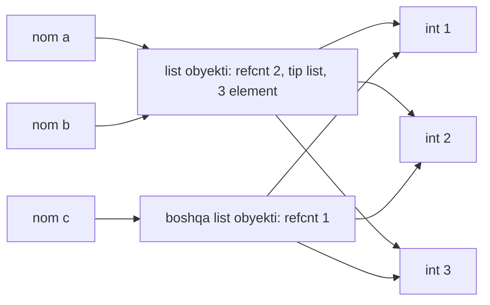
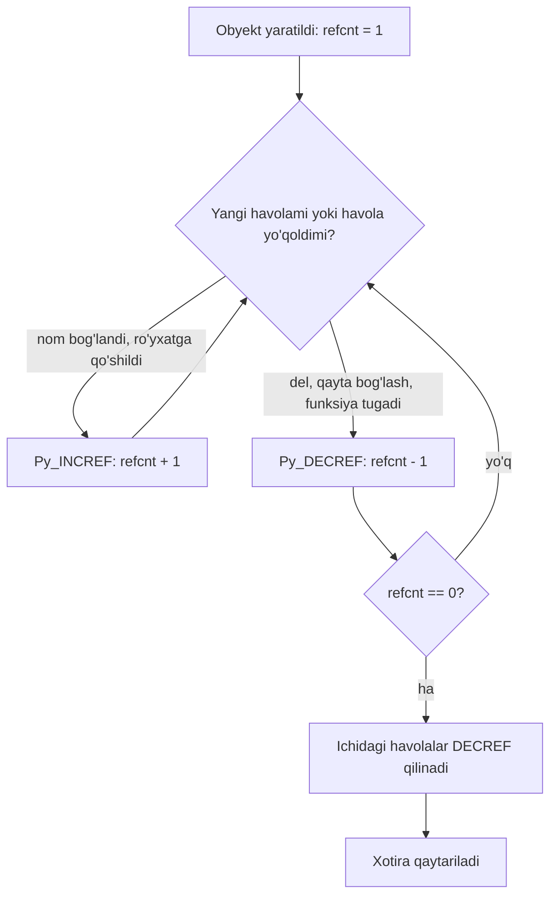
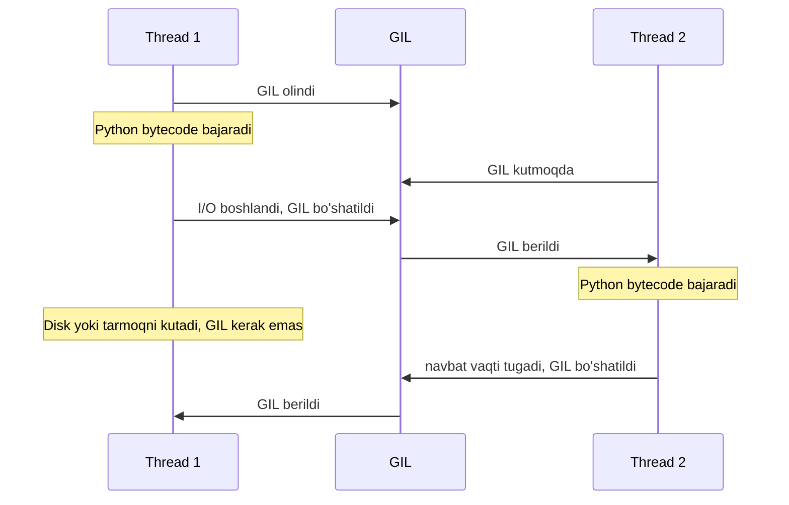

## Bu dars nima uchun kerak

31-34-darslarda Python'ni foydalanuvchi sifatida o'rgandik: o'zgaruvchi e'lon qilinmaydi, tip yozilmaydi, `list` o'zi kattalashadi, `malloc` va `free` yo'q. Bu qulaylik bepul emas. C da har bir baytni o'zimiz boshqargan edik (23-dars): qancha joy, qachon ajratiladi, qachon qaytariladi. Python'da bu ishni interpreter qiladi, va u qanday qilishini bilmasangiz, uchta turdagi kutilmagan holatga duch kelasiz.

1. **Aliasing xatolari.** `b = a` qatoridan keyin `b` ni o'zgartirsangiz, `a` ham o'zgaradi. Funksiyaga uzatilgan ro'yxat funksiya ichida "o'z-o'zidan" o'zgarib qoladi.
2. **Xotira va hayot sikli.** Obyekt qachon yo'q qilinadi? Nima uchun ba'zi obyektlar `del` dan keyin ham yashaydi? Nima uchun bitta million sonli ro'yxat C massividan 9 marta ko'p joy oladi?
3. **Parallellik.** To'rt yadroli kompyuterda ikkita thread (bitta jarayon ichidagi parallel bajarilish oqimi) hisob-kitobni nega tezlashtirmaydi, fayl yuklashni esa tezlashtiradi?

Uchala savolning javobi bitta joyda: eng ko'p ishlatiladigan Python implementatsiyasi **CPython** ning ichki tuzilishida. 31-darsda ko'rganimizdek, Python - til (sintaksis va qoidalar), CPython esa shu tilni bajaradigan, C da yozilgan interpreter; siz `python3` deb ishga tushiradigan narsa odatda CPython. Boshqa implementatsiyalar ham bor (masalan, PyPy), va ular xotirani boshqacha boshqarishi mumkin. Bu darsda faqat CPython haqida gapiramiz va qaysi xususiyat til qoidasi, qaysi biri implementatsiya tafsiloti ekanini alohida belgilaymiz.

Kursning brauzer muhitida Python bloklari Pyodide orqali ishlaydi: bu CPython 3.14 ning WebAssembly'ga kompilyatsiya qilingan versiyasi. Ya'ni bu darsdagi mexanikani to'g'ridan-to'g'ri brauzerda kuzatish mumkin.

Bu darsdan keyin siz:

- "Python'da hamma narsa obyekt" gapining texnik ma'nosini (identity, tip, qiymat) tushuntira olasiz;
- `is` va `==` farqini bilasiz va kichik sonlar keshi nima uchun `is` ni chalg'ituvchi qilishini ko'rsata olasiz;
- mutable va immutable obyektlar bilan aliasing xatolarini topib tuzata olasiz;
- reference counting qanday ishlashini C dagi `malloc`/`free` bilan taqqoslab tushuntira olasiz;
- aylanma havolalar nima uchun reference counting bilan bo'shatilmasligini va `gc` moduli ularni qanday topishini bilasiz;
- GIL nima ekanini, nima uchun mavjudligini va CPU-bound hamda I/O-bound ishlarga qanday ta'sir qilishini hisoblay olasiz;
- 3.13 va 3.14 dagi free-threaded build holatini aniq bilasiz.

## Hamma narsa obyekt: PyObject

Python tilining rasmiy ta'rifi (Language Reference, "Data model" bo'limi) shunday boshlanadi: dasturdagi har bir ma'lumot obyekt yoki obyektlar orasidagi munosabat sifatida ifodalanadi, hatto kodning o'zi ham. Har bir obyektning uchta xususiyati bor:

- **identity** (o'ziga xoslik) - obyekt yaratilgandan keyin hech qachon o'zgarmaydi; `id()` funksiyasi uni butun son sifatida qaytaradi, `is` operatori ikki obyektning identity'sini solishtiradi;
- **tip** - obyekt qanday amallarni qo'llab-quvvatlashini belgilaydi (`len()` ishlaydimi, `+` nimani anglatadi) va u ham o'zgarmaydi;
- **qiymat** - ba'zi obyektlarda o'zgaradi (mutable), ba'zilarida o'zgarmaydi (immutable).

`3` soni, `"salom"` satri, `None`, `len` funksiyasi, `int` tipining o'zi, hatto modul - hammasi obyekt. C da `int x = 3;` 4 baytli xotira katagi edi va unda faqat qiymat turardi. Python'da `3` - heap'dagi to'liq obyekt.

### C darajasida obyekt qanday ko'rinadi

CPython C da yozilgan, shuning uchun har bir Python obyekti aslida C dagi `struct` (20-dars). Har bir obyekt boshida bir xil sarlavha turadi, uni C API hujjati `PyObject` deb ataydi. Unda ikkita asosiy maydon bor:

- `ob_refcnt` - **reference count**: shu obyektga nechta havola borligi;
- `ob_type` - obyektning tipini tasvirlaydigan boshqa obyektga (`PyTypeObject`) pointer.

Qiymat sarlavhadan keyin keladi va tipga qarab har xil: `float` da 8 baytli `double`, `list` da elementlar soni va pointerlar massiviga ko'rsatkich, va hokazo. Hujjat bu maydonlarga to'g'ridan-to'g'ri murojaat qilmaslikni, `Py_REFCNT`, `Py_TYPE`, `Py_INCREF` kabi makroslardan foydalanishni talab qiladi, chunki maydonlar tuzilishi build konfiguratsiyasiga qarab o'zgaradi (masalan, free-threaded build'da, pastda ko'ramiz).

Endi eng muhim kuzatish: Python'dagi **o'zgaruvchi qiymatni saqlamaydi**. O'zgaruvchi - nom, va u obyektga havola (C tilida aytganda, pointer). `x = 3` "x katagiga 3 ni yoz" emas, "3 obyektini yarat yoki top va `x` nomini unga bog'la" degani.



Diagrammada `a = [1, 2, 3]`, `b = a`, `c = [1, 2, 3]` dan keyingi holat: `a` va `b` bitta ro'yxatga qaraydi (shuning uchun uning hisoblagichi 2), `c` esa alohida ro'yxat. Ro'yxatlar ham sonlarni o'z ichida saqlamaydi: ularda int obyektlariga pointerlar turadi.

### `id()`, `is` va `==`

Ikki xil savol bor:

- `a == b` - "qiymatlari tengmi?" Bu tipning `__eq__` metodini chaqiradi; ro'yxatlar uchun elementma-element solishtiradi.
- `a is b` - "bu bitta obyektmi?" Bu hech qanday metod chaqirmaydi, faqat identity'larni solishtiradi.

`id()` hujjatiga ko'ra u obyekt yashagan davr davomida noyob va o'zgarmas butun son qaytaradi; hayot davrlari kesishmaydigan ikki obyektning `id()` si bir xil bo'lishi mumkin. CPython'da (implementatsiya tafsiloti sifatida) bu obyektning xotiradagi manzili. Ya'ni CPython'da `a is b` aslida C dagi `p == q` pointer solishtiruvi, `a == b` esa `strcmp` ga o'xshash mazmun solishtiruvi (12-dars).

```python run
a = [1, 2, 3]
b = a          # yangi ro'yxat emas: ikkinchi nom
c = [1, 2, 3]  # yangi, alohida ro'yxat

b.append(4)
print("a =", a)
print("a is b:", a is b, "  id lar teng:", id(a) == id(b))
print("a == c:", a == c, "  a is c:", a is c)

c.append(4)
print("endi a == c:", a == c, "  a is c:", a is c)

print(type(a), type(3), type(None), type(len))
```

Natija:

```text
a = [1, 2, 3, 4]
a is b: True   id lar teng: True
a == c: False   a is c: False
endi a == c: True   a is c: False
<class 'list'> <class 'int'> <class 'NoneType'> <class 'builtin_function_or_method'>
```

`b.append(4)` dan keyin `a` ham to'rt elementli, chunki ikkalasi bitta obyekt. `c` esa alohida: `append` dan oldin u 3 elementli edi, keyin qiymati teng bo'ldi (`==` True), lekin u baribir boshqa obyekt (`is` False).

### Kichik sonlar keshi: `is` ni sonlar uchun ishlatmang

CPython ko'p ishlatiladigan kichik butun sonlarni oldindan yaratib qo'yadi. Python 3.14 C API hujjatida aytilishicha, CPython -5 dan 256 gacha bo'lgan barcha butun sonlar uchun obyektlar massivini saqlaydi; shu oraliqdagi int "yaratilsa", aslida mavjud obyektga havola qaytadi. Hisob: 256 - (-5) + 1 = 262 ta obyekt.

```python run
x = int("256")
y = int("256")
print("256:", x == y, x is y)

x = int("257")
y = int("257")
print("257:", x == y, x is y)

s = "".join(["sa", "lom"])
print("satr:", s == "salom", s is "salom")
```

Python 3.14 da natija:

```text
256: True True
257: True False
satr: True False
```

Sonlarni `int("...")` orqali yaratganimiz bejiz emas: kodda ikkita bir xil literal `257` yozilsa, kompilyator ularni bitta konstantaga birlashtirishi va `is` tasodifan `True` berishi mumkin. Satr qatorida esa Python 3.8 dan beri `SyntaxWarning: "is" with 'str' literal` ogohlantirishi chiqadi: interpreter o'zi bu xato ekanini aytadi.

Bu chegara til qoidasi emas, implementatsiya tafsiloti. Buning eng yaxshi isboti: Python 3.15 hujjatida xuddi shu jumla endi "-5 dan 1024 gacha" deydi. Ya'ni yuqoridagi `257` qatori 3.15 da `True True` chiqaradi. Kod `is` ga tayansa, interpreter versiyasi yangilanganda uning xatti-harakati o'zgaradi. Qoida oddiy: qiymatlarni doim `==` bilan solishtiring; `is` ni faqat singleton obyektlar uchun ishlating: `x is None`, `x is True`.

## Mutable, immutable va aliasing

Obyektning qiymati o'zgara oladimi - bu uning tipiga bog'liq:

| Tip | Turi | O'zgartiradigan amal | `+=` nima qiladi |
|---|---|---|---|
| `int`, `float`, `bool` | Immutable | Yo'q | Yangi obyekt yaratib, nomni unga qayta bog'laydi |
| `str` | Immutable | Yo'q | Yangi satr yaratadi |
| `tuple` | Immutable (lekin ichidagi obyekt mutable bo'lishi mumkin) | Yo'q | Yangi tuple yaratadi |
| `list` | Mutable | `append`, `sort`, `x[i] = ...` | Joyida kengaytiradi (`extend`) |
| `dict`, `set` | Mutable | `d[k] = v`, `add`, `pop` | `dict` uchun `|=`, joyida |

Immutable obyekt bilan aliasing xavfsiz: `a = 5; b = a; b += 1` dan keyin `a` hali ham 5, chunki `b += 1` 5 obyektini o'zgartirmadi, `b` nomini yangi 6 obyektiga bog'ladi. Mutable obyekt bilan esa `b += [1]` va `b.append(1)` umumiy ro'yxatni o'zgartiradi, `a` ham buni ko'radi.

32-darsda ko'rganimizdek, `dict` kaliti va `set` elementi hash qilinadigan bo'lishi kerak. Endi sababi aniq: agar kalit-obyekt joyida o'zgarsa, uning hash'i ham o'zgaradi va u hash table'ning (30-dars) noto'g'ri bucket'ida qolib ketadi. Shuning uchun `list` kalit bo'la olmaydi, `tuple` (agar ichidagilari ham immutable bo'lsa) bo'la oladi.

### Funksiyaga uzatish

C da hamma narsa qiymat bo'yicha uzatilardi (8-dars), pointer orqali uzatish esa nusxa olingan manzil edi (25-dars). Python'da argument funksiyaga **obyektga havola** sifatida uzatiladi: parametr nomi chaqiruvchidagi o'sha obyektga bog'lanadi, nusxa olinmaydi. Natija:

- funksiya ichida mutable obyektni joyida o'zgartirish (`items.append(x)`) chaqiruvchida ko'rinadi;
- funksiya ichida parametrni qayta bog'lash (`items = [x]`) chaqiruvchiga ta'sir qilmaydi, chunki faqat lokal nom boshqa obyektga qaradi.

Bu C dagi `void f(int *p)` ga juda o'xshash: `*p = 5` chaqiruvchini o'zgartiradi, `p = &other` esa o'zgartirmaydi.

### Aliasing tuzoqlari

Ikkita klassik xato bor. Birinchisi - `*` bilan ichki ro'yxatlarni "ko'paytirish":

```python
grid = [[0] * 3] * 2
grid[0][0] = 1
print(grid)   # [[1, 0, 0], [1, 0, 0]]
```

`[0] * 3` bitta ichki ro'yxat yaratadi, tashqi `* 2` esa unga havolani ikki marta takrorlaydi. Ikkala qator bitta obyekt. `[0] * 3` ning o'zi esa xavfsiz, chunki `0` immutable.

Ikkinchisi - mutable standart qiymat. Funksiya parametrining standart qiymati funksiya **e'lon qilinganda** bir marta hisoblanadi (33-dars), har chaqiruvda emas. `def f(x, acc=[])` dagi ro'yxat barcha chaqiruvlar uchun umumiy bo'lib qoladi. To'g'ri usul: `acc=None` va funksiya ichida `if acc is None: acc = []`.

Nusxa kerak bo'lsa, uni aniq so'rang. `list(a)`, `a[:]` va `a.copy()` - **shallow copy** (sayoz nusxa, 25-darsdagi C misolidagi kabi): yangi tashqi ro'yxat, lekin ichidagi obyektlar umumiy. Ichma-ich mutable tuzilma uchun `copy.deepcopy`.

### Mashq: aliasing xatolarini tuzating

Quyidagi ikki funksiyada aynan shu ikki xato bor. Ularni tuzating: `make_grid(rows, cols)` har bir qatori alohida ro'yxat bo'lgan nollar jadvalini qaytarsin, `add_item(item, bucket=None)` esa `bucket` berilmasa yangi ro'yxat yaratib, unga `item` ni qo'shib qaytarsin, berilsa - o'sha ro'yxatga qo'shsin.

```python run
def make_grid(rows, cols):
    # Xato: barcha qatorlar bitta ro'yxat
    return [[0] * cols] * rows


def add_item(item, bucket=[]):
    # Xato: standart ro'yxat chaqiruvlar orasida umumiy
    bucket.append(item)
    return bucket


g = make_grid(2, 3)
g[0][0] = 1
print(g)
print(add_item("a"), add_item("b"))
```

```python test
def _grid_ok():
    g = make_grid(3, 2)
    g[1][0] = 7
    return g == [[0, 0], [7, 0], [0, 0]]

def _rows_distinct():
    g = make_grid(4, 2)
    return len({id(row) for row in g}) == 4

def _fresh_lists():
    first = add_item("a")
    second = add_item("b")
    return first == ["a"] and second == ["b"] and first is not second

def _uses_given():
    box = [1]
    out = add_item(2, box)
    return out is box and box == [1, 2]

check("make_grid: o'lchamlar to'g'ri (3 qator, 2 ustun)", lambda: [len(r) for r in make_grid(3, 2)] == [2, 2, 2])
check("make_grid: bitta katakni o'zgartirish faqat o'z qatoriga ta'sir qiladi", _grid_ok)
check("make_grid: har bir qator alohida obyekt (id lari har xil)", _rows_distinct)
check("add_item: har chaqiruv o'z yangi ro'yxatini oladi", _fresh_lists)
check("add_item: berilgan ro'yxatning o'ziga qo'shadi (nusxaga emas)", _uses_given)
```

## Reference counting: obyekt qachon yo'q qilinadi

C da hayot sikli oddiy edi: `malloc` - blok tug'iladi, `free` - o'ladi, ikkalasini ham dasturchi yozadi. 23-darsdagi uchta klassik xato (leak, use-after-free, double free) aynan shu qo'lda boshqarishdan kelib chiqardi. CPython bu ishni avtomatlashtiradi va asosiy mexanizm - **reference counting**:

- obyekt yaratilganda uning `ob_refcnt` hisoblagichi 1 bo'ladi;
- har safar unga yangi havola paydo bo'lsa (nom bog'lansa, ro'yxatga qo'shilsa, funksiyaga argument sifatida berilsa), interpreter `Py_INCREF` bilan hisoblagichni 1 ga oshiradi;
- havola yo'qolsa (nom boshqa obyektga bog'lansa, `del` bajarilsa, funksiya tugab lokal nomlar yo'qolsa, ro'yxatdan element olib tashlansa), `Py_DECREF` uni 1 ga kamaytiradi;
- hisoblagich 0 ga tushgan **zahoti** obyekt yo'q qilinadi: u havola qilgan obyektlarning hisoblagichlari kamaytiriladi va xotira qaytariladi (oxir-oqibat C darajasida `free` ga o'xshash amal).



Bu sxemaning eng katta afzalligi - **aniqlik** (determinism): obyekt oxirgi havola yo'qolgan paytdayoq o'ladi, keyinroq qandaydir "tozalash" bosqichini kutmaydi. Shuning uchun CPython'da `open()` qilingan faylning obyekti tashlab yuborilsa, fayl odatda darhol yopiladi. Lekin Data model hujjati bunga tayanmaslikni aniq aytadi: boshqa implementatsiyalar boshqacha ishlaydi, shuning uchun fayllarni `with` bilan yoping (33-34-darslar).

### C da reference counting'ni qo'lda yozamiz

Mexanikani to'liq ko'rish uchun xuddi shu g'oyani C da, 23-darsdagi `malloc`/`free` ustida yozamiz. Har bir obyekt boshida hisoblagich turadi, `incref` va `decref` funksiyalari esa CPython'dagi makroslar vazifasini bajaradi:

```c run
#include <stdio.h>
#include <stdlib.h>
#include <string.h>

typedef struct
{
    int refcnt;
    char text[12];
} object;

object *new_object(const char *text)
{
    object *o = malloc(sizeof(object));
    if (o == NULL)
    {
        return NULL;
    }
    o->refcnt = 1;
    strncpy(o->text, text, sizeof(o->text) - 1);
    o->text[sizeof(o->text) - 1] = '\0';
    printf("yaratildi: %s, refcnt = 1\n", o->text);
    return o;
}

void incref(object *o)
{
    o->refcnt++;
    printf("incref:    %s, refcnt = %d\n", o->text, o->refcnt);
}

void decref(object *o)
{
    o->refcnt--;
    printf("decref:    %s, refcnt = %d\n", o->text, o->refcnt);
    if (o->refcnt == 0)
    {
        printf("free:      %s\n", o->text);
        free(o);
    }
}

int main(void)
{
    object *a = new_object("salom");   // a = "salom"
    if (a == NULL)
    {
        return 1;
    }
    object *b = a;                     // b = a
    incref(b);

    decref(a);                         // del a
    a = NULL;
    printf("b hali tirik: %s\n", b->text);

    decref(b);                         // del b
    b = NULL;
    return 0;
}
```

Natija:

```text
yaratildi: salom, refcnt = 1
incref:    salom, refcnt = 2
decref:    salom, refcnt = 1
b hali tirik: salom
decref:    salom, refcnt = 0
free:      salom
```

Dasturda bitta `malloc` va bitta `free`, leak yo'q. Asosiy farq: `free` ni hech kim "o'z qo'li bilan" chaqirmadi, u oxirgi `decref` ichida avtomatik bajarildi. CPython'da `incref`/`decref` ni interpreter har bir bytecode amalida o'zi qo'yadi, siz faqat Python kod yozasiz.

### `sys.getrefcount`: hisoblagichni ko'rish

`sys.getrefcount(obj)` hisoblagich qiymatini qaytaradi. Hujjat ikkita ogohlantirish beradi: natija odatda kutilganidan 1 ta ko'p, chunki argument sifatida uzatishning o'zi vaqtinchalik havola yaratadi; va qaytgan son haqiqiy havolalar sonini aks ettirmasligi mumkin, shuning uchun unga (0 yoki 1 dan boshqa qiymatlarda) aniq tayanmaslik kerak. Interpreter versiyasi ichki optimizatsiyalarni o'zgartirgani sari mutlaq raqamlar o'zgarib boradi. Shuning uchun quyidagi blokda faqat **farqlarni** chiqaramiz:

```python run
import sys

data = object()
base = sys.getrefcount(data)
print("boshlang'ich qiymat:", base)

alias = data
print("alias = data dan keyin farq:", sys.getrefcount(data) - base)

box = [data, data]
print("ro'yxatga 2 marta qo'shilgach farq:", sys.getrefcount(data) - base)

del alias, box
print("del dan keyin farq:", sys.getrefcount(data) - base)

print("None ning hisoblagichi:", sys.getrefcount(None))
```

Lokal CPython 3.14 (64-bit Linux) da:

```text
boshlang'ich qiymat: 2
alias = data dan keyin farq: 1
ro'yxatga 2 marta qo'shilgach farq: 3
del dan keyin farq: 0
None ning hisoblagichi: 3221225472
```

Birinchi qator versiyaga bog'liq (odatda 2: `data` nomi va argument). Farqlar barqaror: ro'yxatga ikki marta qo'shish ikkita havola beradi (ro'yxat har bir katakda pointer saqlaydi), `del` ikkala nomni o'chiradi, va ro'yxat 0 ga tushib yo'q qilingach, uning ikkita havolasi ham qaytariladi. Jami 1 + 2 = 3 havola qo'shildi va 3 tasi qaytdi.

Oxirgi qator g'alati: `None` ga milliardlab havola yo'q. Bu - **immortal** (o'lmas) obyekt.

### Immortal obyektlar (Python 3.12+)

PEP 683 (Python 3.12 da qabul qilingan) ba'zi obyektlarni immortal qildi: `None`, `True`, `False`, kichik sonlar keshi va boshqa ko'plab ichki obyektlar. Ularning hisoblagichi maxsus juda katta qiymatga o'rnatiladi va `Py_INCREF`/`Py_DECREF` uni o'zgartirmaydi, obyekt hech qachon yo'q qilinmaydi. `sys` hujjatida 3.12 dagi o'zgarish sifatida aynan shu yozilgan: immortal obyektlarning hisoblagichi juda katta va haqiqiy havolalar soniga mos kelmaydi. 3.14 da ularni aniqlash uchun `sys._is_immortal()` qo'shildi.

Nima uchun bu kerak? `None` ga dasturning hamma joyidan murojaat qilinadi. Har murojaatda uning sarlavhasiga yozish (hisoblagichni o'zgartirish) bitta xotira katagini doimiy "issiq" qiladi va ko'p jarayonli yoki ko'p thread'li dasturlarda keraksiz yozuvlarga olib keladi. Immortal obyektda hisoblagich o'zgarmaydi, demak obyekt faqat o'qiladi. Bu keyingi bo'limdagi free-threaded build uchun ham asosiy shartlardan biri.

Yuqoridagi natijadagi aniq son ham implementatsiya tafsiloti: lokal 3.13 da xuddi shu qator `4294967295` (2³² - 1) chiqardi, 3.14 da `3221225472` (3 · 2³⁰). Brauzerdagi 32-bitli muhitda yana boshqa bo'lishi mumkin. Shunga tayanmang.

### Raqamlar: Python obyektining narxi

Obyekt modeli bepul emas. 64-bit Linux'da CPython 3.14 da `sys.getsizeof` bilan o'lchanganda:

- `object()` - 16 bayt: faqat sarlavha, `ob_refcnt` (8) + `ob_type` (8);
- kichik `int`, masalan `1000` - 28 bayt;
- `float` - 24 bayt: 16 baytli sarlavha + 8 baytli `double`;
- bo'sh `list` - 56 bayt, 1 000 000 elementli ro'yxatning o'zi - 8 000 056 bayt: 56 + 8 · 10⁶, ya'ni har element uchun 8 baytli pointer.

Endi `list(range(1_000_000))` ning to'liq narxini hisoblaymiz. Ro'yxatning o'zi 8 000 056 bayt. Sonlar 0 dan 999 999 gacha; ulardan 0-256 (257 ta) keshdan olinadi va qo'shimcha joy olmaydi. Qolgan 1 000 000 - 257 = 999 743 ta int, har biri 28 bayt: 999 743 · 28 = 27 992 804 bayt. Jami taxminan 8,0 + 28,0 = 36 MB.

C dagi `int a[1000000]` esa 1 000 000 · 4 = 4 000 000 bayt (11-dars). Farq 36 / 4 = 9 marta. Bu - har bir sonning to'liq obyekt bo'lishi va ro'yxatning pointerlar saqlashi narxi. Shuning uchun katta sonli massivlar bilan ishlaydigan kutubxonalar (masalan, standart `array` moduli) qiymatlarni C dagi kabi zich saqlaydi. Bu raqamlar platformaga bog'liq: brauzerdagi wasm32 muhitida pointer 4 bayt, shuning uchun o'lchamlar kichikroq chiqadi.

## Aylanma havolalar va gc moduli

Reference counting'ning bitta katta kamchiligi bor. Ikki obyekt bir-biriga havola qilsa, tashqi havolalar yo'qolgandan keyin ham ularning hisoblagichi 0 ga tushmaydi: har biri kamida 1, chunki ikkinchisi uni ushlab turibdi. Bunday tuzilma **reference cycle** (aylanma havola) deyiladi. 28-darsdagi doubly linked list, ota-bola havolali daraxt yoki o'ziga havola qiladigan ro'yxat (`a.append(a)`) - hammasi tsikl.

Avval muammoni C da ko'ramiz. Yuqoridagi `incref`/`decref` sxemasini ikki tugunga qo'llaymiz va ularni bir-biriga bog'laymiz:

```c run
#include <stdio.h>
#include <stdlib.h>

typedef struct node
{
    int refcnt;
    struct node *other;
    char name[8];
} node;

node *new_node(char letter)
{
    node *n = malloc(sizeof(node));
    if (n == NULL)
    {
        exit(1);
    }
    n->refcnt = 1;
    n->other = NULL;
    n->name[0] = letter;
    n->name[1] = '\0';
    return n;
}

void decref(node *n)
{
    n->refcnt--;
    printf("decref %s: refcnt = %d\n", n->name, n->refcnt);
    if (n->refcnt == 0)
    {
        if (n->other != NULL)
        {
            decref(n->other);
        }
        free(n);
    }
}

int main(void)
{
    node *a = new_node('a');
    node *b = new_node('b');

    a->other = b;   // a.other = b
    b->refcnt++;
    b->other = a;   // b.other = a
    a->refcnt++;

    decref(a);      // del a
    decref(b);      // del b
    printf("sizeof(node) = %zu\n", sizeof(node));
    return 0;
}
```

Brauzerdagi natija (wasm32):

```text
decref a: refcnt = 1
decref b: refcnt = 1
sizeof(node) = 16
XOTIRA: 32 bayt bo'shatilmagan, 2 ta blokda (2 ta malloc, 0 ta free). Har malloc uchun free kerak.
```

Ikkala hisoblagich 1 da qoldi, `free` hech qachon chaqirilmadi. Dasturda endi `a` va `b` ga yetib boradigan hech qanday nom yo'q, lekin xotira band. Bu - 23-darsdagi oddiy memory leak, faqat endi uni reference counting'ning o'zi yaratdi. Oxirgi qator - brauzer muhitining leak hisoboti: wasm32 da `sizeof(node)` = 4 + 4 + 8 = 16 bayt, ikkita tugun 2 · 16 = 32 bayt. x86-64 da pointer 8 bayt va `int` dan keyin 4 baytli padding (20-dars) qo'shiladi: 4 + 4 + 8 + 8 = 24 bayt, shuning uchun lokal `clang` bilan uchinchi qator `sizeof(node) = 24` bo'ladi (sanitizer'siz lokal kompilyatsiyada leak hisoboti chiqmaydi; haqiqiy Linux'da 2 · 24 = 48 baytlik yo'qotishni Valgrind topadi, 23-dars).

### CPython yechimi: tsikllarni topadigan garbage collector

CPython bu muammoni ikkinchi, yordamchi mexanizm bilan hal qiladi: **cycle garbage collector**, `gc` moduli orqali boshqariladi. Data model hujjati buni shunday ta'riflaydi: CPython reference counting sxemasini tsiklik axlatni kechiktirib aniqlash bilan birga ishlatadi. U faqat boshqa obyektlarga havola saqlay oladigan "konteyner" obyektlarni (list, dict, foydalanuvchi klasslari obyektlari) kuzatadi: `int` yoki `str` tsikl hosil qila olmaydi.

G'oya soddalashtirilgan holda shunday: collector kuzatilayotgan obyektlar guruhini oladi va har biri uchun "uning hisoblagichidan shu guruh **ichidagi** havolalarni ayirsak, nima qoladi?" deb hisoblaydi. Agar natija 0 dan katta bo'lsa, obyektga tashqaridan (masalan, biror nomdan) havola bor, u tirik, va u orqali yetib boriladigan hamma narsa ham tirik. Qolganlari faqat bir-birini ushlab turibdi va ular axlat. Yuqoridagi C misolida: `a` ning hisoblagichi 1, guruh ichidagi havolalar (b dan) 1, 1 - 1 = 0. `b` uchun ham 0. Demak ikkalasi axlat.

Har safar barcha obyektlarni tekshirish qimmat, shuning uchun collector **generational** (avlodli): `gc` hujjatiga ko'ra obyektlar nechta yig'ishdan omon qolganiga qarab uchta avlodga bo'linadi. Yangi obyekt 0-avlodga tushadi, yig'ishdan omon qolsa keyingi avlodga o'tadi. Asos - kuzatuv: ko'p obyektlar yosh o'ladi. Collector obyektlar ajratilishi va bo'shatilishi sonini sanaydi: ajratishlar soni bo'shatishlardan `threshold0` dan ortiq oshsa, avval faqat 0-avlod tekshiriladi; eski avlodlar ancha kamroq tekshiriladi. Joriy chegaralarni `gc.get_threshold()` beradi.

Bu yerda versiyaga oid muhim tafsilot bor. Python 3.14.0-3.14.4 yangi **incremental** collector bilan chiqdi (faqat ikki avlod, tanaffuslar qisqaroq), lekin 3.14 "What's New" hujjatiga ko'ra ishlab chiqarish muhitlarida xotira bosimi oshgani haqidagi xabarlar tufayli 3.14.5 dan boshlab 3.13 dagi generational collector qaytarildi. Ya'ni "3.14 da GC qanday" degan savolga javob patch versiyasiga bog'liq.

Endi buni Python'da ko'ramiz. Obyekt tirikligini uni ushlab turmasdan kuzatish uchun **weak reference** (`weakref` moduli) ishlatamiz: hujjatga ko'ra, kuchsiz havola obyektni tirik ushlab tura olmaydi. `weakref.ref(obj)` chaqirilsa, obyekt tirik bo'lsa uni, yo'q qilingan bo'lsa `None` qaytaradi.

```python run
import gc
import weakref


class Node:
    def __init__(self, name):
        self.name = name
        self.other = None


gc.disable()  # avtomatik yig'ishni vaqtincha o'chiramiz: tajriba aniq bo'lsin

a = Node("a")
watch = weakref.ref(a)
del a
print("tsiklsiz, del dan keyin:", watch())

a = Node("a")
b = Node("b")
a.other = b
b.other = a
watch = weakref.ref(a)
del a, b
print("tsikl, del dan keyin tirikmi:", watch() is not None)

found = gc.collect()
print("gc.collect() dan keyin:", watch())
print("collector kamida 2 obyekt topdimi:", found >= 2)

gc.enable()
```

Natija:

```text
tsiklsiz, del dan keyin: None
tsikl, del dan keyin tirikmi: True
gc.collect() dan keyin: None
collector kamida 2 obyekt topdimi: True
```

Birinchi holatda `del a` hisoblagichni 0 ga tushirdi va obyekt darhol yo'q bo'ldi. Ikkinchi holatda tsikl ikkala obyektni `gc.collect()` gacha tirik saqladi. `gc.collect()` topilgan obyektlar sonini qaytaradi; aniq son versiyaga bog'liq (obyekt atributlari qanday saqlanishiga qarab), shuning uchun faqat "kamida 2" ni tekshirdik.

### `del` aslida nima qiladi

`del x` obyektni o'chirmaydi. U `x` **nomini** o'chiradi va obyekt hisoblagichini 1 ga kamaytiradi. Obyekt faqat hisoblagich 0 ga tushsa (yoki tsiklning bir qismi bo'lsa, collector uni topganda) yo'q bo'ladi. Yuqoridagi `getrefcount` misolida `del alias` dan keyin `data` tirik qoldi, chunki `data` nomi hali bor edi. `del lst[0]` esa ro'yxatdan bitta havolani olib tashlaydi.

### Weak reference qachon kerak

Kuchsiz havola tsikl yaratmasdan "orqaga" ishora qilish uchun foydali: masalan, bola tugun otasiga kuchli emas, kuchsiz havola saqlasa, daraxtda tsikl bo'lmaydi va u reference counting bilan darhol bo'shaydi. Ikkinchi ishlatilish - kesh: `weakref.WeakValueDictionary` dagi qiymatlar boshqa joyda ishlatilmay qolsa, keshdan o'zi yo'qoladi. Hamma obyektga kuchsiz havola yaratib bo'lmaydi: masalan, `int` va `list` ga to'g'ridan-to'g'ri `weakref.ref` qo'llab bo'lmaydi, foydalanuvchi klasslari obyektlariga esa mumkin.

### Uch usul yonma-yon

| Xususiyat | C: `malloc` / `free` (23-dars) | CPython: reference counting | CPython: cycle GC |
|---|---|---|---|
| Kim bo'shatadi | Dasturchi | Interpreter, avtomatik | Interpreter, davriy |
| Qachon | `free` chaqirilganda | Oxirgi havola yo'qolgan zahoti | Chegara oshganda yoki `gc.collect()` |
| Aylanma tuzilmalar | Dasturchi to'g'ri tartibda bo'shatadi | Bo'shatilmaydi | Topiladi va bo'shatiladi |
| Use-after-free, double free | Mumkin | Python kodida mumkin emas | Python kodida mumkin emas |
| Narxi | Faqat chaqiruvlar | Har bir havola o'zgarishida INCREF/DECREF | Davriy tekshiruv tanaffusi |
| Aniqlik | To'liq | Yuqori: darhol | Past: qachon ishlashi aniq emas |

## GIL: global interpreter lock

Endi parallellikka o'tamiz. Python glossariysi **global interpreter lock** (GIL) ni shunday ta'riflaydi: CPython interpreteri bir vaqtda faqat bitta thread Python bytecode bajarishini kafolatlaydigan mexanizm. Bitta jarayonda 8 ta thread bo'lsa ham va kompyuterda 8 yadro bo'lsa ham, istalgan paytda faqat bittasi Python kodini bajaradi; qolganlari GIL'ni kutadi. Interpreter thread'larni navbat bilan almashtirib turadi, shuning uchun ular "bir vaqtda" ishlayotgandek ko'rinadi.

### Nima uchun GIL bor

Sabab yuqoridagi reference counting'da. `Py_INCREF` C darajasida `o->ob_refcnt++` - va bu bitta amal emas, uchta: xotiradan o'qish, 1 qo'shish, xotiraga yozish. Ikki thread bir vaqtda bitta obyektning hisoblagichini oshirsa:

1. 1-thread `refcnt` ni o'qiydi: 5.
2. 2-thread `refcnt` ni o'qiydi: 5.
3. 1-thread 6 ni yozadi.
4. 2-thread 6 ni yozadi.

Ikki havola qo'shildi, hisoblagich esa faqat 1 ga oshdi. Keyinroq ikkala havola yo'qolganda hisoblagich 0 ga tushadi, lekin obyektga hali bitta havola bor: bu C dagi use-after-free (23-dars), faqat interpreterning ichida. Teskari holatda esa hisoblagich hech qachon 0 ga tushmaydi va obyekt leak bo'ladi. Shu kabi xavf `dict` va `list` ning ichki tuzilmalarida ham bor.

Har bir obyektga alohida qulf (lock) qo'yish yoki hisoblagichni atomik amallar bilan o'zgartirish mumkin edi, lekin bu bitta thread'li dasturlarni sekinlashtiradi. GIL esa oddiy yechim: bitta katta qulf. Glossariy buni aniq aytadi: butun interpreterni qulflash obyekt modelini (jumladan, `dict` kabi muhim tiplarni) bir vaqtdagi murojaatdan yashirin himoyalaydi va implementatsiyani soddalashtiradi, lekin ko'p protsessorli mashinalardagi parallellikning katta qismi evaziga. Bonus sifatida C extension'lar (C da yozilgan Python kutubxonalari) ham thread xavfsizligi haqida kam o'ylashi mumkin edi.

### CPU-bound va I/O-bound

GIL ning ta'siri ish turiga qarab butunlay boshqacha:

- **CPU-bound** ish - vaqtning deyarli hammasi protsessorda hisob-kitobga ketadi (sikllar, matematik amallar, satrlarni qayta ishlash). Bu ishni bajarish uchun GIL kerak, shuning uchun thread'lar navbatma-navbat ishlaydi va parallellik yo'q.
- **I/O-bound** ish - vaqtning ko'p qismi tashqi narsani kutishga ketadi: disk, tarmoq, `time.sleep`. Kutish paytida thread Python bytecode bajarmaydi va GIL'ni bo'shatadi. Shu paytda boshqa thread ishlay oladi.

Quyidagi tajriba `run` siz berilgan: brauzer muhitida yangi thread yaratib bo'lmaydi. Uni o'z kompyuteringizda `python3 gil.py` bilan ishga tushiring.

```python
import threading
import time


def count(n):
    while n > 0:
        n -= 1


N = 20_000_000

start = time.perf_counter()
count(N)
count(N)
print(f"ketma-ket:   {time.perf_counter() - start:.2f} s")

start = time.perf_counter()
t1 = threading.Thread(target=count, args=(N,))
t2 = threading.Thread(target=count, args=(N,))
t1.start()
t2.start()
t1.join()
t2.join()
print(f"2 ta thread: {time.perf_counter() - start:.2f} s")
```

I/O uchun esa yuklashni `time.sleep` bilan taqlid qilamiz:

```python
import threading
import time


def fake_download(seconds):
    time.sleep(seconds)  # kutish paytida GIL bo'shatiladi


start = time.perf_counter()
for _ in range(4):
    fake_download(0.5)
print(f"ketma-ket:   {time.perf_counter() - start:.2f} s")

start = time.perf_counter()
threads = [threading.Thread(target=fake_download, args=(0.5,)) for _ in range(4)]
for t in threads:
    t.start()
for t in threads:
    t.join()
print(f"4 ta thread: {time.perf_counter() - start:.2f} s")
```

Bitta 2 yadroli Linux kompyuterda o'lchangan natijalar (sizda soniyalar boshqacha bo'ladi, nisbat muhim):

| Tajriba | Interpreter | Ketma-ket | Thread'lar bilan |
|---|---|---|---|
| CPU-bound, 2 × 20 mln qadam | CPython 3.14 (GIL bilan) | 1.07 s | 1.44 s |
| CPU-bound, 2 × 20 mln qadam | CPython 3.14t (free-threaded) | 0.97 s | 0.58 s |
| I/O-bound, 4 × 0.5 s kutish | CPython 3.13 (GIL bilan) | 2.00 s | 0.50 s |

Hisob. I/O tajribasida ketma-ket 4 · 0.5 = 2.0 s, thread'lar bilan esa to'rtta kutish ustma-ust tushadi: max(0.5, 0.5, 0.5, 0.5) = 0.5 s, tezlashish 2.0 / 0.5 = 4 marta. GIL bu yerda xalaqit bermaydi. CPU-bound tajribada GIL bilan ikkita thread hatto sekinroq (1.44 / 1.07 ≈ 1.35 marta): parallellik yo'q, ustiga thread'lar o'rtasida GIL'ni uzatish xarajati qo'shiladi. Free-threaded interpreterda esa ikki yadro haqiqatan parallel ishladi: 0.97 / 0.58 ≈ 1.7 marta tezroq (nazariy chegara 2 yadroda 2 marta).

GIL bilan CPU-bound ishni parallellashtirishning klassik yo'llari: `multiprocessing` moduli (har bir jarayon o'z interpreteri va o'z GIL'i bilan; glossariy ham shuni eslatadi) yoki og'ir hisobni GIL'ni bo'shatadigan C extension'ga topshirish. Ko'p tarmoq so'rovlari kabi I/O-bound ish uchun esa thread'lar yoki `asyncio` yetarli.



### GIL sizning kodingizni himoya qilmaydi

Keng tarqalgan xato tushuncha: "GIL bor, demak thread'lar bilan qulf kerak emas". GIL interpreterning **ichki** tuzilmalarini himoya qiladi (hisoblagichlar, `dict` ichki holati), sizning dastur mantiqingizni emas. `counter += 1` bitta bytecode emas: o'qish, qo'shish, yozish alohida bytecode'lar, va interpreter thread'ni ular orasida almashtirishi mumkin. Natijada 39-darsdagi race condition Python thread'larida ham sodir bo'lishi mumkin. Umumiy holatni o'zgartiradigan kod `threading.Lock` bilan himoyalanishi kerak.

## Free-threaded Python: 3.13 va 3.14

GIL'ni olib tashlash uzoq yillik muammo edi: uni olib tashlash bitta thread'li kodni sekinlashtirmasligi va mavjud C extension'larni buzmasligi kerak edi. Hozirgi holat rasmiy hujjatlar bo'yicha:

- **PEP 703** ("Making the Global Interpreter Lock Optional in CPython") Steering Council tomonidan 2023-yil 24-oktyabrda qabul qilindi, shart bilan: o'tish bosqichma-bosqich bo'lsin, iloji boricha kam narsani buzsin va muammoli o'zgarishlarni qaytarib olish mumkin bo'lsin. PEP GIL'siz reference counting uchun uchta usulni taklif qiladi: **biased reference counting** (obyektni yaratgan thread hisoblagichni tez, atomik bo'lmagan usulda o'zgartiradi, boshqa thread'lar esa alohida, atomik hisoblagich bilan), immortalization (yuqoridagi immortal obyektlar) va cheklangan deferred reference counting.
- **Python 3.13** (2024) birinchi marta alohida **free-threaded build** ni taqdim etdi: CPython `--disable-gil` opsiyasi bilan kompilyatsiya qilinadi, odatda `python3.13t` nomi bilan o'rnatiladi. U ochiq-oydin eksperimental edi (PEP 779 bo'yicha "I bosqich"). macOS va Windows rasmiy o'rnatuvchilari uni ixtiyoriy komponent sifatida taklif qiladi.
- **Python 3.14** (2025) da **PEP 779** qabul qilindi: free-threaded build endi rasmiy qo'llab-quvvatlanadi, lekin hali ham ixtiyoriy ("II bosqich"). Standart `python3` hamon GIL bilan. 3.14 "What's New" hujjatiga ko'ra PEP 703 implementatsiyasi yakunlandi, specializing adaptive interpreter free-threaded rejimda ham yoqildi, va bitta thread'li kodning sekinlashuvi platforma va kompilyatorga qarab taxminan 5-10% gacha kamaydi.
- **III bosqich** (free-threaded build'ning standart yoki yagona bo'lishi) haqida qaror hali qabul qilinmagan; 3.14 hujjati buni kelajak masalasi deb ataydi.

Qaysi interpreterda ishlayotganingizni tekshirish (bu ham `run` siz: natija sizning o'rnatilgan Python'ingizga bog'liq):

```python
import sys
import sysconfig

print(sysconfig.get_config_var("Py_GIL_DISABLED"))  # 1 - free-threaded build, 0 yoki None - oddiy
print(sys._is_gil_enabled())                       # 3.13+: hozir GIL yoqilganmi
```

Lokal sinovda oddiy 3.14 da `0` va `True`, `python3.14t` da `1` va `False` chiqdi. Free-threading HOWTO'si ikki amaliy ogohlantirish beradi: build free-threaded bo'lsa ham, unga mos kelmaydigan C extension import qilinsa, interpreter GIL'ni qayta yoqishi mumkin (shuning uchun `_is_gil_enabled()` alohida tekshiriladi); va free-threaded rejimda xotira sarfi biroz oshadi.

## Ko'p uchraydigan xatolar

1. **Sonlar yoki satrlarni `is` bilan solishtirish.** `x is 256` kesh tufayli `True` berishi mumkin, `x is 257` - yo'q, 3.15 da esa chegara 1024 ga ko'chdi. Qiymat uchun `==`, `is` faqat `None`, `True`, `False` uchun.
2. **`b = a` ni nusxa deb o'ylash.** Bu ikkinchi nom, nusxa emas. Ro'yxat nusxasi `a.copy()` yoki `list(a)`, ichma-ich tuzilma uchun `copy.deepcopy`.
3. **`[[0] * n] * m` bilan jadval yaratish.** Barcha qatorlar bitta obyekt. To'g'risi: `[[0] * n for _ in range(m)]`.
4. **Mutable standart parametr (`def f(x, acc=[])`).** Ro'yxat bir marta yaratiladi va chaqiruvlar orasida umumiy. `acc=None` va ichida yangi ro'yxat.
5. **`del` obyektni o'chiradi deb o'ylash.** `del` faqat nomni o'chiradi; obyekt boshqa havolalar bo'lsa yashayveradi, tsiklda bo'lsa - collector topguncha.
6. **`sys.getrefcount` yoki `sys.getsizeof` raqamlariga tayanish.** Ular versiya, platforma va build'ga bog'liq (immortal obyektlar, 32/64 bit, free-threaded). Faqat farqlar va tartib bilan fikr yuriting.
7. **CPU-bound ishni thread'lar bilan tezlashtirishga urinish.** Oddiy CPython'da natija tezlashmaydi, hatto sekinlashishi mumkin. `multiprocessing`, free-threaded build yoki GIL'ni bo'shatadigan kutubxona kerak.
8. **"GIL bor, qulf kerak emas" deb o'ylash.** GIL interpreter ichini himoya qiladi; `counter += 1` kabi bir necha bytecode'li amallar orasida thread almashishi mumkin. Umumiy holatga `threading.Lock`.

## Xulosa

- Python'da har bir qiymat obyekt: identity, tip va qiymatga ega. CPython'da bu `ob_refcnt` va `ob_type` sarlavhali C struct; o'zgaruvchi esa obyektga havola (pointer).
- `==` qiymatni, `is` identity'ni solishtiradi. -5..256 kichik sonlar keshi CPython implementatsiya tafsiloti va versiyalar orasida o'zgaradi (3.15 da -5..1024).
- Mutable obyektda aliasing umumiy o'zgarishga olib keladi; argumentlar obyektga havola sifatida uzatiladi, nusxa olinmaydi.
- Reference counting obyektni oxirgi havola yo'qolgan zahoti bo'shatadi: bu C dagi `free` ning avtomatlashtirilgan, aniq vaqtli shakli. 3.12+ da `None` kabi immortal obyektlar hisoblagichni o'zgartirmaydi.
- Aylanma havolalar reference counting bilan bo'shatilmaydi; ularni `gc` modulidagi generational cycle collector topadi. 3.14.0-3.14.4 da u incremental edi, 3.14.5 da 3.13 dagi sxema qaytarildi.
- `weakref` obyektni tirik ushlamaydigan havola: tsikllarsiz orqa havolalar va keshlar uchun.
- GIL bir vaqtda bitta thread bytecode bajarishini kafolatlaydi: I/O-bound ish thread'lar bilan tezlashadi, CPU-bound ish - yo'q.
- Free-threaded build: 3.13 da eksperimental (PEP 703), 3.14 da rasmiy qo'llab-quvvatlanadigan, lekin ixtiyoriy (PEP 779); standart build hali GIL bilan.

## Amaliy topshiriq

Python'da obyektlar orasidagi havolalarni tekshiradigan kichik "xotira laboratoriyasi" yozing. Kodni brauzerda ishga tushiring (thread qismidan tashqari) va har bir natijani darsdagi mexanika bilan tushuntiring.

Topshiriq qadamlari:

1. **Identity jadvali.** Uchta holat yarating: `a = [1, 2]; b = a`, `c = a.copy()`, `d = [[0, 0]] * 2`. Har biri uchun `==`, `is` va ichki elementlar uchun `is` natijasini chiqaring (`a[0] is c[0]`, `d[0] is d[1]`). Qaysi juftliklar bitta obyekt ekanini sanab chiqing.
2. **Hisoblagich farqlari.** Bitta obyekt yarating va `sys.getrefcount` farqlarini kuzating: nomga bog'lash, ro'yxatga 3 marta qo'shish, lug'atga qiymat sifatida qo'yish, funksiyaga argument sifatida berish (funksiya ichida o'lchang). Har bir farqni oldindan taxmin qilib yozing, keyin natija bilan solishtiring.
3. **Tsikl va weakref.** Ota-bola havolali ikki obyektli `Tree` klassini yozing. Avval bola otaga kuchli havola saqlasin: `gc.disable()` holatida `del` dan keyin ota tirik qolishini `weakref` bilan ko'rsating. Keyin bola otaga `weakref.ref` saqlasin: endi `del` dan keyin ota darhol yo'q bo'lishini ko'rsating.
4. **Xotira hisobi.** 64-bit CPython uchun `[float(i) for i in range(500_000)]` ro'yxatining taxminiy hajmini qo'lda hisoblang (ro'yxat 56 + 8n, har bir float 24 bayt), so'ng uni C dagi `double a[500000]` bilan taqqoslang. Necha marta farq qiladi?
5. **GIL tajribasi (lokal).** Darsdagi CPU-bound tajribani 1, 2 va 4 thread bilan (umumiy ish hajmi bir xil bo'lsin) o'z kompyuteringizda ishga tushiring. Agar imkoningiz bo'lsa, free-threaded build (`python3.14t`) bilan ham takrorlang. Natijalarni jadvalga yozing.
6. **Xulosa.** Yuqoridagi natijalar asosida 5-6 gapda yozing: qaysi holatda thread'lar foyda beradi, qaysida - yo'q, va nima uchun.

Yaxshi javobda bo'lishi kerak bo'lgan narsalar:

- 1-qadamda `a is b` True, `a is c` False lekin `a[0] is c[0]` True (shallow copy), `d[0] is d[1]` True ekani va sababi tushuntirilgan;
- 2-qadamda absolyut qiymat emas, farqlar keltirilgan: ro'yxatga 3 marta qo'shish +3, funksiya ichida o'lchanganda parametr havolasi ham qo'shilishi aytilgan;
- 3-qadamda kuchli orqa havola bilan obyekt `gc.collect()` gacha tirik qolishi, weakref bilan esa darhol bo'shashi ko'rsatilgan;
- 4-qadamdagi hisob ochiq yozilgan: 56 + 8 · 500 000 = 4 000 056 bayt ro'yxat, 500 000 · 24 = 12 000 000 bayt float'lar, jami taxminan 16 MB; C da 500 000 · 8 = 4 000 000 bayt, farq taxminan 4 marta;
- 5-qadamda GIL bilan CPU-bound ish thread'lar sonidan deyarli tezlashmasligi, free-threaded build'da esa yadrolar soniga yaqin tezlashishi (agar sinalgan bo'lsa) qayd etilgan;
- xulosada CPU-bound va I/O-bound farqi, `multiprocessing` muqobili va GIL foydalanuvchi kodini race condition'dan himoya qilmasligi aytilgan.

Javobingizni pastdagi maydonga yozing va yuqoridagi mezonlar bilan solishtiring.

## Manbalar

- Python 3.14. [Data model](https://docs.python.org/3.14/reference/datamodel.html) - "Objects, values and types" bo'limi: identity, tip va qiymat; `is` va `id()`; CPython'ning reference counting va tsiklik axlatni kechiktirib aniqlashi.
- Python 3.14. [Integer Objects (C API)](https://docs.python.org/3.14/c-api/long.html) - `PyLong_FromLong`: -5 dan 256 gacha sonlar keshi (3.15 hujjatida -5..1024) va [Common Object Structures](https://docs.python.org/3.14/c-api/structures.html) - `PyObject`, `ob_refcnt`, `ob_type`.
- Python 3.14. [sys](https://docs.python.org/3.14/library/sys.html) - `getrefcount` (+1 argument havolasi, immortal obyektlar, 3.12 dagi o'zgarish), `_is_immortal`, `_is_gil_enabled`; [Built-in functions](https://docs.python.org/3.14/library/functions.html) - `id()`.
- Python 3.14. [gc](https://docs.python.org/3.14/library/gc.html) - `collect`, `set_threshold`, uch avlod va [weakref](https://docs.python.org/3.14/library/weakref.html) - kuchsiz havola obyektni tirik ushlamasligi.
- Python 3.14. [What's New In Python 3.14](https://docs.python.org/3.14/whatsnew/3.14.html) - "Free-threaded mode improvements" (5-10% sekinlashish), PEP 779, "Garbage collection" (3.14.5 da generational GC qaytarilgani).
- Python 3.14. [Python support for free threading](https://docs.python.org/3.14/howto/free-threading-python.html) - free-threaded build'ni aniqlash, GIL'ning qayta yoqilishi; [Glossary](https://docs.python.org/3.14/glossary.html) - "global interpreter lock", "free threading", "parallelism".
- [PEP 703](https://peps.python.org/pep-0703/) - GIL'ni ixtiyoriy qilish: qabul qilinish shartlari, biased reference counting; [PEP 779](https://peps.python.org/pep-0779/) - free-threaded build bosqichlari; [PEP 683](https://peps.python.org/pep-0683/) - immortal obyektlar (Python 3.12).
- CS50x. [Lecture 6 notes](https://cs50.harvard.edu/x/notes/6/) - "Types" va "Lists" bo'limlari: C dan Python'ga o'tishda tiplar va ro'yxatlar.
