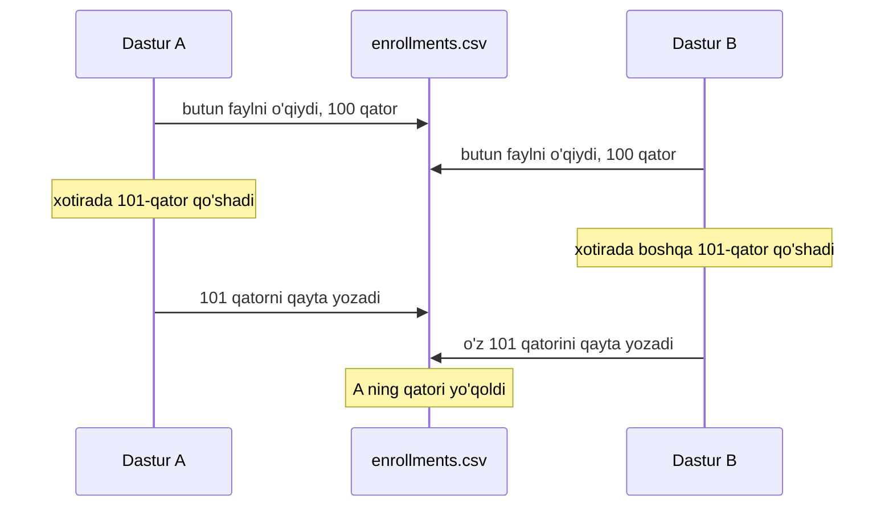
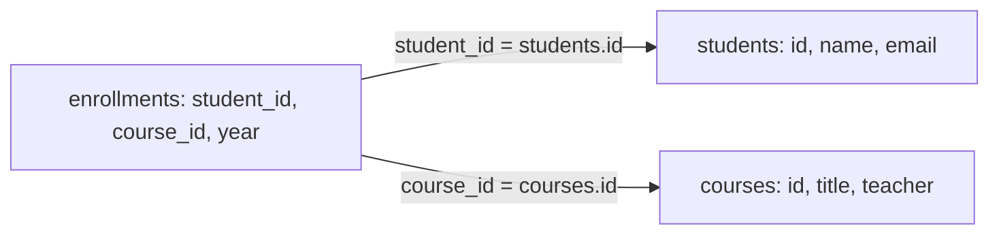

## Bu dars nima uchun kerak

34-darsda CSV faylni `csv` moduli bilan o'qib, qatorlarni sanadik va filtrladik. Kichik ma'lumot uchun bu yetarli: bitta fayl, bitta skript, bir necha soniya. Endi tasavvur qiling, shu fayl o'quv markazining yagona ma'lumot ombori: unga har kuni yangi o'quvchilar yoziladi, o'qituvchilar almashadi, bir vaqtda uchta xodim uni tahrirlaydi, va hisobot "Python kursiga 2026-yilda nechta o'quvchi yozilgan?" degan savolga bir zumda javob berishi kerak. CSV bu vaziyatda asta-sekin buzila boshlaydi: bir xil ma'lumot o'nlab qatorda takrorlanadi, bitta joyda tuzatilgan email boshqa joyda eskicha qoladi, ikki dastur bir vaqtda yozsa, bittasining o'zgarishi yo'qoladi.

Bu dars shu muammolarni aniq misollar bilan ko'rsatadi va ularning standart yechimiga o'tadi: **relational database** (relyatsion ma'lumotlar bazasi) va uning tili **SQL**. Biz SQLite'dan foydalanamiz: u server talab qilmaydi, butun baza bitta faylda turadi, Python'da esa standart kutubxonaning bir qismi. Keyingi to'rtta dars shu poydevor ustiga quriladi: 37-darsda SQL so'rovlari (`ORDER BY`, `GROUP BY`, aggregatsiya), 38-darsda jadvallar orasidagi bog'lanishlar (`JOIN`, primary key, foreign key, normalizatsiya), 39-darsda indekslar va tranzaksiyalar, 40-darsda Python va SQL birga.

Bu darsdan keyin siz:

- flat-file ma'lumotlar bazasi nima ekanini va CSV qachon yetarli ekanini bilasiz;
- takrorlanish, yangilash anomaliyalari, bir vaqtda yozish va qidiruv tezligi muammolarini misol bilan ko'rsata olasiz;
- relational modeldagi jadval, qator, ustun va kalit tushunchalarini bilasiz va bitta katta CSV ni bir nechta jadvalga ajrata olasiz;
- `CREATE TABLE`, `INSERT`, `SELECT` va oddiy `WHERE` bilan ishlay olasiz;
- SQLite'ning tip tizimi (storage class va type affinity) boshqa bazalardan qanday farq qilishini bilasiz;
- bir xil ma'lumot ustida CSV + Python, SQL va Python `sqlite3` bilan bir xil javob olib, natijalarni solishtira olasiz;
- CRUD amallari SQL'dagi qaysi buyruqlarga mos kelishini bilasiz.

## Flat-file ma'lumotlar bazasi

**Flat-file database** - barcha ma'lumot bitta jadval shaklida, oddiy matnli faylda saqlanadigan ombor. CS50 7-ma'ruzasi ham uni shunday ta'riflaydi: ma'lumot bitta jadvalda, matnli faylda; har bir yozuv - alohida qator, ustunlar vergul yoki boshqa ajratuvchi bilan bo'linadi. Eng keng tarqalgan format - CSV (comma-separated values). Uning birinchi qatori odatda sarlavha: ustunlar nomi.

CSV formati RFC 4180 da tasvirlangan (bu hujjat rasmiy standart emas, "informational" maqomida, lekin ko'pchilik dasturlar unga amal qiladi). Asosiy qoidalar: maydonlar vergul bilan ajratiladi; ichida vergul, qo'shtirnoq yoki qator uzilishi bo'lgan maydon qo'shtirnoq ichiga olinadi; maydon ichidagi qo'shtirnoq ikkilantiriladi (`"b""bb"`). Shuning uchun CSV ni `line.split(",")` bilan o'qish noto'g'ri: `"Web: HTML, CSS"` ikkiga bo'linib ketadi. 34-darsda shu sababli `csv` modulidan foydalandik.

O'quv markazining yozilishlar faylini ko'raylik. Har qator: kim, qaysi kursga, o'qituvchisi kim, qaysi yili.

```python run
import csv
from collections import Counter

data = """student,email,course,teacher,year
Aziz Karimov,aziz@example.com,C asoslari,Nodira Usmonova,2026
Aziz Karimov,aziz@example.com,Python,Javlon Rahimov,2026
Malika Tosheva,malika@example.com,Python,Javlon Rahimov,2026
Malika Tosheva,malika@example.com,SQL,Dilshod Qodirov,2026
Sardor Aliyev,sardor@example.com,Python,Javlon Rahimov,2025
Sardor Aliyev,sardor@example.com,"Web: HTML, CSS",Dilshod Qodirov,2026
"""

# Brauzerdagi virtual fayl tizimiga yozamiz, keyin oddiy fayl kabi o'qiymiz
with open("enrollments.csv", "w") as f:
    f.write(data)

counts = Counter()
with open("enrollments.csv") as f:
    for row in csv.DictReader(f):
        counts[row["course"]] += 1

for course, n in counts.most_common():
    print(f"{course}: {n}")

with open("enrollments.csv") as f:
    rows = list(csv.DictReader(f))
print("Python, 2026:", sum(1 for r in rows if r["course"] == "Python" and r["year"] == "2026"))
print("year tipi:", type(rows[0]["year"]).__name__)
```

Natija:

```text
Python: 3
C asoslari: 1
SQL: 1
Web: HTML, CSS: 1
Python, 2026: 2
year tipi: str
```

Kod 34-darsdagi naqsh: `csv.DictReader` har qatorni sarlavha bo'yicha lug'atga aylantiradi, `Counter` (32-dars) esa sanaydi. Qo'shtirnoq ichidagi `"Web: HTML, CSS"` to'g'ri o'qildi. Oxirgi qatorga e'tibor bering: `year` - satr. CSV da tip tushunchasi yo'q, hamma narsa matn. Shuning uchun `r["year"] == 2026` (son bilan) hech qachon `True` bo'lmaydi, va satrlar sifatida saralaganda `"10"` `"9"` dan oldin keladi.

Bu ishlaydi. Endi bu fayl o'sganda va ko'p odam undan foydalanganda nima bo'lishini ko'ramiz.

## Flat-file muammolari

### 1. Takrorlanish

Fayldagi har bir qator o'quvchining ismi va emailini, kurs nomi va o'qituvchisini qayta yozadi. "Javlon Rahimov" uch marta, "Aziz Karimov, aziz@example.com" ikki marta. Bu faqat joy masalasi emas, lekin joydan boshlaymiz.

Hisob. O'quv markazida 2 000 o'quvchi, 40 kurs, 10 000 ta yozilish bo'lsin. Har qatorda o'quvchi ismi va emaili taxminan 40 bayt, kurs nomi va o'qituvchi taxminan 30 bayt, yil va vergullar 10 bayt: jami taxminan 80 bayt. Flat-file: 10 000 · 80 = 800 000 bayt.

Endi ma'lumotni uch qismga ajratamiz: o'quvchilar (2 000 · 40 = 80 000 bayt), kurslar (40 · 30 = 1 200 bayt) va yozilishlar, unda faqat o'quvchi va kurs raqami hamda yil (taxminan 15 bayt): 10 000 · 15 = 150 000 bayt. Jami taxminan 231 200 bayt, ya'ni 800 000 / 231 200 ≈ 3,5 marta kam. Raqamlar taxminiy, lekin xulosa umumiy: takrorlanuvchi ma'lumot yozilishlar soniga ko'paytiriladi, ajratilgan ma'lumot esa faqat bir marta saqlanadi.

### 2. Yangilash anomaliyalari

Takrorlanishning asl xavfi - ziddiyat. Bitta fakt bir nechta joyda yozilgan bo'lsa, uni o'zgartirganda hamma joyni o'zgartirish kerak. Bu muammolar **anomaliya** deb ataladi va uch turga bo'linadi:

- **Update anomaly** (yangilash anomaliyasi): Malika emailini o'zgartirdi. Dastur faqat birinchi topilgan qatorni yangiladi, ikkinchisi eskicha qoldi. Endi bitta odamning ikkita emaili bor va qaysi biri to'g'ri ekanini hech kim bilmaydi.
- **Delete anomaly** (o'chirish anomaliyasi): "C asoslari" kursiga faqat Aziz yozilgan. U kursdan chiqsa va qator o'chirilsa, "C asoslari kursini Nodira Usmonova o'qitadi" degan fakt ham yo'qoladi, garchi kurs mavjud bo'lsa ham.
- **Insert anomaly** (qo'shish anomaliyasi): yangi "Algoritmlar" kursi ochildi, lekin hali hech kim yozilmagan. Uni faylga qo'shib bo'lmaydi: har qator "o'quvchi + kurs" juftligi, o'quvchisiz qator esa bo'sh maydonlarli soxta yozuv bo'ladi.

```python run
import csv
import io

data = """student,email,course,teacher,year
Aziz Karimov,aziz@example.com,C asoslari,Nodira Usmonova,2026
Aziz Karimov,aziz@example.com,Python,Javlon Rahimov,2026
Malika Tosheva,malika@example.com,Python,Javlon Rahimov,2026
Malika Tosheva,malika@example.com,SQL,Dilshod Qodirov,2026
"""
rows = list(csv.DictReader(io.StringIO(data)))

# Update anomaly: faqat birinchi topilgan qator yangilanadi
for r in rows:
    if r["student"] == "Malika Tosheva":
        r["email"] = "malika.t@example.com"
        break
print("Malika emaillari:", sorted({r["email"] for r in rows if r["student"] == "Malika Tosheva"}))

# Delete anomaly: Aziz C asoslari kursidan chiqdi
rows = [r for r in rows if not (r["student"] == "Aziz Karimov" and r["course"] == "C asoslari")]
print("C asoslari o'qituvchisi:", [r["teacher"] for r in rows if r["course"] == "C asoslari"])
```

Natija:

```text
Malika emaillari: ['malika.t@example.com', 'malika@example.com']
C asoslari o'qituvchisi: []
```

Kodda `break` ataylab qo'yilgan, lekin real hayotda bu xato oson sodir bo'ladi: bitta skript emailni yangilaydi, ikkinchisi eski nusxadan o'qiydi, uchinchi xodim qo'lda tahrirlaydi. Muammo dasturda emas, ma'lumotning tuzilishida: bitta fakt bir nechta joyda.

### 3. Bir vaqtda yozish

CSV fayl - shunchaki baytlar. U kim, qachon yozayotganini bilmaydi va hech qanday qulf yo'q. Odatiy "faylni o'qi, xotirada o'zgartir, qaytadan yoz" naqshi ikki dastur bir vaqtda ishlaganda o'zgarishni yo'qotadi:



Bu - **lost update** (yo'qolgan yangilanish): ikkala dastur muvaffaqiyatli tugadi, lekin natijada 102 emas, 101 qator. Xato xabari yo'q, va u faqat ma'lumot yo'qolgani sezilganda topiladi. Faylning oxiriga qo'shish rejimi (`"a"`) bu holatni yumshatadi, lekin tahrirlash va o'chirish uchun yordam bermaydi, va yozish o'rtasida dastur yiqilsa, fayl yarim yozilgan qator bilan qolishi mumkin. Bu race condition'ning bir turi; u 39-darsda tranzaksiyalar bilan birga chuqur ko'riladi.

### 4. Qidiruv tezligi

"Python kursiga 2026-yilda nechta o'quvchi yozilgan?" savoliga javob berish uchun dastur faylni boshidan oxirigacha o'qishi, har qatorni bo'laklarga ajratishi va solishtirishi kerak. Bu 15-darsdagi linear search: O(n). Fayl tartiblangan bo'lsa ham, satrlar uzunligi har xil, shuning uchun o'rtadagi qatorga sakrab binary search qilib bo'lmaydi.

Hisob: 1 000 000 qator, har biri 80 bayt - har so'rovda 80 MB o'qiladi va million marta matn bo'linadi. Kuniga 10 000 so'rov bo'lsa, 800 GB matn qayta ishlanadi. Relational bazalar buni **indeks** bilan hal qiladi: ustun qiymatlari bo'yicha alohida tartiblangan tuzilma (29-darsdagi daraxtlarga o'xshash), unda qidiruv O(log n). log₂(1 000 000) ≈ 20, ya'ni million o'rniga 20 ga yaqin qadam. Indekslar 39-darsda batafsil.

## Relational model

1970-yilda IBM tadqiqotchisi Edgar Codd "A Relational Model of Data for Large Shared Data Banks" maqolasini e'lon qildi. Uning asosiy g'oyasi: ma'lumot foydalanuvchiga matematik ma'nodagi **munosabatlar** (relation) to'plami sifatida ko'rsatilsin, va dastur ma'lumotning diskda qanday joylashganiga bog'liq bo'lmasin. Bugungi relational bazalar (PostgreSQL, MySQL, SQLite va boshqalar) shu g'oyaning amaliy davomi. Kundalik tilda:

| Relational model atamasi | Amaliy atama | Bizning misolda |
|---|---|---|
| Relation | Jadval (table) | `students`, `courses`, `enrollments` |
| Tuple | Qator, yozuv (row) | Bitta o'quvchi: 1, Aziz Karimov, aziz@example.com |
| Attribute | Ustun (column) | `email` |
| Domain | Ustun tipi | Matn, butun son |
| Key | Kalit | `id` - har qatorni noyob aniqlaydigan ustun |
| Schema | Sxema | Jadvallar, ustunlar va tiplar ro'yxati |

Asosiy tushunchalar:

- **Jadval** bitta turdagi narsalarni saqlaydi: faqat o'quvchilar, faqat kurslar. Har ustunning nomi va tipi bor, har qatorda shu ustunlar uchun qiymatlar.
- **Kalit** (key) - qatorni noyob aniqlaydigan ustun yoki ustunlar to'plami. Ism yaxshi kalit emas: ikki Aziz Karimov bo'lishi mumkin. Shuning uchun odatda alohida raqam ustuni (`id`) qo'shiladi. Boshqa jadval o'quvchiga uning ismi orqali emas, `id` orqali murojaat qiladi. Kalit turlari (primary key, foreign key) va ular kafolatlaydigan qoidalar 38-darsda.
- **Sxema** (schema) - ma'lumotdan oldin aniqlanadigan tuzilma: qaysi jadvallar, qaysi ustunlar, qaysi tiplar. CSV da sxema yo'q: sarlavha qatori - shunchaki birinchi qator.

Endi yozilishlar faylini uch jadvalga ajratamiz. Har bir fakt bir marta saqlanadi; `enrollments` jadvali esa faqat "qaysi o'quvchi qaysi kursga qaysi yili yozildi" degan bog'lanishni raqamlar orqali saqlaydi:



Endi uchala anomaliya yo'qoladi. Malika emaili `students` da bitta qatorda: uni bir joyda o'zgartirish yetarli. Aziz "C asoslari" dan chiqsa, `enrollments` dan bitta qator o'chadi, kurs va uning o'qituvchisi `courses` da qoladi. Yangi kurs hech kim yozilmasdan `courses` ga qo'shiladi. Ma'lumotni shunday takrorlanishsiz jadvallarga ajratish **normalizatsiya** deyiladi va 38-darsda qoidalari bilan ko'riladi. Bu "ajratish" qaytadan yig'ish narxiga ega: "Malika qaysi kurslarda o'qiydi?" degan savolga javob uchun uchala jadvalni bog'lash (`JOIN`) kerak, u ham 38-darsda.

## SQL ga kirish: CREATE TABLE, INSERT, SELECT, WHERE

**SQL** (Structured Query Language) - relational bazalar bilan ishlash tili. U C va Python'dan bir muhim jihati bilan farq qiladi: SQL **deklarativ**. Siz "nima kerak"ligini yozasiz ("Python kursining 2026-yildagi yozilishlarini ber"), "qanday topish"ni (qaysi tartibda o'qish, indeks ishlatish yoki yo'q) esa bazaning o'zi tanlaydi. 34-darsdagi Python kodida esa siklni, shartni va hisoblagichni o'zimiz yozdik.

To'rtta asosiy buyruq:

- `CREATE TABLE nom (ustun tip, ...);` - jadval va uning sxemasini yaratadi;
- `INSERT INTO nom (ustunlar) VALUES (qiymatlar);` - qator qo'shadi;
- `SELECT ustunlar FROM nom;` - qatorlarni o'qiydi, `*` - barcha ustunlar;
- `WHERE shart` - faqat shartga mos qatorlarni qoldiradi: `=`, `<>` (teng emas), `<`, `>`, `AND`, `OR`.

Har bir buyruq nuqta-vergul bilan tugaydi. Matnli qiymatlar bitta qo'shtirnoqda yoziladi: `'Python'`. Kalit so'zlarni katta harf bilan yozish an'ana, majburiy emas.

Quyidagi blok brauzerda SQLite bazasi sifatida ishlaydi: jadvallar har ishga tushirishda xotirada yangidan yaratiladi.

```sql run
CREATE TABLE students (
    id INTEGER PRIMARY KEY,
    name TEXT,
    email TEXT
);
CREATE TABLE courses (
    id INTEGER PRIMARY KEY,
    title TEXT,
    teacher TEXT
);
CREATE TABLE enrollments (
    student_id INTEGER,
    course_id INTEGER,
    year INTEGER
);

INSERT INTO students (id, name, email) VALUES
    (1, 'Aziz Karimov', 'aziz@example.com'),
    (2, 'Malika Tosheva', 'malika@example.com'),
    (3, 'Sardor Aliyev', 'sardor@example.com');

INSERT INTO courses (id, title, teacher) VALUES
    (1, 'C asoslari', 'Nodira Usmonova'),
    (2, 'Python', 'Javlon Rahimov'),
    (3, 'SQL', 'Dilshod Qodirov'),
    (4, 'Web: HTML, CSS', 'Dilshod Qodirov');

INSERT INTO enrollments (student_id, course_id, year) VALUES
    (1, 1, 2026), (1, 2, 2026), (2, 2, 2026),
    (2, 3, 2026), (3, 2, 2025), (3, 4, 2026);

SELECT * FROM students;

SELECT title FROM courses WHERE teacher = 'Dilshod Qodirov';

SELECT student_id FROM enrollments WHERE course_id = 2 AND year = 2026;

SELECT COUNT(*) AS soni FROM enrollments WHERE course_id = 2 AND year = 2026;
```

Natija:

```text
id | name | email
1 | Aziz Karimov | aziz@example.com
2 | Malika Tosheva | malika@example.com
3 | Sardor Aliyev | sardor@example.com
(3 qator)
title
SQL
Web: HTML, CSS
(2 qator)
student_id
1
2
(2 qator)
soni
2
(1 qator)
```

Bir necha izoh:

- `id INTEGER PRIMARY KEY` - SQLite'da bu ustun har qator uchun noyob butun son bo'ladi; uning to'liq ma'nosi 38-darsda.
- `year = 2026` endi son bilan solishtirish: ustun tipi `INTEGER`, va CSV dagi "hamma narsa satr" muammosi yo'q.
- Oxirgi so'rovdagi `COUNT(*)` - qatorlar sonini qaytaradigan aggregat funksiya, `AS soni` esa natija ustuniga nom beradi. Aggregatsiya 37-darsda batafsil; bu yerda u 34-darsdagi `sum(1 for r in rows if ...)` bilan bir xil savolga javob bermoqda va javob ham bir xil: 2.
- `WHERE course_id = 2` da kurs nomini emas, raqamini yozdik. Nom bo'yicha qidirish uchun jadvallarni bog'lash kerak: "Python kursining o'quvchilari ismi" so'rovi 38-darsdagi `JOIN` ning birinchi misoli bo'ladi.

Natijalardagi qatorlar tartibiga tayanmang: SQL standarti `ORDER BY` siz tartibni kafolatlamaydi (37-dars). Bu kichik jadvallarda SQLite qatorlarni qo'shilgan tartibda qaytaradi, lekin bu kafolat emas.

## CRUD: to'rtta asosiy amal

Har qanday ma'lumot ombori ustidagi amallar to'rtta guruhga bo'linadi. Ularning bosh harflari **CRUD** deb ataladi; CS50 7-ma'ruzasi ham SQL buyruqlarini shu to'rt guruh orqali tanishtiradi.

| CRUD amali | SQL buyrug'i | CSV + Python'da |
|---|---|---|
| Create (yaratish) | `INSERT INTO ... VALUES ...` | Faylga `"a"` rejimida qator qo'shish |
| Read (o'qish) | `SELECT ... FROM ... WHERE ...` | Butun faylni o'qib, siklda filtrlash |
| Update (yangilash) | `UPDATE ... SET ... WHERE ...` | Butun faylni o'qish, o'zgartirish, qayta yozish |
| Delete (o'chirish) | `DELETE FROM ... WHERE ...` | Butun faylni o'qish, qatorni tashlab, qayta yozish |

Jadvalning o'ng ustunida "butun fayl" uch marta takrorlanadi: CSV da bitta qatorni o'zgartirish uchun ham hamma narsani qayta yozish kerak. SQL da esa `UPDATE` va `DELETE` faqat `WHERE` ga mos qatorlarga ta'sir qiladi. Anomaliyalar misolini SQL da takrorlaymiz:

```sql run
CREATE TABLE students (id INTEGER PRIMARY KEY, name TEXT, email TEXT);
CREATE TABLE courses (id INTEGER PRIMARY KEY, title TEXT, teacher TEXT);
CREATE TABLE enrollments (student_id INTEGER, course_id INTEGER, year INTEGER);

INSERT INTO students VALUES (1, 'Aziz Karimov', 'aziz@example.com'), (2, 'Malika Tosheva', 'malika@example.com');
INSERT INTO courses VALUES (1, 'C asoslari', 'Nodira Usmonova'), (2, 'Python', 'Javlon Rahimov');
INSERT INTO enrollments VALUES (1, 1, 2026), (1, 2, 2026), (2, 2, 2026);

-- Update: email bitta joyda
UPDATE students SET email = 'malika.t@example.com' WHERE id = 2;

-- Delete: Aziz C asoslari kursidan chiqdi
DELETE FROM enrollments WHERE student_id = 1 AND course_id = 1;

-- Insert: hali o'quvchisi yo'q yangi kurs
INSERT INTO courses VALUES (3, 'Algoritmlar', 'Nodira Usmonova');

SELECT * FROM students WHERE id = 2;
SELECT * FROM courses;
SELECT * FROM enrollments;
```

Natija:

```text
id | name | email
2 | Malika Tosheva | malika.t@example.com
(1 qator)
id | title | teacher
1 | C asoslari | Nodira Usmonova
2 | Python | Javlon Rahimov
3 | Algoritmlar | Nodira Usmonova
(3 qator)
student_id | course_id | year
1 | 2 | 2026
2 | 2 | 2026
(2 qator)
```

Email bitta qatorda o'zgardi va boshqa nusxasi yo'q. "C asoslari" va uning o'qituvchisi yozilish o'chirilgandan keyin ham joyida. "Algoritmlar" hech kimsiz qo'shildi. `--` bilan boshlangan qatorlar SQL izohlari.

Bitta ehtiyot chorasi: `WHERE` siz `UPDATE` yoki `DELETE` jadvaldagi **barcha** qatorlarga ta'sir qiladi. `DELETE FROM enrollments;` barcha yozilishlarni o'chiradi, va baza "rostdan ham shunday qilaymi?" deb so'ramaydi.

## SQLite: server yo'q, bitta fayl

Ko'p relational bazalar (PostgreSQL, MySQL) **client-server** arxitekturasida ishlaydi: alohida server jarayoni ma'lumotni boshqaradi, dastur esa unga tarmoq (odatda TCP/IP) orqali so'rov yuboradi. SQLite boshqacha. Rasmiy "About SQLite" sahifasiga ko'ra u alohida server jarayonisiz ishlaydigan, dasturning o'zi ichiga ulanadigan (in-process) kutubxona; u oddiy disk fayllarini to'g'ridan-to'g'ri o'qib-yozadi, va bir nechta jadval, indeks va boshqa obyektlarga ega to'liq baza bitta disk faylida saqlanadi. Fayl formati platformalararo: uni 32 va 64 bitli, little-endian va big-endian (26-dars) tizimlar orasida bemalol ko'chirish mumkin.

Amalda bu shuni anglatadi:

- o'rnatish va sozlash yo'q: Python'da `import sqlite3` darhol ishlaydi, terminalda `sqlite3 school.db` buyrug'i faylni ochadi (yoki yaratadi);
- zaxira nusxa - faylni nusxalash; ma'lumotni boshqa kompyuterga o'tkazish - faylni yuborish;
- bitta faylga bir vaqtda ko'p dastur o'qiy oladi, lekin "Appropriate Uses For SQLite" sahifasiga ko'ra istalgan paytda faqat **bitta** yozuvchi bo'lishi mumkin; boshqa yozuvchilar navbat kutadi. Lekin CSV dan farqli o'laroq, bu navbatni baza o'zi boshqaradi va yo'qolgan yangilanish bo'lmaydi.

Shu sahifa SQLite qachon mos kelmasligini ham aytadi: ma'lumot tarmoq orqali ko'p kompyuterdan yoziladigan, juda ko'p bir vaqtdagi yozuvchili yoki bitta kompyuter sig'diradigan hajmdan katta bo'lgan holatlar. Bunday holatlar uchun client-server bazalar mo'ljallangan. Kursning brauzer muhitida `sql run` bloklari sql.js orqali ishlaydi: bu WebAssembly'ga kompilyatsiya qilingan o'sha SQLite.

| Xususiyat | CSV (flat-file) | SQLite | Client-server baza |
|---|---|---|---|
| Saqlash | Bitta matnli fayl | Bitta binary fayl | Server boshqaradigan fayllar to'plami |
| Sxema va tiplar | Yo'q, hamma narsa matn | Bor (moslashuvchan tiplar) | Bor (qat'iy tiplar) |
| Bitta qatorni yangilash | Butun faylni qayta yozish | `UPDATE ... WHERE` | `UPDATE ... WHERE` |
| Bir vaqtda yozish | Himoya yo'q | Bitta yozuvchi, qolganlar navbatda | Ko'p yozuvchi |
| Qidiruv | Har safar to'liq skan | Indeks bilan O(log n) | Indeks bilan O(log n) |
| O'rnatish | Kerak emas | Kerak emas, kutubxona | Server o'rnatish va sozlash |
| Inson o'qishi | Har qanday matn muharriri | Maxsus vosita kerak | Maxsus vosita kerak |

## SQLite tiplari: storage class va type affinity

Ko'pchilik SQL bazalarda tip ustunga qat'iy bog'langan: `INTEGER` ustuniga faqat son yoziladi. SQLite'ning rasmiy "Datatypes In SQLite" hujjati o'z yondashuvini boshqacha ta'riflaydi: SQLite'da qiymatning tipi ustun bilan emas, **qiymatning o'zi** bilan bog'langan. Har bir saqlangan qiymat beshta **storage class** dan biriga tegishli:

- `NULL` - qiymat yo'q;
- `INTEGER` - ishorali butun son, kattaligiga qarab 0, 1, 2, 3, 4, 6 yoki 8 baytda saqlanadi;
- `REAL` - 8 baytli IEEE 754 floating-point son (7-darsdagi `double`);
- `TEXT` - satr, baza kodlashida (UTF-8 yoki UTF-16, 2-dars);
- `BLOB` - baytlar, kiritilganidek.

Ustunning e'lon qilingan tipi esa **type affinity** ni belgilaydi: bu ustun qaysi tipni "afzal ko'rishi". Beshta affinity bor: TEXT, NUMERIC, INTEGER, REAL, BLOB. Affinity e'lon qilingan tip nomidan quyidagi qoidalar bilan, aynan shu tartibda aniqlanadi:

1. Tip nomida `INT` bo'lsa - INTEGER affinity (`INT`, `INTEGER`, `BIGINT`).
2. Aks holda, `CHAR`, `CLOB` yoki `TEXT` bo'lsa - TEXT (`VARCHAR(255)` ham, chunki unda `CHAR` bor).
3. Aks holda, `BLOB` bo'lsa yoki tip umuman yozilmagan bo'lsa - BLOB.
4. Aks holda, `REAL`, `FLOA` yoki `DOUB` bo'lsa - REAL.
5. Qolgan hamma holatda - NUMERIC (`DECIMAL`, `BOOLEAN`, `DATE`).

Affinity qiymatni iloji bo'lsa o'zgartiradi: masalan, TEXT affinity'li ustunga son yozilsa, u matnga aylantiriladi; INTEGER yoki NUMERIC ustunga yozilgan matn to'g'ri shakllangan son bo'lsa, songa aylantiriladi. Aylantirib bo'lmasa, qiymat o'z storage class'ida qoladi. Hujjat yana bir narsani ta'kidlaydi: `VARCHAR(255)` dagi qavs ichidagi uzunlik e'tiborga olinmaydi. `typeof()` funksiyasi qiymatning haqiqiy storage class'ini ko'rsatadi:

```sql run
CREATE TABLE demo (
    n INTEGER,
    t TEXT,
    v VARCHAR(3),
    x
);

INSERT INTO demo VALUES ('2026', 2026, 'juda uzun satr', '2026');
INSERT INTO demo VALUES ('ikki ming', 3.5, 'ok', 2026);

SELECT n, typeof(n), t, typeof(t), v, typeof(x) FROM demo;
```

Natija:

```text
n | typeof(n) | t | typeof(t) | v | typeof(x)
2026 | integer | 2026 | text | juda uzun satr | text
ikki ming | text | 3.5 | text | ok | integer
(2 qator)
```

Qatorma-qator:

- `n INTEGER` ga `'2026'` satri yozildi va u **songa** aylandi: affinity ishladi. `'ikki ming'` esa songa aylanmaydi, shuning uchun INTEGER ustunda **matn** sifatida saqlandi. Qat'iy tipli bazada bu xato bo'lardi.
- `t TEXT` ga 2026 va 3.5 sonlari yozildi va ikkalasi matnga aylandi.
- `v VARCHAR(3)` ga 14 belgili satr hech qanday xatosiz yozildi: uzunlik cheklovi yo'q.
- `x` ustunining tipi yozilmagan, ya'ni BLOB affinity: qiymat qanday kelsa, shunday saqlanadi (`'2026'` matn, `2026` son).

Bu moslashuvchanlik qulay (CSV dan import qilingan "2026" satrlari avtomatik songa aylanadi), lekin xatolarni ham yashiradi. Hujjatga ko'ra SQLite 3.37.0 (2021-yil 27-noyabr) dan beri qat'iy tekshiruv uchun `STRICT` jadvallar bor: `CREATE TABLE ... ( ... ) STRICT;` bo'lsa, `INTEGER` ustuniga `'ikki ming'` yozishga urinish xato beradi. Buni keyingi bo'limda Python orqali ko'ramiz.

## Python sqlite3: xuddi shu ma'lumot, xuddi shu javob

Python'ning standart `sqlite3` moduli SQLite'ni dasturning ichiga ulaydi. `sqlite3.connect("school.db")` fayldagi bazani ochadi (yo'q bo'lsa yaratadi), `sqlite3.connect(":memory:")` esa faqat xotirada yashaydigan vaqtinchalik baza yaratadi. `execute` bitta SQL buyrug'ini bajaradi, `executemany` esa bitta buyruqni ko'p qiymatlar to'plami bilan. `?` belgisi qiymat uchun joy: qiymatlar SQL matniga qo'shib yozilmaydi, alohida uzatiladi. Nima uchun bu muhim (SQL injection) - 39 va 40-darslarda.

Quyidagi dastur boshidagi CSV ni o'qiydi, ma'lumotni uchta jadvalga yuklaydi va o'sha savolga SQL bilan javob beradi:

```python run
import csv
import io
import sqlite3

data = """student,email,course,teacher,year
Aziz Karimov,aziz@example.com,C asoslari,Nodira Usmonova,2026
Aziz Karimov,aziz@example.com,Python,Javlon Rahimov,2026
Malika Tosheva,malika@example.com,Python,Javlon Rahimov,2026
Malika Tosheva,malika@example.com,SQL,Dilshod Qodirov,2026
Sardor Aliyev,sardor@example.com,Python,Javlon Rahimov,2025
Sardor Aliyev,sardor@example.com,"Web: HTML, CSS",Dilshod Qodirov,2026
"""

con = sqlite3.connect(":memory:")
con.execute("CREATE TABLE students (id INTEGER PRIMARY KEY, name TEXT, email TEXT)")
con.execute("CREATE TABLE courses (id INTEGER PRIMARY KEY, title TEXT, teacher TEXT)")
con.execute("CREATE TABLE enrollments (student_id INTEGER, course_id INTEGER, year INTEGER)")

student_ids = {}
course_ids = {}
for row in csv.DictReader(io.StringIO(data)):
    if row["email"] not in student_ids:
        cur = con.execute("INSERT INTO students (name, email) VALUES (?, ?)", (row["student"], row["email"]))
        student_ids[row["email"]] = cur.lastrowid
    if row["course"] not in course_ids:
        cur = con.execute("INSERT INTO courses (title, teacher) VALUES (?, ?)", (row["course"], row["teacher"]))
        course_ids[row["course"]] = cur.lastrowid
    con.execute(
        "INSERT INTO enrollments VALUES (?, ?, ?)",
        (student_ids[row["email"]], course_ids[row["course"]], row["year"]),
    )

for table in ("students", "courses", "enrollments"):
    print(table, con.execute(f"SELECT COUNT(*) FROM {table}").fetchone()[0])

python_id = con.execute("SELECT id FROM courses WHERE title = ?", ("Python",)).fetchone()[0]
n = con.execute(
    "SELECT COUNT(*) FROM enrollments WHERE course_id = ? AND year = ?", (python_id, 2026)
).fetchone()[0]
print("Python, 2026:", n)
print("year tipi:", con.execute("SELECT typeof(year) FROM enrollments LIMIT 1").fetchone()[0])

con.execute("CREATE TABLE strict_demo (n INTEGER) STRICT")
try:
    con.execute("INSERT INTO strict_demo VALUES ('ikki ming')")
except sqlite3.Error as e:
    print("STRICT:", type(e).__name__)
con.close()
```

Natija:

```text
students 3
courses 4
enrollments 6
Python, 2026: 2
year tipi: integer
STRICT: IntegrityError
```

Uchta usul - CSV ustida Python sikli, `sql run` bloki va Python `sqlite3` - bir xil savolga bir xil javob berdi: 2. Farq tuzilishda:

- 6 qatorli CSV 3 o'quvchi, 4 kurs va 6 yozilishga ajraldi. Har bir ism va o'qituvchi endi bir marta saqlanadi.
- `year` ga CSV dan `"2026"` satri uzatildi, lekin INTEGER affinity uni songa aylantirdi: `typeof` `integer` qaytardi.
- `id` ni o'zimiz bermadik: `INTEGER PRIMARY KEY` ustuni yangi qatorga raqamni o'zi beradi, `cursor.lastrowid` esa uni qaytaradi.
- `STRICT` jadval noto'g'ri tipli qiymatni rad etdi.
- Jadval nomi f-string bilan qo'yilgan, chunki u bizning dasturdagi o'zgarmas ro'yxatdan keladi; foydalanuvchidan kelgan qiymat esa doim `?` orqali uzatiladi.

## Qachon flat-file yetarli

Relational baza har doim ham kerak emas. Har bir vosita o'z o'rniga ega:

| Holat | Tanlov | Sabab |
|---|---|---|
| Bir martalik tahlil, bir necha ming qator | CSV + Python | Tez, oddiy, istalgan dastur ochadi |
| Ma'lumot almashish, eksport, jadval dasturiga yuklash | CSV | Universal format |
| Konfiguratsiya, kichik ro'yxatlar, faqat qo'shiladigan log | Matnli fayl | Inson o'qiydi va tahrirlaydi |
| Bitta dastur, ma'lumot o'zgaradi, so'rovlar ko'p | SQLite | Sxema, tiplar, `UPDATE`, indeks, server yo'q |
| Ko'p foydalanuvchi va ko'p yozuvchi, tarmoq orqali | Client-server baza | Bir vaqtdagi yozish va kirish huquqlari |

Oddiy savol-javob qoidasi: ma'lumot faqat o'qiladimi yoki oxiriga qo'shiladimi, uni bitta dastur bitta marta qayta ishlaydimi va bir necha soniyada to'liq o'qib bo'ladimi? Hammasiga "ha" bo'lsa, CSV yetarli. Ma'lumot tahrirlanadigan, bir nechta tur narsalar (o'quvchi, kurs) bir-biriga bog'langan yoki bir nechta dastur yozadigan bo'lsa, relational bazaga o'ting.

## Ko'p uchraydigan xatolar

1. **CSV ni `split(",")` bilan o'qish.** Qo'shtirnoq ichidagi vergul maydonni bo'lib yuboradi. `csv.reader` yoki `csv.DictReader` ishlating (34-dars).
2. **CSV dagi sonlarni son deb o'ylash.** `csv` hamma narsani satr qaytaradi: `"2026" == 2026` - `False`, `"10" < "9"` - `True`. `int()` bilan aylantiring.
3. **Bitta faktni bir nechta qatorda saqlash.** Ism, email yoki o'qituvchi har yozilishda takrorlansa, update, delete va insert anomaliyalari muqarrar. Har bir narsa turi uchun alohida jadval.
4. **Ismni kalit sifatida ishlatish.** Ism takrorlanadi va o'zgaradi. Har qatorni noyob raqam (`id`) bilan aniqlang.
5. **`WHERE` siz `UPDATE` yoki `DELETE`.** Barcha qatorlar o'zgaradi yoki o'chadi. Avval o'sha `WHERE` bilan `SELECT` qilib, qaysi qatorlarga ta'sir qilishini tekshiring.
6. **SQLite tipni tekshiradi deb o'ylash.** Oddiy jadvalda `INTEGER` ustuniga matn yozilishi mumkin, `VARCHAR(3)` uzunlikni cheklamaydi. Qat'iy tekshiruv kerak bo'lsa, `STRICT` jadval.
7. **SQL da satrni qo'sh qo'shtirnoqda yozish.** SQL standartida `'Python'` - qiymat, `"Python"` - ustun yoki jadval nomi. SQLite moslik uchun ba'zan qo'sh qo'shtirnoqni ham satr deb qabul qiladi, lekin bunga tayanmang.
8. **Natija tartibiga tayanish.** `ORDER BY` siz qatorlar tartibi kafolatlanmaydi (37-dars).

## Xulosa

- Flat-file database - bitta jadval, bitta matnli fayl (odatda CSV); kichik, faqat o'qiladigan yoki faqat qo'shiladigan ma'lumot uchun yetarli.
- O'sib borayotgan va o'zgarayotgan ma'lumotda CSV to'rtta muammo beradi: takrorlanish, yangilash anomaliyalari (update, delete, insert), bir vaqtda yozishda yo'qolgan yangilanish va har so'rovda O(n) to'liq skan.
- Relational model (Codd, 1970) ma'lumotni jadvallarga ajratadi: har jadval bitta turdagi narsa, har qator noyob kalit bilan, jadvallar bir-biriga kalit orqali murojaat qiladi. Har fakt bir marta saqlanadi.
- SQL deklarativ: `CREATE TABLE` sxemani yaratadi, `INSERT` qo'shadi, `SELECT ... WHERE` o'qiydi; `UPDATE` va `DELETE` faqat `WHERE` ga mos qatorlarga ta'sir qiladi. To'rtta amal - CRUD.
- SQLite - server talab qilmaydigan, dastur ichiga ulanadigan baza; butun baza bitta faylda; ko'p o'quvchi, lekin bir vaqtda bitta yozuvchi.
- SQLite'da tip qiymatga bog'langan (5 storage class), ustun esa type affinity orqali qiymatni aylantirishga harakat qiladi; qat'iy tekshiruv uchun `STRICT` jadvallar (3.37.0+).
- Python `sqlite3` moduli bilan bir xil SQL ishlaydi; qiymatlar `?` orqali uzatiladi.

## Amaliy topshiriq

Kutubxona uchun kitob berish yozuvlari CSV faylda saqlanadi. Siz uni SQLite bazasiga ko'chirib, savollarga SQL bilan javob beradigan Python dasturini yozasiz. Birinchi ikki funksiya pastdagi mashqda tekshiriladi.

Topshiriq qadamlari:

1. **Yuklash.** `load_loans(con, csv_text)` funksiyasini yozing: u `loans` jadvalini `reader TEXT, book TEXT, year INTEGER` ustunlari bilan yaratadi va CSV qatorlarini (sarlavhasiz) `executemany` va `?` bilan qo'shadi. CSV ni `csv` moduli bilan o'qing: kitob nomida vergul bo'lishi mumkin.
2. **Sanash.** `count_book(con, book)` funksiyasi shu kitob necha marta berilganini `SELECT COUNT(*) ... WHERE book = ?` bilan qaytarsin (Python siklisiz).
3. **Anomaliyani topish.** Fayldagi qatorlarni ko'rib chiqing: qaysi ma'lumot takrorlanadi? Agar CSV ga o'quvchining telefon raqami ham qo'shilsa, qaysi anomaliyalar paydo bo'lishini misol bilan yozing.
4. **Normalizatsiya rejasi.** Ma'lumotni `readers`, `books`, `loans` jadvallariga ajratish uchun `CREATE TABLE` buyruqlarini yozing. Har jadvalda qaysi ustun kalit va `loans` boshqa jadvallarga qanday murojaat qilishini tushuntiring.
5. **CRUD.** Bitta kitob nomidagi xatoni `UPDATE` bilan, bitta noto'g'ri yozuvni `DELETE` bilan tuzating. Ikkala buyruqni avval xuddi shu `WHERE` bilan `SELECT` qilib tekshiring.
6. **Tanlov.** Bu kutubxona uchun CSV, SQLite yoki client-server baza: qaysi biri va nima uchun? 3-4 gapda, darsdagi mezonlar bilan.

Mashq uchun boshlang'ich kod (funksiyalar hozircha hech narsa qilmaydi):

```python run
import csv
import io
import sqlite3


def load_loans(con, csv_text):
    # loans(reader TEXT, book TEXT, year INTEGER) jadvalini yarating
    # va CSV qatorlarini qo'shing
    pass


def count_book(con, book):
    # SELECT COUNT(*) ... WHERE book = ? natijasini qaytaring
    return 0


DATA = """reader,book,year
Laylo,Kichik shahzoda,2025
Bekzod,"Urush va tinchlik, 1-tom",2026
Laylo,"Urush va tinchlik, 1-tom",2026
Nilufar,Kichik shahzoda,2026
"""

con = sqlite3.connect(":memory:")
load_loans(con, DATA)
print(count_book(con, "Urush va tinchlik, 1-tom"))
```

```python test
def _fresh():
    c = sqlite3.connect(":memory:")
    load_loans(c, DATA)
    return c

def _rows():
    return _fresh().execute("SELECT COUNT(*) FROM loans").fetchone()[0] == 4

def _comma():
    c = _fresh()
    return c.execute("SELECT COUNT(*) FROM loans WHERE book = ?", ("Urush va tinchlik, 1-tom",)).fetchone()[0] == 2

def _int_year():
    c = _fresh()
    return c.execute("SELECT DISTINCT typeof(year) FROM loans").fetchall() == [("integer",)]

def _count():
    c = _fresh()
    return count_book(c, "Kichik shahzoda") == 2 and count_book(c, "Urush va tinchlik, 1-tom") == 2 and count_book(c, "Yo'q kitob") == 0

def _count_sql():
    c = _fresh()
    c.execute("INSERT INTO loans VALUES ('Test', 'Kichik shahzoda', 2026)")
    return count_book(c, "Kichik shahzoda") == 3

check("load_loans: loans jadvalida 4 qator bor (sarlavha qo'shilmagan)", _rows)
check("load_loans: verguli bor kitob nomi bitta maydon sifatida saqlangan", _comma)
check("load_loans: year ustunidagi qiymatlar integer", _int_year)
check("count_book: har bir kitob uchun to'g'ri son, yo'q kitob uchun 0", _count)
check("count_book: javob bazadan SQL bilan olinadi (yangi qator hisobga kiradi)", _count_sql)
```

Yaxshi javobda bo'lishi kerak bo'lgan narsalar:

- mashqdagi 5 ta test o'tgan: `load_loans` `csv.reader` yoki `csv.DictReader` ishlatadi, sarlavhani tashlaydi, `executemany` va `?` bilan qo'shadi; `count_book` `fetchone()[0]` qaytaradi;
- `year` INTEGER affinity yoki `int()` orqali son sifatida saqlangani va buni `typeof` bilan tekshirgani aytilgan;
- takrorlanuvchi ma'lumot (o'quvchi ismi, kitob nomi) va telefon raqami qo'shilganda update, delete va insert anomaliyalariga bittadan aniq misol keltirilgan;
- `readers`, `books`, `loans` sxemasida har jadvalda `id` kaliti bor, `loans` esa ism va nom o'rniga `reader_id` va `book_id` saqlaydi;
- `UPDATE` va `DELETE` buyruqlari aniq `WHERE` bilan, oldidan tekshiruvchi `SELECT` bilan yozilgan;
- tanlov asoslangan: yozuvchilar soni, ma'lumot hajmi, tahrirlash chastotasi va server kerakligi hisobga olingan.

Javobingizni pastdagi maydonga yozing va yuqoridagi mezonlar bilan solishtiring.

## Manbalar

- CS50x. [Lecture 7 notes](https://cs50.harvard.edu/x/notes/7/) - "Flat-File Database" (CSV va Python bilan sanash), "Relational Databases" (CRUD, `CREATE TABLE`, sqlite3), "SELECT", "INSERT", "UPDATE", "DELETE" bo'limlari.
- SQLite. [Datatypes In SQLite](https://www.sqlite.org/datatype3.html) - 2-bo'lim "Storage Classes and Datatypes", 3-bo'lim "Type Affinity" va 3.1 "Determination Of Column Affinity" qoidalari, STRICT jadvallar haqidagi eslatma.
- SQLite. [STRICT Tables](https://www.sqlite.org/stricttables.html) - qat'iy tipli jadvallar va ularning qoidalari.
- SQLite. [About SQLite](https://www.sqlite.org/about.html) va [SQLite Is Serverless](https://www.sqlite.org/serverless.html) - alohida server jarayoni yo'qligi, butun baza bitta disk faylda, platformalararo fayl formati.
- SQLite. [Appropriate Uses For SQLite](https://www.sqlite.org/whentouse.html) - "High Concurrency" (cheksiz o'quvchi, bitta yozuvchi) va SQLite mos kelmaydigan holatlar.
- Python 3.14. [csv](https://docs.python.org/3.14/library/csv.html) - `reader`, `DictReader` va [sqlite3](https://docs.python.org/3.14/library/sqlite3.html) - "Tutorial" (`connect`, `execute`, `executemany`), placeholder'lar bilan qiymat uzatish.
- RFC 4180. [Common Format and MIME Type for CSV Files](https://www.rfc-editor.org/rfc/rfc4180) - 2-bo'lim: vergul, qo'shtirnoq va qator uzilishi bor maydonlar qoidalari.
- E. F. Codd. [A Relational Model of Data for Large Shared Data Banks](https://www.seas.upenn.edu/~zives/03f/cis550/codd.pdf) - Communications of the ACM, 13(6), 1970: relational modelning asl maqolasi, 1-bo'lim (relation, domain, key).
