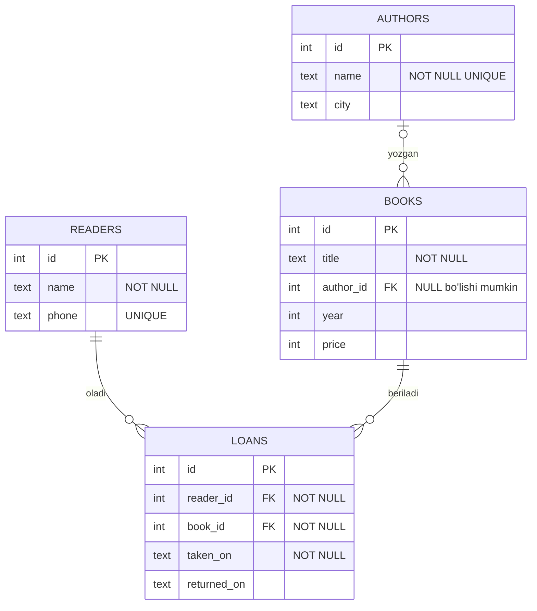

## Bu dars nima uchun kerak

37-darsdagi `books` jadvalida muallif oddiy matn edi: "Aziz Karimov" uch qatorda, "Lola Rahimova" uch qatorda takrorlangan. Bitta jadval uchun bu qulay, lekin tizim o'sganda muammolar boshlanadi. Muallifning shahrini ham saqlamoqchi bo'lsak, u har bir kitob qatorida takrorlanadi. Muallif boshqa shaharga ko'chsa, uning barcha kitoblari qatorini yangilash kerak, bittasi esdan chiqsa, baza bir vaqtda ikki xil shaharni "rost" deb saqlaydi. Bir qatorda "Aziz Karimov", boshqasida "Aziz Karimov " (oxirida bo'shliq) yozilsa, `GROUP BY author` ularni ikki muallif deb sanaydi. 36-darsda CSV fayllarning xuddi shu kamchiligini ko'rgan edik.

Relational model buning javobini beradi: har bir narsa (muallif, kitob, kitobxon) o'z jadvalida bir marta saqlanadi, jadvallar esa **kalitlar** orqali bog'lanadi. So'rov vaqtida bog'langan qatorlar `JOIN` bilan qayta birlashtiriladi. Jadvallarni qanday bo'lish kerakligini tizimli hal qiladigan usul **normalizatsiya** deyiladi.

Bu darsdan keyin siz:

- primary key qanday talablarga javob berishi kerakligini, natural va surrogate key farqini va SQLite'dagi `INTEGER PRIMARY KEY` xususiyatini bilasiz;
- foreign key bilan jadvallarni bog'lab, SQLite'da uni `PRAGMA foreign_keys = ON` bilan yoqishni va `ON DELETE` amallarini qo'llay olasiz;
- one-to-many va many-to-many bog'lanishlarni (bog'lovchi jadval orqali) loyihalab, ER diagramma chiza olasiz;
- `INNER JOIN` va `LEFT JOIN` natijasida nechta qator chiqishini oldindan hisoblay olasiz, `RIGHT` va `FULL` JOIN qachondan beri SQLite'da borligini bilasiz;
- bir vazifani subquery va JOIN bilan yozib, natijadagi farqlarni (takrorlar, NULL) tushuntira olasiz;
- 1NF, 2NF va 3NF buzilishini topib, jadvalni tuzata olasiz va denormalizatsiya qachon o'rinli ekanini baholay olasiz.

## Namunaviy baza: kutubxona

Dars davomida to'rtta jadvaldan iborat kichik kutubxona bazasini ishlatamiz. Ma'lumotlar o'ylab topilgan.

- `authors` - mualliflar: 5 ta. Nodira Saidovaning hali kitobi yo'q.
- `books` - kitoblar: 8 ta. "Xalq ertaklari" ning muallifi yo'q (`author_id` NULL): xalq og'zaki ijodi.
- `readers` - kitobxonlar: 4 ta. Gulnora hali birorta kitob olmagan, Sardorning telefoni yozilmagan.
- `loans` - kim qaysi kitobni qachon olgani: 7 ta yozuv. `returned_on` NULL bo'lsa, kitob hali qaytarilmagan. Kutubxonada har kitobning bir nechta nusxasi bor, shuning uchun bitta kitobni bir vaqtda bir necha kishi olishi mumkin.

Har bir SQL blok shu bazani yaratishdan boshlanadi (37-darsdagidek, har blok toza bazada bajariladi), so'rovlar uning ostida.



Bu **ER diagramma** (entity-relationship, "obyekt-bog'lanish" diagrammasi): to'rtburchaklar - jadvallar, chiziqlar - bog'lanishlar. Chiziq uchlaridagi belgilar sonni bildiradi: `||` - "aynan bitta", `|o` - "nol yoki bitta", `o{` - "nol yoki ko'p". `AUTHORS |o--o{ BOOKS` o'qiladi: bitta muallifning nol yoki ko'p kitobi bor, bitta kitobning esa nol yoki bitta muallifi bor (muallifsiz kitob ham mumkin).

## Primary key

**Primary key** (asosiy kalit) - jadvaldagi har bir qatorni boshqalaridan ajratib turadigan ustun yoki ustunlar to'plami. Unga uchta talab qo'yiladi:

1. **Noyob**: ikki qatorda bir xil qiymat bo'lmaydi.
2. **NULL emas**: "noma'lum" kalit bilan qatorni topib bo'lmaydi.
3. **Barqaror**: qiymat vaqt o'tishi bilan o'zgarmasligi kerak, chunki boshqa jadvallar unga tayanadi.

Kalit ikki xil bo'ladi. **Natural key** - ma'lumotning o'zida bor noyob qiymat: kitobning ISBN raqami, fuqaroning pasport raqami, telefon raqami. **Surrogate key** - faqat identifikatsiya uchun qo'shilgan, ma'nosiz son: `id = 1, 2, 3, ...`. Natural key uchinchi talabni ko'pincha buzadi: telefon raqami o'zgaradi, pasport almashtiriladi, "noyob" deb o'ylangan qiymat amalda takrorlanadi (Sardorning telefoni umuman yo'q). Shuning uchun amalda surrogate `id` ko'proq ishlatiladi, natural qiymat esa alohida ustunda `UNIQUE` cheklovi bilan saqlanadi: `readers.phone` aynan shunday.

Kalit bir nechta ustundan ham iborat bo'lishi mumkin: **composite key**. Masalan, "kitob-janr" juftligi jadvalida `PRIMARY KEY (book_id, genre)` - har bir juftlik bir marta uchraydi, lekin bitta kitob bir nechta janrda, bitta janr bir nechta kitobda bo'lishi mumkin.

### SQLite'ga xos: INTEGER PRIMARY KEY va NULL kalit

SQLite'da (`WITHOUT ROWID` jadvallardan tashqari) har bir qatorda yashirin 64-bitli butun son - **rowid** bor. Ustun aynan `INTEGER PRIMARY KEY` deb e'lon qilinsa, u rowid'ning boshqa nomiga aylanadi: alohida saqlanmaydi va `INSERT` da qiymat berilmasa, SQLite uni o'zi tanlaydi (odatda hozirgi eng katta qiymatdan bitta ko'p).

Ikkinchi xususiyat - tarixiy xato. Standart bo'yicha primary key NULL bo'la olmaydi, lekin SQLite hujjatiga ko'ra eski versiyalardagi xato tufayli `INTEGER PRIMARY KEY` bo'lmagan, `NOT NULL` deb yozilmagan primary key ustuniga NULL yozish mumkin (`STRICT` va `WITHOUT ROWID` jadvallarda bunday emas). Eski ilovalar buzilmasligi uchun bu tuzatilmagan va faqat hujjatlashtirilgan.

```sql run
-- INTEGER PRIMARY KEY - rowid'ning boshqa nomi
CREATE TABLE u (id INTEGER PRIMARY KEY, name TEXT);
INSERT INTO u (name) VALUES ('x'), ('y');
INSERT INTO u VALUES (10, 'z');
INSERT INTO u (name) VALUES ('w');
SELECT rowid, id, name FROM u;

-- TEXT PRIMARY KEY: SQLite ikki NULL kalitni ham qabul qiladi
CREATE TABLE t (code TEXT PRIMARY KEY, name TEXT);
INSERT INTO t VALUES (NULL, 'a'), (NULL, 'b');
SELECT code, name FROM t;
```

Natija: `rowid` va `id` ustunlari bir xil (1, 2, 10, 11); natija sarlavhasida ikkalasi ham `id` deb chiqadi, chunki bu bitta ustunning ikki nomi: `'w'` qatoriga SQLite 10 dan keyingi 11 ni berdi. Ikkinchi jadvalda ikkala qatorning ham kaliti NULL - "primary key" ikki qatorni ajrata olmayapti. Ustun `code TEXT PRIMARY KEY NOT NULL` deb e'lon qilinsa, xuddi shu `INSERT` `NOT NULL constraint failed` xatosi bilan rad etiladi. Xulosa: SQLite'da primary key `INTEGER PRIMARY KEY` bo'lmasa, unga doim `NOT NULL` qo'shing.

## Foreign key va bog'lanish yaxlitligi

**Foreign key** (tashqi kalit) - bir jadvaldagi ustun boshqa jadvalning kalitiga ishora qilishini e'lon qiladi: `books.author_id INTEGER REFERENCES authors(id)`. Ishora qilayotgan jadval (`books`) - "bola" (child), ishora qilinayotgan (`authors`) - "ota" (parent). Cheklov bitta qoidani kafolatlaydi: bola qatoridagi qiymat yoki NULL, yoki ota jadvalda mavjud kalit. Bu qoida **referential integrity** (bog'lanish yaxlitligi) deyiladi: baza hech qachon mavjud bo'lmagan muallifga ishora qiladigan "yetim" kitobni saqlamaydi.

Ota kalit primary key yoki `UNIQUE` ustun bo'lishi shart (SQLite hujjati shuni talab qiladi), aks holda "qaysi muallif" degan savolga bir nechta javob bo'lardi.

### SQLite'da foreign key sukut bo'yicha o'chiq

Bu SQLite'ning eng ko'p adashtiradigan xususiyati. Foreign key majburlash SQLite'ga 3.6.19 versiyada (2009-yil) qo'shilgan. Undan oldingi versiyalar `REFERENCES` ni o'qir, lekin tekshirmas edi; mavjud bazalar va ilovalar buzilmasligi uchun (hujjat bo'yicha "orqaga moslik uchun") majburlash **sukut bo'yicha o'chiq** qoldirilgan. Rasmiy hujjat bo'yicha uni har bir ulanish (connection) uchun alohida yoqish kerak:

```sql
PRAGMA foreign_keys = ON;
```

Yana ikki nozik joy: sozlama faylda saqlanmaydi (har ulanishda qaytadan), va hujjatga ko'ra ochiq tranzaksiya ichida uni o'zgartirish xato bermaydi, shunchaki hech narsa qilmaydi. Python'ning `sqlite3` moduli `INSERT`/`UPDATE`/`DELETE` dan oldin tranzaksiyani o'zi ochadi, shuning uchun `PRAGMA` ni ulanishdan darhol keyin yoki `commit()` dan keyin bering (tranzaksiyalar 39-darsda, Python moduli 40-darsda).

Quyidagi blok uchala cheklovni (`FOREIGN KEY`, `NOT NULL`, `UNIQUE`) Python orqali ko'rsatadi. Xato bilan tugaydigan SQL bloki saytda faqat xato xabarini ko'rsatadi, Python'da esa har bir xatoni `try`/`except` bilan ushlab, keyingi buyruqqa o'tamiz:

```python run
import sqlite3

def try_sql(db, sql):
    try:
        db.execute(sql)
        print("OK  ", sql)
    except sqlite3.IntegrityError as e:
        print("XATO", sql, "->", e)

db = sqlite3.connect(":memory:")
db.executescript("""
CREATE TABLE authors (id INTEGER PRIMARY KEY, name TEXT NOT NULL UNIQUE);
CREATE TABLE books (
  id INTEGER PRIMARY KEY,
  title TEXT NOT NULL,
  author_id INTEGER REFERENCES authors(id)
);
INSERT INTO authors VALUES (1, 'Aziz Karimov');
""")

print("foreign_keys =", db.execute("PRAGMA foreign_keys").fetchone()[0])
try_sql(db, "INSERT INTO books VALUES (1, 'Yetim kitob', 99)")
db.execute("DELETE FROM books")
db.commit()

db.execute("PRAGMA foreign_keys = ON")
print("foreign_keys =", db.execute("PRAGMA foreign_keys").fetchone()[0])
try_sql(db, "INSERT INTO books VALUES (1, 'Yetim kitob', 99)")
try_sql(db, "INSERT INTO books VALUES (2, 'Kumush vodiy', 1)")
try_sql(db, "INSERT INTO books VALUES (3, 'Xalq ertaklari', NULL)")
try_sql(db, "INSERT INTO books VALUES (4, NULL, 1)")
try_sql(db, "INSERT INTO authors VALUES (2, 'Aziz Karimov')")
try_sql(db, "DELETE FROM authors WHERE id = 1")
```

Natija:

```text
foreign_keys = 0
OK   INSERT INTO books VALUES (1, 'Yetim kitob', 99)
foreign_keys = 1
XATO INSERT INTO books VALUES (1, 'Yetim kitob', 99) -> FOREIGN KEY constraint failed
OK   INSERT INTO books VALUES (2, 'Kumush vodiy', 1)
OK   INSERT INTO books VALUES (3, 'Xalq ertaklari', NULL)
XATO INSERT INTO books VALUES (4, NULL, 1) -> NOT NULL constraint failed: books.title
XATO INSERT INTO authors VALUES (2, 'Aziz Karimov') -> UNIQUE constraint failed: authors.name
XATO DELETE FROM authors WHERE id = 1 -> FOREIGN KEY constraint failed
```

Birinchi `INSERT` mavjud bo'lmagan 99-muallifga ishora qilsa ham o'tdi: cheklov o'chiq edi. Yoqilgandan keyin xuddi shu buyruq rad etildi. `author_id` NULL bo'lgan kitob o'tdi: foreign key NULL'ga ruxsat beradi, "muallif yo'q" ni taqiqlash kerak bo'lsa, ustunga `NOT NULL` qo'shiladi. Oxirgi qator muhim: kitobi bor muallifni o'chirib bo'lmaydi, chunki aks holda 2-kitob yetim qolardi.

### ON DELETE: ota qator o'chirilganda nima bo'ladi

Oxirgi xatoning o'rniga boshqa xatti-harakat kerak bo'lishi mumkin. Foreign key e'lonida `ON DELETE` (va `ON UPDATE`) amali beriladi:

| Amal | Ota qator o'chirilganda | Qachon mos |
|---|---|---|
| `NO ACTION` (sukut) | Bola qatorlar qolsa, buyruq xato beradi | Ko'p holatlar uchun xavfsiz tanlov |
| `RESTRICT` | Xuddi shunday, lekin tekshiruv darhol | Kechiktirilgan tekshiruv kerak bo'lmaganda |
| `SET NULL` | Bola qatorlardagi kalit NULL bo'ladi | Bog'lanish ixtiyoriy: muallif o'chsa, kitob qoladi |
| `CASCADE` | Bola qatorlar ham o'chiriladi | Bola otasiz ma'nosiz: buyurtma o'chsa, uning qatorlari |

```sql run
PRAGMA foreign_keys = ON;
CREATE TABLE readers (id INTEGER PRIMARY KEY, name TEXT NOT NULL);
CREATE TABLE loans (
  id        INTEGER PRIMARY KEY,
  reader_id INTEGER NOT NULL REFERENCES readers(id) ON DELETE CASCADE,
  book      TEXT NOT NULL
);
INSERT INTO readers VALUES (1, 'Anvar'), (2, 'Barno');
INSERT INTO loans VALUES (1, 1, 'SQL asoslari'), (2, 1, 'Kumush vodiy'), (3, 2, 'Sehrli qalam');

DELETE FROM readers WHERE id = 1;
SELECT changes() AS ochirilgan_kitobxon;
SELECT * FROM loans;
```

`DELETE` faqat bitta kitobxonni o'chirdi (`changes()` = 1, chunki u faqat to'g'ridan-to'g'ri o'chirilgan qatorlarni sanaydi), lekin `loans` da Anvarning ikkala yozuvi ham yo'qoldi va faqat Barnoning yozuvi qoldi. `CASCADE` kuchli va xavfli: bitta noto'g'ri `DELETE` zanjir bo'ylab ko'plab jadvallarni tozalab yuborishi mumkin. Kutubxonada kitobxon o'chirilganda uning tarixini yo'qotish odatda xato, shuning uchun asosiy bazamizda `loans` uchun sukut (`NO ACTION`) qoldirilgan. `CASCADE` ni faqat bola qator otasiz haqiqatan ma'nosiz bo'lganda tanlang. `PRAGMA foreign_keys = ON` qatorini olib tashlab ko'ring: `CASCADE` ham ishlamay qoladi va uchala yozuv qoladi.

### UNIQUE va NOT NULL

Ikkala cheklov ham kalit bilan yaqin ishlaydi:

- `NOT NULL` - ustunda qiymat bo'lishi shart. Uni majburiy maydonlarga (nom, sana) va bog'lanish majburiy bo'lgan foreign key'larga (`loans.reader_id`) qo'ying.
- `UNIQUE` - ustunda takror yo'q. Natural key'larni (`authors.name`, `readers.phone`) himoya qiladi. SQLite hujjatiga ko'ra noyoblik tekshiruvida NULL'lar o'zaro **har xil** hisoblanadi: ko'p kitobxonning telefoni NULL bo'lishi mumkin. Bu - 37-darsdagi uch qiymatli mantiqning yana bir ko'rinishi: ikki noma'lum qiymatni teng deb bo'lmaydi.

## Bog'lanish turlari

**One-to-many** (birga-ko'p) - eng ko'p uchraydigan bog'lanish: bitta muallif - ko'p kitob, bitta kitobxon - ko'p olish yozuvi. Foreign key **"ko'p" tomonga** qo'yiladi: `books.author_id`. Teskarisi ishlamaydi: `authors` ga `book_id` ustuni qo'yilsa, muallifning faqat bitta kitobini saqlay olardik, ko'p kitob uchun esa `book_ids = '1,2,7'` kabi ro'yxat kerak bo'lardi - bu 1NF buzilishi (pastda).

**Many-to-many** (ko'pga-ko'p): bitta kitobxon ko'p kitob oladi, bitta kitobni ko'p kitobxon oladi. Buni ikki jadvalning hech biriga bitta ustun qo'shib ifodalab bo'lmaydi. Yechim - uchinchi, **bog'lovchi jadval** (junction table): har bir qatori bitta "kitobxon - kitob" juftligi, ikkita foreign key bilan. Bizda bu `loans`. Bog'lovchi jadvalning o'z ustunlari ham bo'lishi mumkin va ko'pincha shunday: `taken_on`, `returned_on` - bular kitobxonga ham, kitobga ham emas, aynan ularning **bog'lanishiga** tegishli fakt.

**One-to-one** (birga-bir): har bir kitobxonning bitta kutubxona kartasi. Ko'pincha bitta jadvalda saqlanadi; alohida jadval kamdan-kam ishlatiladigan yoki maxfiy ustunlarni ajratish uchun kerak bo'ladi. Unda foreign key ustuniga `UNIQUE` qo'yiladi - aynan shu "ko'p" ni "bitta" ga aylantiradi.

## INNER JOIN

`JOIN` ikki jadval qatorlarini shart bo'yicha juftlaydi. Mexanikani tushunish uchun eng sodda model: avval ikki jadvalning **barcha** juftliklari olinadi (Cartesian product: 8 kitob · 5 muallif = 40 juftlik), keyin `ON` sharti TRUE bo'lgan juftliklargina qoladi. Baza amalda 40 juftlikni yaratmaydi (indeks yoki xesh bilan to'g'ridan-to'g'ri mos qatorni topadi), lekin natija aynan shu modelga mos keladi.

```sql run
PRAGMA foreign_keys = ON;
CREATE TABLE authors (
  id   INTEGER PRIMARY KEY,
  name TEXT NOT NULL UNIQUE,
  city TEXT
);
CREATE TABLE books (
  id        INTEGER PRIMARY KEY,
  title     TEXT NOT NULL,
  author_id INTEGER REFERENCES authors(id),
  year      INTEGER,
  price     INTEGER
);
CREATE TABLE readers (
  id    INTEGER PRIMARY KEY,
  name  TEXT NOT NULL,
  phone TEXT UNIQUE
);
CREATE TABLE loans (
  id          INTEGER PRIMARY KEY,
  reader_id   INTEGER NOT NULL REFERENCES readers(id),
  book_id     INTEGER NOT NULL REFERENCES books(id),
  taken_on    TEXT NOT NULL,
  returned_on TEXT
);
INSERT INTO authors VALUES
  (1, 'Aziz Karimov', 'Toshkent'), (2, 'Lola Rahimova', 'Samarqand'),
  (3, 'Javlon Tursunov', 'Buxoro'), (4, 'Dilnoza Ergasheva', 'Toshkent'),
  (5, 'Nodira Saidova', 'Namangan');
INSERT INTO books VALUES
  (1, 'Kumush vodiy', 1, 2015, 85),        (2, 'Qumdagi izlar', 1, 2018, 70),
  (3, 'Algoritmlar sirlari', 2, 2021, 120), (4, 'SQL asoslari', 2, 2019, 90),
  (5, 'Qadimiy shaharlar', 3, 2012, 95),   (6, 'Sehrli qalam', 4, 2020, 30),
  (7, 'Daryo ortida', 1, 2022, 99),        (8, 'Xalq ertaklari', NULL, 2005, 40);
INSERT INTO readers VALUES
  (1, 'Anvar', '90-111'), (2, 'Barno', '90-222'), (3, 'Sardor', NULL), (4, 'Gulnora', '90-444');
INSERT INTO loans VALUES
  (1, 1, 3, '2026-09-01', '2026-09-15'), (2, 1, 4, '2026-09-01', NULL),
  (3, 2, 1, '2026-09-05', '2026-09-20'), (4, 2, 3, '2026-09-21', NULL),
  (5, 3, 6, '2026-09-10', '2026-09-12'), (6, 1, 1, '2026-09-25', NULL),
  (7, 3, 3, '2026-10-01', NULL);

-- Barcha juftliklar soni
SELECT COUNT(*) AS juftliklar FROM books CROSS JOIN authors;

-- Har kitob va uning muallifi
SELECT b.title, a.name
FROM books AS b
JOIN authors AS a ON b.author_id = a.id
ORDER BY b.id;
```

`books AS b` jadvalga qisqa nom (alias) beradi; ikki jadvalda bir xil nomli ustun bo'lsa (`id`), `b.id` va `a.id` deb ajratish shart. `JOIN` yozuvi `INNER JOIN` ning qisqa shakli.

Natija 7 qator, 8 emas. "Xalq ertaklari" ning `author_id` NULL, `NULL = a.id` esa hech qachon TRUE emas (37-dars), shuning uchun u hech bir muallif bilan juftlashmadi. Nodira Saidova ham natijada yo'q: unga ishora qiladigan kitob yo'q. **INNER JOIN faqat ikkala tomonda jufti bor qatorlarni qaytaradi.** Natijadagi qatorlar soni ham shu qoidadan hisoblanadi: har bir muallif kitoblari soni marta chiqadi, ya'ni 3 + 2 + 1 + 1 + 0 = 7.

`ON` shartini unutish eng og'ir xatolardan biri: `FROM books, authors` shartsiz yozilsa, 40 qatorli Cartesian product chiqadi. 10 000 buyurtma va 1 000 mijoz bo'lsa, bu 10 000 000 qator.

## LEFT JOIN va boshqa tashqi JOIN'lar

`LEFT JOIN` chap jadvalning **barcha** qatorlarini saqlaydi: jufti topilmagan qatorga o'ng tomon ustunlari NULL bilan to'ldiriladi. Shu tufayli "kitobi yo'q mualliflar" yoki "kitob olmagan kitobxonlar" kabi savollarga javob beradi.

```sql run
PRAGMA foreign_keys = ON;
CREATE TABLE authors (
  id   INTEGER PRIMARY KEY,
  name TEXT NOT NULL UNIQUE,
  city TEXT
);
CREATE TABLE books (
  id        INTEGER PRIMARY KEY,
  title     TEXT NOT NULL,
  author_id INTEGER REFERENCES authors(id),
  year      INTEGER,
  price     INTEGER
);
CREATE TABLE readers (
  id    INTEGER PRIMARY KEY,
  name  TEXT NOT NULL,
  phone TEXT UNIQUE
);
CREATE TABLE loans (
  id          INTEGER PRIMARY KEY,
  reader_id   INTEGER NOT NULL REFERENCES readers(id),
  book_id     INTEGER NOT NULL REFERENCES books(id),
  taken_on    TEXT NOT NULL,
  returned_on TEXT
);
INSERT INTO authors VALUES
  (1, 'Aziz Karimov', 'Toshkent'), (2, 'Lola Rahimova', 'Samarqand'),
  (3, 'Javlon Tursunov', 'Buxoro'), (4, 'Dilnoza Ergasheva', 'Toshkent'),
  (5, 'Nodira Saidova', 'Namangan');
INSERT INTO books VALUES
  (1, 'Kumush vodiy', 1, 2015, 85),        (2, 'Qumdagi izlar', 1, 2018, 70),
  (3, 'Algoritmlar sirlari', 2, 2021, 120), (4, 'SQL asoslari', 2, 2019, 90),
  (5, 'Qadimiy shaharlar', 3, 2012, 95),   (6, 'Sehrli qalam', 4, 2020, 30),
  (7, 'Daryo ortida', 1, 2022, 99),        (8, 'Xalq ertaklari', NULL, 2005, 40);
INSERT INTO readers VALUES
  (1, 'Anvar', '90-111'), (2, 'Barno', '90-222'), (3, 'Sardor', NULL), (4, 'Gulnora', '90-444');
INSERT INTO loans VALUES
  (1, 1, 3, '2026-09-01', '2026-09-15'), (2, 1, 4, '2026-09-01', NULL),
  (3, 2, 1, '2026-09-05', '2026-09-20'), (4, 2, 3, '2026-09-21', NULL),
  (5, 3, 6, '2026-09-10', '2026-09-12'), (6, 1, 1, '2026-09-25', NULL),
  (7, 3, 3, '2026-10-01', NULL);

-- Har muallif va uning kitoblari, kitobsizlar ham
SELECT a.name, b.title
FROM authors AS a
LEFT JOIN books AS b ON b.author_id = a.id
ORDER BY a.id, b.id;

-- Har muallifning kitoblari soni: COUNT(*) va COUNT(b.id) farqi
SELECT a.name, COUNT(*) AS star_soni, COUNT(b.id) AS kitob_soni
FROM authors AS a
LEFT JOIN books AS b ON b.author_id = a.id
GROUP BY a.id
ORDER BY a.id;

-- Anti-join: birorta kitobi yo'q mualliflar
SELECT a.name
FROM authors AS a
LEFT JOIN books AS b ON b.author_id = a.id
WHERE b.id IS NULL;
```

Birinchi so'rov 8 qator: 7 ta juftlik va Nodira Saidova uchun `title` NULL bo'lgan qator. Ikkinchi so'rov klassik tuzoqni ko'rsatadi: Nodira Saidova uchun `COUNT(*)` 1, `COUNT(b.id)` 0. `COUNT(*)` LEFT JOIN qo'shgan NULL'li qatorni ham sanaydi. Kitoblar soni kerak bo'lsa, o'ng jadvalning NULL bo'lmaydigan ustunini sanang. Uchinchi so'rov - **anti-join**: LEFT JOIN dan keyin o'ng tomoni NULL qolgan qatorlar - aynan jufti yo'q qatorlar.

### Shart ON da yoki WHERE da

LEFT JOIN'da o'ng jadvalga qo'yilgan shart qayerda yozilishi natijani o'zgartiradi:

```sql run
PRAGMA foreign_keys = ON;
CREATE TABLE authors (
  id   INTEGER PRIMARY KEY,
  name TEXT NOT NULL UNIQUE,
  city TEXT
);
CREATE TABLE books (
  id        INTEGER PRIMARY KEY,
  title     TEXT NOT NULL,
  author_id INTEGER REFERENCES authors(id),
  year      INTEGER,
  price     INTEGER
);
CREATE TABLE readers (
  id    INTEGER PRIMARY KEY,
  name  TEXT NOT NULL,
  phone TEXT UNIQUE
);
CREATE TABLE loans (
  id          INTEGER PRIMARY KEY,
  reader_id   INTEGER NOT NULL REFERENCES readers(id),
  book_id     INTEGER NOT NULL REFERENCES books(id),
  taken_on    TEXT NOT NULL,
  returned_on TEXT
);
INSERT INTO authors VALUES
  (1, 'Aziz Karimov', 'Toshkent'), (2, 'Lola Rahimova', 'Samarqand'),
  (3, 'Javlon Tursunov', 'Buxoro'), (4, 'Dilnoza Ergasheva', 'Toshkent'),
  (5, 'Nodira Saidova', 'Namangan');
INSERT INTO books VALUES
  (1, 'Kumush vodiy', 1, 2015, 85),        (2, 'Qumdagi izlar', 1, 2018, 70),
  (3, 'Algoritmlar sirlari', 2, 2021, 120), (4, 'SQL asoslari', 2, 2019, 90),
  (5, 'Qadimiy shaharlar', 3, 2012, 95),   (6, 'Sehrli qalam', 4, 2020, 30),
  (7, 'Daryo ortida', 1, 2022, 99),        (8, 'Xalq ertaklari', NULL, 2005, 40);
INSERT INTO readers VALUES
  (1, 'Anvar', '90-111'), (2, 'Barno', '90-222'), (3, 'Sardor', NULL), (4, 'Gulnora', '90-444');
INSERT INTO loans VALUES
  (1, 1, 3, '2026-09-01', '2026-09-15'), (2, 1, 4, '2026-09-01', NULL),
  (3, 2, 1, '2026-09-05', '2026-09-20'), (4, 2, 3, '2026-09-21', NULL),
  (5, 3, 6, '2026-09-10', '2026-09-12'), (6, 1, 1, '2026-09-25', NULL),
  (7, 3, 3, '2026-10-01', NULL);

-- WHERE da: LEFT JOIN amalda INNER JOIN ga aylanadi
SELECT a.name, b.title
FROM authors AS a
LEFT JOIN books AS b ON b.author_id = a.id
WHERE b.year >= 2020
ORDER BY a.id;

-- ON da: barcha mualliflar qoladi, faqat 2020-yildan beri chiqqan kitoblari juftlanadi
SELECT a.name, b.title
FROM authors AS a
LEFT JOIN books AS b ON b.author_id = a.id AND b.year >= 2020
ORDER BY a.id;
```

Birinchi so'rov 3 qator: Javlon Tursunov va Nodira Saidova yo'qoldi. Sabab - mantiqiy tartib (37-dars): `WHERE` JOIN dan keyin ishlaydi. Nodira Saidovaning qatorida `b.year` NULL, `NULL >= 2020` - UNKNOWN, qator tashlanadi. LEFT JOIN qo'shgan qatorlarni `WHERE` o'zi o'chirib yubordi. Ikkinchi so'rov 5 qator: har muallif bor, 2020-yildan beri kitobi yo'qlarda (Javlon Tursunov, Nodira Saidova) `title` NULL. Qoida: LEFT JOIN'da o'ng jadval sharti "qaysi juftlarni qo'shish" ni belgilasa - `ON` ga; "qaysi natija qatorlarini qoldirish" ni belgilasa - `WHERE` ga.

### RIGHT va FULL JOIN

`RIGHT JOIN` - LEFT JOIN'ning ko'zgu nusxasi: o'ng jadvalning barcha qatorlari saqlanadi. `FULL JOIN` (FULL OUTER JOIN) ikkala tomonning jufti yo'q qatorlarini ham saqlaydi. SQLite uzoq vaqt faqat `INNER` va `LEFT` JOIN'ni qo'llab-quvvatlagan; `RIGHT` va `FULL OUTER JOIN` **3.39.0** versiyada (2022-yil 25-iyun) qo'shilgan. Saytdagi sql.js SQLite'ning 3.39.0 dan yangi versiyasini ishlatadi, shuning uchun quyidagi blok ishlaydi, lekin eski SQLite o'rnatilgan tizimlarda (masalan, eski Python yig'ilishlarida) sintaksis xatosi beradi. `sqlite3.sqlite_version` bilan tekshirish mumkin.

```sql run
PRAGMA foreign_keys = ON;
CREATE TABLE authors (
  id   INTEGER PRIMARY KEY,
  name TEXT NOT NULL UNIQUE,
  city TEXT
);
CREATE TABLE books (
  id        INTEGER PRIMARY KEY,
  title     TEXT NOT NULL,
  author_id INTEGER REFERENCES authors(id),
  year      INTEGER,
  price     INTEGER
);
CREATE TABLE readers (
  id    INTEGER PRIMARY KEY,
  name  TEXT NOT NULL,
  phone TEXT UNIQUE
);
CREATE TABLE loans (
  id          INTEGER PRIMARY KEY,
  reader_id   INTEGER NOT NULL REFERENCES readers(id),
  book_id     INTEGER NOT NULL REFERENCES books(id),
  taken_on    TEXT NOT NULL,
  returned_on TEXT
);
INSERT INTO authors VALUES
  (1, 'Aziz Karimov', 'Toshkent'), (2, 'Lola Rahimova', 'Samarqand'),
  (3, 'Javlon Tursunov', 'Buxoro'), (4, 'Dilnoza Ergasheva', 'Toshkent'),
  (5, 'Nodira Saidova', 'Namangan');
INSERT INTO books VALUES
  (1, 'Kumush vodiy', 1, 2015, 85),        (2, 'Qumdagi izlar', 1, 2018, 70),
  (3, 'Algoritmlar sirlari', 2, 2021, 120), (4, 'SQL asoslari', 2, 2019, 90),
  (5, 'Qadimiy shaharlar', 3, 2012, 95),   (6, 'Sehrli qalam', 4, 2020, 30),
  (7, 'Daryo ortida', 1, 2022, 99),        (8, 'Xalq ertaklari', NULL, 2005, 40);
INSERT INTO readers VALUES
  (1, 'Anvar', '90-111'), (2, 'Barno', '90-222'), (3, 'Sardor', NULL), (4, 'Gulnora', '90-444');
INSERT INTO loans VALUES
  (1, 1, 3, '2026-09-01', '2026-09-15'), (2, 1, 4, '2026-09-01', NULL),
  (3, 2, 1, '2026-09-05', '2026-09-20'), (4, 2, 3, '2026-09-21', NULL),
  (5, 3, 6, '2026-09-10', '2026-09-12'), (6, 1, 1, '2026-09-25', NULL),
  (7, 3, 3, '2026-10-01', NULL);

SELECT a.name, b.title
FROM authors AS a
FULL JOIN books AS b ON b.author_id = a.id
ORDER BY a.id, b.id;
```

9 qator: 7 juftlik, kitobsiz muallif (Nodira Saidova, `title` NULL) va muallifsiz kitob ("Xalq ertaklari", `name` NULL). NULL'lar SQLite'da saralashda eng kichik bo'lgani uchun (37-dars) muallifsiz kitob birinchi qatorda.

| JOIN | Natijada qoladi | Qatorlar (bizning baza) |
|---|---|---|
| `INNER JOIN` | Faqat juftlashgan qatorlar | 7 |
| `LEFT JOIN` (authors chapda) | Barcha mualliflar + juftlar | 7 + 1 = 8 |
| `RIGHT JOIN` (books o'ngda) | Barcha kitoblar + juftlar | 7 + 1 = 8 |
| `FULL JOIN` | Ikkala tomonning hammasi | 7 + 1 + 1 = 9 |
| `CROSS JOIN` | Barcha juftliklar, shartsiz | 5 · 8 = 40 |

## Many-to-many so'rovlari

Bog'lovchi jadval orqali so'rov ikki JOIN'dan iborat: `readers` -> `loans` -> `books`. Har bir JOIN bitta foreign key bo'ylab yuradi.

```sql run
PRAGMA foreign_keys = ON;
CREATE TABLE authors (
  id   INTEGER PRIMARY KEY,
  name TEXT NOT NULL UNIQUE,
  city TEXT
);
CREATE TABLE books (
  id        INTEGER PRIMARY KEY,
  title     TEXT NOT NULL,
  author_id INTEGER REFERENCES authors(id),
  year      INTEGER,
  price     INTEGER
);
CREATE TABLE readers (
  id    INTEGER PRIMARY KEY,
  name  TEXT NOT NULL,
  phone TEXT UNIQUE
);
CREATE TABLE loans (
  id          INTEGER PRIMARY KEY,
  reader_id   INTEGER NOT NULL REFERENCES readers(id),
  book_id     INTEGER NOT NULL REFERENCES books(id),
  taken_on    TEXT NOT NULL,
  returned_on TEXT
);
INSERT INTO authors VALUES
  (1, 'Aziz Karimov', 'Toshkent'), (2, 'Lola Rahimova', 'Samarqand'),
  (3, 'Javlon Tursunov', 'Buxoro'), (4, 'Dilnoza Ergasheva', 'Toshkent'),
  (5, 'Nodira Saidova', 'Namangan');
INSERT INTO books VALUES
  (1, 'Kumush vodiy', 1, 2015, 85),        (2, 'Qumdagi izlar', 1, 2018, 70),
  (3, 'Algoritmlar sirlari', 2, 2021, 120), (4, 'SQL asoslari', 2, 2019, 90),
  (5, 'Qadimiy shaharlar', 3, 2012, 95),   (6, 'Sehrli qalam', 4, 2020, 30),
  (7, 'Daryo ortida', 1, 2022, 99),        (8, 'Xalq ertaklari', NULL, 2005, 40);
INSERT INTO readers VALUES
  (1, 'Anvar', '90-111'), (2, 'Barno', '90-222'), (3, 'Sardor', NULL), (4, 'Gulnora', '90-444');
INSERT INTO loans VALUES
  (1, 1, 3, '2026-09-01', '2026-09-15'), (2, 1, 4, '2026-09-01', NULL),
  (3, 2, 1, '2026-09-05', '2026-09-20'), (4, 2, 3, '2026-09-21', NULL),
  (5, 3, 6, '2026-09-10', '2026-09-12'), (6, 1, 1, '2026-09-25', NULL),
  (7, 3, 3, '2026-10-01', NULL);

-- Hozir kimda qaysi kitob bor (qaytarilmagan)
SELECT r.name, b.title, l.taken_on
FROM loans AS l
JOIN readers AS r ON r.id = l.reader_id
JOIN books   AS b ON b.id = l.book_id
WHERE l.returned_on IS NULL
ORDER BY l.taken_on, r.name;

-- Har kitob necha marta olingan, hech olinmaganlar ham
SELECT b.title, COUNT(l.id) AS marta
FROM books AS b
LEFT JOIN loans AS l ON l.book_id = b.id
GROUP BY b.id
ORDER BY marta DESC, b.title;
```

Birinchi so'rov 4 qator: Anvar (SQL asoslari, 1-sentabr), Barno (Algoritmlar sirlari, 21-sentabr), Anvar (Kumush vodiy, 25-sentabr), Sardor (Algoritmlar sirlari, 1-oktabr). Ikkinchisida "Algoritmlar sirlari" 3 marta, "Kumush vodiy" 2 marta, ikkita kitob 1 martadan va to'rt kitob 0 marta. 0 lar chiqishi uchun `LEFT JOIN` va `COUNT(l.id)` kerak edi: `JOIN` bilan ular yo'qolar, `COUNT(*)` bilan esa 1 bo'lib chiqar edi.

## Subquery va JOIN

**Subquery** (ichki so'rov) - boshqa so'rov ichidagi qavsdagi `SELECT`. U uch joyda uchraydi: `IN (SELECT ...)` bilan qiymatlar ro'yxati, `EXISTS (SELECT ...)` bilan "bunday qator bormi" tekshiruvi va bitta qiymat qaytaradigan scalar subquery. Ko'p vazifani ham JOIN, ham subquery bilan yozish mumkin, lekin natija har doim ham bir xil emas.

```sql run
PRAGMA foreign_keys = ON;
CREATE TABLE authors (
  id   INTEGER PRIMARY KEY,
  name TEXT NOT NULL UNIQUE,
  city TEXT
);
CREATE TABLE books (
  id        INTEGER PRIMARY KEY,
  title     TEXT NOT NULL,
  author_id INTEGER REFERENCES authors(id),
  year      INTEGER,
  price     INTEGER
);
CREATE TABLE readers (
  id    INTEGER PRIMARY KEY,
  name  TEXT NOT NULL,
  phone TEXT UNIQUE
);
CREATE TABLE loans (
  id          INTEGER PRIMARY KEY,
  reader_id   INTEGER NOT NULL REFERENCES readers(id),
  book_id     INTEGER NOT NULL REFERENCES books(id),
  taken_on    TEXT NOT NULL,
  returned_on TEXT
);
INSERT INTO authors VALUES
  (1, 'Aziz Karimov', 'Toshkent'), (2, 'Lola Rahimova', 'Samarqand'),
  (3, 'Javlon Tursunov', 'Buxoro'), (4, 'Dilnoza Ergasheva', 'Toshkent'),
  (5, 'Nodira Saidova', 'Namangan');
INSERT INTO books VALUES
  (1, 'Kumush vodiy', 1, 2015, 85),        (2, 'Qumdagi izlar', 1, 2018, 70),
  (3, 'Algoritmlar sirlari', 2, 2021, 120), (4, 'SQL asoslari', 2, 2019, 90),
  (5, 'Qadimiy shaharlar', 3, 2012, 95),   (6, 'Sehrli qalam', 4, 2020, 30),
  (7, 'Daryo ortida', 1, 2022, 99),        (8, 'Xalq ertaklari', NULL, 2005, 40);
INSERT INTO readers VALUES
  (1, 'Anvar', '90-111'), (2, 'Barno', '90-222'), (3, 'Sardor', NULL), (4, 'Gulnora', '90-444');
INSERT INTO loans VALUES
  (1, 1, 3, '2026-09-01', '2026-09-15'), (2, 1, 4, '2026-09-01', NULL),
  (3, 2, 1, '2026-09-05', '2026-09-20'), (4, 2, 3, '2026-09-21', NULL),
  (5, 3, 6, '2026-09-10', '2026-09-12'), (6, 1, 1, '2026-09-25', NULL),
  (7, 3, 3, '2026-10-01', NULL);

-- 1) "Algoritmlar sirlari" (3) yoki "Kumush vodiy" (1) ni olganlar: JOIN bilan
SELECT r.name
FROM readers AS r
JOIN loans AS l ON l.reader_id = r.id
WHERE l.book_id IN (1, 3)
ORDER BY r.name;

-- 2) Xuddi shu savol: subquery bilan
SELECT name FROM readers
WHERE id IN (SELECT reader_id FROM loans WHERE book_id IN (1, 3))
ORDER BY name;

-- 3) Kitobi yo'q mualliflar: NOT IN tuzog'i
SELECT name FROM authors WHERE id NOT IN (SELECT author_id FROM books);

-- 4) To'g'ri: NOT EXISTS
SELECT name FROM authors AS a
WHERE NOT EXISTS (SELECT 1 FROM books AS b WHERE b.author_id = a.id);

-- 5) Har muallifning eng qimmat kitobi: correlated subquery
SELECT a.name, b.title, b.price
FROM books AS b
JOIN authors AS a ON a.id = b.author_id
WHERE b.price = (SELECT MAX(price) FROM books AS b2 WHERE b2.author_id = b.author_id)
ORDER BY a.id;
```

1-so'rov 5 qator qaytaradi: Anvar 2 marta, Barno 2 marta, Sardor 1 marta. JOIN har bir mos `loans` qatori uchun alohida natija qatori beradi: Anvar ikkala kitobni ham olgan, Barno ham. 2-so'rov esa 3 qator: `IN` faqat "bormi-yo'qmi" ni tekshiradi va kitobxonni takrorlamaydi. Savol "kimlar" bo'lsa, subquery (yoki `SELECT DISTINCT`) kerak; savol "nechta olish" bo'lsa, JOIN.

3-so'rov hech narsa qaytarmaydi, garchi Nodira Saidovaning kitobi yo'qligini bilsak ham. Bu 37-darsdagi `NOT IN` tuzog'ining haqiqiy ko'rinishi: subquery "Xalq ertaklari" ning NULL `author_id` sini ham qaytaradi, va `5 NOT IN (1, 1, 2, 2, 3, 4, 1, NULL)` UNKNOWN bo'ladi. 4-so'rov to'g'ri ishlaydi: `NOT EXISTS` qiymatlarni solishtirmaydi, faqat qator bor-yo'qligini so'raydi, shuning uchun NULL unga ta'sir qilmaydi. Amaliy qoida: "yo'q" so'rovlari uchun `NOT EXISTS` yoki LEFT JOIN anti-join ishlating, `NOT IN (SELECT ...)` ni faqat ustun NULL bo'la olmasligiga ishonchingiz komil bo'lsa.

5-so'rov - 37-darsdagi bare column vazifasining standart yechimi. Ichki so'rov tashqi so'rovning `b.author_id` siga murojaat qiladi, shuning uchun u har bir tashqi qator uchun qaytadan hisoblanadi: bu **correlated subquery** deyiladi. Natija: Aziz Karimov - "Daryo ortida" (99), Lola Rahimova - "Algoritmlar sirlari" (120), Javlon Tursunov - "Qadimiy shaharlar" (95), Dilnoza Ergasheva - "Sehrli qalam" (30). Bu so'rov PostgreSQL'da ham o'zgarishsiz ishlaydi. Bitta farq: muallifning ikki kitobi bir xil eng yuqori narxda bo'lsa, ikkalasi ham chiqadi; bare column esa bittasini tanlab berardi.

Tezlik haqida: zamonaviy optimizatorlar `IN (SELECT ...)` va JOIN'ni ko'pincha bir xil reja bilan bajaradi, shuning uchun avval **to'g'ri** natija beradigan va o'qilishi oson shaklni tanlang. Haqiqiy farqni `EXPLAIN QUERY PLAN` ko'rsatadi (39-dars).

## Normalizatsiya

**Normalizatsiya** - jadvallarni ortiqcha takrorlanish yo'qoladigan qilib bo'lish jarayoni. Uni Edgar Codd relational model doirasida taklif qilgan: birinchi normal forma (1NF) 1970-yildagi asosiy maqolasida, ikkinchi va uchinchi (2NF, 3NF) 1971-yildagi "Further Normalization of the Data Base Relational Model" maqolasida. Maqsad - uch xil **anomaliya**dan qutulish:

- **Update anomaliyasi**: bitta fakt bir nechta qatorda takrorlangan, birini yangilab, boshqasini unutish mumkin.
- **Insert anomaliyasi**: bir faktni boshqasisiz qo'shib bo'lmaydi (kitobi yo'q muallifni yozish uchun joy yo'q).
- **Delete anomaliyasi**: bir faktni o'chirsak, boshqasi ham yo'qoladi (muallifning yagona kitobi o'chsa, muallif haqidagi ma'lumot ham ketadi).

Formalar ketma-ket quriladi: 2NF jadval avval 1NF bo'lishi, 3NF jadval avval 2NF bo'lishi kerak. Har birini buzilgan va tuzatilgan misolda ko'ramiz.

### 1NF: har katakda bitta qiymat

1NF talabi: har bir ustun **atomar** (bo'linmas) qiymat saqlaydi, katak ichida ro'yxat yoki takrorlanuvchi guruh yo'q. Buzilgan variant: kitobxonning barcha telefonlari bitta katakda vergul bilan.

```sql run
-- Buzilgan: bir katakda ro'yxat
CREATE TABLE readers_bad (id INTEGER PRIMARY KEY, name TEXT, phones TEXT);
INSERT INTO readers_bad VALUES
  (1, 'Anvar', '90-111, 93-555'),
  (2, 'Barno', '90-222'),
  (3, 'Sardor', '93-5551');

-- "93-555 kimniki?" - LIKE noto'g'ri qatorni ham topadi
SELECT name FROM readers_bad WHERE phones LIKE '%93-555%';

-- Tuzatilgan: har telefon alohida qator
CREATE TABLE readers (id INTEGER PRIMARY KEY, name TEXT NOT NULL);
CREATE TABLE reader_phones (
  reader_id INTEGER NOT NULL REFERENCES readers(id),
  phone     TEXT NOT NULL UNIQUE,
  PRIMARY KEY (reader_id, phone)
);
INSERT INTO readers VALUES (1, 'Anvar'), (2, 'Barno'), (3, 'Sardor');
INSERT INTO reader_phones VALUES (1, '90-111'), (1, '93-555'), (2, '90-222'), (3, '93-5551');

SELECT r.name FROM readers AS r
JOIN reader_phones AS p ON p.reader_id = r.id
WHERE p.phone = '93-555';
```

Buzilgan jadvalda so'rov Anvar bilan birga Sardorni ham topdi: `'93-5551'` ichida `'93-555'` bor. Bundan tashqari, bitta telefonni o'chirish uchun satrni bo'lib, qayta yig'ish kerak, "bitta telefon bitta odamga tegishli" qoidasini esa umuman tekshirib bo'lmaydi. Tuzatilgan variantda qidiruv aniq `=` bilan, takror telefon `UNIQUE` bilan to'xtatiladi, bitta telefonni o'chirish bitta `DELETE`.

### 2NF: kalitning bir qismiga bog'liqlik yo'q

2NF faqat kaliti bir nechta ustundan iborat (composite) jadvallarda buzilishi mumkin; aniqrog'i, jadvalning birorta kaliti (candidate key) composite bo'lsa. Talab: kalit bo'lmagan har bir ustun **butun kalitga** bog'liq bo'lishi, uning bir qismiga emas. Buzilgan variant: olish yozuvlari kaliti `(reader_id, book_id, taken_on)`, lekin jadvalda kitob nomi va kitobxon ismi ham bor:

```sql
CREATE TABLE loans_bad (
  reader_id   INTEGER,
  book_id     INTEGER,
  taken_on    TEXT,
  reader_name TEXT,   -- faqat reader_id ga bog'liq
  book_title  TEXT,   -- faqat book_id ga bog'liq
  returned_on TEXT,   -- butun kalitga bog'liq: shu olish qachon qaytgan
  PRIMARY KEY (reader_id, book_id, taken_on)
);
```

`book_title` ni bilish uchun `book_id` yetarli, `reader_id` va `taken_on` kerak emas. Natijada "Algoritmlar sirlari" nomi u necha marta olingan bo'lsa, shuncha qatorda takrorlanadi (update anomaliyasi); hali hech kim olmagan kitobning nomini yozishga joy yo'q (insert anomaliyasi); kitobning yagona olish yozuvi o'chsa, uning nomi ham yo'qoladi (delete anomaliyasi). Tuzatish: kalitning qismiga bog'liq ustunlar o'sha qism kalit bo'lgan jadvalga ko'chiriladi. `reader_name` -> `readers`, `book_title` -> `books`, `loans` da esa faqat kalitlar va `returned_on` qoladi. Asosiy bazamizdagi tuzilma aynan shu.

### 3NF: tranzitiv bog'liqlik yo'q

3NF talabi: kalit bo'lmagan ustun boshqa kalit bo'lmagan ustun orqali (bilvosita, tranzitiv) bog'liq bo'lmasligi kerak. William Kent buni bitta jumla bilan ifodalagan: kalit bo'lmagan maydon "the key, the whole key, and nothing but the key" haqida fakt berishi kerak. "The key" - 1NF (kalit bor), "the whole key" - 2NF, "nothing but the key" - 3NF.

Buzilgan variant: kitoblar jadvalida muallif shahri. Kalit `id`; `author_city` esa `id` ga emas, `author_id` ga bog'liq: id -> author_id -> author_city.

```sql run
CREATE TABLE books_bad (
  id INTEGER PRIMARY KEY, title TEXT, author_id INTEGER, author_city TEXT
);
INSERT INTO books_bad VALUES
  (1, 'Kumush vodiy',  1, 'Toshkent'),
  (2, 'Qumdagi izlar', 1, 'Toshkent'),
  (7, 'Daryo ortida',  1, 'Toshkent'),
  (3, 'Algoritmlar sirlari', 2, 'Samarqand');

-- Muallif ko'chdi, lekin faqat bitta qator yangilandi
UPDATE books_bad SET author_city = 'Andijon' WHERE id = 7;

-- Update anomaliyasi: bitta muallif ikki shaharda
SELECT author_id, COUNT(DISTINCT author_city) AS shaharlar
FROM books_bad GROUP BY author_id;

SELECT title, author_city FROM books_bad WHERE author_id = 1 ORDER BY id;
```

Natija: 1-muallif uchun `shaharlar` = 2, 2-muallif uchun 1. Ikkinchi so'rov sababini ko'rsatadi: "Kumush vodiy" va "Qumdagi izlar" qatorlarida Toshkent, "Daryo ortida" qatorida Andijon. Baza endi qarama-qarshi faktni saqlayapti va qaysi biri to'g'ri ekanini bilmaydi. Tuzatish: `author_city` -> `authors.city`. Shahar bitta joyda, bitta `UPDATE` bilan o'zgaradi, kitobning shahri kerak bo'lsa, u JOIN bilan olinadi. Asosiy bazamizdagi `authors` jadvali aynan shunday.

| Forma | Talab | Buzilish belgisi | Tuzatish |
|---|---|---|---|
| 1NF | Har katakda bitta atomar qiymat | `'90-111, 93-555'`, `phone1`, `phone2` ustunlari | Takrorlanuvchi qism alohida jadvalga, har qiymat - qator |
| 2NF | 1NF + ustun butun kalitga bog'liq | Composite key'ning bir qismidan aniqlanadigan ustun | Ustunni o'sha qism kalit bo'lgan jadvalga ko'chirish |
| 3NF | 2NF + kalit bo'lmagan ustunlar orasida bog'liqlik yo'q | id -> author_id -> author_city | Bilvosita ustunni o'z jadvaliga, foreign key qoldirish |

Amalda 3NF ko'pchilik ilovalar uchun yetarli maqsad. Undan yuqori formalar ham bor (Boyce-Codd normal forma, 4NF, 5NF), ular kamroq uchraydigan bog'liqliklarni hal qiladi.

## Denormalizatsiya qachon

Normalizatsiyaning narxi - JOIN. Normal bazada "kitob va muallif shahri" uchun ikki jadval, "kim nima olgan" uchun uch jadval birlashtiriladi. Ko'pchilik ilovalarda bu muammo emas: indekslangan kalitlar bo'yicha JOIN tez ishlaydi. Lekin ba'zan ma'lumot ataylab takrorlanadi - bu **denormalizatsiya**. U normalizatsiyani bilmaslik emas, ongli trade-off:

| Mezon | Normallashgan | Denormallashgan |
|---|---|---|
| Yozish | Bitta fakt bir joyda, bitta `UPDATE` | Har nusxani yangilash kerak, unutish xavfi |
| O'qish | JOIN kerak | Bitta jadvaldan, tezroq |
| Izchillik | Baza kafolatlaydi | Ilova (yoki trigger) kafolatlashi kerak |
| Hajm | Kichikroq | Takror qiymatlar hisobiga kattaroq |
| Sxema o'zgarishi | Oson | Barcha nusxalarni ko'chirish kerak |

Denormalizatsiya o'rinli holatlar:

- **O'qish yozishdan ko'p marta ko'p** va JOIN o'lchab ko'rilgan tor joy: masalan, `books.loan_count` ustuni har sahifada `COUNT` ni qayta hisoblamaslik uchun. Narxi: har olishda bu sonni ham yangilash.
- **Hisobot va tahlil jadvallari**: kunlik hisobot uchun yig'ilgan, keyin o'zgarmaydigan nusxa.
- **Tarixiy fakt**, bu aslida denormalizatsiya emas: buyurtma qatorida xarid paytidagi narx saqlanadi, chunki `books.price` keyin o'zgaradi, buyurtma esa o'sha kundagi narx bilan qolishi kerak. Bu ikki xil fakt: "kitobning hozirgi narxi" va "shu buyurtmadagi narx".

Qoida: avval normallashtiring, keyin aniq o'lchangan muammo uchun aniq joyni denormallashtiring va nusxani yangilash mexanizmini birga yozing.

## Mashq: JOIN so'rovlari

37-darsdagidek, mashqni Python orqali tekshiramiz. Kutubxona bazasi tayyor (`PRAGMA foreign_keys = ON` bilan). To'rtta so'rov yozing:

1. `Q1`: barcha 8 kitobning nomi va muallif ismi, muallifsiz kitob ham (ismi NULL), kitob `id` si bo'yicha.
2. `Q2`: birorta ham kitob olmagan kitobxonlarning ismi.
3. `Q3`: kitob olgan har kitobxon uchun ismi va olgan **turli** kitoblari soni; son bo'yicha kamayish, teng bo'lsa ism bo'yicha.
4. `Q4`: kitoblari kamida bir marta olingan mualliflar ismi, takrorsiz, alifbo tartibida.

```python run
import sqlite3

db = sqlite3.connect(":memory:")
db.executescript("""
PRAGMA foreign_keys = ON;
CREATE TABLE authors (
  id   INTEGER PRIMARY KEY,
  name TEXT NOT NULL UNIQUE,
  city TEXT
);
CREATE TABLE books (
  id        INTEGER PRIMARY KEY,
  title     TEXT NOT NULL,
  author_id INTEGER REFERENCES authors(id),
  year      INTEGER,
  price     INTEGER
);
CREATE TABLE readers (
  id    INTEGER PRIMARY KEY,
  name  TEXT NOT NULL,
  phone TEXT UNIQUE
);
CREATE TABLE loans (
  id          INTEGER PRIMARY KEY,
  reader_id   INTEGER NOT NULL REFERENCES readers(id),
  book_id     INTEGER NOT NULL REFERENCES books(id),
  taken_on    TEXT NOT NULL,
  returned_on TEXT
);
INSERT INTO authors VALUES
  (1, 'Aziz Karimov', 'Toshkent'), (2, 'Lola Rahimova', 'Samarqand'),
  (3, 'Javlon Tursunov', 'Buxoro'), (4, 'Dilnoza Ergasheva', 'Toshkent'),
  (5, 'Nodira Saidova', 'Namangan');
INSERT INTO books VALUES
  (1, 'Kumush vodiy', 1, 2015, 85),        (2, 'Qumdagi izlar', 1, 2018, 70),
  (3, 'Algoritmlar sirlari', 2, 2021, 120), (4, 'SQL asoslari', 2, 2019, 90),
  (5, 'Qadimiy shaharlar', 3, 2012, 95),   (6, 'Sehrli qalam', 4, 2020, 30),
  (7, 'Daryo ortida', 1, 2022, 99),        (8, 'Xalq ertaklari', NULL, 2005, 40);
INSERT INTO readers VALUES
  (1, 'Anvar', '90-111'), (2, 'Barno', '90-222'), (3, 'Sardor', NULL), (4, 'Gulnora', '90-444');
INSERT INTO loans VALUES
  (1, 1, 3, '2026-09-01', '2026-09-15'), (2, 1, 4, '2026-09-01', NULL),
  (3, 2, 1, '2026-09-05', '2026-09-20'), (4, 2, 3, '2026-09-21', NULL),
  (5, 3, 6, '2026-09-10', '2026-09-12'), (6, 1, 1, '2026-09-25', NULL),
  (7, 3, 3, '2026-10-01', NULL);
""")

# 1) Barcha kitoblar va muallif ismi (muallifsiz ham): title, name, kitob id bo'yicha
Q1 = ""
# 2) Hech kitob olmagan kitobxonlar: name
Q2 = ""
# 3) name va turli kitoblar soni, soni kamayishda, keyin name
Q3 = ""
# 4) Kitobi olingan mualliflar: name, takrorsiz, alifbo tartibida
Q4 = ""

for name, q in [("Q1", Q1), ("Q2", Q2), ("Q3", Q3), ("Q4", Q4)]:
    if q:
        print(name, db.execute(q).fetchall())
```

```python test
def rows(q):
    return db.execute(q).fetchall() if q.strip() else None

check("Q1: books LEFT JOIN authors, 8 qator, ORDER BY b.id", lambda: rows(Q1) == [("Kumush vodiy", "Aziz Karimov"), ("Qumdagi izlar", "Aziz Karimov"), ("Algoritmlar sirlari", "Lola Rahimova"), ("SQL asoslari", "Lola Rahimova"), ("Qadimiy shaharlar", "Javlon Tursunov"), ("Sehrli qalam", "Dilnoza Ergasheva"), ("Daryo ortida", "Aziz Karimov"), ("Xalq ertaklari", None)])
check("Q2: loans da yozuvi yo'q kitobxonlar (anti-join yoki NOT EXISTS)", lambda: rows(Q2) == [("Gulnora",)])
check("Q3: COUNT(DISTINCT book_id), GROUP BY kitobxon, ORDER BY soni DESC, name", lambda: rows(Q3) == [("Anvar", 3), ("Barno", 2), ("Sardor", 2)])
check("Q4: authors -> books -> loans, DISTINCT, ORDER BY name", lambda: rows(Q4) == [("Aziz Karimov",), ("Dilnoza Ergasheva",), ("Lola Rahimova",)])
```

Q3 da Anvar 3 marta kitob olgan va 3 ta turli kitob olgan, lekin "Kumush vodiy" ni 2 marta olgan kitobxon bo'lsa nima bo'lardi? `COUNT(*)` va `COUNT(DISTINCT l.book_id)` qachon farq qilishini bitta qator qo'shib tekshiring.

## Ko'p uchraydigan xatolar

1. **`PRAGMA foreign_keys = ON` ni unutish.** SQLite'da `REFERENCES` sukut bo'yicha faqat hujjat: yetim qatorlar jimgina yoziladi, `ON DELETE CASCADE` ishlamaydi. Har ulanishda yoqing va `PRAGMA foreign_keys` bilan tekshiring.
2. **`ON` siz JOIN.** `FROM a, b` yoki shartsiz `JOIN` Cartesian product beradi: 8 · 5 = 40, katta jadvallarda millionlab qator.
3. **LEFT JOIN'dan keyin o'ng jadval shartini `WHERE` ga yozish.** `WHERE b.year >= 2020` NULL'li qatorlarni tashlab, LEFT JOIN'ni INNER JOIN'ga aylantiradi. Shart "qaysi juftlar" haqida bo'lsa, `ON` ga yozing.
4. **LEFT JOIN bilan `COUNT(*)`.** Jufti yo'q qator ham bitta qator sifatida sanaladi: kitobsiz muallifda 0 o'rniga 1. O'ng jadvalning NULL bo'lmaydigan ustunini sanang: `COUNT(b.id)`.
5. **NULL'li ustun bo'yicha `NOT IN (SELECT ...)`.** Bitta NULL butun natijani bo'shatadi. `NOT EXISTS` yoki anti-join ishlating.
6. **JOIN takrorlarini sezmaslik.** One-to-many bo'ylab JOIN "bir" tomon qatorini "ko'p" tomondagi har bir juft uchun takrorlaydi. Keyin `SUM` qilinsa, qiymat bir necha marta qo'shiladi. "Kimlar" savoli uchun `IN`/`EXISTS` yoki `DISTINCT`.
7. **Ro'yxatni bitta katakda saqlash.** `'1,2,7'` yoki `phone1`, `phone2`, `phone3` ustunlari - 1NF buzilishi. Bog'lovchi yoki bola jadval yarating.
8. **Natural key'ni primary key qilish.** Telefon, ism yoki email o'zgaradi yoki takrorlanadi. Surrogate `id` + natural qiymatga `UNIQUE`.

## Xulosa

- Primary key noyob, NULL emas va barqaror bo'lishi kerak. SQLite'da `INTEGER PRIMARY KEY` - rowid'ning boshqa nomi; boshqa tipdagi primary key'ga `NOT NULL` qo'shing, aks holda SQLite NULL kalitga ruxsat beradi.
- Foreign key referential integrity'ni kafolatlaydi, lekin SQLite'da faqat `PRAGMA foreign_keys = ON` dan keyin, har ulanish uchun alohida. `ON DELETE` amali (`NO ACTION`, `RESTRICT`, `SET NULL`, `CASCADE`) ota qator o'chirilganda bolalar taqdirini belgilaydi.
- One-to-many: foreign key "ko'p" tomonda. Many-to-many: o'z ustunlari bo'lishi mumkin bo'lgan bog'lovchi jadval.
- `INNER JOIN` faqat juftlarni, `LEFT JOIN` chap jadvalning hammasini qaytaradi; `RIGHT` va `FULL` JOIN SQLite'da 3.39.0 dan beri bor. NULL kalit hech narsa bilan juftlashmaydi.
- Subquery (`IN`, `EXISTS`) "bormi" savoliga takrorsiz javob beradi, JOIN har juft uchun qator beradi. "Yo'q" savollarida `NOT EXISTS` NULL'ga chidamli, `NOT IN` emas.
- 1NF - atomar qiymatlar, 2NF - butun kalitga bog'liqlik, 3NF - tranzitiv bog'liqlik yo'q. Maqsad - update, insert va delete anomaliyalarini yo'qotish.
- Denormalizatsiya - o'lchangan o'qish muammosi uchun ongli takrorlash, yangilash mexanizmi bilan birga.

## Amaliy topshiriq

O'quv markazi uchun baza loyihalaysiz. Hozir hamma narsa bitta jadvalda:

```text
enrollments_flat(student_name, student_phones, course_title, teacher_name, teacher_room, enrolled_on, grade)
```

`student_phones` da bir nechta telefon vergul bilan yozilgan, har bir o'qituvchining doimiy xonasi bor, bitta talaba bir nechta kursda, bitta kursda ko'p talaba o'qiydi.

1. Jadvaldagi kamida bitta 1NF, bitta 2NF va bitta 3NF buzilishini toping. Har biri uchun update, insert yoki delete anomaliyasiga aniq misol keltiring.
2. 3NF dagi sxemani loyihalang: jadvallar, primary key'lar (surrogate yoki natural - tanlovni asoslang), foreign key'lar, `NOT NULL` va `UNIQUE` cheklovlari, `ON DELETE` amallari. Sxemani mermaid `erDiagram` bilan chizing.
3. `CREATE TABLE` buyruqlarini yozing, `PRAGMA foreign_keys = ON` qo'ying va kamida 4 talaba, 3 kurs, 2 o'qituvchi, 8 yozilish qo'shing. Bitta kursga hech kim yozilmagan, bitta talaba hech qayerga yozilmagan bo'lsin.
4. So'rovlar: (a) har kurs, uning o'qituvchisi va xonasi (`INNER JOIN`); (b) har kurs va talabalar soni, bo'sh kurs 0 bilan (`LEFT JOIN`, `COUNT(...)`); (c) hech qayerga yozilmagan talabalar - ikki usulda: anti-join va `NOT EXISTS`; (d) har o'qituvchining kurslari bo'yicha o'rtacha baho.
5. Python `sqlite3` da: ulanishda foreign key yoqilganini tekshiring, mavjud bo'lmagan kursga yozilish qo'shib ko'ring va `IntegrityError` ni ushlang; keyin talabani o'chirishga urinib, tanlagan `ON DELETE` amalingiz qanday ishlaganini ko'rsating.
6. Bitta denormalizatsiyani taklif qiling (masalan, `courses.student_count`): qaysi so'rovni tezlashtiradi, qaysi yozish amallari uni yangilashi kerak, qanday xavfi bor.

Yaxshi javobda bo'lishi kerak bo'lgan narsalar:

- uchala normal forma buzilishi aniq ustunlar bilan ko'rsatilgan (`student_phones` - 1NF, kalitning bir qismiga bog'liq `course_title`/`student_name` - 2NF, `teacher_name` -> `teacher_room` - 3NF) va har biriga anomaliya misoli;
- `enrollments` bog'lovchi jadval, uning kaliti va `grade`, `enrolled_on` aynan shu jadvalda ekani asoslangan;
- telefonlar alohida jadvalda, `UNIQUE` bilan;
- 4(b) da bo'sh kurs 0 bilan chiqadi (`COUNT(*)` emas), 4(c) ning ikki usuli bir xil natija beradi;
- 5-qadamda `PRAGMA foreign_keys` qiymati, `IntegrityError` matni va `ON DELETE` natijasi ko'rsatilgan;
- denormalizatsiya bo'yicha o'qish foydasi va yozish narxi ikkalasi aytilgan.

Javobingizni pastdagi maydonga yozing va yuqoridagi mezonlar bilan solishtiring.

## Manbalar

- CS50x. [Lecture 7 notes](https://cs50.harvard.edu/x/notes/7/) - "Relational Databases", "IMDb" va "JOINs" bo'limlari: bir nechta jadval, primary/foreign key, JOIN va nested query.
- SQLite. [SQLite Foreign Key Support](https://www.sqlite.org/foreignkeys.html) - 2-bo'lim (sukut bo'yicha o'chiq, `PRAGMA foreign_keys`, tranzaksiya ichida ta'sirsiz), 3-bo'lim (ota kalit PRIMARY KEY yoki UNIQUE), 4.3-bo'lim (`ON DELETE` amallari).
- SQLite. [CREATE TABLE](https://www.sqlite.org/lang_createtable.html) - "The PRIMARY KEY" (NULL'li primary key xatosi), "UNIQUE constraints" (NULL'lar har xil), "ROWIDs and the INTEGER PRIMARY KEY".
- SQLite. [Release 3.39.0](https://www.sqlite.org/releaselog/3_39_0.html) - RIGHT va FULL OUTER JOIN qo'shilgani (2022-06-25).
- SQLite. [SELECT](https://www.sqlite.org/lang_select.html) - "Determination of input data (FROM clause processing)": CROSS/INNER JOIN, `ON` va `USING`, LEFT/RIGHT/FULL JOIN qatorlari.
- PostgreSQL. [Table Expressions](https://www.postgresql.org/docs/current/queries-table-expressions.html) - "Joined Tables": har bir JOIN turining qatorlar ta'rifi.
- Wikipedia. [Database normalization](https://en.wikipedia.org/wiki/Database_normalization) va [Third normal form](https://en.wikipedia.org/wiki/Third_normal_form) - Codd'ning 1970 va 1971 maqolalari, anomaliyalar, Kent'ning 3NF ifodasi.
- Python. [sqlite3 - DB-API 2.0 interface for SQLite databases](https://docs.python.org/3/library/sqlite3.html) - "Tutorial": `connect`, `execute`, `fetchall`.
