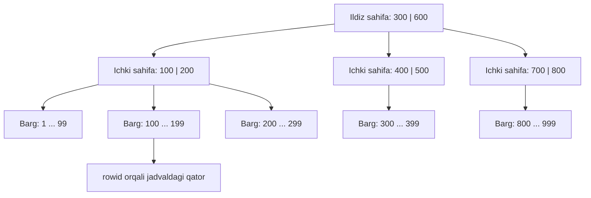
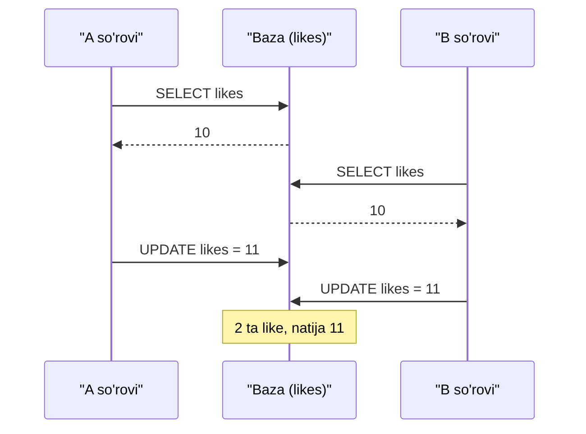
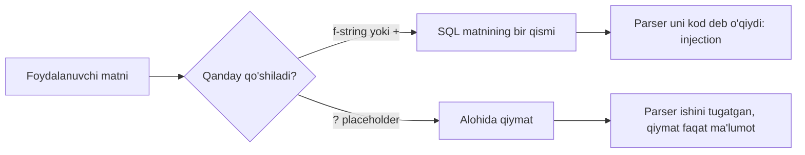

## Bu dars nima uchun kerak

37-38-darslarda to'g'ri natija beradigan SQL so'rovlarini yozishni o'rgandik: `SELECT`, `WHERE`, `GROUP BY`, `JOIN`. Lekin "to'g'ri natija" - ishning yarmi. Haqiqiy ilovada uchta yangi savol tug'iladi:

1. **Tezlik.** Jadvalda 1000 qator bo'lganda har qanday so'rov bir zumda ishlaydi. Million qatorda esa bitta `WHERE author = ?` yuzlab millisekundga cho'zilishi mumkin, chunki baza har bir qatorni ko'rib chiqadi. Qanday qilib kerakli qatorni "to'g'ridan-to'g'ri" topish mumkin?
2. **Bir vaqtda ishlash.** Ikki foydalanuvchi bir postga bir vaqtda "like" bossa, hisoblagich 2 ga emas, 1 ga oshishi mumkin. Pul o'tkazmasida esa bir hisobdan pul yechilib, ikkinchisiga tushmay qolishi mumkin. Bazani qanday qilib "yarim bajarilgan" holatdan himoya qilish kerak?
3. **Xavfsizlik.** Foydalanuvchi kiritgan matn SQL so'rovining ichiga qo'shilsa, u so'rovning ma'nosini o'zgartirib yuborishi mumkin. Bu - eng ko'p uchraydigan va eng qimmatga tushadigan xatolardan biri.

Bu darsda uchala muammoning mexanikasini ochamiz. Indeks 29-darsdagi binary search tree g'oyasining diskka moslashtirilgan ko'rinishi ekanini ko'ramiz, 30-darsdagi hash table bilan nima uchun bu yerda kam ishlatilishini solishtiramiz. Python misollari 31-34-darslardagi sintaksis va exceptions'ga tayanadi; `sqlite3` modulining to'liq imkoniyatlari keyingi, 40-darsda ko'riladi.

Bu darsdan keyin siz:

- indeks nima ekanini va nima uchun u qidiruvni minglab marta tezlashtirishini hisob bilan tushuntira olasiz;
- B-tree ning 29-darsdagi BST dan farqini (sahifa, fan-out, balandlik) bilasiz;
- `CREATE INDEX` bilan indeks yaratib, `EXPLAIN QUERY PLAN` natijasida `SCAN` va `SEARCH` ni farqlay olasiz;
- indeksning narxini (yozish sekinlashadi, joy oladi) o'lchab ko'rsata olasiz va composite indeksda ustunlar tartibi nima uchun muhimligini bilasiz;
- tranzaksiya (`BEGIN`, `COMMIT`, `ROLLBACK`) va ACID xossalarini misol bilan izohlay olasiz;
- race condition va "yo'qolgan yangilanish" ni vaqt chizig'i bilan ko'rsatib, uni tuzata olasiz;
- SQL injection qanday ishlashini va parametrlangan so'rov uni nima uchun to'liq yopishini tushuntira olasiz.

## Indeks: butun jadvalni o'qimaslik

### Full table scan narxi

Indeks bo'lmasa, `SELECT * FROM posts WHERE author = 'user7'` so'rovini bajarish uchun baza boshqa yo'l bilmaydi: jadvalning birinchi qatoridan oxirgisigacha yuradi va har birida shartni tekshiradi. Bu **full table scan** (jadvalni to'liq ko'rib chiqish) deyiladi. 15-darsdagi linear search ning aynan o'zi: O(n).

SQLite ma'lumotni diskda (yoki xotirada) bir xil o'lchamdagi **sahifalar** (page) bilan saqlaydi. Sukut bo'yicha sahifa 4096 bayt. Pastdagi o'lchov misolida 200 000 qatorli jadval 976 sahifa, ya'ni 976 · 4096 ≈ 4 MB oldi. Full scan - shu 976 sahifaning hammasini o'qish. Qidirilgan qatorlar 10 ta bo'lsa ham.

Hisoblaylik: 100 ta har xil muallifni qidirsak, 100 · 976 = 97 600 sahifa o'qiladi. Agar har bir so'rov uchun kerakli qatorni 3-4 sahifa o'qib topish mumkin bo'lsa, bu 100 · 4 = 400 sahifa: taxminan 240 baravar kam ish. Indeks aynan shuni beradi.

### Indeks - saralangan ko'rsatkichlar ro'yxati

Kitob oxiridagi alfavit ko'rsatkichini eslang: "binary search - 87, 112-betlar". Siz kitobni boshidan varaqlamaysiz, ko'rsatkichdan sahifa raqamini olib, to'g'ri o'sha joyga o'tasiz. Bazadagi **indeks** (index) ham shunday: bitta yoki bir nechta ustun qiymatlarining **saralangan** nusxasi, har bir qiymat yonida esa asl qatorning manzili (SQLite da `rowid`).

Saralangan bo'lgani uchun unda binary search qilish mumkin (16-dars): million qiymat orasidan bittasini log₂(1 000 000) ≈ 20 qadamda topamiz. Lekin oddiy saralangan massiv yetarli emas: jadvalga yangi qator qo'shilganda massivning o'rtasiga element qo'yish O(n) siljitishni talab qiladi. Bizga qidiruv ham, qo'shish ham tez bo'lgan tuzilma kerak - ya'ni 29-darsdagi balanslangan qidiruv daraxti.

### B-tree: BST ning diskka moslashgan ko'rinishi

29-darsdagi BST da har bir tugunda **bitta** kalit va **ikkita** bola bor. Million kalitli muvozanatli BST balandligi taxminan log₂(10⁶) ≈ 20. Xotirada 20 ta pointer bo'ylab yurish arzon. Lekin har bir tugun diskdagi alohida joyda bo'lsa, 20 ta tugun - 20 ta alohida disk o'qishi, va disk (hatto SSD) operativ xotiradan ming baravarlab sekin.

**B-tree** bu muammoni tugunni kattalashtirib hal qiladi: bitta tugun - bitta disk sahifasi (4096 bayt), va unga yuzlab kalit sig'adi. Tugunda k ta kalit bo'lsa, k + 1 ta bola bo'ladi: birinchi kalitdan kichiklar, birinchi va ikkinchi orasidagilar va hokazo. Bitta tugundagi bolalar soni **fan-out** deyiladi. BST da fan-out 2, B-tree da yuzlab.

Balandlikni hisoblaymiz. Fan-out f bo'lgan daraxtning balandligi taxminan log_f(n). Kalit kichik butun son yoki qisqa matn bo'lsa, 4096 baytlik sahifaga taxminan 100 dan ko'p yozuv sig'adi; hisob uchun f = 100 deb olamiz:

- n = 1 000 000: log₁₀₀(10⁶) = 6 / 2 = 3 daraja;
- n = 100 000 000: log₁₀₀(10⁸) = 8 / 2 = 4 daraja;
- BST bilan solishtirish: log₂(10⁶) ≈ 20 va log₂(10⁸) ≈ 27 daraja.

Ya'ni million qator orasidan qidiruv 3 ta sahifa o'qishi, yuz million orasidan - 4 ta. Yuqori daraja sahifalari (ildiz va undan keyingi) doim ishlatilgani uchun odatda xotirada (cache'da) turadi, shuning uchun amalda diskdan bitta-ikkita sahifa o'qiladi.



Diagrammada har bir tugun - bitta sahifa, ichida bir nechta kalit. 150 ni qidirish: ildizda 150 < 300, chap bolaga; ichki sahifada 100 ≤ 150 < 200, ikkinchi bolaga; bargda 150 topildi, yonidagi `rowid` bilan jadvaldan qatorni olamiz. Uch sahifa - uch qadam.

BST va B-tree ni yonma-yon qo'yamiz:

| Xususiyat | BST (29-dars) | B-tree |
|---|---|---|
| Bitta tugundagi kalitlar | 1 | Sahifaga sig'gancha (yuzlab) |
| Fan-out | 2 | Yuzlab |
| 10⁶ kalitda balandlik | ≈ 20 (muvozanatli bo'lsa) | ≈ 3 |
| Muvozanat | Oddiy BST da kafolat yo'q (29-dars, degenerate daraxt) | Doim muvozanatli: hamma barglar bir chuqurlikda |
| Optimallashtirilgan narsa | Xotiradagi pointer o'tishlari | Disk sahifasi o'qishlari soni |
| Diapazon so'rovi (`BETWEEN`) | In-order aylanish | Barglar tartibida o'qish |

SQLite fayl formati hujjatiga ko'ra, SQLite da ikki xil daraxt bor: jadvalning o'zi `rowid` bo'yicha saralangan daraxt bo'lib, ma'lumot faqat barglarda saqlanadi (bu ko'rinish ko'pincha B+tree deyiladi), indeks esa ixtiyoriy kalitli B-tree bo'lib, unda kalit va `rowid` turadi. Shuning uchun `WHERE id = 42` (primary key bo'yicha) qidiruv alohida indeksiz ham tez: jadvalning o'zi id bo'yicha saralangan.

### Nega hash table emas?

30-darsdagi hash table qidiruvni o'rtacha O(1) da bajaradi - B-tree ning O(log n) idan ham yaxshi. Lekin hash funksiya qiymatlar tartibini "sochib yuboradi": `"user7"` va `"user8"` jadvalning butunlay boshqa joylariga tushadi. Natijada hash indeks faqat `=` savoliga javob beradi. `WHERE created BETWEEN '2026-01-01' AND '2026-01-31'`, `ORDER BY created`, `WHERE name LIKE 'Ali%'` kabi so'rovlar uchun saralangan tartib kerak. B-tree ikkalasini ham qiladi, shuning uchun relational bazalarda u sukut bo'yicha tanlov. SQLite da faqat B-tree indekslar bor.

## CREATE INDEX va EXPLAIN QUERY PLAN

Indeks bitta buyruq bilan yaratiladi:

```sql
CREATE INDEX idx_posts_author ON posts (author);
```

`idx_posts_author` - indeks nomi (`idx_<jadval>_<ustun>` - keng tarqalgan an'ana), qavs ichida - ustun(lar). Indeksni o'chirish: `DROP INDEX idx_posts_author;`. `CREATE UNIQUE INDEX` esa qo'shimcha ravishda takror qiymatlarni taqiqlaydi; 38-darsdagi `UNIQUE` cheklovi ham ichkarida aynan shunday indeks yaratadi.

Muhim: indeks yaratilgandan keyin so'rovni o'zgartirish shart emas. Qaysi indeksni ishlatishni bazaning **query planner** (so'rov rejalashtiruvchisi) qismi o'zi hal qiladi. Uning qarorini ko'rish uchun so'rov oldiga `EXPLAIN QUERY PLAN` yoziladi. Natijaning `detail` ustunida ikki asosiy so'z bor:

- `SCAN posts` - jadval to'liq ko'rib chiqiladi (full table scan);
- `SEARCH posts USING INDEX ...` - kerakli joy indeks orqali topiladi.

Quyidagi blok 1000 qatorli jadval yaratadi (`WITH RECURSIVE` - 1 dan 1000 gacha sonlar ketma-ketligini hosil qiladigan yordamchi so'rov, bu yerda faqat test ma'lumoti uchun), keyin bir xil so'rovning rejasini indeksdan oldin va keyin ko'rsatadi:

```sql run
CREATE TABLE posts (id INTEGER PRIMARY KEY, author TEXT, created TEXT, likes INTEGER);

WITH RECURSIVE n(i) AS (SELECT 1 UNION ALL SELECT i + 1 FROM n WHERE i < 1000)
INSERT INTO posts (author, created, likes)
SELECT 'user' || (i % 50), '2026-01-' || printf('%02d', i % 28 + 1), i % 97 FROM n;

EXPLAIN QUERY PLAN SELECT * FROM posts WHERE author = 'user7';
EXPLAIN QUERY PLAN SELECT * FROM posts WHERE id = 42;

CREATE INDEX idx_posts_author ON posts (author);

EXPLAIN QUERY PLAN SELECT * FROM posts WHERE author = 'user7';
EXPLAIN QUERY PLAN SELECT COUNT(*) FROM posts WHERE author = 'user7';
EXPLAIN QUERY PLAN SELECT * FROM posts WHERE lower(author) = 'user7';
EXPLAIN QUERY PLAN SELECT * FROM posts WHERE author LIKE '%7';
```

Natijadagi `detail` ustuni (SQLite 3.53 da tekshirilgan; `id`, `parent`, `notused` ustunlaridagi sonlar versiyaga qarab farq qiladi, ularga e'tibor bermang):

```text
SCAN posts
SEARCH posts USING INTEGER PRIMARY KEY (rowid=?)
SEARCH posts USING INDEX idx_posts_author (author=?)
SEARCH posts USING COVERING INDEX idx_posts_author (author=?)
SCAN posts
SCAN posts
```

Har bir qatorni o'qiymiz:

1. Indeksdan oldin - `SCAN`: 1000 qatorning hammasi tekshiriladi.
2. `id = 42` - indeks yaratmagan bo'lsak ham `SEARCH`: `INTEGER PRIMARY KEY` ustuni `rowid` ning o'zi, jadval daraxti shu kalit bo'yicha saralangan.
3. Indeksdan keyin - `SEARCH ... USING INDEX`: indeksdan `user7` qatorlarining `rowid` lari olinadi, keyin har biri uchun jadvaldan to'liq qator o'qiladi.
4. `COUNT(*)` uchun `COVERING INDEX`: so'rovga kerak bo'lgan hamma narsa (bu yerda faqat `author`) indeksning o'zida bor, jadvalga umuman murojaat qilinmaydi. Bunday indeks **covering index** (qoplovchi indeks) deyiladi va eng tez variant.
5. `lower(author) = ...` - yana `SCAN`. Indeks `author` ning o'zi bo'yicha saralangan, `lower(author)` bo'yicha emas. Ustunga funksiya qo'llansa, indeks ishlatilmaydi.
6. `LIKE '%7'` - `SCAN`. Saralangan tartib boshidan qidirishga yordam beradi, oxiridan emas: lug'atda "...lik" bilan tugaydigan so'zlarni topish uchun ham butun lug'atni varaqlash kerak.

Blokni o'zgartirib ko'ring: `WHERE author = 'user7' AND likes > 50` yoki `ORDER BY author` qo'shing va reja qanday o'zgarishini kuzating.

### Tezlikni o'lchaymiz

Rejadagi farqni sekundlarda ko'ramiz. Python'ning `sqlite3` moduli (40-darsda batafsil) bilan 300 000 qatorli jadval yaratib, bir xil 100 ta so'rovni indekssiz va indeks bilan bajaramiz:

```python run
import sqlite3
import time

conn = sqlite3.connect(":memory:")
conn.execute("CREATE TABLE orders (id INTEGER PRIMARY KEY, customer INTEGER, total INTEGER)")
conn.executemany(
    "INSERT INTO orders (customer, total) VALUES (?, ?)",
    ((i * 7919 % 50000, i % 1000) for i in range(300_000)),
)
conn.commit()


def measure(label):
    start = time.perf_counter()
    for c in range(0, 50000, 500):  # 100 ta so'rov
        conn.execute("SELECT SUM(total) FROM orders WHERE customer = ?", (c,)).fetchone()
    ms = (time.perf_counter() - start) * 1000
    plan = conn.execute("EXPLAIN QUERY PLAN SELECT SUM(total) FROM orders WHERE customer = ?", (1,)).fetchone()[3]
    print(f"{label:14} {ms:8.1f} ms   {plan}")


measure("indekssiz")
conn.execute("CREATE INDEX idx_orders_customer ON orders (customer)")
measure("indeks bilan")
```

Lokal kompyuterda (CPython 3.13) natija:

```text
indekssiz         898.4 ms   SCAN orders
indeks bilan        1.3 ms   SEARCH orders USING INDEX idx_orders_customer (customer=?)
```

Millisekundlar kompyuter va brauzerga qarab bir necha baravar farq qiladi (brauzerda WebAssembly sekinroq), lekin nisbat taxminan bir xil: yuzlab baravar. Sababi hisobdan ko'rinadi: indekssiz har bir so'rov 300 000 qatorni ko'radi (jami 100 · 300 000 = 30 million tekshiruv), indeks bilan esa har bir so'rov bir necha sahifadan o'tib, 6 ta mos qatorni (300 000 / 50 000) o'qiydi.

## Indeksning narxi

Agar indeks shunchalik foydali bo'lsa, nega har bir ustunga indeks qo'ymaymiz? Chunki indeks bepul emas:

1. **Joy.** Indeks - ustun qiymatlari va `rowid` larning alohida nusxasi. U ham sahifalarda saqlanadi.
2. **Yozish sekinlashadi.** Har bir `INSERT` faqat jadvalga emas, har bir indeksga ham yozadi: B-tree ning to'g'ri bargini topib, kalitni saralangan joyga qo'yadi, kerak bo'lsa sahifani ikkiga bo'ladi. `UPDATE` indekslangan ustunni o'zgartirsa, eski kalit o'chirilib, yangisi qo'shiladi. `DELETE` ham har bir indeksdan o'chiradi.

O'lchab ko'ramiz: 200 000 qatorni 0, 1, 2 va 3 ta indeksli jadvalga yozamiz. `PRAGMA page_count` va `PRAGMA page_size` bazaning hajmini beradi:

```python run
import sqlite3
import time


def build(index_count):
    conn = sqlite3.connect(":memory:")
    conn.execute("CREATE TABLE events (id INTEGER PRIMARY KEY, device INTEGER, kind TEXT, value INTEGER)")
    for col in ["device", "kind", "value"][:index_count]:
        conn.execute(f"CREATE INDEX idx_events_{col} ON events ({col})")
    rows = [(i * 7919 % 10007, f"tur{i % 13}", i * 31 % 100003) for i in range(200_000)]
    start = time.perf_counter()
    conn.executemany("INSERT INTO events (device, kind, value) VALUES (?, ?, ?)", rows)
    conn.commit()
    ms = (time.perf_counter() - start) * 1000
    pages = conn.execute("PRAGMA page_count").fetchone()[0]
    size = conn.execute("PRAGMA page_size").fetchone()[0]
    print(f"{index_count} ta indeks: {ms:6.0f} ms, {pages:5} sahifa x {size} = {pages * size / 1024 / 1024:5.1f} MB")


for n in range(4):
    build(n)
```

Lokal natija:

```text
0 ta indeks:    110 ms,   976 sahifa x 4096 =   3.8 MB
1 ta indeks:    261 ms,  1563 sahifa x 4096 =   6.1 MB
2 ta indeks:    430 ms,  2278 sahifa x 4096 =   8.9 MB
3 ta indeks:    583 ms,  2904 sahifa x 4096 =  11.3 MB
```

Vaqtlar har safar biroz farq qiladi, sahifalar soni esa deyarli o'zgarmaydi. Xulosa: uchta indeks bazani 2904 / 976 ≈ 3 baravar kattalashtirdi va yozishni bir necha baravar sekinlashtirdi. Indeks - o'qishni tezlashtirish uchun yozish va joy bilan to'lanadigan narx.

`CREATE INDEX` buyrug'ini (f-string bilan) faqat o'zimiz yozgan ro'yxatdagi nomlar uchun yasaganimizga e'tibor bering. Foydalanuvchi kiritgan matnni hech qachon shunday SQL ga qo'shmang - sababi darsning oxirida.

Qachon indeks qo'yish kerak, qachon yo'q:

| Vaziyat | Indeks | Sabab |
|---|---|---|
| Ustun tez-tez `WHERE`, `JOIN ... ON`, `ORDER BY` da | Ha | Aynan shu so'rovlar tezlashadi |
| Foreign key ustuni (38-dars), masalan `books.author_id` | Odatda ha | JOIN va bog'langan qatorlarni o'chirishda kerak; SQLite uni avtomatik yaratmaydi |
| Jadval kichik (bir necha yuz qator) | Yo'q | Full scan baribir bir-ikki sahifa |
| Jadvalga juda ko'p yoziladi, kam o'qiladi (log, telemetriya) | Ehtiyot bilan | Har bir indeks har bir `INSERT` ni sekinlashtiradi |
| Ustunda qiymatlar juda kam xil (masalan, faqat 0 va 1) | Ko'pincha foydasiz | Indeks qatorlarning yarmini qaytaradi, scan bilan farqi oz |
| So'rov ustunga funksiya qo'llaydi (`lower(email)`) | Oddiy indeks ishlamaydi | Ustunni normallashtirib saqlang yoki ifoda bo'yicha indeks (expression index) yarating |

## Composite indeks va ustunlar tartibi

Indeks bir nechta ustundan iborat bo'lishi mumkin. Bunday **composite indeks** (tarkibli indeks) qiymatlarni avval birinchi ustun bo'yicha, birinchisi teng bo'lganda ikkinchi ustun bo'yicha saralaydi - telefon kitobidagi "familiya, keyin ism" tartibi kabi.

```sql
CREATE INDEX idx_trips_driver_day ON trips (driver, day);
```

Bu indeksdagi tartib: `(D1, 2026-03-01)`, `(D1, 2026-03-02)`, ..., `(D2, 2026-03-01)`, ... Natijada:

- `WHERE driver = 'D7'` - ishlaydi: D7 ning hamma yozuvlari indeksda yonma-yon;
- `WHERE driver = 'D7' AND day = '...'` - ishlaydi, eng aniq qidiruv;
- `WHERE driver = 'D7' AND day >= '...'` - ishlaydi: D7 bloki ichida kunlar saralangan;
- `WHERE day = '...'` - **ishlamaydi**: telefon kitobida faqat ism bo'yicha qidirish kabi, kunlar har bir haydovchi bloki ichida sochilgan.

Bu qoida **leftmost prefix** (chap prefiks) qoidasi deyiladi: composite indeks chapdagi ustundan boshlab uzluksiz ishlatilgan ustunlar uchun ishlaydi. Tekshiramiz:

```sql run
CREATE TABLE trips (id INTEGER PRIMARY KEY, driver TEXT, day TEXT, km INTEGER);
CREATE INDEX idx_trips_driver_day ON trips (driver, day);

EXPLAIN QUERY PLAN SELECT * FROM trips WHERE driver = 'D7';
EXPLAIN QUERY PLAN SELECT * FROM trips WHERE driver = 'D7' AND day = '2026-03-01';
EXPLAIN QUERY PLAN SELECT * FROM trips WHERE driver = 'D7' AND day >= '2026-03-01';
EXPLAIN QUERY PLAN SELECT * FROM trips WHERE day = '2026-03-01';
EXPLAIN QUERY PLAN SELECT day FROM trips WHERE driver = 'D7' ORDER BY day;
EXPLAIN QUERY PLAN SELECT * FROM trips WHERE driver = 'D7' ORDER BY km;
```

`detail` ustuni:

```text
SEARCH trips USING INDEX idx_trips_driver_day (driver=?)
SEARCH trips USING INDEX idx_trips_driver_day (driver=? AND day=?)
SEARCH trips USING INDEX idx_trips_driver_day (driver=? AND day>?)
SCAN trips
SEARCH trips USING COVERING INDEX idx_trips_driver_day (driver=?)
SEARCH trips USING INDEX idx_trips_driver_day (driver=?)
USE TEMP B-TREE FOR ORDER BY
```

Oxirgi ikki so'rov qiziq. `ORDER BY day` uchun alohida saralash yo'q: D7 bloki ichida kunlar allaqachon tartiblangan va `day` indeksda bor (covering). `ORDER BY km` uchun esa SQLite natijani vaqtinchalik daraxtda qo'shimcha saralaydi (`USE TEMP B-TREE FOR ORDER BY`), chunki `km` indeksda yo'q.

Ustunlar tartibini qanday tanlash kerak? Asosiy savol: qaysi so'rovlar bor? Agar ilova doim "haydovchi va kun oralig'i" bo'yicha qidirsa, `(driver, day)` to'g'ri: tenglik bilan tekshiriladigan ustun birinchi, diapazon (`>=`, `BETWEEN`) bilan tekshiriladigani keyin. Teskari `(day, driver)` indeksda `day >= ...` diapazoni ko'p haydovchilarni qamrab oladi va `driver` bo'yicha saralangan tartib buziladi. Faqat `day` bo'yicha so'rov ham ko'p bo'lsa, unga alohida indeks kerak (va bu yana yozish narxi).

## Tranzaksiyalar: hammasi yoki hech narsa

Endi ikkinchi muammoga o'tamiz. Pul o'tkazmasi ikki `UPDATE` dan iborat: jo'natuvchidan yechish va qabul qiluvchiga qo'shish. Agar birinchisidan keyin dastur to'xtasa (elektr o'chdi, xato chiqdi), pul yo'qoladi. Bunday "yarim" holatga yo'l qo'ymaslik uchun **tranzaksiya** (transaction) ishlatiladi: bir nechta buyruq bitta bo'linmas birlikka birlashtiriladi.

- `BEGIN` - tranzaksiyani boshlaydi;
- `COMMIT` - barcha o'zgarishlarni doimiy qiladi;
- `ROLLBACK` - tranzaksiya boshidan beri qilingan barcha o'zgarishlarni bekor qiladi.

SQLite da `BEGIN` siz bajarilgan har bir buyruq avtomatik ravishda o'zining alohida tranzaksiyasida ishlaydi (autocommit). Quyidagi blokda o'tkazma o'rtasida xato aniqlanadi va `ROLLBACK` qilinadi:

```sql run
CREATE TABLE accounts (name TEXT PRIMARY KEY, balance INTEGER NOT NULL);

-- Boshlang'ich ma'lumot ham tranzaksiya ichida yozilishi mumkin
BEGIN;
INSERT INTO accounts VALUES ('Aziza', 100), ('Bekzod', 50);
COMMIT;

-- 1-o'tkazma: muvaffaqiyatli
BEGIN;
UPDATE accounts SET balance = balance - 30 WHERE name = 'Aziza';
UPDATE accounts SET balance = balance + 30 WHERE name = 'Bekzod';
COMMIT;

SELECT name, balance FROM accounts;

-- 2-o'tkazma: yechildi, lekin qabul qiluvchi nomi xato ('Bekzodd' yo'q)
BEGIN;
UPDATE accounts SET balance = balance - 50 WHERE name = 'Aziza';
UPDATE accounts SET balance = balance + 50 WHERE name = 'Bekzodd';
SELECT name, balance FROM accounts;
ROLLBACK;

SELECT name, balance, (SELECT SUM(balance) FROM accounts) AS jami FROM accounts;
```

Uchta natija jadvali chiqadi: birinchisida Aziza 70, Bekzod 80. Ikkinchisida (tranzaksiya ichida, `ROLLBACK` dan oldin) Aziza 20, Bekzod 80 - jami 100, 50 so'm "havoda". Uchinchisida yana 70 va 80, jami 150: `ROLLBACK` yechishni bekor qildi. Haqiqiy ilovada "qabul qiluvchi topilmadi" degan qarorni dastur qabul qiladi (`UPDATE` ta'sir qilgan qatorlar soni 0), buni pastdagi mashqda Python'da qilamiz.

### ACID

Tranzaksiyaning kafolatlari to'rt harf bilan ataladi. SQLite hujjati SQLite ni ACID bazasi deb ta'riflaydi:

| Harf | Nomi | Ma'nosi | O'tkazma misolida |
|---|---|---|---|
| A | Atomicity (bo'linmaslik) | Tranzaksiyadagi buyruqlar yo hammasi, yo hech biri bajariladi | Yechish bor-u, qo'shish yo'q holat bo'lmaydi |
| C | Consistency (yaxlitlik) | Tranzaksiya bazani bir to'g'ri holatdan boshqa to'g'ri holatga o'tkazadi, cheklovlar (`NOT NULL`, `CHECK`, `FOREIGN KEY`) buzilmaydi | `CHECK (balance >= 0)` bo'lsa, manfiy balans saqlanmaydi |
| I | Isolation (ajratilganlik) | Parallel tranzaksiyalar bir-birining yarim natijasini ko'rmaydi | Boshqa so'rov "50 so'm havoda" holatini ko'rmaydi |
| D | Durability (chidamlilik) | `COMMIT` dan keyin ma'lumot elektr o'chsa ham saqlanib qoladi | Muvaffaqiyat xabaridan keyin o'tkazma yo'qolmaydi |

Hujjat bu kafolatlar dastur, operatsion tizim yoki elektr ta'minoti uzilganda ham saqlanishini ta'kidlaydi. Atomicity va durability ni SQLite jurnal fayl orqali ta'minlaydi: sahifani o'zgartirishdan oldin uning asl nusxasini jurnalga yozadi (rollback journal) yoki aksincha, o'zgarishlarni alohida faylga yozib boradi (WAL - write-ahead log). Dastur yarim yo'lda to'xtasa, keyingi ochilishda jurnal yordamida baza oxirgi to'g'ri holatga qaytariladi.

Tranzaksiyaning yana bir foydasi - tezlik. Autocommit rejimida har bir `INSERT` alohida tranzaksiya, va har birining oxirida baza ma'lumot diskka haqiqatan yozilganini kutadi. 10 000 qatorni bitta `BEGIN ... COMMIT` ichida yozish 10 000 ta alohida commit'dan ko'p marta tezroq.

## Race condition: yo'qolgan yangilanish

**Race condition** (poyga holati) - natija bir vaqtda bajarilayotgan amallarning qaysi tartibda kelishiga bog'liq bo'lgan xato. Klassik misol: postning "like" hisoblagichi. Ilova kodi ko'pincha shunday yoziladi:

1. `SELECT likes FROM posts WHERE id = 1` - joriy qiymatni o'qi;
2. Python'da 1 qo'sh;
3. `UPDATE posts SET likes = ? WHERE id = 1` - yangi qiymatni yoz.

Bu naqsh **read-modify-write** (o'qi - o'zgartir - yoz) deyiladi. Bitta foydalanuvchi uchun u to'g'ri. Ikki so'rov bir vaqtda kelganda esa:

| Vaqt | A so'rovi | B so'rovi | Bazadagi `likes` |
|---|---|---|---|
| t1 | `SELECT` → 10 | | 10 |
| t2 | | `SELECT` → 10 | 10 |
| t3 | `UPDATE likes = 11` | | 11 |
| t4 | | `UPDATE likes = 11` | 11 |

Ikki like bosildi, hisoblagich bitta oshdi. B ning yozuvi A nikini ustidan yozib yubordi va bu hech qanday xato xabarisiz sodir bo'ldi. Bu - 36-darsda ikki dastur bitta CSV faylni tahrirlaganda ko'rgan lost update ning aynan o'zi, faqat endi bazada. 35-darsdagi `counter += 1` ham Python thread'lari orasida xuddi shu sabab bilan buziladi: o'qish va yozish orasiga boshqa amal kirib qoladi.



Brauzerda haqiqiy parallel oqimlar (thread) ishlamaydi, lekin ikki ulanish (connection) va amallar tartibini qo'lda belgilab, xuddi shu vaqt chizig'ini takrorlash mumkin. Har bir ulanish - alohida foydalanuvchi so'rovi; `isolation_level=None` har bir buyruqni darhol commit qiladi (autocommit, 40-darsda batafsil):

```python run
import os
import sqlite3

if os.path.exists("likes.db"):
    os.remove("likes.db")

setup = sqlite3.connect("likes.db", isolation_level=None)
setup.execute("CREATE TABLE posts (id INTEGER PRIMARY KEY, likes INTEGER NOT NULL)")
setup.execute("INSERT INTO posts (id, likes) VALUES (1, 10)")

a = sqlite3.connect("likes.db", isolation_level=None)  # 1-foydalanuvchi so'rovi
b = sqlite3.connect("likes.db", isolation_level=None)  # 2-foydalanuvchi so'rovi


def read(conn):
    return conn.execute("SELECT likes FROM posts WHERE id = 1").fetchone()[0]


def write(conn, value):
    conn.execute("UPDATE posts SET likes = ? WHERE id = 1", (value,))


# Vaqt chizig'i: ikkala so'rov avval o'qiydi, keyin yozadi
x = read(a)  # t1: A 10 ni o'qidi
y = read(b)  # t2: B ham 10 ni o'qidi
write(a, x + 1)  # t3: A 11 yozdi
write(b, y + 1)  # t4: B ham 11 yozdi (A ning yozuvi ustidan)
print("read-modify-write:", read(setup), "(kutilgan 12)")

# Yechim: hisobni bazaning o'ziga topshirish
setup.execute("UPDATE posts SET likes = 10 WHERE id = 1")
a.execute("UPDATE posts SET likes = likes + 1 WHERE id = 1")
b.execute("UPDATE posts SET likes = likes + 1 WHERE id = 1")
print("likes = likes + 1:", read(setup))
```

Natija:

```text
read-modify-write: 11 (kutilgan 12)
likes = likes + 1: 12
```

### Yechim 1: atomik UPDATE

`UPDATE posts SET likes = likes + 1 WHERE id = 1` - bitta buyruq. Baza uni bajarayotganda qiymatni o'qish va yozish orasiga boshqa yozuv kira olmaydi: SQLite bir vaqtda faqat bitta yozuvchiga ruxsat beradi (pastda), va o'qish shu yozuvchi ichida sodir bo'ladi. Shuning uchun B ning `likes + 1` i A yozgan 11 ni ko'radi va 12 yozadi. Qoida: hisoblagich, qoldiq, zaxira kabi qiymatlarni Python'da hisoblab yozmang, o'zgarishni SQL ifodasi sifatida bazaga yuboring.

Shart ham qo'shish mumkin: `UPDATE products SET stock = stock - 1 WHERE id = ? AND stock > 0`. Agar ta'sir qilgan qatorlar soni 0 bo'lsa, mahsulot tugagan - ikki xaridor oxirgi bitta mahsulotni bir vaqtda sotib ololmaydi.

### Yechim 2: tranzaksiya va SQLite bloklash modeli

Ba'zan hisobni bitta ifodaga sig'dirib bo'lmaydi (masalan, qiymatni o'qib, murakkab Python mantiqidan o'tkazish kerak). Unda o'qish va yozishni bitta tranzaksiyaga o'rash kerak. Bu qanday yordam berishini tushunish uchun SQLite ning bloklash (locking) modelini qisqacha ko'ramiz. Rasmiy hujjatga ko'ra, har bir ulanish baza fayliga nisbatan quyidagi holatlardan birida bo'ladi:

| Holat | Ma'nosi | Boshqalar bilan birga bo'la oladimi |
|---|---|---|
| UNLOCKED | Hech narsa qilmayapti | Ha |
| SHARED | O'qiyapti | Ko'p SHARED birga bo'la oladi |
| RESERVED | Yozishni rejalashtirmoqda, o'zgarishlar hozircha xotirada | Faqat bitta RESERVED, lekin yangi SHARED lar qo'shila oladi |
| PENDING | Yozishga tayyor, mavjud o'quvchilar tugashini kutyapti | Yangi SHARED berilmaydi |
| EXCLUSIVE | Faylga yozyapti | Boshqa hech qanday blok yo'q |

Asosiy oqibat: **o'quvchilar ko'p bo'lishi mumkin, yozuvchi esa bitta.** Commit qilish uchun yozuvchi EXCLUSIVE olishi, ya'ni barcha o'quvchilar tugashini kutishi kerak. Endi lost update stsenariysini tranzaksiyalar bilan takrorlaymiz. `timeout=0` - kutmasdan darhol xato qaytarish (Python'da sukut bo'yicha ulanish blok bo'shashini 5 soniya kutadi):

```python
import sqlite3

s = sqlite3.connect("bank.db", isolation_level=None)
s.execute("CREATE TABLE posts (id INTEGER PRIMARY KEY, likes INTEGER)")
s.execute("INSERT INTO posts VALUES (1, 10)")
a = sqlite3.connect("bank.db", isolation_level=None, timeout=0)
b = sqlite3.connect("bank.db", isolation_level=None, timeout=0)

a.execute("BEGIN")
x = a.execute("SELECT likes FROM posts WHERE id = 1").fetchone()[0]   # A: SHARED
b.execute("BEGIN")
y = b.execute("SELECT likes FROM posts WHERE id = 1").fetchone()[0]   # B: SHARED
a.execute("UPDATE posts SET likes = ? WHERE id = 1", (x + 1,))         # A: RESERVED
try:
    a.execute("COMMIT")                       # A: EXCLUSIVE kerak, B hali o'qiyapti
except sqlite3.OperationalError as e:
    print("A COMMIT:", e)
try:
    b.execute("UPDATE posts SET likes = ? WHERE id = 1", (y + 1,))     # RESERVED band
except sqlite3.OperationalError as e:
    print("B UPDATE:", e)
b.execute("ROLLBACK")                         # B voz kechadi va keyin qaytadan urinadi
a.execute("COMMIT")
print(s.execute("SELECT likes FROM posts").fetchone()[0])
```

Lokal natija (bu blok brauzerda ishga tushirilmaydi: brauzerning virtual fayl tizimida fayl bloklari haqiqiy diskdagi kabi ishlamasligi mumkin):

```text
A COMMIT: database is locked
B UPDATE: database is locked
11
```

Baza ikkala yozuvga birdaniga ruxsat bermadi: B o'zining eskirgan 10 asosidagi yozuvini saqlay olmadi va `ROLLBACK` qildi. Endi B qaytadan urinsa, yangi tranzaksiyada 11 ni o'qiydi va 12 yozadi. Ya'ni tranzaksiya lost update ni xatoga aylantirdi, xato esa qayta urinish bilan hal qilinadi. `database is locked` (SQLite kodi `SQLITE_BUSY`) - "hozir band, keyinroq urin" degani; real ilovada `timeout` ni noldan katta qo'yib, baza o'zi bir oz kutishiga ruxsat beriladi.

Bu misoldagi o'zaro kutishdan qochishning oddiy usuli - yozishni rejalashtirgan tranzaksiyani boshidanoq `BEGIN IMMEDIATE` bilan ochish. SQLite hujjatiga ko'ra, oddiy `BEGIN` (aslida `BEGIN DEFERRED`) birinchi o'qish yoki yozishgacha hech qanday blok olmaydi, `BEGIN IMMEDIATE` esa darhol yozish blokini (RESERVED) oladi. Ikkinchi yozuvchi o'qishni boshlashdan oldinoq kutadi yoki `database is locked` oladi, va eskirgan qiymat asosida hisob qilmaydi.

WAL rejimida (`PRAGMA journal_mode=WAL`) o'quvchilar va yozuvchi bir-birini to'smaydi, lekin yozuvchi baribir bitta. Ko'p foydalanuvchili server bazalari (PostgreSQL, MySQL) bloklarni qator darajasida qo'yadi va bir vaqtda ko'p yozuvchiga ruxsat beradi; ular haqida system design kursida.

## SQL injection

Uchinchi muammo. Foydalanuvchi login formasiga nom va parol kiritadi, ilova esa ularni SQL satriga yopishtiradi:

```python
sql = f"SELECT id FROM users WHERE username = '{username}' AND password = '{password}'"
```

Bu kodning muammosi: `username` va `password` **ma'lumot** bo'lishi kerak, lekin ular SQL **kodi** ichiga matn sifatida qo'shilmoqda. Foydalanuvchi qo'shtirnoq yozsa, u satrni yopadi va undan keyin yozilgan narsa SQL buyrug'i sifatida tahlil qilinadi. Bu **SQL injection** (SQL kod kiritish).

```python run
import sqlite3

conn = sqlite3.connect(":memory:")
conn.execute("CREATE TABLE users (id INTEGER PRIMARY KEY, username TEXT UNIQUE, password TEXT)")
conn.executemany(
    "INSERT INTO users (username, password) VALUES (?, ?)",
    [("aziza", "x7#kQ"), ("bekzod", "m2!pL"), ("admin", "Zr9$w")],
)


def login_unsafe(username, password):
    sql = f"SELECT id, username FROM users WHERE username = '{username}' AND password = '{password}'"
    print("  SQL:", sql)
    return conn.execute(sql).fetchall()


def login_safe(username, password):
    sql = "SELECT id, username FROM users WHERE username = ? AND password = ?"
    return conn.execute(sql, (username, password)).fetchall()


print("Oddiy kirish:", login_unsafe("aziza", "x7#kQ"))
print("Hujum:", login_unsafe("admin", "' OR '1'='1"))
print("Izoh bilan:", login_unsafe("admin' --", "nimadir"))
print("Xavfsiz:", login_safe("admin", "' OR '1'='1"))
print("Xavfsiz:", login_safe("admin' --", "nimadir"))
try:
    login_unsafe("x'; DROP TABLE users; --", "")
except sqlite3.Error as e:
    print("Ko'p buyruq:", type(e).__name__, e)
```

Natija:

```text
  SQL: SELECT id, username FROM users WHERE username = 'aziza' AND password = 'x7#kQ'
Oddiy kirish: [(1, 'aziza')]
  SQL: SELECT id, username FROM users WHERE username = 'admin' AND password = '' OR '1'='1'
Hujum: [(1, 'aziza'), (2, 'bekzod'), (3, 'admin')]
  SQL: SELECT id, username FROM users WHERE username = 'admin' --' AND password = 'nimadir'
Izoh bilan: [(3, 'admin')]
Xavfsiz: []
Xavfsiz: []
  SQL: SELECT id, username FROM users WHERE username = 'x'; DROP TABLE users; --' AND password = ''
Ko'p buyruq: ProgrammingError You can only execute one statement at a time.
```

Hujumlarni tahlil qilamiz:

1. **`' OR '1'='1`.** Parol maydonidagi birinchi `'` parol satrini yopadi. Shart `username = 'admin' AND password = '' OR '1'='1'` ga aylanadi. `AND` `OR` dan oldin bajariladi, shuning uchun bu `(...) OR '1'='1'` - har bir qator uchun rost. Hamma foydalanuvchilar qaytdi; ko'p ilovalar "birinchi qatorni olib, tizimga kiritadi".
2. **`admin' --`.** `--` SQL da qator oxirigacha izoh. Parol tekshiruvi butunlay izohga aylandi: parolni bilmasdan admin sifatida kirish.
3. **`'; DROP TABLE users; --`.** Python'ning `execute()` bir chaqiruvda faqat bitta buyruq bajaradi va bu urinishni rad etdi. Lekin bu himoya emas, tasodifiy to'siq: `executescript()` yoki boshqa kutubxonalar bir nechta buyruqni qabul qiladi, birinchi ikki hujum esa bitta buyruq ichida ishlaydi.

Shuni ham unutmang: o'zbek ismlarida apostrof tabiiy. `G'ayrat` nomli foydalanuvchi hech qanday hujumsiz ham satr birlashtiruvchi kodni buzadi: `WHERE username = 'G'ayrat'` - sintaksis xatosi. SQL injection himoyasizligining birinchi belgisi ko'pincha shunday "g'alati" xato.

Bu darsdagi jadvalda parollar ochiq matnda turibdi - faqat misolni sodda qilish uchun. Haqiqiy tizimda parolning o'zi emas, maxsus sekin hash funksiya natijasi saqlanadi; bu web xavfsizlik darslarida.

### Parametrlangan so'rov: nima uchun u ishlaydi

`login_safe` da SQL matni o'zgarmas: qiymatlar o'rnida `?` belgisi - **placeholder** (o'rin egallovchi). Qiymatlar alohida tuple bilan uzatiladi. Bu **parametrlangan so'rov** (parameterized query).

Farq qayerda? SQLite so'rovni ikki bosqichda bajaradi: avval SQL matnini tahlil qilib, bajariladigan dasturga (prepared statement) aylantiradi, keyin `?` o'rinlariga qiymatlarni bog'laydi (bind). Tahlil paytida qiymatlar hali yo'q. Qiymat bog'langanda u faqat ma'lumot: `' OR '1'='1` - shunchaki 11 belgili satr, va baza "paroli aynan shu satrga teng foydalanuvchi" ni qidiradi. Topilmaydi. Qo'shtirnoqlarni "tozalash" yoki "escape qilish" ga urinishdan farqli o'laroq, bu yerda tozalanadigan narsa yo'q: ma'lumot kod bilan hech qachon aralashmaydi.



Placeholder faqat **qiymat** o'rnida ishlaydi. Jadval yoki ustun nomi, `ORDER BY` yo'nalishi (`ASC`/`DESC`), SQL kalit so'zlari o'rniga `?` qo'yib bo'lmaydi. Ular dinamik bo'lishi kerak bo'lsa, foydalanuvchi kiritgan narsani ruxsat etilgan qiymatlar ro'yxati (allowlist) bilan tekshiring:

```python
SORTABLE = {"created", "likes", "author"}
if column not in SORTABLE:
    raise ValueError("noto'g'ri ustun")
sql = f"SELECT * FROM posts ORDER BY {column}"   # column endi faqat 3 qiymatdan biri
```

Yana bir nozik joy - `LIKE`. `WHERE title LIKE ?` va qiymat `f"%{text}%"` - xavfsiz (injection yo'q), lekin foydalanuvchi `%` yoki `_` yozsa, ular wildcard sifatida ishlaydi. Bu xavfsizlik emas, to'g'rilik masalasi; kerak bo'lsa `ESCAPE` bilan hal qilinadi.

### Bu nazariy xavf emas

SQL injection o'n yillardan beri eng ko'p ekspluatatsiya qilinadigan zaifliklar orasida. OWASP (Open Worldwide Application Security Project) ning veb-ilovalar uchun Top 10 xavflar ro'yxatida Injection 2021-yilgi nashrda 3-o'rinda (A03:2021), 2025-yilgi nashrda 5-o'rinda (A05:2025). MITRE ning eng xavfli dasturiy zaifliklar ro'yxati CWE Top 25 da SQL injection (CWE-89) 2025-yilda 2-o'rinni egalladi (2024-yilda 3-o'rin edi).

Real holatlardan biri: 2015-yil oktyabrida Buyuk Britaniyadagi yirik telekom provayderining veb-saytlariga SQL injection hujumi qilindi. Mamlakatning ma'lumotlarni himoya qilish nazoratchisi (ICO) tergoviga ko'ra, hujumchilar boshqa kompaniyadan meros qolgan, unutilgan eski veb-sahifalardagi zaiflik orqali 156 959 mijozning shaxsiy ma'lumotlariga, ulardan 15 656 tasining bank hisob raqamlariga yetib borgan. Tergov yana shuni aniqladi: bazaning dasturiy ta'minoti eskirgan, tuzatish allaqachon chiqqan xatoni yopish uchun yangilanmagan, va o'sha yilning o'zida bundan oldin ham ikki marta shunga o'xshash hujum bo'lgan - ular kompaniyani ogohlantirishi kerak edi, lekin choralar ko'rilmagan. 2016-yil oktyabrida ICO kompaniyani 400 000 funt sterling jarimaga tortdi - bu o'sha paytdagi eng katta jarimasi edi. Parametrlangan so'rovlar - aynan shu turdagi xatoga qarshi asosiy himoya, OWASP ning SQL injection himoyasi bo'yicha qo'llanmasi ham ularni birinchi o'rinda tavsiya qiladi.

## Mashq: xavfsiz va atomik pul o'tkazmasi

Quyidagi `transfer` funksiyasi uch xil xato bilan yozilgan: SQL satr birlashtirish bilan yasalgan, tranzaksiyasiz (yechishdan keyin xato chiqsa, pul yo'qoladi) va hech narsani tekshirmaydi. Uni qayta yozing:

- `amount` musbat bo'lmasa - `ValueError`;
- jo'natuvchi yoki qabul qiluvchi yo'q bo'lsa - `ValueError`, balanslar o'zgarmasin;
- mablag' yetarli bo'lmasa - `ValueError`, balanslar o'zgarmasin (jadvalda `CHECK (balance >= 0)` bor: manfiy balans `sqlite3.IntegrityError` beradi, uni `ValueError` ga aylantiring);
- muvaffaqiyatli o'tkazma commit qilinsin; har qanday xatoda `conn.rollback()` chaqirilsin;
- faqat parametrlangan so'rovlar: `G'ayrat` nomi ishlashi va `' OR '1'='1` qo'shilgan nom hech narsani o'zgartirmasligi kerak.

Maslahat: `cursor.rowcount` - oxirgi `UPDATE` ta'sir qilgan qatorlar soni; 0 bo'lsa, bunday nom yo'q. Python `sqlite3` moduli `UPDATE` oldidan tranzaksiyani o'zi ochadi, siz faqat `conn.commit()` yoki `conn.rollback()` ni to'g'ri joyda chaqirasiz (33-darsdagi `try` / `except` bilan).

```python run
import sqlite3


def make_db():
    conn = sqlite3.connect(":memory:")
    conn.execute(
        "CREATE TABLE accounts (name TEXT PRIMARY KEY, balance INTEGER NOT NULL CHECK (balance >= 0))"
    )
    conn.executemany("INSERT INTO accounts VALUES (?, ?)", [("G'ayrat", 100), ("Malika", 50)])
    conn.commit()
    return conn


def transfer(conn, sender, receiver, amount):
    # Yechimingizni shu yerga yozing (bu versiya xavfli va atomik emas)
    conn.execute(f"UPDATE accounts SET balance = balance - {amount} WHERE name = '{sender}'")
    conn.execute(f"UPDATE accounts SET balance = balance + {amount} WHERE name = '{receiver}'")
    conn.commit()


def balances(conn):
    return dict(conn.execute("SELECT name, balance FROM accounts"))


conn = make_db()
try:
    transfer(conn, "G'ayrat", "Malika", 30)
except Exception as e:
    print("Xato:", type(e).__name__, e)
print(balances(conn))
```

```python test
def outcome(fn):
    try:
        fn()
    except ValueError:
        return "ValueError"
    except Exception as e:
        return type(e).__name__
    return "ok"


def scenario(sender, receiver, amount):
    db = make_db()
    result = outcome(lambda: transfer(db, sender, receiver, amount))
    return result, balances(db), db.in_transaction


START = {"G'ayrat": 100, "Malika": 50}
check("oddiy o'tkazma: G'ayrat 70, Malika 80 (apostrofli nom ishlashi kerak)",
      lambda: scenario("G'ayrat", "Malika", 30)[:2] == ("ok", {"G'ayrat": 70, "Malika": 80}))
check("muvaffaqiyatdan keyin commit qilingan (ochiq tranzaksiya qolmagan)",
      lambda: scenario("Malika", "G'ayrat", 50) == ("ok", {"G'ayrat": 150, "Malika": 0}, False))
check("yo'q qabul qiluvchi: ValueError va balanslar o'zgarmagan",
      lambda: scenario("G'ayrat", "Nodir", 30) == ("ValueError", START, False))
check("yo'q jo'natuvchi: ValueError va balanslar o'zgarmagan",
      lambda: scenario("Nodir", "Malika", 30) == ("ValueError", START, False))
check("mablag' yetarli emas: ValueError va balanslar o'zgarmagan",
      lambda: scenario("Malika", "G'ayrat", 80) == ("ValueError", START, False))
check("summa musbat bo'lishi kerak (0 va manfiy - ValueError)",
      lambda: scenario("G'ayrat", "Malika", 0) == ("ValueError", START, False)
      and scenario("Malika", "G'ayrat", -20) == ("ValueError", START, False))
check("injection: \"Malika' OR '1'='1\" hech kimning balansini o'zgartirmaydi",
      lambda: scenario("Malika' OR '1'='1", "G'ayrat", 10) == ("ValueError", START, False))
```

Boshlang'ich kodning o'zi ham ishga tushganda `G'ayrat` nomi tufayli sintaksis xatosini chiqaradi - yuqorida aytilgan "g'alati xato" ning aynan o'zi.

## Ko'p uchraydigan xatolar

1. **Indeksni "har ehtimolga qarshi" har bir ustunga qo'yish.** Har bir indeks har bir `INSERT`, `UPDATE`, `DELETE` ni sekinlashtiradi va joy oladi. Indeksni aniq so'rovlar uchun qo'ying va `EXPLAIN QUERY PLAN` bilan ishlatilayotganini tekshiring.
2. **Composite indeksda ustunlar tartibini e'tiborsiz qoldirish.** `(driver, day)` indeksi `WHERE day = ?` uchun ishlamaydi. Tenglik ustuni birinchi, diapazon ustuni keyin.
3. **Indekslangan ustunga funksiya qo'llash.** `WHERE lower(email) = ?` yoki `WHERE substr(created, 1, 4) = '2026'` indeksni chetlab o'tadi. Ma'lumotni normallashtirib saqlang yoki diapazon bilan yozing: `created >= '2026-01-01' AND created < '2027-01-01'`.
4. **Read-modify-write.** Qiymatni `SELECT` qilib, Python'da o'zgartirib, `UPDATE` bilan yozish parallel so'rovlarda yangilanishlarni yo'qotadi. `SET n = n + 1` yoki tranzaksiya ishlating.
5. **Ko'p qadamli o'zgarishni tranzaksiyasiz bajarish.** Yechish va qo'shish orasida xato chiqsa, baza "yarim" holatda qoladi. Bog'liq o'zgarishlar bitta tranzaksiyada, xatoda `ROLLBACK`.
6. **`database is locked` ni e'tiborsiz qoldirish yoki tranzaksiyani uzoq ochiq tutish.** Ochiq tranzaksiya boshqa yozuvchilarni to'sadi. Tranzaksiyani qisqa qiling, ichida foydalanuvchi kiritishini yoki tarmoq so'rovini kutmang.
7. **SQL ni f-string, `+` yoki `%` bilan yig'ish.** Har qanday foydalanuvchi qiymati faqat `?` (yoki `:nom`) orqali. "Qo'shtirnoqlarni o'zim tozalayman" - ishonchsiz yo'l.
8. **Jadval yoki ustun nomini foydalanuvchidan to'g'ridan-to'g'ri olish.** Placeholder ular uchun ishlamaydi; allowlist bilan tekshiring.

## Xulosa

- Indeks - ustun qiymatlarining saralangan nusxasi va qatorga ko'rsatkich. U full table scan (O(n)) ni daraxt bo'ylab qidiruvga (O(log n)) aylantiradi.
- B-tree - BST ning diskka moslashgan ko'rinishi: bitta tugun - bitta sahifa, fan-out yuzlab, shuning uchun million qatorda balandlik taxminan 3, BST da 20.
- `EXPLAIN QUERY PLAN` da `SCAN` - butun jadval, `SEARCH ... USING INDEX` - indeks orqali, `COVERING INDEX` - jadvalga umuman murojaatsiz.
- Indeksning narxi: joy (o'lchovimizda 3 ta indeks bazani taxminan 3 baravar kattalashtirdi) va har bir yozuvning sekinlashishi. Composite indeks leftmost prefix qoidasi bo'yicha ishlaydi.
- Tranzaksiya (`BEGIN`, `COMMIT`, `ROLLBACK`) bir nechta buyruqni bo'linmas birlikka aylantiradi; ACID - atomicity, consistency, isolation, durability.
- Race condition: natija amallar tartibiga bog'liq. Read-modify-write lost update ga olib keladi; yechim - atomik `UPDATE ... SET n = n + 1` yoki tranzaksiya (`BEGIN IMMEDIATE`) va qayta urinish.
- SQLite da o'quvchilar ko'p, yozuvchi bitta; band bo'lsa `database is locked` (`SQLITE_BUSY`).
- SQL injection - foydalanuvchi matni SQL kodi sifatida tahlil qilinishi. Parametrlangan so'rov ma'lumotni koddan to'liq ajratadi; nomlar uchun allowlist.

## Amaliy topshiriq

Kichik blog platformasi uchun `posts` jadvali bor: `id`, `author`, `title`, `created` (`YYYY-MM-DD` matn), `likes`. Ilova uchta so'rovni tez-tez bajaradi: (a) muallifning postlari sanasi bo'yicha teskari tartibda, (b) ma'lum oy ichidagi postlar soni, (c) "like" bosish.

1. **Ma'lumot.** Python `sqlite3` bilan jadval yarating va `executemany` orqali kamida 100 000 qator qo'shing (100 ta muallif, 2025-2026 yillar sanalari). Bazaning hajmini `PRAGMA page_count` bilan yozib oling.
2. **Rejalar.** (a) va (b) so'rovlarini parametrlangan holda yozing va indeksdan oldin `EXPLAIN QUERY PLAN` natijasini, 100 marta bajarish vaqtini o'lchang.
3. **Indeks tanlash.** (a) uchun qaysi composite indeks to'g'ri: `(author, created)` yoki `(created, author)`? Ikkalasini sinab, rejalarni (`USE TEMP B-TREE FOR ORDER BY` bormi?) va vaqtni solishtiring. (b) so'rovini indeks ishlatadigan qilib qayta yozing (`substr` yoki `strftime` emas, diapazon bilan).
4. **Narx.** Tanlangan indekslardan keyin bazaning hajmi va 10 000 qator qo'shish vaqti qanchaga o'zgardi? Hisobni ko'rsating.
5. **Like.** (c) ni avval read-modify-write bilan yozing va ikki ulanish bilan lost update ni takrorlang (vaqt chizig'i jadvali bilan), keyin atomik `UPDATE` bilan tuzating.
6. **Injection.** Muallif nomi bo'yicha qidiruvni ataylab f-string bilan yozib, `' OR '1'='1` va `x' --` kiritishlari natijasini ko'rsating, keyin parametrlangan versiyaga o'tkazing.

Yaxshi javobda bo'lishi kerak bo'lgan narsalar:

- har bir so'rov uchun indeksdan oldingi va keyingi `EXPLAIN QUERY PLAN` (`SCAN` → `SEARCH`) va o'lchangan vaqtlar;
- `(author, created)` tanlovining asoslanishi: tenglik ustuni birinchi, tartiblash ham indeksdan olinadi;
- (b) so'rovi `created >= '2026-03-01' AND created < '2026-04-01'` ko'rinishida va indeks ishlatgani;
- indeksning narxi raqamlarda: sahifalar soni farqi va yozish vaqti farqi;
- lost update vaqt chizig'i (t1-t4) va `likes = likes + 1` dan keyingi to'g'ri natija;
- injection namoyishi va barcha so'rovlarda faqat `?` placeholder ishlatilgani.

Javobingizni pastdagi maydonga yozing va yuqoridagi mezonlar bilan solishtiring.

## Manbalar

- CS50x. [Lecture 7 notes](https://cs50.harvard.edu/x/notes/7/) - "Indexes" (`CREATE INDEX`, B-tree, joy bilan to'lanadigan narx), "Race Conditions" (`BEGIN TRANSACTION`, `COMMIT`, `ROLLBACK`) va "SQL Injection Attacks" (`?` placeholder) bo'limlari.
- SQLite. [Query Planning](https://www.sqlite.org/queryplanner.html) - jadval va indeksning saralangan daraxt sifatida tuzilishi, full scan va indeks orqali qidiruv, covering index, ko'p ustunli indeks.
- SQLite. [EXPLAIN QUERY PLAN](https://www.sqlite.org/eqp.html) - `SCAN`, `SEARCH`, `COVERING INDEX`, `USE TEMP B-TREE FOR ORDER BY` qatorlarining ma'nosi.
- SQLite. [Database File Format](https://www.sqlite.org/fileformat2.html) - "B-tree Pages" bo'limi: table b-tree (ma'lumot faqat barglarda) va index b-tree farqi; [PRAGMA page_size](https://www.sqlite.org/pragma.html#pragma_page_size) - 3.12.0 dan beri sukut bo'yicha 4096 bayt.
- SQLite. [File Locking And Concurrency In SQLite Version 3](https://www.sqlite.org/lockingv3.html) - UNLOCKED, SHARED, RESERVED, PENDING, EXCLUSIVE holatlari, rollback journal.
- SQLite. [Transaction](https://www.sqlite.org/lang_transaction.html) - `BEGIN DEFERRED`, `IMMEDIATE`, `EXCLUSIVE`, autocommit va `SQLITE_BUSY`.
- OWASP. [SQL Injection Prevention Cheat Sheet](https://cheatsheetseries.owasp.org/cheatsheets/SQL_Injection_Prevention_Cheat_Sheet.html) - "Primary Defenses": prepared statements (parametrlangan so'rovlar), allowlist bilan kiritishni tekshirish.
- OWASP. [Top 10:2021 A03 Injection](https://top10.owasp.org/2021/A03_2021-Injection/index.html) va [Top 10:2025](https://top10.owasp.org/2025/) - injection xavflari reytingi; MITRE. [2025 CWE Top 25](https://cwe.mitre.org/top25/archive/2025/2025_cwe_top25.html) - CWE-89 o'rni.
- ICO. [TalkTalk cyber attack - how the ICO's investigation unfolded](https://ico.org.uk/about-the-ico/media-centre/talktalk-cyber-attack-how-the-ico-investigation-unfolded/) - 2015-yilgi SQL injection hujumi bo'yicha tergov: ta'sirlangan mijozlar soni, oldingi urinishlar, jarima. Sayt avtomatik so'rovlarni to'sib qo'ysa, xuddi shu faktlar [BBC News xabarida](https://www.bbc.com/news/business-37565367) (2016-yil oktyabr): rekord 400 000 funt jarima, eskirgan baza dasturi, SQL injection, oldingi ikki hujum.
