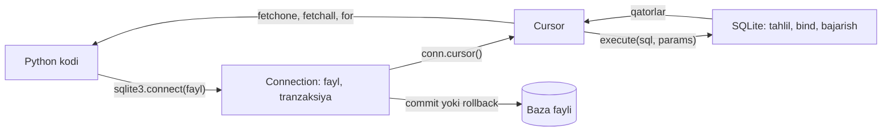
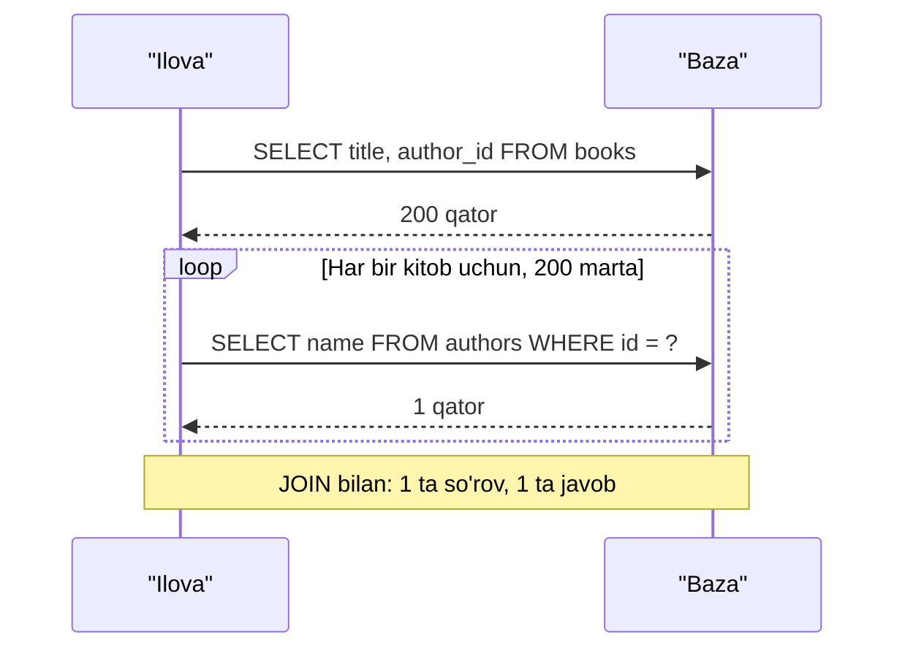

## Bu dars nima uchun kerak

36-39-darslarda SQL ni alohida til sifatida o'rgandik: jadval yaratish, `SELECT`, `JOIN`, indeks va tranzaksiya. Lekin real dasturda SQL o'z-o'zidan ishlamaydi. Uni ilova yuboradi: veb-sahifa so'rovi kelganda, CSV fayl yuklanganda, hisobot kerak bo'lganda. Ilova esa Python (yoki boshqa til) da yozilgan. Demak ikki dunyoni ulash kerak: Python o'zgaruvchilaridagi qiymatlarni SQL ga xavfsiz uzatish, natija qatorlarini Python obyektlariga aylantirish, xatolarni ushlash va tranzaksiyalarni boshqarish.

Python standart kutubxonasidagi `sqlite3` moduli aynan shu vazifani bajaradi. U alohida server talab qilmaydi: baza oddiy fayl (yoki xotiradagi `:memory:` baza), shuning uchun darsdagi barcha misollar to'g'ridan-to'g'ri brauzerda ishlaydi. 39-darsda `sqlite3` dan o'lchov va hujum namoyishi uchun foydalandik; bu darsda modulning o'zini to'liq ochamiz. 34-darsdagi CSV o'qish, 33-darsdagi exceptions va 38-darsdagi `JOIN` shu yerda bitta dasturga birlashadi. Bu dars 4-modulni yakunlaydi; 49-darsda xuddi shu kod Flask veb-ilovasi ichida ishlaydi.

Bu darsdan keyin siz:

- `connect`, `cursor`, `execute`, `fetchone`, `fetchall` nima qilishini va ular orasidagi bog'liqlikni bilasiz;
- `sqlite3.Row` bilan qatorlarga ustun nomi orqali murojaat qila olasiz;
- `?` va `:nom` placeholder'larini, `executemany` bilan ommaviy kiritishni ishlata olasiz;
- `commit` unutilganda nima bo'lishini va `with conn` aynan nima qilishini (va nima qilmasligini) aniq bilasiz;
- `sqlite3.IntegrityError` va boshqa xatolarni ushlab, yomon ma'lumotni o'tkazib yuboradigan import yoza olasiz;
- CSV fayldan bazaga ma'lumot import qilib, undan hisobot chiqara olasiz;
- N+1 so'rov muammosini aniqlab, uni `JOIN` bilan tuzata olasiz;
- `argparse` bilan kichik buyruq qatori dasturini sinovdan o'tkaziladigan qilib yoza olasiz.

## sqlite3 asoslari: ulanish, cursor, so'rov

`sqlite3` - Python'ning DB-API 2.0 standartiga (PEP 249) mos modul. Bu standart Python'dagi deyarli barcha baza kutubxonalari uchun umumiy: PostgreSQL yoki MySQL drayveri ham `connect`, `cursor`, `execute`, `fetchall`, `commit` nomli bir xil interfeysni beradi. Shuning uchun bu yerda o'rganganingiz boshqa bazalarga ham ko'chadi (faqat placeholder belgisi farq qilishi mumkin).

36-darsda `connect`, `execute` va `?` bilan qisqa tanishgan edik. Asosiy obyektlar ikkita:

- **Connection** (ulanish) - bitta baza fayli bilan aloqa. Tranzaksiyalar (`commit`, `rollback`) ulanish darajasida boshqariladi.
- **Cursor** - bitta so'rovni bajaradigan va uning natijasi bo'ylab yuradigan obyekt. Natija qatorlari darhol hammasi xotiraga yuklanmaydi: cursor ularni so'ralganda birma-bir beradi.



Birinchi to'liq misol:

```python run
import sqlite3

conn = sqlite3.connect(":memory:")
cur = conn.cursor()
cur.execute("CREATE TABLE books (id INTEGER PRIMARY KEY, title TEXT NOT NULL, year INTEGER)")
cur.execute("INSERT INTO books (title, year) VALUES (?, ?)", ("Tog' ortidagi qishloq", 1975))
print("lastrowid:", cur.lastrowid, "rowcount:", cur.rowcount)
cur.executemany(
    "INSERT INTO books (title, year) VALUES (?, ?)",
    [("Sariq qumlar", 1968), ("Kechki poyezd", 1936), ("Oxirgi bekat", 1982)],
)
print("executemany rowcount:", cur.rowcount)
conn.commit()

cur.execute("SELECT id, title, year FROM books ORDER BY year")
print("fetchone:", cur.fetchone())
print("fetchmany(2):", cur.fetchmany(2))
print("fetchall:", cur.fetchall())
print("yana fetchone:", cur.fetchone())

for row in conn.execute("SELECT title FROM books WHERE year > ?", (1970,)):
    print("  sikl:", row)

conn.close()
```

Natija:

```text
lastrowid: 1 rowcount: 1
executemany rowcount: 3
fetchone: (3, 'Kechki poyezd', 1936)
fetchmany(2): [(2, 'Sariq qumlar', 1968), (1, "Tog' ortidagi qishloq", 1975)]
fetchall: [(4, 'Oxirgi bekat', 1982)]
yana fetchone: None
  sikl: ("Tog' ortidagi qishloq",)
  sikl: ('Oxirgi bekat',)
```

Qatorma-qator ko'rib chiqamiz:

1. `sqlite3.connect(":memory:")` - xotirada vaqtinchalik baza. Fayl nomi berilsa (`"books.db"`), fayl bo'lmasa yaratiladi.
2. `execute(sql, params)` - bitta SQL buyrug'ini bajaradi. Parametrlar tuple sifatida beriladi: bitta parametr bo'lsa ham `(1970,)` - vergul bilan (31-darsda tuple sintaksisi). `(1970)` shunchaki qavsdagi son va xato beradi.
3. `lastrowid` - oxirgi `INSERT` qo'shgan qatorning `rowid` i (bu yerda `id`). Yangi yozuv identifikatorini bilish uchun kerak.
4. `rowcount` - `INSERT`, `UPDATE`, `DELETE` ta'sir qilgan qatorlar soni (`executemany` uchun jami). `SELECT` uchun -1.
5. `fetchone()` keyingi qatorni tuple sifatida qaytaradi, qator qolmasa `None`. `fetchmany(n)` keyingi n tasini, `fetchall()` qolganlarining hammasini ro'yxat qilib beradi. Uchalasi ham bitta "kursor" ni oldinga suradi: `fetchall` dan keyin `fetchone` - `None`.
6. `conn.execute(...)` - qisqa yo'l: yangi cursor yaratib, unda `execute` qiladi va cursor'ni qaytaradi. Cursor iterator ham, shuning uchun `for row in ...` ishlaydi.

Qaysi usul qachon:

| Usul | Qaytaradi | Xotira | Qachon |
|---|---|---|---|
| `fetchone()` | Bitta tuple yoki `None` | O(1) | Bitta qator kutilganda: `WHERE id = ?`, `COUNT(*)` |
| `fetchmany(n)` | n tagacha qatorli ro'yxat | O(n) | Katta natijani bo'laklab qayta ishlash |
| `fetchall()` | Barcha qolgan qatorlar ro'yxati | O(natija) | Natija kichik va hammasi kerak |
| `for row in cursor` | Qatorlarni birma-bir | O(1) | Katta natijani oqim kabi qayta ishlash |

Million qatorli natijada `fetchall()` hamma qatorni bir vaqtda xotiraga oladi; `for` esa har safar bittasini.

## Natija qatorlari: tuple va sqlite3.Row

Sukut bo'yicha har bir qator - tuple: `row[0]`, `row[1]`. So'rovga yangi ustun qo'shilsa yoki tartibi o'zgarsa, barcha indekslar siljiydi va kod jim noto'g'ri ishlaydi. Ulanishning `row_factory` atributi qatorlar qanday obyektga aylanishini belgilaydi. Python hujjati tavsiya qiladigan tayyor variant - `sqlite3.Row`:

```python run
import sqlite3

conn = sqlite3.connect(":memory:")
conn.row_factory = sqlite3.Row
conn.execute("CREATE TABLE books (id INTEGER PRIMARY KEY, title TEXT, year INTEGER)")
conn.execute("INSERT INTO books (title, year) VALUES ('Sariq qumlar', 1968)")

row = conn.execute("SELECT id, title, year FROM books").fetchone()
print(type(row).__name__, row.keys())
print(row["title"], row["TITLE"], row[2])
print(dict(row))
id_, title, year = row
print(id_, title, year)
```

Natija:

```text
Row ['id', 'title', 'year']
Sariq qumlar Sariq qumlar 1968
{'id': 1, 'title': 'Sariq qumlar', 'year': 1968}
1 Sariq qumlar 1968
```

`Row` ham indeks (`row[2]`), ham ustun nomi (`row["title"]`) bilan ishlaydi, nom katta-kichik harfga sezgir emas, `keys()` ustun nomlarini beradi, `dict(row)` lug'atga aylantiradi (JSON javob tayyorlashda qulay), tuple kabi ochib ham olinadi. Hujjatga ko'ra u tuple'ga nisbatan xotira va tezlikda deyarli qo'shimcha narx qo'shmaydi. Shuning uchun ko'p loyihalarda ulanish ochilishi bilan `conn.row_factory = sqlite3.Row` yoziladi.

Ustun nomi `SELECT` dagi nom bo'ladi: `SELECT COUNT(*) FROM ...` da ustun nomi `COUNT(*)`. Hisoblangan ustunlarga doim `AS` bilan nom bering: `SELECT COUNT(*) AS total`.

## Parametrlar: ?, :nom va executemany

39-darsda ko'rdikki, SQL ni f-string bilan yig'ish injection ga yo'l ochadi. `sqlite3` ikki xil placeholder qo'llaydi:

| Uslub | SQL | Parametrlar | Qachon qulay |
|---|---|---|---|
| qmark | `WHERE name = ? AND year > ?` | Ketma-ketlik (tuple, list): `("Ali", 1990)` | Parametrlar kam, tartib aniq |
| named | `WHERE name = :name AND year > :year` | Lug'at: `{"name": "Ali", "year": 1990}` | Parametrlar ko'p, bitta qiymat bir necha joyda, ma'lumot allaqachon `dict` da |

Qoidalar (Python 3.14 hujjati bo'yicha):

- qmark uslubida parametrlar soni `?` lar soniga teng bo'lishi shart, aks holda `ProgrammingError`;
- named uslubda parametr lug'at bo'lishi kerak. Python 3.14 dan boshlab named placeholder'larga tuple berilsa, `ProgrammingError` chiqadi (3.12 va 3.13 da bu faqat `DeprecationWarning` edi, undan oldingi versiyalarda esa qiymatlar jimgina tartib bo'yicha bog'lanardi);
- placeholder faqat **qiymat** o'rnida ishlaydi: jadval, ustun nomi yoki `ASC`/`DESC` uchun emas (39-darsdagi allowlist qoidasi).

Named uslubning amaliy kuchi: 34-darsdagi `csv.DictReader` har bir qatorni lug'at qilib beradi, va u to'g'ridan-to'g'ri `:ustun` placeholder'li so'rovga uzatiladi (pastdagi import misolida).

### executemany: ommaviy kiritish

`executemany(sql, seq)` bitta SQL ni ketma-ketlikdagi har bir parametrlar to'plami uchun bajaradi. Sikl ichida `execute` chaqirishdan farqi: SQL bir marta tahlil qilinadi (prepared statement qayta ishlatiladi) va Python-SQLite chegarasidan o'tish kamayadi. `seq` ro'yxat bo'lishi shart emas: generator ham bo'ladi, shunda million qator xotiraga birdaniga yuklanmaydi (39-darsdagi o'lchovda shunday qilingan).

Muhim nozik joy: `executemany` bitta tranzaksiya ichida ishlaydi, va qatorlardan biri cheklovni buzsa, xato butun chaqiruvni to'xtatadi. Buni import bo'limida ko'ramiz.

### IN uchun o'zgaruvchan sondagi placeholder

`WHERE id IN (?)` ga ro'yxatni bitta parametr qilib berib bo'lmaydi: bitta `?` - bitta qiymat. To'g'ri yo'l - kerakli sondagi `?` ni yasash:

```python
ids = [3, 7, 12]
marks = ", ".join("?" * len(ids))           # "?, ?, ?"
sql = f"SELECT id, title FROM books WHERE id IN ({marks})"
rows = conn.execute(sql, ids).fetchall()
```

Bu yerda f-string xavfsiz, chunki SQL ga faqat `?` belgilari qo'shilmoqda, qiymatlar esa baribir parametr sifatida ketadi. Ro'yxat bo'sh bo'lsa, SQLite `IN ()` ni qabul qiladi va shunchaki bo'sh natija qaytaradi, lekin ko'p boshqa bazalar (PostgreSQL, MySQL) uchun bu sintaksis xatosi - bu holatni oldindan tekshirib, so'rovni umuman yubormagan ma'qul.

## Tranzaksiyalar: commit va with conn

39-darsda tranzaksiyani SQL darajasida (`BEGIN`, `COMMIT`, `ROLLBACK`) ko'rdik. `sqlite3` moduli sukut bo'yicha ularni qisman o'zi boshqaradi, va bu yerda ko'p xatolar paydo bo'ladi. Python hujjatidagi qoida (sukut bo'yicha, "legacy" rejimda): `INSERT`, `UPDATE`, `DELETE` yoki `REPLACE` bajarilishidan oldin, agar tranzaksiya ochiq bo'lmasa, modul uni avtomatik ochadi (`BEGIN`). Lekin **avtomatik yopmaydi**. Yopish - sizning ishingiz: `conn.commit()` yoki `conn.rollback()`. `SELECT` va `CREATE TABLE` kabi buyruqlar oldidan tranzaksiya ochilmaydi.

Oqibati: `commit` unutilsa, o'zgarishlar ulanish yopilganda yo'qoladi. `close()` o'zi commit qilmaydi. Quyidagi blok haqiqiy fayl bilan buni ko'rsatadi (brauzerda fayl blok ichidagi virtual fayl tizimida yaratiladi):

```python run
import os
import sqlite3

if os.path.exists("shop.db"):
    os.remove("shop.db")

# 1) commit unutildi
conn = sqlite3.connect("shop.db")
conn.execute("CREATE TABLE items (name TEXT UNIQUE, qty INTEGER CHECK (qty >= 0))")
conn.execute("INSERT INTO items VALUES ('daftar', 10)")
print("tranzaksiya ochiqmi:", conn.in_transaction)
conn.close()

conn = sqlite3.connect("shop.db")
print("qayta ochilgandan keyin:", conn.execute("SELECT COUNT(*) FROM items").fetchone()[0])

# 2) with conn: muvaffaqiyat - commit
with conn:
    conn.execute("INSERT INTO items VALUES ('ruchka', 25)")
print("with dan keyin tranzaksiya ochiqmi:", conn.in_transaction)

# 3) with conn: xato - rollback, xatoning o'zi esa tashqariga chiqadi
try:
    with conn:
        conn.execute("UPDATE items SET qty = qty - 5 WHERE name = 'ruchka'")
        conn.execute("INSERT INTO items VALUES ('ruchka', 1)")  # UNIQUE buziladi
except sqlite3.IntegrityError as e:
    print("ushlandi:", e)
print("ruchka:", conn.execute("SELECT qty FROM items WHERE name = 'ruchka'").fetchone()[0])

# 4) with ulanishni yopmaydi
print("ulanish hali ishlaydi:", conn.execute("SELECT COUNT(*) FROM items").fetchone()[0])
conn.close()
try:
    conn.execute("SELECT 1")
except sqlite3.ProgrammingError as e:
    print("close dan keyin:", e)
```

Natija:

```text
tranzaksiya ochiqmi: True
qayta ochilgandan keyin: 0
with dan keyin tranzaksiya ochiqmi: False
ushlandi: UNIQUE constraint failed: items.name
ruchka: 25
ulanish hali ishlaydi: 1
close dan keyin: Cannot operate on a closed database.
```

Tahlil:

1. `CREATE TABLE` darhol saqlandi (u tranzaksiya ochmaydi), `INSERT` esa modul ochgan tranzaksiyada qoldi va `close()` bilan yo'qoldi: qayta ochilganda 0 qator. `conn.in_transaction` - tranzaksiya ochiqligini tekshirishning eng oddiy usuli.
2. `with conn:` bloki xatosiz tugadi - commit qilindi.
3. Blok ichida xato chiqdi - `UPDATE` (25 dan 20 ga) ham bekor qilindi, ruchka 25 bo'lib qoldi. Ya'ni `with conn` - 39-darsdagi atomicity ning Python'dagi qisqa yozuvi.
4. `with conn` dan keyin ulanish ochiq va ishlaydi.

Python hujjati buni aniq aytadi: Connection obyekti context manager sifatida tanadan chiqishda ochiq tranzaksiyani commit qiladi (xato bo'lsa rollback), lekin **yangi tranzaksiya ochmaydi va ulanishni yopmaydi**. Bu 34-darsdagi `with open(...)` dan muhim farq: fayl uchun `with` faylni yopadi, ulanish uchun esa yopmaydi. Yopish ham kerak bo'lsa, `contextlib.closing` ishlatiladi, ikkalasi birga:

```python
from contextlib import closing

with closing(sqlite3.connect("shop.db")) as conn:   # oxirida conn.close()
    with conn:                                        # oxirida commit yoki rollback
        conn.execute("UPDATE items SET qty = qty + 1 WHERE name = ?", ("daftar",))
```

Python 3.12 dan boshlab ulanishda `autocommit` parametri ham bor. Hujjat yangi kod uchun `autocommit=False` ni tavsiya qiladi: unda tranzaksiya doim ochiq turadi va faqat `commit()`/`rollback()` bilan yopiladi, "qaysi buyruq oldidan BEGIN qo'yiladi" degan noaniqlik yo'qoladi. Sukut bo'yicha esa yuqorida tasvirlangan eski (legacy) xatti-harakat saqlangan. 39-darsdagi `isolation_level=None` - avtomatik `BEGIN` ni butunlay o'chirib, har bir buyruqni darhol commit qiladigan rejim.

Yana bir sozlama: `sqlite3.connect(fayl, timeout=5.0)`. Boshqa ulanish bazani bloklab turgan bo'lsa (39-darsdagi `database is locked`), ulanish sukut bo'yicha 5 soniya kutadi, keyin `OperationalError` beradi.

## Xatolarni ushlash

`sqlite3` ning barcha xatolari `sqlite3.Error` dan meros oladi. Eng ko'p uchraydiganlari:

| Xato | Qachon | Misol |
|---|---|---|
| `IntegrityError` | Cheklov buzildi: `UNIQUE`, `NOT NULL`, `CHECK`, `FOREIGN KEY` | Takror email, manfiy qoldiq |
| `OperationalError` | Baza darajasidagi muammo | Jadval yo'q, sintaksis xatosi, `database is locked` |
| `ProgrammingError` | API noto'g'ri ishlatildi | Parametrlar soni mos emas, yopilgan ulanish, bir chaqiruvda ikki buyruq |
| `DatabaseError` | Yuqoridagi baza xatolarining ota sinfi | Buzilgan fayl ("file is not a database") |

`IntegrityError` - "ma'lumot yomon" degan signal: ko'pincha uni ushlab, foydalanuvchiga tushunarli xabar berish yoki yozuvni o'tkazib yuborish kerak. `OperationalError` va `ProgrammingError` esa ko'pincha dasturdagi xato; ularni jim yutib yuborish xatoni yashiradi.

```python run
import sqlite3

conn = sqlite3.connect(":memory:")
conn.execute("PRAGMA foreign_keys = ON")
conn.executescript("""
CREATE TABLE classes (id INTEGER PRIMARY KEY, name TEXT UNIQUE NOT NULL);
CREATE TABLE students (
    id INTEGER PRIMARY KEY,
    email TEXT UNIQUE NOT NULL,
    score INTEGER CHECK (score BETWEEN 0 AND 100),
    class_id INTEGER NOT NULL REFERENCES classes(id)
);
INSERT INTO classes (id, name) VALUES (1, 'CS-1');
""")

SQL = "INSERT INTO students (email, score, class_id) VALUES (?, ?, ?)"
attempts = [
    ("to'g'ri", SQL, ("a@uni.uz", 90, 1)),
    ("takror email", SQL, ("a@uni.uz", 70, 1)),
    ("email yo'q", SQL, (None, 70, 1)),
    ("ball 105", SQL, ("b@uni.uz", 105, 1)),
    ("yo'q sinf", SQL, ("c@uni.uz", 80, 7)),
    ("jadval nomi xato", "INSERT INTO student (email) VALUES (?)", ("d@uni.uz",)),
    ("parametr kam", SQL, ("e@uni.uz", 50)),
]
for label, sql, params in attempts:
    try:
        conn.execute(sql, params)
        print(f"{label:17} OK")
    except sqlite3.Error as e:
        print(f"{label:17} {type(e).__name__}: {e}")
conn.commit()
```

Natija (xabar matnlari SQLite va Python versiyasiga qarab biroz farq qilishi mumkin, xato sinflari esa bir xil):

```text
to'g'ri           OK
takror email      IntegrityError: UNIQUE constraint failed: students.email
email yo'q        IntegrityError: NOT NULL constraint failed: students.email
ball 105          IntegrityError: CHECK constraint failed: score BETWEEN 0 AND 100
yo'q sinf         IntegrityError: FOREIGN KEY constraint failed
jadval nomi xato  OperationalError: no such table: student
parametr kam      ProgrammingError: Incorrect number of bindings supplied. The current statement uses 3, and there are 2 supplied.
```

Ikki muhim tafsilot:

- `PRAGMA foreign_keys = ON`. 38-darsda ko'rganimizdek, SQLite foreign key tekshiruvi orqaga moslik uchun **sukut bo'yicha o'chirilgan** va har bir ulanishda alohida yoqiladi. Bu qatorsiz "yo'q sinf" yozuvi jim saqlanib qolardi. Pragma'ni ulanishdan darhol keyin bering: ochiq tranzaksiya ichida u hech narsa qilmaydi.
- Cheklov buzilganda SQLite faqat **o'sha buyruqni** bekor qiladi, tranzaksiyani emas: birinchi to'g'ri `INSERT` saqlanib qoldi va `commit` bilan yozildi. Butun guruhni bekor qilish kerak bo'lsa, `with conn` yoki `rollback()` ishlating.

`executescript()` haqida: u bir nechta buyruqni (`;` bilan ajratilgan) bitta chaqiruvda bajaradi va hujjatga ko'ra oldin ochiq tranzaksiyani commit qiladi. Unda placeholder yo'q, shuning uchun u faqat o'zingiz yozgan sxema va test ma'lumoti uchun; foydalanuvchi qiymati bilan hech qachon ishlatilmaydi.

## CSV dan bazaga: import va hisobot

Endi hammasini birlashtiramiz. 34-darsdagidek CSV fayl bor: avtopark safarlari (sana, haydovchi, km, yoqilg'i litrda). Fayldagi ikki qator yomon: birida km o'rnida matn, birida km nol. Vazifa: to'g'ri qatorlarni bazaga yozish, yomonlarini sababi bilan hisobotga chiqarish, keyin har bir haydovchi bo'yicha 100 km ga yoqilg'i sarfini hisoblash.

Tekshiruv ikki qavatda bo'ladi: Python tipga aylantirishda (`int("noma'lum")` - `ValueError`), baza esa cheklovlarda (`CHECK (km > 0)` - `IntegrityError`).

```python run
import csv
import sqlite3

# 34-darsdagidek CSV fayl; bu yerda uni blokning o'zi yaratadi
with open("trips.csv", "w", newline="", encoding="utf-8") as f:
    f.write("""date,driver,km,fuel_l
2026-03-01,Aziz,182,15.1
2026-03-01,Dilnoza,95,8.4
2026-03-02,Aziz,240,19.8
2026-03-02,Jasur,noma'lum,7.0
2026-03-03,Dilnoza,131,11.2
2026-03-03,Jasur,77,6.9
2026-03-04,Aziz,0,0.0
""")

conn = sqlite3.connect(":memory:")
conn.execute("""
    CREATE TABLE trips (
        id INTEGER PRIMARY KEY,
        date TEXT NOT NULL,
        driver TEXT NOT NULL,
        km INTEGER NOT NULL CHECK (km > 0),
        fuel_l REAL NOT NULL
    )
""")
SQL = "INSERT INTO trips (date, driver, km, fuel_l) VALUES (:date, :driver, :km, :fuel_l)"

# 1-qadam: o'qish va tiplarni o'zgartirish (Python darajasidagi tekshiruv)
rows, rejected = [], []
with open("trips.csv", newline="", encoding="utf-8") as f:
    for line_no, rec in enumerate(csv.DictReader(f), start=2):
        try:
            rec["km"], rec["fuel_l"] = int(rec["km"]), float(rec["fuel_l"])
            rows.append((line_no, rec))
        except ValueError as e:
            rejected.append((line_no, f"ValueError: {e}"))

# 2-qadam: hammasini bitta tranzaksiyada yozishga urinish
try:
    with conn:
        conn.executemany(SQL, [rec for _, rec in rows])
except sqlite3.IntegrityError as e:
    print("executemany:", e)
print("jadvalda:", conn.execute("SELECT COUNT(*) FROM trips").fetchone()[0], "qator")

# 3-qadam: qatorma-qator, yomon qatorni o'tkazib yuborib
with conn:
    for line_no, rec in rows:
        try:
            conn.execute(SQL, rec)
        except sqlite3.IntegrityError as e:
            rejected.append((line_no, f"IntegrityError: {e}"))
print("jadvalda:", conn.execute("SELECT COUNT(*) FROM trips").fetchone()[0], "qator")
for line_no, reason in sorted(rejected):
    print(f"  {line_no}-qator rad etildi: {reason}")

# 4-qadam: hisobot
conn.row_factory = sqlite3.Row
report = conn.execute("""
    SELECT driver, COUNT(*) AS trips, SUM(km) AS km,
           ROUND(SUM(fuel_l) * 100.0 / SUM(km), 2) AS l_per_100km
    FROM trips
    GROUP BY driver
    ORDER BY l_per_100km DESC
""").fetchall()
print(f"{'haydovchi':10} {'safar':>5} {'km':>5} {'l/100km':>8}")
for r in report:
    print(f"{r['driver']:10} {r['trips']:>5} {r['km']:>5} {r['l_per_100km']:>8}")
```

Natija:

```text
executemany: CHECK constraint failed: km > 0
jadvalda: 0 qator
jadvalda: 5 qator
  5-qator rad etildi: ValueError: invalid literal for int() with base 10: "noma'lum"
  8-qator rad etildi: IntegrityError: CHECK constraint failed: km > 0
haydovchi  safar    km  l/100km
Jasur          1    77     8.96
Dilnoza        2   226     8.67
Aziz           2   422     8.27
```

Nimani ko'ramiz:

1. **Qator raqami.** `enumerate(..., start=2)`: 1-qator sarlavha, shuning uchun birinchi ma'lumot qatori fayldagi 2-qator. Foydalanuvchiga "5-qator" deb aytish faylni ochib tuzatishni osonlashtiradi.
2. **`DictReader` + named placeholder.** Har bir `rec` - `{"date": ..., "driver": ..., "km": ..., "fuel_l": ...}`, va u `:date, :driver, :km, :fuel_l` ga to'g'ridan-to'g'ri mos tushadi. CSV ustunlari tartibi o'zgarsa ham kod buzilmaydi.
3. **`executemany` - hammasi yoki hech narsa.** 8-qatordagi `km = 0` butun chaqiruvni to'xtatdi, `with conn` esa undan oldingi 5 ta qatorni ham bekor qildi: 0 qator. Bu xatti-harakat ba'zan aynan kerak (moliyaviy import: yo hammasi, yo hech narsa). Bu yerda esa "yaxshilarini yoz, yomonlarini xabar qil" kerak, shuning uchun 3-qadamda har bir qator alohida `execute` bilan, lekin hammasi bitta tranzaksiyada (bitta commit - tez).
4. **Hisob.** Aziz: (15.1 + 19.8) · 100 / (182 + 240) = 3490 / 422 ≈ 8.27 l/100km. Dilnoza: (8.4 + 11.2) · 100 / 226 = 1960 / 226 ≈ 8.67. Jasur: 6.9 · 100 / 77 ≈ 8.96. `100.0` ishlatilgan, chunki SQLite da ikki butun sonni bo'lish butun natija beradi (6-darsdagi C qoidasi kabi); bu yerda `fuel_l` REAL bo'lgani uchun xavf yo'q edi, lekin odat sifatida foydali.
5. **Hisobotni SQL qiladi.** `GROUP BY`, `SUM`, `ROUND` (37-dars) baza ichida bajariladi, Python faqat chiqaradi. Hamma qatorni Python'ga olib, lug'atda yig'ish ham mumkin edi, lekin million qatorda bu million qatorni ko'chirish demakdir.

## N+1 so'rov muammosi

Ikki jadvalli hisobotda eng ko'p uchraydigan samaradorlik xatosi shunday ko'rinadi: avval asosiy ro'yxatni olasiz, keyin sikl ichida har bir element uchun bog'langan ma'lumotni alohida so'rov bilan olasiz. N ta kitob uchun: 1 ta so'rov kitoblar uchun + N ta so'rov mualliflar uchun = **N + 1** so'rov. Bu **N+1 so'rov muammosi** (N+1 query problem). Kod to'g'ri ishlaydi va kichik ma'lumotda sezilmaydi, shuning uchun u ko'pincha faqat ishlab chiqarishda topiladi.

`conn.set_trace_callback(f)` - SQLite bajargan har bir SQL buyrug'i matnini `f` ga uzatadi. Uning yordamida so'rovlarni sanaymiz:

```python run
import sqlite3

conn = sqlite3.connect(":memory:")
conn.executescript("""
CREATE TABLE authors (id INTEGER PRIMARY KEY, name TEXT NOT NULL);
CREATE TABLE books (id INTEGER PRIMARY KEY, title TEXT NOT NULL,
                    author_id INTEGER NOT NULL REFERENCES authors(id));
""")
conn.executemany("INSERT INTO authors (id, name) VALUES (?, ?)", [(i, f"Muallif {i}") for i in range(1, 51)])
conn.executemany("INSERT INTO books (title, author_id) VALUES (?, ?)", [(f"Kitob {i}", i % 50 + 1) for i in range(200)])

queries = []
conn.set_trace_callback(queries.append)

# N+1: avval kitoblar, keyin har bir kitob uchun muallif
books = conn.execute("SELECT title, author_id FROM books").fetchall()
report1 = []
for title, author_id in books:
    name = conn.execute("SELECT name FROM authors WHERE id = ?", (author_id,)).fetchone()[0]
    report1.append((title, name))
print("N+1:  so'rovlar soni =", len(queries))

# JOIN: bitta so'rov
queries.clear()
report2 = conn.execute("""
    SELECT books.title, authors.name
    FROM books JOIN authors ON authors.id = books.author_id
""").fetchall()
print("JOIN: so'rovlar soni =", len(queries))
print("Natijalar bir xilmi:", sorted(report1) == sorted(report2))
```

Natija:

```text
N+1:  so'rovlar soni = 201
JOIN: so'rovlar soni = 1
Natijalar bir xilmi: True
```

Nega bu muhim? Har bir so'rovning qat'iy narxi bor: SQL ni tahlil qilish, rejani tuzish, natijani Python'ga uzatish. SQLite ilova jarayonining ichida ishlaydi, shuning uchun bu narx kichik. Lekin server bazada (PostgreSQL, MySQL) har bir so'rov tarmoq orqali boradi va qaytadi. Shartli hisob: bitta borib-kelish (round trip) 0.5 ms bo'lsa, 200 kitobli sahifa uchun 201 · 0.5 ≈ 100 ms faqat kutishga ketadi, JOIN bilan esa 1 · 0.5 = 0.5 ms (ish vaqti qo'shilmagan). Kitoblar 10 000 ta bo'lsa, 10 001 · 0.5 ≈ 5 soniya - sahifa "qotib qoladi".



Yechimlar:

1. **JOIN** (38-dars) - bog'langan ma'lumotni bitta so'rovda olish. Eng oddiy va odatda eng yaxshi yo'l.
2. **Ikki so'rov + IN.** Ba'zan JOIN noqulay (masalan, har bir muallif uchun ko'p maydon takrorlanadi). Unda avval kitoblarni olib, kerakli `author_id` larni to'plamga yig'asiz va bitta `SELECT id, name FROM authors WHERE id IN (?, ?, ...)` bilan hammasini olasiz (yuqoridagi placeholder yasash usuli). Jami 2 so'rov, N ga bog'liq emas.
3. **Agregatsiyani SQL ga topshirish.** "Har bir muallifning kitoblari soni" kerak bo'lsa, sikl ichida `COUNT(*)` emas, bitta `GROUP BY` (37-dars).

N+1 ni topish usuli - so'rovlarni sanash yoki loglash: yuqoridagi `set_trace_callback` yoki server bazaning so'rov logi. Agar sahifadagi so'rovlar soni ma'lumot hajmi bilan birga o'ssa, bu N+1 belgisi.

## Kichik CLI dastur

Endi bilimlarni bitta dasturga yig'amiz: eslatmalar daftari, terminaldan boshqariladi. Masalan, `python notes.py add ish "hisobotni yuborish"`, `python notes.py list --tag ish`, `python notes.py delete 2`. 13-darsda C da `argv` bilan qilganimizni Python'da standart `argparse` moduli qiladi: argumentlarni tahlil qiladi, tiplarni o'zgartiradi (`type=int`), xato bo'lsa usage xabarini chiqaradi va `--help` ni avtomatik yaratadi.

Brauzerdagi muhitda buyruq qatori yo'q: `sys.argv` ga o'quvchi argument bera olmaydi. Shuning uchun dasturni **ikki qatlamga** ajratamiz: bazaga ishlaydigan funksiyalar (`add_note`, `list_notes`, `delete_note`) va argumentlar ro'yxatini qabul qiladigan `main(argv)`. Terminalda `main(sys.argv[1:])` chaqiriladi, brauzerda va testlarda esa `main(["add", "ish", "..."])`. Bu shunchaki muhit cheklovini aylanib o'tish emas: shunday tuzilgan dasturni test qilish ham oson, chunki har bir funksiya alohida chaqiriladi.

```python run
import argparse
import os
import sqlite3


def connect(path):
    conn = sqlite3.connect(path)
    conn.row_factory = sqlite3.Row
    conn.execute("""CREATE TABLE IF NOT EXISTS notes (
        id INTEGER PRIMARY KEY, tag TEXT NOT NULL, text TEXT NOT NULL)""")
    return conn


def add_note(conn, tag, text):
    with conn:
        return conn.execute("INSERT INTO notes (tag, text) VALUES (?, ?)", (tag, text)).lastrowid


def list_notes(conn, tag=None):
    if tag is None:
        return conn.execute("SELECT id, tag, text FROM notes ORDER BY id").fetchall()
    return conn.execute("SELECT id, tag, text FROM notes WHERE tag = ? ORDER BY id", (tag,)).fetchall()


def delete_note(conn, note_id):
    with conn:
        return conn.execute("DELETE FROM notes WHERE id = ?", (note_id,)).rowcount


def build_parser():
    parser = argparse.ArgumentParser(prog="notes", description="Eslatmalar daftari")
    parser.add_argument("--db", default="notes.db", help="baza fayli")
    sub = parser.add_subparsers(dest="command", required=True)
    p_add = sub.add_parser("add", help="eslatma qo'shish")
    p_add.add_argument("tag")
    p_add.add_argument("text")
    p_list = sub.add_parser("list", help="eslatmalar ro'yxati")
    p_list.add_argument("--tag")
    p_del = sub.add_parser("delete", help="eslatmani o'chirish")
    p_del.add_argument("id", type=int)
    return parser


def main(argv):
    args = build_parser().parse_args(argv)
    conn = connect(args.db)
    try:
        if args.command == "add":
            print("qo'shildi, id =", add_note(conn, args.tag, args.text))
        elif args.command == "list":
            for row in list_notes(conn, args.tag):
                print(f"{row['id']:>3}  [{row['tag']}] {row['text']}")
        elif args.command == "delete":
            if delete_note(conn, args.id) == 0:
                print("bunday id yo'q:", args.id)
                return 1
            print("o'chirildi:", args.id)
        return 0
    finally:
        conn.close()


# Terminalda shunday ishga tushiriladi:  python notes.py add ish "hisobotni yuborish"
#     if __name__ == "__main__":
#         sys.exit(main(sys.argv[1:]))
# Brauzerda buyruq qatori yo'q, shuning uchun main() ga ro'yxatni o'zimiz beramiz.
if os.path.exists("notes.db"):
    os.remove("notes.db")
for argv in (["add", "ish", "hisobotni yuborish"],
             ["add", "uy", "non olish"],
             ["add", "ish", "Sa'dulla bilan uchrashuv; '1'='1"],
             ["list"],
             ["list", "--tag", "ish"],
             ["delete", "2"],
             ["delete", "9"]):
    print("$ notes", " ".join(argv))
    code = main(argv)
    print("  exit status:", code)
```

Natija:

```text
$ notes add ish hisobotni yuborish
qo'shildi, id = 1
  exit status: 0
$ notes add uy non olish
qo'shildi, id = 2
  exit status: 0
$ notes add ish Sa'dulla bilan uchrashuv; '1'='1
qo'shildi, id = 3
  exit status: 0
$ notes list
  1  [ish] hisobotni yuborish
  2  [uy] non olish
  3  [ish] Sa'dulla bilan uchrashuv; '1'='1
  exit status: 0
$ notes list --tag ish
  1  [ish] hisobotni yuborish
  3  [ish] Sa'dulla bilan uchrashuv; '1'='1
  exit status: 0
$ notes delete 2
o'chirildi: 2
  exit status: 0
$ notes delete 9
bunday id yo'q: 9
  exit status: 1
```

Dizayn qarorlari:

- **Har bir buyruq - alohida ulanish, `finally` da yopiladi.** CLI dastur qisqa yashaydi: ochadi, ishlaydi, yopadi. `try`/`finally` xato bo'lsa ham ulanish yopilishini kafolatlaydi (yuqoridagi `closing` ning qo'lda yozilgan shakli).
- **Yozuvchi funksiyalar `with conn` ichida.** `add_note` va `delete_note` muvaffaqiyatda commit qiladi; commit unutilib, ma'lumot yo'qolishi mumkin emas.
- **Faqat placeholder.** Uchinchi eslatmadagi apostrof va `'1'='1` shunchaki matn bo'lib saqlandi.
- **Exit status.** `main` 0 (muvaffaqiyat) yoki 1 (topilmadi) qaytaradi; terminalda `sys.exit(main(...))` uni operatsion tizimga uzatadi, xuddi 13-darsdagi C dasturidagi `return 1` kabi. `argparse` o'zi noto'g'ri argumentda usage xabarini chiqarib, 2 kodi bilan chiqadi (`delete abc` - `type=int` xatosi).
- **Yo'l qo'yilgan soddalashtirish.** Global `--db` sub-buyruqdan oldin yoziladi: `notes --db test.db list`.

Blokdagi ro'yxatga o'z buyruqlaringizni qo'shib ko'ring, masalan `["list", "--tag", "uy"]` yoki `["--db", "boshqa.db", "list"]`.

## Mashq: talabalar importi va hisobot

Ikki funksiya yozing.

`import_students(conn, csv_text)` - CSV matnni (`name,email,class,score`) o'qib, har bir qatorni `students` jadvaliga yozadi va `(qo'shildi, rad_etildi)` juftini qaytaradi:

- matnni `csv.DictReader(io.StringIO(csv_text))` bilan o'qing (`io.StringIO` - satrni fayl kabi o'qishga imkon beradi);
- sinf nomini `class_id` ga aylantirish uchun `(SELECT id FROM classes WHERE name = :class)` subquery'sini `INSERT` ichida ishlating; bunday sinf bo'lmasa, natija `NULL` va `NOT NULL` cheklovi qatorni rad etadi;
- `score` ni `int()` ga aylantiring; `ValueError` va `sqlite3.IntegrityError` - qator rad etiladi, qolganlari davom etadi;
- oxirida commit (masalan, hammasini bitta `with conn` ichida).

`class_report(conn)` - har bir sinf uchun `(nomi, talabalar soni, o'rtacha ball 1 xona aniqlikda)` ro'yxatini sinf nomi bo'yicha qaytaradi. Talabasi yo'q sinf ham ro'yxatda bo'lsin (soni 0, o'rtacha `None`). Talab: **bitta** `SELECT` so'rovi (sinflar bo'yicha sikl ichida so'rov - N+1 - testdan o'tmaydi). Maslahat: `LEFT JOIN`, `COUNT(students.id)`, `ROUND(AVG(...), 1)`.

```python run
import csv
import io
import sqlite3

SCHEMA = """
CREATE TABLE classes (id INTEGER PRIMARY KEY, name TEXT UNIQUE NOT NULL);
CREATE TABLE students (
    id INTEGER PRIMARY KEY,
    name TEXT NOT NULL,
    email TEXT UNIQUE NOT NULL,
    class_id INTEGER NOT NULL REFERENCES classes(id),
    score INTEGER NOT NULL CHECK (score BETWEEN 0 AND 100)
);
INSERT INTO classes (name) VALUES ('CS-1'), ('CS-2'), ('CS-3');
"""

CSV_TEXT = """name,email,class,score
Aziza Karimova,aziza@uni.uz,CS-1,91
Bekzod O'ktamov,bekzod@uni.uz,CS-2,78
Dilnoza Rahimova,dilnoza@uni.uz,CS-1,85
Aziza Karimova,aziza@uni.uz,CS-1,60
Jasur Tolipov,jasur@uni.uz,CS-9,70
Malika Usmonova,malika@uni.uz,CS-2,abc
Nodir G'aniyev,nodir@uni.uz,CS-2,104
Sardor Aliyev,sardor@uni.uz,CS-2,66
"""


def make_db():
    conn = sqlite3.connect(":memory:")
    conn.execute("PRAGMA foreign_keys = ON")
    conn.executescript(SCHEMA)
    return conn


def import_students(conn, csv_text):
    """CSV matnidagi talabalarni bazaga yozadi va (qo'shildi, rad_etildi) qaytaradi."""
    # Yechimingizni shu yerga yozing
    return (0, 0)


def class_report(conn):
    """[(sinf, talabalar_soni, o'rtacha_ball), ...] - bitta so'rov bilan, sinf nomi bo'yicha."""
    # Yechimingizni shu yerga yozing
    return []


conn = make_db()
print(import_students(conn, CSV_TEXT))
for row in class_report(conn):
    print(row)
```

```python test
def fresh():
    db = make_db()
    result = import_students(db, CSV_TEXT)
    return db, result


def queries_during(db, fn):
    seen = []
    db.set_trace_callback(seen.append)
    try:
        value = fn()
    finally:
        db.set_trace_callback(None)
    return value, [q for q in seen if q.lstrip().upper().startswith("SELECT")]


def one_select():
    db, _ = fresh()
    _, selects = queries_during(db, lambda: class_report(db))
    return len(selects) == 1


check("import_students (qo'shildi, rad_etildi) = (4, 4) qaytaradi", lambda: fresh()[1] == (4, 4))
check("apostrofli ism to'g'ri saqlangan (Bekzod O'ktamov)",
      lambda: fresh()[0].execute("SELECT COUNT(*) FROM students WHERE name = ?", ("Bekzod O'ktamov",)).fetchone()[0] == 1)
check("takror email birinchi yozuvni o'zgartirmagan (Aziza balli 91)",
      lambda: fresh()[0].execute("SELECT score FROM students WHERE email = 'aziza@uni.uz'").fetchone()[0] == 91)
check("import oxirida commit qilingan (ochiq tranzaksiya yo'q)", lambda: fresh()[0].in_transaction is False)
check("class_report: [('CS-1', 2, 88.0), ('CS-2', 2, 72.0), ('CS-3', 0, None)]",
      lambda: [tuple(r) for r in class_report(fresh()[0])] == [("CS-1", 2, 88.0), ("CS-2", 2, 72.0), ("CS-3", 0, None)])
check("class_report bitta SELECT bilan ishlaydi (N+1 yo'q)", one_select)
```

Kutilgan natijani qo'lda tekshiring: 8 qatordan 4 tasi rad etiladi - takror email (Aziza, `UNIQUE`), mavjud bo'lmagan CS-9 sinfi (`NOT NULL`), `abc` ball (`ValueError`), 104 ball (`CHECK`). CS-1 o'rtachasi (91 + 85) / 2 = 88.0, CS-2: (78 + 66) / 2 = 72.0.

## Ko'p uchraydigan xatolar

1. **`commit()` ni unutish.** Python moduli `INSERT`/`UPDATE`/`DELETE` dan oldin tranzaksiyani o'zi ochadi, lekin yopmaydi; `close()` commit qilmaydi. Yozuvchi kodni `with conn:` ichiga oling.
2. **`with conn` ulanishni yopadi deb o'ylash.** U faqat commit yoki rollback qiladi. Yopish uchun `conn.close()`, `try`/`finally` yoki `contextlib.closing`.
3. **Bitta parametrni tuple'siz berish.** `execute(sql, (5))` - bu tuple emas, son; `(5,)` yoki `[5]` yozing. Satr berilsa (`execute(sql, "Ali")`), u belgilar ketma-ketligi sifatida ko'riladi va "bindings soni mos emas" xatosi chiqadi.
4. **`PRAGMA foreign_keys = ON` ni unutish.** SQLite foreign key'larni sukut bo'yicha tekshirmaydi, va bu har bir ulanishda alohida yoqiladi.
5. **Barcha xatolarni `except Exception: pass` bilan yutish.** `IntegrityError` ni ushlash - ma'lumot tekshiruvi; `OperationalError` (jadval yo'q, sintaksis) - dasturdagi xato, uni yashirmang.
6. **N+1 so'rov.** Sikl ichida `execute` - ogohlantiruvchi belgi. Bog'langan ma'lumot uchun `JOIN`, hisob uchun `GROUP BY`, ro'yxat uchun bitta `IN (...)`.
7. **Katta natijada `fetchall()`.** Million qatorni xotiraga birdaniga yuklaydi. Cursor ustida `for` bilan yuring yoki `fetchmany` ishlating.
8. **`executemany` ni qisman bajariladi deb kutish.** Bitta yomon qator butun chaqiruvni to'xtatadi va `with conn` hammasini bekor qiladi. "Yaxshilarini saqla" kerak bo'lsa, qatorma-qator `execute` va `try`/`except` (lekin bitta tranzaksiyada).

## Xulosa

- `sqlite3` - DB-API 2.0 (PEP 249) moduli: `connect` ulanish beradi, `execute` cursor qaytaradi, `fetchone`/`fetchmany`/`fetchall` yoki `for` natijani o'qiydi.
- `conn.row_factory = sqlite3.Row` qatorlarni ustun nomi bilan o'qish imkonini beradi (`row["title"]`, `dict(row)`), deyarli tuple narxida.
- Qiymatlar faqat placeholder orqali: `?` (tuple bilan) yoki `:nom` (lug'at bilan); `executemany` bitta SQL ni ko'p qatorga qo'llaydi. `IN` uchun `?` lar soni yasaladi, qiymatlar baribir parametr.
- Sukut bo'yicha modul yozuvdan oldin tranzaksiyani ochadi, yopish esa sizda: `commit()`/`rollback()` yoki `with conn`. `with conn` ulanishni yopmaydi.
- Xatolar: `IntegrityError` - cheklov buzildi (ushlab, qayta ishlash mumkin), `OperationalError` va `ProgrammingError` - odatda dastur xatosi. Foreign key'lar uchun `PRAGMA foreign_keys = ON`.
- CSV import: Python tipga aylantirishda, baza cheklovlarda tekshiradi; `executemany` hammasi-yoki-hech-narsa, qatorma-qator import esa yomon qatorlarni sababi bilan qaytaradi.
- N+1: N ta element uchun N + 1 so'rov. `JOIN`, `IN` yoki `GROUP BY` bilan 1-2 so'rovga tushiriladi; `set_trace_callback` bilan sanab tekshiriladi.
- CLI dasturni `main(argv)` va alohida funksiyalarga ajratish uni brauzerda ham, testda ham chaqiriladigan qiladi.

## Amaliy topshiriq

Avtopark uchun kichik buyruq qatori dasturi `fleet.py` yozing. Baza: `vehicles(id, plate UNIQUE NOT NULL, model)` va `refuels(id, vehicle_id REFERENCES vehicles(id), date, liters CHECK (liters > 0), odometer_km)`.

1. **Sxema va ulanish.** `connect(path)` funksiyasi jadvallarni (`CREATE TABLE IF NOT EXISTS`) yaratsin, `PRAGMA foreign_keys = ON` va `row_factory = sqlite3.Row` ni o'rnatsin.
2. **Import.** `import_refuels(conn, csv_text)` CSV (`plate,date,liters,odometer_km`) ni o'qib, `plate` ni subquery bilan `vehicle_id` ga aylantirsin. Rad etilgan qatorlar ro'yxatini (qator raqami va sababi bilan) qaytarsin; to'g'ri qatorlar bitta tranzaksiyada yozilsin. Kamida 10 qatorli CSV tuzing, ichida 3 xil yomon qator bo'lsin (yo'q mashina, manfiy litr, raqam emas).
3. **Hisobot.** `consumption_report(conn)` har bir mashina uchun quyilgan jami litr va bosib o'tilgan masofani (eng katta va eng kichik odometr farqi) bitta `GROUP BY` so'rovi bilan qaytarsin, 100 km ga sarfni hisoblasin. Bitta yozuvli mashinada masofa 0 - nolga bo'lishdan qanday saqlanasiz?
4. **N+1 ni ko'rsatish.** Hisobotning ataylab N+1 versiyasini ham yozing va `set_trace_callback` bilan ikkala versiyadagi so'rovlar sonini 5 va 50 mashina uchun chiqaring.
5. **CLI.** `argparse` bilan `add-vehicle`, `import`, `report` sub-buyruqlari; `main(argv)` 0 yoki 1 qaytarsin. Brauzerda `main([...])` chaqiruvlari bilan namoyish qiling.
6. **Xatolar.** Takror `plate` qo'shilganda dastur `IntegrityError` ni ushlab, tushunarli xabar va exit status 1 bersin; boshqa xato turlari yutilmasin.

Yaxshi javobda bo'lishi kerak bo'lgan narsalar:

- barcha so'rovlar `?` yoki `:nom` placeholder bilan, f-string faqat `?` lar sonini yasash uchun;
- import natijasida yomon qatorlar raqami va sababi (`ValueError`, `IntegrityError` matni) bilan chiqarilgan, to'g'ri qatorlar saqlangan va commit qilingan;
- hisobot bitta so'rov, nolga bo'lish `NULLIF` yoki `CASE` bilan hal qilingan, hisob bitta mashina uchun qo'lda tekshirilgan;
- N+1 va bitta so'rovli versiyaning so'rovlar soni jadvali (masalan, 5 mashina: 6 va 1; 50 mashina: 51 va 1);
- ulanishlar `finally` yoki `closing` bilan yopiladi, yozuvchi funksiyalar `with conn` ichida;
- `PRAGMA foreign_keys = ON` yoqilgan va yo'q mashinaga yozuv rad etilgani ko'rsatilgan.

Javobingizni pastdagi maydonga yozing va yuqoridagi mezonlar bilan solishtiring.

## Manbalar

- Python 3.14. [sqlite3 - DB-API 2.0 interface for SQLite databases](https://docs.python.org/3.14/library/sqlite3.html) - "Reference" (`connect`, `timeout`, `Cursor.execute`, `executemany`, `rowcount`, `lastrowid`, `Row`, exceptions), "How to use placeholders to bind values in SQL queries" (3.14 dagi o'zgarish), "How to use the connection context manager", "Transaction control".
- PEP 249. [Python Database API Specification v2.0](https://peps.python.org/pep-0249/) - Connection va Cursor interfeysi, `fetchone`/`fetchmany`/`fetchall`, xatolar ierarxiyasi.
- CS50x. [Lecture 7 notes](https://cs50.harvard.edu/x/notes/7/) - "Using SQL in Python" va "SQL Injection Attacks" bo'limlari: Python'dan SQL so'rovlarini `?` bilan yuborish.
- SQLite. [SQLite Foreign Key Support](https://www.sqlite.org/foreignkeys.html) - foreign key'larning sukut bo'yicha o'chiqligi va `PRAGMA foreign_keys`, child key ustunlari uchun indeks tavsiyasi.
- SQLite. [ON CONFLICT clause](https://www.sqlite.org/lang_conflict.html) - sukut bo'yicha ABORT: cheklov buzilganda faqat joriy buyruq bekor qilinadi, tranzaksiyadagi oldingi o'zgarishlar saqlanadi.
- Python 3.14. [csv - CSV File Reading and Writing](https://docs.python.org/3.14/library/csv.html) - `DictReader`, `newline=""` bilan fayl ochish.
- Python 3.14. [argparse - Parser for command-line options](https://docs.python.org/3.14/library/argparse.html) - `add_subparsers`, `type=int`, `parse_args(args)` ga ro'yxat berish.
