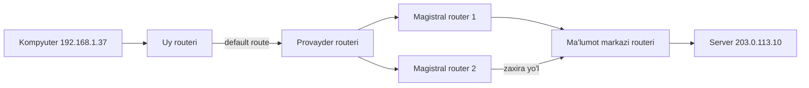
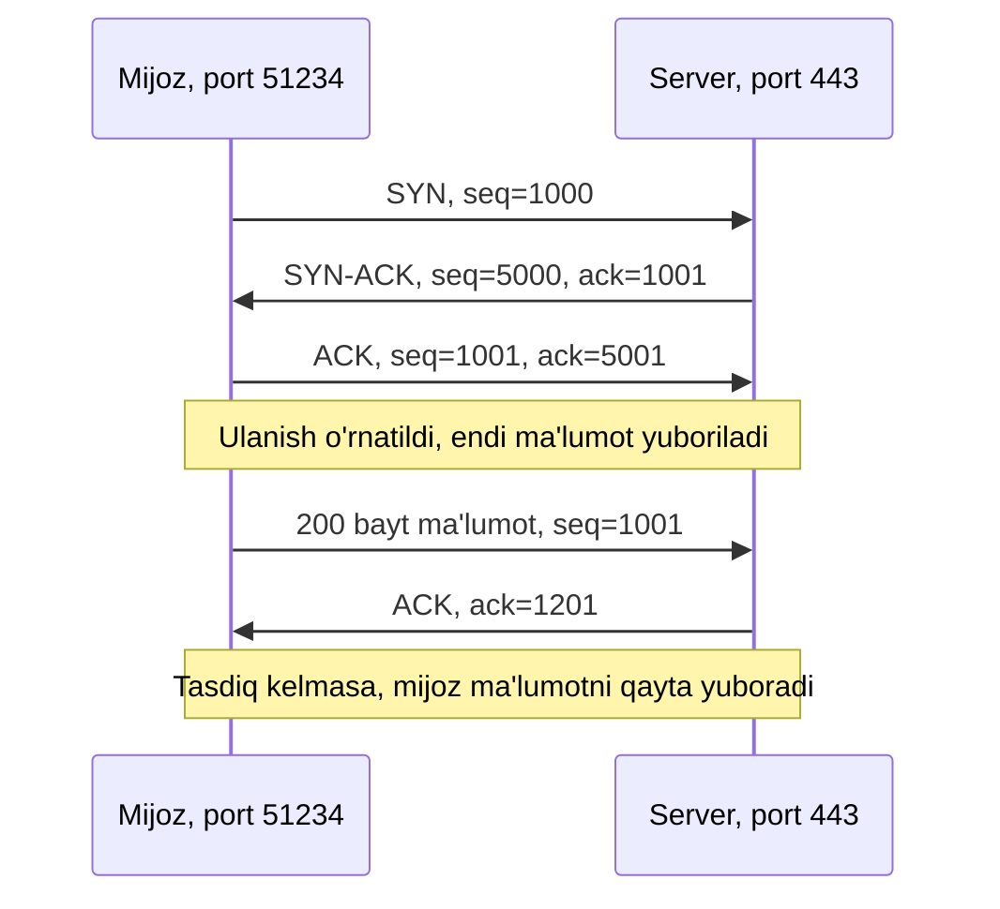
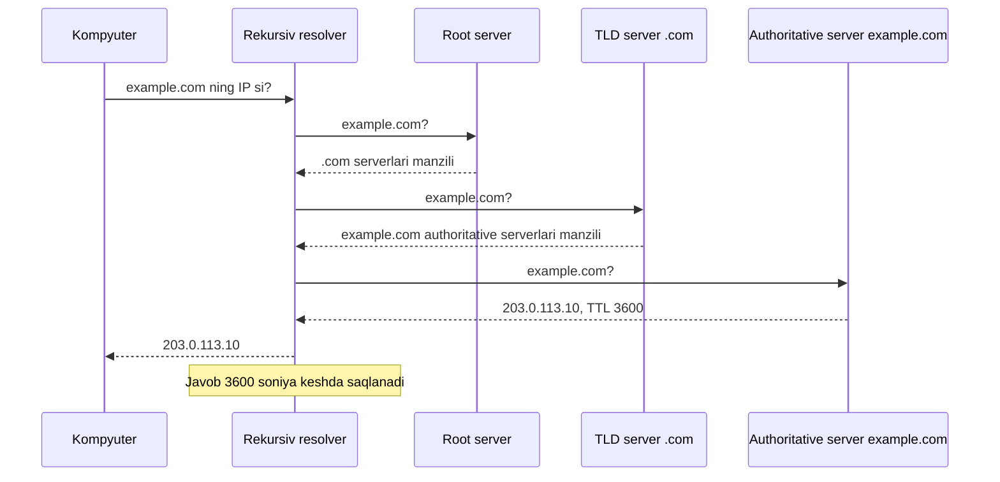

## Bu dars nima uchun kerak

Brauzerga `example.com` yozib Enter bosganingizda sahifa bir soniyadan kamroq vaqtda ochiladi. Shu vaqt ichida kompyuteringiz o'ziga manzil olgan, nomni songa aylantirgan, minglab kilometr uzoqdagi mashina bilan aloqa o'rnatgan va ma'lumotni yo'qotmasdan, to'g'ri tartibda qabul qilgan. Bularning hech biri sehr emas: har bir qadam qat'iy yozilgan qoidalar - **protokollar** bilan bajariladi.

Protokol - ikki tomon oldindan kelishib olgan xabar formati va xatti-harakat qoidalari. Inson tilida ham shunday: telefon qilganda "Allo" deysiz, javob kutasiz, keyin gapirasiz. Kompyuterlar ham xuddi shunday "salomlashadi", "eshitdingmi" deb so'raydi va "xayr" deydi. Internet protokollari RFC (Request for Comments) deb ataladigan ochiq hujjatlarda yozilgan, ularni istalgan kishi o'qishi mumkin. Bu darsda har bir protokolning asl RFC'siga havola beramiz.

Bu dars 5-modul (web dasturlash) ning poydevori. 42-darsdagi HTTP, 47-49-darslardagi Flask ilovalari va 52-darsdagi HTTPS shu yerdagi qatlamlar ustida ishlaydi. Oldingi darslar bilan bog'liqlik ham bor: IP manzil - bu 2-darsdagi 32 ta bit, port - 16 bitli unsigned son (6-dars), TCP ning tartib raqamlari esa 27-darsdagi queue ga o'xshab ishlaydi. System Design kursida tarmoq mavzulari chuqurroq ko'riladi; bu dars esa noldan boshlovchi uchun to'liq, lekin sodda manzara beradi.

Bu darsdan keyin siz:

- ma'lumot tarmoqda nima uchun paketlarga bo'linib yuborilishini va router paketni qanday yo'naltirishini tushuntira olasiz;
- IPv4 manzilni binary ko'rinishga o'tkaza olasiz, 2^32 va 2^128 hisobini va subnet (masalan, /24) ma'nosini bilasiz;
- private manzillar va NAT nima uchun kerakligini bilasiz;
- TCP qanday qilib ishonchli va tartibli yetkazishni ta'minlashini, 3-way handshake ni va UDP farqini tushuntira olasiz;
- port nima ekanini va mashhur portlarni (22, 53, 80, 443) bilasiz;
- DNS nomni IP manzilga qanday aylantirishini (resolver, root, TLD, authoritative, TTL, kesh) tushuntira olasiz;
- `ping`, `traceroute`, `nslookup` natijalarini o'qiy olasiz va Python `ipaddress` moduli bilan subnet hisoblay olasiz.

## Paketlar: ma'lumot qanday yo'lga chiqadi

### Circuit switching va packet switching

Eski telefon tarmog'ida qo'ng'iroq paytida ikki abonent orasida butun suhbat davomida alohida yo'l (kanal) band qilinardi. Bu - **circuit switching**: yo'l oldindan quriladi va siz jim tursangiz ham u boshqalarga berilmaydi.

Internet boshqa g'oyaga qurilgan - **packet switching** (paketli kommutatsiya). Yuboriladigan ma'lumot (rasm, sahifa, xabar) kichik bo'laklarga - **paketlarga** bo'linadi. Har bir paketda xuddi konvertdagi kabi "kimdan" va "kimga" manzili yozilgan sarlavha (header) va ma'lumotning o'zi (payload) bor. Paketlar tarmoqdan bir-biridan mustaqil o'tadi: har xil yo'l bilan ketishi, har xil vaqtda yetib borishi va hatto yo'qolishi mumkin. Qabul qiluvchi ularni qayta yig'adi.

| Xususiyat | Circuit switching | Packet switching |
|---|---|---|
| Yo'l | Oldindan quriladi va band qilinadi | Har bir paket o'zi yo'l topadi |
| Liniyadan foydalanish | Jim paytda ham band | Liniya ko'p foydalanuvchi orasida bo'lishiladi |
| Bitta liniya uzilsa | Aloqa uziladi | Paketlar boshqa yo'ldan ketadi |
| Kechikish | Barqaror | O'zgaruvchan (navbatlar tufayli) |
| Tartib va yo'qotish | Muammo emas | Paketlar aralashishi va yo'qolishi mumkin |

Packet switching ning yutug'i - samaradorlik va chidamlilik: bitta kabel bir vaqtda minglab suhbatning paketlarini tashiydi, biror tugun ishdan chiqsa, paketlar aylanib o'tadi. Narxi - oxirgi qatordagi muammo: paketlar tartibsiz kelishi va yo'qolishi mumkin. Bu muammoni TCP hal qiladi (pastda).

### Bitta paketga qancha sig'adi

Oddiy Ethernet tarmog'ida bitta paket ko'pi bilan 1500 bayt bo'ladi (bu chegara **MTU** - maximum transmission unit deb ataladi). Uning ichida IPv4 sarlavhasi kamida 20 bayt va TCP sarlavhasi kamida 20 bayt (RFC 791 va RFC 9293 dagi minimal sarlavha o'lchamlari). Demak foydali ma'lumot uchun:

1500 - 20 - 20 = 1460 bayt

1 MB (1 048 576 bayt) lik rasm uchun kamida ⌈1 048 576 / 1460⌉ = ⌈718.2⌉ = 719 ta paket kerak. Har biri o'z sarlavhasi bilan: 719 · 40 = 28 760 bayt, ya'ni taxminan 2.7% "konvert" xarajati. Bu hisob qo'shimcha sarlavha opsiyalarisiz eng yaxshi holat uchun.

### Qatlamlar

Internet bitta katta protokol emas, bir-birining ustiga qurilgan qatlamlar to'plami. Har bir qatlam faqat o'z ishini qiladi va pastdagisiga tayanadi. Bu 4-darsdagi abstraction g'oyasining tarmoqdagi ko'rinishi.

| Qatlam | Vazifasi | Misollar | Manzil turi |
|---|---|---|---|
| Ilova (application) | Ma'lumotning ma'nosi | HTTP, DNS, SSH | URL, domen nomi |
| Transport | Dasturdan dasturga yetkazish | TCP, UDP | Port |
| Internet | Kompyuterdan kompyuterga, tarmoqlar orqali | IP | IP manzil |
| Link | Bitta jismoniy tarmoq ichida | Ethernet, Wi-Fi | MAC manzil |

Har bir qatlam yuqoridagisining ma'lumotini o'z sarlavhasi bilan "o'raydi": HTTP so'rovi TCP segmentiga, TCP segmenti IP paketiga, IP paket Ethernet kadriga joylanadi. Qabul qiluvchi tomonda konvertlar teskari tartibda ochiladi. Bu jarayon **encapsulation** (o'rash) deb ataladi.

## Router va marshrutlash

**Router** (marshrutizator) - bir nechta tarmoqqa ulangan qurilma, uning yagona ishi paketni keyingi qadamga uzatish. Uyingizdagi Wi-Fi qurilma ham router: u uy tarmog'ini provayder tarmog'iga ulaydi. Provayderlar, ma'lumot markazlari va qit'alararo kabellar orasida esa minglab katta routerlar turadi.

Router paketning butun yo'lini bilmaydi. U faqat bitta savolga javob beradi: "bu manzilga eng yaqin keyingi qadam qaysi?". Buning uchun unda **marshrutlash jadvali** (routing table) bor: "manzil shu oraliqda bo'lsa, falon tomonga yubor" ko'rinishidagi qatorlar va "boshqa hamma narsa" uchun **default route**. Paket har bir routerda bir qadam (hop) oldinga siljiydi:



Diagrammada magistral routerlardan biri ishdan chiqsa, paketlar ikkinchisi orqali o'tadi. Routerlar bir-biriga qaysi tarmoqlar orqali nimaga yetish mumkinligini maxsus protokollar bilan e'lon qilib turadi va jadvallarini shunga qarab yangilaydi. Shu sababli yo'l har doim bir xil bo'lmaydi.

### TTL: paket abadiy aylanmasligi uchun

Agar ikkita router xato sozlanib, paketni bir-biriga qaytarib tursa nima bo'ladi? Paket abadiy aylanib, tarmoqni to'ldirib yuborardi. Buning oldini olish uchun IPv4 sarlavhasida 8 bitli **TTL** (time to live, yashash muddati) maydoni bor: har bir router uni 1 ga kamaytiradi, 0 ga yetsa, paket tashlab yuboriladi va jo'natuvchiga xabar qaytariladi. 8 bit bo'lgani uchun TTL ko'pi bilan 2^8 - 1 = 255. IPv6 da xuddi shu maydon Hop Limit deb ataladi.

TTL atamasi DNS da ham uchraydi (pastda), lekin u yerda hop emas, soniya sanaladi. Umumiy g'oya bir xil: ma'lumot qancha "yashashi" mumkin.

### traceroute va ping

TTL ning qiziq amaliy ishlatilishi bor: `traceroute` buyrug'i birinchi paketni TTL = 1 bilan yuboradi (u birinchi routerda "o'ladi" va router o'zini tanitadi), keyin TTL = 2, TTL = 3 va hokazo. Shunday qilib yo'ldagi routerlar birma-bir ko'rinadi. Masalan, Linux da natija shunday ko'rinishda bo'ladi (manzillar hujjatlar uchun ajratilgan namunaviy manzillar):

```text
$ traceroute example.com
traceroute to example.com (203.0.113.10), 30 hops max, 60 byte packets
 1  192.168.1.1  1.204 ms  1.087 ms  1.052 ms
 2  10.24.0.1  4.812 ms  4.775 ms  4.731 ms
 3  198.51.100.5  9.633 ms  9.541 ms  9.602 ms
 4  * * *
 5  198.51.100.77  31.418 ms  31.377 ms  31.290 ms
 6  203.0.113.10  32.006 ms  31.954 ms  31.921 ms
```

Har bir qatorda: hop raqami, routerning manzili va uchta urinishning borib-qaytish vaqti. `* * *` - bu router javob bermadi (ko'p routerlar bunday so'rovlarga ataylab javob bermaydi), lekin paket undan o'tib ketdi, chunki keyingi hoplar ko'rinyapti. 1-hop - uy routeri (private manzil), 2-hop - provayderning ichki tarmog'i.

`ping` esa manzil "tirikmi" va borib-qaytish qancha vaqt olishini tekshiradi. U ICMP (Internet Control Message Protocol, IP ning xizmat xabarlari) "echo request" xabarini yuboradi va "echo reply" javobini kutadi. Masalan:

```text
$ ping -c 3 example.com
PING example.com (203.0.113.10) 56(84) bytes of data.
64 bytes from 203.0.113.10: icmp_seq=1 ttl=56 time=31.9 ms
64 bytes from 203.0.113.10: icmp_seq=2 ttl=56 time=32.1 ms
64 bytes from 203.0.113.10: icmp_seq=3 ttl=56 time=31.8 ms

--- example.com ping statistics ---
3 packets transmitted, 3 received, 0% packet loss, time 2003ms
rtt min/avg/max/mdev = 31.8/31.9/32.1/0.1 ms
```

`56(84) bytes`: 56 bayt ma'lumot + 8 bayt ICMP sarlavhasi + 20 bayt IPv4 sarlavhasi = 84. `ttl=56` - javob paketi yetib kelganda TTL dan qolgan qiymat. Agar server javobni TTL = 64 bilan yuborgan bo'lsa (ko'p Linux tizimlarida standart qiymat), 64 - 56 = 8 ta routerdan o'tgan. Bu taxmin, chunki boshlang'ich qiymat tizimga bog'liq.

## IP manzil: 32 bit va 128 bit

### IPv4: to'rtta bayt

Internetdagi har bir qurilmaga paket yetib borishi uchun unda manzil bo'lishi kerak. **IP manzil** (Internet Protocol address) - shu manzil. IPv4 (RFC 791) da manzil 32 bit, ya'ni 4 bayt. Odamlar o'qishi uchun har bir bayt alohida o'nlik son sifatida yoziladi va nuqta bilan ajratiladi: `192.168.1.37`. Bu yozuv **dotted decimal** deb ataladi. Har bir qism (oktet) bitta bayt bo'lgani uchun 0 dan 255 gacha bo'ladi (2-darsdagi kabi, 8 bit 2^8 = 256 ta qiymat).

`192.168.1.37` ni binary ga o'tkazamiz (2-darsdagi 128, 64, 32, 16, 8, 4, 2, 1 vaznlari bilan):

| Oktet | Hisob | Binary |
|---|---|---|
| 192 | 128 + 64 | 11000000 |
| 168 | 128 + 32 + 8 | 10101000 |
| 1 | 1 | 00000001 |
| 37 | 32 + 4 + 1 | 00100101 |

Ya'ni kompyuter uchun bu manzil 32 bitli bitta son: `11000000 10101000 00000001 00100101`. O'nlik ko'rinishda: 192 · 2^24 + 168 · 2^16 + 1 · 2^8 + 37 = 3 221 225 472 + 11 010 048 + 256 + 37 = 3 232 235 813.

Jami IPv4 manzillar soni: 2^32 = 4 294 967 296, taxminan 4.3 milliard. Yer yuzida odamlardan ham, ulangan qurilmalardan ham kam. Shu sababli IPv4 manzillar yetishmaydi va pastdagi ikki yechim paydo bo'lgan: private manzillar bilan NAT va IPv6.

### Subnet: manzilning "ko'cha" va "uy" qismi

IP manzil ikki qismdan iborat: **tarmoq qismi** (qaysi tarmoq) va **host qismi** (shu tarmoqdagi qaysi qurilma). Chegara qayerdaligi `/24` kabi yozuv bilan beriladi - bu **CIDR** (Classless Inter-Domain Routing) yozuvi: "birinchi 24 bit tarmoq, qolgan 32 - 24 = 8 bit host". Xuddi pochta manzilidagi ko'cha va uy raqami kabi: router faqat "ko'cha"ga qaraydi.

`192.168.1.0/24` tarmog'ida:

- host qismi 8 bit, demak 2^8 = 256 ta manzil: `192.168.1.0` dan `192.168.1.255` gacha;
- birinchisi (`.0`) tarmoqning o'zini bildiradi, oxirgisi (`.255`) broadcast (hammaga) manzil, qurilmalarga 256 - 2 = 254 ta qoladi;
- tarmoq qismi 24 ta 1 bit bilan **subnet mask** sifatida ham yoziladi: `11111111.11111111.11111111.00000000` = `255.255.255.0`.

Ikki manzil bir tarmoqdami, degan savolga javob: ikkalasining birinchi 24 biti bir xilmi. Kompyuter buni manzil va mask ustida bitlararo AND bilan tekshiradi. Bir tarmoqda bo'lsa, paket to'g'ridan-to'g'ri yuboriladi; bo'lmasa, routerga (default gateway) beriladi.

Umumiy formula: /n tarmoqda 2^(32 - n) ta manzil. /16 da 2^16 = 65 536, /26 da 2^6 = 64, /32 da 1 ta (bitta aniq manzil).

Python standart kutubxonasidagi `ipaddress` moduli bu hisoblarni qiladi. Kodni o'zgartirib, boshqa manzil va prefikslarni sinab ko'ring:

```python run
import ipaddress

ip = ipaddress.ip_address("192.168.1.37")
print("versiya:", ip.version)
print("son sifatida:", int(ip))
print("binary:", format(int(ip), "032b"))

net = ipaddress.ip_network("192.168.1.0/24")
print("mask:", net.netmask, "| manzillar:", net.num_addresses, "| broadcast:", net.broadcast_address)
print("192.168.1.37 shu tarmoqdami?", ip in net)
print("192.168.2.37 shu tarmoqdami?", ipaddress.ip_address("192.168.2.37") in net)

hosts = list(net.hosts())
print("qurilmalar uchun:", hosts[0], "-", hosts[-1], "| soni:", len(hosts))

# /24 ni to'rtta /26 ga bo'lish
for sub in net.subnets(new_prefix=26):
    print(sub, sub.num_addresses, "ta manzil")
```

Natija:

```text
versiya: 4
son sifatida: 3232235813
binary: 11000000101010000000000100100101
mask: 255.255.255.0 | manzillar: 256 | broadcast: 192.168.1.255
192.168.1.37 shu tarmoqdami? True
192.168.2.37 shu tarmoqdami? False
qurilmalar uchun: 192.168.1.1 - 192.168.1.254 | soni: 254
192.168.1.0/26 64 ta manzil
192.168.1.64/26 64 ta manzil
192.168.1.128/26 64 ta manzil
192.168.1.192/26 64 ta manzil
```

`int(ip)` biz qo'lda hisoblagan 3 232 235 813 bilan bir xil. /24 ni /26 larga bo'lishda prefiks 2 bitga uzaydi, shuning uchun 2^2 = 4 ta kichik tarmoq chiqadi, har birida 2^(32-26) = 64 ta manzil.

### Private manzillar va NAT

RFC 1918 uchta oraliqni **private** (xususiy) manzillar uchun ajratgan. Ular Internetda marshrutlanmaydi va istalgan tashkilot yoki uy tarmog'i ichida qayta ishlatilishi mumkin:

| Oraliq | CIDR | Manzillar soni |
|---|---|---|
| 10.0.0.0 - 10.255.255.255 | 10.0.0.0/8 | 2^24 = 16 777 216 |
| 172.16.0.0 - 172.31.255.255 | 172.16.0.0/12 | 2^20 = 1 048 576 |
| 192.168.0.0 - 192.168.255.255 | 192.168.0.0/16 | 2^16 = 65 536 |

Shuning uchun deyarli har bir uy tarmog'ida kompyuterlar `192.168.x.x` manzilini oladi: millionlab uylarda bir xil manzillar ishlatiladi va bu muammo emas, chunki ular faqat uy ichida ma'noga ega. Yana bir maxsus manzil - `127.0.0.1` (localhost, loopback): "shu kompyuterning o'zi", paket tarmoqqa umuman chiqmaydi.

Unda private manzilli kompyuter Internetga qanday chiqadi? Bu ishni router **NAT** (Network Address Translation, manzil tarjimasi) bilan qiladi. Routerda provayder bergan bitta public manzil bor. Ichkaridagi kompyuter paket yuborganda, router paketning "kimdan" maydonidagi private manzil va portni o'zining public manzili va bo'sh portiga almashtiradi va bu moslikni jadvalda eslab qoladi. Javob kelganda jadvalga qarab, paketni ichkaridagi to'g'ri kompyuterga qaytaradi. Natijada uydagi o'nlab qurilma Internetga bitta public manzil bilan chiqadi. Kamchiligi: tashqaridan ichkaridagi kompyuterga o'z-o'zidan ulanib bo'lmaydi, chunki router jadvalida unga mos yozuv yo'q.

```python run
import ipaddress

for s in ["10.0.0.5", "172.20.3.4", "172.32.0.1", "192.168.1.37", "5.6.7.8", "127.0.0.1"]:
    a = ipaddress.ip_address(s)
    print(f"{s:<14} private={a.is_private!s:<6} loopback={a.is_loopback}")
```

```text
10.0.0.5       private=True   loopback=False
172.20.3.4     private=True   loopback=False
172.32.0.1     private=False  loopback=False
192.168.1.37   private=True   loopback=False
5.6.7.8        private=False  loopback=False
127.0.0.1      private=True   loopback=True
```

`172.32.0.1` private emas: 172.16.0.0/12 oralig'i `172.31.255.255` da tugaydi. Python `is_private` ni kengroq ma'noda ishlatadi (RFC 1918 dan tashqari loopback kabi boshqa maxsus oraliqlarni ham "private" deb hisoblaydi), shuning uchun `127.0.0.1` uchun ham `True`.

### IPv6: 128 bit

IPv4 yetishmovchiligining uzoq muddatli yechimi - **IPv6** (RFC 8200). Unda manzil 128 bit: 2^128 = 340 282 366 920 938 463 463 374 607 431 768 211 456, taxminan 3.4 · 10^38 ta manzil. Bu 2^32 dan 2^96 marta ko'p.

128 bitni o'nlik sonlar bilan yozish noqulay, shuning uchun IPv6 manzil 16 bitli 8 guruhga bo'linadi va har biri 4 ta hex raqam bilan yoziladi (2-darsdagi hexadecimal: 4 bit = 1 hex raqam, 16 bit = 4 hex raqam). Masalan, `2001:0db8:0000:0000:0000:0000:0000:0001`. Qisqartirish qoidalari: har guruh boshidagi nollar tashlanadi va ketma-ket nol guruhlar bir marta `::` bilan almashtiriladi: `2001:db8::1`. `ipaddress.ip_address("2001:db8::1").exploded` to'liq shaklni, `.compressed` qisqasini beradi. IPv6 da loopback - `::1`.

## TCP va UDP: dasturdan dasturga

### Port: qaysi dasturga

IP manzil paketni kompyuterga olib keladi. Lekin kompyuterda bir vaqtda brauzer, messenjer va pochta dasturi ishlaydi: paket qaysi biriga tegishli? Buni **port** hal qiladi - 16 bitli son, kompyuter ichidagi "xonadon raqami". 16 bit bo'lgani uchun portlar 0 dan 2^16 - 1 = 65 535 gacha.

Server dasturlari oldindan kelishilgan portlarda kutadi, shunda mijoz qayerga ulanishni biladi. RFC 6335 portlarni uch oraliqqa bo'ladi: 0-1023 system (well-known) portlar, 1024-49151 user (registered) portlar va 49152-65535 dynamic (ephemeral) portlar. Oxirgisi IANA tomonidan hech kimga berilmaydi: mijoz dasturlar ulanish uchun shu yerdan vaqtinchalik port oladi (amalda operatsion tizimlar boshqa oraliqni ham ishlatishi mumkin).

| Port | Protokol | Nima uchun |
|---|---|---|
| 22 | SSH | Masofadagi kompyuterga xavfsiz terminal |
| 53 | DNS | Domen nomini IP ga aylantirish (asosan UDP) |
| 80 | HTTP | Shifrlanmagan veb sahifalar |
| 443 | HTTPS | Shifrlangan veb sahifalar |

Bitta ulanish to'rtta son bilan aniqlanadi: mijoz IP va porti, server IP va porti. Masalan, `192.168.1.37:51234 -> 203.0.113.10:443`. Shu sababli bitta kompyuterdagi ikkita brauzer oynasi bitta serverning 443-portiga ulanishi mumkin: ularning mijoz portlari farq qiladi. URL da port odatda yozilmaydi, chunki `https` uchun 443, `http` uchun 80 standart; boshqa port kerak bo'lsa, `http://localhost:5000` kabi yoziladi (47-darsda Flask aynan shunday ishga tushadi).

### TCP: ishonchli yetkazish

IP "best effort" ishlaydi: paketni yetkazishga harakat qiladi, lekin hech narsa va'da qilmaydi. Paketlar yo'qolishi, takrorlanishi va aralashib kelishi mumkin. Bunday tarmoqda veb sahifa yoki fayl yuborish xavfli: bitta bayt yo'qolsa, fayl buziladi. **TCP** (Transmission Control Protocol, RFC 9293) shu nosoz tarmoq ustida ishonchli, tartibli bayt oqimini quradi. Uning asosiy mexanizmlari:

1. **Tartib raqami** (sequence number). Har bir baytga 32 bitli raqam beriladi. Qabul qiluvchi aralash kelgan segmentlarni raqam bo'yicha to'g'ri tartibga qo'yadi va takrorlarini tashlaydi.
2. **Tasdiq** (acknowledgment, ACK). Qabul qiluvchi "N-baytgacha hammasini oldim, keyingi kutayotganim N + 1" deb javob beradi.
3. **Qayta yuborish** (retransmission). Jo'natuvchi har bir yuborilgan ma'lumot uchun taymer qo'yadi. Belgilangan vaqtda tasdiq kelmasa, ma'lumotni qayta yuboradi.
4. **Checksum.** Har bir segmentda nazorat yig'indisi bor: yo'lda buzilgan segment tashlab yuboriladi va keyin qayta yuboriladi.
5. **Oqim va tiqilish nazorati** (flow control, congestion control). Qabul qiluvchi qancha joyi borligini aytadi va jo'natuvchi undan ko'p yubormaydi; tarmoq tiqilib qolsa, jo'natuvchi tezlikni pasaytiradi.

Natijada ilova uchun TCP ulanishi - xuddi faylga yozish va o'qish kabi oddiy bayt oqimi (26-darsdagi stream). Paketlar, yo'qotishlar va qayta yuborishlar ko'rinmaydi.

### 3-way handshake

Ma'lumot yuborishdan oldin TCP ulanish o'rnatadi. Bu **3-way handshake** (uch qadamli salomlashish) deyiladi, chunki uchta segment almashinadi. Har ikki tomon o'zining boshlang'ich tartib raqamini tanlaydi va bir-birinikini tasdiqlaydi:



Raqamlarni kuzatamiz. Mijoz `SYN` (synchronize) bilan boshlang'ich raqami 1000 ni aytadi. Server `SYN-ACK` bilan o'z raqami 5000 ni aytadi va "1000 ni oldim, endi 1001 ni kutaman" deydi. Mijoz `ACK` bilan serverning raqamini tasdiqlaydi. SYN o'zi bitta tartib raqamini egallaydi, shuning uchun ma'lumot 1001 dan boshlanadi. 200 bayt yuborilgach, server 1001 + 200 = 1201 ni kutayotganini aytadi. Haqiqiy tizimlarda boshlang'ich raqamlar tasodifiy tanlanadi; bu yerda hisob qulay bo'lishi uchun yumaloq sonlar olingan.

Handshake ning narxi - vaqt: birinchi baytni yuborishdan oldin bitta to'liq borib-qaytish (RTT, round-trip time) kerak. Yuqoridagi `ping` misolida RTT taxminan 32 ms edi, demak har bir yangi TCP ulanish ma'lumotdan oldin kamida 32 ms sarflaydi. HTTPS da ustiga shifrlash kelishuvi ham qo'shiladi (52-dars). Shu sababli brauzerlar ulanishni qayta ishlatishga harakat qiladi (42-darsdagi HTTP versiyalari).

### UDP: tez, lekin kafolatsiz

**UDP** (User Datagram Protocol, RFC 768) - TCP ning teskarisi. Handshake yo'q, tasdiq yo'q, qayta yuborish yo'q, tartib yo'q. Har bir xabar (datagram) alohida yuboriladi; yetib bordimi yoki yo'qmi, UDP buni bilmaydi. UDP faqat portlar va checksum qo'shadi, sarlavhasi bor-yo'g'i 8 bayt (TCP da kamida 20).

| Xususiyat | TCP | UDP |
|---|---|---|
| Ulanish | Handshake bilan o'rnatiladi | Yo'q, darhol yuboriladi |
| Yetkazish | Kafolatlangan, qayta yuboriladi | Kafolat yo'q |
| Tartib | Saqlanadi | Saqlanmaydi |
| Sarlavha | Kamida 20 bayt | 8 bayt |
| Ilova uchun ko'rinish | Uzluksiz bayt oqimi | Alohida xabarlar |
| Qachon | Veb, fayl, pochta, SSH | DNS so'rovlari, ovozli va video qo'ng'iroq, o'yinlar |

Nega kimdir kafolatsiz protokolni tanlaydi? Video qo'ng'iroqda 200 ms kechikib kelgan kadr endi kerak emas: uni kutgandan ko'ra tashlab, keyingisini ko'rsatish yaxshiroq. DNS so'rovi esa bitta kichik paket: yo'qolsa, ilova o'zi qayta so'raydi va handshake ning qo'shimcha RTT sini tejaydi. HTTP/3 ham UDP ustida qurilgan (42-dars): ishonchlilikni u o'zi, ilova darajasida ta'minlaydi.

## DNS: nomdan manzilga

### Nima uchun DNS kerak

Odamlar `example.com` ni eslaydi, routerlar esa faqat IP manzilni tushunadi. Bundan tashqari, serverning IP manzili o'zgarishi mumkin, nom esa qoladi. **DNS** (Domain Name System, RFC 1034 va RFC 1035) - nomlarni IP manzillarga aylantiradigan, butun dunyo bo'ylab tarqalgan ma'lumotlar bazasi. Bitta markaziy jadval bo'lganda u milliardlab so'rovga bardosh berolmasdi va har bir o'zgarish uchun bitta joy javobgar bo'lardi. Shuning uchun DNS ierarxik: har bir daraja faqat o'zidan pastdagilarni biladi.

Domen nomi o'ngdan chapga o'qiladi: `www.example.com.` da oxirgi (odatda yozilmaydigan) nuqta - **root** (ildiz), `com` - **TLD** (top-level domain, yuqori darajadagi domen), `example` - shu TLD ostidagi domen, `www` - uning ichidagi nom. 29-darsdagi daraxtni eslang: DNS nomlari aynan daraxt, root esa uning ildizi.

### Resolver qanday ishlaydi

Kompyuteringiz o'zi butun daraxtni aylanib chiqmaydi. U so'rovni **rekursiv resolver** ga yuboradi (odatda uy routeri yoki provayder serveri; manzilini DHCP beradi, pastda). Resolver "menga yakuniy javobni topib ber" degan so'rovni oladi va kerak bo'lsa, o'zi daraxt bo'ylab yuradi:



1. **Root serverlar** - daraxtning tepasi. Ular har bir nomni bilmaydi, faqat qaysi TLD qaysi serverlarda ekanini biladi. IANA ma'lumotiga ko'ra root zona 13 ta nomlangan avtoritet (`a.root-servers.net` dan `m.root-servers.net` gacha) sifatida sozlangan, lekin ularning ortida dunyo bo'ylab yuzlab jismoniy serverlar turadi.
2. **TLD serverlar** (`.com`, `.org`, `.uz` va hokazo) shu zonadagi domenlarning authoritative serverlari qayerdaligini biladi.
3. **Authoritative server** - domen egasi sozlagan va aniq javobni beradigan server: "example.com ning manzili 203.0.113.10".

Resolver kompyuterga faqat yakuniy javobni qaytaradi. Shu sababli kompyuter yuborgan so'rov "rekursiv" (hammasini sen qil), resolverning daraxt bo'ylab so'rovlari esa "iterativ" (har bir server faqat keyingi qadamni aytadi).

### TTL va kesh

Har bir so'rov uchun root dan boshlash juda sekin bo'lardi. Shuning uchun har bir DNS javobida **TTL** - soniyalarda o'lchanadigan yashash muddati bor. Resolver javobni shu muddat davomida keshda (cache - tez-tez kerak bo'ladigan ma'lumotning yaqin nusxasi) saqlaydi va keyingi so'rovlarga daraxtga chiqmasdan javob beradi. `.com` serverlarining manzili esa ko'p soatlik TTL bilan keladi, shuning uchun root serverga murojaat juda kam bo'ladi. Brauzer va operatsion tizimning ham o'z keshi bor.

Hisob: TTL 3600 soniya (1 soat) bo'lsa, resolver shu nom uchun authoritative serverga soatiga ko'pi bilan bir marta murojaat qiladi. Bitta resolver ortida 10 000 foydalanuvchi soatiga 50 000 marta so'rasa ham, authoritative serverga 1 ta so'rov boradi, qolgan 49 999 tasi keshdan.

Keshning teskari tomoni: domen egasi IP manzilni o'zgartirsa, eski javob TTL tugaguncha keshlarda qoladi. Shuning uchun server ko'chirishdan oldin TTL ni oldindan kamaytirib qo'yish odat.

### nslookup va dig

DNS ni qo'lda so'rash uchun `nslookup` yoki `dig` buyruqlari ishlatiladi. Masalan:

```text
$ nslookup example.com
Server:		192.168.1.1
Address:	192.168.1.1#53

Non-authoritative answer:
Name:	example.com
Address: 203.0.113.10
```

`Server` - so'rov yuborilgan resolver (bu yerda uy routeri), `#53` - DNS porti. "Non-authoritative answer" - javob authoritative serverdan to'g'ridan-to'g'ri emas, resolver keshi yoki uning vositachiligi orqali kelgan. `dig` TTL ni ham ko'rsatadi:

```text
$ dig +noall +answer example.com
example.com.		2873	IN	A	203.0.113.10
```

Bu yerda `2873` - kesh uchun qolgan soniyalar (authoritative serverdagi TTL 3600 bo'lsa, javob keshga 3600 - 2873 = 727 soniya oldin tushgan), `IN` - Internet sinfi, `A` - IPv4 manzil yozuvi. IPv6 manzil uchun yozuv turi `AAAA`.

### DHCP: manzilni kim beradi

Kompyuteringiz Wi-Fi ga ulanganda IP manzilni qo'lda yozmaysiz. Uni **DHCP** (Dynamic Host Configuration Protocol, RFC 2131) avtomatik beradi. Yangi ulangan qurilmaning hali manzili yo'q, shuning uchun u tarmoqdagi hammaga eshittirib so'raydi (Discover), DHCP server (odatda router) bo'sh manzilni taklif qiladi (Offer), qurilma uni so'raydi (Request), server tasdiqlaydi (Ack). Server manzil bilan birga subnet mask, default gateway (router) manzili va DNS resolver manzilini ham beradi. Manzil ijaraga beriladi (lease): muddat tugashidan oldin qurilma uni uzaytiradi, aks holda manzil boshqa qurilmaga o'tishi mumkin.

### Hammasi birga

Endi `https://example.com` ni ochganda nima bo'lishini to'liq aytish mumkin:

1. Wi-Fi ga ulanganda DHCP qurilmaga manzil (`192.168.1.37`), gateway va DNS resolver beradi.
2. Brauzer DNS orqali `example.com` ni `203.0.113.10` ga aylantiradi (keshda bo'lsa, darhol).
3. Brauzer `203.0.113.10:443` bilan TCP 3-way handshake o'tkazadi.
4. HTTPS uchun shifrlash kelishiladi (52-dars), keyin HTTP so'rovi yuboriladi (42-dars).
5. Har bir segment IP paketga o'raladi, uy routeri NAT bilan manzilni almashtiradi va paketlar routerdan routerga o'tadi.
6. Server javobi qaytadan paketlarga bo'linib keladi, TCP ularni tartiblaydi va brauzer sahifani chizadi.

## Mashq: IPv4 manzilni tekshirish va binary ga aylantirish

`ipaddress` moduli bu ishni qiladi, lekin uni o'zingiz yozish manzil tuzilmasini yaxshi tushunishga yordam beradi. Uchta funksiyani yozing:

- `parse_ipv4(s)` - satr to'g'ri IPv4 manzil bo'lsa, to'rtta butun sondan iborat ro'yxat qaytaradi, aks holda `None`. To'g'ri manzil: nuqta bilan ajratilgan aynan 4 ta qism, har biri faqat raqamlardan iborat, 0-255 oralig'ida, bo'sh emas va boshida ortiqcha nol yo'q (`01` noto'g'ri, `0` to'g'ri; bunday yozuvni ba'zi eski dasturlar sakkizlik son deb o'qigani uchun uni rad etish xavfsizroq).
- `to_binary(s)` - har bir oktetni 8 xonali binary qilib, nuqta bilan qaytaradi: `"11000000.10101000.00000001.00100101"`. Noto'g'ri manzil uchun `None`.
- `same_network(a, b, prefix)` - ikkala manzilning birinchi `prefix` biti bir xil bo'lsa, `True`.

Maslahat: oktetlarni bitta 32 bitli songa yig'ish uchun 2^24, 2^16, 2^8 ga ko'paytirish yoki `<<` siljitishdan foydalaning; `prefix` bit bo'yicha solishtirish uchun ikkala sonni `32 - prefix` bitga o'ngga siljiting (`>>`). Sonlarni tekshirishda `str.isdigit()` ning o'rniga belgilarni `"0123456789"` ichida tekshirish aniqroq. "Tekshirish" tugmasi testlarni ishga tushiradi.

```python run
def parse_ipv4(s):
    """'192.168.1.37' -> [192, 168, 1, 37]; noto'g'ri bo'lsa None."""
    # Yechimingizni shu yerga yozing
    return None


def to_binary(s):
    """'192.168.1.37' -> '11000000.10101000.00000001.00100101'; noto'g'ri bo'lsa None."""
    # Yechimingizni shu yerga yozing
    return None


def same_network(a, b, prefix):
    """a va b ning birinchi prefix biti bir xilmi."""
    # Yechimingizni shu yerga yozing
    return False


print(parse_ipv4("192.168.1.37"))
print(to_binary("192.168.1.37"))
print(same_network("192.168.1.37", "192.168.1.200", 24))
```

```python test
import ipaddress
check("oddiy manzil: 192.168.1.37 -> [192, 168, 1, 37]", lambda: parse_ipv4("192.168.1.37") == [192, 168, 1, 37])
check("chegaralar: 0.0.0.0 va 255.255.255.255 to'g'ri", lambda: parse_ipv4("0.0.0.0") == [0, 0, 0, 0] and parse_ipv4("255.255.255.255") == [255, 255, 255, 255])
check("256 oktet uchun juda katta", lambda: parse_ipv4("10.0.0.256") is None)
check("qismlar soni aynan 4 bo'lishi kerak", lambda: parse_ipv4("10.0.0") is None and parse_ipv4("10.0.0.1.5") is None)
check("bo'sh qism va harf rad etiladi", lambda: parse_ipv4("10..0.1") is None and parse_ipv4("10.a.0.1") is None and parse_ipv4("") is None)
check("boshida nol (01) rad etiladi, yolg'iz 0 qabul qilinadi", lambda: parse_ipv4("10.01.0.1") is None and parse_ipv4("10.0.0.1") == [10, 0, 0, 1])
check("ishora va bo'shliq rad etiladi", lambda: parse_ipv4("-1.0.0.1") is None and parse_ipv4("+1.0.0.1") is None and parse_ipv4(" 1.0.0.1") is None)
check("to_binary har oktetni 8 bit qiladi", lambda: to_binary("192.168.1.37") == "11000000.10101000.00000001.00100101")
check("to_binary: 10.0.0.255", lambda: to_binary("10.0.0.255") == "00001010.00000000.00000000.11111111")
check("to_binary noto'g'ri manzil uchun None", lambda: to_binary("300.1.1.1") is None)
check("same_network /24", lambda: same_network("192.168.1.37", "192.168.1.200", 24) and not same_network("192.168.1.37", "192.168.2.37", 24))
check("same_network /26: .63 ichida, .64 tashqarida", lambda: same_network("192.168.1.10", "192.168.1.63", 26) and not same_network("192.168.1.10", "192.168.1.64", 26))
check("same_network /12 va /32", lambda: same_network("172.16.0.1", "172.31.255.255", 12) and not same_network("172.16.0.1", "172.32.0.1", 12) and not same_network("10.0.0.1", "10.0.0.2", 32))
check("natija ipaddress moduli bilan mos", lambda: all(
    to_binary(s) == ".".join(format(int(x), "08b") for x in s.split(".")) and int(ipaddress.ip_address(s)) == sum(o << (24 - 8 * i) for i, o in enumerate(parse_ipv4(s)))
    for s in ["1.2.3.4", "100.64.7.9", "203.0.113.10", "9.10.11.12"]))
```

## Ko'p uchraydigan xatolar

1. **IP manzilni "kompyuterning doimiy nomi" deb o'ylash.** DHCP manzilni ijaraga beradi va u o'zgarishi mumkin; private manzil esa faqat o'z tarmog'i ichida ma'noga ega. `192.168.1.37` minglab uylarda bir vaqtda mavjud.
2. **Oktetni 255 dan katta yozish yoki qismlarni noto'g'ri sanash.** Oktet - 1 bayt, 0-255. `10.0.0.256` manzil emas. IPv4 da aynan 4 ta oktet.
3. **/24 da 256 ta qurilma sig'adi deb hisoblash.** 256 ta manzildan tarmoq manzili (`.0`) va broadcast (`.255`) ayriladi: 254 ta qurilma.
4. **TCP ni "paket yo'qolmaydi" deb tushunish.** Paketlar yo'qoladi; TCP buni payqab qayta yuboradi. Ilova yo'qotishni ko'rmaydi, lekin kechikish sifatida his qiladi.
5. **UDP ni "yomon TCP" deb hisoblash.** UDP ataylab soddalashtirilgan: kechikish muhim bo'lgan joyda (ovoz, o'yin, DNS) u to'g'ri tanlov. Ishonchlilik kerak bo'lsa, ilova uni o'zi qo'shadi.
6. **DNS o'zgarishi darhol hamma joyda ko'rinadi deb kutish.** Eski javob TTL tugaguncha resolver va brauzer keshlarida qoladi.
7. **Port va IP ni aralashtirish.** IP kompyuterni, port shu kompyuterdagi dasturni topadi. `localhost:5000` va `localhost:8000` - bitta kompyuterdagi ikki xil dastur.
8. **`ping` javob bermasa, server ishlamayapti deb xulosa qilish.** Ko'p serverlar va routerlar ICMP ni ataylab bloklaydi; `traceroute` dagi `* * *` ham shunday. Sahifa ochilishi bilan tekshiring.

## Xulosa

- Internet packet switching ga qurilgan: ma'lumot paketlarga bo'linadi, har biri sarlavhasidagi manzil bo'yicha routerdan routerga mustaqil o'tadi; TTL paketning abadiy aylanishiga yo'l qo'ymaydi.
- Protokollar qatlamlarga bo'lingan: ilova (HTTP, DNS), transport (TCP, UDP), internet (IP), link (Ethernet, Wi-Fi); har qatlam yuqoridagisini o'z sarlavhasi bilan o'raydi.
- IPv4 manzil 32 bit (2^32 ≈ 4.3 milliard), IPv6 - 128 bit (≈ 3.4 · 10^38). /n prefiks tarmoq qismini bildiradi, tarmoqda 2^(32 - n) ta manzil.
- Private oraliqlar (10/8, 172.16/12, 192.168/16) va NAT ko'p qurilmani bitta public manzil ortiga yashiradi.
- Port - 16 bitli son (0-65535), kompyuter ichidagi dasturni topadi; 22 SSH, 53 DNS, 80 HTTP, 443 HTTPS.
- TCP tartib raqamlari, tasdiq va qayta yuborish bilan ishonchli, tartibli oqim beradi va 3-way handshake bilan boshlanadi; UDP handshake va kafolatsiz, lekin tez.
- DNS ierarxik: rekursiv resolver root, TLD va authoritative serverlardan so'raydi, javobni TTL davomida keshda saqlaydi. DHCP qurilmaga manzil, gateway va resolver beradi.

## Amaliy topshiriq

Kichik ofis tarmog'ini rejalashtiring va uni Python bilan tekshiring. Provayder ofisga faqat bitta public manzil beradi, ichki tarmoq uchun esa private `10.10.0.0/16` oralig'idan foydalanasiz.

Topshiriq qadamlari:

1. **Bo'linish.** Ichki tarmoqni uchta bo'limga ajrating: xodimlar (kamida 200 qurilma), mehmon Wi-Fi (kamida 50) va serverlar (kamida 10). Har biri uchun eng kichik yetarli prefiksni tanlang va formula bilan asoslang: 2^(32 - n) - 2 ≥ kerakli son.
2. **Python bilan tekshirish.** `ipaddress.ip_network("10.10.0.0/16").subnets(new_prefix=...)` yordamida tanlangan tarmoqlarni oling, har biri uchun manzil, mask, birinchi va oxirgi qurilma manzili va qurilmalar sonini chiqaring. Tarmoqlar bir-biri bilan kesishmasligini `overlaps()` bilan tekshiring.
3. **Binary.** Xodimlar tarmog'idagi bitta manzilni va uning mask'ini mashqdagi `to_binary` bilan chiqaring va tarmoq qismini ajratib ko'rsating.
4. **NAT jadvali.** Xodim kompyuteri `10.10.0.25:50001` va mehmon telefoni `10.10.1.7:50001` bir vaqtda `203.0.113.10:443` ga ulanmoqda. Router NAT jadvali qanday ko'rinishda bo'ladi (ichki manzil:port, tashqi manzil:port)? Nega ikkala qurilmaning porti bir xil bo'lsa ham to'qnashuv yo'q?
5. **DNS va TTL.** Ofis serverining nomi uchun TTL 86 400 soniya qilib qo'yilgan. Ertaga server boshqa IP ga ko'chiriladi. Eng yomon holatda foydalanuvchilar eski manzilni qancha vaqt ko'radi va buni qanday qisqartirish mumkin?

Yaxshi javobda bo'lishi kerak bo'lgan narsalar:

- xodimlar uchun /24 (254 qurilma, /25 ning 126 tasi yetmaydi), mehmonlar uchun /26 (62), serverlar uchun /28 (14) va har biri formula bilan asoslangan;
- tanlangan tarmoqlar `10.10.0.0/16` ichida, bir-biri bilan kesishmaydi va bu `overlaps()` bilan tekshirilgan;
- manzil va mask binary ko'rinishda, tarmoq qismi prefiks uzunligiga mos ajratilgan;
- NAT jadvalida ikki ulanish uchun routerning ikki xil tashqi porti va nega ulanishni to'rtta son (IP va portlar) aniqlashi tushuntirilgan;
- TTL bo'yicha: eng yomon holatda 86 400 soniya = 24 soat, yechim - ko'chirishdan kamida bir TTL oldin TTL ni kichik qiymatga (masalan, 300 soniya) tushirish.

Javobingizni pastdagi maydonga yozing va yuqoridagi mezonlar bilan solishtiring.

## Manbalar

- CS50x. [Lecture 8 notes](https://cs50.harvard.edu/x/notes/8/) - "The Internet", "Routers", "DNS", "DHCP" bo'limlari: paketlar, routerlar, TCP/IP, portlar va DNS ning umumiy manzarasi.
- RFC 791. [Internet Protocol](https://www.rfc-editor.org/rfc/rfc791.html) - 3.1 "Internet Header Format": IPv4 sarlavhasi, 32 bitli manzillar, Time to Live maydoni.
- RFC 8200. [Internet Protocol, Version 6 (IPv6) Specification](https://www.rfc-editor.org/rfc/rfc8200.html) - 3 "IPv6 Header Format": 128 bitli manzillar, Hop Limit.
- RFC 1918. [Address Allocation for Private Internets](https://www.rfc-editor.org/rfc/rfc1918.html) - 3 "Private Address Space": uchta private oraliq.
- RFC 9293. [Transmission Control Protocol (TCP)](https://www.rfc-editor.org/rfc/rfc9293.html) - 3.1 "Header Format", 3.4 "Sequence Numbers", 3.5 "Establishing a Connection" (3-way handshake). UDP uchun: [RFC 768](https://www.rfc-editor.org/rfc/rfc768.html).
- RFC 6335. [IANA Procedures for the Management of the Service Name and Transport Protocol Port Number Registry](https://www.rfc-editor.org/rfc/rfc6335.html) - 6 "Port Number Ranges": system, user va dynamic portlar.
- RFC 1034. [Domain Names - Concepts and Facilities](https://www.rfc-editor.org/rfc/rfc1034.html) - 3 "Domain name space", 4.3.1 "Queries and responses" (rekursiv va iterativ so'rovlar), TTL va kesh. Root serverlar ro'yxati: [IANA Root Servers](https://www.iana.org/domains/root/servers). DHCP: [RFC 2131](https://www.rfc-editor.org/rfc/rfc2131.html).
- Python. [ipaddress - IPv4/IPv6 manipulation library](https://docs.python.org/3/library/ipaddress.html) - `ip_address`, `ip_network`, `hosts()`, `subnets()`, `is_private`.
