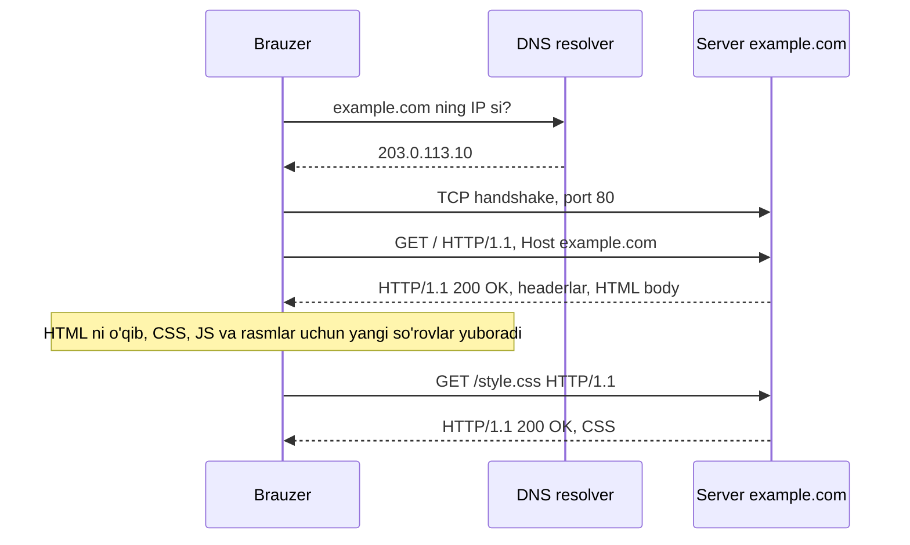

## Bu dars nima uchun kerak

41-darsda paket qanday qilib bir kompyuterdan boshqasiga yetib borishini ko'rdik: DNS nomni IP ga aylantiradi, TCP ishonchli bayt oqimini quradi. Lekin TCP faqat baytlarni tashiydi, ularning ma'nosini bilmaydi. Brauzer serverdan "menga bosh sahifani ber" deb qanday so'raydi? Server "bunday sahifa yo'q" yoki "sahifa boshqa joyga ko'chgan" deb qanday javob beradi? Buning uchun ikki tomon bir xil tilda gaplashishi kerak. Vebning tili - **HTTP** (Hypertext Transfer Protocol).

HTTP ning yaxshi tomoni - u oddiy matnli protokol (hech bo'lmaganda 1.1 versiyasi). So'rov va javobni ko'z bilan o'qish, qo'lda yozish va Python'da parse qilish mumkin. Bu darsda aynan shuni qilamiz: URL ni qismlarga ajratamiz, so'rov va javob matnini qatorma-qator o'qiymiz, metodlar va status kodlarning ma'nosini RFC 9110 bo'yicha aniqlaymiz va oxirida xom HTTP so'rovini parse qiladigan funksiya yozamiz.

Bu bilim keyingi darslarning hammasida kerak bo'ladi: 45-46-darslarda JavaScript `fetch` bilan so'rov yuboradi, 47-49-darslarda Flask'da o'zingiz so'rovni qabul qilib, status kod va header bilan javob qaytarasiz, 48-darsda cookie va session, 50-darsda xavfsizlik, 52-darsda HTTPS ning shifrlash qismi ko'riladi.

Bu darsdan keyin siz:

- URL ni sxema, host, port, path, query va fragment qismlariga ajrata olasiz;
- HTTP so'rov va javob matnining tuzilishini (boshlang'ich qator, headerlar, bo'sh qator, body) bilasiz;
- GET, POST, PUT, PATCH, DELETE, HEAD va OPTIONS metodlari farqini va qaysilari safe yoki idempotent ekanini tushuntira olasiz;
- status kod sinflarini va asosiy kodlarni (200, 201, 204, 301, 302, 304, 400, 401, 403, 404, 429, 500, 503) to'g'ri tanlay olasiz;
- Content-Type, Content-Length, Cache-Control, Location, Set-Cookie headerlarining vazifasini bilasiz;
- HTTP/1.1, HTTP/2 va HTTP/3 farqini va HTTPS nima qo'shishini bilasiz;
- `curl -I` natijasini o'qiy olasiz va xom so'rovni Python'da parse qila olasiz.

## URL: manba qayerda

### URL qismlari

**URL** (Uniform Resource Locator) - Internetdagi manbaning to'liq manzili. Uning umumiy sintaksisi RFC 3986 da yozilgan. Bitta murakkab URL ni qismlarga ajratamiz:

```text
https://shop.example.com:8443/kitoblar/qidiruv?q=python+asoslari&sahifa=2#natijalar
\___/   \______________/ \__/\_______________/ \______________________/ \_______/
sxema         host       port       path                query            fragment
```

| Qism | Misolda | Vazifasi |
|---|---|---|
| Sxema (scheme) | `https` | Qaysi protokol bilan ulanish. `http` yoki `https` |
| Host | `shop.example.com` | Server nomi (DNS orqali IP ga aylanadi, 41-dars) yoki to'g'ridan-to'g'ri IP |
| Port | `8443` | Serverdagi dastur. Yozilmasa: `http` uchun 80, `https` uchun 443 |
| Path | `/kitoblar/qidiruv` | Server ichidagi manba, papka yo'liga o'xshash |
| Query | `q=python+asoslari&sahifa=2` | `?` dan keyingi `kalit=qiymat` juftliklari, `&` bilan ajratilgan |
| Fragment | `natijalar` | `#` dan keyingi qism: sahifa ichidagi joy |

Muhim nozik joy: **fragment serverga yuborilmaydi**. Brauzer `#natijalar` ni o'zida saqlaydi va sahifa yuklangach shu `id` li elementga o'tadi. Server faqat path va query ni ko'radi.

Python'ning `urllib.parse` moduli URL ni RFC 3986 qoidalari bo'yicha ajratadi:

```python run
from urllib.parse import urlsplit, parse_qs, quote, unquote

url = "https://shop.example.com:8443/kitoblar/qidiruv?q=python+asoslari&sahifa=2#natijalar"
u = urlsplit(url)
print("scheme  :", u.scheme)
print("host    :", u.hostname)
print("port    :", u.port)
print("path    :", u.path)
print("query   :", u.query)
print("fragment:", u.fragment)
print(parse_qs(u.query))

# Port yozilmasa, urlsplit uni o'zi to'ldirmaydi
print(urlsplit("http://example.com/").port)

# URL da bo'shliq va maxsus belgilar kodlanadi
print(quote("o'quvchi ro'yxati"))
print(unquote("%D1%88%D0%BA%D0%BE%D0%BB%D0%B0"))
```

Natija:

```text
scheme  : https
host    : shop.example.com
port    : 8443
path    : /kitoblar/qidiruv
query   : q=python+asoslari&sahifa=2
fragment: natijalar
{'q': ['python asoslari'], 'sahifa': ['2']}
None
o%27quvchi%20ro%27yxati
школа
```

Kuzatishlar:

1. `parse_qs` har bir kalit uchun **ro'yxat** qaytaradi, chunki query'da bitta kalit bir necha marta kelishi mumkin (`?rang=qizil&rang=yashil`). Qiymatlar doim satr: `'2'` son emas, uni `int()` bilan o'zingiz aylantirasiz (31-darsdagi dinamik tiplar).
2. Query'dagi `+` bo'shliqqa aylandi. Bu HTML formalaridan qolgan qoida (43-dars).
3. Port yozilmagan URL da `port` - `None`. "Standart port 80" degan bilim urllib'da emas, uni ishlatayotgan kodda.
4. **Percent-encoding**: URL da faqat cheklangan ASCII belgilar to'g'ridan-to'g'ri yoziladi. Qolganlari UTF-8 baytlariga bo'linadi (2-dars) va har bir bayt `%` va ikki hex raqam bilan yoziladi: bo'shliq `%20`, apostrof `%27`. Kirill harfi `ш` UTF-8 da 2 bayt (`D1 88`), shuning uchun `%D1%88` - 6 ta belgi.

## So'rov va javob: matnning o'zi

### Ulanishdan javobgacha

Brauzer `http://example.com/` ni ochganda HTTP 41-darsdagi qatlamlar ustida ishlaydi:



Har bir HTTP almashinuvi bitta qoidaga bo'ysunadi: mijoz (client) **so'rov** (request) yuboradi, server bitta **javob** (response) qaytaradi. Server o'zi gap boshlamaydi. Bitta sahifa odatda o'nlab so'rovdan iborat: HTML, keyin u ko'rsatgan har bir CSS, JS va rasm fayli alohida so'raladi.

### So'rov matni

HTTP/1.1 (RFC 9112) da so'rov shunday ko'rinadi:

```text
GET /kitoblar?sahifa=2 HTTP/1.1
Host: shop.example.com
User-Agent: Mozilla/5.0
Accept: text/html
Accept-Language: uz, en;q=0.8

```

Tuzilishi:

1. **Request line** (boshlang'ich qator): metod (`GET`), **request target** - path va query (`/kitoblar?sahifa=2`), versiya (`HTTP/1.1`). Uchalasi bitta bo'shliq bilan ajratilgan.
2. **Headerlar**: har qatorda `Nom: qiymat`. Header nomlari katta-kichik harfga sezgir emas: `Host`, `host` va `HOST` - bir xil.
3. **Bo'sh qator**: headerlar tugadi degan belgi.
4. **Body** (tana): ixtiyoriy. GET da odatda yo'q, POST da forma yoki JSON ma'lumotlari shu yerda.

Har bir qator oxiri `\r\n` (CR LF, 2-darsdagi ASCII 13 va 10). Shu sababli bo'sh qator aslida `\r\n\r\n` ketma-ketligi: parser headerlar qayerda tugashini shundan biladi.

`Host` headeri HTTP/1.1 da majburiy. Sababi: bitta IP manzilda (bitta serverda) yuzlab sayt turishi mumkin. Request line da faqat path bor, qaysi sayt so'ralayotganini server `Host` dan biladi. RFC 9112 ga ko'ra HTTP/1.1 so'rovida `Host` bo'lmasa, server 400 javobini berishi kerak.

### Javob matni

```text
HTTP/1.1 200 OK
Content-Type: text/html; charset=utf-8
Content-Length: 1256
Cache-Control: max-age=600
Date: Tue, 03 Nov 2026 10:00:00 GMT

<!doctype html>
<html lang="uz">
...
```

Javobning birinchi qatori - **status line**: versiya, uch xonali **status kod** (`200`) va inson uchun izoh (`OK`, reason phrase). Dasturlar faqat raqamga qaraydi, izoh matni ixtiyoriy va har xil bo'lishi mumkin. Keyin so'rovdagi kabi headerlar, bo'sh qator va body.

## Metodlar: nima qilish kerak

### Asosiy metodlar

Metod serverga so'rovning maqsadini aytadi. RFC 9110 sakkizta metodni belgilaydi (GET, HEAD, POST, PUT, DELETE, CONNECT, OPTIONS, TRACE), PATCH esa alohida RFC 5789 da. CRUD amallari (36-dars) bilan solishtirsak:

| Metod | Ma'nosi | CRUD | Body |
|---|---|---|---|
| GET | Manbaning joriy ko'rinishini olish | Read | Odatda yo'q |
| HEAD | GET bilan bir xil, lekin javobda body yo'q, faqat headerlar | Read | Yo'q |
| POST | Yuborilgan ma'lumotni manbaning o'z qoidasiga ko'ra qayta ishlash (ko'pincha yangi yozuv yaratish) | Create | Bor |
| PUT | Manbani yuborilgan ko'rinish bilan to'liq almashtirish (yo'q bo'lsa, yaratish) | Update | Bor |
| PATCH | Manbaning faqat bir qismini o'zgartirish | Update | Bor |
| DELETE | Manbani o'chirish | Delete | Odatda yo'q |
| OPTIONS | Manba qaysi imkoniyatlarni qo'llashini so'rash | - | Odatda yo'q |

HEAD foydali: katta faylni yuklamasdan uning o'lchami (`Content-Length`) yoki o'zgargan-o'zgarmaganini bilish mumkin. Pastdagi `curl -I` aynan HEAD so'rovini yuboradi.

### Safe va idempotent

RFC 9110 metodlarni ikki muhim xususiyat bo'yicha ajratadi:

- **Safe** (xavfsiz) metod - mijoz serverdagi holatni o'zgartirishni so'ramaydi, faqat o'qiydi. RFC 9110 bo'yicha GET, HEAD, OPTIONS va TRACE safe.
- **Idempotent** metod - bir xil so'rovni bir marta yoki N marta yuborishning serverga ta'siri bir xil. RFC 9110 bo'yicha PUT, DELETE va barcha safe metodlar idempotent.

| Metod | Safe | Idempotent | Izoh |
|---|---|---|---|
| GET | Ha | Ha | Faqat o'qish |
| HEAD | Ha | Ha | GET ning body'siz shakli |
| OPTIONS | Ha | Ha | Imkoniyatlarni so'rash |
| PUT | Yo'q | Ha | Ikki marta "shu bilan almashtir" - natija bir xil |
| DELETE | Yo'q | Ha | Ikkinchi marta o'chirish holatni o'zgartirmaydi |
| POST | Yo'q | Yo'q | Ikki marta yuborilsa, ikkita buyurtma yaratilishi mumkin |
| PATCH | Yo'q | Yo'q | RFC 5789: umumiy holda idempotent emas, lekin idempotent qilib ishlatish mumkin |

Misol bilan. `PUT /users/7` body'si `{"ism": "Ali"}`: birinchi so'rovdan keyin 7-foydalanuvchining ismi Ali, uchinchi marta yuborilganda ham Ali. `DELETE /users/7`: birinchi so'rov o'chiradi, ikkinchisi 404 qaytarishi mumkin, lekin serverdagi holat bir xil - foydalanuvchi yo'q. Idempotentlik serverdagi **holat** haqida, javob kodi haqida emas. `POST /orders` esa har safar yangi buyurtma yaratadi: uch marta bosilgan "Sotib olish" tugmasi uchta buyurtma.

Nega bu muhim? RFC 9110 tushuntiradi: javob kelmasdan ulanish uzilsa, mijoz idempotent so'rovni avtomatik qayta yuborishi mumkin, chunki ikki marta bajarilishi zarar qilmaydi. POST bilan buni qilib bo'lmaydi. Safe metodlarni esa qidiruv robotlari va brauzerning oldindan yuklash mexanizmi bemalol chaqiradi. Shuning uchun **GET bilan hech qachon ma'lumot o'zgartirmang**: `GET /delete?id=7` kabi havola robot yoki oldindan yuklash tomonidan bosib yuborilishi mumkin. Bu qoida 50-darsdagi CSRF himoyasi bilan ham bog'liq.

## Status kodlar: nima bo'ldi

### Beshta sinf

Status kod uch xonali son, birinchi raqami sinfni bildiradi. Mijoz noma'lum kodni ko'rsa ham, birinchi raqamidan umumiy ma'noni tushunadi (RFC 9110, 15-bo'lim):

| Sinf | Ma'nosi | Misol |
|---|---|---|
| 1xx | Ma'lumot: so'rov qabul qilindi, jarayon davom etmoqda | 100 Continue |
| 2xx | Muvaffaqiyat | 200 OK |
| 3xx | Yo'naltirish: boshqa joyga murojaat qiling | 301, 302, 304 |
| 4xx | Mijoz xatosi: so'rovda muammo bor | 400, 404 |
| 5xx | Server xatosi: so'rov to'g'ri, server bajara olmadi | 500, 503 |

4xx va 5xx farqi amaliy: 4xx da xuddi shu so'rovni qayta yuborish foyda bermaydi, so'rovni tuzatish kerak; 5xx da esa keyinroq qayta urinish mumkin.

### Asosiy kodlar

| Kod | Nomi | Qachon |
|---|---|---|
| 200 | OK | So'rov bajarildi, natija body'da |
| 201 | Created | Yangi manba yaratildi (odatda POST yoki PUT dan keyin); `Location` yangi manba manzilini ko'rsatadi |
| 204 | No Content | Bajarildi, lekin qaytaradigan body yo'q (masalan, DELETE dan keyin) |
| 301 | Moved Permanently | Manba butunlay yangi manzilga ko'chgan, `Location` da yangi manzil |
| 302 | Found | Manba vaqtincha boshqa manzilda, keyingi safar ham eski manzildan so'rash kerak |
| 304 | Not Modified | Keshdagi nusxa hali yangi, body yuborilmaydi |
| 400 | Bad Request | So'rov noto'g'ri tuzilgan (masalan, `Host` yo'q yoki JSON buzilgan) |
| 401 | Unauthorized | Autentifikatsiya kerak: kimligingiz noma'lum (login qilmagansiz) |
| 403 | Forbidden | Kimligingiz ma'lum, lekin bu amalga ruxsatingiz yo'q |
| 404 | Not Found | Bunday manba yo'q (yoki server borligini oshkor qilmaydi) |
| 418 | (I'm a teapot) | Hazil: RFC 2324, 1-aprel RFC'si |
| 429 | Too Many Requests | Vaqt birligida juda ko'p so'rov (rate limiting), RFC 6585 |
| 500 | Internal Server Error | Serverda kutilmagan xato (masalan, dasturdagi exception) |
| 503 | Service Unavailable | Server vaqtincha band yoki texnik ishlar ketmoqda |

Bir nechta nozik juftliklar:

- **401 va 403.** Nomiga qaramay, 401 "autentifikatsiya yo'q" degani: login qiling. 403 - login qilgansiz, lekin ruxsat yo'q: oddiy foydalanuvchi admin sahifasini ochmoqchi.
- **301 va 302.** Brauzer va qidiruv tizimlari 301 ni eslab qoladi va keyingi safar to'g'ridan-to'g'ri yangi manzilga boradi. 302 da eslab qolinmaydi. Masalan, login qilgandan keyin bosh sahifaga yo'naltirish vaqtinchalik (302), sayt domenini almashtirish - doimiy (301).
- **304.** Brauzerda sahifaning eski nusxasi bor. U so'rovga "menda shu versiya bor" degan header qo'shadi (masalan, `If-None-Match` va oldin olingan `ETag` qiymati). Manba o'zgarmagan bo'lsa, server body'siz 304 qaytaradi va brauzer keshdagi nusxani ishlatadi. 100 KB lik fayl o'rniga bir necha yuz baytlik javob.
- **429.** RFC 6585 bo'yicha javobda `Retry-After` headeri bo'lishi mumkin: necha soniyadan keyin qayta urinish mumkinligi.
- **418.** RFC 2324 - 1998-yil 1-aprelda chiqqan hazil RFC: choynak bilan qahva damlashga urinish "418 I'm a teapot" xatosini qaytarishi kerak. RFC 9110 izohlashicha, bu kod hazil sifatida shunchalik ko'p ishlatilganki, uni boshqa maqsadga berib bo'lmaydi, shuning uchun u registrda band qilingan, lekin "Unused" deb belgilangan. Haqiqiy API'da ishlatmang.

## Headerlar: so'rov va javob haqida ma'lumot

**HTTP header** - so'rov yoki javob haqidagi qo'shimcha ma'lumot, `Nom: qiymat` ko'rinishida. Ular yuzlab, lekin eng muhimlari quyidagilar.

### Content-Type va Content-Length

`Content-Type` body qanday formatda ekanini aytadi. Qiymati **MIME type** (media type) deb ataladigan `tur/kichik_tur` yozuvi:

| Content-Type | Body |
|---|---|
| `text/html; charset=utf-8` | HTML sahifa, UTF-8 kodlashda |
| `text/css` | CSS fayl |
| `application/json` | JSON ma'lumot (46-dars) |
| `image/png` | PNG rasm |
| `application/x-www-form-urlencoded` | HTML forma ma'lumoti: `ism=Ali&yosh=20` (43-dars) |

Brauzer faylni kengaytmasiga emas, `Content-Type` ga qarab talqin qiladi: `.html` nomli fayl `text/plain` bilan kelsa, HTML sifatida emas, oddiy matn sifatida ko'rsatiladi.

`Content-Length` body uzunligini **baytlarda** beradi, belgilarda emas. 2-darsdagi UTF-8 bu yerda muhim: `salom` 5 bayt, lekin `o'zbek` ni `o‘zbek` (tutuq belgisi U+2018) bilan yozsangiz, 6 belgi, lekin 8 bayt, chunki U+2018 UTF-8 da 3 bayt. Uzunlikni belgilarda hisoblagan server body oxirini kesib qo'yadi yoki mijoz yana baytlar kutib qoladi. Bitta TCP ulanishida bir nechta javob ketma-ket kelganda, mijoz bir javob qayerda tugab, keyingisi qayerdan boshlanishini aynan `Content-Length` dan biladi.

### Cache-Control, Location, Set-Cookie

- `Cache-Control` javobni keshda saqlash qoidasi. `max-age=600` - 600 soniya (10 daqiqa) davomida qayta so'ramasdan ishlatish mumkin. `no-store` - umuman saqlamang (masalan, bank sahifasi). `no-cache` nomiga qaramay "saqlash mumkin, lekin har safar server bilan tekshiring" degani (yuqoridagi 304 mexanizmi).
- `Location` 3xx javoblarda qayerga o'tish kerakligini, 201 da yaratilgan manba manzilini ko'rsatadi.
- `Set-Cookie` - server javobida: "shu qiymatni eslab qol". Brauzer keyingi so'rovlarda uni `Cookie` headerida qaytaradi. HTTP o'zi har bir so'rovni alohida, oldingisini eslamasdan qayta ishlaydi (**stateless**). Cookie shu xotirasizlik ustida login holatini saqlash usuli, 48-darsda Flask session bilan chuqur ko'riladi.

### Request, Response va Headers obyektlari

Brauzer JavaScript'ida (va Web Worker'da ham) HTTP xabarlari `Request`, `Response` va `Headers` obyektlari bilan ifodalanadi; 46-darsdagi `fetch` aynan shu obyektlar bilan ishlaydi. Ularni tarmoqsiz ham yaratish mumkin, bu esa so'rov va javob tuzilishini o'rganishga qulay:

```js run
const h = new Headers({ "Content-Type": "application/json" });
h.append("Cache-Control", "no-cache");
console.log(h.get("content-type"));      // nom katta-kichik harfga sezgir emas
console.log(String(h.has("CACHE-CONTROL")));

const body = JSON.stringify({ ism: "Ali", shahar: "Toshkent" });
const req = new Request("https://example.com/api/users?page=2", { method: "POST", headers: h, body });
console.log(req.method, req.url);
const url = new URL(req.url);
console.log(url.pathname, url.searchParams.get("page"));
console.log(JSON.stringify(await req.json()));

const res = new Response("Qo'shildi: o'quvchi №7", {
  status: 201,
  headers: { "Content-Type": "text/plain; charset=utf-8", "Location": "/api/users/7" },
});
console.log(res.status, res.ok, res.headers.get("location"));
const text = await res.text();
console.log("belgilar:", text.length, "baytlar:", new TextEncoder().encode(text).length);
for (const [k, v] of res.headers) console.log(k + ": " + v);

const empty = new Response(null, { status: 204 });
console.log(empty.status, empty.ok, JSON.stringify(await empty.text()));
```

Natija:

```text
application/json
true
POST https://example.com/api/users?page=2
/api/users 2
{"ism":"Ali","shahar":"Toshkent"}
201 true /api/users/7
belgilar: 22 baytlar: 24
content-type: text/plain; charset=utf-8
location: /api/users/7
204 true ""
```

Kuzatishlar: `Headers` nomlarni kichik harfga keltirib saqlaydi va shunday chiqaradi. `res.ok` status 200-299 oralig'ida bo'lsa `true`, shuning uchun 204 ham "ok". Matnda 22 belgi, lekin `№` belgisi UTF-8 da 3 bayt bo'lgani uchun 24 bayt: `Content-Length` 24 bo'lishi kerak. 204 javobida body bo'sh satr.

Brauzer xavfsizlik uchun ba'zi headerlarni JavaScript'ga yozdirmaydi (masalan, `Host`, `Cookie`, javobdagi `Set-Cookie`): ularni brauzerning o'zi boshqaradi. Shuning uchun misolda ular ishlatilmagan.

## HTTPS va HTTP versiyalari

### HTTPS

Oddiy HTTP matni tarmoq bo'ylab ochiq ketadi: yo'ldagi har bir router, umumiy Wi-Fi dagi qo'shni yoki provayder parolingizni o'qishi va javobni o'zgartirishi mumkin. **HTTPS** - xuddi shu HTTP, lekin TCP va HTTP orasiga **TLS** (Transport Layer Security) qatlami qo'shilgan. TLS uch narsani beradi: shifrlash (o'qib bo'lmaydi), yaxlitlik (o'zgartirib bo'lmaydi) va autentifikatsiya (sertifikat orqali server haqiqatan ham `example.com` ekanini tekshirish). Standart port 443. TLS ning ichki mexanikasi - kalit almashish, simmetrik va asimmetrik shifrlash, sertifikatlar - 52-darsda.

HTTPS da yo'ldagi kuzatuvchi faqat qaysi serverga ulanayotganingizni (IP manzil, ko'pincha domen nomi ham) ko'radi, lekin path, query, headerlar va body shifrlangan.

### HTTP/1.1, HTTP/2, HTTP/3

| Xususiyat | HTTP/1.1 | HTTP/2 | HTTP/3 |
|---|---|---|---|
| Standart | RFC 9112 | RFC 9113 | RFC 9114 |
| Format | Matn | Binary freymlar | Binary freymlar |
| Transport | TCP | TCP | QUIC (UDP ustida, RFC 9000) |
| Bitta ulanishda parallel so'rovlar | Amalda yo'q, ketma-ket | Ha, multiplexing (oqimlar) | Ha, oqimlar |
| Bitta paket yo'qolsa | Shu ulanishdagi navbat to'xtaydi | Butun TCP ulanish kutadi | Faqat shu oqim kutadi |
| Shifrlash | Ixtiyoriy (HTTPS bilan) | Amalda brauzerlarda doim TLS | QUIC ichida majburiy |

Muhimi: metodlar, status kodlar va headerlarning ma'nosi (RFC 9110) uchala versiyada bir xil. O'zgaradigani - shu ma'lumot simda qanday kodlanishi va tashilishi. HTTP/1.1 da bitta ulanishda javob kelmaguncha keyingi so'rov kutadi, shuning uchun brauzerlar bitta saytga bir nechta TCP ulanish ochardi; 41-darsdan bilamizki, har bir yangi ulanish handshake uchun RTT talab qiladi. HTTP/2 o'nlab so'rovni bitta ulanishda parallel oqimlarga bo'lib yuboradi. Lekin TCP baytlarni qat'iy tartibda beradi: bitta paket yo'qolsa, uning ortidagi hamma oqimlar kutadi. HTTP/3 shuning uchun TCP o'rniga UDP ustidagi QUIC ni ishlatadi: u oqimlarni bir-biridan mustaqil tartiblaydi.

Flask darslarida (47-49) siz HTTP/1.1 ning matnli shaklini ko'rasiz; brauzer va server qaysi versiyani ishlatishni o'zlari kelishib oladi va ilova kodi o'zgarmaydi.

### curl -I: javob headerlarini ko'rish

`curl` - terminaldan HTTP so'rov yuboradigan dastur. `-I` bayrog'i HEAD so'rovini yuboradi va faqat status qatori va headerlarni chiqaradi. Masalan, domen `http` dan `https` ga yo'naltirilgan saytda:

```text
$ curl -I http://example.com/
HTTP/1.1 301 Moved Permanently
Location: https://example.com/
Content-Length: 0
Date: Tue, 03 Nov 2026 10:00:00 GMT

$ curl -I https://example.com/
HTTP/2 200
content-type: text/html; charset=utf-8
content-length: 1256
cache-control: max-age=600
date: Tue, 03 Nov 2026 10:00:05 GMT
```

Birinchi javob: port 80 dagi oddiy HTTP so'rovi doimiy (301) ravishda HTTPS manzilga yo'naltirildi, `Location` qayerga ekanini aytadi. Ikkinchi javob HTTP/2 da keldi: unda reason phrase yo'q (HTTP/2 da u umuman uzatilmaydi) va header nomlari kichik harflarda, chunki HTTP/2 ularni shunday yozishni talab qiladi. `curl -L` bayrog'i yo'naltirishlarga avtomatik ergashadi, `curl -v` esa yuborilgan so'rovni ham ko'rsatadi.

## Mashq: xom HTTP so'rovini parse qilish

Server qabul qilgan baytlar - oddiy matn. Flask kabi framework uni sizning o'rningizga parse qiladi (47-dars), lekin buni bir marta o'zingiz qilish so'rov tuzilishini yaxshi mustahkamlaydi. `parse_request(raw)` funksiyasini yozing. `raw` - so'rovning to'liq matni, qatorlar `\r\n` bilan ajratilgan. Funksiya lug'at (dict) qaytaradi:

- `method`, `target`, `version` - request line'ning uchta qismi;
- `path` va `query` - `target` ning `?` gacha va undan keyingi qismi (`?` bo'lmasa, `query` - bo'sh satr);
- `headers` - lug'at: kalitlar **kichik harfda**, qiymatlarning ikki chetidagi bo'shliqlar olib tashlangan;
- `body` - bo'sh qatordan keyingi matn. `Content-Length` berilgan bo'lsa, body shuncha **bayt** (UTF-8) bilan cheklanadi, aks holda bo'sh satr.

Xato holatlar: request line'da aynan 3 qism bo'lmasa yoki versiya `HTTP/` bilan boshlanmasa, `ValueError` ko'taring (33-dars). `HTTP/1.1` so'rovida `host` headeri bo'lmasa ham `ValueError`: haqiqiy server bu holda 400 qaytaradi.

Maslahat: avval `raw.split("\r\n\r\n", 1)` bilan bosh qism va body'ni ajrating, keyin bosh qismni `\r\n` bo'yicha qatorlarga bo'ling. Header qatorini birinchi `:` bo'yicha bo'ling (`str.partition`), chunki qiymat ichida ham `:` bo'lishi mumkin (`Host: localhost:5000`).

```python run
def parse_request(raw):
    """Xom HTTP/1.x so'rov matnini lug'atga aylantiradi."""
    # Yechimingizni shu yerga yozing
    return {}


raw = (
    "POST /api/izoh?post=7 HTTP/1.1\r\n"
    "Host: localhost:5000\r\n"
    "Content-Type: application/json\r\n"
    "Content-Length: 18\r\n"
    "\r\n"
    '{"matn": "salom"}\n'
)
r = parse_request(raw)
print(r)
```

```python test
GET_RAW = "GET /kitoblar?sahifa=2 HTTP/1.1\r\nHost: shop.example.com\r\nAccept:   text/html  \r\n\r\n"
POST_RAW = "POST /api/izoh?post=7 HTTP/1.1\r\nHost: localhost:5000\r\nContent-Type: application/json\r\nContent-Length: 17\r\n\r\n{\"matn\": \"salom\"}ORTIQCHA"

def raises(fn):
    try:
        fn()
    except ValueError:
        return True
    return False

check("request line: method, target, version", lambda: (lambda r: (r["method"], r["target"], r["version"]) == ("GET", "/kitoblar?sahifa=2", "HTTP/1.1"))(parse_request(GET_RAW)))
check("target path va query ga bo'linadi", lambda: (lambda r: r["path"] == "/kitoblar" and r["query"] == "sahifa=2")(parse_request(GET_RAW)))
check("? bo'lmasa query bo'sh satr", lambda: parse_request("GET / HTTP/1.1\r\nHost: a\r\n\r\n")["query"] == "")
check("header kalitlari kichik harfda, qiymat chetlari tozalangan", lambda: parse_request(GET_RAW)["headers"] == {"host": "shop.example.com", "accept": "text/html"})
check("qiymat ichidagi ':' saqlanadi (localhost:5000)", lambda: parse_request(POST_RAW)["headers"]["host"] == "localhost:5000")
check("Content-Length bo'yicha body kesiladi", lambda: parse_request(POST_RAW)["body"] == '{"matn": "salom"}')
check("Content-Length yo'q bo'lsa body bo'sh", lambda: parse_request(GET_RAW)["body"] == "")
check("Content-Length baytlarda (UTF-8)", lambda: parse_request("POST /x HTTP/1.1\r\nHost: a\r\nContent-Length: 4\r\n\r\nшкола")["body"] == "шк")
check("headerlarda katta-kichik harf farq qilmaydi", lambda: parse_request("GET / HTTP/1.1\r\nHOST: a\r\ncontent-LENGTH: 2\r\n\r\nabc")["body"] == "ab")
check("request line 3 qism bo'lmasa ValueError", lambda: raises(lambda: parse_request("GET /\r\nHost: a\r\n\r\n")))
check("versiya HTTP/ bilan boshlanmasa ValueError", lambda: raises(lambda: parse_request("GET / FTP/1.0\r\nHost: a\r\n\r\n")))
check("HTTP/1.1 da Host bo'lmasa ValueError", lambda: raises(lambda: parse_request("GET / HTTP/1.1\r\nAccept: */*\r\n\r\n")))
check("HTTP/1.0 da Host majburiy emas", lambda: parse_request("GET / HTTP/1.0\r\n\r\n")["headers"] == {})
```

## Ko'p uchraydigan xatolar

1. **GET bilan ma'lumot o'zgartirish.** `GET /delete?id=7` safe bo'lishi kerak bo'lgan metodni buzadi: robotlar, oldindan yuklash va qayta urinishlar uni bemalol chaqiradi. O'zgartirish uchun POST, PUT, PATCH, DELETE.
2. **Hamma narsaga 200 qaytarish.** Xatoni body'da `{"xato": "topilmadi"}` deb yozib, status 200 qoldirish keshlar, brauzer va monitoring uchun "hammasi joyida" degani. To'g'ri kod tanlang: 404, 400, 500.
3. **401 va 403 ni almashtirish.** 401 - kim ekaningiz noma'lum (login qiling), 403 - ma'lum, lekin ruxsat yo'q.
4. **301 ni vaqtinchalik yo'naltirish uchun ishlatish.** Brauzerlar 301 ni eslab qoladi va keyin eski manzilni so'ramaydi. Vaqtinchalik holat uchun 302.
5. **Content-Length ni belgilarda hisoblash.** U baytlarda: UTF-8 da harf 1-4 bayt (2-dars). Noto'g'ri qiymat javobni kesadi yoki ulanishni osiltirib qo'yadi.
6. **Fragment serverga boradi deb kutish.** `#` dan keyingi qism brauzerda qoladi. Server uchun ma'lumot query'da yuborilishi kerak.
7. **URL ni qo'lda yig'ib, kodlashni unutish.** Bo'shliq, `&`, `?` yoki kirill harflari bo'lgan qiymat URL tuzilishini buzadi. `urllib.parse.quote`/`urlencode` yoki JavaScript'da `URL`/`URLSearchParams` dan foydalaning.
8. **HTTPS ni "faqat parollar uchun" deb hisoblash.** Oddiy HTTP da har qanday sahifani yo'lda o'zgartirish (masalan, reklama yoki zararli skript qo'shish) mumkin. Har bir sahifa HTTPS bo'lishi kerak.

## Xulosa

- URL: sxema, host, port (standart 80/443), path, query va fragment; fragment serverga yuborilmaydi, maxsus belgilar percent-encoding bilan kodlanadi.
- HTTP so'rov: request line (metod, target, versiya), headerlar, bo'sh qator (`\r\n\r\n`), body. Javob: status line, headerlar, bo'sh qator, body. HTTP/1.1 da `Host` majburiy.
- RFC 9110: GET, HEAD, OPTIONS safe; ular va PUT, DELETE idempotent; POST va PATCH umumiy holda idempotent emas. Idempotentlik serverdagi holat haqida.
- Status kod sinflari: 1xx ma'lumot, 2xx muvaffaqiyat, 3xx yo'naltirish, 4xx mijoz xatosi, 5xx server xatosi; 401 va 403, 301 va 302 farqini biling, 304 kesh bilan ishlaydi.
- Content-Type formatni, Content-Length body'ni baytlarda beradi; Cache-Control kesh qoidasini, Location yo'nalishni belgilaydi; Set-Cookie va Cookie stateless HTTP ustida holat saqlaydi (48-dars).
- HTTPS = HTTP + TLS (52-dars). HTTP/2 bitta TCP ulanishda parallel oqimlar, HTTP/3 QUIC (UDP) ustida; ma'nosi (metod, status, header) hamma versiyada bir xil.

## Amaliy topshiriq

Kutubxona uchun kichik REST API ni loyihalang: kitoblar ro'yxati, bitta kitob, kitob qo'shish, ma'lumotini yangilash va o'chirish. Hali server yozmaysiz (bu 47-49-darslarda), faqat HTTP darajasidagi shartnomani tuzasiz va uni Python bilan tekshirasiz.

Topshiriq qadamlari:

1. **Endpointlar jadvali.** Har bir amal uchun metod, path, kutilgan body va muvaffaqiyatli status kodni yozing (masalan, `GET /books`, `GET /books/12`, `POST /books`, `PUT /books/12`, `PATCH /books/12`, `DELETE /books/12`). Qidiruv va sahifalash uchun query parametrlarini (`?q=...&sahifa=...`) belgilang.
2. **Xato holatlari.** Har bir endpoint uchun kamida bitta xato holatini va uning kodini yozing: mavjud bo'lmagan kitob, buzilgan JSON, login qilinmagan foydalanuvchi, oddiy foydalanuvchi o'chirmoqchi, juda ko'p so'rov.
3. **Xom matnlar.** `POST /books` so'rovi va unga 201 javobining to'liq matnini yozing: request line, kerakli headerlar (`Host`, `Content-Type`, `Content-Length`, javobda `Location`) va JSON body. `Content-Length` ni baytlarda hisoblang; kitob nomida kamida bitta ASCII bo'lmagan belgi bo'lsin.
4. **Parser bilan tekshirish.** 3-qadamdagi so'rov matnini mashqdagi `parse_request` ga bering va body to'liq hamda aniq olinganini tekshiring.
5. **Idempotentlik.** Mijoz `POST /books` yubordi, lekin javob kelmasdan ulanish uzildi. Mijoz so'rovni avtomatik qayta yuborsa, nima bo'lishi mumkin? `PUT /books/12` uchun-chi? Takrorlanishdan himoya uchun qanday yondashuv taklif qilasiz?

Yaxshi javobda bo'lishi kerak bo'lgan narsalar:

- metodlar maqsadiga mos: o'qish GET, yaratish POST (201 va `Location`), to'liq almashtirish PUT, qisman o'zgartirish PATCH, o'chirish DELETE (204 yoki 200);
- xatolar uchun 400, 401, 403, 404, 429 to'g'ri ajratilgan, 401 va 403 farqi asoslangan;
- xom matnlarda request line va status line to'g'ri, headerlar va body orasida bo'sh qator, `Content-Length` UTF-8 baytlarda to'g'ri hisoblangan;
- `parse_request` 3-qadamdagi matnni xatosiz o'qigani va body uzunligi `Content-Length` ga teng ekani ko'rsatilgan;
- POST takrorlansa ikkita kitob yaratilishi mumkinligi, PUT esa idempotent ekani va takrorlanishdan himoya g'oyasi (masalan, so'rovga noyob identifikator qo'shib, server uni eslab qolishi) tushuntirilgan.

Javobingizni pastdagi maydonga yozing va yuqoridagi mezonlar bilan solishtiring.

## Manbalar

- CS50x. [Lecture 8 notes](https://cs50.harvard.edu/x/notes/8/) - "HTTPS" bo'limi: URL, HTTP so'rov va javob, status kodlar, `curl -I` misollari.
- RFC 9110. [HTTP Semantics](https://www.rfc-editor.org/rfc/rfc9110.html) - 9 "Methods" (9.2.1 Safe Methods, 9.2.2 Idempotent Methods, Table 4), 15 "Status Codes" (15.5.19 - 418 Unused), 8.3 Content-Type, 8.6 Content-Length, 10.2.2 Location.
- RFC 9112. [HTTP/1.1](https://www.rfc-editor.org/rfc/rfc9112.html) - 2 "Message", 3 "Request Line", 3.2 "Request Target" (Host majburiyligi va 400), 4 "Status Line".
- RFC 3986. [Uniform Resource Identifier (URI): Generic Syntax](https://www.rfc-editor.org/rfc/rfc3986.html) - 3 "Syntax Components" (scheme, authority, path, query, fragment), 2.1 "Percent-Encoding".
- RFC 5789. [PATCH Method for HTTP](https://www.rfc-editor.org/rfc/rfc5789.html) - 2 "The PATCH Method": safe va idempotent emasligi. RFC 6585. [Additional HTTP Status Codes](https://www.rfc-editor.org/rfc/rfc6585.html) - 4 "429 Too Many Requests". RFC 2324. [HTCPCP/1.0](https://www.rfc-editor.org/rfc/rfc2324.html) - 2.3.2 "418 I'm a teapot".
- HTTP versiyalari: [RFC 9113 (HTTP/2)](https://www.rfc-editor.org/rfc/rfc9113.html), [RFC 9114 (HTTP/3)](https://www.rfc-editor.org/rfc/rfc9114.html), [RFC 9000 (QUIC)](https://www.rfc-editor.org/rfc/rfc9000.html); umumiy tarix: MDN [Evolution of HTTP](https://developer.mozilla.org/en-US/docs/Web/HTTP/Guides/Evolution_of_HTTP).
- MDN. [HTTP response status codes](https://developer.mozilla.org/en-US/docs/Web/HTTP/Reference/Status), [Request](https://developer.mozilla.org/en-US/docs/Web/API/Request) - status kodlar ro'yxati va Fetch API obyektlari (Web Worker'da ham mavjud).
- Python. [urllib.parse - Parse URLs into components](https://docs.python.org/3/library/urllib.parse.html) - `urlsplit`, `parse_qs`, `quote`, `unquote`.
