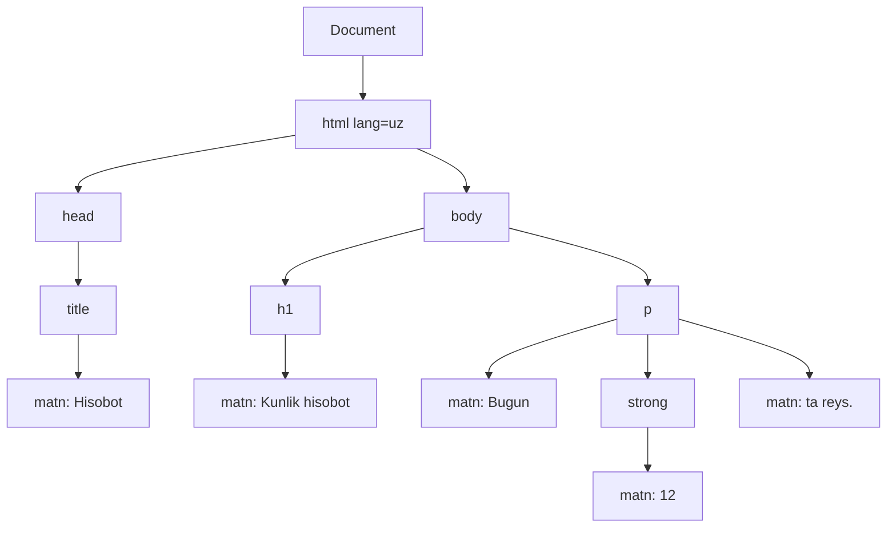
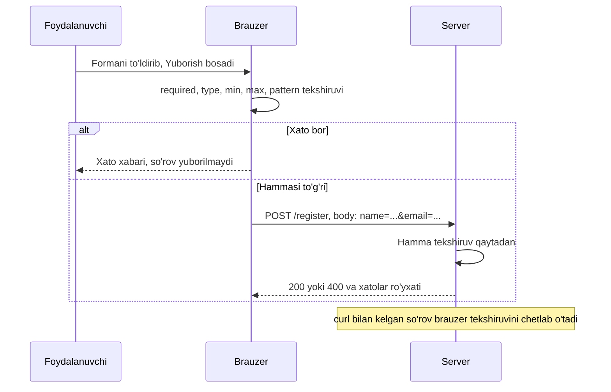

## Bu dars nima uchun kerak

41-darsda brauzer serverni qanday topishini (DNS, IP, TCP) ko'rdik, 42-darsda esa u serverdan HTTP so'rov bilan nima olishini: javob tanasida (body) ko'pincha `Content-Type: text/html` sarlavhali matn keladi. Bu matn - **HTML** (HyperText Markup Language, gipermatnni belgilash tili). U dasturlash tili emas: unda sikl, o'zgaruvchi yoki shart yo'q. HTML matnning qaysi qismi sarlavha, qaysi qismi ro'yxat, qaysi qismi havola yoki forma ekanini **belgilaydi**, brauzer esa shu belgilar asosida sahifani quradi.

HTML ni "ishlasa bo'ldi" deb yozish oson: deyarli har qanday xato kodni brauzer qandaydir ko'rsatadi. Lekin ko'rinib turgan sahifa hali to'g'ri sahifa emas. Ekran o'quvchi dastur (screen reader - matnni ovoz chiqarib o'qiydigan dastur, ko'zi ojiz foydalanuvchilar ishlatadi) faqat `div` lardan iborat sahifada sarlavhani ham, menyuni ham topa olmaydi. Qidiruv tizimi qaysi matn asosiy mazmun ekanini bilmaydi. Labelsiz forma maydoni nomini ekran o'quvchi aytolmaydi, nomga bosib esa maydonni tanlab bo'lmaydi. Bu darsda HTML ni "ko'rinish" uchun emas, **tuzilma** uchun yozishni o'rganamiz.

Dars keyingi darslarning poydevori: 44-darsda CSS shu tuzilmaga selektorlar orqali bog'lanadi, 45-darsda JavaScript shu daraxtni (DOM) o'zgartiradi, 47-48-darslarda Flask serveri formalardan kelgan ma'lumotni qabul qiladi.

Bu darsdan keyin siz:

- to'g'ri HTML hujjat skeletini yoza olasiz va har bir qatori (doctype, `lang`, `charset`, `viewport`) nima uchun kerakligini tushuntira olasiz;
- element, teg va atributni farqlaysiz, HTML matndan qanday DOM daraxti hosil bo'lishini chiza olasiz;
- `div` o'rniga semantik teglarni (`header`, `nav`, `main`, `article`, `section`, `footer`) tanlay olasiz va sarlavhalar ierarxiyasini to'g'ri qura olasiz;
- nisbiy va absolyut URL qanday hal qilinishini (resolve) oldindan hisoblay olasiz;
- ma'lumot jadvalini `thead`, `tbody`, `th scope` bilan to'g'ri belgilaysiz;
- forma qanday HTTP so'rovga aylanishini (GET query string yoki POST body) aniq bayt darajasida ko'rsata olasiz;
- brauzer validatsiyasini (`required`, `min`, `max`, `pattern`, `type="email"`) ishlata olasiz va nega u server tekshiruvining o'rnini bosmasligini bilasiz;
- accessibility (foydalanish imkoniyati) asoslarini: `alt`, `label`, landmark elementlarni qo'llay olasiz.

## Hujjat skeleti

Har bir HTML sahifa bir xil skeletdan boshlanadi. Quyidagi blokni ishga tushiring: sahifa kod ostida ochiladi, skript esa brauzer hujjatdan nimani tushunganini konsolga chiqaradi.

```html run
<!doctype html>
<html lang="uz">
  <head>
    <meta charset="utf-8">
    <meta name="viewport" content="width=device-width, initial-scale=1">
    <title>Avtopark: bosh sahifa</title>
  </head>
  <body>
    <h1>Salom, dunyo</h1>
    <p>Bu birinchi HTML sahifamiz.</p>
    <script>
      console.log("rejim:", document.compatMode);
      console.log("til:", document.documentElement.lang);
      console.log("kodlash:", document.characterSet);
      console.log("sarlavha:", document.title);
    </script>
  </body>
</html>
```

Natija:

```text
rejim: CSS1Compat
til: uz
kodlash: UTF-8
sarlavha: Avtopark: bosh sahifa
```

Har bir qatorni ko'rib chiqamiz:

- **`<!doctype html>`** - hujjat turi e'loni. U teg emas, brauzer uchun signal: "sahifani zamonaviy standart bo'yicha ko'rsat". Doctype bo'lmasa, brauzer **quirks mode** ga o'tadi - 1990-yillar brauzerlarining xatolarini taqlid qiladigan rejim. Natijadagi `CSS1Compat` standart rejimni bildiradi; doctype o'chirilsa, `BackCompat` chiqadi. Quirks mode da, masalan, box model boshqacha hisoblanishi mumkin (44-dars), shuning uchun doctype doim birinchi qator.
- **`<html lang="uz">`** - ildiz element. `lang` atributi matn tilini bildiradi: ekran o'quvchi shunga qarab talaffuz qoidasini tanlaydi, brauzer tarjima taklif qiladi, CSS esa so'z bo'lish (hyphenation) qoidasini oladi.
- **`<head>`** - sahifa haqidagi ma'lumot (metadata): u ekranda ko'rinmaydi.
- **`<meta charset="utf-8">`** - baytlarni belgilarga qanday aylantirishni aytadi. 2-darsdan eslaymiz: lotin harflari ASCII da 1 bayt, kirill harflari esa UTF-8 da 2 baytdan. Kodlash noto'g'ri tanlansa, mojibake (2-dars) chiqadi. HTML standarti bu e'lon hujjatning birinchi 1024 bayti ichida bo'lishini talab qiladi, shuning uchun u `head` ning boshida turadi.
- **`<meta name="viewport" ...>`** - mobil brauzerga sahifa kengligini qurilma ekrani kengligiga teng qilishni aytadi. Usiz telefon brauzeri sahifani taxminan 980 pikselli "virtual ekranda" chizib, keyin kichraytiradi va matn mayda bo'lib qoladi. 44-darsdagi media query lar ham shu qatorga tayanadi.
- **`<title>`** - brauzer tabidagi, tarixdagi, xatcho'plardagi va qidiruv natijasidagi nom. Har sahifada noyob bo'lsin.
- **`<body>`** - ko'rinadigan barcha mazmun.

## Element, teg, atribut va DOM daraxti

Uch atamani farqlash muhim:

- **Teg** (tag) - matndagi belgi: `<p>` ochuvchi teg, `</p>` yopuvchi teg.
- **Element** - ochuvchi teg, mazmun va yopuvchi teg birgalikda: `<p>Matn</p>`. Ba'zi elementlar bo'sh (void): `<meta>`, ``, `<input>`, `<br>` - ularda mazmun ham, yopuvchi teg ham yo'q.
- **Atribut** - ochuvchi tegdagi `nom="qiymat"` juftligi, elementga qo'shimcha ma'lumot beradi: `<a href="/about">`, ``. Ba'zi atributlar mantiqiy (boolean): `<input required>` - atribut borligining o'zi "ha" degani, qiymati ahamiyatsiz.

Elementlar bir-birining ichida joylashadi (nesting) va to'g'ri yopilishi kerak: `<p><strong>muhim</strong></p>` to'g'ri, `<p><strong>muhim</p></strong>` noto'g'ri. Shuning uchun HTML hujjat aslida **daraxt**: har bir element o'z ichidagi elementlarning ota-onasi (parent).

Brauzer HTML matnni o'qiganda (parsing) undan xotirada obyektlar daraxtini quradi. Bu daraxt **DOM** (Document Object Model) deyiladi. CSS va JavaScript HTML matn bilan emas, aynan DOM bilan ishlaydi. 29-darsdagi daraxtlar kabi, DOM ham tugunlardan iborat, lekin binary emas: tugunning bolalari soni cheklanmagan. Tugunlar turi har xil: element tugunlari, matn tugunlari, izoh tugunlari.

Quyidagi kichik hujjat uchun DOM:

```html
<!doctype html>
<html lang="uz">
  <head><title>Hisobot</title></head>
  <body>
    <h1>Kunlik hisobot</h1>
    <p>Bugun <strong>12</strong> ta reys.</p>
  </body>
</html>
```



E'tibor bering: `p` elementining uchta bolasi bor - matn, `strong` elementi va yana matn. Bu yerda soddalik uchun teglar orasidagi bo'shliq va qator ko'chirishlardan hosil bo'ladigan "bo'sh" matn tugunlari ko'rsatilmagan; haqiqiy DOM da ular ham bor.

Endi DOM ni brauzerning o'zidan so'raymiz. Skript `body` dan boshlab element tugunlarini rekursiv aylanib chiqadi (18-darsdagi rekursiya va 29-darsdagi pre-order aylanish kabi) va chuqurlikka qarab chekinish bilan chiqaradi:

```html run
<!doctype html>
<html lang="uz">
  <head><title>Hisobot</title></head>
  <body>
    <h1>Kunlik hisobot</h1>
    <p>Bugun <strong>12</strong> ta reys.</p>
    <ul>
      <li>Toshkent</li>
      <li>Samarqand</li>
    </ul>
    <script>
      function walk(node, depth) {
        if (node.tagName === "SCRIPT") return 0;
        console.log("  ".repeat(depth) + node.tagName.toLowerCase() + " (" + node.childNodes.length + " tugun)");
        let count = 1;
        for (const child of node.children) count += walk(child, depth + 1);
        return count;
      }
      const total = walk(document.body, 0);
      console.log("element tugunlari:", total);
      console.log("p ichidagi matn:", document.querySelector("p").textContent);
    </script>
  </body>
</html>
```

Natija:

```text
body (8 tugun)
  h1 (1 tugun)
  p (3 tugun)
    strong (1 tugun)
  ul (5 tugun)
    li (1 tugun)
    li (1 tugun)
element tugunlari: 7
p ichidagi matn: Bugun 12 ta reys.
```

`body` da 8 ta tugun, garchi unda 4 ta element (`h1`, `p`, `ul`, `script`) bo'lsa ham: qolgan 4 tasi elementlar oldidagi bo'shliq va qator ko'chirishlardan hosil bo'lgan matn tugunlari. `script` dan keyingi bo'shliq hisobga kirmadi: skript ishlayotgan paytda parser hujjatning undan keyingi qismini hali o'qimagan, ya'ni DOM bosqichma-bosqich quriladi. `ul` da esa 2 ta `li` va 3 ta bo'shliq matni - jami 5. `walk` funksiyasi `script` ni o'tkazib yuborgani uchun element tugunlari 7 ta: `body`, `h1`, `p`, `strong`, `ul` va ikkita `li`. `childNodes` hamma tugunlarni, `children` faqat elementlarni qaytaradi. 45-darsda aynan shu API bilan sahifani o'zgartiramiz.

### Brauzer xatoni kechiradi

C kompilyatori (5-dars) yopilmagan qavsni xato deb to'xtaydi. HTML parser esa hech qachon to'xtamaydi: standart har bir xato holat uchun "tiklanish" qoidasini belgilaydi. `<p>Bir<p>Ikki` yozilsa, ikkinchi `<p>` birinchisini avtomatik yopadi. Bu qulay, lekin xavfli: xato jim o'tadi va DOM siz kutgandan boshqacha chiqishi mumkin. Shuning uchun HTML ni validator (W3C Nu HTML Checker) bilan tekshirish foydali.

## Semantik teglar va sarlavhalar ierarxiyasi

HTML da ikki xil element bor: ma'nosiz konteynerlar (`div` - blok, `span` - satr ichi) va ma'no tashiydigan **semantik** elementlar. Ekranda ular bir xil ko'rinishi mumkin, lekin brauzer, ekran o'quvchi va qidiruv tizimi uchun farq katta.

| Element | Ma'nosi | Landmark roli |
|---|---|---|
| `header` | Sahifa yoki bo'lim boshi: logotip, nom, qidiruv | `banner` (faqat sahifa darajasida) |
| `nav` | Asosiy navigatsiya havolalari | `navigation` |
| `main` | Sahifaning asosiy, noyob mazmuni; sahifada bitta ko'rinadigan `main` | `main` |
| `article` | O'zi mustaqil ma'noga ega birlik: maqola, post, sharh | `article` |
| `section` | Mavzu bo'yicha guruh, odatda o'z sarlavhasi bilan | nomi berilsa `region` |
| `aside` | Asosiy mazmunga yondosh: yon panel, izoh | `complementary` |
| `footer` | Sahifa yoki bo'lim oxiri: muallif, huquqlar, aloqa | `contentinfo` (faqat sahifa darajasida) |
| `div` | Hech qanday ma'no yo'q, faqat guruhlash yoki CSS uchun | yo'q |

**Landmark** (mo'ljal nuqtasi) - ekran o'quvchi foydalanuvchiga to'g'ridan-to'g'ri o'tish imkonini beradigan sahifa hududi. Ko'radigan odam sahifaga qarab menyu tepada, mazmun o'rtada ekanini bir zumda tushunadi. Ekran o'quvchi foydalanuvchisi esa sahifani chiziqli eshitadi; landmarklar unga "asosiy mazmunga o'tish" yoki "navigatsiyaga o'tish" tugmalarini beradi. `div` bilan yasalgan sahifada bunday nuqtalar yo'q.

### Sarlavhalar: h1-h6

`h1` dan `h6` gacha oltita daraja bor. Ular shrift o'lchami uchun emas (o'lchamni CSS beradi), balki hujjatning **mundarijasi** uchun. Ekran o'quvchi foydalanuvchilarining katta qismi sahifani aynan sarlavhalar bo'yicha "varaqlab" chiqadi. Qoidalar:

1. Sahifada bitta `h1` - sahifa nima haqida ekanini aytadi.
2. Daraja sakramasin: `h2` dan keyin `h4` emas, `h3`. Pastga bir pog'ona tushiladi, yuqoriga istalgancha chiqiladi.
3. Sarlavha ichidagi matn mazmunli bo'lsin ("Batafsil" emas, "Yoqilg'i sarfi hisoboti").

Quyidagi sahifa semantik tuzilmada. Skript landmarklarni va sarlavhalar daraxtini chiqaradi, so'ng daraja sakrashini tekshiradi:

```html run
<!doctype html>
<html lang="uz">
<head><meta charset="utf-8"><title>Avtopark yangiliklari</title></head>
<body>
  <header>
    <p>Avtopark</p>
    <nav>
      <a href="/">Bosh sahifa</a>
      <a href="/reyslar">Reyslar</a>
    </nav>
  </header>
  <main>
    <h1>Yangiliklar</h1>
    <article>
      <h2>Yangi marshrut ochildi</h2>
      <section>
        <h3>Jadval</h3>
        <p>Har kuni soat 8:00 da.</p>
      </section>
      <section>
        <h4>Narxlar</h4>
        <p>Chipta narxi o'zgarmadi.</p>
      </section>
    </article>
  </main>
  <footer><p>Aloqa: info@example.com</p></footer>
  <script>
    const marks = ["header", "nav", "main", "article", "section", "footer"];
    console.log("landmarklar:", marks.map(t => t + "=" + document.querySelectorAll(t).length).join(", "));
    let prev = 0;
    for (const h of document.querySelectorAll("h1, h2, h3, h4, h5, h6")) {
      const level = Number(h.tagName[1]);
      const jump = prev && level > prev + 1 ? "   <- sakrash: h" + prev + " dan keyin h" + level : "";
      console.log("  ".repeat(level - 1) + h.tagName.toLowerCase() + " " + h.textContent + jump);
      prev = level;
    }
  </script>
</body>
</html>
```

Natija:

```text
landmarklar: header=1, nav=1, main=1, article=1, section=2, footer=1
h1 Yangiliklar
  h2 Yangi marshrut ochildi
    h3 Jadval
      h4 Narxlar
```

Avtomatik tekshiruv sakrash topmadi: `h3` dan keyin `h4` - bir pog'ona pastga, qoida bo'yicha ruxsat. Lekin mazmunan bu xato, va buni hech qanday dastur topa olmaydi. "Narxlar" bo'limi "Jadval" ning ichida emas, unga teng (ikkalasi ham `article` ning bo'limi), shuning uchun u ham `h3` bo'lishi kerak. Ekranda `h4` kichikroq chiqqani uchun muallif uni "chiroyliroq" deb tanlagan bo'lishi mumkin, lekin endi mundarija "Narxlar - Jadvalning bo'limi" deb aytadi. `h4` ni `h3` ga o'zgartirib qayta ishga tushiring: daraxt to'g'rilanadi. Keyin uni `h5` qilib ko'ring: endi tekshiruvchi `<- sakrash: h3 dan keyin h5` deb yozadi. Kichik shrift kerak bo'lsa, buni CSS bilan qiling.

### Nega bu muhim: accessibility va qidiruv

- **Accessibility** (qisqartmasi a11y - "a" va "y" orasida 11 harf). [Jahon sog'liqni saqlash tashkiloti](https://www.who.int/news-room/fact-sheets/detail/blindness-and-visual-impairment) ma'lumotiga ko'ra, dunyoda kamida 2,2 milliard odamda yaqin yoki uzoqni ko'rish buzilishi bor; ko'p foydalanuvchilar sichqoncha o'rniga klaviatura ishlatadi. Semantik element bepul imkoniyat beradi: `button` klaviaturadan Tab bilan tanlanadi va Enter bilan bosiladi, `div` esa yo'q.
- **Qidiruv tizimlari** sahifani ham DOM sifatida tahlil qiladi: `h1`, `title`, `main` va `article` ichidagi matn mazmunni tushunishga yordam beradi.
- **Kodni o'qish**: `<nav>` ni ko'rgan dasturchi uning nima ekanini darhol biladi; `<div class="x7">` ni ko'rgan esa CSS ga qarashga majbur.

## Matn, ro'yxatlar, havolalar va rasmlar

### Ro'yxatlar

- `ul` (unordered list) - tartibi muhim bo'lmagan ro'yxat: xususiyatlar, menyu bandlari.
- `ol` (ordered list) - tartibi muhim: qadamlar, reyting. `start` va `reversed` atributlari bor.
- `li` - har ikkalasining bandi. `ul` ning bevosita bolasi faqat `li` bo'lishi mumkin.
- `dl`, `dt`, `dd` - atama va uning ta'rifi juftliklari (lug'at, "kalit: qiymat" ro'yxati).

Ekran o'quvchi ro'yxatga kirganda "ro'yxat, 5 band" deb aytadi - foydalanuvchi uzunlikni oldindan biladi. Qatorlarni `<br>` bilan ajratib yozilgan "ro'yxat" bunday ma'lumot bermaydi.

### Havolalar va URL turlari

`<a href="...">` - gipermatnning "giper" qismi. `href` qiymati ikki xil bo'ladi:

- **Absolyut URL** - to'liq manzil: sxema, host, yo'l. `https://example.com/kurslar/cs50/` (sxema va host 41-darsda ko'rilgan).
- **Nisbiy URL** - joriy sahifa manziliga (base URL) nisbatan yoziladi va brauzer uni absolyutga aylantiradi (resolve).

Nisbiy URL qoidalari fayl tizimidagi yo'llarga o'xshaydi (5-darsdagi joriy papka): `/` bilan boshlansa - hostning ildizidan, `../` - bir papka yuqoriga, aks holda joriy papkadan. Brauzer bu hisobni `URL` obyekti bilan aniq ko'rsatadi:

```html run
<!doctype html>
<html lang="uz">
<body>
<script>
  const base = "https://example.com/kurslar/cs50/043.html";
  const links = ["044.html", "./rasm/dom.png", "../go/", "/about", "?sahifa=2", "#formalar", "//cdn.example.com/x.js", "https://example.org/"];
  for (const href of links) {
    console.log(href.padEnd(24) + " -> " + new URL(href, base).href);
  }
</script>
</body>
</html>
```

Natija:

```text
044.html                 -> https://example.com/kurslar/cs50/044.html
./rasm/dom.png           -> https://example.com/kurslar/cs50/rasm/dom.png
../go/                   -> https://example.com/kurslar/go/
/about                   -> https://example.com/about
?sahifa=2                -> https://example.com/kurslar/cs50/043.html?sahifa=2
#formalar                -> https://example.com/kurslar/cs50/043.html#formalar
//cdn.example.com/x.js   -> https://cdn.example.com/x.js
https://example.org/     -> https://example.org/
```

Kuzatishlar: joriy papka - oxirgi `/` gacha bo'lgan qism (`/kurslar/cs50/`); `043.html` "fayl nomi" sifatida tashlanadi. `?` faqat query string ni, `#` faqat fragmentni almashtiradi. `//` bilan boshlangan URL sxemani joriy sahifadan oladi. Sayt ichidagi havolalar uchun nisbiy URL qulay: domen o'zgarsa yoki sayt lokal ishlasa ham buzilmaydi. Tashqi sayt uchun esa doim absolyut URL.

Yana bir nechta qoida:

- Havola matni mazmunli bo'lsin: "bu yerga bosing" emas, "CS50 8-hafta konspekti". Ekran o'quvchi havolalar ro'yxatini alohida ko'rsatadi, va o'nta "bu yerga bosing" hech narsa aytmaydi.
- `target="_blank"` havolani yangi tabda ochadi. Zamonaviy brauzerlar bunda `rel="noopener"` ni avtomatik qo'llaydi (yangi sahifa eski sahifani `window.opener` orqali boshqara olmaydi), lekin uni ochiq yozish eski brauzerlar uchun ham xavfsiz.
- Havola (`a`) boshqa joyga **olib boradi**, tugma (`button`) shu sahifada **amal bajaradi**. `<a href="#" onclick="...">` - noto'g'ri tanlov.

### Rasmlar va `alt`

```html

```

`alt` (alternative text) - rasm ko'rinmaganda uning o'rnini bosadigan matn: ekran o'quvchi uni o'qiydi, rasm yuklanmasa brauzer uni ko'rsatadi. Qoidalar:

- Ma'lumot beruvchi rasm: `alt` rasmda nima muhim ekanini aytadi ("avtobus.jpg" yoki "rasm" emas).
- Bezak rasmi (ma'no qo'shmaydi): `alt=""` - bo'sh, lekin bor. Ekran o'quvchi uni o'tkazib yuboradi. `alt` umuman yo'q bo'lsa, ko'p ekran o'quvchilar fayl nomini o'qiydi.
- Havola ichidagi yagona rasm: `alt` havola **qayerga olib borishini** aytadi ("Bosh sahifa"), rasm nimaligini emas.
- `width` va `height` berilsa, brauzer rasm yuklanmasdan oldin joy ajratadi va sahifa "sakramaydi".

## Jadvallar

Jadval faqat **jadval ma'lumoti** uchun: qator va ustunlar mazmunan bog'langan (38-darsdagi SQL natijasi kabi). Sahifa joylashuvi (layout) uchun jadval ishlatish eskirgan usul: buning uchun 44-darsdagi flexbox va grid bor.

```html run
<!doctype html>
<html lang="uz">
<head>
<meta charset="utf-8">
<style>
  table { border-collapse: collapse; font-family: sans-serif; }
  th, td { border: 1px solid #888; padding: 4px 10px; text-align: left; }
  td.son { text-align: right; }
</style>
</head>
<body>
<table>
  <caption>Haftalik yoqilg'i sarfi</caption>
  <thead>
    <tr><th scope="col">Mashina</th><th scope="col">Masofa, km</th><th scope="col">Yoqilg'i, l</th></tr>
  </thead>
  <tbody>
    <tr><th scope="row">01 A 123 BC</th><td class="son">420</td><td class="son">50</td></tr>
    <tr><th scope="row">01 B 456 DE</th><td class="son">310</td><td class="son">41</td></tr>
  </tbody>
  <tfoot>
    <tr><th scope="row">Jami</th><td class="son">730</td><td class="son">91</td></tr>
  </tfoot>
</table>
<script>
  const t = document.querySelector("table");
  console.log("qatorlar:", t.rows.length, "| tbody qatorlari:", t.tBodies[0].rows.length);
  const cell = t.tBodies[0].rows[1].cells[2];
  const col = t.tHead.rows[0].cells[cell.cellIndex].textContent;
  const row = cell.parentElement.cells[0].textContent;
  console.log("41 katagi: ustun '" + col + "', qator '" + row + "'");
</script>
</body>
</html>
```

Natija:

```text
qatorlar: 4 | tbody qatorlari: 2
41 katagi: ustun 'Yoqilg'i, l', qator '01 B 456 DE'
```

Elementlar:

- `caption` - jadval nomi; ekran o'quvchi jadvalga kirganda uni birinchi aytadi.
- `thead`, `tbody`, `tfoot` - sarlavha, tana va yakun qatorlari guruhi. Uzun jadval chop etilganda brauzer `thead` ni har sahifada takrorlashi mumkin.
- `tr` - qator, `td` - oddiy katak, `th` - sarlavha katagi.
- `scope="col"` - bu `th` ustun sarlavhasi; `scope="row"` - qator sarlavhasi. Ekran o'quvchi "41" katagiga kelganda "Yoqilg'i, l, 01 B 456 DE, 41" deb o'qiydi - foydalanuvchi qaysi ustun va qatorda ekanini biladi. Skriptdagi hisob aynan shu bog'lanishni qo'lda takrorlaydi. Oddiy jadvallarda brauzer bog'lanishni o'zi taxmin qila oladi, lekin `scope` uni aniq qiladi.

`rows.length` 4: `thead` dagi 1, `tbody` dagi 2 va `tfoot` dagi 1 qator.

## Formalar: HTML dan HTTP so'rovgacha

Forma - foydalanuvchidan ma'lumot olib, uni serverga yuboradigan yagona "o'rnatilgan" HTML mexanizmi. Uning ikki asosiy atributi 42-darsdagi HTTP so'rovning ikki qismini belgilaydi:

- **`action`** - so'rov qaysi URL ga ketadi. Berilmasa, joriy sahifa manziliga. Nisbiy URL bo'lishi mumkin (yuqoridagi qoidalar bilan).
- **`method`** - `get` (sukut bo'yicha) yoki `post`.

Har bir maydonning `name` atributi kalit, joriy qiymati esa qiymat bo'ladi. `name` siz maydon umuman yuborilmaydi. Juftliklar `application/x-www-form-urlencoded` formatida kodlanadi (bu `enctype` ning sukut bo'yicha qiymati): `kalit=qiymat` lar `&` bilan ulanadi, bo'shliq `+` ga, ASCII dan tashqari va maxsus belgilar esa UTF-8 baytlari bo'yicha `%XX` ga aylanadi.

| | `method="get"` | `method="post"` |
|---|---|---|
| Ma'lumot qayerda | URL dagi query string: `/search?q=...` | So'rov tanasida (body) |
| Brauzer tarixida, server loglarida | Ko'rinadi | URL da yo'q (lekin shifrlanmagan HTTP da tarmoqda baribir ochiq) |
| Xatcho'p va havola qilish | Mumkin: natija URL bilan takrorlanadi | Mumkin emas |
| Qayta yuborish (F5) | Xavfsiz, shunchaki qayta o'qiydi | Brauzer ogohlantiradi: amal ikki marta bajarilishi mumkin |
| Hajm | URL uzunligi bilan cheklangan (brauzer va serverga bog'liq) | Katta ma'lumot va fayllar (`multipart/form-data` bilan) |
| Qachon | Qidiruv, filtr, sahifalash - holatni o'zgartirmaydigan so'rov | Ro'yxatdan o'tish, buyurtma, parol - holatni o'zgartiradigan amal |

Qoida 42-darsdagi HTTP semantikasidan kelib chiqadi: GET "o'qish" uchun va safe (holatni o'zgartirmaydi), POST esa "o'zgartirish" uchun. Parolni GET bilan yuborish uni manzil satriga, tarixga va server loglariga yozib qo'yadi.

Quyidagi blok forma yuborilganda brauzer qanday so'rov tuzishini ko'rsatadi. Sandbox ichida haqiqiy yuborish sahifani qayta yuklagani uchun `event.preventDefault()` yuborishni to'xtatadi, biz esa `FormData` va `URLSearchParams` bilan aynan o'sha kodlashni takrorlaymiz. Skript oxirida formani o'zi yuboradi (`requestSubmit`), siz esa qiymatlarni o'zgartirib, "Yuborish" ni bosishingiz mumkin:

```html run
<!doctype html>
<html lang="uz">
<head><meta charset="utf-8"></head>
<body>
<form id="f" action="/search" method="get">
  <label for="q">Qidiruv</label>
  <input id="q" name="q" value="G'ulom Ali">
  <label for="city">Shahar</label>
  <select id="city" name="city">
    <option value="tosh" selected>Toshkent</option>
    <option value="sam">Samarqand</option>
  </select>
  <input name="izoh" value="" placeholder="ixtiyoriy">
  <input value="name yo'q">
  <button type="submit">Yuborish</button>
</form>
<script>
  const form = document.getElementById("f");
  form.addEventListener("submit", (event) => {
    event.preventDefault();
    const params = new URLSearchParams(new FormData(form));
    const body = params.toString();
    console.log("GET  " + form.getAttribute("action") + "?" + body);
    console.log("POST " + form.getAttribute("action") + "  body: " + body);
    console.log("body uzunligi: " + new TextEncoder().encode(body).length + " bayt");
  });
  form.requestSubmit();
</script>
</body>
</html>
```

Natija:

```text
GET  /search?q=G%27ulom+Ali&city=tosh&izoh=
POST /search  body: q=G%27ulom+Ali&city=tosh&izoh=
body uzunligi: 30 bayt
```

Tahlil:

- `G'ulom Ali` -> `G%27ulom+Ali`: apostrof (ASCII kodi 39 = 0x27) `%27` ga, bo'shliq `+` ga aylandi.
- `select` tanlangan `option` ning `value` sini yuboradi (`tosh`), ko'rinadigan matnini (`Toshkent`) emas.
- Bo'sh `izoh` ham yuborildi: `izoh=`. Bo'sh qiymat ham qiymat.
- `name` siz maydon (`name yo'q`) umuman yo'q.
- Uzunlik: `q=` (2) + `G%27ulom` (8) + `+` (1) + `Ali` (3) = 14; `&city=tosh` = 10; `&izoh=` = 6; jami 14 + 10 + 6 = 30 bayt. Asl `G'ulom Ali` 10 belgi edi, kodlangani 12: apostrof bitta belgidan uchtaga (`%27`) aylandi. Kirill yoki boshqa ASCII dan tashqari harf bo'lsa, farq yanada katta: UTF-8 da 2 baytli harf `%D0%90` kabi 6 belgiga aylanadi.

POST da xuddi shu satr so'rov tanasiga tushadi va `Content-Type: application/x-www-form-urlencoded` sarlavhasi qo'shiladi; GET da tana yo'q, satr URL ga yopishtiriladi. Server tomonda ikkalasini o'qish 47-48-darslarda (Flask `request.args` va `request.form`).

### Input turlari

`input` ning `type` atributi maydonning ko'rinishini, klaviaturasini va validatsiyasini belgilaydi:

| `type` | Nima uchun | Brauzer nima beradi |
|---|---|---|
| `text` (sukut) | Bir qatorli erkin matn | Hech qanday tekshiruv yo'q |
| `email` | Email manzil | Formatni tekshiradi (`@` va domen), telefonda `@` li klaviatura |
| `number` | Son | Strelkalar, `min`, `max`, `step` bo'yicha tekshiruv, raqamli klaviatura |
| `password` | Parol | Belgilar yashiriladi; qiymat baribir oddiy matn sifatida yuboriladi |
| `checkbox` | Ha/yo'q, bir nechtasini tanlash | Belgilansa `name=value` yuboriladi (value berilmasa `on`), belgilanmasa hech narsa |
| `radio` | Bir guruhdan bittasini tanlash | Bir xil `name` li radio lar guruh: bittasi tanlansa, qolganlari o'chadi |
| `date`, `tel`, `url`, `search`, `range`, `file`, `hidden` | Sana, telefon, URL va boshqalar | Mos tanlagich yoki klaviatura |

Ko'p qatorli matn uchun `textarea`, ro'yxatdan tanlash uchun `select` va `option`.

### `label`: maydonning nomi

Har bir maydonning ko'rinadigan va dasturiy bog'langan nomi bo'lishi kerak. Ikki usul:

```html
<label for="email">Email</label>
<input id="email" name="email" type="email">

<label><input type="checkbox" name="terms"> Shartlarga roziman</label>
```

Birinchi usulda `label` ning `for` atributi `input` ning `id` siga teng (`name` ga emas!). Ikkinchisida maydon `label` ichida. Bog'lanishning ikki foydasi: ekran o'quvchi maydonga kelganda "Email, tahrirlanadigan matn" deb o'qiydi, sichqoncha bilan label matniga bosish maydonni tanlaydi (kichik checkbox uchun bu bosish maydonini bir necha barobar kattalashtiradi). `placeholder` label o'rnini bosmaydi: u yozish boshlanganda yo'qoladi va ko'pincha past kontrastli.

Radio guruhining umumiy savoli uchun `fieldset` va `legend`:

```html
<fieldset>
  <legend>Tarif</legend>
  <label><input type="radio" name="plan" value="basic" checked> Asosiy</label>
  <label><input type="radio" name="plan" value="pro"> Kengaytirilgan</label>
</fieldset>
```

### Brauzer validatsiyasi

Atributlar bilan brauzer formani yuborishdan oldin tekshiradi va xato bo'lsa, yubormaydi:

- `required` - bo'sh bo'lmasin (checkbox uchun - belgilangan bo'lsin);
- `min`, `max`, `step` - son va sana chegaralari;
- `minlength`, `maxlength` - matn uzunligi;
- `pattern` - qiymat butunlay mos kelishi kerak bo'lgan regular expression (34-dars); `^` va `$` avtomatik qo'shiladi;
- `type="email"`, `type="url"` - format.

Har bir maydonda `validity` obyekti bor, unda qaysi qoida buzilgani bayroqlar (flag) bilan ko'rsatiladi:

```html run
<!doctype html>
<html lang="uz">
<body>
<form>
  <input id="name" required>
  <input id="email" type="email" value="ali@">
  <input id="age" type="number" min="16" max="99" value="12">
  <input id="plate" pattern="[0-9]{2} [A-Z] [0-9]{3} [A-Z]{2}" value="01 A 123 BC">
  <input id="code" pattern="[0-9]{4}" value="12345">
</form>
<script>
  for (const el of document.querySelectorAll("input")) {
    const v = el.validity;
    const flags = ["valueMissing", "typeMismatch", "rangeUnderflow", "rangeOverflow", "patternMismatch"].filter(k => v[k]);
    console.log(el.id.padEnd(6) + (v.valid ? "to'g'ri" : "xato: " + flags.join(", ")));
  }
  console.log("butun forma:", document.querySelector("form").checkValidity());
</script>
</body>
</html>
```

Natija:

```text
name  xato: valueMissing
email xato: typeMismatch
age   xato: rangeUnderflow
plate to'g'ri
code  xato: patternMismatch
butun forma: false
```

`code` maydonida `12345` rad etildi, garchi u "4 ta raqam"ni o'z ichiga olsa ham: `pattern` butun qiymatga mos kelishi kerak. Qiymatlarni o'zgartirib ko'ring: `age` ni 120 qilsangiz, `rangeOverflow` chiqadi.

### Brauzer validatsiyasi xavfsizlik emas

Bu - darsning eng muhim qoidasi. Brauzer validatsiyasi **foydalanuvchi qulayligi** uchun: xato darhol, server javobini kutmasdan ko'rinadi. Lekin u himoya emas, chunki forma foydalanuvchining kompyuterida ishlaydi va u to'liq foydalanuvchi nazoratida:

- DevTools da `required` yoki `max` atributini o'chirish bir soniya;
- `<form novalidate>` yoki `<button formnovalidate>` tekshiruvni butunlay o'chiradi;
- eng muhimi, so'rovni umuman brauzersiz yuborish mumkin: 42-darsdagi `curl` bilan `curl -d "age=-5&email=yoq" https://example.com/register` hech qanday HTML ni ko'rmaydi.

Server uchun kelgan har bir so'rov - begona ma'lumot. Shuning uchun har bir tekshiruv serverda **qaytadan** bajariladi (48-dars), ma'lumot bazaga parametrli so'rov bilan yoziladi (39-darsdagi SQL injection), sahifaga chiqarishda esa escape qilinadi. Bu himoya qatlamlari 50-darsda (XSS, CSRF) to'liq ko'riladi.



### Tugmalar: `type` ni doim yozing

`button` ning `type` atributi uch qiymatli: `submit` (formani yuboradi), `reset` (maydonlarni boshlang'ich holatga qaytaradi) va `button` (hech narsa qilmaydi, JavaScript uchun). Muhim: forma ichidagi `type` siz `button` **sukut bo'yicha `submit`**. "Parolni ko'rsatish" yoki "Maydon qo'shish" kabi yordamchi tugma `type="button"` siz yozilsa, unga bosish formani kutilmaganda yuboradi. Qoida: har bir `button` da `type` ni ochiq yozing.

## Accessibility asoslari

Accessibility - sahifadan har kim foydalana olishi: ko'rmaydiganlar (ekran o'quvchi), ko'rishi zaif (kattalashtirish, yuqori kontrast), sichqoncha ishlata olmaydiganlar (faqat klaviatura) va boshqalar. Xalqaro standart - W3C ning **WCAG** (Web Content Accessibility Guidelines, joriy versiyasi 2.2). Uning tamoyillari sahifa idrok qilinadigan (perceivable), boshqariladigan (operable), tushunarli (understandable) va mustahkam (robust) bo'lishi kerakligini aytadi. Bu darsda HTML bilan bevosita hal qilinadigan qismini ko'rdik:

| Muammo | Yomon | Yaxshi |
|---|---|---|
| Rasm ma'nosi | `` | `` |
| Maydon nomi | `<p>Email</p><input>` | `<label for="e">Email</label><input id="e" type="email">` |
| Tugma | `<div onclick="save()">Saqlash</div>` | `<button type="button">Saqlash</button>` |
| Sahifa hududlari | `<div class="menu">`, `<div class="content">` | `<nav>`, `<main>` |
| Mundarija | Kattalik uchun `h4`, sakrashlar | Bitta `h1`, keyin `h2`, `h3` ketma-ket |
| Til | `<html>` | `<html lang="uz">` |

Asosiy g'oya: **avval to'g'ri HTML elementini tanlang**. `button`, `a`, `input`, `label`, `nav` brauzerga ma'lum: ular klaviaturadan ishlaydi, fokus oladi va ekran o'quvchiga o'z rolini aytadi. `div` dan tugma yasash uchun esa `tabindex`, `role="button"`, Enter va Space tugmalari ishlovchilari va boshqalarni qo'lda qo'shish kerak - va ko'pincha nimadir unutiladi. ARIA atributlari (`role`, `aria-label`) faqat mos HTML element yo'q bo'lganda kerak bo'ladi; MDN va WAI ning birinchi qoidasi ham shu.

Tez tekshiruv: sichqonchani olib qo'ying va sahifani faqat Tab, Shift+Tab, Enter va Space bilan ishlatib ko'ring. Hamma narsaga yeta olyapsizmi va fokus qayerda ekani ko'rinib turibdimi?

## Mashq: semantik ro'yxatdan o'tish formasi

Quyidagi boshlang'ich kod ishlaydi va ekranda forma kabi ko'rinadi, lekin semantik va accessibility nuqtai nazaridan noto'g'ri: `div` lar, bog'lanmagan yozuvlar, noto'g'ri tiplar, tekshiruvsiz maydonlar. Uni shunday qayta yozingki, quyidagi talablar bajarilsin:

1. Butun mazmun `main` ichida, unda bitta `h1` sarlavha.
2. `form` elementi: `action="/register"`, `method="post"`.
3. Maydonlar va ularning `name` lari: ism (`name`, matn), email (`email`), yosh (`age`), parol (`password`), shartlarga rozilik checkbox'i (`terms`).
4. Har bir maydonning `label` bilan bog'langan nomi bor.
5. Email maydoni `type="email"`, yosh `type="number"` va 16 dan 99 gacha, parol `type="password"` va kamida 8 belgi (`minlength`).
6. Ism, email, parol va `terms` majburiy (`required`).
7. Yuborish tugmasi `button type="submit"`.

"Tekshirish" tugmasi DOM ni tekshiradi.

```html run
<!doctype html>
<html lang="uz">
<head><meta charset="utf-8"><title>Ro'yxatdan o'tish</title></head>
<body>
  <div class="page">
    <div class="title">Ro'yxatdan o'tish</div>
    <div class="form">
      <div>Ism</div>
      <input name="name">
      <div>Email</div>
      <input name="email">
      <div>Yosh</div>
      <input name="age">
      <div>Parol</div>
      <input name="password">
      <input type="checkbox" name="terms"> Shartlarga roziman
      <div class="btn">Yuborish</div>
    </div>
  </div>
</body>
</html>
```

```js test
const field = (n) => document.querySelector(`form [name="${n}"]`);
check("main ichida bitta h1 bor", () => document.querySelectorAll("main h1").length === 1 && document.querySelectorAll("h1").length === 1);
check("form: action=/register va method=post", () => {
  const f = document.querySelector("main form");
  return f !== null && f.getAttribute("action") === "/register" && f.method === "post";
});
check("forma ichida name, email, age, password, terms maydonlari bor", () => ["name", "email", "age", "password", "terms"].every((n) => field(n) !== null));
check("har bir maydon label bilan bog'langan", () => ["name", "email", "age", "password", "terms"].every((n) => field(n) && field(n).labels.length > 0 && field(n).labels[0].textContent.trim() !== ""));
check("email maydoni type=email", () => field("email")?.type === "email");
check("yosh: type=number, min=16, max=99", () => {
  const a = field("age");
  return a?.type === "number" && a.min === "16" && a.max === "99";
});
check("parol: type=password, minlength=8", () => field("password")?.type === "password" && field("password").minLength === 8);
check("terms checkbox", () => field("terms")?.type === "checkbox");
check("name, email, password, terms majburiy (required)", () => ["name", "email", "password", "terms"].every((n) => field(n)?.required));
check("brauzer 15 yoshni rad etadi", () => {
  const a = field("age");
  if (!a) return false;
  a.value = "15";
  const bad = a.validity.rangeUnderflow;
  a.value = "";
  return bad;
});
check("yuborish tugmasi button type=submit", () => {
  const b = document.querySelector("main form button");
  return b !== null && b.getAttribute("type") === "submit";
});
```

Yechimni tekshirgandan keyin o'zingizga savol bering: bu formadagi barcha tekshiruvlarni o'chirib, `curl` bilan `age=5` yuborilsa, nima bo'ladi? Javob - server buni qabul qilmasligi kerak, va bu 48-darsning vazifasi.

## Ko'p uchraydigan xatolar

1. **Doctype yo'q.** Sahifa quirks mode da ochiladi va CSS ba'zi joylarda boshqacha ishlaydi. `<!doctype html>` doim birinchi qator.
2. **Ko'rinish uchun teg tanlash.** Kichik shrift uchun `h4`, qalin matn uchun `h2`, chekinish uchun `blockquote`. Teg ma'noni, CSS ko'rinishni belgilaydi.
3. **Hamma narsa `div`.** `div` dan tugma, havola yoki menyu klaviatura va ekran o'quvchi uchun ko'rinmaydi. Avval mos semantik elementni qidiring.
4. **`label` ning `for` i `name` ga bog'langan.** `for` maydonning `id` siga ishora qiladi. `<label for="email">` va `<input name="email">` (id siz) bog'lanmaydi.
5. **`placeholder` label o'rnida.** Yozish boshlanishi bilan yo'qoladi, ekran o'quvchida ishonchli o'qilmaydi.
6. **Maydonda `name` yo'q.** Forma yuborilganda u maydon umuman so'rovga tushmaydi, server esa "maydon kelmadi" deb hayron qoladi.
7. **Forma ichida `type` siz `button`.** Sukut bo'yicha `submit`, shuning uchun yordamchi tugma formani yuborib yuboradi.
8. **Brauzer validatsiyasiga ishonish.** `required`, `max`, `pattern` - qulaylik. Server har bir qiymatni qaytadan tekshirishi shart (48 va 50-darslar).

## Xulosa

- HTML - tuzilma tili: matnning har bir qismi nima ekanini belgilaydi; brauzer undan DOM daraxtini quradi, CSS va JavaScript shu daraxt bilan ishlaydi.
- Skelet: `<!doctype html>` (standart rejim), `<html lang>`, `<meta charset="utf-8">`, `viewport`, noyob `title`.
- Semantik teglar (`header`, `nav`, `main`, `article`, `section`, `footer`) landmarklar beradi; sarlavhalar mundarija bo'lib, bitta `h1` va sakrashsiz darajalar bilan yoziladi.
- Nisbiy URL base URL ga nisbatan hal qilinadi: `/` - ildizdan, `../` - bir papka yuqoridan, `?` va `#` faqat o'z qismini almashtiradi.
- Jadval faqat jadval ma'lumoti uchun: `caption`, `thead`, `tbody`, `th scope`.
- Forma - HTTP so'rov: `action` URL ni, `method` GET (query string) yoki POST (body) ni belgilaydi; faqat `name` li maydonlar urlencoded ko'rinishda yuboriladi.
- `label for` = `id`, to'g'ri `type`, `required`, `min`, `max`, `pattern` - qulay forma uchun; lekin brauzer tekshiruvi xavfsizlik emas, server hammasini qaytadan tekshiradi.
- Accessibility ning birinchi qadami - to'g'ri HTML elementi: `alt`, `label`, `button`, landmarklar va `lang`.

## Amaliy topshiriq

Avtopark uchun "Reys qo'shish" sahifasini HTML da yozing (CSS va JavaScript hozircha shart emas).

1. **Skelet.** To'liq hujjat: doctype, `lang="uz"`, `charset`, `viewport`, mazmunli `title`.
2. **Tuzilma.** `header` (sayt nomi va `nav` da uchta havola: biri absolyut, ikkitasi nisbiy), `main` (bitta `h1`), `footer`. Sarlavhalar daraxtini yozib bering va sakrash yo'qligini ko'rsating.
3. **Jadval.** "Bugungi reyslar" jadvali: `caption`, `thead` da `th scope="col"`, har qatorning birinchi katagi `th scope="row"` (mashina raqami), kamida 3 qator.
4. **Forma.** `action="/trips"`, `method="post"`. Maydonlar: mashina raqami (`pattern` bilan, masalan `01 A 123 BC` formati), haydovchi (`select`), masofa km (`number`, 1-2000), jo'nash sanasi (`date`), yuk turi (radio guruh, `fieldset` va `legend` bilan), izoh (`textarea`, ixtiyoriy). Har bir maydon `label` bilan bog'langan, kerakli maydonlar `required`.
5. **So'rovni hisoblang.** Forma ma'lum qiymatlar bilan to'ldirilgan deb hisoblab, yuboriladigan POST body satrini qo'lda yozing (qaysi belgilar `%XX` ga aylanadi?) va uning uzunligini baytlarda hisoblang. Agar `method="get"` bo'lsa, URL qanday ko'rinardi va nega bu forma uchun GET noto'g'ri?
6. **Tekshiruvlar ro'yxati.** Brauzer qaysi xatolarni ushlaydi, qaysilarini esa faqat server ushlay oladi (masalan, "bunday mashina bazada yo'q", "masofa -5" curl bilan kelganda)?

Yaxshi javobda bo'lishi kerak bo'lgan narsalar:

- doctype, `lang`, `charset`, `viewport` va `title` bor, har birining vazifasi bir gapda izohlangan;
- `div` faqat ma'nosiz guruhlash uchun; landmarklar `header`, `nav`, `main`, `footer`; bitta `h1` va sakrashsiz sarlavhalar;
- jadvalda `caption`, `thead`, `tbody`, `th scope="col"` va `th scope="row"`;
- har bir `input`, `select`, `textarea` ning `label for` = `id` bog'lanishi, radio guruh `fieldset`/`legend` da, hamma maydonda `name`;
- `type="number"` bilan `min`/`max`, `pattern` va `required` to'g'ri qo'yilgan, tugma `type="submit"`;
- POST body satri `%XX` va `+` kodlash bilan to'g'ri yozilgan, uzunligi sanalgan, GET nega mos emasligi (holat o'zgartiradi, URL va loglarda qoladi) tushuntirilgan;
- brauzer tekshiruvi va server tekshiruvi aniq ajratilgan, server tekshiruvi majburiy ekani aytilgan.

Javobingizni pastdagi maydonga yozing va yuqoridagi mezonlar bilan solishtiring.

## Manbalar

- CS50x. [Lecture 8 notes](https://cs50.harvard.edu/x/notes/8/) - "HTML" bo'limi: hujjat tuzilmasi, teglar va atributlar, formalar va ularning HTTP so'rovga aylanishi.
- MDN. [`<input>`: The HTML Input element](https://developer.mozilla.org/en-US/docs/Web/HTML/Reference/Elements/input) - input turlari jadvali, `required`, `min`, `max`, `minlength`, `pattern` atributlari, `name` va qiymat juftligi.
- MDN. [`<form>`: The Form element](https://developer.mozilla.org/en-US/docs/Web/HTML/Reference/Elements/form) - `action`, `method`, `enctype` (sukut bo'yicha `application/x-www-form-urlencoded`), `novalidate`.
- MDN. [Client-side form validation](https://developer.mozilla.org/en-US/docs/Learn_web_development/Extensions/Forms/Form_validation) - o'rnatilgan validatsiya atributlari, `validity` obyekti va mijoz tekshiruvi xavfsizlik o'rnini bosmasligi haqidagi ogohlantirish.
- MDN. [HTML: A good basis for accessibility](https://developer.mozilla.org/en-US/docs/Learn_web_development/Core/Accessibility/HTML) - semantik HTML, sarlavhalar, havola matni, `label`, `alt` va jadval sarlavhalari.
- MDN. [`<th>`: The Table Header element](https://developer.mozilla.org/en-US/docs/Web/HTML/Reference/Elements/th) - `scope` atributi qiymatlari (`col`, `row`).
- WHATWG. [HTML Living Standard: Forms](https://html.spec.whatwg.org/multipage/forms.html) - forma elementlari va ularning xatti-harakatining rasmiy ta'rifi.
- W3C. [Web Content Accessibility Guidelines (WCAG) 2.2](https://www.w3.org/TR/WCAG22/) - accessibility tamoyillari va muvaffaqiyat mezonlari (masalan, 1.1.1 matnli alternativa, 1.3.1 ma'lumot va munosabatlar).
