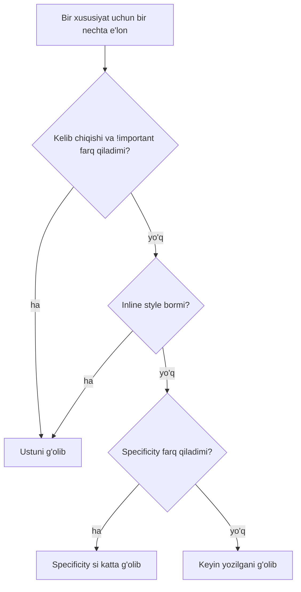

## Bu dars nima uchun kerak

43-darsda HTML hujjatning **tuzilmasini** belgiladik: qayer sarlavha, qayer navigatsiya, qayer forma. Lekin brauzerning standart ko'rinishi oddiy: oq fon, qora matn, hamma narsa yuqoridan pastga bitta ustunda. Ranglar, shriftlar, oraliqlar, ustunlar, telefon va kompyuterda turlicha joylashuv - bularning hammasi **CSS** (Cascading Style Sheets, kaskadli uslublar jadvali) vazifasi.

CSS sintaksisi juda sodda: "shu elementlarga shu xususiyatlar". Qiyinchilik boshqa joyda. Bitta elementga o'nlab qoida mos kelishi mumkin - qaysi biri g'olib? Nega `width: 200px` berilgan quti ekranda 242 piksel? Nega element markazga turmayapti? Bu savollarga "sinab ko'rish" bilan emas, aniq qoidalar bilan javob berish mumkin: cascade algoritmi, specificity hisobi, box model formulasi va flexbox/grid ning bo'sh joyni taqsimlash qoidalari. Bu darsda ularning har birini raqamlar bilan hisoblaymiz va brauzerning o'zi (`getComputedStyle`) bilan tekshiramiz.

Bu darsdan keyin siz:

- CSS ni sahifaga ulashning uch usulini va ularning farqini bilasiz;
- tag, class, id, atribut, kombinator va pseudo-class selektorlarini yoza olasiz;
- selektor specificity sini (a, b, c) ko'rinishida hisoblab, qaysi qoida g'olib bo'lishini oldindan ayta olasiz;
- cascade va meros (inheritance) qanday ishlashini tushuntira olasiz;
- box model bo'yicha elementning haqiqiy o'lchamini `content-box` va `border-box` uchun hisoblay olasiz;
- `px`, `em`, `rem`, `%`, `vw` birliklarini piksellarga aylantira olasiz;
- flexbox va grid da bo'sh joy qanday taqsimlanishini hisoblay olasiz;
- mobile-first media query yozasiz va matn kontrastini WCAG formulasi bilan tekshira olasiz.

## CSS ni ulash va qoida tuzilishi

CSS qoidasi (rule) ikki qismdan iborat: **selektor** (qaysi elementlar) va **e'lonlar bloki** (declarations - nima qilish):

```css
h1 {
  color: navy;
  font-size: 2rem;
}
```

`h1` - selektor, `color: navy;` - e'lon (xususiyat va qiymat). Brauzer noma'lum xususiyat yoki noto'g'ri qiymatni xato bermasdan tashlab ketadi (43-darsdagi HTML parser kabi kechirimli), shuning uchun xato ko'pincha jim o'tadi: DevTools da e'lon ustidan chizilgan bo'ladi.

CSS sahifaga uch usulda ulanadi:

| Usul | Yozilishi | Qachon | Kamchiligi |
|---|---|---|---|
| Tashqi fayl | `<link rel="stylesheet" href="styles.css">` `head` ichida | Asosiy usul: bir fayl ko'p sahifaga, brauzer uni keshlaydi | Qo'shimcha HTTP so'rov (42-dars) |
| `<style>` elementi | `<style> h1 { color: navy; } </style>` | Bitta sahifaga xos uslublar, kichik misollar | Har sahifada takrorlanadi, keshlanmaydi |
| Inline | `<h1 style="color: navy">` | JavaScript dinamik qiymat qo'yganda | Selektor yo'q, qayta ishlatib bo'lmaydi, deyarli har doim g'olib (pastda) |

Bu darsdagi ishga tushiriladigan bloklarda `<style>` ishlatamiz, chunki blok o'zi yetarli bo'lishi kerak. Haqiqiy loyihada asosiy usul - tashqi fayl.

## Selektorlar

Selektor - DOM daraxtidagi (43-dars) elementlarni tanlash usuli. Asosiy turlari:

| Selektor | Misol | Nimani tanlaydi |
|---|---|---|
| Tag (type) | `p` | Barcha `p` elementlari |
| Class | `.card` | `class` ro'yxatida `card` bor elementlar |
| Id | `#main` | `id="main"` li yagona element |
| Atribut | `[type="email"]`, `[href^="https"]` | Atributi berilgan qiymatga teng, `^=` - shu bilan boshlanadi |
| Universal | `*` | Hamma element |
| Descendant (avlod) | `nav a` | `nav` ichidagi istalgan chuqurlikdagi `a` |
| Child (bola) | `ul > li` | Faqat `ul` ning bevosita bolasi bo'lgan `li` |
| Guruh | `h1, h2` | Ikkala ro'yxatdagi elementlar |
| Pseudo-class | `a:hover`, `input:focus`, `li:nth-child(2n)` | Holat yoki daraxtdagi o'rin bo'yicha |
| Pseudo-element | `p::first-line`, `li::before` | Elementning bir qismi yoki CSS yaratgan "virtual" element |

Selektorlar birlashtiriladi: `button.primary:hover` - "`primary` class li, sichqoncha ustida turgan `button`". Bo'shliq muhim: `div.card` (class li div) va `div .card` (div ichidagi class li element) - ikki xil selektor.

Pseudo-class lar elementning **holatini** tanlaydi:

- `:hover` - sichqoncha ustida;
- `:focus` - klaviatura fokusi shu elementda (Tab bilan kelinganda yoki bosilganda); `:focus-visible` - faqat brauzer fokusni ko'rsatish kerak deb hisoblaganda (odatda klaviatura bilan);
- `:checked`, `:disabled`, `:invalid` - forma holatlari (43-darsdagi `validity` bilan bog'liq: `:invalid` tekshiruvdan o'tmagan maydonni tanlaydi);
- `:nth-child(an+b)` - ota-onadagi tartib raqami bo'yicha (1 dan sanaladi): `:nth-child(2)` - ikkinchisi, `:nth-child(odd)` - toqlari, `:nth-child(3n+1)` - 1, 4, 7, ...; `:first-child`, `:last-child`.

Quyidagi blokda selektorlar ranglar bilan ko'rinadi. Sichqonchani havolalar ustiga olib boring, maydonga Tab bilan o'ting. Skript esa har bir selektor nechta elementni tanlashini `querySelectorAll` bilan sanaydi - CSS va JavaScript bir xil selektor tilidan foydalanadi:

```html run
<!doctype html>
<html lang="uz">
<head>
<meta charset="utf-8">
<style>
  body { font-family: sans-serif; }
  li:nth-child(odd) { background: #eef; }
  ul > li.done { text-decoration: line-through; }
  nav a { color: #0645ad; }
  nav a:hover { background: #ffd; }
  a[href^="https"]::after { content: " (tashqi)"; font-size: 0.8em; }
  input:focus { outline: 3px solid #1a73e8; }
  input:invalid { border: 2px solid #c00; }
</style>
</head>
<body>
  <nav><a href="/reyslar">Reyslar</a> | <a href="https://example.com">Hamkor</a></nav>
  <ul>
    <li class="done">Moy almashtirish</li>
    <li>Shina tekshiruvi</li>
    <li class="done">Sug'urta</li>
    <li>Texnik ko'rik</li>
    <li>Yuvish</li>
  </ul>
  <input type="email" value="noto'g'ri" aria-label="Email">
  <script>
    for (const sel of ["li", "li:nth-child(odd)", "ul > li.done", "nav a", "a[href^=\"https\"]", "input:invalid", "li:nth-child(3n+1)"]) {
      console.log(sel.padEnd(20) + document.querySelectorAll(sel).length);
    }
  </script>
</body>
</html>
```

Natija:

```text
li                  5
li:nth-child(odd)   3
ul > li.done        2
nav a               2
a[href^="https"]    1
input:invalid       1
li:nth-child(3n+1)  2
```

`3n+1` uchun n = 0, 1, 2, ... qo'yiladi: 1, 4, 7, ... - 5 ta elementdan 1- va 4-si mos keladi. `:hover` va `:focus` ni skript sanay olmaydi, chunki ular faqat foydalanuvchi harakati paytida mos keladi.

`:focus` uslubini o'chirish (`outline: none`) - accessibility dagi keng tarqalgan xato: klaviatura foydalanuvchisi qayerda turganini ko'rmay qoladi. Standart outline yoqmasa, uni o'chirmang, boshqasi bilan almashtiring.

## Cascade, specificity va meros

Bitta elementga bir nechta qoida bir xil xususiyat bersa, qaysi qiymat ishlatilishini **cascade** (kaskad) algoritmi hal qiladi. Soddalashtirilgan tartibda brauzer quyidagilarni solishtiradi va birinchi farq qilgan bosqichda to'xtaydi:

1. **Kelib chiqishi va muhimligi** (origin and importance): brauzerning standart uslublari, foydalanuvchi sozlamalari, sayt muallifi uslublari; `!important` belgisi bu tartibni o'zgartiradi.
2. **Inline style** (`style="..."` atributi) - har qanday selektordan ustun.
3. **Layer lar va scope** (`@layer`, `@scope`, Shadow DOM) - bu kurs doirasidan tashqari.
4. **Specificity** (aniqlik darajasi) - selektor qanchalik aniq.
5. **Tartib** - hammasi teng bo'lsa, keyin yozilgan qoida g'olib.



### Specificity ni hisoblash

Selectors Level 4 spetsifikatsiyasi bo'yicha selektorda uchta son sanaladi va (a, b, c) ko'rinishida yoziladi:

- **a** - id selektorlari soni;
- **b** - class, atribut selektorlari va pseudo-class lar soni;
- **c** - tag selektorlari va pseudo-element lar soni.

Universal selektor `*` va kombinatorlar (bo'shliq, `>`, `+`, `~`) hisobga kirmaydi. Solishtirish lug'at tartibida (37-darsdagi `ORDER BY a, b, c` kabi): avval a, teng bo'lsa b, keyin c. Ya'ni (1, 0, 0) har qanday (0, b, c) dan katta, hatto b = 20 bo'lsa ham - xonalar o'nlik sanoqdagidek bir-biriga "o'tmaydi".

| Selektor | a (id) | b (class, atribut, pseudo-class) | c (tag, pseudo-element) | Specificity |
|---|---|---|---|---|
| `*` | 0 | 0 | 0 | (0, 0, 0) |
| `p` | 0 | 0 | 1 | (0, 0, 1) |
| `ul li` | 0 | 0 | 2 | (0, 0, 2) |
| `.lead` | 0 | 1 | 0 | (0, 1, 0) |
| `p.lead` | 0 | 1 | 1 | (0, 1, 1) |
| `a[href^="https"]:hover` | 0 | 2 | 1 | (0, 2, 1) |
| `li:nth-child(2n)::before` | 0 | 1 | 2 | (0, 1, 2) |
| `#intro` | 1 | 0 | 0 | (1, 0, 0) |
| `nav#top a.active` | 1 | 1 | 2 | (1, 1, 2) |
| `:where(#intro) p` | 0 | 0 | 1 | (0, 0, 1) |

Oxirgi qator: `:is()` va `:not()` ning specificity si ichidagi eng aniq argumentniki bo'ladi, `:where()` niki esa doim nol. Bu - specificity ni ataylab past qilish vositasi.

Brauzerda tekshiramiz. Bitta paragrafga beshta qoida rang beradi; har safar qaysi biri g'olib ekanini `getComputedStyle` ko'rsatadi:

```html run
<!doctype html>
<html lang="uz">
<head>
<meta charset="utf-8">
<style>
  #intro { color: rgb(200, 0, 0); }       /* (1,0,0) */
  p.lead { color: rgb(0, 0, 200); }       /* (0,1,1) */
  .lead { color: rgb(0, 150, 0); }        /* (0,1,0) */
  p { color: gray; }                      /* (0,0,1) */
  .note { color: orange; }                /* (0,1,0) */
  .note2 { color: purple; }               /* (0,1,0), keyinroq */
  .loud { color: black !important; }
</style>
</head>
<body>
  <p id="intro" class="lead">Birinchi paragraf</p>
  <p class="lead">Ikkinchi paragraf</p>
  <p class="note note2">Uchinchi paragraf</p>
  <p class="note2 note">To'rtinchi paragraf</p>
  <p id="x" class="loud" style="color: teal">Beshinchi paragraf</p>
  <script>
    for (const p of document.querySelectorAll("p")) {
      console.log(p.textContent.padEnd(20) + getComputedStyle(p).color);
    }
  </script>
</body>
</html>
```

Natija:

```text
Birinchi paragraf   rgb(200, 0, 0)
Ikkinchi paragraf   rgb(0, 0, 200)
Uchinchi paragraf   rgb(128, 0, 128)
To'rtinchi paragraf rgb(128, 0, 128)
Beshinchi paragraf  rgb(0, 0, 0)
```

Tahlil:

- 1-paragrafga to'rtta qoida mos: `#intro` (1, 0, 0) qolganlaridan katta - qizil. `#intro` faylda birinchi yozilgani ahamiyatsiz: tartib faqat specificity teng bo'lganda hal qiladi.
- 2-paragraf: `p.lead` (0, 1, 1) > `.lead` (0, 1, 0) > `p` (0, 0, 1) - ko'k.
- 3- va 4-paragraf: `.note` va `.note2` teng (0, 1, 0), shuning uchun CSS faylda keyin yozilgani (`.note2`, binafsha) g'olib. HTML dagi `class="..."` tartibi umuman ta'sir qilmaydi - bu keng tarqalgan noto'g'ri tushuncha.
- 5-paragraf: inline `style` har qanday selektordan ustun, lekin `!important` li e'lon undan ham ustun - qora.

`!important` - favqulodda vosita. U cascade ni buzadi: keyin uni bekor qilish uchun yana `!important` va yanada aniqroq selektor kerak bo'ladi. Uslublar "urushi" ning odatiy sababi - id selektorlari va `!important`. Amaliy qoida: uslub uchun asosan class selektorlari ishlatilsin, id esa havola langari (anchor) va JavaScript uchun qolsin.

### Meros (inheritance)

Ba'zi xususiyatlar ota elementdan bolalarga **meros** bo'lib o'tadi: agar bolaga hech qanday qoida qiymat bermasa, u ota-onaning hisoblangan qiymatini oladi. Asosan matn bilan bog'liq xususiyatlar meros bo'ladi (`color`, `font-family`, `font-size`, `line-height`, `text-align`), quti bilan bog'liqlari esa yo'q (`border`, `padding`, `margin`, `width`, `background`). Mantiqan ham shunday: `body` ga `font-family` berib butun sahifaning shriftini o'zgartirish qulay, lekin `div` ning ramkasi uning ichidagi har bir elementga takrorlansa, bema'ni bo'lardi.

```html run
<!doctype html>
<html lang="uz">
<head>
<style>
  .box { color: rgb(0, 100, 0); border: 2px solid black; font-size: 20px; padding: 8px; }
  .own { color: rgb(200, 0, 0); }
  .force { border: inherit; }
</style>
</head>
<body>
  <div class="box">
    Ota
    <span id="a">meros oladi</span>
    <span id="b" class="own">o'zinikini</span>
    <span id="c" class="force">ramka majburan</span>
  </div>
  <script>
    for (const id of ["a", "b", "c"]) {
      const s = getComputedStyle(document.getElementById(id));
      console.log(id + ": color=" + s.color + " font-size=" + s.fontSize + " border=" + s.borderTopWidth + " padding=" + s.paddingTop);
    }
  </script>
</body>
</html>
```

Natija:

```text
a: color=rgb(0, 100, 0) font-size=20px border=0px padding=0px
b: color=rgb(200, 0, 0) font-size=20px border=0px padding=0px
c: color=rgb(0, 100, 0) font-size=20px border=2px padding=0px
```

`a` rang va shrift o'lchamini meros oldi, ramka va padding ni yo'q. `b` da o'z qoidasi bor, va har qanday to'g'ridan-to'g'ri qoida (hatto `*` (0, 0, 0) ham) merosdan ustun. `c` da `inherit` kalit so'zi meros bo'lmaydigan xususiyatni ham majburan ota-onadan oldi.

## Box model

Brauzer har bir elementni to'rtburchak **quti** sifatida joylashtiradi. Quti to'rt qatlamdan iborat, ichkaridan tashqariga:

1. **content** - mazmun (matn, rasm);
2. **padding** - mazmun va ramka orasidagi ichki bo'shliq (fon rangi shu yergacha bo'yaladi);
3. **border** - ramka;
4. **margin** - qo'shni elementlargacha tashqi bo'shliq (har doim shaffof).

Asosiy savol: `width: 200px` qaysi qatlamning kengligi? Buni `box-sizing` xususiyati belgilaydi.

- **`content-box`** (sukut bo'yicha): `width` faqat content kengligi. Ko'rinadigan kenglik:
  - kenglik = width + padding-chap + padding-o'ng + border-chap + border-o'ng
  - `width: 200px; padding: 20px; border: 1px` -> 200 + 20 · 2 + 1 · 2 = **242 px**
- **`border-box`**: `width` - ramka bilan birga to'liq kenglik. Padding va border ichkariga sig'diriladi:
  - content = width - padding · 2 - border · 2 = 200 - 40 - 2 = **158 px**, ko'rinadigan kenglik **200 px**

Margin ikkala holatda ham kenglikka kirmaydi: u qutidan tashqarida. Agar shu quti `margin: 10px` bilan bo'lsa, u egallagan joy content-box da 242 + 20 = 262 px, border-box da 200 + 20 = 220 px.

```html run
<!doctype html>
<html lang="uz">
<head>
<style>
  .b { width: 200px; padding: 20px; border: 1px solid #333; margin: 10px; background: #def; }
  .cb { box-sizing: content-box; }
  .bb { box-sizing: border-box; }
  .m1 { margin-bottom: 20px; height: 20px; background: #fdd; }
  .m2 { margin-top: 30px; height: 20px; background: #dfd; }
</style>
</head>
<body>
  <div class="b cb">content-box</div>
  <div class="b bb">border-box</div>
  <div class="m1"></div>
  <div class="m2"></div>
  <script>
    for (const el of document.querySelectorAll(".b")) {
      const s = getComputedStyle(el);
      console.log(s.boxSizing.padEnd(12) + "width=" + s.width + "  ko'rinadigan=" + el.offsetWidth + "px  content=" + el.clientWidth + "px (padding bilan)");
    }
    const [m1, m2] = document.querySelectorAll(".m1, .m2");
    const gap = m2.getBoundingClientRect().top - m1.getBoundingClientRect().bottom;
    console.log("m1 va m2 orasidagi masofa: " + gap + "px");
  </script>
</body>
</html>
```

Natija:

```text
content-box width=200px  ko'rinadigan=242px  content=240px (padding bilan)
border-box  width=200px  ko'rinadigan=200px  content=198px (padding bilan)
m1 va m2 orasidagi masofa: 30px
```

`offsetWidth` - ramka bilan to'liq kenglik (242 va 200), `clientWidth` - padding bilan, ramkasiz (240 = 200 + 40 va 198 = 158 + 40). `getComputedStyle(...).width` ikkalasida `200px`, chunki u CSS da yozilgan qiymatni qaytaradi; haqiqiy kenglikni o'lchash uchun `offsetWidth` yoki `getBoundingClientRect()` kerak.

Oxirgi qator - **margin collapse** (margin qo'shilib ketishi): ikki blokning vertikal marginlari (20 va 30) qo'shilmaydi (50 emas), balki kattasi olinadi - 30. Bu faqat vertikal yo'nalishda va oddiy blok oqimida bo'ladi; flexbox va grid elementlarida margin collapse yo'q.

`border-box` bilan hisoblash ancha oson: "200 px kenglik" deyilsa, quti haqiqatan 200 px bo'ladi va padding qo'shilganda joylashuv buzilmaydi. Shuning uchun ko'p loyihalar CSS faylni shu qator bilan boshlaydi:

```css
*, *::before, *::after {
  box-sizing: border-box;
}
```

## Birliklar

| Birlik | Nimaga nisbatan | Misol (root 16px, ota 20px, ota kengligi 400px) | Qachon |
|---|---|---|---|
| `px` | CSS piksel (qurilmadagi fizik piksel emas; yuqori zichlikli ekranda 1 CSS px = 2-3 fizik piksel) | `12px` = 12px | Ramka qalinligi, aniq kichik o'lchamlar |
| `em` | Elementning o'z `font-size` i; `font-size` ning o'zida - ota-onaning `font-size` i | `font-size: 1.5em` = 1.5 · 20 = 30px | Matnga bog'liq oraliqlar (tugma ichidagi padding) |
| `rem` | Root (`html`) elementning `font-size` i | `1.5rem` = 1.5 · 16 = 24px | Shrift o'lchamlari va umumiy oraliqlar |
| `%` | Ota-onaning tegishli o'lchami (`width` uchun - ota-onaning content kengligi) | `width: 50%` = 0.5 · 400 = 200px | Moslashuvchan kengliklar |
| `vw`, `vh` | Viewport kengligi/balandligining 1% i | `10vw` 1280px oynada = 128px | Butun ekranga bog'liq bloklar |

Ko'p brauzerlarda root `font-size` sukut bo'yicha 16px, lekin foydalanuvchi uni sozlamalarda kattalashtirishi mumkin. `rem` da yozilgan sahifa shu sozlamaga ergashadi, `px` da yozilgani esa yo'q - shuning uchun shrift o'lchamlari uchun `rem` afzal.

`em` ning tuzog'i - ko'payib borishi. `font-size: 1.2em` ichma-ich uch marta qo'llansa: 16 · 1.2 · 1.2 · 1.2 = 27.648px. `rem` da bu muammo yo'q: u har doim root ga nisbatan.

```html run
<!doctype html>
<html lang="uz">
<head>
<style>
  .parent { font-size: 20px; width: 400px; }
  .em { font-size: 1.5em; }
  .rem { font-size: 1.5rem; }
  .pct { width: 50%; }
  .vw { width: 10vw; }
  .nest { font-size: 1.2em; }
</style>
</head>
<body>
  <div class="parent">
    <p class="em">em</p>
    <p class="rem">rem</p>
    <div class="pct">%</div>
  </div>
  <div class="vw">vw</div>
  <div class="nest"><div class="nest"><div class="nest" id="deep">ichma-ich</div></div></div>
  <script>
    const px = (sel, prop) => getComputedStyle(document.querySelector(sel))[prop];
    console.log("1.5em =", px(".em", "fontSize"), "| 1.5rem =", px(".rem", "fontSize"));
    console.log("50% =", px(".pct", "width"));
    console.log("10vw =", px(".vw", "width"), "(oyna kengligi " + innerWidth + "px)");
    console.log("3 marta 1.2em =", px("#deep", "fontSize"));
  </script>
</body>
</html>
```

Natija (vw qatori oyna kengligiga bog'liq; bu yerda 1280px kenglikdagi oyna):

```text
1.5em = 30px | 1.5rem = 24px
50% = 200px
10vw = 128px (oyna kengligi 1280px)
3 marta 1.2em = 27.648px
```

Darsdagi blok kengligi ekraningizga bog'liq, shuning uchun `10vw` qatori sizda boshqacha chiqadi - lekin har doim innerWidth / 10 ga teng.

## display: element qanday joylashadi

`display` xususiyati elementning tashqi oqimdagi xatti-harakatini va ichidagi elementlarni joylashtirish usulini belgilaydi:

| Qiymat | Yangi qatordan boshlanadimi | `width`/`height` ishlaydimi | Odatiy elementlar |
|---|---|---|---|
| `block` | Ha, ota-onaning butun kengligini egallaydi | Ha | `div`, `p`, `h1`, `ul`, `section` |
| `inline` | Yo'q, matn qatorida oqadi | Yo'q, o'lchami mazmundan; vertikal padding qo'shni qatorlarni surmaydi | `span`, `a`, `strong` |
| `inline-block` | Yo'q, matn qatorida | Ha | `button`, `input` ga o'xshash |
| `none` | Element umuman chizilmaydi va joy egallamaydi | - | Yashirin menyular |
| `flex`, `grid` | Tashqarida blok, ichida flexbox/grid joylashuvi | Ha | Keyingi bo'limlar |

`display: none` va `visibility: hidden` farqi: birinchisida element joy ham egallamaydi va ekran o'quvchi ham uni o'qimaydi; ikkinchisida element ko'rinmaydi, lekin uning joyi bo'sh qoladi.

```html run
<!doctype html>
<html lang="uz">
<head>
<style>
  span { width: 300px; background: #fde; }
  .ib { display: inline-block; }
  .hide { display: none; }
  .inv { visibility: hidden; }
  div { background: #def; }
</style>
</head>
<body>
  <span id="s1">inline</span> <span id="s2" class="ib">inline-block</span>
  <div id="d1">block</div>
  <div id="d2" class="hide">none</div>
  <div id="d3" class="inv">hidden</div>
  <script>
    for (const id of ["s1", "s2", "d1", "d2", "d3"]) {
      const r = document.getElementById(id).getBoundingClientRect();
      console.log(id + ": kenglik " + Math.round(r.width) + "px, balandlik " + Math.round(r.height) + "px");
    }
  </script>
</body>
</html>
```

Natija (`d1` va `d3` ning kengligi oyna kengligidan `body` ning 8px li marginlari ayirilgani, bu yerda 1280 - 16; darsdagi blokda oyna - blokning o'zi, shuning uchun sizda `innerWidth - 16` chiqadi):

```text
s1: kenglik 36px, balandlik 17px
s2: kenglik 300px, balandlik 18px
d1: kenglik 1264px, balandlik 18px
d2: kenglik 0px, balandlik 0px
d3: kenglik 1264px, balandlik 18px
```

`s1` ga `width: 300px` berilgan, lekin u inline - kenglik mazmundan olinadi (`inline` so'zining kengligi va satr balandligi shriftga bog'liq, sizda biroz boshqacha chiqishi mumkin). Xuddi shu qoida `inline-block` da ishladi. `d2` hech qanday joy egallamaydi, `d3` esa ko'rinmasa ham joyini saqlaydi.

## Flexbox: bir o'qli joylashuv

`display: flex` berilgan element **flex container** ga, uning bevosita bolalari esa **flex item** larga aylanadi. Flexbox bir yo'nalishdagi (qator yoki ustun) joylashuv uchun: navigatsiya paneli, tugmalar qatori, karta ichidagi elementlar.

Asosiy tushuncha - ikki o'q:

- **Asosiy o'q** (main axis) - elementlar terilgan yo'nalish. `flex-direction: row` (sukut) da gorizontal, chapdan o'ngga; `column` da vertikal.
- **Ko'ndalang o'q** (cross axis) - unga perpendikulyar.

Xususiyatlar o'q bo'yicha nomlangan:

- `justify-content` - asosiy o'q bo'ylab bo'sh joyni taqsimlash: `flex-start`, `center`, `flex-end`, `space-between` (birinchi va oxirgi chetga, qolgan joy oralarga teng), `space-around`, `space-evenly`;
- `align-items` - ko'ndalang o'q bo'ylab tekislash: `stretch` (sukut, balandlikni to'ldiradi), `flex-start`, `center`, `flex-end`;
- `gap` - elementlar orasidagi qat'iy bo'shliq;
- `flex-wrap: wrap` - joy yetmasa, keyingi qatorga ko'chirish (sukut - `nowrap`: hammasi bitta qatorda, elementlar siqiladi);
- elementlarda: `flex-grow` (bo'sh joydan ulush oladi), `flex-shrink` (joy yetmaganda siqiladi), `flex-basis` (boshlang'ich o'lcham). `flex: 1` - "bo'sh joyni boshqalar bilan teng bo'lish".

Hisob. Konteyner kengligi 400px, uchta element har biri 80px:

- `justify-content: space-between`: bo'sh joy = 400 - 3 · 80 = 160px, ikki oraliqqa teng: 80px. Chap chekkalar: 0, 80 + 80 = 160, 160 + 80 + 80 = 320.
- `justify-content: center; gap: 10px`: band joy = 3 · 80 + 2 · 10 = 260px, chap qoldiq = (400 - 260) / 2 = 70px. Chap chekkalar: 70, 70 + 90 = 160, 250.
- Uchinchi elementga `flex: 1` (boshqalari 80px, `gap: 10px`): u qolgan joyni oladi: 400 - 80 - 80 - 2 · 10 = 220px, chap chekkasi 80 + 10 + 80 + 10 = 180.

```html run
<!doctype html>
<html lang="uz">
<head>
<style>
  .row { display: flex; width: 400px; height: 50px; background: #eee; margin-bottom: 6px; }
  .row div { width: 80px; background: #8ac; border: 0; }
  .r1 { justify-content: space-between; }
  .r2 { justify-content: center; gap: 10px; align-items: center; }
  .r2 div { height: 20px; }
  .r3 { gap: 10px; }
  .r3 .grow { flex: 1; }
</style>
</head>
<body>
  <div class="row r1"><div>A</div><div>B</div><div>C</div></div>
  <div class="row r2"><div>A</div><div>B</div><div>C</div></div>
  <div class="row r3"><div>A</div><div>B</div><div class="grow">C</div></div>
  <script>
    for (const row of document.querySelectorAll(".row")) {
      const base = row.getBoundingClientRect();
      const items = [...row.children].map(d => {
        const r = d.getBoundingClientRect();
        return d.textContent + ": x=" + (r.left - base.left) + " w=" + r.width + " y=" + (r.top - base.top);
      });
      console.log(row.className.padEnd(7) + " " + items.join(" | "));
    }
  </script>
</body>
</html>
```

Natija:

```text
row r1  A: x=0 w=80 y=0 | B: x=160 w=80 y=0 | C: x=320 w=80 y=0
row r2  A: x=70 w=80 y=15 | B: x=160 w=80 y=15 | C: x=250 w=80 y=15
row r3  A: x=0 w=80 y=0 | B: x=90 w=80 y=0 | C: x=180 w=220 y=0
```

Hisob bilan bir xil. `r2` da `align-items: center`: 20px li elementlar 50px balandlikda (50 - 20) / 2 = 15px pastda. `.row` ga `flex-direction: column` qo'shib ko'ring: endi `justify-content` vertikal ishlaydi, chunki asosiy o'q burildi.

Flexbox bilan klassik "markazga qo'yish" masalasi uch qatorda hal bo'ladi: `display: flex; justify-content: center; align-items: center;`.

## Grid: ikki o'qli joylashuv

Flexbox bitta o'q bo'ylab ishlaydi; **CSS Grid** esa qator va ustunlarni birga boshqaradi - sahifa karkasi, kartalar to'ri, forma maydonlari jadvali uchun.

- `display: grid` - grid konteyner;
- `grid-template-columns` - ustunlar kengligi ro'yxati: `200px 1fr 2fr`;
- `fr` (fraction) - bo'sh joyning ulushi: qat'iy ustunlar va `gap` ayirilgandan keyin qolgan joy `fr` lar soniga bo'linadi;
- `repeat(3, 1fr)` = `1fr 1fr 1fr`; `repeat(auto-fill, minmax(150px, 1fr))` - sig'adigancha ustun, har biri kamida 150px;
- `gap` - qator va ustunlar orasidagi bo'shliq;
- elementda `grid-column: 1 / 3` - 1-chiziqdan 3-chiziqqacha, ya'ni ikki ustunni egallash (chiziqlar 1 dan sanaladi).

Hisob: konteyner 500px, `grid-template-columns: 200px 1fr 2fr`, `gap: 10px`. Qat'iy qism = 200 + 2 · 10 = 220px, qolgan 500 - 220 = 280px. 1fr = 280 / 3 ≈ 93.33px, 2fr ≈ 186.67px.

```html run
<!doctype html>
<html lang="uz">
<head>
<style>
  .g { display: grid; width: 500px; gap: 10px; background: #eee; margin-bottom: 8px; }
  .g div { background: #8ac; padding: 4px; }
  .g1 { grid-template-columns: 200px 1fr 2fr; }
  .g2 { grid-template-columns: repeat(3, 1fr); }
  .g2 .wide { grid-column: 1 / 3; }
  .g3 { grid-template-columns: repeat(auto-fill, minmax(150px, 1fr)); }
</style>
</head>
<body>
  <div class="g g1"><div>A</div><div>B</div><div>C</div></div>
  <div class="g g2"><div class="wide">A (2 ustun)</div><div>B</div><div>C</div><div>D</div></div>
  <div class="g g3"><div>1</div><div>2</div><div>3</div><div>4</div></div>
  <script>
    for (const g of document.querySelectorAll(".g")) {
      console.log(g.className + ": " + getComputedStyle(g).gridTemplateColumns);
      const base = g.getBoundingClientRect();
      console.log("   " + [...g.children].map(d => {
        const r = d.getBoundingClientRect();
        return "(" + Math.round(r.left - base.left) + "," + Math.round(r.top - base.top) + ") w=" + Math.round(r.width);
      }).join("  "));
    }
  </script>
</body>
</html>
```

Natija:

```text
g g1: 200px 93.3281px 186.672px
   (0,0) w=200  (210,0) w=93  (313,0) w=187
g g2: 160px 160px 160px
   (0,0) w=330  (340,0) w=160  (0,36) w=160  (170,36) w=160
g g3: 160px 160px 160px
   (0,0) w=160  (170,0) w=160  (340,0) w=160  (0,36) w=160
```

Kuzatishlar:

- `g1`: 93.33 va 186.67 - hisob bilan bir xil (brauzer kasrni o'z aniqligida yaxlitlaydi: 93.3281).
- `g2`: 1fr = (500 - 2 · 10) / 3 = 160px. "A" 1-3 chiziqlar orasida: 160 + 10 + 160 = 330px. "B" uchinchi ustunga tushdi, "C" va "D" keyingi qatorga avtomatik joylashdi.
- `g3`: nechta 150px li ustun sig'adi? n ta ustun uchun n · 150 + (n - 1) · 10 ≤ 500, ya'ni n ≤ 510 / 160 ≈ 3.19 - demak 3 ta. Keyin `minmax(150px, 1fr)` ning `1fr` qismi qolgan joyni teng bo'ladi: (500 - 2 · 10) / 3 = 160px. To'rtinchi element ikkinchi qatorga tushdi. Konteynerni 700px qilsangiz, 4 ta ustun bo'ladi: 4 · 150 + 3 · 10 = 630 ≤ 700. Bu - media query siz moslashuvchan to'r.
- Ikkinchi qatorning y koordinatasi 36: birinchi qator balandligi 4 + 18 + 4 = 26px (18 - shu shriftdagi matn qatori balandligi, sizda biroz farq qilishi mumkin) va 10px `gap`.

Flexbox va grid ni qachon tanlash:

| Savol | Flexbox | Grid |
|---|---|---|
| Nechta o'q | Bitta: qator yoki ustun | Ikkita: qator va ustun birga |
| O'lcham qayerdan | Mazmundan: elementlar o'z o'lchami bilan, keyin bo'sh joy taqsimlanadi | Konteynerdan: avval to'r chiziladi, elementlar kataklarga joylanadi |
| Odatiy ishlatilishi | Navbar, tugmalar qatori, karta ichi | Sahifa karkasi, kartalar to'ri, galereya |
| Elementlarni tekislash | Har qator o'zicha | Ustunlar qatorlar bo'ylab tekis |

Ular bir-birini istisno qilmaydi: grid karkas ichidagi har bir karta o'z ichida flexbox ishlatishi odatiy hol.

## Responsive dizayn: media query va mobile-first

**Responsive** (moslashuvchan) sahifa ekran kengligiga qarab joylashuvini o'zgartiradi. Asos - 43-darsdagi `viewport` meta tegi (usiz telefon sahifani 980px li virtual oynada chizadi va media query lar noto'g'ri ishlaydi) va **media query** lar:

```css
/* Asosiy uslub: tor ekran (telefon) uchun, bitta ustun */
.cards { display: grid; grid-template-columns: 1fr; gap: 16px; }

/* 600px va kengroq: ikki ustun */
@media (min-width: 600px) {
  .cards { grid-template-columns: repeat(2, 1fr); }
}

/* 1000px va kengroq: uch ustun */
@media (min-width: 1000px) {
  .cards { grid-template-columns: repeat(3, 1fr); }
}
```

Bu - **mobile-first** yondashuv: avval eng tor ekran uchun oddiy uslub yoziladi, keyin `min-width` bilan kengroq ekranlar uchun murakkablik **qo'shiladi**. Teskari yondashuv (desktop-first, `max-width` bilan murakkab joylashuvni "olib tashlash") ham ishlaydi, lekin odatda ko'proq bekor qilinadigan kod beradi, telefon esa keraksiz uslublarni ham qayta ishlaydi. Media query ham cascade ga bo'ysunadi: shart bajarilganda ichidagi qoidalar oddiy qoidalar kabi specificity va tartib bo'yicha solishtiriladi, shuning uchun `min-width` bloklari asosiy uslubdan **keyin** yoziladi.

Media query lar JavaScript dan ham tekshiriladi (`matchMedia`). Blok kengligi qurilmangizga bog'liq, shuning uchun natija har kimda boshqacha:

```html run
<!doctype html>
<html lang="uz">
<head>
<meta name="viewport" content="width=device-width, initial-scale=1">
<style>
  .cards { display: grid; grid-template-columns: 1fr; gap: 8px; }
  @media (min-width: 600px) { .cards { grid-template-columns: repeat(2, 1fr); } }
  @media (min-width: 1000px) { .cards { grid-template-columns: repeat(3, 1fr); } }
  .cards div { background: #8ac; padding: 8px; }
</style>
</head>
<body>
  <div class="cards"><div>1</div><div>2</div><div>3</div><div>4</div><div>5</div><div>6</div></div>
  <script>
    const cols = getComputedStyle(document.querySelector(".cards")).gridTemplateColumns.split(" ").length;
    console.log("oyna kengligi: " + innerWidth + "px");
    console.log("(min-width: 600px): " + matchMedia("(min-width: 600px)").matches);
    console.log("(min-width: 1000px): " + matchMedia("(min-width: 1000px)").matches);
    console.log("ustunlar soni: " + cols);
  </script>
</body>
</html>
```

1280px kenglikdagi oynada natija:

```text
oyna kengligi: 1280px
(min-width: 600px): true
(min-width: 1000px): true
ustunlar soni: 3
```

Darsdagi blok odatda 1000px dan tor, shuning uchun sizda 2 ustun (kompyuterda) yoki 1 ustun (telefonda) chiqadi. Brauzer oynasini toraytirib, blokni qayta ishga tushiring.

## Ranglar va kontrast

CSS da rang bir necha usulda yoziladi, hammasi bir xil RGB qiymatga keladi (2-darsdagi RGB):

- nomli: `navy`, `white`;
- hex: `#1a73e8` - har bir kanal 2 ta o'n oltilik raqam (0-255), qisqa shakli `#fff` = `#ffffff`;
- `rgb(26 115 232)`, shaffoflik bilan `rgb(26 115 232 / 50%)`;
- `hsl(214 82% 51%)` - rang tusi (gradusda), to'yinganlik, yorqinlik; bir rangning ochroq yoki to'qroq variantini olish uchun qulay.

Rang tanlashda faqat chiroyi emas, **o'qilishi** ham muhim. WCAG 2.2 ning 1.4.3 mezoni (Contrast Minimum, AA darajasi) oddiy matn uchun matn va fon orasida kamida **4.5:1** kontrast talab qiladi, katta matn (18pt yoki 14pt qalin; CSS da taxminan 24px yoki 18.67px qalin) uchun **3:1**.

Kontrast formulasi WCAG da aniq berilgan:

1. Har bir kanal 0-1 oraliqqa: c = qiymat / 255.
2. Chiziqli qiymatga: c ≤ 0.04045 bo'lsa c / 12.92, aks holda ((c + 0.055) / 1.055)^2.4.
3. Nisbiy yorqinlik (relative luminance): L = 0.2126 · R + 0.7152 · G + 0.0722 · B. Yashil kanalning og'irligi katta, chunki ko'z yashilga eng sezgir.
4. Kontrast = (L1 + 0.05) / (L2 + 0.05), bu yerda L1 - yorqinrog'i. Natija 1 (bir xil rang) dan 21 gacha (qora va oq).

```js run
function luminance(hex) {
  const [r, g, b] = [1, 3, 5].map(i => {
    const c = parseInt(hex.slice(i, i + 2), 16) / 255;
    return c <= 0.04045 ? c / 12.92 : ((c + 0.055) / 1.055) ** 2.4;
  });
  return 0.2126 * r + 0.7152 * g + 0.0722 * b;
}

function contrast(a, b) {
  const [l1, l2] = [luminance(a), luminance(b)].sort((x, y) => y - x);
  return (l1 + 0.05) / (l2 + 0.05);
}

for (const [fg, bg] of [["#000000", "#ffffff"], ["#777777", "#ffffff"], ["#767676", "#ffffff"], ["#1a73e8", "#ffffff"], ["#ffffff", "#ff9800"]]) {
  const c = contrast(fg, bg);
  const verdict = c >= 4.5 ? "AA (oddiy matn)" : c >= 3 ? "faqat katta matn" : "yaroqsiz";
  console.log(fg + " / " + bg + "  " + c.toFixed(2) + ":1  " + verdict);
}
```

Natija:

```text
#000000 / #ffffff  21.00:1  AA (oddiy matn)
#777777 / #ffffff  4.48:1  faqat katta matn
#767676 / #ffffff  4.54:1  AA (oddiy matn)
#1a73e8 / #ffffff  4.51:1  AA (oddiy matn)
#ffffff / #ff9800  2.16:1  yaroqsiz
```

`#777777` va `#767676` ko'zga deyarli bir xil, lekin chegaraning ikki tomonida: oq fondagi kulrang matn uchun `#767676` - AA dan o'tadigan eng och kulrang. To'q sariq tugmadagi oq matn esa (keng tarqalgan dizayn) atigi 2.16:1. Shuningdek, ma'lumotni faqat rang bilan bermang (masalan, xato maydonni faqat qizil ramka bilan): rangni farqlamaydigan foydalanuvchi uchun matn yoki belgi ham kerak.

## Mashq: kartalar qatori

Avtopark sahifasida uchta karta bitta qatorda turishi kerak. Boshlang'ich CSS da kartalar ustma-ust turibdi, kengligi kutilganidan katta va ajratilgan kartadagi matn o'qilmaydi. CSS ni (faqat `<style>` ichini) shunday o'zgartiringki:

1. `.cards` - flex konteyner, elementlar orasida `16px` bo'shliq (`gap`), elementlar ko'ndalang o'q bo'ylab tepaga tekislangan (`align-items: flex-start`).
2. Har bir `.card` ning ko'rinadigan kengligi (ramka bilan) aynan 200px bo'lsin, `padding: 20px` va `border: 2px` saqlansin. Hisobni o'zgartirmasdan `box-sizing` bilan hal qiling.
3. Uchta karta bitta qatorda, chapdan o'ngga: chap chekkalari 0, 216 va 432px.
4. `.card.featured` dagi matn va fon kontrasti kamida 4.5:1 (testlar hisoblangan ranglardan WCAG formulasi bilan tekshiradi).
5. Karta sarlavhalari (`.card h2`) `1.25rem` - root 16px da 20px.

```html run
<!doctype html>
<html lang="uz">
<head>
<meta charset="utf-8">
<style>
  body { font-family: sans-serif; }
  .cards { width: 700px; }
  .card { width: 200px; padding: 20px; border: 2px solid #ccc; }
  .card h2 { font-size: 1.5em; margin: 0 0 8px; }
  .featured { background: #ffeb3b; color: #ffffff; }
</style>
</head>
<body>
  <main>
    <h1>Avtopark</h1>
    <div class="cards">
      <section class="card"><h2>Mashinalar</h2><p>42 ta faol</p></section>
      <section class="card featured"><h2>Ogohlantirish</h2><p>3 ta texnik ko'rik</p></section>
      <section class="card"><h2>Haydovchilar</h2><p>38 nafar</p></section>
    </div>
  </main>
</body>
</html>
```

```js test
const cards = [...document.querySelectorAll(".card")];
const box = document.querySelector(".cards");
const lum = (rgb) => {
  const ch = rgb.match(/[\d.]+/g).slice(0, 3).map(Number).map((v) => {
    const c = v / 255;
    return c <= 0.04045 ? c / 12.92 : ((c + 0.055) / 1.055) ** 2.4;
  });
  return 0.2126 * ch[0] + 0.7152 * ch[1] + 0.0722 * ch[2];
};
check(".cards: display flex", () => getComputedStyle(box).display === "flex");
check(".cards: gap 16px", () => getComputedStyle(box).columnGap === "16px");
check(".cards: align-items flex-start", () => ["flex-start", "start"].includes(getComputedStyle(box).alignItems));
check("karta: box-sizing border-box", () => cards.every((c) => getComputedStyle(c).boxSizing === "border-box"));
check("karta: padding 20px va border 2px saqlangan", () => cards.every((c) => {
  const s = getComputedStyle(c);
  return s.paddingLeft === "20px" && s.borderLeftWidth === "2px";
}));
check("karta: ko'rinadigan kenglik 200px", () => cards.every((c) => c.offsetWidth === 200));
check("kartalar bir qatorda: x = 0, 216, 432", () => {
  const left = box.getBoundingClientRect().left;
  const xs = cards.map((c) => Math.round(c.getBoundingClientRect().left - left));
  const ys = new Set(cards.map((c) => Math.round(c.getBoundingClientRect().top)));
  return xs.join(",") === "0,216,432" && ys.size === 1;
});
check("featured: kontrast kamida 4.5:1", () => {
  const s = getComputedStyle(document.querySelector(".featured"));
  const [a, b] = [lum(s.color), lum(s.backgroundColor)].sort((x, y) => y - x);
  return (a + 0.05) / (b + 0.05) >= 4.5;
});
check("sarlavha: 1.25rem = 20px", () => cards.every((c) => getComputedStyle(c.querySelector("h2")).fontSize === "20px"));
```

Kontrast uchun bir nechta rangni yuqoridagi `js run` blokida sinab ko'ring: sariq fonga qanday matn rangi to'g'ri keladi?

## Ko'p uchraydigan xatolar

1. **`content-box` ni unutish.** `width: 200px` va `padding: 20px` - quti 240px (ramka bilan yana ko'proq) va joylashuv buziladi. Loyiha boshida `box-sizing: border-box` qo'ying.
2. **Specificity bilan kurashish uchun `!important`.** Muammoni vaqtincha yashiradi, keyingi o'zgarishni qiyinlashtiradi. Selektorni soddalashtiring, id o'rniga class ishlating.
3. **HTML dagi class tartibi muhim deb o'ylash.** `class="a b"` va `class="b a"` bir xil; specificity teng bo'lsa, CSS fayldagi tartib hal qiladi.
4. **`em` ning ko'payib borishi.** Ichma-ich `1.2em` lar shriftni kutilmaganda kattalashtiradi. Shrift o'lchami uchun `rem`.
5. **`:focus` uslubini o'chirish.** `outline: none` klaviatura foydalanuvchisini "ko'r" qiladi. O'chirsangiz, o'rniga ko'rinadigan uslub bering.
6. **Flexbox da o'qlarni adashtirish.** `flex-direction: column` da `justify-content` vertikal, `align-items` gorizontal ishlaydi.
7. **Media query ni asosiy uslubdan oldin yozish.** Specificity teng bo'lgani uchun keyingi oddiy qoida media query ni bekor qiladi. Mobile-first da `min-width` bloklari oxirida.
8. **Kontrastni ko'z bilan baholash.** `#777` oq fonda "yetarli ko'rinadi", lekin 4.48:1 - AA dan o'tmaydi. Formula yoki DevTools dagi kontrast ko'rsatkichi bilan tekshiring.

## Xulosa

- CSS qoidasi = selektor + e'lonlar; asosiy ulash usuli - tashqi fayl (`<link rel="stylesheet">`).
- Selektorlar: tag, `.class`, `#id`, `[atribut]`, avlod (bo'shliq), bola (`>`), pseudo-class (`:hover`, `:focus`, `:nth-child(an+b)`).
- Cascade: kelib chiqish va `!important`, inline style, specificity (a, b, c), keyin tartib. Specificity xonalari bir-biriga o'tmaydi: (1, 0, 0) > (0, 20, 0).
- Matn xususiyatlari (`color`, `font-*`) meros bo'ladi, quti xususiyatlari (`border`, `padding`, `margin`) yo'q.
- Box model: content-box da kenglik = width + 2 · padding + 2 · border (200 + 40 + 2 = 242), border-box da kenglik = width (content 158). Vertikal marginlar qo'shilib ketadi (collapse).
- `rem` - root ga, `em` - shriftga, `%` - ota-onaga, `vw` - oynaga nisbatan.
- Flexbox - bir o'q: `justify-content` asosiy o'q bo'ylab bo'sh joyni, `align-items` ko'ndalang o'qda tekislashni boshqaradi; grid - ikki o'q: `fr` qat'iy ustunlar va `gap` dan qolgan joyning ulushi.
- Mobile-first: tor ekran uchun asos, `@media (min-width: ...)` bilan kengaytirish; matn kontrasti kamida 4.5:1 (katta matn 3:1).

## Amaliy topshiriq

43-darsdagi "Reys qo'shish" sahifasiga (yoki o'zingiz yozgan istalgan semantik sahifaga) CSS yozing. Tashqi fayl `styles.css` sifatida.

1. **Asos.** `box-sizing: border-box` ni hamma elementga, `body` ga shrift va `line-height`. Shrift o'lchamlarini `rem` da bering va har biri necha piksel ekanini hisoblab yozing (root 16px).
2. **Karkas.** `header`, `main`, `footer` ni grid bilan joylashtiring. Telefon (asosiy uslub): bitta ustun. `@media (min-width: 900px)`: `main` ichida ikki ustun - forma `2fr`, reyslar jadvali `1fr`, `gap: 24px`. 1200px kenglikdagi konteynerda (padding yo'q deb) har ustun necha piksel bo'lishini hisoblang.
3. **Navigatsiya.** `nav` dagi havolalar flexbox bilan bir qatorda, `gap` bilan; `:hover` va `:focus-visible` holatlari uchun alohida uslub (fokus ko'rinib turishi shart).
4. **Specificity.** O'zingiz yozgan uchta eng murakkab selektorning specificity sini (a, b, c) ko'rinishida hisoblang. Agar ulardan biri id yoki `!important` ishlatsa, nega kerakligini asoslang yoki class bilan almashtiring.
5. **Kontrast.** Matn/fon juftliklaridan kamida uchtasining kontrastini WCAG formulasi bilan hisoblang (yuqoridagi `js run` blokidan foydalanish mumkin) va 4.5:1 dan pastini tuzating.
6. **Box model hisobi.** Formadagi `input` larga `width: 100%`, `padding: 10px`, `border: 1px` bering. 400px kenglikdagi ustunda `content-box` va `border-box` da input qancha joy egallashini hisoblang va qaysi biri ustundan chiqib ketishini ko'rsating.

Yaxshi javobda bo'lishi kerak bo'lgan narsalar:

- `border-box` asosi va 6-qadam hisobi: content-box da 400 + 20 + 2 = 422px (22px chiqib ketadi), border-box da 400px;
- `rem` -> px hisoblari va grid ustunlari hisobi: (1200 - 24) / 3 = 392px uchun 1fr, forma 784px, jadval 392px;
- mobile-first tartib: asosiy uslub avval, `min-width` media query keyin;
- havolalar uchun ko'rinadigan `:focus-visible` uslubi, `outline: none` ni o'rnini bosmasdan ishlatmaslik;
- uchta selektorning to'g'ri (a, b, c) hisobi va id/`!important` ga asoslangan munosabat;
- kamida uchta kontrast hisobi, 4.5:1 dan pastlari tuzatilgan.

Javobingizni pastdagi maydonga yozing va yuqoridagi mezonlar bilan solishtiring.

## Manbalar

- CS50x. [Lecture 8 notes](https://cs50.harvard.edu/x/notes/8/) - "CSS" bo'limi: CSS ni ulash, selektorlar va uslub xususiyatlari.
- W3C. [Selectors Level 4](https://www.w3.org/TR/selectors-4/) - "Calculating a selector's specificity" bo'limi: (A, B, C) hisobi, `:is()`, `:not()`, `:where()` qoidalari.
- MDN. [Specificity](https://developer.mozilla.org/en-US/docs/Web/CSS/Guides/Cascade/Specificity) - specificity ustunlari, `!important`, inline style va keng tarqalgan xatolar.
- MDN. [Handling conflicts](https://developer.mozilla.org/en-US/docs/Learn_web_development/Core/Styling_basics/Handling_conflicts) - cascade, specificity va meros (inheritance), `inherit` kalit so'zi.
- MDN. [The box model](https://developer.mozilla.org/en-US/docs/Learn_web_development/Core/Styling_basics/Box_model) - content, padding, border, margin, `box-sizing`, margin collapse, `display` turlari.
- MDN. [Flexbox](https://developer.mozilla.org/en-US/docs/Learn_web_development/Core/CSS_layout/Flexbox) va [Grids](https://developer.mozilla.org/en-US/docs/Learn_web_development/Core/CSS_layout/Grids) - asosiy va ko'ndalang o'q, `justify-content`, `align-items`, `flex-wrap`; `fr`, `repeat()`, `minmax()`, `grid-column`.
- MDN. [Media queries](https://developer.mozilla.org/en-US/docs/Learn_web_development/Core/CSS_layout/Media_queries) - `@media`, `min-width`, mobile-first yondashuv.
- W3C. [Understanding SC 1.4.3: Contrast (Minimum)](https://www.w3.org/WAI/WCAG22/Understanding/contrast-minimum.html) va [WCAG 2.2](https://www.w3.org/TR/WCAG22/) - 4.5:1 va 3:1 talablari, katta matn ta'rifi, nisbiy yorqinlik va kontrast formulasi.
