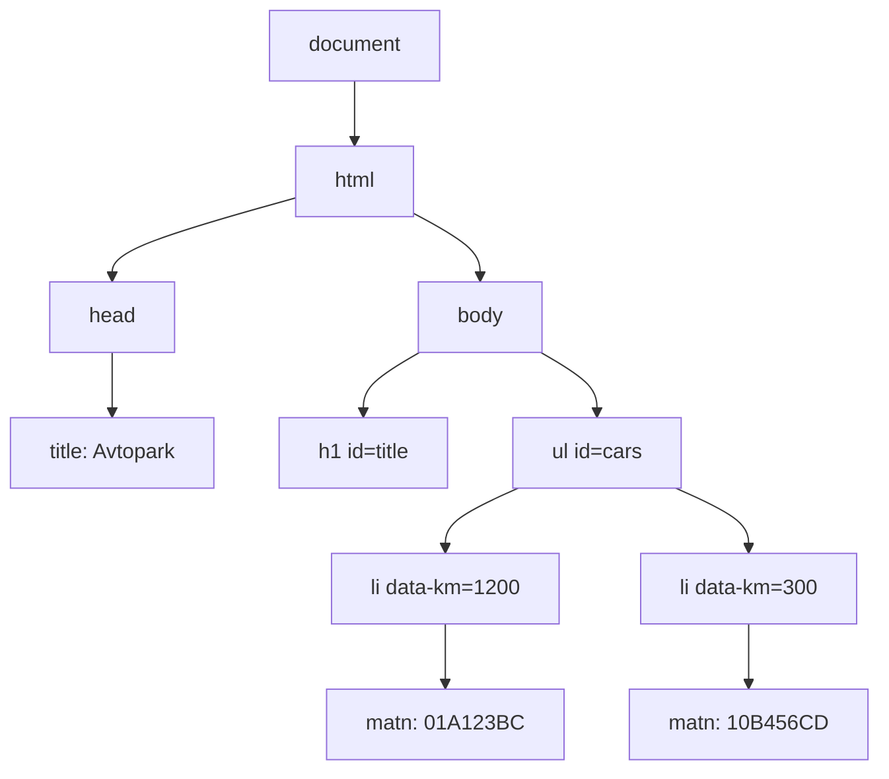
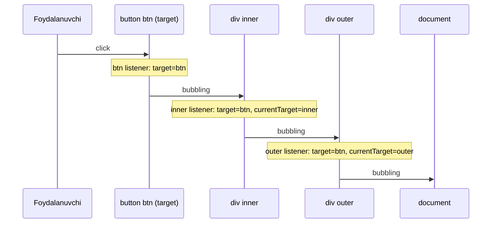

## Bu dars nima uchun kerak

43-darsda sahifaning tuzilmasini HTML bilan, 44-darsda ko'rinishini CSS bilan yozdik. Lekin ikkalasi ham statik: foydalanuvchi tugmani bossa, formaga matn yozsa yoki ro'yxatdan elementni o'chirmoqchi bo'lsa, sahifaning o'zi hech narsa qila olmaydi. Har bir harakat uchun serverga yangi so'rov yuborib, butun sahifani qayta yuklash kerak bo'lardi (42-darsdagi HTTP so'rov va javob). Brauzer ichida, foydalanuvchining kompyuterida ishlaydigan dastur kerak. Brauzerda sahifa bilan ishlaydigan asosiy til - JavaScript (brauzer 9-darsda tilga olingan WebAssembly'ni ham bajaradi, lekin u ham sahifaga JavaScript orqali ulanadi).

Siz allaqachon ikki tilni bilasiz. C (5-30-darslar) sizga xotira, tiplar va pointerlarni o'rgatdi, Python (31-35-darslar) esa dinamik tiplash, ro'yxat va lug'atlar bilan yuqori darajada ishlashni. JavaScript ko'p jihatdan Python'ga o'xshaydi (dinamik tiplar, avtomatik xotira boshqaruvi, funksiya - qiymat), sintaksisi esa C ga yaqin (`{}`, `;`, `for (let i = 0; i < n; i++)`). Shuning uchun bu darsda tilni noldan o'rgatmaymiz, balki C va Python bilan farq qiladigan joylarga e'tibor qaratamiz: aynan shu joylarda tajribali dasturchilar ham xato qiladi.

Darsning ikkinchi yarmi brauzerga bag'ishlangan: JavaScript sahifadagi elementlarni qanday topadi, o'zgartiradi, yaratadi (DOM) va foydalanuvchi harakatlariga qanday javob beradi (eventlar). Asinxron kod, event loop va serverdan ma'lumot olish (`fetch`) keyingi, 46-darsda.

Bu darsdan keyin siz:

- JavaScript qayerda ishlashini (brauzer, Node.js) va bu darsdagi ikki xil playground blokining farqini bilasiz;
- `let`, `const` va `var` farqini, `var` ning muammolarini (funksiya scope'i, hoisting, sikldagi bitta o'zgaruvchi) misol bilan ko'rsata olasiz;
- `number` - bitta tip, IEEE 754 double ekanini, `Number.MAX_SAFE_INTEGER` chegarasini va `BigInt` ni 7-darsdagi hisob bilan bog'lay olasiz;
- `==` va `===` farqini, truthy/falsy qiymatlarni va ularning Python'dan farqini bilasiz;
- satr, massiv, obyekt va funksiyalar (arrow, closure) bilan ishlay olasiz;
- `querySelector`, `textContent`, `createElement`, `append`, `classList` bilan sahifani o'zgartira olasiz va `innerHTML` ning xavfini tushuntira olasiz;
- `addEventListener`, event obyekti, bubbling, event delegation va `preventDefault` bilan interaktiv sahifa yoza olasiz.

## JavaScript qayerda ishlaydi

JavaScript - **ECMAScript** standartining amalga oshirilishi. Standart tilning o'zini (sintaksis, tiplar, `Array`, `JSON`, `Promise`) belgilaydi, lekin unda sahifa, tugma yoki fayl haqida hech narsa yo'q. Bu imkoniyatlarni tilni ishga tushirayotgan **muhit** (host environment) qo'shadi:

- **Brauzer.** Har bir brauzerda JavaScript engine bor (masalan, V8). Brauzer tilga `document` (sahifa), `window`, `fetch`, `setTimeout`, `localStorage` kabi obyektlarni qo'shadi. Kod sahifaga `<script>` tegi orqali ulanadi (43-dars).
- **Node.js.** Xuddi shu V8 engine, lekin brauzersiz: `document` yo'q, o'rniga fayl tizimi, tarmoq va jarayonlar bilan ishlash modullari bor. Terminalda `node fayl.js` bilan ishga tushiriladi, xuddi `python3 fayl.py` kabi.

C dan farqi: JavaScript kodi oldindan mashina kodiga kompilyatsiya qilinmaydi (9-dars). Engine uni manba ko'rinishida oladi, tahlil qiladi va ishga tushiradi; tez-tez bajariladigan qismlarni esa ishlash paytida mashina kodiga kompilyatsiya qiladi (JIT, just-in-time). Python'da (31-dars) interpreter bytecode'ni bajarar edi; zamonaviy JS engine'lar ham avval bytecode bilan boshlaydi, keyin "issiq" funksiyalarni optimallashtiradi.

Bu darsda ikki xil ishga tushiriladigan blok bor:

- **JavaScript bloki** (`js run`) - alohida Web Worker ichida ishlaydi: til bor, `console.log` bor, lekin sahifa (`document`) yo'q. Tilni o'rganish uchun qulay.
- **Sahifa bloki** (`html run`) - to'liq HTML sahifa kod ostida ochiladi, `<script>` ichidagi kod `document` bilan ishlaydi. `console.log` natijasi pastda chiqadi. DOM va eventlar uchun.

Natijani ko'rish uchun hamma joyda `console.log` ishlatamiz - Python'dagi `print` va C dagi `printf` ning o'rni.

## O'zgaruvchilar: let, const va var

JavaScript'da o'zgaruvchi e'lon qilishning uchta usuli bor:

- `let x = 5;` - qayta o'zlashtirish mumkin bo'lgan o'zgaruvchi;
- `const y = 10;` - qayta o'zlashtirib bo'lmaydigan nom;
- `var z = 1;` - eski usul (2015-yilgacha yagona usul edi), yangi kodda ishlatilmaydi.

Tip yozilmaydi: Python'dagi kabi tip qiymatga tegishli, nomga emas (31-darsdagi dinamik tiplash). Lekin Python'dan farqli, nomni ishlatishdan oldin uni e'lon qilish shart. `"use strict"` rejimida (va bu darsning playground'ida shu rejim yoqilgan) e'lon qilinmagan nomga qiymat berish `ReferenceError` beradi; eski "sloppy" rejimda esa u jimgina global o'zgaruvchi yaratib yuborardi.

### var ning uchta muammosi

`let` va `const` 8-darsdagi C ga o'xshab **block scope** ga ega: `{ }` ichida e'lon qilingan nom faqat shu blok ichida ko'rinadi. `var` esa **funksiya scope'iga** ega: `if` yoki `for` bloki ichida e'lon qilingan `var` butun funksiyaga tegishli.

Ikkinchi muammo - **hoisting** (yuqoriga ko'tarish). Engine funksiyani bajarishdan oldin undagi barcha e'lonlarni oldindan ro'yxatga oladi. `var x = 5` ikki qismga bo'linadi: e'lon (`var x`) funksiya boshiga "ko'tariladi" va `undefined` qiymat oladi, o'zlashtirish (`x = 5`) esa o'z joyida qoladi. Natijada `x` ni e'londan oldin o'qish xato bermaydi, `undefined` qaytaradi va xatoni yashiradi.

`let` va `const` ham texnik jihatdan ro'yxatga olinadi, lekin e'lon qatoriga yetguncha ularga murojaat taqiqlangan. Blok boshidan e'longacha bo'lgan bu zona **temporal dead zone** (TDZ, "vaqtinchalik o'lik zona") deyiladi: unda nomni o'qish `ReferenceError` beradi. Bu `var` ning `undefined` idan yaxshiroq: xato darhol va aniq joyda chiqadi.

Uchinchi muammo - sikl. `for (var i ...)` da butun sikl uchun **bitta** `i` bor; `for (let i ...)` da esa har iteratsiya o'z nusxasini oladi. Sikl ichida yaratilgan funksiyalar `i` ni keyinroq o'qisa, farq ko'rinadi:

```js run
// 1. var: funksiya scope'i va hoisting
console.log("x =", x);
var x = 5;
console.log("x =", x);

if (true) {
  var a = 1;
  let b = 2;
}
console.log(`typeof a: ${typeof a}, typeof b: ${typeof b}`);

// 2. let: e'lon qilinishidan oldin murojaat - xato
try {
  console.log(y);
} catch (e) {
  console.log(`${e.name}: ${e.message}`);
}
let y = 10;

// 3. Sikl va funksiyalar: var bitta, let har iteratsiyada yangi
const withVar = [];
for (var i = 0; i < 3; i++) withVar.push(() => i);
const withLet = [];
for (let j = 0; j < 3; j++) withLet.push(() => j);
console.log(`var: ${withVar.map((f) => f()).join(" ")}`);
console.log(`let: ${withLet.map((f) => f()).join(" ")}`);

// 4. const: nomni qayta bog'lab bo'lmaydi, obyektni o'zgartirish mumkin
const car = { plate: "01A123BC", km: 1000 };
car.km += 250;
console.log(`car.km = ${car.km}`);
try {
  car = {};
} catch (e) {
  console.log(`${e.name}: ${e.message}`);
}
```

Natija (xato matnlari V8 engine'niki; boshqa brauzerda so'zlar farq qilishi mumkin, xato turi esa bir xil):

```text
x = undefined
x = 5
typeof a: number, typeof b: undefined
ReferenceError: Cannot access 'y' before initialization
var: 3 3 3
let: 0 1 2
car.km = 1250
TypeError: Assignment to constant variable.
```

`typeof b` xato bermadi, `undefined` qaytardi: `typeof` e'lon qilinmagan nom uchun ham ishlaydigan yagona operator. `var` siklida uchala funksiya bitta `i` ni ko'radi, sikl tugaganda u 3 ga teng. `let` siklida har funksiya o'z iteratsiyasining `j` sini eslab qolgan (bu closure, pastda).

Oxirgi misol muhim: `const` **nomni** qotiradi, **obyektni** emas. `car.km` ni o'zgartirish mumkin, `car` ni boshqa obyektga bog'lab bo'lmaydi. C dagi `int *const p` (pointerning o'zi o'zgarmas, ko'rsatgan joyi o'zgaradi) ga o'xshash. Amaliy qoida: sukut bo'yicha `const`, qayta o'zlashtirish kerak bo'lsa `let`, `var` hech qachon.

## Tiplar: number faqat double

JavaScript'da qiymatlar ikki guruhga bo'linadi. **Primitivlar** (yettita): `number`, `bigint`, `string`, `boolean`, `undefined`, `null`, `symbol`. Qolgan hamma narsa **obyekt**: oddiy obyektlar `{}`, massivlar `[]`, funksiyalar, sanalar. Primitivlar o'zgarmas (immutable), obyektlar esa havola orqali uzatiladi (pastda).

`undefined` va `null` ikkalasi ham "qiymat yo'q" degani, lekin ma'nosi farqli: `undefined` - "hali berilmagan" (e'lon qilingan, lekin qiymatsiz o'zgaruvchi, mavjud bo'lmagan xususiyat, `return` siz funksiya natijasi), `null` esa dasturchi ataylab qo'ygan "bo'sh" qiymat. Python'da ikkalasining o'rnida bitta `None` bor.

### Butun son tipi yo'q

C da `int`, `long`, `float`, `double` bor edi (6-dars), Python'da `int` (cheksiz) va `float`. JavaScript'ning `number` tipi esa **bitta**: IEEE 754 binary64, ya'ni C dagi `double`. `5` ham, `5.0` ham, `3.14` ham bir xil tipdagi bir xil formatdagi qiymat. Bundan to'g'ridan-to'g'ri uchta oqibat kelib chiqadi.

**1. 7-darsdagi floating-point imprecision to'liq saqlanadi.** `0.1 + 0.2` natijasi `0.30000000000000004`, chunki 0.1 ikkilik tizimda cheksiz kasr va 53 bitda yaxlitlanadi. 7-darsda C da ko'rgan natija aynan shu.

**2. Butun sonlar faqat 2⁵³ gacha aniq.** `double` da mantissa 52 bit va bitta yashirin bit, jami 53 bit aniqlik (7-dars). Demak 0 dan 2⁵³ gacha bo'lgan har bir butun son aniq ifodalanadi, undan keyin esa qo'shni `double` lar orasidagi masofa 2 ga teng bo'ladi. Shuning uchun standart xavfsiz chegarani belgilaydi:

`Number.MAX_SAFE_INTEGER` = 2⁵³ - 1 = 9 007 199 254 740 991.

"Xavfsiz" degani: bu oraliqdagi har bir butun son aniq ifodalanadi va uni boshqa butun son bilan adashtirib bo'lmaydi. 2⁵³ + 1 esa ifodalanmaydi va 2⁵³ ga yaxlitlanadi, shuning uchun `MAX_SAFE_INTEGER + 1 === MAX_SAFE_INTEGER + 2` - `true`. Taqqoslash uchun: C dagi 64-bitli `long long` 2⁶³ - 1 ≈ 9.22·10¹⁸ gacha aniq, ya'ni JavaScript'ning chegarasidan taxminan 1024 marta katta (2⁶³ / 2⁵³ = 2¹⁰). Ma'lumotlar bazasidagi 64-bitli ID'lar yoki tiyinlardagi katta summalar JavaScript'ga `number` bo'lib kelsa, oxirgi raqamlari jimgina buzilishi mumkin.

**3. Butun bo'lish yo'q.** C da `7 / 2` - 3, Python'da `7 / 2` - 3.5 va `7 // 2` - 3. JavaScript'da `7 / 2` har doim 3.5, butun qismni olish uchun `Math.trunc` (nolga qarab, C kabi) yoki `Math.floor` (pastga, Python'ning `//` kabi). `%` esa C dagi kabi bo'linuvchining ishorasini oladi: `-7 % 2` - `-1` (Python'da `1`).

### BigInt

2⁵³ dan katta butun sonlar uchun 2020-yilda (ES2020) alohida primitiv qo'shildi: **BigInt**. Literal oxiriga `n` qo'yiladi: `42n`, `2n ** 64n`. BigInt Python'ning `int` i kabi ixtiyoriy uzunlikda va aniq. Lekin u `number` bilan aralashmaydi: `10n + 1` - `TypeError`, avval bir tipga aniq o'tkazish kerak (`10n + BigInt(1)` yoki `Number(10n) + 1`). Bu ataylab qilingan: aks holda qaysi tipga o'tkazish kerakligi (aniqlikni yo'qotib `number` ga yoki kasrni yo'qotib `bigint` ga) noaniq bo'lardi. BigInt bo'lish natijasi kasrsiz: `7n / 2n` - `3n`.

### Nolga bo'lish va NaN

C da butun sonni nolga bo'lish - undefined behavior, Python'da `ZeroDivisionError`. JavaScript'da esa IEEE 754 qoidasi ishlaydi: `1 / 0` - `Infinity`, `0 / 0` - `NaN` (Not a Number). Xato chiqmaydi, `NaN` esa hisob bo'ylab tarqalib ketadi: `NaN` ishtirok etgan har qanday arifmetika `NaN` beradi. `NaN` o'ziga ham teng emas, shuning uchun tekshirish uchun `Number.isNaN(x)` ishlatiladi.

```js run
console.log(`0.1 + 0.2 = ${0.1 + 0.2}`);
console.log(`0.1 + 0.2 === 0.3: ${0.1 + 0.2 === 0.3}`);
console.log(`7 / 2 = ${7 / 2}, Math.trunc(7 / 2) = ${Math.trunc(7 / 2)}, -7 % 2 = ${-7 % 2}`);

const max = Number.MAX_SAFE_INTEGER;
console.log(`MAX_SAFE_INTEGER = ${max} (2 ** 53 - 1 = ${2 ** 53 - 1})`);
console.log(`max + 1 = ${max + 1}, max + 2 = ${max + 2}`);
console.log(`max + 1 === max + 2: ${max + 1 === max + 2}`);
console.log(`Number.isSafeInteger(max + 1): ${Number.isSafeInteger(max + 1)}`);

const big = BigInt(max) + 2n;
console.log(`BigInt: ${big}, 2n ** 64n = ${2n ** 64n}`);
console.log(`7n / 2n = ${7n / 2n}`);
try {
  console.log(big + 1);
} catch (e) {
  console.log(`${e.name}: ${e.message}`);
}

console.log(`1 / 0 = ${1 / 0}, -1 / 0 = ${-1 / 0}, 0 / 0 = ${0 / 0}`);
console.log(`NaN === NaN: ${NaN === NaN}, Number.isNaN(0 / 0): ${Number.isNaN(0 / 0)}`);
console.log(`parseInt("42px") = ${parseInt("42px")}, Number("42px") = ${Number("42px")}`);

const values = [42, 3.14, 42n, "salom", true, undefined, null, {}, [], () => 1];
console.log(values.map((v) => typeof v).join(", "));
```

Natija:

```text
0.1 + 0.2 = 0.30000000000000004
0.1 + 0.2 === 0.3: false
7 / 2 = 3.5, Math.trunc(7 / 2) = 3, -7 % 2 = -1
MAX_SAFE_INTEGER = 9007199254740991 (2 ** 53 - 1 = 9007199254740991)
max + 1 = 9007199254740992, max + 2 = 9007199254740992
max + 1 === max + 2: true
Number.isSafeInteger(max + 1): false
BigInt: 9007199254740993, 2n ** 64n = 18446744073709551616
7n / 2n = 3
TypeError: Cannot mix BigInt and other types, use explicit conversions
1 / 0 = Infinity, -1 / 0 = -Infinity, 0 / 0 = NaN
NaN === NaN: false, Number.isNaN(0 / 0): true
parseInt("42px") = 42, Number("42px") = NaN
number, number, bigint, string, boolean, undefined, object, object, object, function
```

Oxirgi qatorda ikki tarixiy g'alatilik bor: `typeof null` - `"object"` (tilning birinchi versiyasidan qolgan xato, moslik uchun tuzatilmagan; `null` ni `x === null` bilan tekshiring) va `typeof []` - `"object"` (massivni `Array.isArray(x)` bilan tekshiring). `parseInt` satr boshidagi raqamlarni o'qib, qolganini tashlab yuboradi, `Number` esa butun satr son bo'lishini talab qiladi - foydalanuvchi kiritishini tekshirishda ikkinchisi xavfsizroq.

## == va ===, truthy va falsy

### Tip o'zgartirish (coercion)

JavaScript'da ikki tenglik operatori bor. `===` (**strict equality**) qiymatlarni tipini o'zgartirmasdan solishtiradi: tiplar har xil bo'lsa, natija darhol `false`. `==` (loose equality) esa tiplar har xil bo'lsa, avval ularni murakkab qoidalar bo'yicha bir tipga keltiradi. Tilning o'zi bajaradigan bunday yashirin tip o'zgartirish **type coercion** deyiladi. 6-darsdagi C ning implicit conversion i kabi, faqat ancha kengroq: satr songa, mantiqiy qiymat songa, obyekt satrga aylanishi mumkin.

```js run
// == turni o'zgartiradi (coercion), === o'zgartirmaydi
const cases = [
  ['"5" == 5', "5" == 5, '"5" === 5', "5" === 5],
  ['0 == ""', 0 == "", '0 === ""', 0 === ""],
  ['null == undefined', null == undefined, 'null === undefined', null === undefined],
  ['"0" == false', "0" == false, '"0" === false', "0" === false],
  ['[] == false', [] == false, '[] === false', [] === false],
];
for (const [a, x, b, y] of cases) {
  console.log(`${a.padEnd(18)} ${String(x).padEnd(6)} ${b.padEnd(19)} ${y}`);
}

// truthy / falsy: Python bilan farq qiladigan joylar
const samples = [["0", 0], ['""', ""], ['"0"', "0"], ['" "', " "], ["[]", []], ["{}", {}], ["null", null], ["NaN", NaN]];
console.log(samples.map(([label, v]) => `${label} -> ${Boolean(v)}`).join(" | "));

// || va ?? farqi
const saved = 0;
console.log(`saved || 10 = ${saved || 10}, saved ?? 10 = ${saved ?? 10}`);
```

Natija:

```text
"5" == 5           true   "5" === 5           false
0 == ""            true   0 === ""            false
null == undefined  true   null === undefined  false
"0" == false       true   "0" === false       false
[] == false        true   [] === false        false
0 -> false | "" -> false | "0" -> true | " " -> true | [] -> true | {} -> true | null -> false | NaN -> false
saved || 10 = 10, saved ?? 10 = 0
```

`"0" == false` ni qadamma-qadam ko'raylik: `false` songa aylanadi (0), keyin `"0"` songa aylanadi (0), 0 == 0. `[] == false` da esa bo'sh massiv avval satrga (`""`), keyin songa (0) aylanadi. Bu qoidalarni yodlash shart emas. Amaliy qoida oddiy: **har doim `===` va `!==`**. Yagona keng tarqalgan istisno - `x == null`, u `null` va `undefined` ni birga ushlaydi.

### Truthy va falsy

`if`, `while`, `&&`, `||`, `!` mantiqiy qiymat kutadi va boshqa qiymatlarni o'zi `boolean` ga aylantiradi. `false` ga aylanadigan qiymatlar **falsy** deyiladi, ularning ro'yxati qisqa: `false`, `0`, `-0`, `0n`, `""` (bo'sh satr), `null`, `undefined`, `NaN`. Qolgan hamma narsa **truthy**: `"0"`, `" "`, `"false"`, `[]`, `{}`, har qanday funksiya.

Python bilan eng xavfli farq: Python'da bo'sh ro'yxat va bo'sh lug'at falsy (`if items:` - "ro'yxat bo'sh emasmi?"), JavaScript'da esa `[]` va `{}` truthy, chunki ular obyekt. Python odati bilan yozilgan `if (items)` bo'sh massivda ham bajariladi. To'g'risi: `if (items.length > 0)`.

`||` chap qiymat falsy bo'lsa o'ng qiymatni qaytaradi va ko'pincha "sukut bo'yicha qiymat" uchun ishlatiladi. Lekin `0` va `""` ham falsy bo'lgani uchun, foydalanuvchi ataylab kiritgan 0 ham almashtirib yuboriladi. `??` (nullish coalescing) faqat `null` va `undefined` da o'ng qiymatni oladi - sukut qiymat uchun odatda aynan shu kerak.

## Satrlar, massivlar va obyektlar

### Satrlar va template literal

JavaScript satrlari Python'dagi kabi o'zgarmas: `s.toUpperCase()` yangi satr qaytaradi. Alohida `char` tipi yo'q, `s[0]` - bitta belgili satr. Qo'shtirnoqning uch turi bor: `'...'`, `"..."` va teskari tirnoq `` `...` ``. Oxirgisi **template literal**: ichiga `${ifoda}` qo'yish mumkin va u bir necha qatorga cho'zila oladi. Bu Python'dagi f-string ning (31-dars) aynan o'zi: `` `${name}: ${score} ball` `` va `f"{name}: {score} ball"`.

2-darsda JavaScript satrlari ichkarida UTF-16 da saqlanishini aytgan edik. `length` belgilarni emas, 16-bitli birliklarni sanaydi: BMP dan tashqaridagi belgi (masalan, U+1D11E musiqiy kalit belgisi) surrogate pair bo'lib, `length` da 2 hisoblanadi.

`+` operatori satrlar uchun qo'shish, sonlar uchun yig'indi. Bitta operand satr bo'lsa, ikkinchisi ham satrga aylanadi: `"5" + 1` - `"51"`. Boshqa arifmetik operatorlar esa satrni songa aylantiradi: `"5" - 1` - `4`. Formadan kelgan qiymat (u har doim satr) bilan hisoblashdan oldin uni `Number(...)` bilan aniq o'tkazing.

```js run
const name = "Malika";
const score = 87;
console.log(`${name}: ${score} ball, ${score >= 80 ? "o'tdi" : "o'tmadi"}`);
console.log(`"5" + 1 = ${"5" + 1}, "5" - 1 = ${"5" - 1}, "5" * "2" = ${"5" * "2"}`);

const clef = "\u{1D11E}";
console.log(`length: ${clef.length}, code point'lar: ${[...clef].length}`);
console.log(`${"  Toshkent ".trim().toUpperCase()} | ${"a,b,c".split(",").length} | ${"salom".includes("lo")}`);

// Massivlar
const nums = [10, 9, 1, 100];
console.log(`sort(): ${[...nums].sort().join(", ")}`);
console.log(`sort((a, b) => a - b): ${[...nums].sort((a, b) => a - b).join(", ")}`);

const trips = [
  { driver: "Ali", km: 120 },
  { driver: "Vali", km: 45 },
  { driver: "Ali", km: 300 },
];
const long = trips.filter((t) => t.km > 100).map((t) => `${t.driver}:${t.km}`);
const total = trips.reduce((sum, t) => sum + t.km, 0);
console.log(`uzun reyslar: ${long.join(" ")}, jami: ${total} km`);

// Obyektlar - havola orqali
const a = { plate: "01A123BC", km: 1000 };
const b = a;
b.km = 5000;
const c = { ...a };
c.km = 0;
console.log(`a.km = ${a.km}, b === a: ${b === a}, c === a: ${c === a}`);
console.log(JSON.stringify(a));
console.log(`a["plate"] = ${a["plate"]}, a.color = ${a.color}`);
const { plate, km } = a;
console.log(`destructuring: ${plate} ${km}`);
```

Natija:

```text
Malika: 87 ball, o'tdi
"5" + 1 = 51, "5" - 1 = 4, "5" * "2" = 10
length: 2, code point'lar: 1
TOSHKENT | 3 | true
sort(): 1, 10, 100, 9
sort((a, b) => a - b): 1, 9, 10, 100
uzun reyslar: Ali:120 Ali:300, jami: 465 km
a.km = 5000, b === a: true, c === a: false
{"plate":"01A123BC","km":5000}
a["plate"] = 01A123BC, a.color = undefined
destructuring: 01A123BC 5000
```

### Massivlar

Massiv (`[]`) Python'ning `list` iga o'xshaydi: uzunligi o'zgaradi (`push`, `pop`), har xil tipdagi qiymatlarni saqlay oladi, `length` xususiyati bor. C dagi massivdan farqi: chegaradan tashqariga o'qish (`nums[10]`) xotirani buzmaydi va xato ham bermaydi, shunchaki `undefined` qaytaradi (12-darsdagi buffer overflow'dan farqli, xotira buzilmaydi, lekin dastur noto'g'ri qiymat bilan jimgina davom etadi).

Eng mashhur tuzoq - `sort()`. Argumentsiz `sort` elementlarni **satr** sifatida, leksikografik tartibda saralaydi: `"100"` `"9"` dan oldin keladi, chunki `"1" < "9"`. Sonlarni saralash uchun solishtirish funksiyasi beriladi: `(a, b) => a - b` manfiy son qaytarsa `a` oldin, musbat bo'lsa `b` oldin. Bu C dagi `qsort` ning solishtirish funksiyasi bilan bir xil kelishuv. Yana bir farq: `sort` massivning o'zini o'zgartiradi (in-place), shuning uchun yuqorida `[...nums]` bilan nusxa olindi.

`map`, `filter`, `reduce` - Python'dagi list comprehension (32-dars) va `sum` ning o'rni: `[t.km for t in trips if t.km > 100]` JavaScript'da `trips.filter(...).map(...)`.

### Obyektlar

Obyekt (`{}`) - kalit va qiymat juftliklari, Python'ning `dict` iga o'xshaydi. Ikki xil murojaat bor: `a.plate` (kalit oldindan ma'lum bo'lsa) va `a["plate"]` (kalit o'zgaruvchida bo'lsa). Kalitlar satrga aylanadi: `obj[1]` va `obj["1"]` bir xil xususiyat. Mavjud bo'lmagan kalit Python'dagi kabi `KeyError` emas, `undefined` beradi.

Obyekt va massivlar **havola orqali** saqlanadi va uzatiladi: `const b = a` yangi obyekt yaratmaydi, ikkinchi nom beradi. 32-darsdagi mutable aliasing va 22-darsdagi `char *t = s` ning aynan o'zi. `===` obyektlarda tarkibni emas, havolani solishtiradi: ikki xil, lekin tarkibi bir xil obyekt teng emas. `{ ...a }` (spread) shallow copy yaratadi: birinchi darajadagi xususiyatlar nusxalanadi, ichma-ich obyektlar esa umumiyligicha qoladi (32-darsdagi `copy.copy`). `const { plate, km } = a` - **destructuring**, Python'dagi `x, y = pair` ning obyekt versiyasi.

## Funksiyalar va closure

Funksiya bir necha usulda yaratiladi:

```js
function square(n) {      // function declaration: butunligicha hoist qilinadi
  return n * n;
}
const cube = function (n) { return n * n * n; };   // function expression
const half = (n) => n / 2;                          // arrow funksiya: qisqa yozuv
const greet = (name = "mehmon") => `salom, ${name}`;   // default parametr
```

Arrow funksiya (`=>`) - Python'dagi `lambda` ga o'xshaydi, lekin cheklovsiz: tanasi `{ }` ichida istalgan uzunlikda bo'lishi mumkin. Tana bitta ifoda bo'lsa, `return` siz yoziladi. Arrow funksiyaning yana bir xususiyati (`this` ni tashqaridan olishi) obyektga yo'naltirilgan kodda muhim, bu kursda u bizga deyarli kerak emas.

JavaScript'da funksiya, Python'dagi kabi (33-dars), first-class function: uni o'zgaruvchiga yozish, argument qilib uzatish va boshqa funksiyadan qaytarish mumkin. Yuqorida `map((t) => ...)` va `sort((a, b) => a - b)` aynan shunday ishladi. Eventlarda ham listener - argument sifatida uzatilgan funksiya.

C va Python'dan farqli, argumentlar soni tekshirilmaydi: yetishmagan parametr `undefined` bo'ladi, ortiqchasi e'tiborsiz qoladi.

### Closure

33-darsdagi `make_counter` ni eslang: ichki funksiya tashqi funksiyaning o'zgaruvchisini, tashqi funksiya qaytgandan keyin ham "eslab qoladi". Funksiya va u yaratilgan joydagi o'zgaruvchilarning bu birikmasi **closure** deyiladi. C da bu mumkin emas: lokal o'zgaruvchi funksiya qaytishi bilan stack frame bilan birga yo'qoladi (18-dars). JavaScript'da esa o'zgaruvchi unga havola qiladigan funksiya bor ekan yashaydi (35-darsdagi Python obyektlari kabi, avtomatik xotira boshqaruvi uni keyin tozalaydi).

```js run
// Function declaration butunligicha hoist qilinadi
console.log(`square(4) = ${square(4)}`);
function square(n) {
  return n * n;
}

const greet = (name = "mehmon") => `salom, ${name}`;
console.log(`${greet()} | ${greet("Aziz")}`);

const apply = (f, x) => f(x);
console.log(`apply(square, 9) = ${apply(square, 9)}`);

// Closure: har chaqiruv o'zining count o'zgaruvchisini yaratadi
function makeCounter() {
  let count = 0;
  return () => {
    count += 1;
    return count;
  };
}
const c1 = makeCounter();
const c2 = makeCounter();
c1();
c1();
console.log(`c1: ${c1()}, c2: ${c2()}`);

const add = (x, y) => x + y;
console.log(`add(1) = ${add(1)}, add(1, 2, 3) = ${add(1, 2, 3)}`);
```

Natija:

```text
square(4) = 16
salom, mehmon | salom, Aziz
apply(square, 9) = 81
c1: 3, c2: 1
add(1) = NaN, add(1, 2, 3) = 3
```

`c1` va `c2` har biri o'z `count` iga ega, chunki `makeCounter` har chaqirilganda yangi `count` yaratiladi. Python'da ichki funksiyadan `count` ni o'zgartirish uchun `nonlocal` kerak edi; JavaScript'da `let` bilan e'lon qilingan tashqi o'zgaruvchini to'g'ridan-to'g'ri o'zgartirish mumkin. `var` siklidagi "3 3 3" muammosi ham closure orqali tushuntiriladi: uchta funksiya bitta o'zgaruvchini yopib olgan edi. `add(1)` esa `1 + undefined` = `NaN` - argumentlar soni tekshirilmasligining oqibati.

## JS, Python va C: yonma-yon

| Mavzu | C | Python | JavaScript |
|---|---|---|---|
| Ishga tushirish | Kompilyatsiya, keyin `./a.out` | Interpreter (bytecode) | Engine: bytecode va JIT |
| Tiplar | Statik, nomga tegishli | Dinamik, qiymatga tegishli | Dinamik, qiymatga tegishli |
| Butun son | `int`, `long`: belgilangan o'lcham, overflow | `int`: cheksiz | Yo'q: `number` = double, 2⁵³ - 1 gacha aniq; `BigInt` alohida |
| `7 / 2` | `3` | `3.5` (`7 // 2` = `3`) | `3.5` (`Math.trunc` = `3`) |
| Nolga bo'lish | Butun sonda UB | `ZeroDivisionError` | `Infinity` yoki `NaN` |
| "Qiymat yo'q" | `NULL` (pointer uchun) | `None` | `undefined` va `null` |
| Tenglik | `==` | `==` (qiymat), `is` (obyekt) | `===` (`==` coercion qiladi) |
| Bo'sh ro'yxat shartda | Tushuncha yo'q | falsy | truthy |
| Satr | `char` massivi + NUL | O'zgarmas, code point'lar | O'zgarmas, UTF-16 birliklar |
| Formatlash | `printf("%i", x)` | `f"{x}"` | `` `${x}` `` |
| Chegaradan tashqari indeks | UB, xotira buziladi | `IndexError` | `undefined` |
| Scope | Block | Funksiya (LEGB) | `let`/`const`: block, `var`: funksiya |
| Xotira | `malloc` / `free` | Avtomatik (reference counting) | Avtomatik (garbage collector) |

Jadvaldan asosiy xulosa: JavaScript Python kabi kechirimli, lekin xatolarni exception bilan emas, ko'pincha jim `undefined` yoki `NaN` bilan bildiradi. Shuning uchun `===`, `Number.isNaN`, `Array.isArray` kabi aniq tekshiruvlar odat bo'lishi kerak.

## DOM: sahifa - obyektlar daraxti

Brauzer HTML matnini o'qib (43-dars), uni xotirada obyektlar daraxtiga aylantiradi. Bu daraxt **DOM** (Document Object Model) deyiladi. Har bir teg - element tuguni, teglar orasidagi matn - matn tuguni, ichma-ich teglar - bolalar. Daraxtning ildizi - `document` obyekti. JavaScript HTML matnini emas, aynan shu daraxtni o'zgartiradi, brauzer esa o'zgarishni darhol ekranga chizadi. 29-darsdagi daraxtlardan farqi: bolalar soni cheklanmagan va ularning tartibi muhim.



### Elementni topish

- `document.querySelector(selektor)` - selektorga mos **birinchi** elementni qaytaradi, topilmasa `null`. Selektor - 44-darsdagi CSS selektorlarining aynan o'zi: `"#title"`, `".active"`, `"#cars li"`, `"input[name=q]"`.
- `document.querySelectorAll(selektor)` - barcha mos elementlar, `NodeList` ko'rinishida (`length`, indeks, `forEach` bor). Bu chaqiruv paytidagi "surat": keyin qo'shilgan elementlar unga kirmaydi.
- `element.querySelector(...)` - qidiruvni faqat shu element ichida bajaradi.

`querySelector` `null` qaytarishi mumkinligini unutmang: selektorda xato bo'lsa, keyingi `.textContent` `TypeError: Cannot read properties of null` beradi. Bu C dagi null pointer dereference'ning (13 va 21-darslar) JavaScript'dagi ko'rinishi, faqat dastur yiqilmaydi, exception chiqadi.

### Matn: textContent va innerHTML

- `el.textContent` - elementning matni. Unga satr yozilsa, eski tarkib o'chiriladi va satr **oddiy matn** sifatida qo'yiladi: `<b>` belgilari ekranda `<b>` bo'lib ko'rinadi, teg bo'lmaydi.
- `el.innerHTML` - elementning ichidagi HTML. Unga yozilgan satr HTML sifatida tahlil qilinadi va yangi elementlarga aylanadi.

Farq xavfsizlik uchun hal qiluvchi. Foydalanuvchi kiritgan matnni (ism, izoh, qidiruv so'zi) `innerHTML` ga yozsangiz, hujumchi matn o'rniga HTML yuboradi. `<script>` teglari `innerHTML` orqali qo'shilganda bajarilmaydi, lekin `` dagi `onerror` atributi ishlaydi: rasm yuklanmaydi va hujumchining kodi sizning sahifangizda, foydalanuvchingiz nomidan bajariladi. Bu hujum **XSS** (cross-site scripting) deyiladi va 50-darsda batafsil ko'riladi. 39-darsdagi SQL injection bilan bir xil ildiz: ma'lumot kod sifatida talqin qilinmoqda. Qoida ham bir xil: foydalanuvchi ma'lumoti uchun faqat `textContent` (yoki `createElement` va `textContent`), `innerHTML` - faqat o'zingiz yozgan, ishonchli HTML uchun.

### Yaratish, qo'shish, class va atributlar

- `document.createElement("li")` - yangi element yaratadi, lekin u hali sahifada emas.
- `parent.append(child)` - bolani oxiriga qo'shadi; `prepend` - boshiga; `el.remove()` - elementni o'chiradi.
- `el.classList.add("active")`, `remove`, `toggle`, `contains` - CSS class'larini boshqarish. Ko'rinishni JavaScript'da to'g'ridan-to'g'ri `el.style.color = ...` bilan emas, class qo'shib, uslubni CSS'da (44-dars) yozish yaxshiroq: dizayn va mantiq ajraladi.
- `el.getAttribute("href")`, `el.setAttribute("href", url)` - atributlar. `data-*` atributlari uchun qulay `el.dataset`: `data-km="1200"` - `el.dataset.km` (qiymat doim satr).
- Forma maydonlarida joriy qiymat `input.value` da (satr). `getAttribute("value")` esa HTML'dagi boshlang'ich qiymatni qaytaradi.

```html run
<!doctype html>
<html lang="uz">
<head>
  <meta charset="utf-8">
  <style>
    .active { color: #c00; font-weight: bold; }
  </style>
</head>
<body>
  <h1 id="title">Avtopark</h1>
  <ul id="cars">
    <li data-km="1200">01A123BC</li>
    <li data-km="300">10B456CD</li>
  </ul>
  <p id="out"></p>
  <script>
    // 1. Topish
    const title = document.querySelector("#title");
    const items = document.querySelectorAll("#cars li");
    console.log(`li soni: ${items.length}, birinchisi: ${items[0].textContent}`);

    // 2. Matnni o'zgartirish
    title.textContent = "Avtopark: 3 ta mashina";

    // 3. Yangi element yaratib qo'shish
    const li = document.createElement("li");
    li.textContent = "30C789EF";
    li.dataset.km = "50";
    document.querySelector("#cars").append(li);
    console.log(`endi li soni: ${document.querySelectorAll("#cars li").length}, eski NodeList: ${items.length}`);

    // 4. Class va atributlar
    items[0].classList.add("active");
    items[0].classList.toggle("active");
    items[0].classList.toggle("active");
    console.log(`class: ${items[0].className}, data-km: ${items[0].dataset.km}, getAttribute: ${li.getAttribute("data-km")}`);

    // 5. textContent va innerHTML: foydalanuvchi kiritgan matn
    const userInput = '';
    const out = document.querySelector("#out");
    out.textContent = userInput;
    console.log(`textContent bilan img soni: ${out.querySelectorAll("img").length}`);
    const unsafe = document.createElement("p");
    unsafe.innerHTML = userInput;
    document.body.append(unsafe);
    console.log(`innerHTML bilan img soni: ${unsafe.querySelectorAll("img").length}`);
  </script>
</body>
</html>
```

Natija:

```text
li soni: 2, birinchisi: 01A123BC
endi li soni: 3, eski NodeList: 2
class: active, data-km: 1200, getAttribute: 50
textContent bilan img soni: 0
innerHTML bilan img soni: 1
XSS: begona kod ishladi
```

Sahifada `textContent` bilan qo'yilgan qator HTML matni sifatida ko'rinadi, `innerHTML` bilan qo'yilgani esa buzilgan rasm belgisi bo'lib chiqadi va uning `onerror` kodi ishga tushdi. Oxirgi qator kechroq chiqqanini ham ko'ring: rasmni yuklashga urinish va xato asinxron sodir bo'ladi (46-dars). `<script>` sahifa oxirida, `</body>` dan oldin turibdi: brauzer HTML'ni yuqoridan pastga o'qiydi, va skript ishga tushganda yuqoridagi elementlar allaqachon DOM'da bo'lishi kerak. Skript `<head>` da bo'lsa, `defer` atributini qo'ying: u skriptni HTML to'liq o'qilgandan keyin ishga tushiradi.

## Eventlar

Foydalanuvchi tugmani bosadi, klaviaturada yozadi, formani yuboradi - brauzer har bir shunday hodisa uchun **event** obyekti yaratadi va uni tegishli elementga yetkazadi. Dastur bunga oldindan ro'yxatdan o'tkazilgan funksiya - **listener** (yoki handler) orqali javob beradi:

```js
button.addEventListener("click", (event) => {
  console.log("bosildi", event.target);
});
```

Bu yozuvda funksiya **hozir chaqirilmaydi**: u brauzerga topshiriladi va har safar `click` sodir bo'lganda chaqiriladi. Dastur oqimi C dagi kabi `main` boshidan oxirigacha emas: skript listener'larni o'rnatib tugaydi, keyin brauzer hodisalarni kutadi. Bu "event-driven" (hodisaga asoslangan) dasturlash; uning ichki mexanikasi - event loop - 46-darsda.

Bitta elementga bir xil turdagi bir nechta listener qo'shish mumkin, `removeEventListener` bilan olib tashlash mumkin (buning uchun aynan o'sha funksiyaga havola kerak). HTML atributidagi `onclick="..."` eski usul: bitta element uchun bitta handler, kod HTML ichida aralashib ketadi.

### Ko'p ishlatiladigan eventlar

| Event | Qachon | Qayerda | Foydali xususiyatlar |
|---|---|---|---|
| `click` | Sichqoncha bosilib qo'yildi (yoki Enter/Space tugmada) | Istalgan element | `target` |
| `input` | Maydon qiymati har o'zgarganda (har harf) | `input`, `textarea`, `select` | `target.value` |
| `change` | Qiymat o'zgarishi "tasdiqlanganda": matn maydonida fokus yo'qolganda, checkbox yoki select'da darhol | `input`, `select`, `textarea` | `target.value`, `target.checked` |
| `keydown` | Klaviatura tugmasi bosilganda (ushlab turilsa, takrorlanadi) | Fokusdagi element, `document` | `key` (`"Enter"`, `"a"`), `ctrlKey`, `shiftKey` |
| `submit` | Forma yuborilganda (tugma yoki Enter) | `form` | `preventDefault()` |
| `DOMContentLoaded` | HTML to'liq o'qilib, DOM qurilganda | `document` | - |

Listener'ga keladigan **event obyekti** hodisa haqidagi ma'lumotni olib keladi: `event.type` (`"click"`), `event.target` (hodisa haqiqatda sodir bo'lgan element), `event.currentTarget` (listener o'rnatilgan element), klaviatura uchun `event.key`.

### Bubbling

Ichma-ich elementlarda hodisa faqat bosilgan elementda qolmaydi. Brauzer uni avval eng ichki elementga (`target`) yetkazadi, keyin daraxt bo'ylab yuqoriga - otasiga, uning otasiga va hokazo `document` gacha ko'taradi. Bu **event bubbling** (pufakchadek ko'tarilish) deyiladi. Har bir ajdodda shu turdagi listener bo'lsa, u ham chaqiriladi. Aslida yo'l ikki bosqichli: avval `document` dan `target` gacha pastga tushish (capture), keyin yuqoriga ko'tarilish (bubble); `addEventListener` sukut bo'yicha listener'ni ko'tarilish bosqichiga qo'yadi.



`event.stopPropagation()` ko'tarilishni to'xtatadi, lekin uni kamdan-kam ishlating: sahifaning boshqa qismlari (masalan, ochiq menyuni tashqariga bosganda yopadigan kod) shu hodisani kutayotgan bo'lishi mumkin.

### Event delegation

Bubbling'ning eng foydali qo'llanilishi - **event delegation**: har bir elementga alohida listener qo'yish o'rniga, ularning umumiy otasiga **bitta** listener qo'yiladi va `event.target` orqali qaysi bola bosilgani aniqlanadi. Ikki afzalligi bor:

1. **Keyin qo'shilgan elementlar ham ishlaydi.** Ro'yxatga JavaScript bilan yangi `li` qo'shilsa, unga listener qo'shishni unutish mumkin emas - ota listener uni avtomatik "ko'radi".
2. **Xotira va vaqt.** 1000 qatorli jadvalda 1000 ta listener o'rniga bitta.

`event.target` bosilgan eng ichki element bo'lgani uchun (masalan, `li` ichidagi `span`), kerakli elementni `event.target.closest("li")` bilan topamiz: u elementning o'zidan boshlab ajdodlar bo'ylab yuqoriga selektorga mos birinchisini qidiradi.

### preventDefault

Ba'zi hodisalarning brauzerdagi **standart xatti-harakati** bor: havolani bosish - boshqa sahifaga o'tish, formani yuborish - `action` manziliga so'rov yuborib sahifani qayta yuklash (43-dars), checkbox'ni bosish - belgilash. `event.preventDefault()` shu standart harakatni bekor qiladi. Formani JavaScript bilan qayta ishlamoqchi bo'lsak (tekshirish, ro'yxatga qo'shish, 46-darsda `fetch` bilan yuborish), `submit` listener'ida birinchi ish - `preventDefault()`. Aks holda kodimiz ishlab ulgurmay sahifa qayta yuklanadi va hamma o'zgarish yo'qoladi.

E'tibor bering: forma uchun `click` emas, `submit` eventini tinglash kerak. Forma faqat tugma bosilganda emas, maydonda Enter bosilganda ham yuboriladi, `submit` ikkalasini ham ushlaydi.

```html run
<!doctype html>
<html lang="uz">
<head>
  <meta charset="utf-8">
  <style>
    .box { border: 1px solid #888; padding: 8px; margin: 4px; }
  </style>
</head>
<body>
  <div id="outer" class="box">outer
    <div id="inner" class="box">inner <button id="btn">Bos</button></div>
  </div>
  <ul id="menu">
    <li data-action="start">Boshlash</li>
    <li data-action="stop">To'xtatish</li>
  </ul>
  <form id="search">
    <input name="q" value="Toshkent">
    <button>Qidirish</button>
  </form>
  <input id="kb" placeholder="Bu yerga yozing va Enter bosing">
  <script>
    // 1. Bubbling: bitta click uchta listener'ga yetib boradi
    for (const id of ["outer", "inner", "btn"]) {
      document.getElementById(id).addEventListener("click", (e) => {
        console.log(`${id}: target=${e.target.id}, currentTarget=${e.currentTarget.id}`);
      });
    }
    document.querySelector("#btn").click();

    // 2. Delegation: bitta listener ro'yxatning o'zida
    const menu = document.querySelector("#menu");
    menu.addEventListener("click", (e) => {
      const li = e.target.closest("li");
      if (li) console.log(`menu: ${li.dataset.action}`);
    });
    const extra = document.createElement("li");
    extra.dataset.action = "reset";
    extra.textContent = "Qaytadan";
    menu.append(extra);
    extra.click();

    // 3. Forma: submit sahifani qayta yuklamasin
    document.querySelector("#search").addEventListener("submit", (e) => {
      e.preventDefault();
      const data = new FormData(e.target);
      console.log(`submit to'xtatildi, q = ${data.get("q")}`);
    });
    document.querySelector("#search").requestSubmit();

    // 4. input va keydown
    const kb = document.querySelector("#kb");
    kb.addEventListener("input", (e) => console.log(`input: ${e.target.value}`));
    kb.addEventListener("keydown", (e) => {
      if (e.key === "Enter") console.log(`keydown: Enter, qiymat = ${kb.value}`);
    });
    kb.value = "kod orqali";
    console.log("value o'zgardi, lekin input eventi chiqmadi");
  </script>
</body>
</html>
```

Natija (skript oxirigacha ishlagandan keyin):

```text
btn: target=btn, currentTarget=btn
inner: target=btn, currentTarget=inner
outer: target=btn, currentTarget=outer
menu: reset
submit to'xtatildi, q = Toshkent
value o'zgardi, lekin input eventi chiqmadi
```

Kod tugmalarni `el.click()` va `form.requestSubmit()` bilan dastur orqali "bosdi", shuning uchun natija darhol ko'rinadi. Endi sahifada o'zingiz bosib ko'ring: "Bos" tugmasi yana uch qator chiqaradi, "inner" yozuvining o'zini bossangiz - ikki qator (`target=inner`), menyu elementlari o'z `data-action` ini chiqaradi, pastki maydonga yozganingizda har harf uchun `input` qatori, Enter bosganingizda `keydown` qatori paydo bo'ladi. Oxirgi qatorga ham e'tibor bering: `value` ni JavaScript'dan o'zgartirish `input` eventini chiqarmaydi - eventlar foydalanuvchi harakatlari haqida.

`extra` elementi listener o'rnatilgandan **keyin** yaratilgan, lekin delegation tufayli ishladi. `FormData` formadagi barcha maydonlarni `name` atributi bo'yicha yig'ib beradi - 48-darsda Flask aynan shu nomlar bilan qiymatlarni oladi.

## Mashq: vazifalar ro'yxati

Quyidagi sahifada forma, hisoblagich va bo'sh ro'yxat bor. `submit` listener'i allaqachon yozilgan va `addTodo(input.value)` ni chaqiradi. Sizning vazifangiz:

- `addTodo(text)`: matnni `trim()` qiling; bo'sh bo'lsa hech narsa qilmang. Aks holda `#list` ga `<li><span class="text">MATN</span> <button class="delete">x</button></li>` tuzilmasidagi element qo'shing. Matn **faqat** `textContent` orqali qo'yilsin: `<b>` kiritilsa, u matn bo'lib ko'rinishi kerak.
- qo'shilgandan keyin `input` ni tozalang;
- `updateCount()`: `#count` ga ro'yxatdagi `li` lar sonini yozing va uni qo'shish hamda o'chirishdan keyin chaqiring;
- o'chirish: `#list` ning o'ziga **bitta** `click` listener qo'shing (event delegation), bosilgan element `.delete` tugmasi bo'lsa, uning `li` sini o'chiring. Har bir tugmaga alohida listener qo'yish oxirgi testdan o'tmaydi: test ro'yxatga `li` ni sizning `addTodo` ingizni chetlab o'tib qo'shadi.

Maslahat: `e.target.closest(".delete")` va `btn.closest("li").remove()`.

```html run
<!doctype html>
<html lang="uz">
<head>
  <meta charset="utf-8">
  <style>
    body { font-family: sans-serif; }
    li { margin: 4px 0; }
    .delete { margin-left: 8px; }
  </style>
</head>
<body>
  <form id="todo-form">
    <input id="new-todo" placeholder="Yangi vazifa" autocomplete="off">
    <button>Qo'shish</button>
  </form>
  <p>Vazifalar: <span id="count">0</span></p>
  <ul id="list"></ul>
  <script>
    const form = document.querySelector("#todo-form");
    const input = document.querySelector("#new-todo");
    const list = document.querySelector("#list");
    const count = document.querySelector("#count");

    function updateCount() {
      // Yechimingizni shu yerga yozing
    }

    function addTodo(text) {
      // Yechimingizni shu yerga yozing
    }

    form.addEventListener("submit", (e) => {
      e.preventDefault();
      addTodo(input.value);
    });

    // O'chirish uchun list'ga bitta listener qo'shing (event delegation)
  </script>
</body>
</html>
```

```js test
const form = document.querySelector("#todo-form");
const input = document.querySelector("#new-todo");
const list = document.querySelector("#list");
const count = document.querySelector("#count");
const add = (text) => {
  input.value = text;
  form.requestSubmit();
};
const texts = () => [...list.querySelectorAll("li .text")].map((s) => s.textContent);

check("matn kiritib submit qilinsa, li.text ichida vazifa paydo bo'ladi", () => {
  add("Non olish");
  return texts().length === 1 && texts()[0] === "Non olish";
});
check("boshidagi va oxiridagi bo'shliqlar olib tashlanadi (trim)", () => {
  add("  Kitob o'qish  ");
  return texts()[1] === "Kitob o'qish";
});
check("bo'sh yoki faqat bo'shliqdan iborat matn qo'shilmaydi", () => {
  add("");
  add("   ");
  return texts().length === 2;
});
check("qo'shilgandan keyin input tozalanadi", () => {
  add("Sport");
  return input.value === "" && texts().length === 3;
});
check("HTML teglar matn bo'lib qoladi (innerHTML emas, textContent)", () => {
  add("<b>qalin</b>");
  return list.querySelector("b") === null && texts()[3] === "<b>qalin</b>";
});
check("#count vazifalar sonini ko'rsatadi", () => count.textContent === "4");
check("har bir li ichida button.delete bor va u vazifani o'chiradi", () => {
  list.querySelector("li .delete").click();
  return !texts().includes("Non olish") && texts().length === 3 && count.textContent === "3";
});
check("o'chirish ro'yxatdagi bitta listener orqali ishlaydi (event delegation)", () => {
  const li = document.createElement("li");
  li.innerHTML = '<span class="text">qo\'lda</span> <button class="delete">x</button>';
  list.append(li);
  li.querySelector(".delete").click();
  return !list.contains(li);
});
```

Testlar haqiqiy foydalanuvchi kabi ishlaydi: `input.value` ga matn yozib, formani `requestSubmit()` bilan yuboradi va DOM'ni tekshiradi. Testdan o'tgandan keyin sahifada qo'lda ham sinab ko'ring.

## Ko'p uchraydigan xatolar

1. **`==` ishlatish.** `"0" == false` - `true`, `[] == false` - `true`. Har doim `===` va `!==`; yagona istisno - `x == null`.
2. **Python odati bilan `if (items)`.** Bo'sh massiv va bo'sh obyekt truthy. `items.length > 0` yoki `Object.keys(obj).length > 0` deb yozing.
3. **Raqamlarni `sort()` bilan saralash.** Argumentsiz `sort` satr sifatida saralaydi: `[10, 9, 1]` - `[1, 10, 9]`. Sonlar uchun `sort((a, b) => a - b)`.
4. **Forma qiymatini son deb hisoblash.** `input.value` har doim satr: `"5" + 1` - `"51"`. `Number(input.value)` va `Number.isNaN` bilan tekshirish.
5. **Katta butun sonlarni `number` da saqlash.** 2⁵³ - 1 dan katta ID yoki summa jimgina yaxlitlanadi. Ularni satr yoki `BigInt` sifatida saqlang.
6. **Foydalanuvchi matnini `innerHTML` ga yozish.** Bu XSS uchun ochiq eshik (50-dars). Matn uchun `textContent`, element yaratish uchun `createElement`.
7. **Formada `preventDefault()` ni unutish yoki `click` ni tinglash.** Sahifa qayta yuklanadi va o'zgarishlar yo'qoladi; Enter bilan yuborish esa `click` listener'ini chetlab o'tadi. `submit` ni tinglang va birinchi qatorda `e.preventDefault()`.
8. **Dinamik elementlarga alohida listener va `querySelector` ning `null` ini tekshirmaslik.** Keyin qo'shilgan elementlar ishlamay qoladi, noto'g'ri selektor esa `TypeError: Cannot read properties of null` beradi. Ota elementda event delegation, selektor natijasini esa ishlatishdan oldin tekshiring.

## Xulosa

- JavaScript - ECMAScript standarti asosidagi til; brauzer unga `document`, `fetch`, `setTimeout` kabi imkoniyatlarni, Node.js esa fayl va tarmoq modullarini qo'shadi.
- `const` sukut bo'yicha, `let` qayta o'zlashtirish uchun, `var` hech qachon: u funksiya scope'iga ega, hoisting tufayli e'londan oldin `undefined` beradi va siklda bitta o'zgaruvchi yaratadi. `let`/`const` da e'longacha bo'lgan zona - TDZ.
- `number` - bitta tip, IEEE 754 double: `0.1 + 0.2 !== 0.3`, butun sonlar `Number.MAX_SAFE_INTEGER` = 2⁵³ - 1 gacha aniq, `7 / 2 = 3.5`, `1 / 0 = Infinity`. Katta butun sonlar uchun `BigInt` (`n` qo'shimchasi), u `number` bilan aralashmaydi.
- `===` tipni o'zgartirmaydi, `==` coercion qiladi. Falsy: `false`, `0`, `-0`, `0n`, `""`, `null`, `undefined`, `NaN`; qolgani, jumladan `[]` va `{}`, truthy.
- Template literal (`` `${x}` ``) - f-string'ning o'rni; obyekt va massivlar havola orqali uzatiladi, `{ ...a }` - shallow copy; `sort` sukut bo'yicha satr sifatida saralaydi.
- Funksiya - qiymat; closure tashqi o'zgaruvchilarni funksiya qaytgandan keyin ham saqlaydi.
- DOM - sahifaning obyektlar daraxti: `querySelector` bilan topiladi, `textContent` / `createElement` / `append` / `classList` / `dataset` bilan o'zgartiriladi. Foydalanuvchi matni hech qachon `innerHTML` ga yozilmaydi.
- Eventlar `addEventListener` orqali; hodisa `target` dan yuqoriga bubbling qiladi, bu esa ota elementda bitta listener bilan event delegation qilish imkonini beradi; `submit` da `preventDefault()` sahifa qayta yuklanishini to'xtatadi.

## Amaliy topshiriq

Avtopark uchun bitta sahifali "Yoqilg'i quyish jurnali" yozing (HTML, CSS va JavaScript bitta faylda; serversiz, ma'lumot sahifa xotirasida).

1. **Forma.** Maydonlar: davlat raqami (matn), litr (son), narx (bir litr uchun, so'mda, butun son), sana. `submit` listener'ida `preventDefault()`, keyin har bir maydonni tekshiring: raqam bo'sh emas, litr 0 dan katta va 200 dan oshmaydi (`Number(...)` va `Number.isNaN` bilan), narx musbat butun son (`Number.isInteger`). Xato bo'lsa, maydon yonida xabar chiqaring (`textContent`) va unga `error` class'ini qo'shing.
2. **Jadval.** To'g'ri yozuvni `<table>` ga yangi qator sifatida qo'shing, faqat `createElement` va `textContent` bilan. Yozuvlarni JavaScript massivida ham saqlang (obyektlar: `{ plate, liters, price, date }`).
3. **Hisob.** Har qo'shish va o'chirishdan keyin jadval ostida jami litr va jami summani `reduce` bilan hisoblab chiqaring. Summani tiyinsiz butun so'mda hisoblang va nega `number` bu yerda yetarli ekanini (eng katta mumkin bo'lgan summa 2⁵³ dan qancha kichik) bir-ikki gap bilan asoslang.
4. **O'chirish va filtr.** Har qatorda "o'chirish" tugmasi; jadvalga bitta listener (event delegation). Yuqorida qidiruv maydoni: `input` eventida davlat raqami bo'yicha qatorlarni filtrlang (mos kelmaganlariga `hidden` class'i).
5. **Saralash.** Jadval sarlavhasidagi "Litr" ni bosganda yozuvlar litr bo'yicha o'sish tartibida saralanib, jadval qayta chizilsin. Argumentsiz `sort()` bilan nima bo'lishini (masalan, 9 va 40 litr) ko'rsating.
6. **Xavfsizlik tekshiruvi.** Davlat raqami maydoniga `` kiritib, sahifa buni matn sifatida ko'rsatishini tekshiring va natijani yozing.

Yaxshi javobda bo'lishi kerak bo'lgan narsalar:

- `submit` eventi va birinchi qatorda `preventDefault()`; Enter bilan yuborish ham ishlaydi;
- forma qiymatlari `Number(...)` bilan aniq o'tkazilgan, `NaN` va chegaralar tekshirilgan, `==` o'rniga `===`;
- foydalanuvchi ma'lumoti faqat `textContent` orqali DOM'ga tushadi, `innerHTML` faqat ishonchli statik HTML uchun (yoki umuman yo'q); XSS sinovi natijasi yozilgan;
- o'chirish uchun bitta listener (`closest` bilan), filtr `input` eventida va `classList` bilan;
- `sort((a, b) => a.liters - b.liters)` va argumentsiz `sort` ning noto'g'ri natijasi misol bilan;
- summaning hisobi: masalan, 10 000 yozuv × 200 litr × 20 000 so'm = 4·10¹⁰, bu 2⁵³ ≈ 9·10¹⁵ dan taxminan 225 000 marta kichik, shuning uchun butun so'mlar aniq.

Javobingizni pastdagi maydonga yozing va yuqoridagi mezonlar bilan solishtiring.

## Manbalar

- CS50x. [Lecture 8 notes](https://cs50.harvard.edu/x/notes/8/) - "JavaScript" bo'limi: `<script>` tegi, eventlar, `addEventListener`, `querySelector` va DOM bilan sahifani o'zgartirish misollari.
- MDN. [JavaScript data types and data structures](https://developer.mozilla.org/en-US/docs/Web/JavaScript/Guide/Data_structures) - primitivlar ro'yxati, `typeof null`, Number (IEEE 754 binary64) va BigInt bo'limlari, type coercion.
- MDN. [Number.MAX_SAFE_INTEGER](https://developer.mozilla.org/en-US/docs/Web/JavaScript/Reference/Global_Objects/Number/MAX_SAFE_INTEGER) - 2⁵³ - 1 qiymati va "xavfsiz" butun son ta'rifi.
- MDN. [let](https://developer.mozilla.org/en-US/docs/Web/JavaScript/Reference/Statements/let) - block scope va "Temporal dead zone (TDZ)" bo'limi; [Closures](https://developer.mozilla.org/en-US/docs/Web/JavaScript/Guide/Closures) - lexical scoping va sikldagi closure muammosi.
- MDN. [Strict equality (===)](https://developer.mozilla.org/en-US/docs/Web/JavaScript/Reference/Operators/Strict_equality) va [Falsy](https://developer.mozilla.org/en-US/docs/Glossary/Falsy) - tenglik algoritmi va falsy qiymatlarning to'liq jadvali.
- MDN. [Document Object Model (DOM)](https://developer.mozilla.org/en-US/docs/Web/API/Document_Object_Model) - DOM daraxti, `document`, elementga murojaat; [Element.innerHTML](https://developer.mozilla.org/en-US/docs/Web/API/Element/innerHTML) - "Security considerations" bo'limi.
- MDN. [EventTarget.addEventListener()](https://developer.mozilla.org/en-US/docs/Web/API/EventTarget/addEventListener) va [Event bubbling](https://developer.mozilla.org/en-US/docs/Learn_web_development/Core/Scripting/Event_bubbling) - listener parametrlari, capture va bubble bosqichlari, `target` va `currentTarget`, event delegation.
