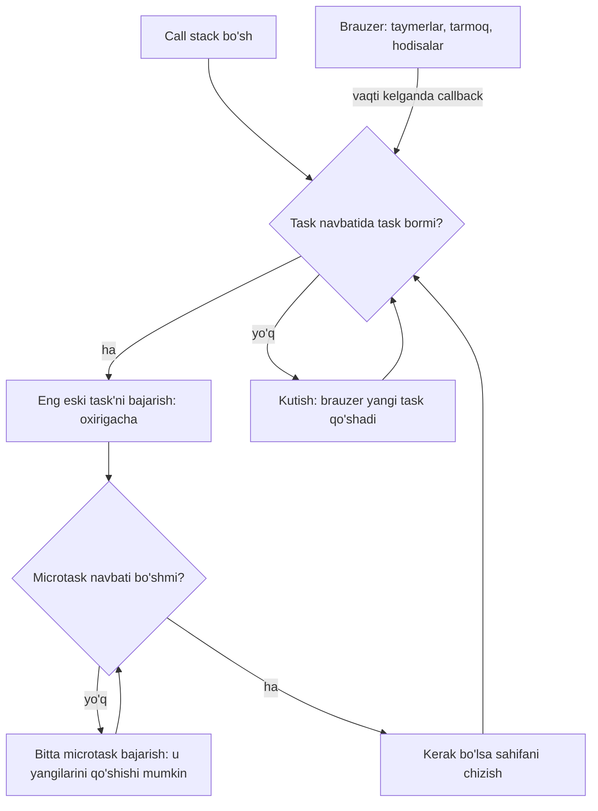
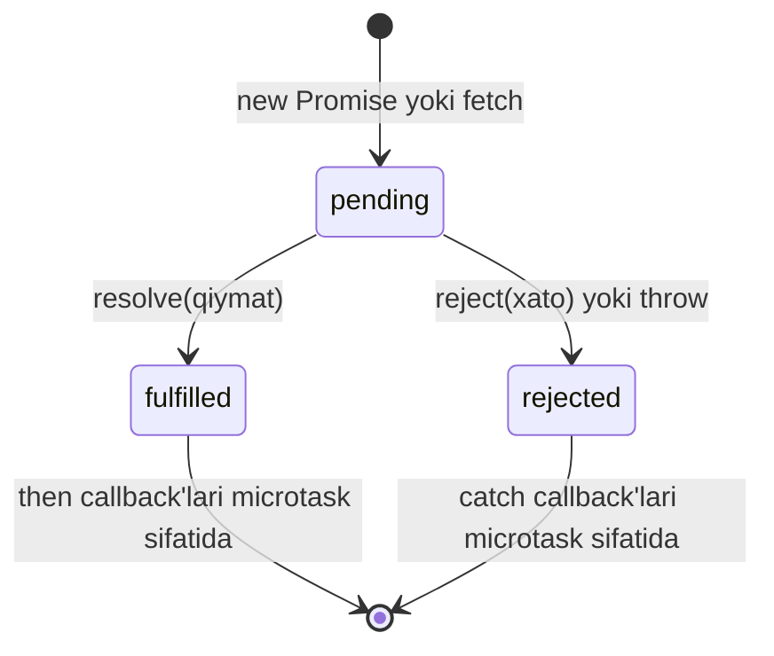

## Bu dars nima uchun kerak

45-darsda `addEventListener` bilan funksiyani "keyinroq chaqirish uchun" brauzerga topshirdik va skript tugagandan keyin ham sahifa hodisalarga javob berishini ko'rdik. Lekin bu qanday ishlaydi? JavaScript bitta thread'da ishlaydi: bir vaqtda faqat bitta funksiya bajariladi. Shu bitta thread serverdan javob kutayotganda, foydalanuvchi tugma bossa nima bo'ladi? Taymer, tarmoq javobi va click bir vaqtda kelsa, qaysi biri birinchi bajariladi?

C da (26-dars) `fread` chaqirilganda dastur fayl o'qilguncha shu qatorda to'xtab turar edi. Python'da ham `input()` yoki tarmoq so'rovi shunday "bloklaydi". Brauzerda bu mumkin emas: 2 soniyalik so'rov paytida sahifa qotib qolsa, foydalanuvchi uni buzilgan deb o'ylaydi. Shuning uchun brauzerdagi JavaScript butunlay boshqa modelga qurilgan: kutish ishini brauzerning o'zi bajaradi, natija tayyor bo'lganda esa bajariladigan funksiya navbatga qo'yiladi. Navbatlarni boshqaradigan mexanizm - **event loop**.

Bu dars shu mexanizmni ichidan ochadi, keyin uning ustiga qurilgan vositalarni o'rganadi: callback, Promise, `async`/`await`, serverdan ma'lumot olish uchun `fetch` va ma'lumot almashish formati JSON. 47-50-darslarda Flask serverini yozganimizda, brauzer tomoni aynan shu vositalar bilan u bilan gaplashadi.

Bu darsdan keyin siz:

- JavaScript nima uchun bitta thread'da ishlashini va call stack (18-dars) bilan event loop qanday bog'liqligini tushuntira olasiz;
- task (macrotask) va microtask navbatlarini farqlab, `console.log`, `setTimeout(..., 0)`, `Promise.then` va `queueMicrotask` aralash kodining natija tartibini oldindan ayta olasiz;
- uzoq sinxron hisob nega sahifani muzlatishini va uni qanday bo'laklarga bo'lishni bilasiz;
- callback, Promise (pending, fulfilled, rejected) va `async`/`await` ni, shuningdek `Promise.all`, `allSettled`, `race` ni ishlatib xatolarni to'g'ri ushlay olasiz;
- `fetch` bilan ishlay olasiz va 404 yoki 500 javobda `fetch` nima uchun reject qilmasligini bilasiz;
- JSON formatini, `JSON.stringify` / `JSON.parse` ni va ularning Python `json` modulidan farqini bilasiz;
- CORS nima ekanini qisqa tushuntira olasiz.

## Bitta thread va call stack

18-darsda C dagi **call stack** ni ko'rdik: funksiya chaqirilganda stack'ga uning frame'i qo'shiladi, qaytganda olib tashlanadi. JavaScript engine'ida ham xuddi shunday call stack bor, va u **bitta**. Brauzer sahifasining asosiy (main) thread'i bitta JavaScript kodini bajaradi, va shu thread sahifani chizish (layout, paint) hamda foydalanuvchi hodisalarini qayta ishlash bilan ham band. Natija oddiy: stack'da biror funksiya ishlayotgan ekan, boshqa hech narsa - na boshqa listener, na taymer, na ekranni yangilash - bajarilmaydi.

Bu qoida **run-to-completion** (oxirigacha bajarish) deyiladi: boshlangan funksiya, hatto u 10 soniya ishlasa ham, oxirigacha bajariladi va uni hech kim o'rtasida to'xtatmaydi. 39-darsdagi race condition'ni eslang: ikki thread bitta o'zgaruvchini bir vaqtda o'zgartirgani uchun yangilanish yo'qolgan edi. JavaScript'da bitta funksiya ichida bunday muammo yo'q - u ishlayotganda hech kim aralashmaydi. 35-darsdagi Python GIL ham bir vaqtda faqat bitta thread'ga bytecode bajarishga ruxsat beradi, lekin Python thread'larni o'zi almashtirib turadi; JavaScript'da esa almashtirish yo'q, faqat navbat bor.

Unda `setTimeout(f, 1000)` qanday ishlaydi? Bir soniyani JavaScript emas, **brauzer** sanaydi. Taymerlar, tarmoq so'rovlari, fayl o'qish - bularni brauzer o'z ichki thread'larida, JavaScript bilan parallel bajaradi. JavaScript faqat "ish tugaganda shu funksiyani chaqir" deb topshiradi. Vaqt kelganda brauzer funksiyani to'g'ridan-to'g'ri chaqirmaydi (stack band bo'lishi mumkin), balki uni **navbatga** qo'yadi. Navbatdan stack'ga olib o'tadigan mexanizm - event loop.

## Event loop: task va microtask navbatlari

HTML standarti event loop'ni algoritm sifatida ta'riflaydi. Soddalashtirilgan ko'rinishi:

1. **Task navbatidan** eng eski task'ni olib, uni oxirigacha bajarish. Task - skriptning o'zi (sahifa yuklanganda), `setTimeout` / `setInterval` callback'i, foydalanuvchi hodisasi (click, keydown), tarmoqdan kelgan xabar. Ko'p manbalarda task **macrotask** deb ham ataladi.
2. Stack bo'shagach, **microtask navbatini to'liq bo'shatish**: navbatdagi barcha microtask'larni bajarish, shu jarayonda yangi qo'shilganlarini ham. Microtask - Promise'ning `then` / `catch` / `finally` callback'lari, `await` dan keyingi davom, `queueMicrotask(f)`.
3. Kerak bo'lsa, sahifani qayta chizish (brauzer odatda ekran yangilanish chastotasiga, masalan sekundiga 60 marta, moslashadi).
4. 1-qadamga qaytish.



Asosiy farq: bitta task'dan keyin **bitta** keyingi task emas, balki **barcha** microtask'lar bajariladi. Shuning uchun Promise callback'i har doim `setTimeout(..., 0)` dan oldin ishlaydi, hatto taymer avvalroq qo'yilgan bo'lsa ham.

### Klassik misol

Quyidagi kodning natija tartibini oldindan aytib ko'ring, keyin ishga tushiring:

```js run
console.log("1: sinxron kod boshlandi");

setTimeout(() => {
  console.log("6: setTimeout A (task)");
  Promise.resolve().then(() => console.log("7: A ichidagi microtask"));
}, 0);
setTimeout(() => console.log("8: setTimeout B (task)"), 0);

Promise.resolve()
  .then(() => console.log("3: then (microtask)"))
  .then(() => console.log("5: ikkinchi then (microtask)"));
queueMicrotask(() => console.log("4: queueMicrotask"));

console.log("2: sinxron kod tugadi");

// Playground blok tugashi bilan worker'ni to'xtatadi: taymerlar ulgurishi uchun kutamiz
await new Promise((resolve) => setTimeout(resolve, 50));
```

Natija:

```text
1: sinxron kod boshlandi
2: sinxron kod tugadi
3: then (microtask)
4: queueMicrotask
5: ikkinchi then (microtask)
6: setTimeout A (task)
7: A ichidagi microtask
8: setTimeout B (task)
```

Qadamma-qadam:

| Qadam | Bajarilayotgan narsa | Chiqish | Microtask navbati | Task navbati |
|---|---|---|---|---|
| 1 | Skript (1-task): `console.log` | 1 | - | - |
| 2 | Ikki `setTimeout` | - | - | A, B |
| 3 | `Promise.resolve().then(...)`, `queueMicrotask` | - | then-3, qm-4 | A, B |
| 4 | `console.log`, skript tugadi | 2 | then-3, qm-4 | A, B |
| 5 | Microtask: then-3; u keyingi `then` ni navbatga qo'yadi | 3 | qm-4, then-5 | A, B |
| 6 | Microtask: qm-4, keyin then-5; navbat bo'sh | 4, 5 | - | A, B |
| 7 | Task A; u yangi microtask qo'yadi | 6 | then-7 | B |
| 8 | Task A dan keyin microtask'lar: then-7 | 7 | - | B |
| 9 | Task B | 8 | - | - |

E'tibor bering: 5-qatordagi ikkinchi `then` birinchisi bajarilgandan keyingina navbatga tushdi, lekin baribir `setTimeout` dan oldin ishladi, chunki microtask navbati to'liq bo'shatiladi. 7-qadamdagi microtask ham B task'idan oldin bajarildi: har bir task'dan keyin microtask navbati yana bo'shatiladi.

Blok oxiridagi `await` haqida: bu darsning playground'i kodni Web Worker'da ishga tushiradi va kod tugashi bilan worker'ni to'xtatadi. `setTimeout` callback'lari kelajakdagi task'lar, shuning uchun ular ulgurishi uchun 50 ms kutamiz. Brauzer sahifasida yoki Node.js da bu qator kerak emas: dastur navbatda task bor ekan yashaydi.

### setTimeout(f, 0) - "nol" emas

`setTimeout(f, 0)` "darhol" emas, balki "joriy task va barcha microtask'lar tugagach, navbatga qo'y" degani. Kechikish argumenti - **minimal** kutish vaqti, kafolat emas: oldinda uzun task'lar bo'lsa, callback ancha kechroq ishlaydi. Bundan tashqari HTML standarti bo'yicha ichma-ich `setTimeout` chaqiruvlari 5 marta takrorlangandan keyin brauzer minimal kechikishni 4 ms qilib qo'yadi. Faol bo'lmagan (fon) varaqlardagi taymerlarni brauzerlar yanada sekinlashtiradi.

### Microtask navbatini to'ldirib yubormang

Microtask navbati to'liq bo'shatilmaguncha keyingi task ham, sahifani chizish ham boshlanmaydi. Agar har bir microtask yangisini qo'shsa (masalan, o'zini cheksiz `queueMicrotask` qiladigan funksiya), event loop hech qachon 3-qadamga yetmaydi va sahifa xuddi cheksiz `while` siklidagidek qotadi. `setTimeout` bilan qo'yilgan cheksiz zanjir esa bunday qilmaydi: har bir taymer alohida task, ular orasida brauzer hodisalarni qayta ishlaydi va ekranni chizadi.

## Uzoq sinxron hisob sahifani muzlatadi

Event loop'ning eng muhim amaliy oqibati: agar bitta task uzoq ishlasa, uning vaqtida **hech narsa** bo'lmaydi - tugmalar bosilmaydi, animatsiya to'xtaydi, matn maydoniga yozib bo'lmaydi. Brauzerlar 50 ms dan uzoq task'ni "uzun task" deb hisoblaydi, chunki undan keyin foydalanuvchi kechikishni seza boshlaydi; ekran sekundiga 60 marta yangilansa, bitta kadrga atigi 1000 / 60 ≈ 16.7 ms to'g'ri keladi.

Quyidagi sahifada har 50 ms da soat yangilanadi (`setInterval` - har safar yangi task). Ikkala tugma ham taxminan 800 ms protsessor vaqtini oladi: birinchisi bitta uzun task bilan, ikkinchisi 50 ms li 16 ta bo'lak bilan, har bo'lakdan keyin `setTimeout(..., 0)` orqali navbatni brauzerga qaytarib. Sahifa ochilganda namoyish avtomatik bir marta ishlaydi, keyin tugmalarni o'zingiz bosib, soatni kuzating.

```html run
<!doctype html>
<html lang="uz">
<head>
  <meta charset="utf-8">
  <style>
    #clock { font: bold 32px monospace; }
  </style>
</head>
<body>
  <p>Soat: <span id="clock">0</span></p>
  <button id="block">Bloklovchi hisob (800 ms)</button>
  <button id="chunked">Bo'laklangan hisob (800 ms)</button>
  <script>
    // Har 50 ms da soat yangilanadi - bu ham event loop'dagi task
    let ticks = 0;
    setInterval(() => {
      ticks += 1;
      document.querySelector("#clock").textContent = ticks;
    }, 50);

    // ms millisekund davomida protsessorni band qiladigan "og'ir hisob"
    function busy(ms) {
      const end = performance.now() + ms;
      let n = 0;
      while (performance.now() < end) n += 1;
      return n;
    }

    function blocking() {
      const before = ticks;
      const t0 = performance.now();
      setTimeout(() => {
        console.log(`setTimeout(0) ${Math.round((performance.now() - t0) / 100) * 100} ms dan keyin ishladi`);
      }, 0);
      busy(800);
      console.log(`bloklovchi: 800 ms davomida soat ${ticks - before} marta yangilandi`);
    }

    async function chunked() {
      const before = ticks;
      for (let i = 0; i < 16; i++) {
        busy(50);
        await new Promise((resolve) => setTimeout(resolve, 0)); // navbatni brauzerga beramiz
      }
      console.log(`bo'laklangan: soat ${ticks - before} marta yangilandi`);
    }

    document.querySelector("#block").addEventListener("click", blocking);
    document.querySelector("#chunked").addEventListener("click", chunked);

    // Avtomatik namoyish: avval bloklovchi, keyin bo'laklangan
    setTimeout(async () => {
      blocking();
      await new Promise((resolve) => setTimeout(resolve, 100));
      await chunked();
    }, 100);
  </script>
</body>
</html>
```

Taxminiy natija (raqamlar kompyuter tezligiga qarab farq qiladi):

```text
bloklovchi: 800 ms davomida soat 0 marta yangilandi
setTimeout(0) 800 ms dan keyin ishladi
bo'laklangan: soat 13 marta yangilandi
```

Bloklovchi variantda soat **nol** marta yangilandi va "0 ms" li taymer 800 ms kutdi: `busy` tugamaguncha event loop navbatga umuman qaramadi. Bo'laklangan variantda esa bo'laklar orasida interval task'lari bajarildi; ideal holda 800 / 50 = 16 marta, amalda biroz kamroq, chunki taymer va bo'laklar navbatda almashinib turadi. Umumiy hisob vaqti deyarli bir xil, lekin sahifa "tirik" qoldi.

Bo'laklash - yarim yechim. Haqiqatan og'ir hisob (rasmni qayta ishlash, katta faylni tahlil qilish) uchun brauzerda **Web Worker** bor: alohida thread, o'z call stack'i va event loop'i bilan, sahifa bilan esa xabar almashib gaplashadi. Bu darsdagi `js run` bloklari aynan Worker'da ishlaydi - shuning uchun ulardagi cheksiz sikl darsning sahifasini qotirmaydi.

## Callback'dan Promise'gacha

### Callback va "callback hell"

Asinxron natijani qaytarishning eng oddiy usuli - **callback**: natija tayyor bo'lganda chaqiriladigan funksiyani argument qilib berish. `addEventListener` va `setTimeout` aynan shunday. Node.js'ning eski API'lari ham shu uslubda: birinchi argument xato, ikkinchisi natija.

Muammo ketma-ket bog'liq amallarda boshlanadi. Foydalanuvchini topish, keyin uning mashinasini, keyin mashinaning joylashuvini olish kerak bo'lsin:

```js
getUser(7, (err, user) => {
  if (err) return showError(err);
  getCar(user.carId, (err, car) => {
    if (err) return showError(err);
    getPosition(car.trackerId, (err, pos) => {
      if (err) return showError(err);
      render(car, pos);
    });
  });
});
```

Har bir qadam o'ngga bir pog'ona suriladi - bu shakl **callback hell** (yoki "pyramid of doom") deyiladi. Muammo faqat ko'rinishda emas: xatoni har darajada qo'lda tekshirish kerak (bittasini unutish - xatoni jimgina yo'qotish), ikki so'rovni parallel yuborib, ikkalasini kutish uchun esa hisoblagich va bayroqlar yozishga to'g'ri keladi.

### Promise

**Promise** - kelajakda tayyor bo'ladigan natijani ifodalovchi obyekt. U uchta holatdan birida bo'ladi:

- **pending** (kutilmoqda) - natija hali yo'q;
- **fulfilled** (bajarildi) - qiymat bilan muvaffaqiyatli tugadi;
- **rejected** (rad etildi) - xato (sabab, odatda `Error`) bilan tugadi.

Fulfilled yoki rejected holatdagi Promise **settled** (hal bo'lgan) deyiladi. Holat faqat bir marta o'zgaradi: settled Promise hech qachon qayta pending bo'lmaydi va qiymatini o'zgartirmaydi.



`p.then(f)` Promise fulfilled bo'lganda `f` ni chaqiradi, `p.catch(g)` - rejected bo'lganda, `p.finally(h)` - har ikki holatda. Eng muhim xususiyat: `then` **yangi Promise qaytaradi**, va `f` qaytargan qiymat (yoki Promise) shu yangi Promise'ning natijasi bo'ladi. Shuning uchun piramida o'rniga tekis zanjir yoziladi, zanjirning istalgan joyidagi xato esa oxiridagi bitta `catch` ga tushadi - xuddi 33-darsdagi exception stack bo'ylab yuqoriga ko'tarilgani kabi.

### async va await

`async` funksiya har doim Promise qaytaradi: `return x` - Promise `x` bilan fulfilled, `throw e` - Promise `e` bilan rejected. Uning ichida `await p` yoziladi: funksiya `p` hal bo'lguncha **to'xtaydi**, keyin natija bilan davom etadi; `p` rejected bo'lsa, `await` qatori xatoni `throw` qiladi va uni oddiy `try` / `catch` bilan ushlash mumkin.

Muhim nozik joy: `await` thread'ni emas, faqat **shu funksiyani** to'xtatadi. Funksiya stack'dan chiqib ketadi, event loop boshqa task'larni bajarishda davom etadi; Promise hal bo'lgach, funksiyaning davomi microtask sifatida navbatga qo'yiladi. Shuning uchun `await` C dagi bloklovchi `fread` dan farqli, sahifani qotirmaydi. `async`/`await` - Promise ustidagi qulay sintaksis: kod sinxron ko'rinadi, ichkarida esa o'sha `then` zanjiri.

Quyidagi blokda "server" `setTimeout` bilan simulyatsiya qilingan; bir xil oqim avval `then` zanjiri, keyin `async`/`await` bilan yozilgan:

```js run
// Soxta "server": har so'rov 20 ms dan keyin javob beradi
const db = {
  users: { 7: { name: "Ali", carId: 3 } },
  cars: { 3: { plate: "01A123BC", trackerId: 11 } },
  positions: { 11: { lat: 41.31, lon: 69.28 } },
};
const request = (table, id) =>
  new Promise((resolve, reject) => {
    setTimeout(() => {
      const row = db[table][id];
      if (row) resolve(row);
      else reject(new Error(`${table}/${id} topilmadi`));
    }, 20);
  });

// 1. then zanjiri: har then yangi Promise qaytaradi
await request("users", 7)
  .then((user) => request("cars", user.carId))
  .then((car) => request("positions", car.trackerId))
  .then((pos) => console.log(`then: ${pos.lat}, ${pos.lon}`))
  .catch((err) => console.log(`then xato: ${err.message}`));

// 2. Xuddi shu oqim async/await bilan
async function findCar(userId) {
  const user = await request("users", userId);
  const car = await request("cars", user.carId);
  const pos = await request("positions", car.trackerId);
  return `${car.plate}: ${pos.lat}, ${pos.lon}`;
}

console.log(`await: ${await findCar(7)}`);

const p = findCar(8);
console.log(`async funksiya qaytargani Promise: ${p instanceof Promise}`);
try {
  await p;
} catch (err) {
  console.log(`try/catch ushladi: ${err.message}`);
}
```

Natija:

```text
then: 41.31, 69.28
await: 01A123BC: 41.31, 69.28
async funksiya qaytargani Promise: true
try/catch ushladi: users/8 topilmadi
```

`new Promise((resolve, reject) => ...)` - callback uslubidagi API'ni Promise'ga o'rash usuli: ichidagi funksiya darhol chaqiriladi va ish tugaganda `resolve` yoki `reject` ni chaqiradi.

### Xatolarni ushlash

Asinxron xatolar sinxronlariga qaraganda osonroq yo'qoladi. Uchta qoida:

1. **`await` siz `try` hech narsani ushlamaydi.** `try { request("users", 8); } catch ...` - funksiya Promise qaytaradi va darhol chiqib ketadi; xato keyinroq, `try` bloki allaqachon tugagandan keyin sodir bo'ladi. To'g'risi - `await request(...)` yoki `.catch(...)`.
2. **Ushlanmagan rejection.** Hech kim `catch` qilmagan rejected Promise brauzer konsolida "Uncaught (in promise)" xatosi bo'lib chiqadi, Node.js esa sukut bo'yicha bunday holatda jarayonni xato bilan to'xtatadi. Har bir Promise zanjiri `catch` yoki `try`/`await` bilan tugashi kerak.
3. **Xatoni yutib yubormang.** `catch (e) {}` yoki `.catch(() => {})` xatoni yo'qotadi va keyinroq tushunarsiz `undefined` ga aylanadi. Kamida log qiling yoki foydalanuvchiga xabar ko'rsating.

## Promise kombinatorlari: parallel kutish

Bir nechta mustaqil so'rov bo'lsa, ularni ketma-ket `await` qilish vaqtni behuda sarflaydi: uchta 100 ms li so'rov ketma-ket 300 ms, parallel esa taxminan 100 ms oladi. Parallel kutish uchun `Promise` ning statik metodlari bor:

| Metod | Qachon fulfilled | Qachon rejected | Natija | Qachon ishlatiladi |
|---|---|---|---|---|
| `Promise.all(ps)` | Hammasi fulfilled bo'lganda | Birinchi rejection'da darhol (fail-fast) | Qiymatlar massivi, **kirish tartibida** | Hammasi kerak: biri yo'q bo'lsa, natija ma'nosiz |
| `Promise.allSettled(ps)` | Hammasi settled bo'lganda (doim) | Hech qachon | `{status, value}` yoki `{status, reason}` massivi | Har birining natijasi alohida kerak (qisman muvaffaqiyat) |
| `Promise.race(ps)` | Birinchi settled fulfilled bo'lsa | Birinchi settled rejected bo'lsa | Birinchi hal bo'lganning natijasi | Timeout: so'rov va taymer poygasi |
| `Promise.any(ps)` | Birinchi fulfilled'da | Hammasi rejected bo'lsa (`AggregateError`) | Birinchi muvaffaqiyatli qiymat | Bir nechta zaxira manbadan eng tezi |

```js run
const delay = (ms, value, fail = false) =>
  new Promise((resolve, reject) =>
    setTimeout(() => (fail ? reject(new Error(value)) : resolve(value)), ms));
let start = Date.now();
// O'tgan vaqt, 100 ms gacha yaxlitlangan (taymerlar bir necha ms kechikishi mumkin)
const t = () => `${Math.round((Date.now() - start) / 100) * 100} ms`;

const all = await Promise.all([delay(100, "A"), delay(300, "B"), delay(200, "C")]);
console.log(`all: ${all.join(", ")} (${t()})`);

start = Date.now();
try {
  await Promise.all([delay(100, "A"), delay(200, "C tushdi", true), delay(300, "B")]);
} catch (err) {
  console.log(`all xato: ${err.message} (${t()})`);
}

start = Date.now();
const settled = await Promise.allSettled([delay(100, "A"), delay(200, "C tushdi", true)]);
const report = settled.map((r) => (r.status === "fulfilled" ? `ok ${r.value}` : `xato ${r.reason.message}`));
console.log(`allSettled: ${report.join(" | ")} (${t()})`);

start = Date.now();
const winner = await Promise.race([delay(300, "sekin"), delay(100, "tez")]);
console.log(`race: ${winner} (${t()})`);

// Ketma-ket va parallel await
start = Date.now();
const a1 = await delay(100, 1);
const a2 = await delay(100, 2);
const a3 = await delay(100, 3);
console.log(`ketma-ket: ${a1 + a2 + a3} (${t()})`);

start = Date.now();
const [b1, b2, b3] = await Promise.all([delay(100, 1), delay(100, 2), delay(100, 3)]);
console.log(`parallel: ${b1 + b2 + b3} (${t()})`);
```

Natija:

```text
all: A, B, C (300 ms)
all xato: C tushdi (200 ms)
allSettled: ok A | xato C tushdi (200 ms)
race: tez (100 ms)
ketma-ket: 6 (300 ms)
parallel: 6 (100 ms)
```

Uchta kuzatuv. Birinchidan, `all` natijasi B eng oxirida tugagan bo'lsa ham `A, B, C` tartibida - kirish tartibi saqlanadi. Ikkinchidan, `all` xatoda 200 ms da reject qildi va 300 ms li B ni kutmadi; lekin B ning taymeri **bekor qilinmadi**, u baribir ishlab tugadi. Promise - natijani kutish vositasi, ishni boshqarish emas: so'rovni haqiqatan to'xtatish uchun alohida mexanizm (`fetch` uchun `AbortController`) kerak. Uchinchidan, parallel variant vaqtni eng sekin so'rovgacha qisqartirdi: n ta mustaqil so'rov uchun n · t o'rniga taxminan max(t).

## fetch: serverdan ma'lumot olish

`fetch(url, options)` - brauzerning (va Node.js 18 dan beri Node'ning ham) HTTP so'rov yuborish funksiyasi. U darhol Promise qaytaradi, Promise esa server **javob sarlavhalarini** yuborgach `Response` obyekti bilan fulfilled bo'ladi. 42-darsdagi HTTP javobining hamma qismlari shu obyektda:

- `response.status` - status kod (200, 404, 500), `response.statusText`;
- `response.ok` - status 200-299 oralig'ida bo'lsa `true`;
- `response.headers.get("content-type")` - sarlavhalar;
- tana: `await response.json()` (JSON deb o'qib, obyektga aylantiradi), `await response.text()`. Bular ham Promise qaytaradi, chunki tana sarlavhalardan keyin, bo'laklab kelishi mumkin. Tanani faqat bir marta o'qish mumkin.

Eng ko'p uchraydigan xato: **`fetch` 404 yoki 500 javobda reject qilmaydi.** Server javob berdimi - demak HTTP almashinuvi muvaffaqiyatli bo'ldi, va Promise `ok: false` bo'lgan `Response` bilan fulfilled bo'ladi. `fetch` faqat javob umuman olinmaganda reject qiladi: tarmoq yo'q, DNS topilmadi (41-dars), URL noto'g'ri, CORS ruxsat bermadi. Shuning uchun har bir `fetch` dan keyin `response.ok` ni tekshirish kerak.

Bu darsning sandbox muhitida tashqi serverlarga so'rov ishonchsiz, shuning uchun misolda ikkita tarmoqsiz usuldan foydalanamiz. **`data:` URL** - javob tanasi URL'ning o'zida turadi (`data:<media turi>,<ma'lumot>`), `fetch` uni xuddi serverdan kelgandek 200 status bilan qaytaradi. Ikkinchisi - `new Response(tana, { status, headers })` bilan javob obyektini o'zimiz yasash: shu orqali 404 ni simulyatsiya qilamiz. Haqiqiy server 404 qaytarganda `fetch` aynan shunday `Response` bilan fulfilled bo'ladi.

```js run
// 1. data: URL - javob tarmoqsiz, URL ichida turadi
const url = 'data:application/json,{"plate":"01A123BC","km":1250}';
const res = await fetch(url);
console.log(`status: ${res.status}, ok: ${res.ok}, type: ${res.headers.get("content-type")}`);
const car = await res.json();
console.log(`json(): ${car.plate}, ${car.km + 100} km`);

// 2. Soxta server: Response obyektini o'zimiz yaratamiz
const cars = { 1: { plate: "01A123BC" } };
async function fakeFetch(path) {
  await new Promise((r) => setTimeout(r, 10));
  const id = Number(path.split("/").pop());
  const body = cars[id] ? { car: cars[id] } : { error: "topilmadi" };
  return new Response(JSON.stringify(body), {
    status: cars[id] ? 200 : 404,
    headers: { "Content-Type": "application/json" },
  });
}

const notFound = await fakeFetch("/api/cars/99");
console.log(`404 da fetch reject qilmadi: status ${notFound.status}, ok ${notFound.ok}`);

// 3. To'g'ri yordamchi: ok ni tekshiradi
async function getJson(fetchFn, path) {
  const r = await fetchFn(path);
  if (!r.ok) throw new Error(`HTTP ${r.status} (${path})`);
  return r.json();
}
for (const path of ["/api/cars/1", "/api/cars/99"]) {
  try {
    const data = await getJson(fakeFetch, path);
    console.log(`${path}: ${data.car.plate}`);
  } catch (err) {
    console.log(`${path}: ${err.message}`);
  }
}

// 4. Tarmoq xatosi va buzilgan JSON - bular reject qiladi
try {
  await fetch("nosuchscheme://example");
} catch (err) {
  console.log(`tarmoq darajasidagi xato: ${err.name}`);
}
try {
  await new Response("{buzilgan").json();
} catch (err) {
  console.log(`buzilgan JSON: ${err.name}`);
}
```

Natija:

```text
status: 200, ok: true, type: application/json
json(): 01A123BC, 1350 km
404 da fetch reject qilmadi: status 404, ok false
/api/cars/1: 01A123BC
/api/cars/99: HTTP 404 (/api/cars/99)
tarmoq darajasidagi xato: TypeError
buzilgan JSON: SyntaxError
```

Xato turlari chiqarildi, matnlari emas: xato matni brauzerdan brauzerga farq qiladi (masalan, Chrome'da tarmoq xatosi "Failed to fetch", Node.js da "fetch failed"), turi esa standart bilan belgilangan.

### Ma'lumot yuborish

`fetch` sukut bo'yicha `GET` yuboradi. Serverga JSON yuborish uchun metod, sarlavha va tana beriladi (42-darsdagi `POST` va `Content-Type`):

```js
const response = await fetch("/api/refuel", {
  method: "POST",
  headers: { "Content-Type": "application/json" },
  body: JSON.stringify({ plate: "01A123BC", liters: 42.5 }),
});
if (!response.ok) throw new Error(`HTTP ${response.status}`);
const saved = await response.json();
```

45-darsdagi formani endi `preventDefault()` dan keyin shu tarzda yuborish mumkin: sahifa qayta yuklanmaydi, server javobi esa DOM'ga qo'shiladi. 49-darsda Flask tomonini yozamiz.

## JSON: ma'lumot almashish formati

**JSON** (JavaScript Object Notation) - JavaScript obyekt literallaridan olingan, lekin tildan mustaqil **matn** formati, RFC 8259 bilan standartlashtirilgan. Unda faqat oltita turdagi qiymat bor: obyekt `{}`, massiv `[]`, satr (faqat qo'shtirnoq `"..."`), son, `true` / `false` va `null`. Shuning uchun u deyarli har bir til o'qiy oladigan umumiy til bo'lib qoldi: brauzer, Flask serveri va mobil ilova bir-biri bilan JSON matni orqali gaplashadi.

JavaScript obyekt literalidan farqlari, ya'ni JSON'da **bo'lmaydigan** narsalar: kalitlar qo'shtirnoqsiz (`{a: 1}`), bitta tirnoq (`'a'`), oxirgi elementdan keyingi vergul, izohlar, `undefined`, funksiyalar, `NaN` va `Infinity` (RFC ularni aniq taqiqlaydi), sana tipi, `BigInt`.

Ikkita funksiya:

- `JSON.stringify(qiymat, null, bo'shliq)` - qiymatni JSON matniga aylantiradi (serialization). Uchinchi argument - chiroyli chiqish uchun chekinish.
- `JSON.parse(matn)` - matnni qiymatga aylantiradi; noto'g'ri matnda `SyntaxError`.

```js run
const trip = {
  plate: "01A123BC",
  liters: 42.5,
  paid: true,
  stops: ["Toshkent", "Samarqand"],
  driver: null,
  note: undefined,
  fuelLeft: NaN,
  started: new Date(Date.UTC(2026, 10, 3, 8, 30)),
  calc() { return 1; },
};
const text = JSON.stringify(trip);
console.log(text);
console.log(`typeof: ${typeof text}, uzunlik: ${text.length}`);

const back = JSON.parse(text);
console.log(`started tipi: ${typeof back.started}, stops[1]: ${back.stops[1]}, "note" in back: ${"note" in back}`);

console.log(JSON.stringify({ a: [1, 2], b: { c: "d" } }, null, 2));

for (const bad of ["{'a': 1}", '{"a": 1,}', "{a: 1}"]) {
  try {
    JSON.parse(bad);
  } catch (err) {
    console.log(`${bad} -> ${err.name}`);
  }
}
try {
  JSON.stringify({ id: 10n });
} catch (err) {
  console.log(`BigInt -> ${err.name}`);
}
```

Natija:

```text
{"plate":"01A123BC","liters":42.5,"paid":true,"stops":["Toshkent","Samarqand"],"driver":null,"fuelLeft":null,"started":"2026-11-03T08:30:00.000Z"}
typeof: string, uzunlik: 146
started tipi: string, stops[1]: Samarqand, "note" in back: false
{
  "a": [
    1,
    2
  ],
  "b": {
    "c": "d"
  }
}
{'a': 1} -> SyntaxError
{"a": 1,} -> SyntaxError
{a: 1} -> SyntaxError
BigInt -> TypeError
```

`JSON.stringify` jim ishlaydi va ma'lumotni o'zgartiradi: `undefined` qiymatli kalit va funksiya (`calc`) tashlab yuborildi, `NaN` `null` ga aylandi, `Date` ISO satrga (`toJSON` metodi orqali) aylandi va `parse` dan keyin satr bo'lib qoldi. Ya'ni `JSON.parse(JSON.stringify(x))` har doim ham `x` ning nusxasi emas. Sanalarni JSON'da ISO 8601 satr sifatida yuborib, qabul qiluvchi tomonda `new Date(...)` bilan qayta tiklash odatiy kelishuv. 45-darsda aytilgan katta ID'lar ham shu yerda yo'qoladi: `JSON.parse("9007199254740993")` - `9007199254740992`, shuning uchun API'lar 64-bitli ID'larni ko'pincha satr sifatida yuboradi.

### Python'dagi json moduli

Python'da xuddi shu ish standart kutubxonadagi `json` moduli bilan qilinadi: `json.dumps` (JavaScript'dagi `JSON.stringify`) va `json.loads` (`JSON.parse`), fayllar uchun `json.dump` / `json.load` (34-darsdagi `open` bilan).

```python run
import json
import math

trip = {"plate": "01A123BC", "liters": 42.5, "paid": True,
        "stops": ("Toshkent", "Samarqand"), "driver": None, 7: "kalit son"}
text = json.dumps(trip)
print(text)
back = json.loads(text)
print("stops tipi:", type(back["stops"]).__name__, "| kalitlar:", list(back))

print(json.dumps(float("nan")), json.dumps({"x": math.inf}))
try:
    json.dumps(float("nan"), allow_nan=False)
except ValueError as e:
    print("allow_nan=False ->", type(e).__name__)

print(json.dumps("Тошкент"), json.dumps("Тошкент", ensure_ascii=False))
try:
    json.loads('{"a": 1,}')
except json.JSONDecodeError as e:
    print("ortiqcha vergul ->", type(e).__name__)
print(json.loads("[NaN, 1e400]"))
```

Natija:

```text
{"plate": "01A123BC", "liters": 42.5, "paid": true, "stops": ["Toshkent", "Samarqand"], "driver": null, "7": "kalit son"}
stops tipi: list | kalitlar: ['plate', 'liters', 'paid', 'stops', 'driver', '7']
NaN {"x": Infinity}
allow_nan=False -> ValueError
"Тошкент" "Тошкент"
ortiqcha vergul -> JSONDecodeError
[nan, inf]
```

| Masala | JavaScript `JSON` | Python `json` |
|---|---|---|
| Matnga / matndan | `JSON.stringify` / `JSON.parse` | `json.dumps` / `json.loads` |
| `null` | `null` | `None` |
| Massiv | `Array` | `list` (tuple ham `list` bo'lib yoziladi) |
| Son kalitli obyekt | Kalitlar baribir satr | `7` kalit `"7"` ga aylanadi, qaytib `int` bo'lmaydi |
| `NaN`, `Infinity` yozish | `null` ga aylanadi (jim) | Sukut bo'yicha `NaN` deb yozadi - bu standart JSON emas; `allow_nan=False` - `ValueError` |
| Yozib bo'lmaydigan qiymat | `undefined` va funksiya tashlab yuboriladi, `BigInt` - `TypeError` | `TypeError` (masalan, `set`, `datetime`) |
| Katta butun son | 2⁵³ dan keyin aniqlik yo'qoladi | `int` aniq saqlanadi |
| ASCII bo'lmagan belgilar | O'zicha yoziladi | Sukut bo'yicha `\uXXXX`, `ensure_ascii=False` bilan o'zicha |
| Buzilgan matn | `SyntaxError` | `json.JSONDecodeError` (`ValueError` ning bolasi) |

Xavfli farq - `NaN`: Python sukut bo'yicha yozgan `NaN` ni JavaScript'ning `JSON.parse` i qabul qilmaydi va `SyntaxError` beradi. Server tomonda `allow_nan=False` yoki `NaN` ni oldindan `None` ga almashtirish yaxshi odat.

## CORS haqida qisqacha

Brauzer sahifadagi skriptlarga **same-origin policy** (bir xil manba siyosati) qo'llaydi. **Origin** - sxema, host va port uchligi: `https://app.example.uz` va `https://api.example.uz` - har xil origin (host farq qiladi), `http://localhost:5000` va `http://localhost:3000` ham (port farq qiladi). Siyosat bo'yicha bir origin'dagi sahifaning skripti boshqa origin'ga `fetch` yuborishi mumkin, lekin **javobni o'qiy olmaydi** - agar server bunga aniq ruxsat bermasa.

Ruxsat mexanizmi - **CORS** (Cross-Origin Resource Sharing). Server javobga `Access-Control-Allow-Origin: https://app.example.uz` (yoki ochiq API uchun `*`) sarlavhasini qo'shadi, brauzer esa uni ko'rib, javobni skriptga beradi. Sarlavha bo'lmasa, `fetch` `TypeError` bilan reject qiladi va konsolda CORS xatosi chiqadi. "Oddiy" bo'lmagan so'rovlardan oldin (masalan, `Content-Type: application/json` bilan `POST` yoki `PUT`, `DELETE`) brauzer avval `OPTIONS` metodli **preflight** so'rov yuborib, server shu metod va sarlavhalarga ruxsat berishini so'raydi.

Uch muhim nuqta:

- CORS - **brauzerning** himoyasi, foydalanuvchini himoya qiladi: begona sayt foydalanuvchining cookie'lari bilan uning bankidagi ma'lumotni o'qiy olmasligi uchun. `curl`, Python skripti yoki boshqa server CORS ni umuman tekshirmaydi.
- CORS xatosini **mijoz tomonda tuzatib bo'lmaydi**: ruxsat serverning javob sarlavhalarida beriladi.
- Bu darsning playground sahifasi sandbox'li iframe'da "null" origin bilan ishlaydi, shuning uchun CORS ruxsati bo'lmagan tashqi serverga `fetch` aynan shu sababdan `TypeError` beradi. `data:` URL va o'zimiz yasagan `Response` tarmoqqa chiqmagani uchun bu cheklovga tushmaydi.

## Mashq: retry, parallel yuklash va timeout

Uchta kichik yordamchi funksiya yozing - ular haqiqiy ilovalarda `fetch` atrofida deyarli har doim kerak bo'ladi:

- `retry(fn, attempts)` - `fn` Promise qaytaradigan funksiya. Uni ko'pi bilan `attempts` marta chaqiring: birinchi muvaffaqiyatli natijani qaytaring; hamma urinish xato bo'lsa, **oxirgi** xatoni tashlang. Muvaffaqiyatdan keyin qayta chaqirmang.
- `loadAll(ids, load)` - har `id` uchun `load(id)` ni **parallel** ishga tushiring va natijalarni `ids` tartibida qaytaring. Bitta xato - butun natija shu xato bilan reject. Boshlang'ich versiya to'g'ri natija beradi, lekin ketma-ket ishlaydi: 5 ta 100 ms li so'rov 500 ms oladi, test esa 250 ms dan kam kutadi.
- `withTimeout(promise, ms)` - `promise` `ms` ichida hal bo'lsa, uning natijasi yoki xatosi; aks holda `new Error("timeout")` bilan reject. Maslahat: `Promise.race` va `setTimeout` ichida `reject` qiladigan ikkinchi Promise.

```js run
// 1. retry(fn, attempts): fn - Promise qaytaradigan funksiya. Uni ko'pi bilan attempts marta chaqiring.
//    Birinchi muvaffaqiyatli natijani qaytaring; hamma urinish xato bo'lsa, OXIRGI xatoni tashlang.
async function retry(fn, attempts) {
  // Yechimingizni shu yerga yozing
  return fn();
}

// 2. loadAll(ids, load): har bir id uchun load(id) ni PARALLEL ishga tushiring
//    va natijalarni ids tartibida qaytaring. Bitta xato - butun natija xato.
async function loadAll(ids, load) {
  // Bu versiya to'g'ri natija beradi, lekin so'rovlarni ketma-ket yuboradi
  const results = [];
  for (const id of ids) {
    results.push(await load(id));
  }
  return results;
}

// 3. withTimeout(promise, ms): promise ms ichida tugasa - uning natijasi (yoki xatosi),
//    aks holda new Error("timeout") bilan reject.
function withTimeout(promise, ms) {
  // Yechimingizni shu yerga yozing
  return promise;
}

// Sinab ko'rish
const wait = (ms, value) => new Promise((resolve) => setTimeout(() => resolve(value), ms));
const started = Date.now();
const cars = await loadAll([3, 1, 2], (id) => wait(100, `car${id}`));
console.log(`${cars.join(", ")} - ${Date.now() - started} ms`);
```

```js test
const testSleep = (ms, value, fail = false) =>
  new Promise((resolve, reject) => setTimeout(() => (fail ? reject(new Error(value)) : resolve(value)), ms));

check("retry: 3-urinishda muvaffaqiyat - natija qaytadi, fn 3 marta chaqirilgan", async () => {
  let calls = 0;
  const flaky = async () => {
    calls += 1;
    if (calls < 3) throw new Error(`xato ${calls}`);
    return "ok";
  };
  return (await retry(flaky, 5)) === "ok" && calls === 3;
});
check("retry: birinchi urinish muvaffaqiyatli bo'lsa, fn qayta chaqirilmaydi", async () => {
  let calls = 0;
  const good = async () => {
    calls += 1;
    return 42;
  };
  return (await retry(good, 3)) === 42 && calls === 1;
});
check("retry: hammasi xato bo'lsa, oxirgi xato tashlanadi va fn aynan attempts marta chaqiriladi", async () => {
  let calls = 0;
  const bad = async () => {
    calls += 1;
    throw new Error(`xato ${calls}`);
  };
  try {
    await retry(bad, 4);
    return false;
  } catch (err) {
    return err.message === "xato 4" && calls === 4;
  }
});
check("loadAll: natijalar ids tartibida (javoblar boshqa tartibda kelsa ham)", async () => {
  const result = await loadAll([3, 1, 2], (id) => testSleep(id * 30, `car${id}`));
  return result.join(",") === "car3,car1,car2";
});
check("loadAll: so'rovlar parallel (5 ta x 100 ms taxminan 100 ms da tugashi kerak)", async () => {
  const s = Date.now();
  await loadAll([1, 2, 3, 4, 5], (id) => testSleep(100, id));
  return Date.now() - s < 250;
});
check("loadAll: bitta so'rov xato bo'lsa, natija o'sha xato bilan reject", async () => {
  try {
    await loadAll([1, 2, 3], (id) => (id === 2 ? testSleep(10, "2 topilmadi", true) : testSleep(10, id)));
    return false;
  } catch (err) {
    return err.message === "2 topilmadi";
  }
});
check("withTimeout: vaqtida tugagan promise natijasi qaytadi", async () => {
  return (await withTimeout(testSleep(20, "tez"), 200)) === "tez";
});
check("withTimeout: kechikkan promise Error(\"timeout\") bilan, ms dan keyin darhol reject bo'ladi", async () => {
  const s = Date.now();
  try {
    await withTimeout(testSleep(600, "sekin"), 50);
    return false;
  } catch (err) {
    return err.message === "timeout" && Date.now() - s < 300;
  }
});
check("withTimeout: promise'ning o'z xatosi o'zgarmasdan o'tadi", async () => {
  try {
    await withTimeout(testSleep(10, "server xatosi", true), 200);
    return false;
  } catch (err) {
    return err.message === "server xatosi";
  }
});
```

Bitta nozik joy: `withTimeout` da taymer ichidagi Promise poygada yutqazsa ham, `setTimeout` o'z vaqtida baribir ishlaydi. Yaxshi yechim `finally` ichida `clearTimeout` chaqiradi. `retry` da esa `return fn()` emas, `return await fn()` yozilishi kerak: `await` siz rejected Promise `try` blokidan chiqib ketadi va `catch` uni ushlamaydi - bu "Xatolarni ushlash" bo'limidagi birinchi qoidaning o'zi.

## Ko'p uchraydigan xatolar

1. **`setTimeout(f, 0)` ni "darhol" deb hisoblash.** U barcha sinxron kod va barcha microtask'lardan keyin, minimal kechikish bilan ishlaydi; oldinda uzun task bo'lsa, ancha kechroq.
2. **Main thread'da uzun sinxron hisob.** 50 ms dan uzun task sahifani qotiradi. Ishni bo'laklang yoki Web Worker'ga o'tkazing.
3. **`fetch` dan keyin `response.ok` ni tekshirmaslik.** 404 va 500 da `fetch` reject qilmaydi; xato sahifaning HTML matni `response.json()` da `SyntaxError` ga aylanib, haqiqiy sababni yashiradi.
4. **`await` ni unutish.** `const data = getJson(url)` - `data` natija emas, Promise; `if (data)` doim truthy. `try` ichidagi `await` siz chaqiruv xatoni ushlamaydi.
5. **Mustaqil so'rovlarni ketma-ket `await` qilish.** n ta so'rov n baravar uzoq. Mustaqil so'rovlar uchun `Promise.all` (yoki qisman muvaffaqiyat kerak bo'lsa `allSettled`).
6. **`forEach` ichida `await`.** `items.forEach(async (x) => await save(x))` hech narsani kutmaydi: `forEach` qaytgan Promise'larni e'tiborsiz qoldiradi. Ketma-ket uchun `for...of` ichida `await`, parallel uchun `Promise.all(items.map(...))`.
7. **`JSON.parse(JSON.stringify(x))` ni to'liq nusxa deb hisoblash.** `undefined`, funksiyalar, `Date`, `NaN`, `BigInt` va katta sonlar yo'qoladi yoki o'zgaradi. Python'dan kelgan `NaN` esa `JSON.parse` ni buzadi.
8. **CORS xatosini mijoz tomonda "tuzatishga" urinish.** Ruxsat serverning `Access-Control-Allow-Origin` sarlavhasida beriladi; brauzer kodida buni chetlab o'tadigan sozlama yo'q.

## Xulosa

- JavaScript bitta call stack'li bitta thread'da ishlaydi va har bir task oxirigacha bajariladi; kutishni brauzer qiladi, tayyor callback'lar esa navbatga qo'yiladi.
- Event loop: bitta task, keyin microtask navbati to'liq bo'shatiladi, keyin chizish. Shuning uchun `Promise.then` va `queueMicrotask` har doim `setTimeout(..., 0)` dan oldin ishlaydi.
- Uzun sinxron hisob butun sahifani muzlatadi: taymerlar, eventlar va chizish kutib turadi. Yechim - bo'laklash yoki Web Worker.
- Promise - pending, fulfilled yoki rejected holatdagi kelajakdagi natija; `then` yangi Promise qaytaradi, zanjirdagi xato bitta `catch` ga tushadi. `async`/`await` - Promise ustidagi sintaksis, `await` faqat funksiyani to'xtatadi, thread'ni emas.
- `Promise.all` - hammasi yoki birinchi xato (tartib saqlanadi), `allSettled` - har birining natijasi, `race` - birinchi hal bo'lgan, `any` - birinchi muvaffaqiyatli.
- `fetch` faqat tarmoq darajasidagi xatoda reject qiladi; 4xx/5xx da `response.ok === false`, uni har doim tekshiring. `response.json()` ham Promise.
- JSON - oltita qiymat turli matn formati; `JSON.stringify` `undefined` va funksiyalarni tashlaydi, `NaN` ni `null` qiladi, `Date` ni satrga aylantiradi. Python `json` sukut bo'yicha `NaN` yozadi va son kalitlarni satrga aylantiradi.
- CORS - brauzer boshqa origin javobini skriptga faqat server `Access-Control-Allow-Origin` bilan ruxsat berganda beradi; bu brauzerning foydalanuvchini himoya qilish mexanizmi.

## Amaliy topshiriq

Avtopark dispetcheri uchun "Mashinalar holati" sahifasini yozing. Haqiqiy server o'rniga o'zingizning `fakeFetch(path)` funksiyangizdan foydalaning: u 50-300 ms tasodifiy kechikish bilan `Response` qaytaradi, 10% hollarda 500 status, mavjud bo'lmagan mashina uchun 404.

1. **API qatlami.** `getJson(path)` yozing: `fakeFetch` ni chaqiradi, `response.ok` ni tekshiradi (xato bo'lsa status bilan `Error`), JSON qaytaradi. 500 xatolarda 3 martagacha qayta urinadi (o'zingizning `retry` ingiz), 404 da qayta urinmaydi - nima uchun bunday farq kerakligini yozing.
2. **Parallel yuklash.** `/api/cars` dan 20 ta mashina ID ro'yxatini oling, keyin har birining holatini (`/api/cars/:id/status`) parallel yuklang. Bitta mashina xatosi butun sahifani buzmasligi uchun qaysi kombinatorni tanlaysiz? Xato bo'lgan mashinalar qatorida "ma'lumot yo'q" ko'rsating.
3. **Timeout va holat.** Har bir so'rovga 1 soniyalik timeout qo'ying (`withTimeout`). Yuklanayotganda sahifada "Yuklanmoqda..." yozuvi, tugagach - jadval va jami vaqt (`performance.now()` bilan) chiqsin. Ketma-ket va parallel yuklash vaqtini o'lchab solishtiring.
4. **Tartibni bashorat qilish.** Kodingizga `console.log`, `setTimeout(..., 0)`, `Promise.resolve().then` va `await` aralash 6-8 qatorli kichik bo'lak qo'shing. Ishga tushirishdan oldin natija tartibini va har bir qatorning qaysi navbatdan (task yoki microtask) kelganini yozing, keyin tekshiring.
5. **JSON.** `fakeFetch` javobiga ataylab `NaN` qiymatli maydon va 2⁵³ dan katta ID qo'shing (Python serveri yuborgandek, matn ko'rinishida). `response.json()` va `JSON.parse` qanday natija berishini ko'rsating va server tomoni uchun to'g'ri yechimni taklif qiling.

Yaxshi javobda bo'lishi kerak bo'lgan narsalar:

- `getJson` da `response.ok` tekshiruvi va `await` bilan `try`/`catch`; 5xx vaqtinchalik bo'lishi mumkin, 4xx esa so'rovning o'zi noto'g'ri ekanini bildiradi, shuning uchun faqat 5xx qayta uriniladi;
- `Promise.allSettled` tanlovi va uning sababi (`Promise.all` birinchi xatoda butun natijani rad etadi), natija tartibi ID tartibiga mosligi;
- `Promise.race` asosidagi timeout, `clearTimeout` bilan; o'lchangan vaqtlar: ketma-ket taxminan yig'indi (20 × o'rtacha kechikish), parallel taxminan eng sekin so'rov;
- 4-qadamda oldindan yozilgan tartib va uning event loop qoidalari (sinxron, keyin barcha microtask'lar, keyin task) bilan izohi;
- `NaN` li JSON `SyntaxError` berishi, katta ID'ning yaxlitlanishi va yechim: serverda `allow_nan=False` yoki `None`, ID'larni satr sifatida yuborish.

Javobingizni pastdagi maydonga yozing va yuqoridagi mezonlar bilan solishtiring.

## Manbalar

- CS50x. [Lecture 8 notes](https://cs50.harvard.edu/x/notes/8/) - "JavaScript" bo'limi: brauzerdagi JavaScript, eventlar va sahifani dinamik yangilash.
- WHATWG. [HTML Standard: Event loops](https://html.spec.whatwg.org/multipage/webappapis.html#event-loops) - task queue, microtask queue, "perform a microtask checkpoint" va rendering qadamlarining rasmiy algoritmi.
- MDN. [Using microtasks in JavaScript with queueMicrotask()](https://developer.mozilla.org/en-US/docs/Web/API/HTML_DOM_API/Microtask_guide) - "Tasks vs. microtasks" bo'limi: qaysi callback'lar task, qaysilari microtask, navbatlar qanday bo'shatiladi; [setTimeout()](https://developer.mozilla.org/en-US/docs/Web/API/Window/setTimeout) - "Reasons for delays longer than specified", "Nested timeouts" (4 ms chegara).
- MDN. [Promise](https://developer.mozilla.org/en-US/docs/Web/JavaScript/Reference/Global_Objects/Promise) - holatlar (pending, fulfilled, rejected, settled), zanjir, `Promise.all`, `allSettled`, `race`, `any`; [Promise.allSettled()](https://developer.mozilla.org/en-US/docs/Web/JavaScript/Reference/Global_Objects/Promise/allSettled).
- MDN. [Window: fetch()](https://developer.mozilla.org/en-US/docs/Web/API/Window/fetch) - HTTP xato statuslarida reject qilmasligi, `Response.ok` va `Response.status`; [Using the Fetch API](https://developer.mozilla.org/en-US/docs/Web/API/Fetch_API/Using_Fetch) - so'rov tanasi, sarlavhalar, javobni o'qish; [Response.ok](https://developer.mozilla.org/en-US/docs/Web/API/Response/ok) - 200-299 oralig'i.
- MDN. [Cross-Origin Resource Sharing (CORS)](https://developer.mozilla.org/en-US/docs/Web/HTTP/Guides/CORS) - origin, `Access-Control-Allow-Origin`, simple request va preflight.
- MDN. [JSON.stringify()](https://developer.mozilla.org/en-US/docs/Web/JavaScript/Reference/Global_Objects/JSON/stringify) - `undefined`, funksiya, `NaN`, `Date` va `BigInt` bilan ishlash; IETF. [RFC 8259](https://www.rfc-editor.org/rfc/rfc8259) - JSON grammatikasi, 6-bo'lim "Numbers" (`NaN` va `Infinity` taqiqlangani).
- Python. [json - JSON encoder and decoder](https://docs.python.org/3/library/json.html) - `dumps`/`loads`, `allow_nan`, `ensure_ascii`, kalitlarning satrga aylanishi va konversiya jadvali.
