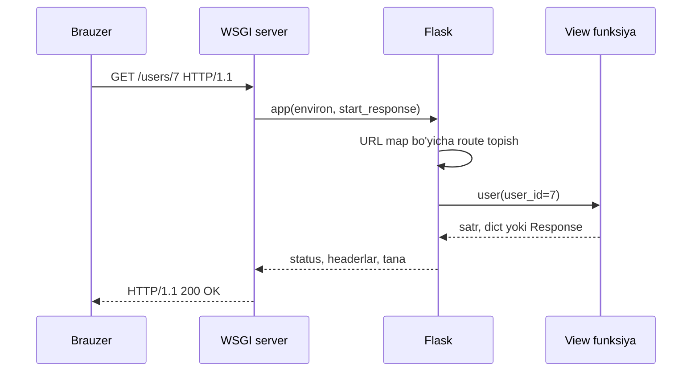
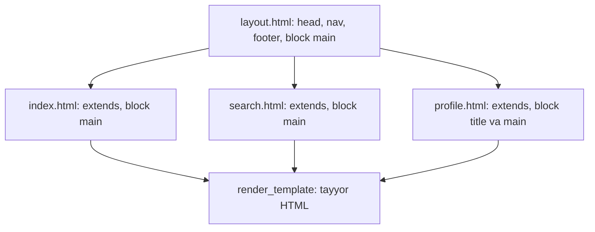

## Bu dars nima uchun kerak

41-42-darslarda brauzer serverga TCP ulanish ochib, HTTP so'rov yuborishini va server status kod, header va tanadan iborat javob qaytarishini ko'rdik. 43-45-darslarda javob tanasining o'zi - HTML, CSS va JavaScript bilan ishladik. Lekin hozirgacha bu sahifalar statik edi: fayl qanday yozilgan bo'lsa, foydalanuvchi shuni oladi. Qidiruv natijasi, foydalanuvchi profili yoki buyurtmalar ro'yxati kabi sahifalarni oldindan yozib qo'yib bo'lmaydi: ular har so'rovda server tomonidagi kod bilan yaratiladi.

Buning uchun serverda uchta ish bajarilishi kerak:

1. **So'rovni tahlil qilish.** Kelgan baytlardan metod (`GET`, `POST`), yo'l (`/users/7`), query string (`?q=flask`) va forma maydonlarini ajratib olish.
2. **Yo'naltirish.** Shu yo'l va metod uchun qaysi kod ishlashini aniqlash.
3. **Javob yasash.** Natijani HTML shabloniga qo'yish, status kod va headerlarni to'g'ri berish.

Har bir loyihada buni noldan yozish - 13-darsda `argv` ni qo'lda tahlil qilganimizga o'xshash, faqat ancha murakkabroq ish. **Web framework** shu takroriy qismni o'z zimmasiga oladi. Bu darsda Python'ning kichik va mashhur frameworki Flask bilan ishlaymiz: 33-darsdagi funksiyalar, modullar va decorator sintaksisi, 32-darsdagi dict va 34-darsdagi satr bilan ishlash shu yerda bir joyga yig'iladi. 48-darsda formalar, cookie va session, 49-darsda 40-darsdagi `sqlite3` bilan to'liq ilova, 50-darsda xavfsizlik keladi.

Bu darsdan keyin siz:

- web framework qanday muammoni hal qilishini va WSGI interfeysi nima ekanini tushuntira olasiz;
- Flask loyihasining tuzilmasini (`app.py`, `templates/`, `static/`) va uni `flask run` bilan ishga tushirishni bilasiz;
- `@app.route` bilan route e'lon qila olasiz, URL o'zgaruvchilari va converter'larni (`<int:id>`) ishlata olasiz;
- `methods=["GET", "POST"]`, `request.args`, `request.form` va `request.method` bilan so'rov ma'lumotlarini o'qiy olasiz;
- satr, tuple, dict, `redirect`, `url_for` va `abort(404)` bilan to'g'ri javob qaytara olasiz;
- Jinja shablonida `{{ }}`, ``, `if`, `for`, filtrlar va shablon merosidan foydalana olasiz;
- avtomatik escaping sizni XSS dan qanday himoya qilishini va debug rejimi nima uchun productionda xavfli ekanini bilasiz;
- Flask ilovasini serverni ishga tushirmasdan `test_client()` bilan sinay olasiz.

## Web framework: so'rovdan funksiyagacha

42-darsdagi HTTP so'rov aslida matn: birinchi qatorda metod, yo'l va versiya, keyin headerlar, bo'sh qator va (bo'lsa) tana. Server dasturi bu matnni o'qib, javob matnini qaytarishi kerak. Agar buni qo'lda yozsak, har bir ilovada bir xil kod paydo bo'ladi: socket'dan o'qish, qatorlarga bo'lish, `%20` kabi kodlangan belgilarni ochish, `Content-Length` ni hisoblash va hokazo.

Framework ishni ikkiga bo'ladi. Takroriy, hamma ilovada bir xil bo'lgan qism (protokol, tahlil, xatolar sahifasi) frameworkda. Ilovaga xos qism esa siz yozgan oddiy Python funksiyalarida. Flask atamasi bilan bunday funksiya **view funksiya** (view function) deyiladi: u so'rov ma'lumotini oladi va javob qaytaradi. Qaysi URL qaysi view funksiyaga tegishli ekanini aniqlash **routing** (marshrutlash) deyiladi.



Diagrammadagi uch qatlam alohida vazifalarni bajaradi. **Server** (ishlab chiqishda Flask bilan keladigan Werkzeug serveri, productionda Gunicorn yoki boshqa) tarmoq bilan ishlaydi: ulanishlarni qabul qiladi va baytlarni o'qiydi. **Flask** so'rovni obyektga aylantiradi, route topadi va javobni yig'adi. **View funksiya** - faqat sizning mantiqingiz.

### WSGI: server va ilova orasidagi shartnoma

Server bilan framework qanday gaplashadi? Python'da buning standarti **WSGI** (Web Server Gateway Interface), PEP 3333 da tasvirlangan. Uning maqsadi PEP abstraktida aytilgan: ilovani turli web serverlar orasida ko'chiriladigan qilish. Shartnoma juda kichik: ilova - ikki argumentli chaqiriladigan obyekt (callable). Birinchi argument `environ` - so'rov haqidagi ma'lumotlar dict'i (`REQUEST_METHOD`, `PATH_INFO`, `QUERY_STRING` va boshqalar). Ikkinchisi `start_response` - status va headerlarni berish uchun server bergan funksiya. Ilova tanani baytlar ketma-ketligi (iterable) sifatida qaytaradi.

Frameworksiz eng kichik WSGI ilovani yozib, uni soxta "server" bilan chaqiramiz. Haqiqiy server ham aynan shunday qiladi, faqat `environ` ni tarmoqdan kelgan so'rovdan to'ldiradi:

```python run
def app(environ, start_response):
    path = environ["PATH_INFO"]
    if path == "/":
        status, body = "200 OK", "Bosh sahifa"
    else:
        status, body = "404 NOT FOUND", "Topilmadi"
    data = body.encode("utf-8")
    start_response(status, [("Content-Type", "text/plain; charset=utf-8"),
                            ("Content-Length", str(len(data)))])
    return [data]


def fake_server(app, method, path):
    environ = {"REQUEST_METHOD": method, "PATH_INFO": path}
    captured = {}

    def start_response(status, headers):
        captured["status"] = status
        captured["headers"] = headers

    chunks = app(environ, start_response)
    body = b"".join(chunks).decode("utf-8")
    print(method, path, "->", captured["status"], captured["headers"], body)


fake_server(app, "GET", "/")
fake_server(app, "GET", "/about")
```

Natija:

```text
GET / -> 200 OK [('Content-Type', 'text/plain; charset=utf-8'), ('Content-Length', '11')] Bosh sahifa
GET /about -> 404 NOT FOUND [('Content-Type', 'text/plain; charset=utf-8'), ('Content-Length', '9')] Topilmadi
```

`Content-Length` belgilar emas, baytlar sonida: "Bosh sahifa" 11 ta ASCII belgi, UTF-8 da 11 bayt. Agar tanadagi `o` o'rniga 2 baytli `ö` bo'lsa, belgi soni o'zgarmasa ham bayt soni 1 ga oshardi (2-darsdagi UTF-8). Shu sababli uzunlik `encode` dan keyin hisoblangan.

Bu kodda `if path == "/"` - eng sodda routing. 50 ta sahifada bu zanjir o'qib bo'lmaydigan bo'ladi, `/users/7` dagi 7 ni ajratish, query string'ni tahlil qilish, 405 va 404 ni to'g'ri berish ham sizning zimmangizda qoladi. Flask ilovasi ham xuddi shunday WSGI callable (`app(environ, start_response)` ni chaqirsa bo'ladi), faqat bu ishlarning hammasini o'zi bajaradi.

## Flask ilova tuzilmasi

Kichik Flask loyihasi odatda shunday ko'rinadi:

```text
myapp/
  app.py            # Flask ilova va route'lar
  requirements.txt  # Flask (versiyasi bilan)
  templates/        # Jinja shablonlari: render_template shu yerdan qidiradi
    layout.html
    index.html
  static/           # o'zgarmas fayllar: CSS, JS, rasmlar
    styles.css
```

`templates` va `static` nomlari Flask kelishuvi: `render_template("index.html")` faylni `templates/` dan qidiradi, `static/` dagi fayllar esa avtomatik ravishda `/static/<fayl>` yo'lida beriladi. Eng kichik `app.py`:

```python
from flask import Flask, render_template

app = Flask(__name__)


@app.route("/")
def index():
    return render_template("index.html", name="Ali")
```

Lokal kompyuterda u terminaldan ishga tushiriladi (`pip install flask` dan keyin):

```text
$ flask --app app run --debug
 * Serving Flask app 'app'
 * Debug mode: on
WARNING: This is a development server. Do not use it in a production deployment. Use a production WSGI server instead.
 * Running on http://127.0.0.1:5000
Press CTRL+C to quit
 * Restarting with stat
 * Debugger is active!
 * Debugger PIN: 123-456-789
```

Oxirgi qatordagi PIN har kompyuterda boshqacha; `WARNING` qatori Werkzeug serverining o'z ogohlantirishi (pastda, "Debug rejimi" bo'limida).

`Flask(__name__)` dagi `__name__` (33-dars) Flask'ga ilova qaysi modulda ekanini aytadi: `templates/` va `static/` papkalari shu modul joylashgan papkadan qidiriladi. Fayl `app.py` (yoki `wsgi.py`) deb nomlansa, `--app` ni yozmasa ham bo'ladi: Flask shu nomli modulni o'zi qidiradi.

### Brauzerda sinash: test_client

Bu kursning brauzer muhitida tarmoq serveri ishga tushirilmaydi (`app.run()` yo'q). Buning o'rniga Flask'ning `test_client()` ishlatiladi: u WSGI ilovani xuddi server kabi `environ` bilan chaqiradi, lekin hech qanday port ochmaydi. Javob obyektidan `status_code`, `headers` va `get_data(as_text=True)` olinadi. Bu usul haqiqiy loyihalarda avtomatik testlar uchun ham ishlatiladi, shuning uchun bu ko'nikma bekor ketmaydi.

```python run
from flask import Flask

app = Flask(__name__)


@app.route("/")
def index():
    return "Bosh sahifa"


@app.route("/salom/<name>")
def hello(name):
    return f"Salom, {name}!"


client = app.test_client()
for path in ["/", "/salom/Ali", "/yoq"]:
    r = client.get(path)
    first_line = r.get_data(as_text=True).splitlines()[0]
    print(path, "->", r.status, "|", r.content_type, "|", first_line)

for rule in app.url_map.iter_rules():
    print(rule.rule, sorted(rule.methods), rule.endpoint)
```

Natija:

```text
/ -> 200 OK | text/html; charset=utf-8 | Bosh sahifa
/salom/Ali -> 200 OK | text/html; charset=utf-8 | Salom, Ali!
/yoq -> 404 NOT FOUND | text/html; charset=utf-8 | <!doctype html>
/static/<path:filename> ['GET', 'HEAD', 'OPTIONS'] static
/ ['GET', 'HEAD', 'OPTIONS'] index
/salom/<name> ['GET', 'HEAD', 'OPTIONS'] hello
```

Kuzatishlar:

1. Satr qaytarilsa, Flask uni `200 OK` va `text/html` javobiga aylantiradi. Rasmiy quickstart'da shunday yozilgan.
2. Hech bir route mos kelmasa, Flask o'zi `404` va standart HTML xato sahifasini qaytaradi.
3. `url_map` - Flask'ning routing jadvali. Har qoidaning yo'li, metodlari va **endpoint** nomi bor (endpoint odatda view funksiya nomi). `static` qoidasini Flask o'zi qo'shgan. `GET` bor joyda `HEAD`, har bir route'ga esa `OPTIONS` avtomatik qo'shiladi.

## Routing: @app.route va URL o'zgaruvchilari

`@app.route("/")` - 33-darsda qisqa tanishgan decorator sintaksisi. `@app.route(...)` yozuvi `def` dan keyin bajariladigan `index = app.route("/")(index)` bilan deyarli bir xil: `app.route("/")` bir funksiya qaytaradi, u `index` ni qabul qilib, `url_map` ga "`/` yo'li - `index` endpoint'i" qoidasini yozadi va funksiyani o'zgartirmay qaytaradi. Demak decorator bu yerda funksiyani o'rab olmaydi, faqat ro'yxatga oladi. Bu ish modul import bo'lganda bir marta bajariladi, so'rov kelganda esa Flask tayyor jadvaldan qidiradi.

### URL o'zgaruvchilari va converter'lar

Yo'lning bir qismi o'zgaruvchi bo'lishi mumkin: `<name>` yozuvi shu qismni view funksiyaga `name` argumenti sifatida uzatadi. Standart holatda qiymat satr. Turini cheklash uchun **converter** yoziladi: `<int:user_id>`. Flask quickstart'idagi converter'lar:

| Converter | Nimani qabul qiladi | `/x/<conv:v>` uchun misol | View funksiyaga |
|---|---|---|---|
| `string` (standart) | slash'siz istalgan matn | `/x/ali` | `"ali"` |
| `int` | musbat butun son | `/x/42` | `42` (`int`) |
| `float` | musbat kasr son | `/x/2.5` | `2.5` (`float`) |
| `path` | `string` kabi, lekin slash ham | `/x/a/b.txt` | `"a/b.txt"` |
| `uuid` | UUID satri | `/x/123e4567-...` | `uuid.UUID` obyekti |

Converter ikki vazifani bajaradi: yo'lni **filtrlaydi** (mos kelmasa, bu route tanlanmaydi) va qiymatni **aylantiradi**. Natijada `int(user_id)` va `ValueError` ni ushlash kodi view funksiyadan yo'qoladi:

```python run
from flask import Flask

app = Flask(__name__)

USERS = {1: "Ali", 2: "Vali"}


@app.route("/users/<int:user_id>")
def user(user_id):
    print("  user_id =", repr(user_id), type(user_id).__name__)
    return USERS.get(user_id, "yo'q")


@app.route("/files/<path:subpath>")
def files(subpath):
    return f"fayl: {subpath}"


@app.route("/projects/")
def projects():
    return "loyihalar"


client = app.test_client()
for path in ["/users/2", "/users/abc", "/users/-1", "/files/docs/a.txt", "/projects", "/projects/"]:
    r = client.get(path)
    body = r.get_data(as_text=True) if r.status_code == 200 else ""
    print(path, "->", r.status_code, r.headers.get("Location", ""), body)
```

Natija:

```text
  user_id = 2 int
/users/2 -> 200  Vali
/users/abc -> 404  
/users/-1 -> 404  
/files/docs/a.txt -> 200  fayl: docs/a.txt
/projects -> 308 http://localhost/projects/ 
/projects/ -> 200  loyihalar
```

Uch nozik joy:

- `/users/abc` va `/users/-1` view funksiyaga umuman yetib bormadi (`print` chiqmadi): converter mos kelmagani uchun Flask boshqa route qidirdi, topmadi va 404 berdi. Manfiy son ham mos kelmaydi, chunki `int` standart holatda faqat musbat sonlarni qabul qiladi.
- `/files/<path:subpath>` slash'li yo'lni bitta argumentga yig'di. Oddiy `<subpath>` bo'lganda `/files/docs/a.txt` 404 berardi.
- `/projects/` route'i oxiridagi slash bilan e'lon qilingan. Quickstart buni papkaga o'xshatadi: slash'siz `/projects` so'ralsa, Flask `308 Permanent Redirect` bilan to'g'ri manzilga yo'naltiradi. Teskari holatda (`/about` e'lon qilingan, `/about/` so'ralgan) javob 404. `308` (42-darsdagi `301` dan farqli) brauzerga metod va tanani o'zgartirmay qayta yuborishni aytadi.

Yo'naltirishning narxi bor: brauzer ikkinchi so'rov yuboradi. Agar server bilan aylanma vaqt (RTT, 41-dars) 80 ms bo'lsa, slash'siz havola sahifa ochilishiga kamida 1 · 80 = 80 ms qo'shadi. Shuning uchun havolalarni qo'lda yozmasdan, pastda ko'riladigan `url_for` bilan yasash yaxshi: u doim kanonik manzilni beradi.

### Metodlar

`@app.route` standart holatda faqat `GET` (va avtomatik `HEAD`, `OPTIONS`) so'rovlarini qabul qiladi. Forma yuboradigan route uchun metodlar ro'yxati beriladi: `methods=["GET", "POST"]`. Ro'yxatda yo'q metod bilan kelgan so'rovga Flask `405 Method Not Allowed` qaytaradi va `Allow` headerida ruxsat berilgan metodlarni sanaydi. Flask 2.0 dan beri qisqa yozuvlar ham bor: `@app.get("/")` va `@app.post("/")`.

Bitta funksiyada ikki metodni ishlash odatiy naqsh: `GET` - formani ko'rsatish, `POST` - uni qabul qilish. Ichkarida farq `request.method` bilan aniqlanadi.

## request: so'rov ma'lumotlarini o'qish

View funksiya argument sifatida faqat URL o'zgaruvchilarini oladi. Qolgan hamma narsa global ko'rinadigan `request` obyektida:

| Atribut | Manba | Misol so'rov | Qiymat |
|---|---|---|---|
| `request.method` | so'rov qatori | `POST /notes` | `"POST"` |
| `request.args` | query string (`?` dan keyin) | `GET /search?q=flask` | `{"q": "flask"}` |
| `request.form` | `POST` tanasi (forma) | `text=sut+olish` | `{"text": "sut olish"}` |
| `request.cookies` | `Cookie` header | `Cookie: theme=dark` | `{"theme": "dark"}` (48-dars) |
| `request.headers` | barcha headerlar | `User-Agent: ...` | header nomi bo'yicha |
| `request.path` | yo'l | `/search?q=flask` | `"/search"` |

`args` va `form` oddiy dict emas, **MultiDict**: bitta kalitga bir nechta qiymat kelishi mumkin (`?tag=web&tag=python` yoki bir nechta belgilangan checkbox). `request.args["q"]` kalit bo'lmasa xato beradi (Flask uni avtomatik `400 Bad Request` ga aylantiradi), `request.args.get("q", "")` esa standart qiymat qaytaradi. `get` ning `type=` parametri qiymatni aylantiradi va aylantirib bo'lmasa standart qiymatni beradi.

```python run
from flask import Flask, request

app = Flask(__name__)


@app.route("/search")
def search():
    q = request.args.get("q", "")
    page = request.args.get("page", 1, type=int)
    tags = request.args.getlist("tag")
    return f"q={q!r} page={page} tags={tags}"


@app.route("/notes", methods=["GET", "POST"])
def notes():
    if request.method == "POST":
        text = request.form.get("text", "").strip()
        return f"POST: saqlandi {text!r}"
    return "GET: forma ko'rsatiladi"


client = app.test_client()
print(client.get("/search?q=flask&page=2&tag=web&tag=python").get_data(as_text=True))
print(client.get("/search?page=abc").get_data(as_text=True))
print(client.get("/notes").get_data(as_text=True))
print(client.post("/notes", data={"text": "  sut olish  "}).get_data(as_text=True))
r = client.delete("/notes")
print("DELETE ->", r.status, "| Allow:", sorted(r.headers["Allow"].split(", ")))
```

Natija:

```text
q='flask' page=2 tags=['web', 'python']
q='' page=1 tags=[]
GET: forma ko'rsatiladi
POST: saqlandi 'sut olish'
DELETE -> 405 METHOD NOT ALLOWED | Allow: ['GET', 'HEAD', 'OPTIONS', 'POST']
```

`?page=abc` xato bermadi: `type=int` aylantira olmagach, standart 1 ni qaytardi. `test_client().post(..., data={...})` brauzer forma yuborgandagi kabi tanani `application/x-www-form-urlencoded` (43-darsdagi formaning standart kodlanishi) ko'rinishida yasaydi. Kelgan qiymatlarga hech qachon ishonmang: `.strip()` bilan bo'shliqlarni olib tashlash va bo'sh qiymatni tekshirish - eng kam validatsiya. To'liq validatsiya 48-darsda.

`request` qanday qilib global bo'la turib, bir vaqtda kelgan ikki so'rovni aralashtirmaydi? Flask uni **context local** obyekt sifatida yaratadi: har so'rov ishlayotganda `request` aynan shu so'rovning ma'lumotiga ishora qiladi. Shuning uchun `request` ga faqat so'rov ishlayotgan paytda (view funksiya ichida) murojaat qilish mumkin; modul darajasida ishlatsangiz "Working outside of request context" xatosi chiqadi.

## Javob qaytarish

Rasmiy quickstart view funksiya qaytargan qiymatni javobga aylantirish qoidalarini sanab beradi. Asosiylari:

| Qaytarilgan qiymat | Natija |
|---|---|
| `"matn"` | `200 OK`, `text/html`, tana - shu matn |
| `{"a": 1}` yoki `[1, 2]` | `jsonify()` orqali `application/json` |
| `("matn", 201)` | tana va status kod |
| `("matn", 201, {"Location": "/books/3"})` | tana, status va qo'shimcha headerlar |
| `redirect("/yo'l")` | `302 Found` va `Location` header |
| `abort(404)` | exception: Flask uni 404 javobiga aylantiradi |
| `Response` obyekti (`make_response`) | o'zgarishsiz qaytariladi |

**`url_for`** endpoint nomi va argumentlardan URL yasaydi: `url_for("book", book_id=7)` - `/books/7`. Route'da yo'q argumentlar query string'ga tushadi. Yo'lni qo'lda (`"/books/" + str(id)`) yozishdan afzalligi: route yo'li o'zgarsa, hamma havolalar avtomatik yangilanadi, maxsus belgilar to'g'ri kodlanadi.

**`abort(code)`** view funksiyani darhol to'xtatadi (ichida exception otiladi, 33-dars). Bu `if` ichidan chuqur joydan ham xato javobini qaytarish imkonini beradi. Standart xato sahifasini `@app.errorhandler(404)` bilan o'zingiznikiga almashtirish mumkin.

```python run
from flask import Flask, abort, redirect, url_for

app = Flask(__name__)
BOOKS = {1: "SICP", 2: "K&R"}


@app.route("/")
def index():
    return redirect(url_for("book", book_id=1))


@app.route("/books/<int:book_id>")
def book(book_id):
    if book_id not in BOOKS:
        abort(404)
    return BOOKS[book_id]


@app.route("/books", methods=["POST"])
def create():
    return "yaratildi", 201, {"Location": url_for("book", book_id=3)}


@app.route("/api/books")
def api():
    return {"count": len(BOOKS), "titles": list(BOOKS.values())}


@app.errorhandler(404)
def not_found(error):
    return "Bunday sahifa yo'q", 404


with app.test_request_context():
    print("url_for:", url_for("book", book_id=7), url_for("book", book_id=7, tab="izoh"))

client = app.test_client()
r = client.get("/")
print("/", r.status, "->", r.headers["Location"])
r = client.get("/", follow_redirects=True)
print("follow:", r.status_code, r.get_data(as_text=True), [h.status_code for h in r.history])
r = client.get("/books/9")
print("/books/9", r.status, r.get_data(as_text=True))
r = client.post("/books")
print("POST /books", r.status, r.headers["Location"], r.get_data(as_text=True))
r = client.get("/api/books")
print("/api/books", r.content_type, r.get_json())
```

Natija:

```text
url_for: /books/7 /books/7?tab=izoh
/ 302 FOUND -> /books/1
follow: 200 SICP [302]
/books/9 404 NOT FOUND Bunday sahifa yo'q
POST /books 201 CREATED /books/3 yaratildi
/api/books application/json {'count': 2, 'titles': ['SICP', 'K&R']}
```

`url_for` so'rov kontekstini talab qiladi, shuning uchun view funksiyadan tashqarida uni `test_request_context()` ichida chaqirdik. `follow_redirects=True` bilan test client brauzer kabi `Location` ga ikkinchi so'rov yubordi; `r.history` oraliq javoblarni saqlaydi. Dict qaytarish JSON API (46-darsdagi `fetch` uchun server tomoni) yozishning eng qisqa yo'li.

## Jinja: HTML shablonlar

View funksiyada HTML ni f-string bilan yig'ish ikki sababga ko'ra yomon: HTML va Python aralashib ketadi, eng muhimi esa foydalanuvchi kiritgan qiymat HTML sifatida talqin qilinadi (pastda ko'ramiz). Flask buning uchun **Jinja** shablon tilidan foydalanadi. Shablon - oddiy HTML, unga ikki xil maxsus qism qo'shiladi:

- `{{ ifoda }}` - ifoda qiymatini chiqaradi: `{{ name }}`, `{{ user.email }}`, `{{ items | length }}`;
- `` - boshqaruv: `......`, `...`, ``, ``.

`|` belgisi **filtr** qo'llaydi: qiymatni funksiyadan o'tkazadi (`upper`, `length`, `default("yo'q")`, `join(", ")`). `for` ichida `loop.index` (1 dan), `loop.first`, `loop.last` mavjud. `for` ning `` qismi ro'yxat bo'sh bo'lganda ishlaydi.

Haqiqiy loyihada shablon `templates/` dagi faylda turadi va `render_template("index.html", ...)` bilan chaqiriladi. Brauzer muhitida fayl yo'q, shuning uchun aynan shu mexanizmni satrdan ishlatadigan `render_template_string` dan foydalanamiz:

```python run
from flask import Flask, render_template_string, request

app = Flask(__name__)
app.jinja_env.trim_blocks = True
app.jinja_env.lstrip_blocks = True

PAGE = """<h1>Salom, {{ name }}!</h1>

<ul>

  <li>{{ loop.index }}. {{ t.title | upper }} (bajarildi)</li>

</ul>
<p>Jami: {{ tasks | length }} ta</p>

<p>Vazifa yo'q</p>
"""


@app.route("/")
def index():
    tasks = [
        {"title": "sut olish", "done": True},
        {"title": "dars qilish", "done": False},
    ]
    if request.args.get("empty"):
        tasks = []
    return render_template_string(PAGE, name=request.args.get("name", "mehmon"), tasks=tasks)


client = app.test_client()
print(client.get("/?name=Ali").get_data(as_text=True))
print("-----")
print(client.get("/?empty=1").get_data(as_text=True))
```

Natija:

```text
<h1>Salom, Ali!</h1>
<ul>
  <li>1. SUT OLISH (bajarildi)</li>
  <li>2. DARS QILISH</li>
</ul>
<p>Jami: 2 ta</p>

-----
<h1>Salom, mehmon!</h1>
<p>Vazifa yo'q</p>
```

`t.title` - dict bo'lsa ham nuqta bilan yozildi: Jinja `t.title` ni avval atribut, topilmasa kalit sifatida qidiradi. `trim_blocks` va `lstrip_blocks` sozlamalari `` qatorlaridan qoladigan bo'sh qatorlarni olib tashlaydi; ularsiz natijada har buyruq o'rnida bo'sh qator bo'lardi. Brauzer uchun bu farq qilmaydi (HTML bo'shliqlarni yig'adi), lekin chiqishni o'qish oson bo'ladi. `-----` dan oldingi bo'sh qator esa `` dan oldin qolgan `\n` va `print` qo'shgan yangi qatordan.

Jinja shabloni Python emas: unda faqat ifodalar va cheklangan buyruqlar bor. Bu ataylab qilingan. Ma'lumotni olish va qaror qabul qilish view funksiyada, shablon esa faqat ko'rsatish bilan shug'ullanadi. 49-darsda bu ajratish MVC naqshining "View" qismiga aylanadi.

### Avtomatik escaping: XSS dan birinchi himoya

Foydalanuvchi ismi o'rniga `<script>alert(1)</script>` yuborsa nima bo'ladi? Agar bu matn HTML ichiga o'zgarishsiz qo'yilsa, brauzer uni skript sifatida bajaradi: bu **XSS** (cross-site scripting) hujumi. Skript sahifaning boshqa foydalanuvchisi brauzerida, sizning saytingiz nomidan ishlaydi.

Jinja buni **avtomatik escaping** (autoescaping) bilan to'xtatadi: `{{ }}` ichidagi qiymatdagi HTML uchun maxsus belgilar entity'ga almashtiriladi. Flask hujjatiga ko'ra autoescaping `render_template()` da `.html`, `.htm`, `.xml`, `.xhtml` va `.svg` bilan tugaydigan shablonlar uchun, `render_template_string()` da esa barcha satrlar uchun yoqilgan.

| Belgi | Escape qilingan shakli | Nega xavfli |
|---|---|---|
| `<` | `&lt;` | teg ochadi |
| `>` | `&gt;` | teg yopadi |
| `&` | `&amp;` | entity boshlaydi |
| `"` | `&#34;` | atribut qiymatini yopadi |
| `'` | `&#39;` | atribut qiymatini yopadi |

```python run
from flask import Flask, render_template_string, request
from markupsafe import Markup, escape

app = Flask(__name__)


@app.route("/greet")
def greet():
    name = request.args.get("name", "")
    safe = render_template_string("<p>Salom, {{ name }}</p>", name=name)
    unsafe = render_template_string("<p>Salom, {{ name | safe }}</p>", name=name)
    fstring = f"<p>Salom, {name}</p>"
    return "\n".join([safe, unsafe, fstring])


attack = "<script>alert(1)</script>"
r = app.test_client().get("/greet", query_string={"name": attack})
print(r.get_data(as_text=True))
print(escape("Tom & Jerry's \"show\""))
print(repr(Markup("<b>ishonchli</b>")))
```

Natija:

```text
<p>Salom, &lt;script&gt;alert(1)&lt;/script&gt;</p>
<p>Salom, <script>alert(1)</script></p>
<p>Salom, <script>alert(1)</script></p>
Tom &amp; Jerry&#39;s &#34;show&#34;
Markup('<b>ishonchli</b>')
```

Birinchi qator xavfsiz: brauzer `&lt;script&gt;` ni matn sifatida ko'rsatadi. Hisob: hujum satri 25 belgi, unda 4 ta burchak qavs bor, har biri 1 belgidan 4 belgiga aylanadi: 25 + 4 · 3 = 37 belgi. Ikkinchi va uchinchi qatorlar zaif: `| safe` filtri escaping'ni o'chiradi, f-string esa umuman escape qilmaydi. `Markup` - "bu satr allaqachon xavfsiz HTML" belgisi; uni faqat o'zingiz yaratgan HTML uchun ishlating. Escaping qayerda yetmasligi (masalan `<a href="{{ url }}">` ga `javascript:` URL) va CSRF 50-darsda chuqur ko'riladi.

### Shablon merosi: extends va block

Saytning har sahifasida bir xil `<head>`, menyu va pastki qism bo'ladi. Ularni har shablonga nusxalash 10-darsdagi "takrorlanish" muammosi. Jinja **shablon merosi** (template inheritance) bilan buni hal qiladi: asosiy shablon (`layout.html`) umumiy karkasni beradi va o'zgaradigan joylarni `` bilan belgilaydi. Bola shablon `` bilan boshlanadi va faqat bloklarni to'ldiradi. `{{ super() }}` ota blokning mazmunini qo'shadi.

Haqiqiy loyihada `layout.html` `templates/` papkasida turadi. Brauzerda papka yo'qligi uchun uni Jinja'ning `DictLoader` i bilan xotiraga joylashtiramiz, bola shablonni esa `render_template_string` bilan chizamiz:

```python run
from flask import Flask, render_template_string
from jinja2 import DictLoader

app = Flask(__name__)
app.jinja_env.trim_blocks = True
app.jinja_env.lstrip_blocks = True

# Haqiqiy loyihada bu templates/layout.html fayli bo'ladi
app.jinja_loader = DictLoader({
    "layout.html": """<!doctype html>
<title>Sayt</title>
<nav><a href="{{ url_for('index') }}">Bosh sahifa</a></nav>
<main>

</main>
<footer>2026</footer>""",
})

INDEX = """
Bosh sahifa - {{ super() }}

<p>Xush kelibsiz, {{ user }}!</p>
"""


@app.route("/")
def index():
    return render_template_string(INDEX, user="<Ali>")


print(app.test_client().get("/").get_data(as_text=True))
```

Natija:

```text
<!doctype html>
<title>Bosh sahifa - Sayt</title>
<nav><a href="/">Bosh sahifa</a></nav>
<main>
<p>Xush kelibsiz, &lt;Ali&gt;!</p>
</main>
<footer>2026</footer>
```

Bola shablonda `` dan keyin `` dan tashqarida yozilgan matn chiqmaydi (Jinja hujjatiga ko'ra `extends` dan oldingi matn esa oddiy chiqariladi, shuning uchun `extends` birinchi teg bo'lishi kerak): natijaning tuzilmasini faqat ota belgilaydi. Shablon ichida `url_for` ham ishladi: Flask uni (`request`, `session`, `get_flashed_messages` bilan birga) har shablonga avtomatik qo'shadi. 10 ta sahifali saytda bu menyuni 10 marta emas, 1 marta yozish degani; menyuni o'zgartirish ham 1 ta faylni tahrirlash.



## Debug rejimi: qulay, lekin productionda xavfli

`flask run --debug` ikki narsani yoqadi: kod o'zgarganda server avtomatik qayta yuklanadi (reloader) va so'rovda xato bo'lsa, brauzerda interaktiv debugger ochiladi. Debugger traceback'ning har qatorida Python kodini bajarishga imkon beradi. Rasmiy quickstart'dagi ogohlantirish aniq: debugger brauzerdan ixtiyoriy Python kodini bajarishga ruxsat beradi, u PIN bilan himoyalangan, lekin baribir jiddiy xavfsizlik xavfi; development serveri yoki debugger'ni production muhitida ishga tushirmang.

Debugger ochiq qolgan server - serverda buyruq bajarish imkoniyati: fayllarni o'qish, bazaga ulanish, maxfiy kalitlarni olish. Productionda Flask WSGI server (masalan Gunicorn) ortida debug'siz ishlaydi, xatolar esa log'ga yoziladi. Qoida oddiy: `--debug` faqat o'z kompyuteringizda.

| Muhit | Server | Debug | Xato bo'lganda foydalanuvchi ko'radi |
|---|---|---|---|
| Ishlab chiqish | `flask run` (Werkzeug) | yoqilgan | traceback va interaktiv debugger |
| Production | Gunicorn va boshqa WSGI serverlar | o'chirilgan | `500 Internal Server Error` sahifasi |
| Avtomatik test | `app.test_client()` | odatda o'chirilgan, `TESTING` yoqilgan | test natijasi |

### Testli mashq: kitoblar katalogi API

Kichik JSON API yozing. Ma'lumotlar `BOOKS` dict'ida (id - kalit, sarlavha - qiymat). Talablar:

1. `GET /books` - `[{"id": 1, "title": "..."}, ...]`, id bo'yicha tartibda, status 200.
2. `GET /books/<int:book_id>` - `{"id": ..., "title": ...}` yoki kitob yo'q bo'lsa 404.
3. `GET /books/search?q=...` - sarlavhasida `q` bor kitoblar (katta-kichik harf farqsiz), id tartibida, `", "` bilan birlashtirilgan oddiy matn. `q` berilmagan yoki bo'sh bo'lsa 400.
4. `POST /books` - forma maydoni `title`; bo'sh (yoki faqat bo'shliq) bo'lsa 400, aks holda yangi id (eng kattasi + 1) bilan qo'shib, `{"id": yangi_id}` va 201 qaytaring.
5. Boshqa metodlar (`DELETE /books`) - 405, buni Flask o'zi beradi.

```python run
from flask import Flask, abort, request

app = Flask(__name__)

BOOKS = {1: "Structure and Interpretation", 2: "The C Programming Language", 3: "Python Crash Course"}


@app.route("/books", methods=["GET", "POST"])
def books():
    # GET: [{"id": 1, "title": "..."}, ...] id bo'yicha tartibda
    # POST: forma maydoni title; bo'sh bo'lsa 400, aks holda 201 va {"id": yangi_id}
    return "TODO", 501


@app.route("/books/<int:book_id>")
def book(book_id):
    # bor bo'lsa {"id": ..., "title": ...}, yo'q bo'lsa 404
    return "TODO", 501


@app.route("/books/search")
def search():
    # ?q=... (katta-kichik harf farqsiz), topilganlar ", " bilan; q yo'q yoki bo'sh bo'lsa 400
    return "TODO", 501


client = app.test_client()
print(client.get("/books").status_code)
```

```python test
c = app.test_client()
check("GET /books: 200 va 3 ta kitob ro'yxati", lambda: c.get("/books").status_code == 200 and len(c.get("/books").get_json()) == 3)
check("GET /books: id bo'yicha tartib, har biri id va title bilan", lambda: c.get("/books").get_json()[0] == {"id": 1, "title": "Structure and Interpretation"})
check("GET /books/2: 200 va to'g'ri title", lambda: c.get("/books/2").get_json() == {"id": 2, "title": "The C Programming Language"})
check("GET /books/99: 404", lambda: c.get("/books/99").status_code == 404)
check("GET /books/abc: 404 (int converter)", lambda: c.get("/books/abc").status_code == 404)
check("search?q=PYTHON: katta-kichik harf farqsiz", lambda: c.get("/books/search?q=PYTHON").get_data(as_text=True) == "Python Crash Course")
check("search?q=on: bir nechta natija ', ' bilan", lambda: c.get("/books/search?q=on").get_data(as_text=True) == "Structure and Interpretation, Python Crash Course")
check("search q siz: 400", lambda: c.get("/books/search").status_code == 400)
check("POST bo'sh title: 400", lambda: c.post("/books", data={"title": "  "}).status_code == 400)
check("POST to'g'ri title: 201 va yangi id 4", lambda: (lambda r: r.status_code == 201 and r.get_json() == {"id": 4})(c.post("/books", data={"title": "SQL Basics"})))
check("POST dan keyin GET /books/4 ishlaydi", lambda: c.get("/books/4").get_json()["title"] == "SQL Basics")
check("DELETE /books: 405", lambda: c.delete("/books").status_code == 405)
```

Maslahat: list qaytarsangiz Flask uni JSON ga aylantiradi; `abort(400)` va `abort(404)` view funksiyani darhol to'xtatadi; `max(BOOKS, default=0) + 1` keyingi id ni beradi.

## Ko'p uchraydigan xatolar

1. **`POST` route'da `methods` ni unutish.** Forma yuborilganda `405 Method Not Allowed` chiqadi. `methods=["GET", "POST"]` yozing yoki `@app.post` ishlating.
2. **`request.form["x"]` ni tekshiruvsiz ishlatish.** Maydon yo'q bo'lsa, foydalanuvchi tushunarsiz `400 Bad Request` ni ko'radi. `request.form.get("x", "")` bilan oling va qiymatni o'zingiz tekshiring.
3. **URL'ni qo'lda yig'ish.** `"/books/" + str(id)` route o'zgarganda buziladi va maxsus belgilarni kodlamaydi. `url_for("book", book_id=id)` ishlating, shablonlarda ham.
4. **Converter'siz son kutish.** `<user_id>` bilan `user_id` satr bo'ladi va `USERS.get("2")` `None` qaytaradi, chunki kalit `int`. `<int:user_id>` yozing.
5. **HTML ni f-string bilan yig'ish yoki `| safe` qo'yish.** Bu XSS ni ochadi. Foydalanuvchi qiymatini faqat `{{ }}` orqali, autoescaping yoqilgan shablonda chiqaring.
6. **View funksiyadan `None` qaytarish.** Masalan, `if request.method == "POST":` ichida `return` yozilgan, `GET` holati esa unutilgan. Flask `TypeError` beradi: view funksiya yaroqli javob qaytarmadi.
7. **Debug rejimini productionda qoldirish.** Interaktiv debugger orqali serverda ixtiyoriy kod bajarish mumkin. `--debug` faqat lokal ishlab chiqishda.
8. **`request` ni view funksiyadan tashqarida ishlatish.** Modul darajasida yoki so'rovsiz chaqirilgan funksiyada "Working outside of request context" xatosi. So'rov ma'lumotini view ichida o'qib, argument sifatida uzating.

## Xulosa

- Web framework takroriy ishni (HTTP tahlili, routing, xato javoblari) o'z zimmasiga oladi; siz faqat view funksiyalarni yozasiz. Python'da server va ilova orasidagi shartnoma - WSGI: `app(environ, start_response)`.
- `@app.route` decorator'i funksiyani `url_map` ga ro'yxatga oladi. Converter'lar (`int`, `path`, `uuid`) URL qismini ham filtrlaydi, ham to'g'ri tipga aylantiradi.
- `methods` ro'yxati qabul qilinadigan metodlarni belgilaydi, qolganiga Flask 405 beradi. `request.method`, `request.args` (query string) va `request.form` (POST tanasi) - so'rovning asosiy manbalari.
- View satr (200, HTML), dict yoki list (JSON), tuple (status va headerlar), `redirect`, yoki `abort` orqali xato qaytaradi. URL'lar `url_for` bilan yasaladi.
- Jinja shablonida `{{ }}` qiymat chiqaradi, `` boshqaradi; filtrlar `|` bilan; shablon merosi (`extends`, `block`, `super()`) umumiy karkasni bir joyda saqlaydi.
- Autoescaping `<`, `>`, `&`, `"`, `'` ni entity'ga almashtirib, XSS ning eng oddiy shaklini to'xtatadi; `| safe`, `Markup` va f-string bu himoyani chetlab o'tadi.
- Debug rejimi qulay, lekin interaktiv debugger tufayli productionda taqiqlangan. `test_client()` ilovani serversiz, avtomatik testlar bilan tekshirish imkonini beradi.

## Amaliy topshiriq

Kichik "Lug'at" web ilovasini yozing: so'zlar va ularning tarjimalari Python dict'ida saqlanadi (bazasiz; 49-darsda unga SQL ulanadi).

Topshiriq qadamlari:

1. **Tuzilma.** `app.py`, `templates/layout.html`, `templates/index.html`, `templates/word.html`, `static/styles.css` dan iborat loyiha yarating. `layout.html` da `title` va `main` bloklari, menyuda `url_for` bilan yasalgan havolalar bo'lsin.
2. **Route'lar.** `/` - barcha so'zlar ro'yxati (alifbo tartibida, har biri o'z sahifasiga havola); `/word/<word>` - bitta so'z sahifasi, so'z yo'q bo'lsa `abort(404)` va o'z `errorhandler` sahifangiz; `/search?q=...` - so'z yoki tarjimada `q` bor yozuvlar, `q` bo'sh bo'lsa `/` ga yo'naltirish.
3. **API.** `/api/words` - dict qaytarib JSON javob; `/api/words/<word>` - bitta yozuv yoki 404.
4. **Shablonlar.** `for ... else` bilan bo'sh natijani ko'rsating, `loop.index` bilan raqamlang, kamida ikkita filtr (`length`, `upper` yoki `default`) ishlating.
5. **Testlar.** `test_app.py` da `app.test_client()` bilan kamida 8 ta tekshiruv yozing: har route'ning status kodi, 404 holatlari, qidiruvda katta-kichik harf, `/search` bo'sh `q` da 302, va `?q=<b>x</b>` qidiruvida javobda `&lt;b&gt;` borligi (autoescaping).
6. **Tahlil.** `--debug` bilan ishga tushirib, view'da ataylab xato qiling va brauzerda nimani ko'rganingizni yozing. Nima uchun bu sahifa productionda xavfli ekanini 2-3 gap bilan tushuntiring.

Yaxshi javobda bo'lishi kerak bo'lgan narsalar:

- loyiha tuzilmasi to'g'ri, barcha sahifalar `layout.html` dan meros oladi va hech bir HTML ikki marta yozilmagan;
- `/word/<word>` va `/api/words/<word>` mavjud bo'lmagan so'zga 404 qaytaradi, xato sahifasi o'zingizniki;
- hech bir havola qo'lda yozilmagan, hammasi `url_for` orqali;
- qidiruv `request.args.get` bilan o'qiladi, bo'sh `q` tekshiriladi, shablonda `| safe` yoki f-string HTML yo'q;
- testlar status kodlarini va javob matnini tekshiradi, escaping testi o'tadi;
- debug rejimi xavfi aniq tushuntirilgan: ixtiyoriy kod bajarish.

Javobingizni pastdagi maydonga yozing va yuqoridagi mezonlar bilan solishtiring.

## Manbalar

- CS50x. [Week 9: Flask](https://cs50.harvard.edu/x/weeks/9/) - ma'ruza, notes va shu haftaning materiallari (routing, `request.args`, `request.form`, Jinja, shablon merosi).
- Flask. [Quickstart](https://flask.palletsprojects.com/en/stable/quickstart/) - "Debug Mode" (debugger ogohlantirishi), "Routing" va "Variable Rules" (converter'lar jadvali), "Unique URLs / Redirection Behavior", "HTTP Methods", "URL Building", "Rendering Templates", "Redirects and Errors", "About Responses".
- Flask. [Templates](https://flask.palletsprojects.com/en/stable/templating/) - "Jinja Setup" (qaysi shablonlarda autoescaping yoqilgan, `render_template_string`), "Standard Context" (`request`, `session`, `url_for`, `get_flashed_messages`).
- Jinja. [Template Designer Documentation](https://jinja.palletsprojects.com/en/stable/templates/) - "Variables", "Filters", "Template Inheritance" (`extends`, `block`, `super()`), "Whitespace Control", "HTML Escaping", "For" (`loop.index`, `else`).
- PEP 3333. [Python Web Server Gateway Interface v1.0.1](https://peps.python.org/pep-3333/) - "Abstract", "The Application/Framework Side" (ikki argumentli callable), "environ Variables".
- Flask. [Testing Flask Applications](https://flask.palletsprojects.com/en/stable/testing/) - "Sending Requests with the Test Client", "Following Redirects", "Form Data".
- Flask. [Security Considerations](https://flask.palletsprojects.com/en/stable/web-security/) - "Cross-Site Scripting (XSS)": autoescaping qayerda yetmaydi.
