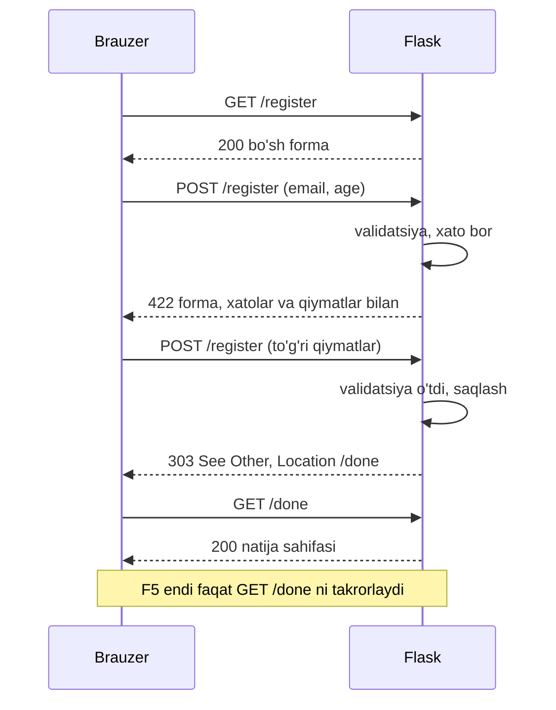
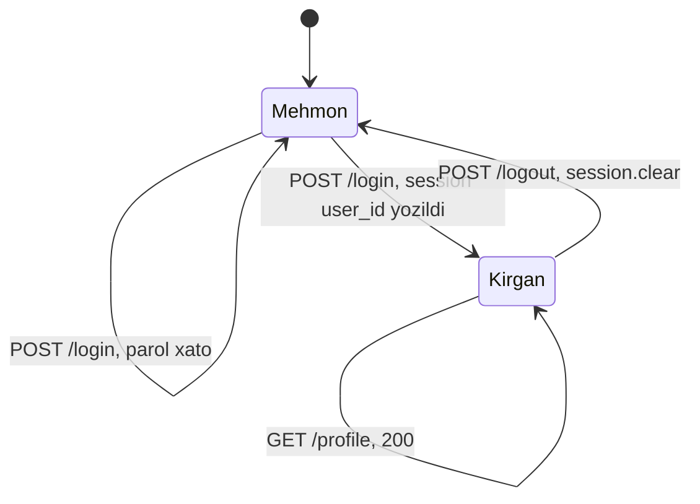

## Bu dars nima uchun kerak

47-darsda Flask so'rovni view funksiyaga yo'naltirishini, `request.form` dan qiymat o'qishni va Jinja shablonini chizishni ko'rdik. Lekin har so'rov alohida edi: server oldingi so'rovdan hech narsani eslamaydi. Haqiqiy ilova esa eslashi kerak: foydalanuvchi tizimga kirganmi, savatida nechta mahsulot bor, qaysi tilni tanlagan. Bundan tashqari, formani qabul qilish ham "`request.form.get` va tayyor" emas: noto'g'ri qiymatga xato ko'rsatish, kiritilgan qiymatlarni yo'qotmaslik, sahifa yangilanganda buyurtma ikki marta yuborilmasligi kerak.

Bu dars uchta savolga javob beradi:

1. **Formani qanday to'g'ri qabul qilish kerak?** GET bilan ko'rsatish, POST bilan qabul qilish, validatsiya, xato bilan qayta ko'rsatish va Post/Redirect/Get naqshi.
2. **HTTP holatni eslamasa, server foydalanuvchini qanday taniydi?** Cookie mexanizmi: `Set-Cookie` va `Cookie` headerlari va ularning xavfsizlik atributlari (42-darsdagi headerlar shu yerda ishga tushadi).
3. **Flask session nima va u qanchalik xavfsiz?** Imzolangan cookie, `SECRET_KEY`, server-side session bilan farqi, login/logout oqimi va flash xabarlar.

Bu darsdan keyin siz:

- GET/POST forma oqimini validatsiya va xato bilan qayta ko'rsatish bilan yoza olasiz;
- Post/Redirect/Get naqshi qaysi muammoni hal qilishini va nima uchun `303` ishlatilishini tushuntira olasiz;
- HTTP stateless ekanini va cookie bu muammoni qanday hal qilishini, `Set-Cookie` atributlarini (`Expires`, `Max-Age`, `HttpOnly`, `Secure`, `SameSite`, `Path`, `Domain`) bilasiz;
- Flask session cookie'sini dekodlab, u shifrlanmagan, faqat imzolangan ekanini ko'rsata olasiz va `SECRET_KEY` rolini tushuntira olasiz;
- client-side va server-side session'ni (Flask-Session) taqqoslay olasiz;
- `session["user_id"]` asosida login, logout va himoyalangan sahifa yoza olasiz, flash xabarlarni ishlata olasiz;
- `test_client()` bilan ketma-ket so'rovlarda cookie va session'ni kuzata olasiz.

## Forma yuborish oqimi

43-darsdagi `<form method="post">` yuborilganda brauzer maydonlarni `nom=qiymat&...` ko'rinishida POST tanasiga joylaydi. Server tomonda bitta route ikki ishni bajaradi:

1. **GET** - bo'sh formani ko'rsatadi.
2. **POST** - qiymatlarni o'qiydi va **validatsiya** qiladi (to'g'riligini tekshiradi).
3. Xato bo'lsa - formani **xato xabarlari va foydalanuvchi kiritgan qiymatlar bilan** qayta ko'rsatadi. Qiymatlarni qaytarish muhim: 10 ta maydonli formada bitta xato uchun hammasini qaytadan yozdirish foydalanuvchini qochiradi.
4. Muvaffaqiyatli bo'lsa - ma'lumotni saqlaydi va boshqa sahifaga yo'naltiradi.

43-darsdagi `required`, `type="email"` kabi HTML atributlari faqat qulaylik: ularni brauzer tekshiradi, hujumchi esa so'rovni brauzersiz (masalan `curl` yoki `test_client` bilan) yuborishi mumkin. Shuning uchun server tomondagi validatsiya majburiy, mijoz tomoni esa ixtiyoriy qo'shimcha.

```python run
from flask import Flask, redirect, render_template_string, request, url_for

app = Flask(__name__)
app.jinja_env.trim_blocks = True
app.jinja_env.lstrip_blocks = True

FORM = """<form method="post">
  <input name="email" value="{{ email }}">
  <input name="age" value="{{ age }}">

  <p class="error">{{ e }}</p>

</form>"""

REGISTERED = []


@app.route("/register", methods=["GET", "POST"])
def register():
    if request.method == "GET":
        return render_template_string(FORM, email="", age="", errors=[])

    email = request.form.get("email", "").strip()
    age = request.form.get("age", "").strip()
    errors = []
    if "@" not in email:
        errors.append("Email noto'g'ri")
    if not age.isdigit() or not 7 <= int(age) <= 120:
        errors.append("Yosh 7 dan 120 gacha butun son bo'lsin")
    if errors:
        return render_template_string(FORM, email=email, age=age, errors=errors), 422

    REGISTERED.append(email)
    return redirect(url_for("done"), code=303)


@app.route("/done")
def done():
    return f"Ro'yxatdan o'tganlar: {len(REGISTERED)}"


client = app.test_client()
r = client.post("/register", data={"email": "ali.example.com", "age": "abc"})
print(r.status)
print(r.get_data(as_text=True))
r = client.post("/register", data={"email": "ali@example.com", "age": "19"})
print(r.status, "Location:", r.headers["Location"])
r = client.get(r.headers["Location"])
print(r.status, r.get_data(as_text=True))
```

Natija:

```text
422 UNPROCESSABLE ENTITY
<form method="post">
  <input name="email" value="ali.example.com">
  <input name="age" value="abc">
  <p class="error">Email noto&#39;g&#39;ri</p>
  <p class="error">Yosh 7 dan 120 gacha butun son bo&#39;lsin</p>
</form>
303 SEE OTHER Location: /done
200 OK Ro'yxatdan o'tganlar: 1
```

Kuzatishlar:

- Xato bo'lganda forma kiritilgan qiymatlar bilan qaytdi. `value="{{ email }}"` atribut ichida ekani uchun autoescaping (47-dars) bu yerda ayniqsa muhim: qiymatdagi `"` escape qilinmasa, foydalanuvchi atributni yopib, o'z atributini qo'sha olardi.
- Xato javobi statusi `422` (so'rov tuzilishi to'g'ri, lekin mazmuni yaroqsiz). Ko'p ilovalar bu yerda `400` yoki hatto `200` qaytaradi; muhimi - muvaffaqiyatli javobdan farqlanishi, ayniqsa API va testlar uchun.
- Hamma xatolar birdaniga yig'ildi (`errors` ro'yxati). Birinchi xatoda to'xtash foydalanuvchini har maydon uchun formani qayta-qayta yuborishga majburlaydi.
- `int(age)` dan oldin `age.isdigit()` tekshirildi: `and` ning qisqa tutashuvi (4-dars) `int("abc")` ning `ValueError` iga yo'l qo'ymaydi.

### Post/Redirect/Get

Muvaffaqiyatli POST dan keyin nima uchun sahifani darhol chizmasdan, yo'naltirdik? Agar POST javobi to'g'ridan-to'g'ri "Rahmat" sahifasi bo'lsa, brauzer tarixida oxirgi so'rov - POST. Foydalanuvchi sahifani yangilasa (F5) yoki "orqaga, keyin oldinga" bossa, brauzer o'sha POST ni qayta yuboradi: buyurtma ikki marta yaratiladi, pul ikki marta yechiladi. Ko'p brauzerlar oldin "formani qayta yuborasizmi?" deb so'raydi, lekin foydalanuvchi ko'pincha "ha" ni bosadi.

**Post/Redirect/Get** (PRG) naqshi bu muammoni yo'q qiladi: POST muvaffaqiyatli bo'lgach, server sahifa o'rniga `303 See Other` va `Location` header qaytaradi. Brauzer `Location` ga GET so'rov yuboradi va tarixda endi GET turadi. Yangilash faqat shu GET ni takrorlaydi, u esa hech narsani o'zgartirmaydi (42-darsdagi xavfsiz metod).



Nima uchun `303`, `302` emas? Flask'ning `redirect()` standart holatda `302 Found` beradi. HTTP spetsifikatsiyasida `302` dan keyin metodni o'zgartirish noaniq qoldirilgan (brauzerlar amalda POST ni GET ga almashtiradi), `303` esa aynan "natijani GET bilan ol" degani. `307` va `308` esa metodni saqlaydi: ular PRG uchun yaroqsiz, chunki brauzer yana POST yuboradi. Shuning uchun `redirect(url, code=303)`.

Narx: PRG har muvaffaqiyatli formaga bitta qo'shimcha so'rov qo'shadi. RTT 80 ms bo'lsa, foydalanuvchi natijani taxminan 80 ms kechroq ko'radi. Bunga qarshi turgan narsa - takroriy buyurtma xavfining yo'qolishi; deyarli har doim bunga arziydi.

Xato holatida esa yo'naltirmadik: formani shu POST javobida qayta chizdik. Yo'naltirsak, xatolar va kiritilgan qiymatlar yo'qolardi, chunki keyingi GET so'rov ular haqida hech narsa bilmaydi. Bu bizni darsning asosiy savoliga olib keladi.

## HTTP stateless: cookie nima uchun kerak

HTTP **stateless** (holatsiz) protokol: server har so'rovni oldingilaridan mustaqil qayta ishlaydi. MDN cookie qo'llanmasi ham shuni ta'kidlaydi: cookie stateless HTTP ustida holat ma'lumotini eslab qolish imkonini beradi. Holatsizlikning yaxshi tomoni bor: istalgan so'rovni istalgan serverga yuborish mumkin, bu esa masshtablashni osonlashtiradi. Lekin "bu so'rov 5 soniya oldin parol kiritgan foydalanuvchidanmi?" degan savolga protokolning o'zi javob bermaydi.

**Cookie** - server bergan va brauzer keyingi so'rovlarda o'zi qaytaradigan kichik nom=qiymat juftligi:

1. Server javobga `Set-Cookie: visits=1; Max-Age=3600; HttpOnly` headerini qo'shadi.
2. Brauzer cookie'ni shu sayt uchun saqlaydi.
3. Shu saytga keyingi har bir so'rovda brauzer `Cookie: visits=1` headerini yuboradi.

Flask'da cookie `request.cookies` dan o'qiladi va javob obyektidagi `set_cookie` bilan beriladi. Javob obyektini olish uchun `make_response` ishlatiladi:

```python run
from flask import Flask, make_response, request

app = Flask(__name__)


@app.route("/")
def index():
    visits = int(request.cookies.get("visits", "0")) + 1
    resp = make_response(f"Siz bu yerda {visits}-marta")
    resp.set_cookie("visits", str(visits), max_age=3600, httponly=True, samesite="Lax")
    return resp


@app.route("/forget")
def forget():
    resp = make_response("unutildi")
    resp.delete_cookie("visits")
    return resp


alice = app.test_client()
bob = app.test_client()
r = alice.get("/")
print(r.get_data(as_text=True), "| Set-Cookie:", r.headers["Set-Cookie"])
print(alice.get("/").get_data(as_text=True))
print(alice.get("/").get_data(as_text=True), "| brauzerdagi qiymat:", alice.get_cookie("visits").value)
print("Bob:", bob.get("/").get_data(as_text=True))
r = alice.get("/forget")
print("forget | Set-Cookie:", r.headers["Set-Cookie"])
print(alice.get("/").get_data(as_text=True))
```

Natija (`Expires` dagi sana ishga tushirilgan vaqtga bog'liq):

```text
Siz bu yerda 1-marta | Set-Cookie: visits=1; Expires=Tue, 03 Nov 2026 11:56:57 GMT; Max-Age=3600; HttpOnly; Path=/; SameSite=Lax
Siz bu yerda 2-marta
Siz bu yerda 3-marta | brauzerdagi qiymat: 3
Bob: Siz bu yerda 1-marta
forget | Set-Cookie: visits=; Expires=Thu, 01 Jan 1970 00:00:00 GMT; Max-Age=0; Path=/
Siz bu yerda 1-marta
```

Har `test_client()` alohida "brauzer": u o'zining cookie omborini saqlaydi va keyingi so'rovlarda `Cookie` headerini o'zi qo'shadi. Shuning uchun Alice'ning hisoblagichi o'sdi, Bob'niki esa 1 dan boshlandi: server bir xil kod bilan ikki foydalanuvchini faqat cookie orqali ajratdi. Cookie'ni o'chirishning maxsus buyrug'i yo'q: `delete_cookie` bo'sh qiymat va o'tib ketgan muddat (`Max-Age=0`, 1970-yil) yuboradi, brauzer uni o'zi o'chiradi.

Bu hisoblagichning muhim kamchiligi: qiymat butunlay mijozda va hech qanday himoyasiz. Foydalanuvchi brauzer vositalarida `visits=1000000` deb yozsa, server bunga ishonadi. Bu hisoblagich uchun zararsiz, `user_id=1` yoki `is_admin=1` uchun esa halokatli. Bu muammoni pastda imzo hal qiladi.

### Set-Cookie atributlari

MDN dagi `Set-Cookie` sahifasiga ko'ra asosiy atributlar:

| Atribut | Ma'nosi | Berilmasa |
|---|---|---|
| `Expires=<sana>` | cookie qachongacha yashaydi (HTTP sana) | session cookie: brauzer yopilganda o'chadi (session tiklash funksiyasi buni chetlab o'tishi mumkin) |
| `Max-Age=<soniya>` | necha soniya yashaydi; 0 yoki manfiy - darhol o'chadi | `Expires` ishlatiladi; ikkalasi bo'lsa `Max-Age` ustun |
| `HttpOnly` | JavaScript `document.cookie` orqali o'qiy olmaydi, lekin so'rovlarda yuboriladi | JS o'qiy oladi: XSS bo'lsa cookie o'g'irlanadi |
| `Secure` | faqat `https:` so'rovlarda yuboriladi (localhost bundan mustasno) | HTTP orqali ochiq matnda ham yuboriladi |
| `SameSite=Strict/Lax/None` | boshqa saytdan boshlangan so'rovlarda yuborilishini boshqaradi; `None` uchun `Secure` majburiy | ba'zi brauzerlar `Lax` deb hisoblaydi |
| `Path=<yo'l>` | qaysi yo'llar uchun yuboriladi (`/docs` - `/docs/web` ham) | so'rov URL'ining yo'li |
| `Domain=<domen>` | domen va uning subdomenlariga yuboriladi | faqat cookie'ni bergan host (host-only) |

`Max-Age=3600` yuqoridagi misolda 3600 / 60 = 60 daqiqa degani. Flask `max_age` berilganda `Expires` ni ham hisoblab qo'shdi: eski brauzerlar faqat `Expires` ni tushunadi.

`SameSite` CSRF hujumidan (boshqa sayt sizning brauzeringiz nomidan so'rov yuborishi) qisman himoya qiladi; CSRF va uning to'liq himoyasi 50-darsda. `HttpOnly` esa XSS ning oqibatini kamaytiradi: hujumchi skripti sahifada ishlasa ham, session cookie'ni o'qib, o'z serveriga jo'nata olmaydi.

Hajm haqida hisob: MDN ga ko'ra cookie kichik ma'lumot uchun (taxminan 4 KB gacha) va **har so'rov bilan** yuboriladi. Sahifa 40 ta resurs (rasm, CSS, JS) yuklasa va saytdagi cookie'lar jami 3 KB bo'lsa, bir sahifa ochilishida brauzer serverga 40 · 3 = 120 KB faqat cookie yuboradi. Shu sababli cookie'da katta ma'lumot saqlanmaydi.

## Flask session: imzolangan cookie

Har safar cookie'ni qo'lda boshqarish va soxtalashtirishdan himoya qilish o'rniga Flask **session** obyektini beradi. U dict kabi ishlatiladi (`session["user_id"] = 42`), Flask esa uni so'rov oxirida bitta `session` cookie'siga joylaydi va keyingi so'rov boshida qayta tiklaydi.

Flask quickstart'i mexanizmni aniq aytadi: session cookie'lar ustiga qurilgan va cookie'larni kriptografik **imzolaydi**; foydalanuvchi cookie mazmunini ko'ra oladi, lekin imzolash uchun ishlatilgan maxfiy kalitni bilmasa, uni o'zgartira olmaydi. Demak:

- session **shifrlanmagan**: ichidagi ma'lumotni har kim o'qiydi;
- session **imzolangan**: o'zgartirilgan cookie'ni server rad etadi.

Buni o'z ko'zimiz bilan tekshiramiz: cookie'ni dekodlaymiz, keyin soxtalashtirishga urinib ko'ramiz.

```python run
import base64
import json

from flask import Flask, session

app = Flask(__name__)
app.secret_key = "dev-uchun-kalit-productionda-boshqa"


@app.route("/set")
def set_value():
    session["user_id"] = 42
    session["theme"] = "dark"
    return "yozildi"


@app.route("/get")
def get_value():
    return f"user_id={session.get('user_id')} theme={session.get('theme')}"


client = app.test_client()
r = client.get("/set")
cookie = r.headers["Set-Cookie"]
print("Set-Cookie:", cookie)

value = client.get_cookie("session").value
payload, timestamp, signature = value.split(".")
padded = payload + "=" * (-len(payload) % 4)
print("1-qism (base64):", payload)
print("dekodlangan:", json.loads(base64.urlsafe_b64decode(padded)))
print("imzo uzunligi:", len(signature), "belgi")

print(client.get("/get").get_data(as_text=True))

# Hujumchi user_id ni 1 ga o'zgartirmoqchi
fake = base64.urlsafe_b64encode(json.dumps({"theme": "dark", "user_id": 1}, separators=(",", ":")).encode()).decode().rstrip("=")
client.set_cookie("session", f"{fake}.{timestamp}.{signature}")
print("soxta cookie bilan:", client.get("/get").get_data(as_text=True))
```

Natija (o'rta va oxirgi qism vaqtga bog'liq, har ishga tushirishda boshqacha):

```text
Set-Cookie: session=eyJ0aGVtZSI6ImRhcmsiLCJ1c2VyX2lkIjo0Mn0.aum-AQ.RT2ZhfxnB580S5UqGVbnzKTFGRg; HttpOnly; Path=/
1-qism (base64): eyJ0aGVtZSI6ImRhcmsiLCJ1c2VyX2lkIjo0Mn0
dekodlangan: {'theme': 'dark', 'user_id': 42}
imzo uzunligi: 27 belgi
user_id=42 theme=dark
soxta cookie bilan: user_id=None theme=None
```

Cookie qiymati nuqta bilan ajratilgan uch qism:

1. **Ma'lumot** - JSON, base64url bilan kodlangan. Kodlash shifrlash emas: hech qanday kalitsiz ochildi.
2. **Vaqt belgisi** - imzo yaratilgan vaqt (session muddatini tekshirish uchun).
3. **Imzo** - ma'lumot va vaqt belgisidan `SECRET_KEY` bilan hisoblangan HMAC. Flask buning uchun itsdangerous kutubxonasini HMAC-SHA1 bilan ishlatadi (imzo kaliti `SECRET_KEY` va `"cookie-session"` salt'idan hosil qilinadi): SHA-1 natijasi 20 bayt, base64 da har 3 bayt 4 belgiga aylanadi, 20 bayt uchun ⌈20 · 4 / 3⌉ = 27 belgi (oxiridagi `=` tashlanadi).

Hujumchi JSON ni o'zgartirdi, lekin to'g'ri imzoni hisoblay olmadi (buning uchun kalit kerak), shuning uchun Flask cookie'ni rad etdi va bo'sh session berdi. HMAC va hash funksiyalarining ichki ishlashi 52-darsda.

Ma'lumot kattaroq bo'lsa, itsdangerous uni zlib bilan siqadi va qiymat nuqta bilan boshlanadi (`.eJy...`); bu ham shifrlash emas.

### SECRET_KEY roli

`SECRET_KEY` (yoki `app.secret_key`) imzoning yagona siri. Undan uchta xulosa chiqadi:

- **Kalitsiz session ishlamaydi.** `secret_key` o'rnatilmagan bo'lsa, `session` ga yozishda Flask xato beradi.
- **Kalit oshkor bo'lsa, session himoyasi yo'q.** Kalitni bilgan odam `{"user_id": 1}` uchun to'g'ri imzo yasaydi va administrator sifatida kiradi. Shuning uchun kalit kodda (va git'da) emas, muhit o'zgaruvchisida yoki maxfiy konfiguratsiyada saqlanadi. Flask quickstart'i tasodifiy kalit yaratish uchun `python -c 'import secrets; print(secrets.token_hex())'` ni tavsiya qiladi.
- **Kalit o'zgarsa, barcha session'lar yaroqsiz bo'ladi.** Eski imzolar mos kelmaydi: hamma foydalanuvchi tizimdan chiqadi. Kalit sizib chiqqanda aynan shu kerak.

Session'ga faqat o'qilishi zarar qilmaydigan narsalarni yozing: `user_id`, til, savatdagi mahsulot id'lari. Parol, karta raqami yoki maxfiy tokenlar session'da emas, serverda turadi.

### Session sozlamalari va muddati

Flask konfiguratsiya hujjatidagi standart qiymatlar:

| Sozlama | Standart | Ma'nosi |
|---|---|---|
| `SESSION_COOKIE_HTTPONLY` | `True` | JS session cookie'ni o'qiy olmaydi |
| `SESSION_COOKIE_SECURE` | `False` | HTTPS bilan ishlaganda `True` qiling |
| `SESSION_COOKIE_SAMESITE` | `None` | `'Lax'` tavsiya etiladi |
| `PERMANENT_SESSION_LIFETIME` | 31 kun | `session.permanent = True` bo'lganda cookie muddati |

Standart holatda `session.permanent` `False`: Flask `Expires` qo'ymaydi va cookie brauzer yopilganda o'chadi (yuqoridagi natijadagi `Set-Cookie` da muddat yo'qligini ko'ring). `session.permanent = True` qilinsa, muddat 31 kun: 31 · 24 · 3600 = 2 678 400 soniya, hujjatdagi raqam bilan bir xil.

### Ichki dict tuzog'i

Flask session o'zgarganini faqat yuqori darajadagi yozuvdan (`session["cart"] = ...`) biladi va cookie'ni faqat shunda qayta yuboradi. Session ichidagi dict yoki list'ni joyida o'zgartirish (`session["cart"]["olma"] += 1`) sezilmaydi: o'zgarish shu so'rov ichida ko'rinadi, keyingi so'rovda esa yo'qoladi. Flask manba kodidagi izoh ham shuni aytadi: ichki o'zgaruvchan ma'lumot o'zgarsa, `session.modified = True` ni qo'lda qo'yish kerak.

```python run
from flask import Flask, session

app = Flask(__name__)
app.secret_key = "dev-kalit"


@app.route("/bad/<item>")
def bad(item):
    if "cart" not in session:
        session["cart"] = {}
    cart = session["cart"]
    cart[item] = cart.get(item, 0) + 1   # ichki dict o'zgardi, session buni sezmaydi
    return str(session["cart"])


@app.route("/good/<item>")
def good(item):
    cart = session.get("cart", {})
    cart[item] = cart.get(item, 0) + 1
    session["cart"] = cart               # qayta yozish: session.modified = True
    return str(session["cart"])


for prefix in ["bad", "good"]:
    c = app.test_client()
    results = [c.get(f"/{prefix}/olma").get_data(as_text=True) for _ in range(3)]
    print(prefix, results)
```

Natija:

```text
bad ["{'olma': 1}", "{'olma': 2}", "{'olma': 2}"]
good ["{'olma': 1}", "{'olma': 2}", "{'olma': 3}"]
```

`bad` ning izi: 1-so'rovda `session["cart"] = {}` yozildi, session "o'zgargan" deb belgilandi va `{'olma': 1}` saqlandi. 2-so'rovda faqat ichki dict o'zgardi: javobda 2 ko'rindi, lekin cookie yangilanmadi. 3-so'rov yana saqlangan `{'olma': 1}` dan boshladi. Bu xato faqat ketma-ket so'rovlarda ko'rinadi, bitta so'rovni tekshiradigan testdan o'tib ketadi.

## Client-side va server-side session

Flask'ning standart session'i **client-side**: ma'lumotning o'zi cookie'da. Muqobili - **server-side session**: Flask-Session kengaytmasi hujjatiga ko'ra, bu holda ma'lumot serverdagi omborda saqlanadi, cookie'da esa faqat foydalanuvchini o'sha ma'lumotga bog'laydigan session identifikatori bo'ladi. CS50 ma'ruzasidagi misollar ham Flask-Session'ni fayl tizimi ombori bilan ishlatadi.

| Xususiyat | Client-side (Flask standart) | Server-side (Flask-Session) |
|---|---|---|
| Ma'lumot qayerda | cookie ichida, imzolangan | Redis, baza yoki fayl; cookie'da faqat id |
| Hajm | cookie chegarasi, taxminan 4 KB | amalda cheklanmagan |
| Foydalanuvchi o'qiy oladimi | ha (shifrlanmagan) | yo'q, faqat tasodifiy id'ni ko'radi |
| Serverda qo'shimcha infratuzilma | kerak emas | ombor kerak va u ishlab turishi shart |
| Bir nechta server | kalit bir xil bo'lsa ishlaydi | hamma server bitta omborga ulanishi kerak |
| Bitta session'ni majburan bekor qilish | qiyin: cookie muddatigacha yaroqli | oson: ombordan yozuvni o'chirish |
| Har so'rovdagi narx | imzoni tekshirish | ombordan o'qish (tarmoq so'rovi) |

Oxiridan ikkinchi qator muhim: client-side session'da "shu foydalanuvchini hozir chiqarib yubor" deyish uchun serverda bekor qilingan session'lar ro'yxati yoki kalitni almashtirish kerak. Server-side'da yozuvni o'chirish kifoya. Kichik ilova uchun standart session yetarli; katta ma'lumot, majburiy chiqarish yoki ma'lumotni mijozdan butunlay yashirish kerak bo'lsa, server-side tanlanadi.

## Login, logout va flash xabarlar

Endi hamma qismni birlashtiramiz. Login oqimi:

1. `GET /login` - forma.
2. `POST /login` - login va parolni tekshirish. Noto'g'ri bo'lsa, xabar bilan qayta. To'g'ri bo'lsa, `session.clear()` (eski session qoldiqlarini tozalash) va `session["user_id"] = user["id"]`, keyin PRG bilan profilga.
3. Himoyalangan sahifa `session.get("user_id")` ni tekshiradi. Yo'q bo'lsa, login sahifasiga yo'naltiradi. Bu tekshiruvni har view'ga yozmaslik uchun 33-darsdagi decorator'dan foydalanamiz: `login_required` view'ni o'rab, avval session'ni tekshiradi. `functools.wraps` o'ralgan funksiyaning nomini saqlaydi, aks holda barcha himoyalangan view'lar bitta `wrapper` endpoint nomini olib, Flask xato berardi.
4. `POST /logout` - `session.clear()` va login sahifasiga. Logout GET emas, POST: GET havola boshqa saytdagi `` orqali ham chaqirilishi mumkin.

**Flash xabar** - bitta so'rovda yozilib, keyingi sahifada bir marta ko'rsatiladigan xabar ("Xush kelibsiz!", "Parol noto'g'ri"). PRG bilan yo'naltirishda oddiy o'zgaruvchi yo'qoladi, flash esa session ichida saqlangani uchun yo'naltirishdan "o'tib" keladi. `flash(xabar, kategoriya)` yozadi, shablondagi `get_flashed_messages()` o'qiydi va o'chiradi.

```python run
from functools import wraps

from flask import (Flask, flash, redirect, render_template_string, request,
                   session, url_for)

app = Flask(__name__)
app.secret_key = "dev-kalit"
app.jinja_env.trim_blocks = True
app.jinja_env.lstrip_blocks = True

USERS = {"ali": {"id": 1, "password": "olma123"}}  # 50-darsda: parol hash bilan saqlanadi

PAGE = """
<p class="{{ category }}">{{ msg }}</p>

{{ body }}"""


def login_required(view):
    @wraps(view)
    def wrapper(*args, **kwargs):
        if session.get("user_id") is None:
            flash("Avval tizimga kiring", "warning")
            return redirect(url_for("login"))
        return view(*args, **kwargs)
    return wrapper


@app.route("/login", methods=["GET", "POST"])
def login():
    if request.method == "POST":
        user = USERS.get(request.form.get("username", ""))
        if user is None or user["password"] != request.form.get("password"):
            flash("Login yoki parol noto'g'ri", "error")
            return redirect(url_for("login"))
        session.clear()
        session["user_id"] = user["id"]
        flash("Xush kelibsiz!", "success")
        return redirect(url_for("profile"))
    return render_template_string(PAGE, body="[login formasi]")


@app.route("/profile")
@login_required
def profile():
    return render_template_string(PAGE, body=f"Profil: user_id={session['user_id']}")


@app.route("/logout", methods=["POST"])
def logout():
    session.clear()
    flash("Chiqdingiz", "info")
    return redirect(url_for("login"))


c = app.test_client()
steps = [
    ("GET", "/profile", None),
    ("POST", "/login", {"username": "ali", "password": "xato"}),
    ("POST", "/login", {"username": "ali", "password": "olma123"}),
    ("GET", "/profile", None),
    ("POST", "/logout", None),
    ("GET", "/profile", None),
]
for method, path, data in steps:
    r = c.open(path, method=method, data=data, follow_redirects=True)
    body = " / ".join(line for line in r.get_data(as_text=True).splitlines() if line)
    print(f"{method} {path} -> {r.request.path}: {body}")
```

Natija:

```text
GET /profile -> /login: <p class="warning">Avval tizimga kiring</p> / [login formasi]
POST /login -> /login: <p class="error">Login yoki parol noto&#39;g&#39;ri</p> / [login formasi]
POST /login -> /profile: <p class="success">Xush kelibsiz!</p> / Profil: user_id=1
GET /profile -> /profile: Profil: user_id=1
POST /logout -> /login: <p class="info">Chiqdingiz</p> / [login formasi]
GET /profile -> /login: <p class="warning">Avval tizimga kiring</p> / [login formasi]
```

Har qatorda `->` dan keyin yo'naltirishlardan keyingi yakuniy yo'l. To'rtinchi qatorda flash yo'q: "Xush kelibsiz!" uchinchi so'rovda bir marta ko'rsatildi va o'chdi. Butun ketma-ketlikni bitta `test_client` bajardi: u har javobdagi `Set-Cookie` ni saqlab, keyingi so'rovga `Cookie` qilib qo'shdi, xuddi brauzer kabi. Xato parolda ham PRG ishlatildi (xabar flash orqali), chunki bu yerda saqlanadigan kiritilgan qiymat yo'q.

Bu misolda parol ochiq matnda solishtirildi: bu faqat oqimni ko'rsatish uchun. Parollarni hash bilan saqlash va tekshirish 50-darsda.



### Testli mashq: session'dagi savatcha

Session'da savatchani saqlaydigan ilova yozing. `session["cart"]` - mahsulot nomidan songa dict. Talablar:

1. `GET /cart` - savat bo'sh bo'lsa `bo'sh`, aks holda nom bo'yicha tartibda `non=2, olma=1; jami=3`.
2. `POST /cart/add/<item>` - `item` `PRODUCTS` da bo'lmasa 404; sonini 1 ga oshiring va `303` bilan `/cart` ga yo'naltiring (PRG).
3. `POST /cart/remove/<item>` - savatda yo'q bo'lsa 400; sonini 1 ga kamaytiring, 0 ga tushsa kalitni o'chiring; `303` bilan `/cart`.
4. `POST /cart/clear` - faqat savatni o'chiring (session'dagi boshqa kalitlar qolsin); `303` bilan `/cart`.
5. Ichki dict tuzog'iga tushmang: testlar ketma-ket so'rovlarni tekshiradi.

```python run
from flask import Flask, abort, redirect, session, url_for

app = Flask(__name__)
app.secret_key = "dev-kalit"

PRODUCTS = {"non", "olma", "sut"}


@app.route("/cart")
def show_cart():
    # bo'sh savat: "bo'sh"
    # aks holda nom bo'yicha tartibda: "non=2, olma=1; jami=3"
    return "TODO", 501


@app.route("/cart/add/<item>", methods=["POST"])
def add(item):
    # PRODUCTS da yo'q bo'lsa 404; sonini 1 ga oshiring; 303 bilan /cart ga yo'naltiring
    return "TODO", 501


@app.route("/cart/remove/<item>", methods=["POST"])
def remove(item):
    # savatda yo'q bo'lsa 400; sonini 1 ga kamaytiring, 0 bo'lsa kalitni o'chiring; 303 bilan /cart
    return "TODO", 501


@app.route("/cart/clear", methods=["POST"])
def clear():
    # savatni tozalang (boshqa session kalitlariga tegmang); 303 bilan /cart
    return "TODO", 501


c = app.test_client()
print(c.post("/cart/add/non", follow_redirects=True).get_data(as_text=True))
```

```python test
def _text(r):
    return r.get_data(as_text=True)

def _seq():
    c = app.test_client()
    c.post("/cart/add/olma")
    c.post("/cart/add/non")
    c.post("/cart/add/non")
    return c

check("yangi foydalanuvchi: bo'sh", lambda: _text(app.test_client().get("/cart")) == "bo'sh")
check("add: 303 va Location /cart", lambda: (lambda r: r.status_code == 303 and r.headers["Location"].endswith("/cart"))(app.test_client().post("/cart/add/sut")))
check("add javobida session cookie bor (Set-Cookie)", lambda: "session=" in app.test_client().post("/cart/add/sut").headers.get("Set-Cookie", ""))
check("ketma-ket 3 ta add: non=2, olma=1; jami=3", lambda: _text(_seq().get("/cart")) == "non=2, olma=1; jami=3")
check("noma'lum mahsulot: 404", lambda: app.test_client().post("/cart/add/tosh").status_code == 404)
check("GET bilan add: 405", lambda: app.test_client().get("/cart/add/non").status_code == 405)
check("ikki foydalanuvchi savati aralashmaydi", lambda: (_seq(), _text(app.test_client().get("/cart")) == "bo'sh")[1])
def _remove():
    c = _seq()
    c.post("/cart/remove/olma")
    c.post("/cart/remove/non")
    return _text(c.get("/cart"))
check("remove: 0 ga tushgan kalit o'chadi", lambda: _remove() == "non=1; jami=1")
check("savatda yo'q mahsulotni remove: 400", lambda: app.test_client().post("/cart/remove/sut").status_code == 400)
def _clear():
    c = _seq()
    with c.session_transaction() as s:
        s["theme"] = "dark"
    c.post("/cart/clear")
    with c.session_transaction() as s:
        other = s.get("theme")
    return _text(c.get("/cart")) == "bo'sh" and other == "dark"
check("clear: savat bo'sh, boshqa session kalitlari qoladi", _clear)
```

Maslahat: `session.get("cart", {})` bilan oling, o'zgartiring va `session["cart"] = cart` bilan qayta yozing; `session.pop("cart", None)` faqat savatni o'chiradi. Testlardagi `session_transaction()` test client'ning session'ini so'rovsiz o'qish va yozish imkonini beradi.

## Ko'p uchraydigan xatolar

1. **Muvaffaqiyatli POST dan keyin sahifani to'g'ridan-to'g'ri chizish.** Yangilash formani qayta yuboradi va takroriy buyurtma yaratadi. Post/Redirect/Get: `redirect(url, code=303)`.
2. **Faqat brauzerdagi validatsiyaga ishonish.** `required` va `type="email"` ni chetlab o'tib so'rov yuborish oson. Har qiymatni serverda tekshiring va xato bilan formani kiritilgan qiymatlar bilan qaytaring.
3. **Session shifrlangan deb o'ylash.** Flask session faqat imzolangan: base64 ni har kim ochadi. Parol, maxfiy token yoki shaxsiy ma'lumotni session'ga yozmang.
4. **`SECRET_KEY` ni kodda yoki git'da saqlash, yoki zaif kalit.** Kalitni bilgan odam istalgan session'ni, jumladan administratornikini, soxtalashtiradi. `secrets.token_hex()` bilan yarating va muhit o'zgaruvchisida saqlang.
5. **Session ichidagi dict yoki list'ni joyida o'zgartirish.** O'zgarish keyingi so'rovda yo'qoladi. Qayta yozing (`session["cart"] = cart`) yoki `session.modified = True` qo'ying.
6. **Muhim qiymatni oddiy (imzosiz) cookie'da saqlash.** `set_cookie("user_id", "1")` ni foydalanuvchi o'zgartira oladi. Identifikatsiya uchun faqat imzolangan session yoki server-side session.
7. **HTTPS da `Secure`, `HttpOnly` va `SameSite` ni sozlamaslik.** Flask'da `SESSION_COOKIE_SECURE` standart `False`, `SESSION_COOKIE_SAMESITE` standart `None`. Productionda `True` va `'Lax'` qiling.
8. **Logout'ni GET bilan qilish va login'da eski session'ni tozalamaslik.** GET logout begona sahifadagi rasm teglari bilan chaqirilishi mumkin; login'da `session.clear()` oldingi foydalanuvchi qoldiqlarini o'chiradi.

## Xulosa

- Forma oqimi: GET ko'rsatadi, POST qabul qiladi, server validatsiya qiladi, xatoda forma kiritilgan qiymatlar va xatolar bilan qayta chiziladi, muvaffaqiyatda yo'naltiriladi.
- Post/Redirect/Get: muvaffaqiyatli POST dan keyin `303` va `Location`; brauzer tarixida GET qoladi, yangilash formani qayta yubormaydi.
- HTTP stateless; cookie (`Set-Cookie` - `Cookie`) holatni so'rovlar orasida saqlaydi. Atributlar: `Expires`/`Max-Age` muddat, `HttpOnly` JS dan, `Secure` ochiq HTTP dan, `SameSite` begona saytdan, `Path`/`Domain` doirani belgilaydi.
- Flask session - imzolangan cookie: ma'lumot + vaqt + HMAC imzo. Shifrlanmagan, lekin kalitsiz o'zgartirib bo'lmaydi. `SECRET_KEY` - imzoning yagona siri.
- Server-side session (Flask-Session) cookie'da faqat id saqlaydi: hajm cheklovi yo'q, ma'lumot yashirin va session'ni bekor qilish oson, lekin ombor kerak.
- Login: `session.clear()` va `session["user_id"]`; himoya decorator orqali; logout - POST va `session.clear()`. Flash xabar session orqali yo'naltirishdan o'tib, bir marta ko'rsatiladi.
- `test_client()` brauzer kabi cookie'larni saqlaydi: `r.headers["Set-Cookie"]`, `get_cookie`, `session_transaction()` bilan ketma-ket so'rovlarni tekshirish mumkin.

## Amaliy topshiriq

Kichik "Eslatmalar" ilovasini yozing: foydalanuvchi tizimga kiradi, faqat o'z eslatmalarini ko'radi va qo'shadi. Ma'lumotlar xotiradagi dict'larda (49-darsda SQL ga o'tkaziladi).

Topshiriq qadamlari:

1. **Login va logout.** `USERS` dict'ida ikkita foydalanuvchi. `/login` (GET/POST), `/logout` (faqat POST). Muvaffaqiyatli login'da `session.clear()` va `session["user_id"]`, flash xabar va PRG.
2. **Himoya.** `login_required` decorator'ini yozing (`functools.wraps` bilan). `/notes` va `/notes/new` faqat kirgan foydalanuvchiga; aks holda flash va `/login` ga yo'naltirish.
3. **Forma va validatsiya.** `/notes/new` formasi: `title` (1-80 belgi) va `body` (bo'sh emas). Xatoda forma kiritilgan qiymatlar va hamma xatolar bilan `422` qaytsin; muvaffaqiyatda `303` bilan `/notes`.
4. **Cookie sozlamalari.** `SECRET_KEY` ni muhit o'zgaruvchisidan o'qing; `SESSION_COOKIE_HTTPONLY`, `SESSION_COOKIE_SAMESITE='Lax'` va (HTTPS uchun) `SESSION_COOKIE_SECURE` ni sozlang. Til tanlovini (`uz`/`en`) alohida oddiy cookie'da 30 kunga (`max_age`) saqlang va nima uchun buni imzosiz saqlash xavfsiz ekanini yozing.
5. **Testlar.** `test_client()` bilan kamida 8 ta tekshiruv: kirmasdan `/notes` - yo'naltirish; xato parol; to'g'ri login dan keyin `Set-Cookie` da `session=` va `HttpOnly`; ikki foydalanuvchi bir-birining eslatmasini ko'rmasligi; validatsiya xatosida `422` va kiritilgan qiymat javobda; muvaffaqiyatli POST da `303`; logout'dan keyin `/notes` yopiq; GET `/logout` - 405.
6. **Tahlil.** Login'dan keyingi session cookie'sini base64 bilan dekodlang va natijani yozing. Hujumchi `SECRET_KEY` ni bilsa nima qila olishini va kalit sizib chiqqanda qanday choralar ko'rishni 3-4 gap bilan tushuntiring.

Yaxshi javobda bo'lishi kerak bo'lgan narsalar:

- PRG to'g'ri: muvaffaqiyatli POST lar `303`, xato formalar qayta chiziladi va qiymatlarni saqlaydi;
- validatsiya serverda, hamma xatolar bir vaqtda ko'rsatiladi;
- `session` da faqat `user_id` (va kerak bo'lsa kichik sozlamalar), parol yoki eslatma matni yo'q;
- `SECRET_KEY` kodda emas, cookie atributlari sozlangan va har biri nima uchun kerakligi izohlangan;
- ichki dict tuzog'i yo'q: ketma-ket so'rovlar testlari o'tadi;
- testlar alohida `test_client` lar bilan foydalanuvchilar ajralganini tekshiradi;
- tahlilda session shifrlanmagan, faqat imzolangan ekani va kalitni almashtirish barcha session'larni bekor qilishi aytilgan.

Javobingizni pastdagi maydonga yozing va yuqoridagi mezonlar bilan solishtiring.

## Manbalar

- CS50x. [Week 9: Flask](https://cs50.harvard.edu/x/weeks/9/) - ma'ruza va notes: formalar, `POST`, cookie va session, Flask-Session bilan login misoli.
- Flask. [Quickstart](https://flask.palletsprojects.com/en/stable/quickstart/) - "Sessions" (imzolangan cookie, mazmunni ko'rish mumkin, o'zgartirib bo'lmaydi; "How to generate good secret keys"), "Cookies", "Redirects and Errors", "Message Flashing".
- Flask. [Configuration Handling](https://flask.palletsprojects.com/en/stable/config/) - "Builtin Configuration Values": `SECRET_KEY`, `SESSION_COOKIE_HTTPONLY`, `SESSION_COOKIE_SECURE`, `SESSION_COOKIE_SAMESITE`, `PERMANENT_SESSION_LIFETIME` va ularning standart qiymatlari.
- Flask. [Message Flashing](https://flask.palletsprojects.com/en/stable/patterns/flashing/) - `flash`, `get_flashed_messages`, kategoriyalar.
- MDN. [Set-Cookie](https://developer.mozilla.org/en-US/docs/Web/HTTP/Reference/Headers/Set-Cookie) - "Attributes": `Expires`, `Max-Age`, `HttpOnly`, `Secure`, `SameSite`, `Path`, `Domain`.
- MDN. [Using HTTP cookies](https://developer.mozilla.org/en-US/docs/Web/HTTP/Guides/Cookies) - cookie va stateless HTTP, "Creating, removing, and updating cookies", "Security", hajm va har so'rov bilan yuborilishi.
- Flask-Session. [Introduction](https://flask-session.readthedocs.io/en/latest/introduction.html) - "Client-side vs Server-side sessions".
- Wikipedia. [Post/Redirect/Get](https://en.wikipedia.org/wiki/Post/Redirect/Get) - naqsh, takroriy yuborish muammosi va `303` ning roli.
