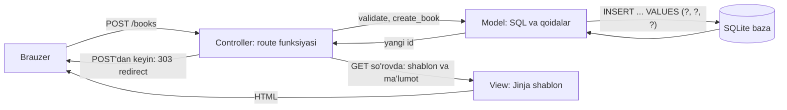

## Bu dars nima uchun kerak

47-darsda Flask'da route, `request` va Jinja shablonini, 48-darsda formalar, cookie va session'ni ko'rdik. Lekin hozircha ilovamizning xotirasi yo'q: ma'lumot Python ro'yxatida yoki session cookie'sida yashaydi va server qayta ishga tushsa yo'qoladi. 36-40-darslarda esa SQL va Python'ning `sqlite3` moduli bilan ishladik, lekin bitta skript ichida. Bu dars ikkalasini birlashtiradi: brauzer so'rovi Flask route'iga keladi, route bazadan o'qiydi yoki yozadi, natija HTML sahifa yoki JSON bo'lib qaytadi.

Bunday ilovaning deyarli har biri bir xil to'rt amaldan iborat: yaratish, o'qish, yangilash, o'chirish - 36-darsda tanishgan CRUD. Kutubxona kataloglari, eslatmalar, buyurtmalar, foydalanuvchilar ro'yxati - hammasi "CRUD + bir oz biznes qoidasi". Shuning uchun bu naqshni bir marta to'g'ri qurib olish keyingi har bir loyihani tezlashtiradi, jumladan 58-59-darslardagi yakuniy loyihani.

Ikkinchi muammo - tartib. Route funksiyasi ichida SQL, HTML va validatsiya aralashib ketsa, 200 qatordan keyin kodni o'qib bo'lmaydi. Buning klassik yechimi - kodni uch qatlamga ajratish: MVC (model, view, controller). Biz uni Flask'ga qanday mos tushishini ko'ramiz.

Bu darsda kichik, lekin to'liq ilova quramiz: kutubxona kitoblari katalogi. Barcha kod brauzerda ishga tushadi va `test_client` bilan tekshiriladi, server kerak emas.

Bu darsdan keyin siz:

- CRUD ilova uchun URL va HTTP metodlarini rejalashtira olasiz va nega HTML forma faqat GET va POST yuborishini bilasiz;
- MVC qatlamlarini va ularning Flask'dagi o'rnini (shablon, model funksiyalari, route) tushuntira olasiz;
- rasmiy Flask tutorial naqshi bo'yicha `get_db()`, `g` obyekti va `teardown_appcontext` bilan har so'rovga bitta ulanish ochib-yopa olasiz;
- jadval sxemasini yozib, faqat parametrlangan so'rovlar bilan model funksiyalarini tuza olasiz;
- ro'yxat, ko'rish, yaratish, tahrirlash, o'chirish route'larini, validatsiyani va 404 holatini yoza olasiz;
- xuddi shu ma'lumot uchun `jsonify` bilan JSON API variantini yoza olasiz;
- butun oqimni `app.test_client()` bilan avtomatik tekshira olasiz.

## Ilova rejasi: resurs, URL va metod

Kod yozishdan oldin ilova qaysi URL'larga javob berishini rejalashtiramiz. Bizda bitta **resurs** bor - kitob. Har bir kitobning o'z raqami (`id`) va manzili bor: `/books/7`. Kitoblar to'plami - `/books`. Bu fikr REST (Representational State Transfer) uslubidan keladi: URL - "nima" (resurs), HTTP metod - "nima qilish" (amal). 42-darsda ko'rgan metodlarning ma'nosi shu yerda ishga tushadi: GET - faqat o'qish, holatni o'zgartirmaydi; POST - yangi narsa yaratish yoki amal bajarish; PUT - resursni yangilash; DELETE - o'chirish.

Toza REST'da yangilash `PUT /books/7`, o'chirish `DELETE /books/7` bo'lardi. Lekin HTML forma bunday yubora olmaydi: `<form>` ning `method` atributi faqat `get`, `post` va `dialog` qiymatlarini qabul qiladi (MDN). `method="delete"` yozsangiz, brauzer uni noto'g'ri qiymat deb hisoblaydi va oddiy GET yuboradi. Shuning uchun HTML ilovalarda amal URL'ga qo'shiladi va POST bilan yuboriladi: `POST /books/7/edit`, `POST /books/7/delete`. JavaScript `fetch` (46-dars) esa istalgan metodni yubora oladi, shuning uchun JSON API'da toza REST URL'lari ishlatiladi.

| Amal | HTML ilova (forma) | JSON API (`fetch`) | Muvaffaqiyatli javob |
|---|---|---|---|
| Ro'yxat | `GET /books` | `GET /api/books` | 200 + sahifa yoki JSON massiv |
| Bittasini ko'rish | `GET /books/7` | `GET /api/books/7` | 200; yo'q bo'lsa 404 |
| Yaratish formasi | `GET /books/new` | kerak emas | 200 |
| Yaratish | `POST /books` | `POST /api/books` | HTML: 303 redirect; API: 201 + `Location` |
| Tahrirlash formasi | `GET /books/7/edit` | kerak emas | 200 |
| Yangilash | `POST /books/7/edit` | `PUT /api/books/7` | HTML: 303; API: 200 + yangi qiymat |
| O'chirish | `POST /books/7/delete` | `DELETE /api/books/7` | HTML: 303; API: 204, tanasiz |

Nega o'chirish uchun GET ishlatib bo'lmaydi? GET "xavfsiz" metod deb hisoblanadi: brauzer sahifani oldindan yuklashi (prefetch), qidiruv roboti havolalar bo'ylab yurishi, foydalanuvchi sahifani yangilashi mumkin. Agar `<a href="/books/7/delete">` bo'lsa, ularning har biri kitobni o'chirib yuboradi. Bundan tashqari, GET bilan o'chirish 50-darsdagi CSRF hujumini juda osonlashtiradi: oddiy `` ham yetarli bo'ladi.

## MVC: kod qayerda yashaydi

**MVC** (Model-View-Controller) - dasturni uch vazifaga ajratish naqshi:

- **Model** - ma'lumot va qoidalar: jadval sxemasi, SQL so'rovlari, validatsiya. Model HTTP, URL yoki HTML haqida hech narsa bilmaydi.
- **View** - ko'rinish: ma'lumotni foydalanuvchiga qanday ko'rsatish. Flask'da bu Jinja shablonlari.
- **Controller** - boshqaruvchi: so'rovni qabul qiladi, kerakli model funksiyasini chaqiradi, natijani qaysi view bilan ko'rsatishni yoki qayerga redirect qilishni hal qiladi. Flask'da bu route funksiyalari.

Bir chalkashlikka e'tibor bering: Flask hujjatlari (va 47-dars) route funksiyasini view funksiya (view function) deb ataydi. Bu MVC'dagi "view" emas, balki MVC'dagi controller. Django esa o'z naqshini MTV (model, template, view) deb ataydi - nomlar boshqa, g'oya bir xil: ko'rinish, ma'lumot va boshqaruv aralashmasin.



Nima uchun ajratish kerak? Uchta amaliy sabab:

1. **Qayta ishlatish.** Pastda bir xil `find_book()` HTML sahifa uchun ham, JSON API uchun ham ishlaydi. SQL route ichida yozilgan bo'lsa, uni ikki joyga ko'chirish kerak bo'lardi.
2. **Test.** Model funksiyalarini brauzersiz, HTTP'siz tekshirish mumkin.
3. **O'zgarish bir joyda.** Jadvalga ustun qo'shilsa, model va shablon o'zgaradi; URL'lar o'zgarmaydi.

| MVC qismi | Flask'dagi joyi | Haqiqiy loyihada fayl | Bu darsda |
|---|---|---|---|
| Model | oddiy Python funksiyalari + `sqlite3` | `db.py`, `models.py`, `schema.sql` | `all_books`, `find_book`, `create_book` |
| View | Jinja shablonlari | `templates/*.html` | `LIST`, `SHOW`, `FORM` satrlari |
| Controller | `@app.get`, `@app.post` route funksiyalari | `app.py` yoki blueprint fayllari | `index`, `show`, `create`, `delete` |

## Bazaga ulanish: `get_db`, `g` va `teardown_appcontext`

### Har so'rovga bitta ulanish

Eng sodda fikr - modul boshida bitta global `conn = sqlite3.connect(...)` ochish. Bu ishlamaydi yoki xavfli. Haqiqiy server bir vaqtda bir nechta so'rovga xizmat qilish uchun ularni turli thread'larda bajarishi mumkin, Python'ning `sqlite3` ulanishi esa sukut bo'yicha (`check_same_thread=True`) faqat o'zini yaratgan thread'da ishlatilishiga ruxsat beradi, boshqa thread'dan murojaat `ProgrammingError` beradi. Har route'da `connect()` va `close()` yozish esa takrorlanish va unutilgan `close()` demakdir.

Flask'ning rasmiy tutoriali (Flaskr bloglari) bu masalani shunday hal qiladi: ulanish **so'rov davomida bir marta** ochiladi, keyingi chaqiruvlar o'shani qaytaradi, javob yuborilgach avtomatik yopiladi. Buning uchun ikki vosita bor.

**`g` obyekti** - joriy so'rov davomida ma'lumot saqlash uchun nomlar fazosi. Har so'rov o'z `g` siga ega va so'rov tugashi bilan u tozalanadi. Flask hujjati aniq ogohlantiradi: `g` so'rovlar orasida ma'lumot saqlash uchun emas, buning uchun session yoki baza bor.

**Application context** (ilova konteksti) - Flask so'rovni ishlashni boshlaganda "ilova konteksti" va "so'rov konteksti" ni yoqadi, so'rov tugaganda ularni o'chiradi. `g` ning umri - ilova kontekstining umri, odatda bitta so'rov. `@app.teardown_appcontext` bilan ro'yxatdan o'tgan funksiya kontekst yopilayotganda, javob tayyor bo'lgandan keyin chaqiriladi - xato bo'lsa ham.

Naqsh:

```python
def get_db():
    if "db" not in g:
        g.db = sqlite3.connect(app.config["DATABASE"])
        g.db.row_factory = sqlite3.Row      # qatorlar lug'atga o'xshab: row["title"]
    return g.db


@app.teardown_appcontext
def close_db(exc):
    db = g.pop("db", None)
    if db is not None:
        db.close()
```

`g.pop("db", None)` muhim: bazaga umuman murojaat qilmagan so'rovda `g.db` yo'q va teardown hech narsa qilmasligi kerak.

### `:memory:` tuzog'i va brauzerdagi baza

Haqiqiy loyihada `DATABASE` - fayl yo'li, masalan `instance/library.sqlite`. Bu dars bloklarida esa xotiradagi baza kerak. Lekin bu yerda tuzoq bor: `sqlite3.connect(":memory:")` **har chaqiruvda yangi, bo'sh** baza yaratadi. `get_db()` har so'rovda yangi ulanish ochgani uchun, birinchi so'rovda yaratilgan jadvalni ikkinchi so'rov ko'rmaydi. Yechim - Python hujjatida keltirilgan **nomlangan umumiy xotira bazasi**: URI `file:nom?mode=memory&cache=shared` va `uri=True`. Bir xil nom bilan ochilgan barcha ulanishlar bitta bazani ko'radi. SQLite hujjatiga ko'ra, xotiradagi baza oxirgi ulanish yopilganda o'chadi, shuning uchun blok boshida bitta "qo'riqchi" ulanishni ochiq qoldiramiz.

```python run
import sqlite3

a = sqlite3.connect(":memory:")
a.execute("CREATE TABLE books (id INTEGER PRIMARY KEY, title TEXT)")
a.execute("INSERT INTO books (title) VALUES ('Alpomish')")
print("1-ulanish:", a.execute("SELECT count(*) FROM books").fetchone()[0], "ta kitob")

b = sqlite3.connect(":memory:")
try:
    b.execute("SELECT count(*) FROM books")
except sqlite3.OperationalError as e:
    print("2-ulanish:", e)

URI = "file:sinov?mode=memory&cache=shared"
keeper = sqlite3.connect(URI, uri=True)  # shu ulanish ochiq turguncha baza yashaydi
keeper.execute("DROP TABLE IF EXISTS books")
keeper.execute("CREATE TABLE books (id INTEGER PRIMARY KEY, title TEXT)")
keeper.execute("INSERT INTO books (title) VALUES ('Alpomish')")
keeper.commit()
c = sqlite3.connect(URI, uri=True)
print("shared cache:", c.execute("SELECT count(*) FROM books").fetchone()[0], "ta kitob")
```

Natija:

```text
1-ulanish: 1 ta kitob
2-ulanish: no such table: books
shared cache: 1 ta kitob
```

Endi `get_db()` va teardown qachon ishlashini kuzatamiz. Har qadam ro'yxatga yoziladi:

```python run
import sqlite3
from flask import Flask, g

app = Flask(__name__)
app.config["DATABASE"] = "file:demo?mode=memory&cache=shared"
log = []


def get_db():
    if "db" not in g:
        g.db = sqlite3.connect(app.config["DATABASE"], uri=True)
        g.db.row_factory = sqlite3.Row
        log.append("  ulanish ochildi")
    return g.db


@app.teardown_appcontext
def close_db(exc):
    db = g.pop("db", None)
    if db is not None:
        db.close()
        log.append("  ulanish yopildi (teardown)")


@app.route("/")
def index():
    first = get_db()
    second = get_db()
    log.append(f"  ikkinchi get_db() o'sha ulanishmi: {first is second}")
    row = first.execute("SELECT 2 + 2 AS javob").fetchone()
    return f"javob = {row['javob']}"


@app.route("/salom")
def salom():
    return "bazasiz sahifa"


client = app.test_client()
for path in ["/", "/", "/salom"]:
    log.append(f"GET {path}")
    r = client.get(path)
    log.append(f"  javob: {r.status_code} {r.get_data(as_text=True)}")
print("\n".join(log))
```

Natija:

```text
GET /
  ulanish ochildi
  ikkinchi get_db() o'sha ulanishmi: True
  ulanish yopildi (teardown)
  javob: 200 javob = 4
GET /
  ulanish ochildi
  ikkinchi get_db() o'sha ulanishmi: True
  ulanish yopildi (teardown)
  javob: 200 javob = 4
GET /salom
  javob: 200 bazasiz sahifa
```

Kuzatishlar:

1. Bitta so'rov ichida `get_db()` ikki marta chaqirildi, lekin ulanish bir marta ochildi: `first is second` - `True`.
2. Ulanish javob qaytishidan oldin yopildi: `test_client` javobni qaytarganda teardown allaqachon ishlagan.
3. Ikkinchi so'rov yangi ulanish ochdi: `g` so'rovlar orasida saqlanmaydi.
4. `/salom` bazaga murojaat qilmadi, shuning uchun ulanish umuman ochilmadi va teardown ham hech narsa yopmadi. Bu "dangasa" (lazy) ochish: ulanish faqat kerak bo'lganda yaratiladi.

Haqiqiy loyihada fayllar odatda shunday ajratiladi (rasmiy tutorialdagi tuzilmaga yaqin):

```text
library/
    app.py            # Flask ilova va route'lar (controller)
    db.py             # get_db, close_db, init_db
    models.py         # all_books, find_book, create_book... (model)
    schema.sql        # CREATE TABLE
    templates/        # list.html, show.html, form.html (view)
    instance/library.sqlite
```

Tutorialda `close_db` `app.teardown_appcontext(close_db)` chaqiruvi bilan, baza esa `flask --app library init-db` buyrug'i bilan yaratiladi; bizning bloklarda `init_db()` ni `with app.app_context():` ichida to'g'ridan-to'g'ri chaqiramiz. `with app.app_context()` kerak, chunki `get_db()` `g` ga murojaat qiladi, `g` esa faqat kontekst ichida mavjud. Kontekstsiz chaqirsangiz, `RuntimeError: Working outside of application context` olasiz.

## Model: sxema va parametrlangan so'rovlar

Jadval:

```sql
CREATE TABLE books (
    id     INTEGER PRIMARY KEY AUTOINCREMENT,
    title  TEXT NOT NULL CHECK (length(title) > 0),
    author TEXT NOT NULL,
    year   INTEGER
);
```

`id` - 38-darsdagi surrogate key; `INTEGER PRIMARY KEY` SQLite'da qatorning `rowid` iga aylanadi. `AUTOINCREMENT` o'chirilgan kitobning raqami boshqa kitobga qayta berilmasligini kafolatlaydi: `/books/5` havolasi eskirgan bo'lsa, u boshqa kitobni emas, 404 ni ko'rsatadi. `CHECK` - oxirgi himoya chizig'i: validatsiya kodida xato bo'lsa ham bo'sh nom bazaga kirmaydi.

Model funksiyalari qoidalari:

- Har bir SQL faqat `?` placeholder bilan. 39-darsda ko'rganimizdek, f-string bilan yig'ilgan SQL - injection, va hatto hujumsiz ham `G'ayrat` kabi apostrofli nom so'rovni buzadi.
- O'zgartiruvchi amaldan keyin `commit()`. Python `sqlite3` `INSERT`/`UPDATE`/`DELETE` oldidan tranzaksiyani o'zi ochadi (40-dars); commit qilinmasa, ulanish teardown'da yopilganda o'zgarish bekor bo'ladi. Bu xato juda kam seziladi: route "muvaffaqiyatli" redirect qiladi, lekin keyingi sahifada kitob yo'q.
- `cursor.lastrowid` - yangi qatorning `id` si; redirect manzili uchun kerak.
- Topilmasa `None` qaytaradi, `abort()` chaqirmaydi. HTTP holat kodi - controller ishi. (Rasmiy tutorialdagi `get_post()` `abort(404)` ni o'zi chaqiradi; kichik ilovada bu ham maqbul, lekin unda model HTTP'ga bog'lanib qoladi.)

Validatsiya ham modelga tegishli: "nom bo'sh bo'lmasin", "yil butun son bo'lsin" - bu ma'lumot qoidalari, ular HTML forma orqali ham, JSON API orqali ham bir xil bo'lishi kerak.

## Controller va view: to'liq ilova

Endi hammasini bitta blokda yig'amiz. Kod uch bo'limga bo'lingan - model, view, controller - va oxirida butun oqim `test_client` bilan tekshiriladi.

```python run
import sqlite3
from flask import Flask, abort, g, redirect, render_template_string, request, url_for

app = Flask(__name__)
app.config["DATABASE"] = "file:kutubxona?mode=memory&cache=shared"
keeper = sqlite3.connect(app.config["DATABASE"], uri=True)  # xotiradagi baza yo'qolmasin


# == Ulanish (rasmiy Flask tutorial naqshi) ==
def get_db():
    if "db" not in g:
        g.db = sqlite3.connect(app.config["DATABASE"], uri=True)
        g.db.row_factory = sqlite3.Row
    return g.db


@app.teardown_appcontext
def close_db(exc):
    db = g.pop("db", None)
    if db is not None:
        db.close()


# == MODEL: ma'lumot va qoidalar, HTTP haqida hech narsa bilmaydi ==
SCHEMA = """
DROP TABLE IF EXISTS books;
CREATE TABLE books (
    id     INTEGER PRIMARY KEY AUTOINCREMENT,
    title  TEXT NOT NULL CHECK (length(title) > 0),
    author TEXT NOT NULL,
    year   INTEGER
);
"""


def init_db():
    get_db().executescript(SCHEMA)


def all_books():
    return get_db().execute("SELECT id, title, author, year FROM books ORDER BY title").fetchall()


def find_book(book_id):
    return get_db().execute("SELECT id, title, author, year FROM books WHERE id = ?", (book_id,)).fetchone()


def validate(form):
    data = {
        "title": form.get("title", "").strip(),
        "author": form.get("author", "").strip(),
        "year": form.get("year", "").strip(),
    }
    errors = []
    if not data["title"]:
        errors.append("Nom bo'sh bo'lmasin")
    if not data["author"]:
        errors.append("Muallif bo'sh bo'lmasin")
    if data["year"] and not data["year"].isdigit():
        errors.append("Yil butun son bo'lsin")
    data["year"] = int(data["year"]) if data["year"].isdigit() else None
    return data, errors


def create_book(data):
    db = get_db()
    cur = db.execute(
        "INSERT INTO books (title, author, year) VALUES (?, ?, ?)",
        (data["title"], data["author"], data["year"]),
    )
    db.commit()
    return cur.lastrowid


def delete_book(book_id):
    db = get_db()
    db.execute("DELETE FROM books WHERE id = ?", (book_id,))
    db.commit()


# == VIEW: Jinja shablonlar, faqat ko'rsatish ==
LIST = """<h1>Kitoblar ({{ books|length }})</h1>
<ul>
  <li><a href="{{ url_for('show', book_id=b.id) }}">{{ b.title }}</a> - {{ b.author }}</li>
</ul>
<a href="{{ url_for('new') }}">Yangi kitob</a>"""

SHOW = """<h1>{{ book.title }}</h1>
<p>{{ book.author }}, {{ book.year }}</p>
<form method="post" action="{{ url_for('delete', book_id=book.id) }}"><button>O'chirish</button></form>"""

FORM = """<p class="error">{{ e }}</p>
<form method="post">
  <input name="title" value="{{ data.title }}">
  <input name="author" value="{{ data.author }}">
  <input name="year" value="{{ data.year or '' }}">
  <button>Saqlash</button>
</form>"""


# == CONTROLLER: route funksiyalari ==
@app.get("/books")
def index():
    return render_template_string(LIST, books=all_books())


@app.get("/books/new")
def new():
    return render_template_string(FORM, data={}, errors=[])


@app.post("/books")
def create():
    data, errors = validate(request.form)
    if errors:
        return render_template_string(FORM, data=data, errors=errors), 400
    book_id = create_book(data)
    return redirect(url_for("show", book_id=book_id), code=303)


@app.get("/books/<int:book_id>")
def show(book_id):
    book = find_book(book_id)
    if book is None:
        abort(404)
    return render_template_string(SHOW, book=book)


@app.post("/books/<int:book_id>/delete")
def delete(book_id):
    if find_book(book_id) is None:
        abort(404)
    delete_book(book_id)
    return redirect(url_for("index"), code=303)


# == Butun oqim test_client bilan ==
with app.app_context():
    init_db()

client = app.test_client()

r = client.post("/books", data={"title": "O'tkan kunlar", "author": "Abdulla Qodiriy", "year": "1926"})
print("1. Yaratish:", r.status_code, r.headers["Location"])

client.post("/books", data={"title": "Alpomish", "author": "Xalq dostoni"})
r = client.get("/books")
print("2. Ro'yxat:", r.status_code)
print(r.get_data(as_text=True))

r = client.get("/books/1")
print("3. Ko'rish:", r.status_code, "|", r.get_data(as_text=True).splitlines()[1])

r = client.post("/books", data={"title": "  ", "author": "", "year": "19x"})
print("4. Xato forma:", r.status_code, r.get_data(as_text=True).count('class="error"'), "ta xato")

r = client.post("/books/1/delete")
print("5. O'chirish:", r.status_code, r.headers["Location"])
print("6. Qayta ko'rish:", client.get("/books/1").status_code)
print("7. Noma'lum id:", client.get("/books/99").status_code, "| harf id:", client.get("/books/abc").status_code)
print("8. GET bilan o'chirish:", client.get("/books/2/delete").status_code)
```

Natija:

```text
1. Yaratish: 303 /books/1
2. Ro'yxat: 200
<h1>Kitoblar (2)</h1>
<ul>
  <li><a href="/books/2">Alpomish</a> - Xalq dostoni</li>
  <li><a href="/books/1">O&#39;tkan kunlar</a> - Abdulla Qodiriy</li>
</ul>
<a href="/books/new">Yangi kitob</a>
3. Ko'rish: 200 | <p>Abdulla Qodiriy, 1926</p>
4. Xato forma: 400 3 ta xato
5. O'chirish: 303 /books
6. Qayta ko'rish: 404
7. Noma'lum id: 404 | harf id: 404
8. GET bilan o'chirish: 405
```

Har bir qadamni tahlil qilamiz:

1. **Yaratish.** `POST /books` 200 emas, 303 qaytardi: `Location: /books/1`. Bu 48-darsdagi Post/Redirect/Get naqshi: POST'dan keyin sahifa to'g'ridan-to'g'ri qaytarilsa, "yangilash" tugmasi formani qayta yuboradi va kitob ikki marta yaratiladi. `redirect()` sukut bo'yicha 302 beradi; 48-darsda ko'rganimizdek, `code=303` brauzerga keyingi so'rov aniq GET bo'lishini aytadi.
2. **Ro'yxat.** Kitoblar `ORDER BY title` bo'yicha. `O'tkan` dagi apostrof `&#39;` ga aylangan: 47-darsdagi avtomatik escaping ishladi. Bu XSS himoyasi, 50-darsda batafsil. Havolalar `url_for('show', book_id=...)` bilan yasalgan, qo'lda `"/books/" + id` emas: URL o'zgarsa, faqat route dekoratori o'zgaradi.
3. **Ko'rish.** Shablonda `book.title` yozilgan, `book` esa `sqlite3.Row`. Jinja avval atributni, topilmasa `book["title"]` ni sinaydi, shuning uchun ikkalasi ham ishlaydi.
4. **Xato forma.** Uchta xato bitta javobda, holat kodi 400. Forma kiritilgan qiymatlar bilan qayta ko'rsatiladi (`data` qaytarildi), foydalanuvchi hammasini qaytadan yozmaydi. 400 o'rniga 200 qaytarish ham ko'p uchraydi, lekin 400 testlarda va API'da xatoni aniq ko'rsatadi.
5. **O'chirish.** POST, keyin ro'yxatga 303 redirect.
6. **Qayta ko'rish** 404: kitob yo'q, `find_book()` `None` qaytardi, controller `abort(404)` chaqirdi.
7. **`/books/abc`** ham 404, lekin boshqa sababga ko'ra: `<int:book_id>` konverteri `abc` ni qabul qilmadi va route umuman mos kelmadi. Konverter ikki ish qiladi: noto'g'ri URL'ni filtrlaydi va `book_id` ni tayyor `int` qilib beradi.
8. **`GET /books/2/delete`** - 405 Method Not Allowed. Route faqat `@app.post` bilan e'lon qilingan; Flask shu URL boshqa metod bilan mavjudligini biladi va 404 emas, 405 qaytaradi (javobda ruxsat etilgan metodlar `Allow` header'ida keladi).

### Yangilash qanday quriladi

Yuqoridagi ilovada "U" yo'q - uni pastdagi mashqda o'zingiz qo'shasiz. Reja jadvaldagidek: bitta URL `/books/<int:book_id>/edit`, ikki metod. GET joriy qiymatlar bilan to'ldirilgan formani ko'rsatadi (xuddi shu `FORM` shablon - view qayta ishlatiladi). POST esa yaratishdagi kabi `validate()` dan o'tadi, xato bo'lsa 400 bilan formani qaytaradi, aks holda modeldagi `update_book()` ni chaqirib, kitob sahifasiga redirect qiladi. Ikkala holatda ham avval kitob mavjudligi tekshiriladi, yo'q bo'lsa 404.

`UPDATE` ning eng xavfli xatosi - `WHERE` ni unutish: `UPDATE books SET title = ?` jadvaldagi **hamma** kitobning nomini o'zgartiradi. Mashqdagi testlardan biri aynan shuni tekshiradi.

## JSON API varianti

Brauzerdagi JavaScript (46-darsdagi `fetch`), mobil ilova yoki boshqa server HTML'ga muhtoj emas, ularga ma'lumot kerak. Model qatlami tayyor bo'lsa, JSON API - faqat boshqa controller va boshqa "view": shablon o'rniga `jsonify()`. `jsonify` Python lug'ati yoki ro'yxatini JSON matnga aylantiradi va `Content-Type: application/json` header'ini qo'yadi. `sqlite3.Row` ni to'g'ridan-to'g'ri JSON'ga aylantirib bo'lmaydi, shuning uchun `dict(row)` qilamiz.

Bu blok o'zi yetarli bo'lishi uchun ulanish kodi qayta yozilgan; haqiqiy loyihada API route'lari o'sha `db.py` va `models.py` ni import qiladi.

```python run
import sqlite3
from flask import Flask, abort, g, jsonify, request, url_for

app = Flask(__name__)
app.config["DATABASE"] = "file:api?mode=memory&cache=shared"
keeper = sqlite3.connect(app.config["DATABASE"], uri=True)
keeper.executescript("""
DROP TABLE IF EXISTS books;
CREATE TABLE books (id INTEGER PRIMARY KEY AUTOINCREMENT, title TEXT NOT NULL, author TEXT NOT NULL, year INTEGER);
INSERT INTO books (title, author, year) VALUES ('Alpomish', 'Xalq dostoni', NULL);
""")


def get_db():
    if "db" not in g:
        g.db = sqlite3.connect(app.config["DATABASE"], uri=True)
        g.db.row_factory = sqlite3.Row
    return g.db


@app.teardown_appcontext
def close_db(exc):
    db = g.pop("db", None)
    if db is not None:
        db.close()


def find_or_404(book_id):
    row = get_db().execute("SELECT * FROM books WHERE id = ?", (book_id,)).fetchone()
    if row is None:
        abort(404)
    return dict(row)


def read_json():
    data = request.get_json(silent=True) or {}
    title, author = str(data.get("title", "")).strip(), str(data.get("author", "")).strip()
    if not title or not author:
        abort(400)
    return title, author, data.get("year")


@app.errorhandler(400)
@app.errorhandler(404)
def json_error(e):
    return jsonify(error=e.name), e.code


@app.get("/api/books")
def api_list():
    rows = get_db().execute("SELECT * FROM books ORDER BY id").fetchall()
    return jsonify([dict(r) for r in rows])


@app.post("/api/books")
def api_create():
    db = get_db()
    cur = db.execute("INSERT INTO books (title, author, year) VALUES (?, ?, ?)", read_json())
    db.commit()
    book = find_or_404(cur.lastrowid)
    return jsonify(book), 201, {"Location": url_for("api_get", book_id=book["id"])}


@app.get("/api/books/<int:book_id>")
def api_get(book_id):
    return jsonify(find_or_404(book_id))


@app.put("/api/books/<int:book_id>")
def api_update(book_id):
    find_or_404(book_id)
    db = get_db()
    db.execute("UPDATE books SET title = ?, author = ?, year = ? WHERE id = ?", (*read_json(), book_id))
    db.commit()
    return jsonify(find_or_404(book_id))


@app.delete("/api/books/<int:book_id>")
def api_delete(book_id):
    find_or_404(book_id)
    db = get_db()
    db.execute("DELETE FROM books WHERE id = ?", (book_id,))
    db.commit()
    return "", 204


c = app.test_client()
r = c.post("/api/books", json={"title": "Kecha va kunduz", "author": "Cho'lpon", "year": 1936})
print("POST  ", r.status_code, r.headers["Location"], r.get_json())
r = c.put("/api/books/2", json={"title": "Kecha va kunduz", "author": "Cho'lpon", "year": 1937})
print("PUT   ", r.status_code, r.get_json()["year"])
print("GET   ", c.get("/api/books").get_json())
r = c.delete("/api/books/1")
print("DELETE", r.status_code, repr(r.get_data(as_text=True)))
r = c.get("/api/books/1")
print("GET   ", r.status_code, r.get_json(), r.headers["Content-Type"])
r = c.post("/api/books", json={"title": ""})
print("POST  ", r.status_code, r.get_json())
```

Natija:

```text
POST   201 /api/books/2 {'author': "Cho'lpon", 'id': 2, 'title': 'Kecha va kunduz', 'year': 1936}
PUT    200 1937
GET    [{'author': 'Xalq dostoni', 'id': 1, 'title': 'Alpomish', 'year': None}, {'author': "Cho'lpon", 'id': 2, 'title': 'Kecha va kunduz', 'year': 1937}]
DELETE 204 ''
GET    404 {'error': 'Not Found'} application/json
POST   400 {'error': 'Bad Request'}
```

HTML versiyadan farqlar:

- `POST` 303 emas, **201 Created** va `Location` header'i qaytaradi; tanasida yaratilgan obyekt. Mijoz redirect'ga muhtoj emas, yangi `id` ni javobdan oladi.
- `PUT` haqiqiy `PUT`: `fetch` uni yubora oladi. `@app.put`, `@app.delete` - Flask 2.0 dan beri bor bo'lgan qisqa yozuvlar (`@app.route(..., methods=["PUT"])` bilan bir xil).
- `DELETE` **204 No Content**: muvaffaqiyat, tana yo'q (`''`).
- Xatolar ham JSON: `@app.errorhandler(404)` sukut bo'yicha HTML xato sahifasini `{"error": "Not Found"}` bilan almashtiradi. API mijozi HTML xato sahifasini tahlil qila olmaydi.
- `request.get_json(silent=True)` noto'g'ri JSON yoki noto'g'ri `Content-Type` bo'lsa xato chiqarmasdan `None` qaytaradi; biz uni bo'sh lug'atga aylantirib, 400 qaytaramiz.
- `jsonify` lug'at kalitlarini alifbo tartibida chiqaradi (Flask'ning standart JSON provayderi `sort_keys=True`), shuning uchun `author` birinchi.

Brauzerda bu API'ni chaqirish 46-darsdagi kabi: `fetch("/api/books/2", {method: "PUT", headers: {"Content-Type": "application/json"}, body: JSON.stringify(book)})`. `test_client` dagi `json=` argumenti xuddi shuni qiladi: tanani JSON'ga aylantiradi va header'ni qo'yadi.

| | HTML ilova | JSON API |
|---|---|---|
| Mijoz | Brauzer, forma va havolalar | `fetch`, mobil ilova, boshqa server |
| Metodlar | Faqat GET va POST | GET, POST, PUT, PATCH, DELETE |
| Kiritish | `request.form` | `request.get_json()` |
| Muvaffaqiyatli yozish | 303 redirect (PRG) | 201 / 200 / 204 va JSON tana |
| Xato | Forma xabarlar bilan, 400 | `{"error": ...}` va 400 / 404 |
| View | Jinja shablon | `jsonify` |
| Model | Bir xil | Bir xil |

## Raqamlar: so'rovlar soni va sahifalash

Web ilovaning tezligi ko'pincha bitta HTTP so'rovga nechta SQL so'rov to'g'ri kelishiga bog'liq. Bizning route'lar:

| Route | SQL so'rovlar | Izoh |
|---|---|---|
| `GET /books` | 1 | `SELECT ... ORDER BY title` |
| `GET /books/7` | 1 | `SELECT ... WHERE id = ?` (primary key bo'yicha, 39-darsdagi B-tree qidiruvi) |
| `POST /books` | 1 + commit | `INSERT` |
| `POST /books/7/delete` | 2 + commit | mavjudligini tekshirish + `DELETE` |

Endi har kitob uchun muallif alohida `authors` jadvalida bo'lsin (38-darsdagi foreign key). Ro'yxat sahifasi avval 20 ta kitobni oladi, keyin sikl ichida har biri uchun `SELECT name FROM authors WHERE id = ?` chaqirsa, so'rovlar soni 1 + 20 = 21 bo'ladi. Bu **N+1 so'rov** muammosi: sahifadagi kitoblar soni N ga qarab so'rovlar chiziqli o'sadi. 100 ta kitobli sahifada 101 so'rov. Bitta `JOIN` (38-dars) bilan har doim 1 so'rov. SQLite bir jarayon ichida ishlagani uchun har so'rov arzon, lekin tarmoq orqali ishlaydigan server bazasida (PostgreSQL) har so'rovga borib-kelish vaqti qo'shiladi: masalan, 0,5 ms bo'lsa, 101 so'rov kamida 101 x 0,5 = 50,5 ms, `JOIN` bilan esa 0,5 ms atrofida.

Ikkinchi hisob - **sahifalash** (pagination, 37-dars). 10 000 kitobni bitta sahifada chiqarish o'rniga sahifasiga 20 tadan: sahifalar soni ⌈10 000 / 20⌉ = 500. n-sahifa uchun `LIMIT 20 OFFSET (n - 1) * 20`; 37-sahifa: `OFFSET 720`. Route'da: `page = request.args.get("page", 1, type=int)`. `type=int` noto'g'ri qiymatni sukut qiymatiga almashtiradi, shuning uchun `?page=abc` xato bermaydi. `OFFSET` katta bo'lganda baza o'tkazib yuboriladigan qatorlarni baribir sanaydi; juda katta jadvallarda "oxirgi ko'rilgan id dan keyingilar" (`WHERE id > ? LIMIT 20`) usuli tezroq.

## Mashq: tahrirlash route'ini qo'shing

Quyidagi ilovada yaratish, ko'rish va o'chirish bor, tahrirlash yo'q. Ikki narsani qo'shing:

1. Modelda `update_book(book_id, data)`: bitta parametrlangan `UPDATE ... WHERE id = ?` va `commit()`.
2. Controller'da `GET` va `POST` `/books/<int:book_id>/edit`: kitob yo'q bo'lsa 404; GET - `FORM` shabloni joriy qiymatlar bilan; POST - `validate()`, xato bo'lsa `FORM` va 400, aks holda `update_book()` va `redirect(url_for("show", book_id=book_id))`.

Maslahat: bitta funksiyaga ikki metod uchun `@app.route("/books/<int:book_id>/edit", methods=["GET", "POST"])` va ichida `request.method` tekshiruvi yetarli. `FORM` shablonga `data=book` berish mumkin: `sqlite3.Row` da `title`, `author`, `year` bor.

Testlar to'liq CRUD oqimini tekshiradi: forma ochilishi, yangilanish va redirect, 400, 404, `WHERE` unutilmagani, `INSERT` emas `UPDATE` ishlatilgani va apostrofli nom.

```python run
import sqlite3
from flask import Flask, abort, g, redirect, render_template_string, request, url_for

app = Flask(__name__)
app.config["DATABASE"] = "file:mashq49?mode=memory&cache=shared"
keeper = sqlite3.connect(app.config["DATABASE"], uri=True)  # xotiradagi baza yo'qolmasin


# == Ulanish (rasmiy Flask tutorial naqshi) ==
def get_db():
    if "db" not in g:
        g.db = sqlite3.connect(app.config["DATABASE"], uri=True)
        g.db.row_factory = sqlite3.Row
    return g.db


@app.teardown_appcontext
def close_db(exc):
    db = g.pop("db", None)
    if db is not None:
        db.close()


# == MODEL: ma'lumot va qoidalar, HTTP haqida hech narsa bilmaydi ==
SCHEMA = """
DROP TABLE IF EXISTS books;
CREATE TABLE books (
    id     INTEGER PRIMARY KEY AUTOINCREMENT,
    title  TEXT NOT NULL CHECK (length(title) > 0),
    author TEXT NOT NULL,
    year   INTEGER
);
"""


def init_db():
    get_db().executescript(SCHEMA)


def all_books():
    return get_db().execute("SELECT id, title, author, year FROM books ORDER BY title").fetchall()


def find_book(book_id):
    return get_db().execute("SELECT id, title, author, year FROM books WHERE id = ?", (book_id,)).fetchone()


def validate(form):
    data = {
        "title": form.get("title", "").strip(),
        "author": form.get("author", "").strip(),
        "year": form.get("year", "").strip(),
    }
    errors = []
    if not data["title"]:
        errors.append("Nom bo'sh bo'lmasin")
    if not data["author"]:
        errors.append("Muallif bo'sh bo'lmasin")
    if data["year"] and not data["year"].isdigit():
        errors.append("Yil butun son bo'lsin")
    data["year"] = int(data["year"]) if data["year"].isdigit() else None
    return data, errors


def create_book(data):
    db = get_db()
    cur = db.execute(
        "INSERT INTO books (title, author, year) VALUES (?, ?, ?)",
        (data["title"], data["author"], data["year"]),
    )
    db.commit()
    return cur.lastrowid


def update_book(book_id, data):
    # 1-qadam: UPDATE ... WHERE id = ? (faqat parametrlar bilan) va commit
    pass


def delete_book(book_id):
    db = get_db()
    db.execute("DELETE FROM books WHERE id = ?", (book_id,))
    db.commit()


# == VIEW: Jinja shablonlar, faqat ko'rsatish ==
LIST = """<h1>Kitoblar ({{ books|length }})</h1>
<ul>
  <li><a href="{{ url_for('show', book_id=b.id) }}">{{ b.title }}</a> - {{ b.author }}</li>
</ul>
<a href="{{ url_for('new') }}">Yangi kitob</a>"""

SHOW = """<h1>{{ book.title }}</h1>
<p>{{ book.author }}, {{ book.year }}</p>
<form method="post" action="{{ url_for('delete', book_id=book.id) }}"><button>O'chirish</button></form>"""

FORM = """<p class="error">{{ e }}</p>
<form method="post">
  <input name="title" value="{{ data.title }}">
  <input name="author" value="{{ data.author }}">
  <input name="year" value="{{ data.year or '' }}">
  <button>Saqlash</button>
</form>"""


# == CONTROLLER: route funksiyalari ==
@app.get("/books")
def index():
    return render_template_string(LIST, books=all_books())


@app.get("/books/new")
def new():
    return render_template_string(FORM, data={}, errors=[])


@app.post("/books")
def create():
    data, errors = validate(request.form)
    if errors:
        return render_template_string(FORM, data=data, errors=errors), 400
    book_id = create_book(data)
    return redirect(url_for("show", book_id=book_id), code=303)


@app.get("/books/<int:book_id>")
def show(book_id):
    book = find_book(book_id)
    if book is None:
        abort(404)
    return render_template_string(SHOW, book=book)


# 2-qadam: GET va POST /books/<int:book_id>/edit route'ini shu yerga yozing:
#   - kitob yo'q bo'lsa 404;
#   - GET: FORM shablonini joriy qiymatlar bilan ko'rsating;
#   - POST: validate(); xato bo'lsa FORM va 400; aks holda update_book() va
#     kitob sahifasiga redirect.


@app.post("/books/<int:book_id>/delete")
def delete(book_id):
    if find_book(book_id) is None:
        abort(404)
    delete_book(book_id)
    return redirect(url_for("index"), code=303)


with app.app_context():
    init_db()
print("Ilova tayyor. Edit route'ini qo'shing va Tekshirish tugmasini bosing.")
```
```python test
def _fresh():
    with app.app_context():
        init_db()
    c = app.test_client()
    c.post("/books", data={"title": "Alpomish", "author": "Xalq dostoni"})
    c.post("/books", data={"title": "Kecha va kunduz", "author": "Cho'lpon", "year": "1936"})
    return c


def _count():
    with app.app_context():
        return len(all_books())


def _edit_get():
    r = _fresh().get("/books/2/edit")
    return r.status_code == 200 and "Kecha va kunduz" in r.get_data(as_text=True)


def _edit_post():
    c = _fresh()
    r = c.post("/books/2/edit", data={"title": "Kecha va kunduz (2-nashr)", "author": "Cho'lpon", "year": "1937"})
    page = c.get("/books/2").get_data(as_text=True)
    return r.status_code == 303 and r.headers["Location"].endswith("/books/2") and "(2-nashr)" in page and "1937" in page


def _invalid():
    c = _fresh()
    r = c.post("/books/2/edit", data={"title": " ", "author": "Cho'lpon"})
    return r.status_code == 400 and "Kecha va kunduz" in c.get("/books/2").get_data(as_text=True)


def _missing():
    c = _fresh()
    return c.get("/books/1/edit").status_code == 200 and c.get("/books/99/edit").status_code == 404 and c.post("/books/99/edit", data={"title": "x", "author": "y"}).status_code == 404


def _no_new_row():
    c = _fresh()
    c.post("/books/1/edit", data={"title": "Alpomish", "author": "Xalq dostoni", "year": "1999"})
    return "1999" in c.get("/books/1").get_data(as_text=True) and _count() == 2


def _only_one():
    c = _fresh()
    c.post("/books/1/edit", data={"title": "Yangi nom", "author": "Kimdir"})
    first = c.get("/books/1").get_data(as_text=True)
    return "Yangi nom" in first and "Kecha va kunduz" in c.get("/books/2").get_data(as_text=True)


def _apostrophe():
    c = _fresh()
    c.post("/books/1/edit", data={"title": "G'aroyib sarguzasht", "author": "O'ktam"})
    return "G&#39;aroyib sarguzasht" in c.get("/books/1").get_data(as_text=True)


def _flow():
    c = _fresh()
    r = c.post("/books", data={"title": "Uchinchi", "author": "Muallif"})
    new_id = int(r.headers["Location"].rsplit("/", 1)[1])
    ok = c.post(f"/books/{new_id}/edit", data={"title": "Uchinchi (tahrir)", "author": "Muallif"}).status_code == 303
    ok = ok and "Uchinchi (tahrir)" in c.get("/books").get_data(as_text=True)
    ok = ok and c.post(f"/books/{new_id}/delete").status_code == 303
    return ok and c.get(f"/books/{new_id}").status_code == 404 and _count() == 2


check("GET /books/<id>/edit joriy qiymatlar bilan forma qaytaradi (200)", _edit_get)
check("to'g'ri POST 303 bilan kitob sahifasiga yo'naltiradi va ma'lumot yangilanadi", _edit_post)
check("bo'sh nom bilan POST 400 qaytaradi va kitob o'zgarmaydi", _invalid)
check("mavjud bo'lmagan kitob uchun GET va POST 404 qaytaradi", _missing)
check("tahrirlash yangi qator qo'shmaydi (INSERT emas, UPDATE)", _no_new_row)
check("faqat ko'rsatilgan kitob o'zgaradi (UPDATE ... WHERE id = ?)", _only_one)
check("apostrofli nom (G'aroyib) to'g'ri saqlanadi - parametrlangan so'rov", _apostrophe)
check("to'liq oqim: yaratish, tahrirlash, ro'yxat, o'chirish, 404", _flow)
```

## Ko'p uchraydigan xatolar

1. **`commit()` ni unutish.** Route 303 qaytaradi, xato yo'q, lekin ulanish teardown'da yopilganda tranzaksiya bekor bo'ladi va keyingi sahifada o'zgarish yo'q. Har bir `INSERT`/`UPDATE`/`DELETE` dan keyin `commit()`, yoki `with db:` bloki (muvaffaqiyatda commit, xatoda rollback).
2. **Global ulanish yoki ulanishni yopmaslik.** Modul darajasidagi bitta `conn` thread'lar orasida `ProgrammingError` beradi, har route'da qo'lda ochilgan ulanish esa xato yo'lida yopilmay qoladi. `get_db()` + `teardown_appcontext` ikkalasini hal qiladi.
3. **`:memory:` bazani har so'rovda ochish.** Har ulanish yangi bo'sh baza oladi: "no such table". Testlarda nomlangan `cache=shared` URI yoki vaqtinchalik fayl ishlating.
4. **O'chirish yoki o'zgartirish uchun GET.** Prefetch, robotlar va CSRF uchun ochiq eshik. Holatni o'zgartiruvchi har bir amal - POST (HTML) yoki PUT/PATCH/DELETE (API).
5. **POST'dan keyin sahifani to'g'ridan-to'g'ri qaytarish.** Sahifani yangilash formani qayta yuboradi va dublikat yaratadi. Muvaffaqiyatli POST'dan keyin redirect (PRG).
6. **Topilmagan resursni tekshirmaslik.** `find_book()` `None` qaytarsa va shablonga shunday uzatilsa, bo'sh sahifa 200 bilan chiqadi yoki `None["title"]` 500 xato beradi. To'g'ri javob - 404.
7. **`UPDATE` yoki `DELETE` da `WHERE` yo'q.** Bitta kitob o'rniga butun jadval o'zgaradi. `cursor.rowcount` ni tekshirish (kutilgan 1) bunday xatoni darhol ko'rsatadi.
8. **Route ichida SQL va HTML aralashmasi.** Ishlaydi, lekin JSON API qo'shilganda hammasi ko'chiriladi. SQL - modelda, HTML - shablonda.

## Xulosa

- CRUD ilova - bitta resurs, to'rt amal va har biriga URL + HTTP metod. HTML forma faqat GET va POST yuboradi, shuning uchun yangilash va o'chirish `POST /books/7/edit`, `POST /books/7/delete`; JSON API esa `PUT` va `DELETE` ni to'g'ridan-to'g'ri ishlatadi.
- MVC: model (SQL, validatsiya) - view (Jinja shablon yoki `jsonify`) - controller (route funksiyasi). Flask route'ni "view function" deb ataydi, lekin vazifasi controller.
- `get_db()` ulanishni `g` da saqlaydi: so'rovga bitta, kerak bo'lgandagina. `teardown_appcontext` uni har holatda yopadi.
- Har SQL faqat `?` placeholder bilan, har yozuvdan keyin `commit()`.
- Muvaffaqiyatli POST'dan keyin 303 redirect (PRG); validatsiya xatosida forma va 400; yo'q resursga 404; noto'g'ri metodga Flask o'zi 405 qaytaradi.
- JSON API o'sha modelni qayta ishlatadi: 201 + `Location`, 200, 204, xatolar ham JSON.
- `test_client` butun oqimni server va brauzersiz tekshiradi: holat kodi, `Location`, sahifa matni.
- N+1 so'rovni `JOIN` bilan, katta ro'yxatni `LIMIT`/`OFFSET` bilan yeching.

## Amaliy topshiriq

Kutubxonaga ijara (kitobni olib ketish) imkoniyatini qo'shing. Ilova Flask + `sqlite3` da, barcha tekshiruv `test_client` bilan.

1. **Sxema.** `members (id, name)` va `loans (id, book_id, member_id, taken_at, returned_at)` jadvallarini qo'shing; `book_id` va `member_id` - foreign key. Bitta kitob bir vaqtda faqat bitta ochiq ijarada bo'lishi kerak (`returned_at IS NULL`); buni model funksiyasida tekshiring.
2. **Model.** `borrow(book_id, member_id)`, `give_back(loan_id)`, `open_loans()` funksiyalari; hammasi parametrlangan, `borrow` ichida tekshiruv va `INSERT` bitta tranzaksiyada (39-darsdagi race condition'ni eslang).
3. **Controller va view.** `GET /loans` (ochiq ijaralar ro'yxati, kitob nomi va a'zo ismi bitta `JOIN` bilan), `POST /books/<id>/borrow`, `POST /loans/<id>/return`. Band kitobni olishga urinish - forma xato bilan 409 yoki 400 (tanlovingizni asoslang).
4. **JSON API.** `GET /api/loans` va `POST /api/loans` (201 + `Location`), xatolar JSON.
5. **Testlar.** `test_client` bilan kamida 8 ta tekshiruv: muvaffaqiyatli olish, band kitob, qaytarish, yo'q `id` larga 404, GET bilan olishga urinish 405, `/loans` sahifasi bitta SQL so'rov bilan quriladi (so'rovlarni sanash uchun `conn.set_trace_callback` dan foydalaning).

Yaxshi javobda bo'lishi kerak bo'lgan narsalar:

- URL va metodlar jadvali (har bir amal, holat kodi bilan);
- MVC bo'yicha ajratilgan kod: SQL faqat model funksiyalarida, route'larda faqat chaqiruvlar va javob;
- `get_db()` / `teardown_appcontext` naqshi va har yozuvdan keyin `commit()`;
- band kitob tekshiruvi va `INSERT` bitta tranzaksiyada, nega bu muhimligi izohi;
- `/loans` uchun `JOIN` va N+1 yo'qligini isbotlovchi so'rovlar soni;
- kamida 8 ta `test_client` tekshiruvi va ularning natijasi.

Javobingizni pastdagi maydonga yozing va yuqoridagi mezonlar bilan solishtiring.

## Manbalar

- CS50x. [Lecture 9 notes](https://cs50.harvard.edu/x/notes/9/) - "Flask and SQL" (froshims: ro'yxatdan o'tkazish va o'chirish), "Cookies and Session" boshidagi MVC izohi, "APIs" va "JSON" (`jsonify`) bo'limlari.
- Flask. [Tutorial: Define and Access the Database](https://flask.palletsprojects.com/en/stable/tutorial/database/) - `get_db`, `close_db`, `g`, `sqlite3.Row`, `schema.sql`, `app.teardown_appcontext(close_db)` va `init-db` buyrug'i.
- Flask. [The Application Context](https://flask.palletsprojects.com/en/stable/appcontext/) - "Storing Data" (`g` va `get_X` / `teardown_X` naqshi), "Lifetime of the Context", `Working outside of application context` xatosi.
- Flask. [Using SQLite 3 with Flask](https://flask.palletsprojects.com/en/stable/patterns/sqlite3/) - ulanishni so'rov davomida boshqarish naqshining qisqa varianti.
- Flask. [API](https://flask.palletsprojects.com/en/stable/api/) - `jsonify`, `abort`, `redirect`, `url_for`, `Flask.test_client`, `Flask.errorhandler`.
- Python. [sqlite3](https://docs.python.org/3/library/sqlite3.html) - `connect()` parametrlari (`check_same_thread`, `uri`), "Create a shared named in-memory database" misoli, `lastrowid`, `row_factory`.
- SQLite. [In-Memory Databases](https://www.sqlite.org/inmemorydb.html) - `:memory:` har ulanishda alohida baza, `mode=memory&cache=shared` va bazaning oxirgi ulanish yopilganda o'chishi.
- MDN. [MVC](https://developer.mozilla.org/en-US/docs/Glossary/MVC) va [`<form>`: method](https://developer.mozilla.org/en-US/docs/Web/HTML/Reference/Elements/form) - MVC qismlarining ta'rifi; forma faqat `post`, `get`, `dialog` qiymatlarini qabul qilishi.
