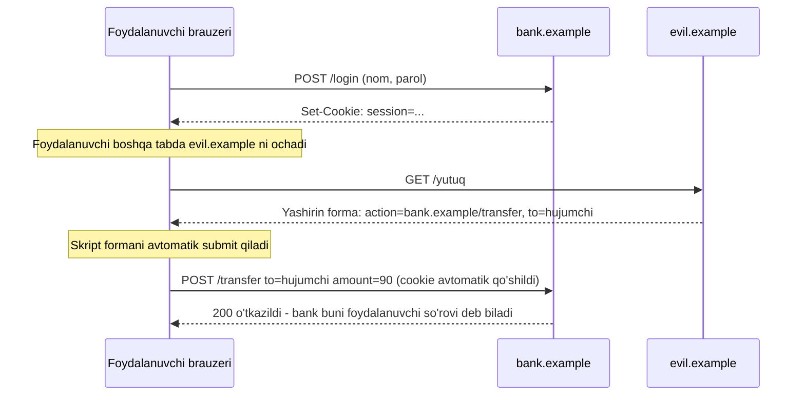

## Bu dars nima uchun kerak

49-darsda to'liq ishlaydigan CRUD ilova qurdik. U to'g'ri ishlaydi - lekin faqat hamma foydalanuvchi halol bo'lsa. Internetga chiqqan ilova esa birinchi kundanoq avtomatik skanerlar, botlar va qiziquvchilar bilan uchrashadi. Bu darsda web ilovaning eng ko'p uchraydigan uchta zaifligini va ularning mexanikasini ko'ramiz:

1. **Parollarni saqlash.** Baza ertami-kechmi sizib chiqishi mumkin: SQL injection, o'g'irlangan zaxira nusxa, noto'g'ri sozlangan server. Savol "sizib chiqsa nima bo'ladi?" ga aylanadi. Parollar ochiq yoki oddiy hash bilan saqlangan bo'lsa, ular soatlar ichida tiklanadi va foydalanuvchilarning boshqa saytlardagi akkauntlari ham xavf ostida qoladi.
2. **XSS** (Cross-Site Scripting). Foydalanuvchi kiritgan matn sahifaga HTML sifatida tushsa, hujumchining JavaScript kodi boshqa foydalanuvchilarning brauzerida, sizning saytingiz nomidan ishlaydi.
3. **CSRF** (Cross-Site Request Forgery). Brauzer cookie'ni har so'rov bilan avtomatik yuboradi, hatto so'rov boshqa saytdan boshlangan bo'lsa ham. Hujumchi sahifasi foydalanuvchi nomidan pul o'tkazishi yoki parolni o'zgartirishi mumkin.

To'rtinchi klassik zaiflik - SQL injection - 39-darsda batafsil ko'rilgan; bu yerda faqat qisqa eslatma va OWASP Top 10 ro'yxatidagi o'rni. 30-darsdagi hash funksiya, 45-darsdagi `innerHTML`, 47-darsdagi Jinja va 48-darsdagi cookie va session bu darsda xavfsizlik nuqtai nazaridan qayta ochiladi. Kriptografik hash va shifrlashning nazariyasi 52-darsda, foydalanuvchi tomonidagi himoya (2FA, passkey) 51-darsda.

Bu darsdan keyin siz:

- nega parol ochiq ham, oddiy SHA-256 bilan ham saqlanmasligini raqamlar bilan tushuntira olasiz;
- salt va rainbow table nima ekanini, salt nimadan himoya qilib, nimadan qilmasligini bilasiz;
- bcrypt, scrypt va Argon2id ni OWASP tavsiya etgan parametrlar bilan ishlata olasiz, `werkzeug.security` sukut bo'yicha nima qilishini bilasiz;
- stored va reflected XSS ni ajrata olasiz, Jinja avtomatik escaping qachon himoya qilishini va `|safe` qachon xavfli ekanini bilasiz;
- `innerHTML` va `textContent` farqini va Content-Security-Policy vazifasini tushuntira olasiz;
- CSRF hujumini qadamlab ko'rsatib, SameSite cookie va CSRF token bilan himoya qila olasiz;
- OWASP Top 10:2025 ro'yxatini o'qib, bu darsdagi zaifliklarning qaysi toifaga tushishini bilasiz.

## Parolni saqlash: ochiq matndan hashgacha

### Ochiq matn va oddiy hash

Eng yomon variant - parolni ochiq matnda saqlash (39-darsdagi misolda soddalik uchun shunday qilgan edik). Baza sizib chiqsa, hujumchi parollarni tayyor holda oladi. Odamlar bitta parolni ko'p joyda ishlatgani uchun zarar sizning saytingiz bilan cheklanmaydi.

Keyingi qadam - parol o'rniga uning hashini saqlash. 30-darsda ko'rganimizdek, hash funksiya istalgan uzunlikdagi kirishni belgilangan uzunlikdagi qiymatga aylantiradi. Kriptografik hash (SHA-256) bunga qo'shimcha ravishda **bir tomonlama**: hashdan parolni hisoblab bo'lmaydi. Kirishda foydalanuvchi parolini hashlab, saqlangan hash bilan solishtiramiz. Muammo hal bo'ldimi?

```python run
import hashlib

# Bazada parol o'rniga uning SHA-256 hashi saqlangan (YOMON usul)
users = {"aziza": "qwerty123", "bekzod": "Lola2007", "dilnoza": "qwerty123", "jasur": "k7#Vq!p2Zx"}
db = {name: hashlib.sha256(pw.encode()).hexdigest() for name, pw in users.items()}
for name, h in db.items():
    print(f"{name:8} {h[:20]}...")

# Baza o'g'irlandi. Hujumchida mashhur parollar ro'yxati bor.
common = ["123456", "password", "qwerty123", "111111", "iloveyou", "Lola2007", "admin"]
lookup = {hashlib.sha256(w.encode()).hexdigest(): w for w in common}
print()
for name, h in db.items():
    print(f"{name:8} -> {lookup.get(h, 'topilmadi')}")
print("bir xil hashlar:", len(db) - len(set(db.values())))
```

Natija:

```text
aziza    daaad6e5604e8e17bd9f...
bekzod   e3216edb364e2375eae6...
dilnoza  daaad6e5604e8e17bd9f...
jasur    13d96f4ee92d5ce542bf...

aziza    -> qwerty123
bekzod   -> Lola2007
dilnoza  -> qwerty123
jasur    -> topilmadi
bir xil hashlar: 1
```

Ikki muammo ko'rindi. Birinchisi: `aziza` va `dilnoza` hashlari bir xil - demak parollari ham bir xil, buni hujumchi hech narsa buzmasdan ko'radi. Ikkinchisi: hujumchiga parolni "teskari hisoblash" shart emas. U taxminiy parollar ro'yxatini hashlaydi va natijalarni bazadagi hashlar bilan solishtiradi. Hash bir tomonlama, lekin deterministik: bir xil kirish doim bir xil chiqish beradi.

**Rainbow table** - shu g'oyaning sanoat versiyasi: millionlab va milliardlab ehtimoliy parollar uchun hashlar oldindan bir marta hisoblanib, ixcham jadvalda saqlanadi. Keyin har qanday sizib chiqqan bazadagi har qanday oddiy SHA-256 hash bir qidiruv bilan tekshiriladi. Hisob bir marta qilinadi, foydasi minglab bazalarga.

### Salt

Yechimning birinchi yarmi - **salt** (tuz): har bir foydalanuvchi uchun alohida tasodifiy qiymat yaratiladi, parol bilan birga hashlanadi va hash yonida ochiq saqlanadi. Salt sir emas, uning vazifasi - bir xil parollarni har xil qilish.

```python run
import hashlib
import secrets


def salted_sha256(password, salt):
    return hashlib.sha256(salt + password.encode()).hexdigest()


s1 = secrets.token_bytes(16)
s2 = secrets.token_bytes(16)
h1 = salted_sha256("qwerty123", s1)
h2 = salted_sha256("qwerty123", s2)
print("salt uzunligi:", len(s1), "bayt =", len(s1) * 8, "bit")
print("bir xil parol, turli salt -> hashlar teng emas:", h1 != h2)
print("tekshiruv (to'g'ri parol):", salted_sha256("qwerty123", s1) == h1)
print("tekshiruv (xato parol):  ", salted_sha256("qwerty124", s1) == h1)
```

Natija:

```text
salt uzunligi: 16 bayt = 128 bit
bir xil parol, turli salt -> hashlar teng emas: True
tekshiruv (to'g'ri parol): True
tekshiruv (xato parol):   False
```

16 baytli salt bilan bitta parolning 2^128 xil hashi bo'lishi mumkin. OWASP Password Storage Cheat Sheet salt'ning foydasini uchta natija bilan tushuntiradi: oldindan hisoblangan jadvallar (rainbow table) yaroqsiz bo'ladi; hujumchi har bir hashni alohida, o'z salt'i bilan buzishga majbur, ya'ni ish hajmi foydalanuvchilar soniga proporsional o'sadi; ikki foydalanuvchining paroli bir xilligini ko'rib bo'lmaydi. Salt `secrets` moduli (yoki `os.urandom`) bilan yaratiladi, `random` bilan emas: `random` kriptografik emas, uning qiymatlarini oldindan aytish mumkin.

Lekin salt bitta muammoni hal qilmaydi: **tezlik**. Bitta foydalanuvchining hashini lug'at bilan buzish hali ham arzon, chunki SHA-256 tez bo'lishi uchun loyihalangan.

### Hisob: tez hash va sekin hash

Quyidagi blok bitta tekshiruv narxini o'lchaydi. bcrypt va Argon2id pastda tushuntiriladi; hozircha faqat raqamlarga qarang.

```python run
import hashlib
import time

import bcrypt
from argon2 import PasswordHasher

ph = PasswordHasher(time_cost=2, memory_cost=19456, parallelism=1)

# Bitta hisob necha millisekund oladi (natija qurilmaga bog'liq)
for name, fn in [
    ("sha256 x 1000", lambda: [hashlib.sha256(b"x%d" % i).digest() for i in range(1000)]),
    ("bcrypt cost=10", lambda: bcrypt.hashpw(b"x", bcrypt.gensalt(rounds=10))),
    ("bcrypt cost=12", lambda: bcrypt.hashpw(b"x", bcrypt.gensalt(rounds=12))),
    ("argon2id m=19MiB t=2", lambda: ph.hash("x")),
]:
    t = time.perf_counter()
    fn()
    print(f"{name:22} {(time.perf_counter() - t) * 1000:9.3f} ms")
```

Natija qurilmaga bog'liq. Bir x86-64 kompyuterda (bitta yadro) taxminan shunday chiqdi: 1000 ta SHA-256 - 0,5 ms, ya'ni bittasi 0,5 mikrosekund; bcrypt cost=10 - 80 ms; bcrypt cost=12 - 310 ms; Argon2id (19 MiB, t=2) - 27 ms. Brauzerda (WebAssembly) natijalar sekinroq bo'lishi mumkin, lekin nisbatlar o'xshash.

Endi hujumchi tomonidan hisoblaymiz. Bitta yadro sekundiga taxminan 1000 / 0,5 ms = 2 million SHA-256 hisoblaydi.

| Stsenariy | SHA-256 (0,5 mks) | bcrypt cost=12 (310 ms) |
|---|---|---|
| Sizib chiqqan 10 mln mashhur parol ro'yxati, bitta foydalanuvchi | 10^7 x 0,5 mks = 5 s | 10^7 x 0,31 s = 3,1 mln s, taxminan 36 kun |
| 8 ta kichik lotin harfi, barcha variantlar: 26^8 = 208 827 064 576 | 2,09 x 10^11 x 0,5 mks = 104 000 s, taxminan 29 soat | 2,09 x 10^11 x 0,31 s = 6,5 x 10^10 s, taxminan 2050 yil |

Bu bitta CPU yadrosi uchun. Haqiqiy hujumchi yuzlab parallel yadroli GPU va ijaraga olingan serverlar ishlatadi, shuning uchun mutlaq raqamlar hujumchi foydasiga ko'p marta o'zgaradi. Lekin nisbat qoladi: sekin funksiya hujumchining har bir taxminini yuz minglab marta qimmatlashtiradi. Bizning serverimiz uchun esa 0,3 sekund kirish paytida bir marta to'lanadigan narx - foydalanuvchi uni sezmaydi.

## Sekin hash funksiyalar: bcrypt, scrypt, Argon2id

Parol hashlash uchun maxsus funksiyalar (ularni **key derivation function**, KDF, ham deyishadi - paroldan kalit chiqaruvchi funksiya) ikki xususiyatga ega: salt'ni o'zi boshqaradi va **sozlanadigan narx** (work factor) bor. Kompyuterlar tezlashgani sari narx oshiriladi. Ba'zilari **xotiraga qattiq** (memory-hard): har hisob ko'p megabayt RAM talab qiladi. GPU'da minglab yadro bor, lekin har biriga 19-128 MiB xotira berib bo'lmaydi, shuning uchun parallel hujum qimmatlashadi.

OWASP Password Storage Cheat Sheet tavsiyalari (bu yerda qisqartirilgan):

| Algoritm | Qachon | Minimal parametrlar (OWASP) | Izoh |
|---|---|---|---|
| Argon2id | Birinchi tanlov | m=19 MiB, t=2, p=1 (yoki m=46 MiB, t=1, p=1; m=12 MiB, t=3, p=1 va h.k.) | 2015-yilgi Password Hashing Competition g'olibi; RFC 9106; xotiraga qattiq |
| scrypt | Argon2id yo'q bo'lsa | N=2^17 (128 MiB), r=8, p=1 (yoki N=2^16, p=2; N=2^15, p=3; N=2^14, p=5) | Colin Percival; xotira = 128 x N x r bayt |
| bcrypt | Faqat eski (legacy) tizimlar | work factor (cost) kamida 10 | Kirish 72 bayt bilan cheklangan; uzunroq parol jimgina kesilishi mumkin |
| PBKDF2-HMAC-SHA256 | FIPS-140 talab qilinsa | 600 000 iteratsiya | Xotiraga qattiq emas |

Har qatordagi bir nechta variant OWASP bo'yicha teng kuchli: xotirani kamaytirsangiz, vaqt (t yoki p) ni oshirasiz. scrypt xotirasini hisoblaymiz: N=2^17, r=8 uchun 128 x 131 072 x 8 = 134 217 728 bayt = 128 MiB. bcrypt'da cost - logarifmik: cost bir oshsa, ish ikki baravar oshadi. Yuqoridagi o'lchovda cost=10 dan 12 ga o'tish 80 ms dan 310 ms ga, ya'ni taxminan 2^2 = 4 marta.

### Python'da: bcrypt va Argon2id

Brauzer muhitida `bcrypt` va `argon2-cffi` paketlari bor. Ikkala kutubxona ham salt'ni o'zi yaratadi va uni parametrlar bilan birga natija satriga joylaydi - alohida ustun kerak emas:

```python run
import bcrypt
from argon2 import PasswordHasher
from argon2.exceptions import VerifyMismatchError

# bcrypt: salt va cost hashning ichida saqlanadi
h1 = bcrypt.hashpw(b"qwerty123", bcrypt.gensalt(rounds=12))
h2 = bcrypt.hashpw(b"qwerty123", bcrypt.gensalt(rounds=12))
print("bcrypt prefiks:", h1[:7].decode(), "| uzunlik:", len(h1))
print("bir xil parol, turli hash:", h1 != h2)
print("to'g'ri parol:", bcrypt.checkpw(b"qwerty123", h1))
print("xato parol:   ", bcrypt.checkpw(b"qwerty124", h1))

# Argon2id: parametrlarni aniq beramiz (OWASP minimum: 19 MiB, t=2, p=1)
ph = PasswordHasher(time_cost=2, memory_cost=19456, parallelism=1)
a = ph.hash("qwerty123")
print("argon2 parametrlar:", "$".join(a.split("$")[:4]))
print("to'g'ri parol:", ph.verify(a, "qwerty123"))
try:
    ph.verify(a, "qwerty124")
except VerifyMismatchError:
    print("xato parol:    VerifyMismatchError")
```

Natija:

```text
bcrypt prefiks: $2b$12$ | uzunlik: 60
bir xil parol, turli hash: True
to'g'ri parol: True
xato parol:    False
argon2 parametrlar: $argon2id$v=19$m=19456,t=2,p=1
to'g'ri parol: True
xato parol:    VerifyMismatchError
```

bcrypt satri `$2b$12$` bilan boshlanadi: algoritm versiyasi va cost; keyin 22 belgida salt va 31 belgida hash, jami 60 belgi. Argon2 satri ham o'zini tavsiflaydi: `$argon2id$v=19$m=19456,t=2,p=1$<salt>$<hash>`. Bu juda muhim: ertaga parametrlarni oshirsangiz, eski hashlar o'z parametrlari bilan tekshirilaveradi. argon2-cffi'da `ph.check_needs_rehash(a)` eski parametrli hashni aniqlaydi: foydalanuvchi to'g'ri parol bilan kirganda uni yangi parametrlar bilan qayta hashlab saqlash mumkin (parol aynan shu paytda ochiq holda qo'lingizda).

### Flask'da: `werkzeug.security`

Flask o'rnatilganda Werkzeug ham keladi va unda tayyor ikki funksiya bor. CS50'ning finance problem set'i ham shulardan foydalanadi.

```python
from werkzeug.security import check_password_hash, generate_password_hash

h = generate_password_hash("qwerty123")
print(h)
method, salt, digest = h.split("$")
print("method:", method, "| salt:", len(salt), "belgi | hash:", len(digest), "hex belgi")
print(check_password_hash(h, "qwerty123"), check_password_hash(h, "qwerty124"))

strong = generate_password_hash("qwerty123", method="scrypt:131072:8:1")
print(strong.split("$")[0])
```

Werkzeug 3.1 bilan lokal natija (salt va hash har ishga tushirishda boshqacha):

```text
scrypt:32768:8:1$SYIQau3D0rNmMNE4$3e4525945b75be9fd02b77be37f12d546c53dff8a4e36ba308edab6c0aa7228e20d7323f7c7e444611e7eff5ef37533cbc9a54ffc490a06f7b96a3dc8266e8f0
method: scrypt:32768:8:1 | salt: 16 belgi | hash: 128 hex belgi
True False
scrypt:131072:8:1
```

Werkzeug hujjatiga ko'ra, `generate_password_hash(password, method='scrypt', salt_length=16)`: sukut bo'yicha algoritm **scrypt**, parametrlari `scrypt:32768:8:1`, ya'ni N=2^15, r=8, p=1. Ikkinchi variant - `pbkdf2` ("less secure" deb belgilangan). Natija formati `method$salt$hash`, `check_password_hash` parametrlarni satrdan o'qiydi.

Bir nozik joy: OWASP jadvalida N=2^15 r=8 qatori p=3 bilan keladi, Werkzeug sukuti esa p=1, ya'ni OWASP minimumidan taxminan uch baravar arzon. Kuchliroq parametr `method` orqali beriladi, masalan `"scrypt:131072:8:1"` (OWASP'ning birinchi qatori). Qaysi parametr - server yuklamasiga qarab tanlanadi va o'lchanadi.

Bu blok `run` emas: brauzerdagi Python (Pyodide) OpenSSL'siz yig'ilgan va unda `hashlib.scrypt` hamda `hashlib.pbkdf2_hmac` yo'q, Python 3.12 dan beri bu ikki funksiya faqat OpenSSL bilan mavjud. Kompyuteringizda `pip install flask` qilib sinab ko'ring.

### Qo'lda: `hashlib.scrypt`

Kutubxonasiz ham yozish mumkin; bu formatning ichini ko'rsatadi. Ikki tafsilotga e'tibor bering: `maxmem` (OpenSSL sukuti 32 MiB, N=2^17 uchun esa 128 MiB kerak, aks holda `ValueError: ... memory limit exceeded`) va `hmac.compare_digest`.

```python
import hashlib
import hmac
import secrets

N, R, P = 2**17, 8, 1          # OWASP: N=2^17 (128 MiB), r=8, p=1
MAXMEM = 132 * N * R * P       # sukut 32 MiB yetmaydi: 128 * N * r = 128 MiB kerak


def hash_password(password):
    salt = secrets.token_bytes(16)
    dk = hashlib.scrypt(password.encode(), salt=salt, n=N, r=R, p=P, maxmem=MAXMEM, dklen=32)
    return f"scrypt${N}${R}${P}${salt.hex()}${dk.hex()}"


def verify_password(stored, password):
    _, n, r, p, salt_hex, dk_hex = stored.split("$")
    n, r, p = int(n), int(r), int(p)
    dk = hashlib.scrypt(password.encode(), salt=bytes.fromhex(salt_hex), n=n, r=r, p=p,
                        maxmem=132 * n * r * p, dklen=32)
    return hmac.compare_digest(dk.hex(), dk_hex)


stored = hash_password("qwerty123")
print(stored[:40] + "...")
print(verify_password(stored, "qwerty123"), verify_password(stored, "qwerty124"))
```

```text
scrypt$131072$8$1$876de17eda502e3ab9bdb4...
True False
```

Nega `==` emas, `hmac.compare_digest`? Oddiy satr solishtirish birinchi farqli belgida to'xtaydi, shuning uchun javob vaqti nechta belgi mos kelganiga bog'liq. Bunday vaqt farqi o'lchab olinadigan bo'lsa, u ma'lumot sizdiradi (timing attack). `compare_digest` vaqti faqat uzunlikka bog'liq. Parol hashlarida bu xavf kichik (hujumchi salt'ni bilmaydi), lekin sirlarni (token, imzo) solishtirishda doim `compare_digest` ishlatish - yaxshi odat; pastda CSRF tokenida ham shunday qilamiz.

**Pepper** haqida qisqa. OWASP qo'shimcha himoya sifatida pepper'ni ham tilga oladi: barcha parollar uchun umumiy sir, bazada emas, alohida (secrets vault) saqlanadi. Faqat baza sizib chiqsa (masalan SQL injection orqali), pepper'siz hashlarni buzib bo'lmaydi. Lekin u salt va sekin funksiya o'rnini bosmaydi va almashtirilganda barcha parollarni qayta o'rnatishni talab qiladi.

## XSS: foydalanuvchi matni kodga aylanganda

XSS (Cross-Site Scripting) - 39-darsdagi SQL injection'ning HTML versiyasi. U yerda foydalanuvchi matni SQL kodiga qo'shilgan edi, bu yerda HTML kodiga. Brauzer `<script>` yoki `onerror="..."` ni ko'rsa, uni sizning saytingiz kodi deb bajaradi. Bu kod sahifadagi hamma narsani o'qiy oladi, foydalanuvchi nomidan so'rov yubora oladi va `HttpOnly` bo'lmagan cookie'larni (48-dars) o'g'irlashi mumkin.

Uch turi bor:

- **Stored XSS** (saqlangan): zararli matn bazaga yoziladi (izoh, profil nomi, kitob nomi) va uni ko'rgan **har bir** foydalanuvchining brauzerida ishlaydi. Eng xavflisi.
- **Reflected XSS** (aks ettirilgan): zararli matn so'rovning o'zida (`/search?q=...`) va javobga darhol qaytariladi. Hujumchi qurbonni maxsus havolani ochishga undaydi.
- **DOM-based XSS**: server ishtirok etmaydi; sahifadagi JavaScript URL yoki boshqa manbadan olingan matnni `innerHTML` ga yozadi (45-dars). Pastda `html run` misoli.

### Jinja avtomatik escaping

Himoya g'oyasi 39-darsdagi kabi: ma'lumot kod bilan aralashmasin. HTML uchun bu **escaping** (47-darsda avtomatik escaping sifatida tanishganmiz): maxsus belgilar entity'ga almashtiriladi: `<` - `&lt;`, `>` - `&gt;`, `&` - `&amp;`, `"` - `&#34;`, `'` - `&#39;`. Brauzer ularni teg emas, matn sifatida ko'rsatadi. Flask hujjatiga ko'ra, Jinja `render_template()` da `.html`, `.htm`, `.xml`, `.xhtml` va `.svg` shablonlari uchun, `render_template_string()` da esa har doim avtomatik escape qiladi.

```python run
from flask import Flask, render_template_string, request
from markupsafe import escape

app = Flask(__name__)
comments = []  # "baza": stored XSS shu yerda yashaydi


@app.get("/search-unsafe")
def search_unsafe():
    q = request.args.get("q", "")
    return f"<p>Qidiruv: {q}</p>"              # f-string: hech narsa escape qilinmaydi


@app.get("/search")
def search():
    q = request.args.get("q", "")
    return render_template_string("<p>Qidiruv: {{ q }}</p>", q=q)


@app.post("/comments")
def add_comment():
    comments.append(request.form["text"])
    return "ok"


@app.get("/comments")
def show_comments():
    return render_template_string(
        "<li>{{ c }}</li>"
        "|<li>{{ c|safe }}</li>",
        comments=comments,
    )


@app.get("/name")
def name():
    n = request.args.get("n", "")
    return render_template_string("<input value={{ n }}>|<input value=\"{{ n }}\">", n=n)


payload = ''
c = app.test_client()
print("Reflected, f-string:")
print("  ", c.get("/search-unsafe", query_string={"q": payload}).get_data(as_text=True))
print("Reflected, Jinja:")
print("  ", c.get("/search", query_string={"q": payload}).get_data(as_text=True))

c.post("/comments", data={"text": "<script>steal(document.cookie)</script>"})
escaped, raw = c.get("/comments").get_data(as_text=True).split("|")
print("Stored, {{ c }}:     ", escaped)
print("Stored, {{ c|safe }}:", raw)
bad, good = c.get("/name", query_string={"n": "x onfocus=steal() autofocus"}).get_data(as_text=True).split("|")
print("Qo'shtirnoqsiz atribut:", bad)
print("Qo'shtirnoqli atribut: ", good)
print("escape():", escape("Tom & \"Jerry\" <'x'>"))
```

Natija:

```text
Reflected, f-string:
   <p>Qidiruv: </p>
Reflected, Jinja:
   <p>Qidiruv: &lt;img src=x onerror=&#34;steal(document.cookie)&#34;&gt;</p>
Stored, {{ c }}:      <li>&lt;script&gt;steal(document.cookie)&lt;/script&gt;</li>
Stored, {{ c|safe }}: <li><script>steal(document.cookie)</script></li>
Qo'shtirnoqsiz atribut: <input value=x onfocus=steal() autofocus>
Qo'shtirnoqli atribut:  <input value="x onfocus=steal() autofocus">
escape(): Tom &amp; &#34;Jerry&#34; &lt;&#39;x&#39;&gt;
```

Tahlil:

1. **f-string** bilan qaytarilgan javobda `` haqiqiy tegga aylandi: rasm yuklanmaydi, `onerror` ishlaydi. Bu reflected XSS. Flask route'idan to'g'ridan-to'g'ri satr qaytarish va unga foydalanuvchi matnini qo'shish - Jinja'ni chetlab o'tish demak.
2. **`{{ q }}`** o'sha matnni zararsiz `&lt;img ...&gt;` ga aylantirdi. Foydalanuvchi ekranda aynan o'zi yozgan matnni ko'radi.
3. **Stored**: izoh bazaga (bu yerda ro'yxatga) xom holda saqlangan va bu to'g'ri. Escaping saqlashda emas, **chiqarishda**, kontekstga qarab qilinadi: HTML'da bir xil, JSON'da boshqacha, SQL'da parametr.
4. **`|safe`** filtri "bu matn xavfsiz HTML, escape qilma" degani. Foydalanuvchi matniga qo'llansa, avtomatik himoya o'chadi va `<script>` tirik qoladi. `|safe` va `Markup()` faqat siz o'zingiz yaratgan yoki ishonchli sanitizer'dan o'tgan HTML uchun.
5. **Qo'shtirnoqsiz atribut.** `x onfocus=steal() autofocus` da escape qilinadigan belgi yo'q: na `<`, na `"`. Lekin `value={{ n }}` qo'shtirnoqsiz bo'lgani uchun bo'shliq atributni yopdi va `onfocus`, `autofocus` yangi atributlarga aylandi. Flask hujjati shu sababli atributlarni doim qo'shtirnoqqa olishni talab qiladi: `value="{{ n }}"`.

Escaping ham hamma narsani yopmaydi. Flask hujjati misoli: `<a href="{{ url }}">` da foydalanuvchi `javascript:...` manzilini kiritsa, unda hech qanday maxsus belgi bo'lmasligi mumkin, lekin bosilganda kod ishlaydi. Bunday maydonlarni allowlist bilan tekshiring (faqat `http://` va `https://`) va CSP qo'ying.

### Brauzerda: `innerHTML` va `textContent`

45-darsda DOM'ga matn yozishning ikki yo'lini ko'rgan edik. Quyidagi sahifa bir xil "izoh" ni ikkalasi bilan yozadi. Zararli kod hech narsa o'g'irlamaydi, faqat `<body>` ga `data-hacked` atributini qo'yadi - shu bilan kod ishlaganini ko'ramiz.

```html run
<!doctype html>
<html>
<body>
  <p>Hujumchi izoh sifatida yozgan matn:</p>
  <pre id="src"></pre>
  <h3>innerHTML</h3>
  <div id="unsafe"></div>
  <h3>textContent</h3>
  <div id="safe"></div>
  <script>
    const comment = 'Zo\'r maqola! ';
    document.getElementById("src").textContent = comment;

    document.getElementById("unsafe").innerHTML = comment;   // HTML sifatida tahlil qilinadi
    document.getElementById("safe").textContent = comment;   // oddiy matn bo'lib qoladi

    setTimeout(() => {
      console.log("innerHTML ichidagi elementlar:", document.getElementById("unsafe").children.length);
      console.log("textContent ichidagi elementlar:", document.getElementById("safe").children.length);
      console.log("body data-hacked:", document.body.dataset.hacked ?? "yo'q");
    }, 100);
  </script>
</body>
</html>
```

Natija (konsol):

```text
innerHTML ichidagi elementlar: 1
textContent ichidagi elementlar: 0
body data-hacked: ha
```

`innerHTML` matnni HTML sifatida tahlil qildi: `` elementi yaratildi, rasm yuklanmadi va `onerror` hujumchi kodini bajardi (rasm o'rnida "kod ishladi" yozuvi chiqadi). MDN `innerHTML` sahifasi aynan shuni ogohlantiradi: `innerHTML` orqali qo'shilgan `<script>` elementlari bajarilmaydi, lekin `onerror` kabi hodisa atributlari orqali kod baribir ishlaydi; matn oddiy matn bo'lishi kerak bo'lsa, `textContent` ishlating. `textContent` hech narsani tahlil qilmaydi: ekranda teglar harfma-harf ko'rinadi, element yaratilmaydi.

Qoida: foydalanuvchi matni uchun `textContent` (yoki `createElement` + `textContent`). HTML haqiqatan kerak bo'lsa (masalan, Markdown'dan yasalgan), uni ishonchli sanitizer orqali o'tkazing.

### Content-Security-Policy

Escaping - asosiy himoya. **CSP** (Content-Security-Policy) - ikkinchi qatlam: server javob header'i orqali brauzerga sahifa qayerdan skript, uslub, rasm yuklashi mumkinligini aytadi. Flask hujjati qat'iy misol keltiradi:

```python
@app.after_request
def security_headers(resp):
    resp.headers["Content-Security-Policy"] = "default-src 'self'"
    return resp
```

`default-src 'self'` bilan faqat o'z domeningizdagi fayllardan skript yuklanadi, inline `<script>` va `onerror="..."` kabi atributlar esa bajarilmaydi. Shunda escaping'da xato qilinsa ham, kiritilgan kod ishlamaydi. Narxi: barcha JavaScript alohida `.js` faylga ko'chirilishi kerak (yoki nonce/hash bilan ruxsat beriladi). CSP to'liq qamrovi - MDN'ning CSP qo'llanmasida.

## CSRF: boshqa sayt sizning nomingizdan

### Hujum mexanizmi

48-darsda ko'rganimizdek, login qilgandan keyin brauzer session cookie'ni saqlaydi va shu saytga yuborilgan **har bir** so'rovga avtomatik qo'shadi. "Har bir" ichiga boshqa saytdan boshlangan so'rovlar ham kiradi. OWASP CSRF Cheat Sheet ta'rifi: zararli sayt, xat yoki dastur autentifikatsiyadan o'tgan foydalanuvchining brauzerini ishonchli saytda istalmagan amal bajarishga majbur qiladi; himoyasiz sayt soxta so'rovni haqiqiysidan ajrata olmaydi.



Hujumchi javobni o'qiy olmaydi (brauzerning same-origin qoidasi), lekin bunga ehtiyoj ham yo'q: amal bajarildi. CSRF faqat holatni o'zgartiruvchi so'rovlarga xavfli - shuning uchun 49-darsdagi "o'chirish GET bilan bo'lmasin" qoidasi bu yerda ham himoya.

### SameSite cookie

Birinchi himoya brauzer darajasida: 48-darsda cookie atributlari orasida ko'rgan `SameSite`. Endi uni aynan CSRF nuqtai nazaridan o'qiymiz (MDN bo'yicha):

| Qiymat | Boshqa saytdan boshlangan so'rovda cookie | Natija |
|---|---|---|
| `Strict` | Hech qachon yuborilmaydi, hatto oddiy havola bosilganda ham | Eng xavfsiz; tashqi havoladan kelgan foydalanuvchi "login qilmagan" bo'lib ko'rinadi |
| `Lax` | Faqat yuqori darajadagi navigatsiya (manzil satri o'zgaradi) va xavfsiz metod (GET) bo'lsa | Yuqoridagi yashirin POST forma cookie'siz keladi; havolalar ishlayveradi |
| `None` | Har doim (`Secure` atributi majburiy) | Himoya yo'q; uchinchi tomon kontekstlari uchun |

MDN'ga ko'ra ba'zi brauzerlar `SameSite` berilmasa `Lax` ni sukut qiladi, lekin bu sukut biroz yumshoqroq: yangi o'rnatilgan cookie 2 daqiqa davomida cross-site POST'larda ham yuboriladi. Flask'da `SESSION_COOKIE_SAMESITE` sukut bo'yicha `None` (atribut umuman qo'yilmaydi), hujjat `'Lax'` ni tavsiya qiladi. Shuning uchun uni aniq qo'yamiz.

OWASP bu atributni chuqur himoyaning bir qatlami deb hisoblaydi, asosiy himoya emas: `Lax` GET ni o'tkazib yuboradi (holat o'zgartiruvchi GET bo'lsa, hujum ishlaydi), "sayt" esa domen bo'yicha aniqlanadi, ya'ni sizning subdomenlaringizdagi zaiflik ham ichkaridan hisoblanadi.

### CSRF token

Asosiy himoya - **synchronizer token** naqshi: server har session uchun tasodifiy token yaratadi, uni session'da saqlaydi va har bir formaga yashirin maydon sifatida qo'yadi. POST kelganda formadagi token session'dagisi bilan solishtiriladi. Hujumchi sahifasi cookie'ni brauzer orqali "yubora oladi", lekin tokenni bilmaydi: u sizning sahifangizni o'qiy olmaydi.

```python run
import re
import secrets

from flask import Flask, abort, render_template_string, request, session

app = Flask(__name__)
app.config.update(SECRET_KEY="faqat-misol-uchun", SESSION_COOKIE_SAMESITE="Lax")
balances = {"aziza": 100, "hujumchi": 0}


def csrf_token():
    if "csrf" not in session:
        session["csrf"] = secrets.token_urlsafe(32)   # 32 tasodifiy bayt
    return session["csrf"]


@app.before_request
def check_csrf():
    if request.method == "POST":
        sent = request.form.get("csrf_token", "")
        if not sent or not secrets.compare_digest(sent, session.get("csrf", "")):
            abort(403)


@app.post("/login")
def login():
    session["user"] = request.form["user"]
    return "kirdingiz"


@app.get("/transfer")
def transfer_form():
    return render_template_string(
        '<form method="post"><input type="hidden" name="csrf_token" value="{{ t }}">'
        '<input name="to"><input name="amount"><button>Yuborish</button></form>',
        t=csrf_token(),
    )


@app.post("/transfer")
def transfer():
    user, amount = session["user"], int(request.form["amount"])
    balances[user] -= amount
    balances[request.form["to"]] += amount
    return f"o'tkazildi: {amount}"


@app.after_request
def security_headers(resp):
    resp.headers["Content-Security-Policy"] = "default-src 'self'"
    return resp


c = app.test_client()

# 1. Foydalanuvchi forma sahifasini ochadi: session'da token paydo bo'ladi
page = c.get("/transfer")
token = re.search(r'name="csrf_token" value="([^"]+)"', page.get_data(as_text=True))[1]
print("token uzunligi:", len(token), "belgi")
print("Set-Cookie: session=<imzolangan qiymat>;", page.headers["Set-Cookie"].split(";", 1)[1].strip())
print("CSP:", page.headers["Content-Security-Policy"])

# 2. Login ham POST, demak u ham token talab qiladi
print("tokensiz login:", c.post("/login", data={"user": "aziza"}).status_code)
print("tokenli login: ", c.post("/login", data={"user": "aziza", "csrf_token": token}).status_code)

# 3. Hujumchi sahifasidagi yashirin forma: cookie brauzerda bor, token esa yo'q
r = c.post("/transfer", data={"to": "hujumchi", "amount": "90"})
print("tokensiz POST:  ", r.status_code, balances)
r = c.post("/transfer", data={"to": "hujumchi", "amount": "90", "csrf_token": "taxmin"})
print("noto'g'ri token:", r.status_code, balances)

# 4. Haqiqiy forma tokenni o'zi yuboradi
r = c.post("/transfer", data={"to": "hujumchi", "amount": "10", "csrf_token": token})
print("to'g'ri token:  ", r.status_code, r.get_data(as_text=True), balances)
```

Natija:

```text
token uzunligi: 43 belgi
Set-Cookie: session=<imzolangan qiymat>; HttpOnly; Path=/; SameSite=Lax
CSP: default-src 'self'
tokensiz login: 403
tokenli login:  200
tokensiz POST:   403 {'aziza': 100, 'hujumchi': 0}
noto'g'ri token: 403 {'aziza': 100, 'hujumchi': 0}
to'g'ri token:   200 o'tkazildi: 10 {'aziza': 90, 'hujumchi': 10}
```

Kuzatishlar:

1. Token `secrets.token_urlsafe(32)` bilan: 32 tasodifiy bayt, base64url'da 43 belgi, 256 bit - taxmin qilib bo'lmaydi. Har session uchun bitta token (OWASP stateful ilovalar uchun shu naqshni tavsiya qiladi).
2. Session cookie'da `HttpOnly` (JavaScript o'qiy olmaydi - XSS bo'lsa ham cookie o'g'irlanmaydi) va `SameSite=Lax` bor. Haqiqiy saytda `SESSION_COOKIE_SECURE=True` ham (faqat HTTPS orqali).
3. Login ham POST va ham token talab qiladi. Bu "login CSRF" dan himoya: hujumchi qurbonni o'zining akkauntiga kiritib, keyin u kiritgan ma'lumotlarni o'qishi mumkin.
4. Tokensiz va noto'g'ri token bilan kelgan POST'lar 403 oldi, balanslar o'zgarmadi. `before_request` barcha POST'larni bitta joyda tekshiradi - yangi route qo'shilganda himoyani unutib bo'lmaydi.
5. Token `compare_digest` bilan solishtiriladi.

Amaliyotda bu kodni qo'lda yozish shart emas. **Flask-WTF** kengaytmasining `CSRFProtect(app)` i xuddi shu ishni qiladi: barcha POST'larni tekshiradi, shablonga `{{ csrf_token() }}` funksiyasini beradi (formaga `<input type="hidden" name="csrf_token" value="{{ csrf_token() }}">`), JavaScript so'rovlari uchun `X-CSRFToken` header'ini qabul qiladi. OWASP ham avval framework'ning tayyor himoyasini ishlatishni maslahat beradi. Bitta muhim ogohlantirish (OWASP): XSS barcha CSRF himoyalarini buzadi, chunki sahifa ichida ishlayotgan hujumchi kodi tokenni o'qib, so'rovga qo'sha oladi. Ikkala himoya birga kerak.

## SQL injection va OWASP Top 10

SQL injection mexanikasi va himoyasi 39-darsda: foydalanuvchi matni SQL kodiga qo'shilsa, u so'rov ma'nosini o'zgartiradi; parametrlangan so'rov (`?` placeholder) ma'lumotni koddan to'liq ajratadi; jadval va ustun nomlari uchun allowlist. Bu darsdagi XSS - xuddi shu xatoning HTML'dagi ko'rinishi, va himoyaning g'oyasi ham bir xil: ma'lumotni kod sifatida talqin qilinishiga yo'l qo'ymaslik.

**OWASP Top 10** - Open Worldwide Application Security Project'ning web ilovalar uchun eng muhim xavflar ro'yxati, bir necha yilda bir yangilanadi. Eng so'nggi nashr - **2025**:

| O'rin | Toifa | Bu kursda |
|---|---|---|
| A01:2025 | Broken Access Control (kirish huquqini noto'g'ri tekshirish) | CSRF (CWE-352) shu toifada; boshqa foydalanuvchining `/books/7/edit` iga kirish |
| A02:2025 | Security Misconfiguration (noto'g'ri sozlama) | `debug=True` serverda, sukutdagi `SECRET_KEY`, xavfsizlik header'larining yo'qligi |
| A03:2025 | Software Supply Chain Failures (dasturiy ta'minot zanjiri) | Zaif yoki soxta paket o'rnatish (`pip install`) |
| A04:2025 | Cryptographic Failures (kriptografik xatolar) | Parolni ochiq yoki tez hash bilan saqlash, salt'siz hash (CWE-916, CWE-759); 52-dars |
| A05:2025 | Injection | SQL injection (CWE-89, 39-dars) va XSS (CWE-79, shu dars) |
| A06:2025 | Insecure Design (xavfsiz bo'lmagan loyihalash) | Tahdid modelisiz qurilgan tizim; 51-dars |
| A07:2025 | Authentication Failures (autentifikatsiya xatolari) | Kuchsiz parol siyosati, session boshqaruvi; 51-dars |
| A08:2025 | Software or Data Integrity Failures (yaxlitlik) | Imzolanmagan yangilanish yoki ma'lumot |
| A09:2025 | Security Logging and Alerting Failures (log va ogohlantirish) | Hujum urinishlari sezilmasligi (39-darsdagi tergov misoli) |
| A10:2025 | Mishandling of Exceptional Conditions (istisno holatlarni noto'g'ri ishlash) | Xato sahifasida stack trace, xatoda "ochiq" qolgan tekshiruv |

2021-yilgi nashrdan farqlar: Injection 3-o'rindan 5-o'ringa, Cryptographic Failures 2-o'rindan 4-o'ringa tushdi; A03 2013-yildagi "ma'lum zaifligi bor komponentlar" toifasining butun dasturiy ta'minot zanjiriga kengaytirilgan ko'rinishi, A10 esa 2025-yilda yangi qo'shilgan toifa. OWASP sahifasiga ko'ra, A01 bo'yicha sinovdan o'tgan ilovalarning 100% ida kirish nazoratining qandaydir xatosi topilgan, Injection esa eng ko'p CVE qayd etilgan toifa.

## Mashq: salt bilan parol hashlash va tekshirish

`hash_password` va `verify_password` funksiyalarini yozing. `kdf()` tayyor: u `cryptography` paketidagi scrypt (brauzerda `hashlib.scrypt` yo'qligi sababli) bilan paroldan 32 baytli kalit chiqaradi. Sizning vazifangiz - salt, format va tekshiruv:

- `hash_password(password)` - har chaqiruvda yangi 16 baytli salt (`secrets.token_bytes`), natija `scrypt$N$r$p$<salt hex>$<kalit hex>` formatida;
- `verify_password(stored, password)` - N, r, p va salt'ni **saqlangan satrdan** oladi (konstantalardan emas: eski parametrli hashlar ham tekshirilishi kerak), kalitni qayta hisoblaydi va `hmac.compare_digest` bilan solishtiradi;
- buzuq satr (`$` lar soni noto'g'ri, hex emas, raqam emas) uchun xato chiqarmasdan `False` qaytaradi.

Testlar bir xil parolga turli hash, formatni, to'g'ri va xato parolni, eski parametrli hashni va buzuq satrni tekshiradi. Parametrlar OWASP jadvalidagi N=2^14, r=8, p=5 qatori; bitta hash brauzerda taxminan chorak sekund oladi, testlar bir necha sekund.

```python run
import hmac
import secrets

from cryptography.hazmat.primitives.kdf.scrypt import Scrypt

N, R, P = 2**14, 8, 5      # OWASP jadvalidagi qator: N=2^14 (16 MiB), r=8, p=5
SALT_BYTES = 16


def kdf(password, salt, n, r, p):
    """scrypt: parol (str) va salt (bytes) -> 32 baytli kalit. Tayyor, o'zgartirmang."""
    return Scrypt(salt=salt, length=32, n=n, r=r, p=p).derive(password.encode())


def hash_password(password):
    # Natija formati: "scrypt$N$r$p$<salt hex>$<kalit hex>"
    # 1) secrets bilan 16 baytli yangi salt yarating
    # 2) kdf() bilan kalit hisoblang
    # 3) parametrlar, salt va kalitni formatga yig'ing
    return ""


def verify_password(stored, password):
    # 1) stored ni "$" bo'yicha ajrating, N, r, p ni stored'dan oling (konstantadan emas)
    # 2) o'sha salt va parametrlar bilan kdf() ni qayta hisoblang
    # 3) hmac.compare_digest bilan solishtiring; buzuq format bo'lsa False qaytaring
    return False


h = hash_password("qwerty123")
print(h)
print(verify_password(h, "qwerty123"), verify_password(h, "qwerty124"))
```
```python test
_h1 = hash_password("qwerty123")
_h2 = hash_password("qwerty123")


def _parts(h):
    p = h.split("$")
    return p if len(p) == 6 else None


check("format: scrypt$N$r$p$salt$kalit (6 qism)", lambda: _parts(_h1) is not None and _parts(_h1)[0] == "scrypt")
check("parametrlar hashning ichida: N=16384, r=8, p=5", lambda: _parts(_h1)[1:4] == ["16384", "8", "5"])
check("salt 16 bayt (32 hex belgi), kalit 32 bayt (64 hex belgi)",
      lambda: len(bytes.fromhex(_parts(_h1)[4])) == 16 and len(bytes.fromhex(_parts(_h1)[5])) == 32)
check("bir xil parolga ikki marta - turli salt va turli hash", lambda: _h1 != _h2 and _parts(_h1)[4] != _parts(_h2)[4])
check("hash bo'sh emas va unda parolning o'zi yo'q", lambda: len(_h1) > 0 and "qwerty123" not in _h1)
check("to'g'ri parol tekshiruvdan o'tadi", lambda: verify_password(_h1, "qwerty123") is True)
check("xato parol va bo'sh parol rad etiladi",
      lambda: verify_password(_h1, "qwerty123") and verify_password(_h1, "qwerty124") is False
      and verify_password(_h1, "") is False)


def _old_params():
    salt = bytes(range(16))
    old = "scrypt$1024$8$1$" + salt.hex() + "$" + kdf("eski-parol", salt, 1024, 8, 1).hex()
    return verify_password(old, "eski-parol") is True and verify_password(old, "boshqa") is False


check("N, r, p saqlangan satrdan o'qiladi (eski parametrli hash ham tekshiriladi)", _old_params)
check("buzuq satr uchun xato emas, False",
      lambda: verify_password(_h1, "qwerty123") and verify_password("salom", "x") is False
      and verify_password("scrypt$a$b$c$zz$zz", "x") is False)
```

## Ko'p uchraydigan xatolar

1. **Parolni ochiq matnda yoki shifrlab saqlash.** Shifrlash ikki tomonlama: kalit bilan birga sizib chiqsa, hamma parol tiklanadi. Parol uchun faqat sekin bir tomonlama hash.
2. **SHA-256 yoki MD5 bilan, hatto salt bilan hashlash.** Salt rainbow table'ni yopadi, lekin tezlikni emas: bitta yadro sekundiga millionlab taxmin. Argon2id, scrypt yoki bcrypt kerak.
3. **Barcha foydalanuvchilarga bitta salt yoki `random` bilan salt.** Umumiy salt bir xil parollarni yana bir xil qiladi; `random` oldindan aytiladigan qiymat beradi. Har foydalanuvchiga `secrets` bilan alohida salt (kutubxonalar buni o'zi qiladi).
4. **Parametrlarni hashdan alohida, kodda saqlash.** Narx oshirilganda eski hashlar tekshirilmay qoladi. Format o'zini tavsiflasin (`$argon2id$v=19$m=...`, `scrypt:32768:8:1$...`).
5. **`|safe`, `Markup()` yoki f-string bilan HTML yasash.** Jinja himoyasi o'chadi. Foydalanuvchi matni faqat `{{ }}` orqali, atributlar doim qo'shtirnoq ichida.
6. **`innerHTML = foydalanuvchiMatni`.** DOM-based XSS. Matn uchun `textContent`.
7. **Holatni o'zgartiruvchi GET va CSRF tokensiz POST.** `SameSite=Lax` GET'ni himoya qilmaydi, tokensiz POST esa boshqa saytdan yuboriladi. POST + token (Flask-WTF) + `SameSite`.
8. **Sirlarni `==` bilan solishtirish va kodda `SECRET_KEY` yozish.** Token va imzolar uchun `hmac.compare_digest`; `SECRET_KEY` muhit o'zgaruvchisidan, `secrets.token_hex()` bilan yaratilgan.

## Xulosa

- Parol faqat sekin, salt'li funksiya bilan saqlanadi: birinchi tanlov Argon2id (OWASP: kamida 19 MiB, t=2, p=1), keyin scrypt (N=2^17, r=8, p=1), eski tizimlarda bcrypt (cost 10 dan kam emas, 72 bayt cheklovi).
- Salt bir xil parollarni har xil qiladi va rainbow table'ni yaroqsiz qiladi; sekin funksiya har bir taxminni qimmatlashtiradi. Ikkalasi birga kerak.
- `werkzeug.security.generate_password_hash` sukut bo'yicha `scrypt:32768:8:1` va 16 belgili salt ishlatadi; kuchliroq parametrni `method` bilan bering, tekshiruvni `check_password_hash` ga qoldiring.
- XSS - foydalanuvchi matni HTML/JS sifatida bajarilishi: stored, reflected, DOM-based. Jinja avtomatik escaping asosiy himoya; `|safe`, qo'shtirnoqsiz atribut, `javascript:` URL va `innerHTML` - teshiklar. CSP ikkinchi qatlam.
- CSRF - brauzer cookie'ni boshqa saytdan boshlangan so'rovga ham qo'shishidan foydalanadi. Himoya: holat o'zgartiruvchi so'rov faqat POST, CSRF token (synchronizer token, Flask-WTF), qo'shimcha ravishda `SameSite=Lax` va `HttpOnly`.
- SQL injection va XSS - bitta xato: ma'lumot kodga aylanadi. OWASP Top 10:2025 da ikkalasi A05 Injection'da, CSRF A01'da, parol saqlash A04'da.
- Sirlarni `hmac.compare_digest` bilan solishtiring, tasodifiy qiymatlarni `secrets` bilan yarating.

## Amaliy topshiriq

49-darsdagi kutubxona ilovasiga foydalanuvchilar va xavfsizlik qatlamini qo'shing.

1. **Ro'yxatdan o'tish va kirish.** `users (id, username UNIQUE, hash)` jadvali; `POST /register` va `POST /login`. Parol `generate_password_hash` (yoki Argon2id) bilan, OWASP minimumidan past bo'lmagan parametrlar bilan; tanlovingizni va bitta hash necha millisekund olishini o'lchab yozing. Login muvaffaqiyatsiz bo'lsa, "nom yoki parol xato" - qaysi biri ekanini aytmang.
2. **Parametrlarni yangilash.** Foydalanuvchi muvaffaqiyatli kirganda hash eski parametrli bo'lsa (masalan, `scrypt:32768:8:1`), uni yangi parametrlar bilan qayta hashlab saqlang. Buni test bilan ko'rsating.
3. **XSS.** Kitobga izoh qo'shish imkoniyatini qo'shing. `<script>`, `` va qo'shtirnoqsiz atribut hujumlari ishlamasligini `test_client` bilan isbotlang. Barcha javoblarga `Content-Security-Policy: default-src 'self'` header'ini qo'shing.
4. **CSRF.** Barcha POST route'larni CSRF token bilan himoya qiling (qo'lda yoki Flask-WTF). `SESSION_COOKIE_SAMESITE="Lax"`, `SESSION_COOKIE_HTTPONLY=True`, `SESSION_COOKIE_SECURE=True`. Tokensiz va boshqa session tokeni bilan kelgan POST 403 (yoki 400) olishini test bilan ko'rsating.
5. **Kirish nazorati.** Faqat izoh muallifi o'z izohini o'chira oladi; boshqa foydalanuvchining urinishiga 403. Bu OWASP Top 10:2025 ning qaysi toifasi ekanini yozing.

Yaxshi javobda bo'lishi kerak bo'lgan narsalar:

- tanlangan algoritm va parametrlar, OWASP jadvali bilan solishtiruv va o'lchangan vaqt;
- eski hashni qayta hashlash mantiqi va uning testi;
- XSS uchun kamida uchta hujum satri va ularning escape qilingan natijasi;
- CSRF token qayerda yaratiladi, qayerda saqlanadi, qanday solishtiriladi; cookie atributlari;
- har bir himoyaning OWASP Top 10:2025 toifasi (A01, A04, A05);
- kamida 10 ta `test_client` tekshiruvi.

Javobingizni pastdagi maydonga yozing va yuqoridagi mezonlar bilan solishtiring.

## Manbalar

- OWASP. [Password Storage Cheat Sheet](https://cheatsheetseries.owasp.org/cheatsheets/Password_Storage_Cheat_Sheet.html) - "Salting", "Peppering", "Argon2id", "scrypt", "bcrypt" ("Input Limits of bcrypt"), "PBKDF2": tavsiya etilgan parametrlar jadvallari.
- Werkzeug. [Utilities: generate_password_hash, check_password_hash](https://werkzeug.palletsprojects.com/en/stable/utils/) - sukutdagi `scrypt:32768:8:1`, `pbkdf2` varianti, `salt_length=16`.
- Python. [hashlib](https://docs.python.org/3/library/hashlib.html) - "Key derivation": `scrypt` (RFC 7914, `maxmem`) va `pbkdf2_hmac` (3.12 dan faqat OpenSSL bilan); [RFC 9106](https://www.rfc-editor.org/rfc/rfc9106.html) - Argon2 parametrlari.
- Flask. [Security Considerations](https://flask.palletsprojects.com/en/stable/web-security/) - "Cross-Site Scripting (XSS)" (avtomatik escaping, qo'shtirnoqsiz atribut, `javascript:` URI), "Cross-Site Request Forgery (CSRF)", "Security Headers" (CSP); [Templates](https://flask.palletsprojects.com/en/stable/templating/) - qaysi shablonlarda autoescape yoqilgani, `|safe`, `Markup`.
- MDN. [Element: innerHTML](https://developer.mozilla.org/en-US/docs/Web/API/Element/innerHTML) - "Security considerations"; [Set-Cookie](https://developer.mozilla.org/en-US/docs/Web/HTTP/Reference/Headers/Set-Cookie) - `SameSite` qiymatlari va `Lax` sukutidagi 2 daqiqalik istisno; [CSP](https://developer.mozilla.org/en-US/docs/Web/HTTP/Guides/CSP).
- OWASP. [Cross-Site Request Forgery Prevention Cheat Sheet](https://cheatsheetseries.owasp.org/cheatsheets/Cross-Site_Request_Forgery_Prevention_Cheat_Sheet.html) - synchronizer token, "SameSite (Cookie Attribute)" va uning cheklovlari; [Cross Site Scripting Prevention Cheat Sheet](https://cheatsheetseries.owasp.org/cheatsheets/Cross_Site_Scripting_Prevention_Cheat_Sheet.html) - kontekstga qarab chiqishni kodlash.
- Flask-WTF. [CSRF Protection](https://flask-wtf.readthedocs.io/en/1.2.x/csrf/) - `CSRFProtect`, `csrf_token()`, `X-CSRFToken` header'i.
- OWASP. [Top 10:2025](https://top10.owasp.org/2025/) - ro'yxat, [A05:2025 Injection](https://top10.owasp.org/2025/A05_2025-Injection/) (XSS va SQL injection), [A01:2025 Broken Access Control](https://top10.owasp.org/2025/A01_2025-Broken_Access_Control/) (CSRF); CS50x [Lecture 9 notes](https://cs50.harvard.edu/x/notes/9/) - Flask, cookie va session.
