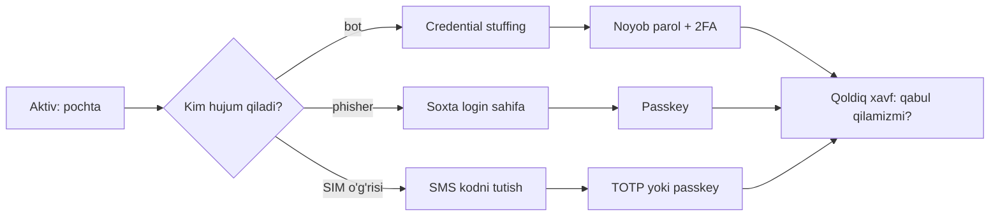
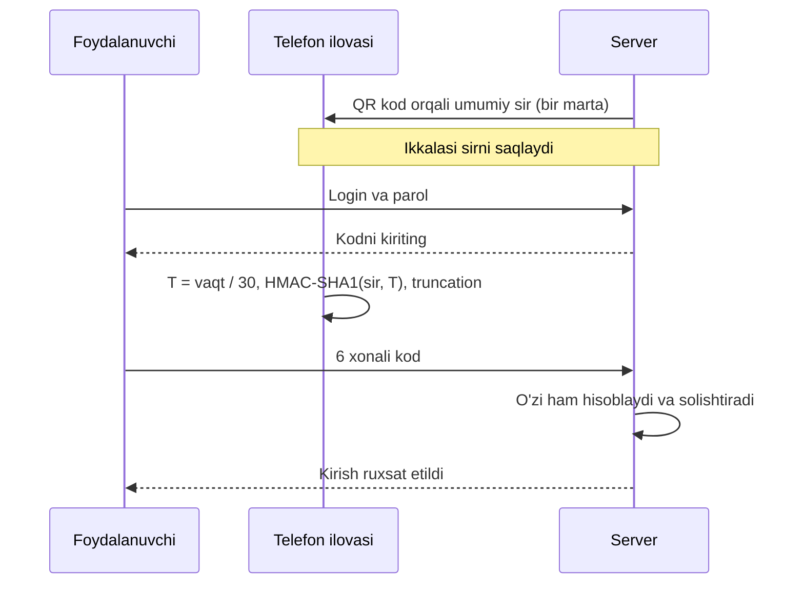
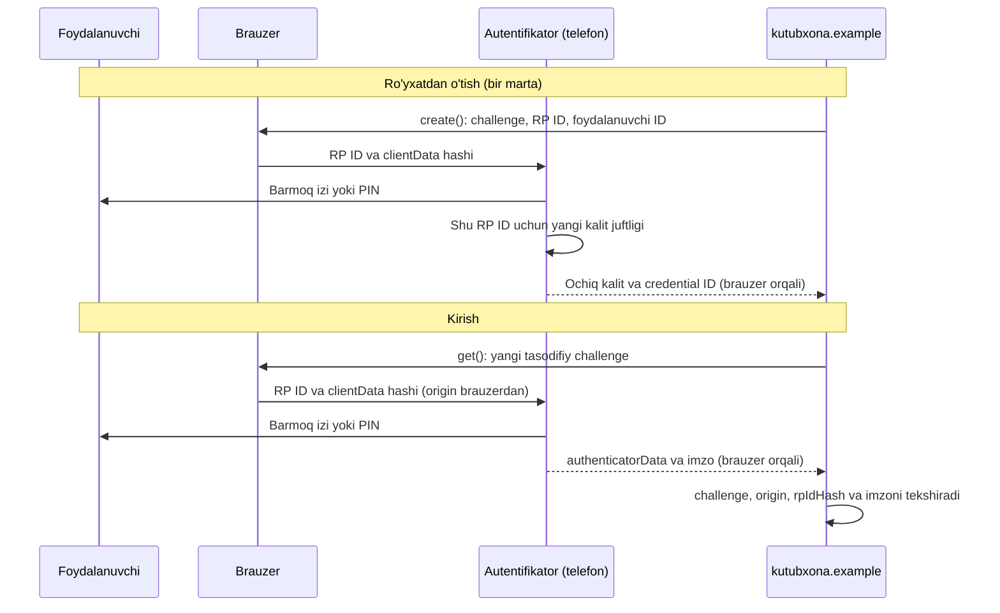

## Bu dars nima uchun kerak

50-darsda server tomonini himoya qildik: parol sekin hash bilan saqlanadi, XSS va CSRF yopiladi. Lekin akkauntlarning ko'pchiligi serverdagi xato orqali emas, boshqa yo'l bilan buziladi: foydalanuvchi parolini soxta sahifaga o'zi kiritadi, boshqa saytda sizib chiqqan parolni bu yerda ham ishlatgan bo'ladi yoki "123456" ni tanlaydi. Bunday hujumlarda bcrypt ham, CSRF token ham yordam bermaydi, chunki hujumchi tizimga to'g'ri parol bilan, xuddi egasi kabi kiradi.

Bu dars - autentifikatsiya (foydalanuvchi haqiqatan o'zi ekanini tekshirish) xavfsizligi haqida, ham foydalanuvchi, ham dasturchi nuqtai nazaridan. Avval umumiy fikrlash vositasini quramiz: nimani, kimdan va qanday himoya qilamiz. Keyin parol kuchini raqam bilan o'lchaymiz, NIST'ning eng so'nggi tavsiyalarini o'qiymiz, ikkinchi faktorlarni (SMS, TOTP, push, hardware key) solishtiramiz va parolsiz kelajak - passkey qanday ishlashini ko'ramiz.

Oldingi darslar bilan bog'liqlik: 14-darsdagi brute force va Kerckhoffs tamoyili parol kuchini hisoblashda qaytadi; 30-darsdagi hash funksiya va 50-darsdagi `hmac.compare_digest` TOTP'da qayta ishlatiladi; 46-darsdagi origin va 48-darsdagi session passkey'ning phishing'ga chidamliligini tushuntiradi. Ochiq kalitli kriptografiya (passkey ichidagi imzo) 52-darsda chuqur ko'riladi; bu yerda uni "qora quti" sifatida ishlatamiz.

Bu darsdan keyin siz:

- CIA triadasi orqali hodisani tasniflay olasiz va oddiy tahdid modelini to'rt savol bilan tuza olasiz;
- phishing, social engineering, brute force, credential stuffing va password spraying farqini va har biriga qarshi himoyani bilasiz;
- parol entropiyasini L · log2(N) formulasi bilan hisoblab, hujum vaqtini baholay olasiz;
- NIST SP 800-63B-4 (2025) parol talablarini va ular nega eski "murakkablik qoidalari" dan voz kechganini tushuntira olasiz;
- TOTP algoritmini (RFC 6238) Python'da `hmac` bilan yozib, rasmiy test vektorlari bilan tekshira olasiz;
- SMS, TOTP, push va hardware key'ni phishing va SIM swap'ga chidamliligi bo'yicha solishtira olasiz;
- passkey (WebAuthn) nima uchun phishing'ga chidamli ekanini qadamlab ko'rsata olasiz;
- rate limiting va account lockout'ni hisob bilan loyihalay olasiz.

## Xavfsizlik nima: CIA triadasi va tahdid modeli

### CIA triadasi

"Xavfsiz" so'zi aniq emas. Amerika standarti FIPS 199 (NIST) axborot xavfsizligini uch maqsad orqali ta'riflaydi va ularni bosh harflari bilan **CIA triadasi** deyishadi:

| Maqsad | Ma'nosi | Buzilishga misol | Asosiy himoya |
|---|---|---|---|
| Confidentiality (maxfiylik) | Ma'lumotni faqat ruxsati borlar o'qiydi | Parollar bazasi sizib chiqdi; umumiy Wi-Fi'da xat o'qildi | Shifrlash (52-dars), kirish nazorati, autentifikatsiya |
| Integrity (yaxlitlik) | Ma'lumotni ruxsatsiz o'zgartirib bo'lmaydi va o'zgarish seziladi | Hujumchi pul o'tkazmasida summani o'zgartirdi; CSRF (50-dars) | Hash, HMAC, raqamli imzo (52-dars), tranzaksiya (40-dars) |
| Availability (mavjudlik) | Tizim kerak bo'lganda ishlaydi | Server so'rovlar bilan to'ldirildi; akkaunt bloklanib qoldi | Zaxira nusxa, rate limiting, ortiqcha serverlar |

Bitta hodisa bir nechta maqsadni buzishi mumkin. Masalan, akkaunt o'g'irlansa, hujumchi xatlarni o'qiydi (C), ularni o'chiradi yoki o'zgartiradi (I) va parolni almashtirib, egasini kirita olmaydi (A). Triadaning foydasi - savolni aniq qo'yish: "bu himoya qaysi harfni qo'riqlaydi?" Masalan, parolni 5 marta xato terganda akkauntni butunlay bloklash C ni kuchaytiradi, lekin A ni zaiflashtiradi: hujumchi ataylab xato terib, istalgan foydalanuvchini tizimdan chiqarib qo'yishi mumkin. Bu darsning oxirida shu muvozanatga qaytamiz.

### Tahdid modeli

Hamma narsadan bir vaqtda himoyalanib bo'lmaydi: himoyaning narxi bor (pul, vaqt, qulaylik). **Tahdid modeli** (threat model) - nimani himoya qilayotganimizni, kimdan va qanday hujumlardan qo'rqishimizni va bunga qarshi nima qilishimizni yozib chiqish. OWASP Threat Modeling Cheat Sheet butun jarayonni to'rtta savolga tayantiradi:

1. Nima ustida ishlayapmiz? (aktivlar: nima qimmatli)
2. Nima noto'g'ri ketishi mumkin? (kim hujum qiladi, qanday)
3. Bunga qarshi nima qilamiz?
4. Yetarlicha yaxshi qildikmi?

Oddiy shaxsiy misol. Aziza - talaba. Uning aktivlari: elektron pochta (boshqa barcha akkauntlarning parolini tiklash shu orqali - demak eng qimmatlisi), messenger, onlayn bank ilovasi, telefon.

| Kim (hujumchi) | Nima istaydi | Qanday | Himoya |
|---|---|---|---|
| Avtomatik bot | Har qanday akkaunt | Sizib chiqqan parollarni ommaviy sinash | Har saytga alohida parol (parol menejeri), 2FA |
| Phishing yuboruvchi | Bank yoki pochta | "Akkauntingiz bloklandi" xati va soxta sahifa | Passkey yoki hardware key, havoladan kirmaslik |
| Telefon raqamini o'g'irlovchi | SMS kodlar | Operatorni aldab SIM'ni qayta chiqarish | SMS o'rniga TOTP yoki passkey, operatorda PIN |
| Tanish odam | Shaxsiy yozishmalar | Qulflanmagan telefonni olish | Ekran qulfi, biometrika |

Ko'rinib turibdiki, hujumchi turiga qarab himoya har xil. Davlat razvedkasi Aziza uchun real tahdid emas va unga qarshi himoya qurish behuda xarajat; bot esa har bir internet foydalanuvchisi uchun real. Tahdid modelining asosiy natijasi aynan shu: kuchni eng ehtimolli va eng zararli tahdidlarga sarflash.



Dasturchi uchun ham xuddi shu: OWASP Top 10:2025 ning A06 (Insecure Design) toifasi (50-dars) aynan tahdid modelisiz qurilgan tizimlar haqida. Login sahifasini yozishdan oldin "bu sahifaga kim va qanday hujum qiladi?" degan savolga javob yozilgan bo'lishi kerak.

## Hujum turlari

### Phishing va social engineering

**Social engineering** (ijtimoiy muhandislik) - texnik zaiflik o'rniga odamni aldash: o'zini bank xodimi, texnik yordam yoki rahbar deb tanishtirib, parol, kod yoki amal so'rash. Kerckhoffs tamoyili (14-dars) algoritmni ochiq deb faraz qiladi; social engineering esa kalitning o'zini egasidan oladi.

**Phishing** - social engineering'ning eng keng tarqalgan turi: soxta xat yoki xabar foydalanuvchini asl saytga juda o'xshash sahifaga olib boradi va u yerda parol kiritiladi. Zamonaviy phishing to'plamlari bundan ham uzoqqa boradi: OWASP Multifactor Authentication Cheat Sheet "reverse proxy" phishing'ni tasvirlaydi - soxta sahifa foydalanuvchi kiritgan parol va bir martalik kodni real vaqtda asl saytga uzatadi va session cookie'ni (48-dars) o'g'irlaydi. Shuning uchun SMS va TOTP kodlari phishing'dan himoya qilmaydi: foydalanuvchi kodni soxta sahifaga o'zi yozadi, hujumchi uni 30 sekund ichida ishlatadi.

### Parolni taxmin qilish hujumlari

OWASP Credential Stuffing Prevention Cheat Sheet uch hujumni ajratadi:

| Hujum | Nima sinaladi | Qaysi zaiflikdan foydalanadi | Asosiy himoya |
|---|---|---|---|
| Brute force (14-dars) | Bitta akkauntga ko'p parol (lug'at yoki barcha variantlar) | Qisqa yoki oddiy parol | Uzun parol, rate limiting |
| Credential stuffing | Boshqa saytdan sizib chiqqan login:parol juftliklari | Bitta parolni ko'p saytda ishlatish | Noyob parol, buzilgan parollar ro'yxati, MFA |
| Password spraying | Bitta keng tarqalgan parol ko'p akkauntga | Har akkauntdagi lockout chegarasidan pastda qolish | Blocklist, IP va umumiy sonni kuzatish, MFA |

Bundan tashqari **online** va **offline** hujumlarni farqlash muhim. Online hujumda har bir taxmin serverga yuboriladi, demak server ularni sanaydi va sekinlashtiradi: sekundiga bir necha urinish, umumiy son esa cheklangan. Offline hujumda hujumchi 50-darsdagidek hash bazasini o'g'irlagan va taxminlarni o'z kompyuterida tekshiradi: hech kim sanamaydi, tezlik faqat hash funksiya narxiga bog'liq. Parol kuchi haqidagi barcha hisob-kitoblar aslida offline stsenariy uchun; online hujum esa rate limiting bilan to'xtatiladi (pastda).

## Parol kuchi va entropiya

### Formula

Parol tasodifiy tanlangan bo'lsa, uning kuchini **entropiya** bilan o'lchaymiz: hujumchi barcha variantlarni sinash uchun nechta urinish kerakligining logarifmi. Agar parol N ta belgidan iborat alifbodan L ta belgi bilan tasodifiy tanlansa:

- variantlar soni: N^L;
- entropiya: H = log2(N^L) = L · log2(N) bit.

Bit - "nechta tanga tashlashga teng" degani. 40 bitli parolni topish uchun eng yomon holatda 2^40 ta, o'rtacha 2^39 ta urinish kerak. Har bir qo'shimcha bit ishni ikki baravar oshiradi.

Misollar: 8 ta kichik lotin harfi: 8 · log2(26) = 8 · 4,70 = 37,6 bit. 94 ta bosiladigan ASCII belgidan 12 ta: 12 · log2(94) = 12 · 6,55 = 78,7 bit. Diceware usulida so'zlar 7776 = 6^5 so'zli ro'yxatdan besh marta zar tashlab tanlanadi, har so'z log2(7776) = 12,9 bit beradi; 6 so'z - 77,5 bit.

Quyidagi dastur bir nechta parol siyosatining entropiyasini va offline hujumda barcha variantlarni sinash vaqtini hisoblaydi. Hujumchi sekundiga 10^10 taxmin tekshiradi deb faraz qilamiz: bu tez hash (salt'li SHA-256 kabi) va bir nechta GPU uchun taxminiy daraja; 50-darsdagi bcrypt yoki Argon2id bu tezlikni yuz minglab marta pasaytiradi.

```c run
#include <math.h>
#include <stdio.h>

typedef struct
{
    const char *name;
    double n;   // alifbo o'lchami: nechta belgi (yoki so'z) dan tanlanadi
    int len;    // uzunlik: nechta belgi (yoki so'z)
} policy;

// Sekundlarni o'qiladigan ko'rinishga keltiradi
void print_time(double s)
{
    if (s < 1)
        printf("%.3g sekund", s);
    else if (s < 3600)
        printf("%.1f daqiqa", s / 60);
    else if (s < 86400 * 365.25)
        printf("%.1f kun", s / 86400);
    else
        printf("%.3g yil", s / (86400 * 365.25));
}

int main(void)
{
    policy p[] = {
        {"PIN, 6 raqam", 10, 6},
        {"8 kichik harf", 26, 8},
        {"8 belgi: a-z A-Z 0-9", 62, 8},
        {"8 belgi: 94 ASCII", 94, 8},
        {"12 belgi: 94 ASCII", 94, 12},
        {"15 kichik harf", 26, 15},
        {"6 so'z, 7776 so'zli ro'yxat", 7776, 6},
    };
    int count = sizeof(p) / sizeof(p[0]);
    double rate = 1e10;   // offline hujum: sekundiga 10^10 taxmin (faraz)

    for (int i = 0; i < count; i++)
    {
        double bits = p[i].len * log2(p[i].n);
        printf("%-28s %5.1f bit  ", p[i].name, bits);
        print_time(pow(2, bits) / rate);
        printf("\n");
    }
}
```

Kompilyatsiya va natija (`math.h` uchun `-lm`):

```text
$ clang entropy.c -lm -o entropy
$ ./entropy
PIN, 6 raqam                  19.9 bit  0.0001 sekund
8 kichik harf                 37.6 bit  0.3 daqiqa
8 belgi: a-z A-Z 0-9          47.6 bit  0.3 kun
8 belgi: 94 ASCII             52.4 bit  7.1 kun
12 belgi: 94 ASCII            78.7 bit  1.51e+06 yil
15 kichik harf                70.5 bit  5.31e+03 yil
6 so'z, 7776 so'zli ro'yxat   77.5 bit  7.01e+05 yil
```

Uch xulosa:

1. **Uzunlik alifbodan kuchliroq.** Alifboni 26 dan 94 ga oshirish har belgiga 4,7 o'rniga 6,55 bit beradi (+1,85 bit). Uzunlikni bitta belgiga oshirish esa butun belgini (+4,7 yoki +6,55 bit) qo'shadi. 15 ta kichik harf (70,5 bit) 8 belgili "murakkab" paroldan (52,4 bit) 26^15 / 94^8, ya'ni taxminan 275 ming marta kuchliroq va yodlash ham osonroq.
2. **Har bit vaqtni ikki baravar oshiradi**: 47,6 bitdan 52,4 bitga (+4,8 bit) o'tish 0,3 kunni 7,1 kunga, taxminan 2^4,8 = 28 marta oshirdi.
3. **Formula faqat tasodifiy parol uchun.** "Lola2007" ham formal ravishda 8 belgi: a-z A-Z 0-9 (47,6 bit) bo'lib ko'rinadi, lekin u ism va yil - hujumchi lug'ati uni birinchi minglab urinishda topadi (50-darsdagi misolda aynan shunday bo'ldi). Odam tanlagan parolning haqiqiy entropiyasi ancha past va uni o'lchab bo'lmaydi. Shuning uchun kuchli parol odam emas, generator (parol menejeri, zar) tomonidan tanlanadi.

Bu yerda 14-darsdagi brute force hisobi bilan solishtiring: u yerda Vigenere kaliti uchun 26^L variantni xuddi shunday hisoblagan edik. Kalit ham, parol ham bir xil qonunga bo'ysunadi: xavfsizlik variantlar sonida, variantlar soni esa uzunlik bilan eksponensial o'sadi.

## NIST SP 800-63B-4: parol bo'yicha hozirgi tavsiyalar

AQSh Milliy standartlar va texnologiyalar instituti (NIST) ning SP 800-63B hujjati - autentifikatsiya bo'yicha eng ko'p iqtibos keltiriladigan qo'llanma. Uning to'rtinchi reviziyasi **SP 800-63B-4** 2025-yil iyulda yakuniy ko'rinishda chiqdi va 2017-yildagi (2020-yilda yangilangan) 3-reviziyani almashtirdi. Hujjatda SHALL - majburiy, SHOULD - tavsiya. Parollar bo'yicha asosiy talablar:

| Mavzu | SP 800-63B-4 talabi | Eski amaliyot |
|---|---|---|
| Minimal uzunlik | Yagona faktor bo'lsa kamida 15 belgi (SHALL); faqat MFA tarkibida ishlatilsa kamida 8 (SHALL) | 8 belgi yetarli deb hisoblangan |
| Maksimal uzunlik | Kamida 64 belgigacha ruxsat berish (SHOULD) | 16 yoki 20 belgi bilan cheklash |
| Belgilar | Barcha bosiladigan ASCII va bo'shliq (SHOULD), Unicode (SHOULD); har code point bitta belgi | Faqat harf va raqam |
| Murakkablik qoidalari | Boshqa tarkib talablari ("katta harf + raqam + belgi") qo'yilmaydi (SHALL NOT) | Majburiy aralash belgilar |
| Davriy almashtirish | Vaqti-vaqti bilan almashtirishni talab qilish taqiqlanadi (SHALL NOT); buzilganlik dalili bo'lsa majburiy almashtiriladi (SHALL) | Har 90 kunda yangi parol |
| Blocklist | Keng tarqalgan, kutiladigan yoki buzilgan parollar ro'yxatida bo'lsa, boshqasini tanlash talab qilinadi | Yo'q |
| Eslatma va maxfiy savollar | Parol eslatmasi (hint) va "birinchi uy hayvoningiz nomi" kabi savollar taqiqlanadi (SHALL NOT) | Keng tarqalgan |
| Parol menejeri | Parol menejeri va avtomatik to'ldirishga ruxsat berish (SHALL), "paste" ga ruxsat (SHOULD) | Paste bloklangan |
| Tekshiruv | Parol to'liq tekshiriladi, kesilmaydi (SHALL); Unicode bo'lsa NFC normalizatsiya (SHOULD) | Ba'zi tizimlar parolni kesgan |
| Taxminlar soni | Rate limiting majburiy (SHALL), pastda | Turlicha |

Nega murakkablik qoidalari va davriy almashtirish olib tashlandi? Ikkalasi ham odam xulq-atvoriga qarshi ishlaydi. "Kamida bitta katta harf, raqam va belgi" talabiga odamlar bashorat qilinadigan javob beradi: `Parol1!`, `Lola2007!` - bosh harf boshida, raqam va belgi oxirida; hujumchi lug'atlari bu naqshlarni biladi. 90 kunlik almashtirish esa `Lola2007!` ni `Lola2008!` ga aylantiradi: hujumchi eski parolni bilsa, yangisini bir necha urinishda topadi. Shu bilan birga foydalanuvchi parollarni yozib qo'yadi yoki qayta ishlatadi. NIST o'rniga entropiyaning haqiqiy manbaini talab qiladi - **uzunlik** - va eng zaif parollarni blocklist bilan aniq to'sadi. Xuddi shu hujjat parollar phishing'ga chidamli emasligini ham alohida qayd etadi.

Amaliy ma'nosi dasturchi uchun:

- ro'yxatdan o'tishda parolni ma'lum sizib chiqqan va keng tarqalgan parollar ro'yxati bilan solishtiring (kerak bo'lsa, hashning faqat bir necha belgisini yuboradigan "k-anonymity" API'lari orqali);
- parolni rad etganda nima uchun ekanini va qanday kuchliroq tanlashni ayting (NIST buni ham talab qiladi);
- maksimal uzunlikni 64 dan kam qilmang. 50-darsdagi bcrypt 72 bayt cheklovini eslang: UTF-8 da kirill harflari 2 baytdan bo'lgani uchun 64 belgilik parol bu chegaradan oshishi mumkin - Argon2id yoki scrypt bu muammodan holi.

### Parol menejerlari

Har bir saytga 15+ belgili tasodifiy va noyob parol - odam yodlay olmaydigan talab. **Parol menejeri** buni hal qiladi: u har sayt uchun tasodifiy parol yaratadi (masalan, 20 belgi, 94 ASCII - 131 bit), ularni bitta asosiy parol bilan shifrlangan bazada saqlaydi va to'g'ri saytda avtomatik to'ldiradi. Shu bilan credential stuffing butunlay yopiladi: bitta saytdan sizib chiqqan parol boshqa hech qayerda ishlamaydi.

Ikkinchi, kam e'tiborga olinadigan foyda - phishing'ga qarshi: menejer parolni domen bo'yicha to'ldiradi. Soxta `kutubxona-login.example` sahifasida u `kutubxona.example` parolini taklif qilmaydi va bu foydalanuvchi uchun ogohlantirish belgisi. Lekin bu kafolat emas: foydalanuvchi parolni qo'lda nusxalab, soxta sahifaga qo'yishi mumkin. Haqiqiy kriptografik himoya passkey'da (pastda).

Menejerning o'zi yagona nosozlik nuqtasiga aylanadi, shuning uchun asosiy parol uzun bo'lishi (masalan, 6 so'zli diceware, 77,5 bit) va menejer akkaunti albatta ikkinchi faktor bilan himoyalanishi kerak.

## Ikki faktorli autentifikatsiya

### Faktorlar

Autentifikatsiya **faktori** - shaxsni tasdiqlovchi dalil turi. Klassik uch tur: siz *bilgan* narsa (parol, PIN), sizda *bor* narsa (telefon, kalit), siz *o'zingiz* (barmoq izi, yuz). **MFA** (multi-factor authentication, ko'p faktorli autentifikatsiya) - kamida ikki **turli** faktorni talab qilish; ikki faktorli holat **2FA** deyiladi. OWASP alohida ta'kidlaydi: parol va PIN - ikkalasi ham "bilgan narsa", bu MFA emas, chunki ikkalasi bitta hujum (masalan, phishing) bilan olinadi.

MFA'ning qiymati shundaki, credential stuffing va password spraying parolni oladi, lekin ikkinchi faktorni ololmaydi. OWASP Credential Stuffing Cheat Sheet MFA'ni bu hujumlarga qarshi "eng yaxshi himoya" deb ataydi.

### SMS va SIM swap

Eng sodda ikkinchi faktor - SMS bilan kod. U hech narsadan yaxshiroq, lekin eng zaifi. OWASP MFA Cheat Sheet kamchiliklarini sanab o'tadi: SIM swap'ga zaif, phishing'ga zaif, qulflangan ekranda ko'rinishi mumkin, zararli ilova o'qishi mumkin. NIST SP 800-63B-4 telefon tarmog'i (PSTN) orqali kod yuborishni **restricted** (cheklangan) autentifikator deb belgilaydi: undan foydalanadigan tizim foydalanuvchiga muqobil usul taklif qilishi va xavf haqida ogohlantirishi shart.

**SIM swap** - hujumchi mobil operatorni aldab (o'zini egasi deb tanishtirib yoki ichkaridagi xodim orqali) qurbonning raqamini o'z SIM kartasiga o'tkazadi. Shu daqiqadan boshlab barcha SMS kodlar va qo'ng'iroqlar hujumchiga keladi. Bu kriptografik zaiflik emas - social engineering, lekin natijasi bir xil: "sizda bor narsa" endi hujumchida. NIST bunga qarshi kod yuborishdan oldin SIM almashtirish, raqam ko'chirilishi kabi xavf belgilarini tekshirishni tavsiya qiladi; foydalanuvchi esa operatorda PIN o'rnatishi mumkin.

### TOTP: ilovadagi 6 xonali kod

**TOTP** (Time-based One-Time Password, RFC 6238) - autentifikator ilovalaridagi har 30 sekundda almashadigan kod. Ro'yxatdan o'tishda server va telefon bitta tasodifiy **umumiy sir** (shared secret) ni bo'lishadi - odatda QR kod orqali. Keyin har ikki tomon tarmoqsiz, faqat soat va sir bilan bir xil kodni hisoblaydi:

1. **Qadam raqami**: T = floor((joriy Unix vaqt - T0) / X), odatda T0 = 0, X = 30 sekund.
2. **HMAC**: T ni 8 baytli big-endian songa aylantirib, HMAC-SHA1(sir, T) hisoblanadi - 20 bayt. Bu HOTP algoritmi (RFC 4226), TOTP esa uning hisoblagich o'rniga vaqt qo'yilgan varianti: TOTP = HOTP(K, T). HMAC'ning ichki tuzilishi 52-darsda; hozircha u "sir bilan imzolangan hash".
3. **Dynamic truncation**: oxirgi baytning kichik 4 biti offset (0-15) bo'ladi; shu offsetdan 4 bayt olinib, eng yuqori bit nolga tushiriladi (31 bitli musbat son).
4. **Raqamlar**: son mod 10^d, d = 6 (yoki 8); boshidagi nollar saqlanadi.



Python'da hammasi standart kutubxona bilan, 20 qatorga sig'adi. RFC 4226 va RFC 6238 ning rasmiy test vektorlari bilan tekshiramiz: sir - ASCII satr `"12345678901234567890"`.

```python run
import hashlib
import hmac
import struct


def hotp(key, counter, digits=6):
    mac = hmac.new(key, struct.pack(">Q", counter), hashlib.sha1).digest()  # 20 bayt
    offset = mac[-1] & 0x0F                                   # oxirgi baytning 4 biti
    code = struct.unpack(">I", mac[offset:offset + 4])[0] & 0x7FFFFFFF
    return str(code % 10**digits).zfill(digits)


def totp(key, unix_time, step=30, digits=6):
    return hotp(key, unix_time // step, digits)


key = b"12345678901234567890"
mac = hmac.new(key, struct.pack(">Q", 1), hashlib.sha1).digest()
print("HMAC (counter=1):", mac.hex(), "| offset =", mac[-1] & 0x0F)

print("RFC 4226, counter 0..2:", [hotp(key, c) for c in range(3)])
for t in [59, 1111111109, 1234567890, 2000000000]:
    print(f"RFC 6238, t={t:>10}: T={t // 30:>9}  TOTP={totp(key, t, digits=8)}")
```

Natija:

```text
HMAC (counter=1): 75a48a19d4cbe100644e8ac1397eea747a2d33ab | offset = 11
RFC 4226, counter 0..2: ['755224', '287082', '359152']
RFC 6238, t=        59: T=        1  TOTP=94287082
RFC 6238, t=1111111109: T= 37037036  TOTP=07081804
RFC 6238, t=1234567890: T= 41152263  TOTP=89005924
RFC 6238, t=2000000000: T= 66666666  TOTP=69279037
```

Hamma qiymatlar RFC jadvallaridagi bilan bir xil. E'tibor bering: `07081804` nol bilan boshlanadi - `zfill` bo'lmasa, 7 xonali `7081804` chiqib, tekshiruv buziladi. Haqiqiy autentifikator ilovasida `unix_time` o'rniga `int(time.time())` va 6 raqam ishlatiladi.

Amaliy tafsilotlar:

- Telefon va server soatlari biroz farq qilishi mumkin, shuning uchun server odatda oldingi va keyingi qadam kodini ham qabul qiladi (±1 qadam). NIST ham TOTP amal qilish muddati soat farqi va tarmoq kechikishiga qarab belgilanishini talab qiladi.
- Bitta kod bir martadan ortiq qabul qilinmasligi kerak: server oxirgi muvaffaqiyatli T ni saqlaydi.
- Sir serverda ham saqlanadi va u parol hashi kabi bir tomonlama emas: hisoblash uchun sirning o'zi kerak. Demak sir shifrlangan holda saqlanadi (52-dars).
- Kodni `==` bilan emas, `hmac.compare_digest` bilan solishtiring (50-darsdagi timing attack).

TOTP SIM swap'dan himoya qiladi (tarmoq ishtirok etmaydi), lekin phishing'dan emas: foydalanuvchi kodni soxta sahifaga o'zi kiritadi.

### Push va hardware key

**Push** tasdiqlash: telefon ilovasiga "Kirishni tasdiqlaysizmi?" bildirishnomasi keladi. Qulay, lekin yangi hujum paydo bo'ldi - **MFA fatigue** (push bombing): parolni bilgan hujumchi ketma-ket o'nlab so'rov yuboradi, charchagan yoki aldangan foydalanuvchi bittasini tasdiqlaydi. OWASP himoyasi: "number matching" (ekrandagi raqamni ilovaga kiritish talab qilinadi, ko'r-ko'rona tasdiqlab bo'lmaydi), push sonini cheklash va g'ayritabiiy faollikni kuzatish.

**Hardware key** (FIDO U2F yoki FIDO2 kaliti, USB yoki NFC orqali ulanadigan qurilma) ichida yopiq kalit saqlanadi va u qurilmadan chiqmaydi. Kirishda kalit server bergan tasodifiy so'rovni imzolaydi, imzoga esa saytning domeni kiradi. Bu passkey bilan bir xil mexanika, faqat alohida qurilmada.

| Usul | Faktor | Phishing (real vaqt) | SIM swap | Server sizib chiqsa | Qulaylik |
|---|---|---|---|---|---|
| Faqat parol | Bilgan | Zaif | - | Hash buziladi (50-dars) | Yuqori |
| SMS kod | Bor (raqam) | Zaif | Zaif | Ta'sir qilmaydi | Yuqori |
| TOTP ilova | Bor (sir) | Zaif | Chidamli | Sir oshkor bo'ladi | O'rta |
| Push | Bor (telefon) | Zaif (MFA fatigue) | Chidamli | Ta'sir qilmaydi | Yuqori |
| Hardware key | Bor (yopiq kalit) | Chidamli | Chidamli | Faqat ochiq kalit, foydasiz | O'rta |
| Passkey | Bor + odatda biometrika/PIN | Chidamli | Chidamli | Faqat ochiq kalit, foydasiz | Yuqori |

## Passkey va WebAuthn

### G'oya: sirni yuborish o'rniga isbotlash

Parol, SMS va TOTP'ning umumiy kamchiligi: foydalanuvchi **sirni yoki undan olingan kodni** serverga yuboradi. Kim sahifani nazorat qilsa (soxta sayt), u shu qiymatni oladi. **Passkey** boshqacha ishlaydi: u ochiq kalitli kriptografiyaga asoslangan (52-darsda chuqur). Har bir sayt uchun qurilmada kalit juftligi yaratiladi:

- **yopiq kalit** (private key) qurilmada qoladi, hech qachon uzatilmaydi;
- **ochiq kalit** (public key) serverga beriladi; u bilan faqat imzoni tekshirish mumkin, imzolash mumkin emas.

Kirishda server tasodifiy **challenge** (so'rov) yuboradi, qurilma uni yopiq kalit bilan imzolaydi, server ochiq kalit bilan tekshiradi. Server bazasi sizib chiqsa ham, hujumchi faqat ochiq kalitlarni oladi va ular bilan hech narsa qila olmaydi - 50-darsdagi parol hashlash muammosi umuman yo'qoladi.

**WebAuthn** (Web Authentication) - brauzer va saytlarning passkey bilan ishlash API'si, W3C standarti. Uning 3-darajasi (Level 3) 2026-yil 25-avgustda W3C Recommendation maqomini oldi; hujjat bir nechta qurilmada sinxronlanadigan kalitlarni "synced passkeys" deb ataydi. FIDO Alliance standarti (CTAP) bilan birgalikda u FIDO2 deb ataladi. Saytning o'zi standartda **Relying Party** (RP) deyiladi, uning domeni - **RP ID**.

### Nega phishing'ga chidamli

Kalit juftligi aniq bir RP ID'ga bog'lanadi. Imzolanadigan ma'lumotga ikki narsa kiradi va ikkalasini sahifa emas, **brauzer** to'ldiradi:

- `clientDataJSON` - ichida `challenge` va `origin` (sahifaning haqiqiy manzili, 46-dars);
- `authenticatorData` - ichida RP ID'ning SHA-256 hashi (`rpIdHash`).

Foydalanuvchi soxta `kutubxona-login.example` da bo'lsa, brauzer `kutubxona.example` passkey'ini umuman taklif qilmaydi: bu domen uchun kalit yo'q. Hujumchi asl saytdan challenge olib, soxta sahifaga uzatsa ham (reverse proxy), imzo ichida noto'g'ri origin bo'ladi va server uni rad etadi. Foydalanuvchi qanchalik aldanmasin, uning qo'lidan qayta ishlatiladigan sir chiqmaydi. OWASP MFA Cheat Sheet aynan shu sababli real vaqt phishing'iga qarshi passkey'ni tavsiya qiladi.



Barmoq izi yoki PIN serverga ketmaydi: u faqat qurilmadagi kalitni "ochadi" (user verification). Shuning uchun passkey bitta qadamda ikki faktorni beradi: qurilma (bor) va biometrika yoki PIN (o'zingiz yoki bilgan).

### Python'da modeli

Quyidagi blok WebAuthn mantig'ining soddalashtirilgan modeli. Haqiqiy formatlar (CBOR, flags, signature counter, attestation) tashlab ketilgan; imzo uchun `cryptography` paketidagi Ed25519 ishlatiladi (Python standart kutubxonasida ochiq kalitli imzo yo'q, brauzer muhitida paket avtomatik yuklanadi). Uchta stsenariy: haqiqiy sayt, soxta sayt va eski javobni qayta yuborish (replay).

```python run
import hashlib
import json
import secrets

from cryptography.exceptions import InvalidSignature
from cryptography.hazmat.primitives.asymmetric.ed25519 import Ed25519PrivateKey

RP_ID = "kutubxona.example"
ORIGIN = "https://kutubxona.example"


class Authenticator:
    """Telefon yoki kalit ichidagi qism: yopiq kalitlar shu yerdan chiqmaydi."""

    def __init__(self):
        self.keys = {}  # rp_id -> yopiq kalit

    def register(self, rp_id):
        self.keys[rp_id] = Ed25519PrivateKey.generate()
        return self.keys[rp_id].public_key()

    def sign(self, rp_id, client_data):
        if rp_id not in self.keys:
            return None, None  # bu sayt uchun passkey yo'q
        auth_data = hashlib.sha256(rp_id.encode()).digest()  # rpIdHash
        signed = auth_data + hashlib.sha256(client_data).digest()
        return auth_data, self.keys[rp_id].sign(signed)


def browser_login(auth, page_origin, challenge):
    """Brauzer origin'ni o'zi yozadi: sahifa uni soxtalashtira olmaydi."""
    rp_id = page_origin.removeprefix("https://")
    client_data = json.dumps({"type": "webauthn.get", "challenge": challenge, "origin": page_origin}).encode()
    auth_data, sig = auth.sign(rp_id, client_data)
    return client_data, auth_data, sig


def server_verify(public_key, challenge, client_data, auth_data, sig):
    if sig is None:
        return "imzo yo'q"
    cd = json.loads(client_data)
    if cd["challenge"] != challenge:
        return "challenge mos emas"
    if cd["origin"] != ORIGIN:
        return "origin mos emas: " + cd["origin"]
    if auth_data != hashlib.sha256(RP_ID.encode()).digest():
        return "rpIdHash mos emas"
    try:
        public_key.verify(sig, auth_data + hashlib.sha256(client_data).digest())
    except InvalidSignature:
        return "imzo noto'g'ri"
    return "OK"


phone = Authenticator()
pub = phone.register(RP_ID)  # ro'yxatdan o'tish: server faqat ochiq kalitni saqlaydi
print("serverda saqlanadi: ochiq kalit,", len(pub.public_bytes_raw()), "bayt")

ch = secrets.token_urlsafe(16)
print("haqiqiy sayt:     ", server_verify(pub, ch, *browser_login(phone, ORIGIN, ch)))

ch = secrets.token_urlsafe(16)
print("soxta sayt:       ", server_verify(pub, ch, *browser_login(phone, "https://kutubxona-login.example", ch)))

ch = secrets.token_urlsafe(16)
old = browser_login(phone, ORIGIN, "eski-challenge")
print("eski javob (replay):", server_verify(pub, ch, *old))
```

Natija:

```text
serverda saqlanadi: ochiq kalit, 32 bayt
haqiqiy sayt:      OK
soxta sayt:        imzo yo'q
eski javob (replay): challenge mos emas
```

Tahlil:

1. Serverda faqat 32 baytli ochiq kalit. Uni o'g'irlash hujumchiga hech narsa bermaydi - bu parol hashidan tubdan farq.
2. Soxta saytda autentifikator imzo bermadi: RP ID boshqa. Foydalanuvchi qanchalik ishonmasin, "noto'g'ri saytga to'g'ri parolni kiritish" holati umuman yuzaga kelmaydi.
3. Eski imzo yangi challenge bilan mos kelmadi. Challenge har kirishda tasodifiy (`secrets`) va bir martalik bo'lishi kerak, aks holda tutib olingan javob qayta ishlatiladi.
4. `origin` ni `browser_login` yozdi, sahifa emas - haqiqiy hayotda ham shunday: JavaScript `clientDataJSON` dagi origin'ni o'zgartira olmaydi.

Qurilma yo'qolsa nima bo'ladi? Shuning uchun ko'p tizimlar **sinxronlanadigan** passkey'larni ishlatadi: kalit foydalanuvchining bulutdagi shifrlangan kalitlar xazinasi orqali boshqa qurilmalariga ko'chiriladi. NIST SP 800-63B-4 bunday "syncable authenticators" uchun alohida ilova (Appendix B) ajratgan. Muqobil - har bir qurilmada alohida passkey ro'yxatdan o'tkazish va zaxira hardware key saqlash. Akkauntni tiklash jarayoni esa eng zaif bo'g'in bo'lib qoladi: agar uni SMS bilan qilsa, butun himoya SMS darajasiga tushadi.

## Rate limiting va account lockout

### Online hujumni cheklash

Online hujumda server har bir urinishni ko'radi, demak ularni sanab, cheklay oladi. **Rate limiting** - vaqt birligida ruxsat etilgan urinishlar sonini cheklash; **account lockout** - ma'lum sondagi xatodan keyin akkauntni (yoki shu autentifikatorni) vaqtincha yoki butunlay bloklash.

NIST SP 800-63B-4 talabi: bitta akkauntdagi bitta autentifikator bo'yicha ketma-ket muvaffaqiyatsiz urinishlar **100 tadan oshmasligi** kerak, keyin u o'chiriladi va qayta bog'lanishi talab qilinadi. 100 - yuqori chegara, kamroq bo'lishi mumkin. NIST bu sonni aynan 6 xonali kodga 100 urinish ehtimoli va akkauntni tiklash zarurati orasidagi muvozanat sifatida tanlagan. Qo'shimcha usullar: urinishlar orasida kechikish, CAPTCHA, ishonchli IP va qurilmalarni ajratish.

Hisob bilan ko'ramiz. 6 xonali TOTP, server ±1 qadamni qabul qiladi, ya'ni har urinishda 10^6 dan 3 ta kod to'g'ri. Uch stsenariy: cheklov yo'q (sekundiga 100 urinish, bir soat), NIST chegarasi (100 urinish) va eksponensial kutish (OWASP Authentication Cheat Sheet misoli: kutish 1 sekunddan boshlanib, har xatoda ikki baravar oshadi).

```c run
#include <stdio.h>

int main(void)
{
    double codes = 1000000;   // 6 xonali kod: 10^6 variant
    int valid = 3;            // server oldingi, joriy va keyingi qadam kodini qabul qiladi

    // 1) Cheklovsiz: sekundiga 100 urinish, bir soat davomida
    double tries = 100.0 * 3600;
    double p_miss = 1;
    for (long i = 0; i < (long) tries; i++)
    {
        p_miss *= 1 - valid / codes;   // har urinishda topmaslik ehtimoli
    }
    printf("cheklovsiz, 1 soat: %.0f urinish, topish ehtimoli %.4f\n", tries, 1 - p_miss);

    // 2) NIST yuqori chegarasi: ketma-ket 100 xato, keyin autentifikator o'chiriladi
    printf("100 urinish limiti:  topish ehtimoli %.6f\n", 100 * valid / codes);

    // 3) Eksponensial kutish: har xatodan keyin kutish 2 baravar (1, 2, 4, ... sekund)
    double waited = 0, delay = 1;
    int attempts = 0;
    while (waited + delay <= 86400)
    {
        waited += delay;
        delay *= 2;
        attempts++;
    }
    printf("eksponensial kutish: 1 sutkada %d urinish, oxirgi kutish %.0f s\n", attempts, delay / 2);
}
```

Natija:

```text
cheklovsiz, 1 soat: 360000 urinish, topish ehtimoli 0.6604
100 urinish limiti:  topish ehtimoli 0.000300
eksponensial kutish: 1 sutkada 16 urinish, oxirgi kutish 32768 s
```

Formulalar: bitta urinishda topmaslik ehtimoli 1 - 3/10^6; n urinishda (1 - 3·10^-6)^n, n = 360 000 uchun bu taxminan e^(-1,08) = 0,34, demak cheklovsiz server bir soatda 66% ehtimol bilan buziladi. 100 urinish chegarasida ehtimol 100 · 3 / 10^6 = 0,03%. Eksponensial kutishda k ta urinish uchun umumiy kutish 1 + 2 + ... + 2^(k-1) = 2^k - 1 sekund; 2^k - 1 ≤ 86 400 shartidan k = 16. Ko'rinib turibdiki, 6 xonali kod o'z-o'zidan zaif, uni faqat rate limiting kuchli qiladi.

### Lockout'ning narxi: mavjudlik

Bu yerda CIA muvozanati qaytadi. "5 xatodan keyin akkaunt butunlay bloklanadi" qoidasi brute force'ni to'xtatadi (C), lekin hujumchiga yangi qurol beradi: istalgan foydalanuvchi nomi bilan 5 marta xato kirib, uni tizimdan chiqarib qo'yish (A buzildi). Foydalanuvchi nomlari ochiq bo'lgan tizimda (forum, ichki tizim) bu barcha foydalanuvchilarga qarshi ommaviy hujumga aylanadi. OWASP Authentication Cheat Sheet ham lockout tizimini loyihalashda undan xizmatni to'xtatish uchun foydalanishning oldini olish kerakligini ogohlantiradi.

Amaliy kombinatsiya:

- akkaunt bo'yicha eksponensial kechikish (butunlay bloklash o'rniga), chegarada esa NIST'dagi kabi qayta tasdiqlash;
- IP bo'yicha alohida chegara va bir IP'dan ko'p akkauntga urinishlarni kuzatish (password spraying shunday ko'rinadi);
- muvaffaqiyatsiz urinishlar haqida foydalanuvchini xabardor qilish va loglash (OWASP Top 10:2025 A09);
- xato xabari bir xil: "login yoki parol xato" (50-darsdagi kabi), aks holda hujumchi qaysi foydalanuvchi nomlari mavjudligini bilib oladi.

## Mashq: TOTP generatori

`hotp(key, counter, digits)` va `totp(key, unix_time, step, digits)` funksiyalarini yozing. Faqat standart kutubxona: `hmac`, `hashlib`, `struct`. Qo'shimcha ravishda `verify_totp(key, code, unix_time, window=1)` - kodni joriy qadam va ±`window` qo'shni qadamlar bo'yicha `hmac.compare_digest` bilan tekshiradi.

Testlar RFC 4226 (HOTP, 6 raqam) va RFC 6238 (TOTP, SHA-1, 8 raqam) rasmiy vektorlarini, boshidagi nollarni, 30 sekund chegarasini va `verify_totp` oynasini tekshiradi.

```python run
import hashlib
import hmac
import struct


def hotp(key, counter, digits=6):
    # 1) counter ni 8 baytli big-endian qiling: struct.pack(">Q", counter)
    # 2) HMAC-SHA1(key, shu baytlar)
    # 3) dynamic truncation: offset = oxirgi bayt & 0x0F, 4 bayt, & 0x7FFFFFFF
    # 4) mod 10**digits, boshidagi nollar bilan satr
    return ""


def totp(key, unix_time, step=30, digits=6):
    return ""


def verify_totp(key, code, unix_time, window=1, step=30, digits=6):
    # joriy qadam va qo'shni qadamlarni tekshiring, compare_digest bilan
    return False


key = b"12345678901234567890"
print(hotp(key, 0), totp(key, 59, digits=8))
```

```python test
_K = b"12345678901234567890"
check("RFC 4226: counter 0..4 kodlari", lambda: [hotp(_K, c) for c in range(5)] == ["755224", "287082", "359152", "969429", "338314"])
check("RFC 4226: counter 5..9 kodlari", lambda: [hotp(_K, c) for c in range(5, 10)] == ["254676", "287922", "162583", "399871", "520489"])
check("RFC 6238: t=59 va t=1111111111 (8 raqam)", lambda: totp(_K, 59, digits=8) == "94287082" and totp(_K, 1111111111, digits=8) == "14050471")
check("RFC 6238: t=1234567890, 2000000000, 20000000000", lambda: [totp(_K, t, digits=8) for t in (1234567890, 2000000000, 20000000000)] == ["89005924", "69279037", "65353130"])
check("boshidagi nol saqlanadi: t=1111111109 -> 07081804", lambda: totp(_K, 1111111109, digits=8) == "07081804")
check("bitta 30 sekundlik qadam ichida kod bir xil, keyingisida boshqa", lambda: totp(_K, 30) == totp(_K, 59) and totp(_K, 59) != totp(_K, 60))
check("verify_totp: joriy va qo'shni qadam kodi qabul qilinadi", lambda: verify_totp(_K, totp(_K, 1000), 1000) and verify_totp(_K, totp(_K, 970), 1000) and verify_totp(_K, totp(_K, 1030), 1000))
check("verify_totp: 2 qadam uzoqdagi va noto'g'ri kod rad etiladi", lambda: verify_totp(_K, totp(_K, 1000), 1000) and not verify_totp(_K, totp(_K, 1060), 1000) and not verify_totp(_K, "000000", 1000))
```

## Ko'p uchraydigan xatolar

1. **Parolga murakkablik qoidalari va 90 kunlik almashtirish qo'yish.** Natija - `Lola2007!` va `Lola2008!`. NIST SP 800-63B-4 ikkalasini taqiqlaydi; o'rniga uzunlik (15+ yoki MFA bilan 8+) va blocklist.
2. **Entropiya formulasini odam tanlagan parolga qo'llash.** L · log2(N) faqat tasodifiy generatsiya uchun. "Lola2007" 47,6 bit emas: u lug'atdagi ism va yil.
3. **Bitta parolni bir nechta saytda ishlatish.** Credential stuffing aynan shundan yashaydi. Parol menejeri va har saytga noyob tasodifiy parol.
4. **SMS'ni ishonchli ikkinchi faktor deb hisoblash.** SIM swap va phishing'ga zaif; NIST uni restricted deb belgilagan. Imkon bo'lsa TOTP, undan yaxshisi passkey yoki hardware key.
5. **TOTP kodini `==` bilan solishtirish, bir kodni qayta qabul qilish yoki boshidagi nolni yo'qotish.** `compare_digest`, oxirgi T ni saqlash, `zfill`.
6. **Rate limiting'siz login va OTP tekshiruvi.** 6 xonali kod cheklovsiz serverda bir soatda 66% ehtimol bilan topiladi. NIST: ketma-ket 100 xatodan ko'p emas.
7. **Butunlay bloklovchi lockout.** Brute force to'xtaydi, lekin har kim har kimni tizimdan chiqara oladi. Eksponensial kechikish va IP bo'yicha chegaralar.
8. **Passkey'ni joriy qilib, akkaunt tiklashni SMS bilan qoldirish.** Himoya eng zaif yo'l darajasiga tushadi. Tiklash ham kamida bir xil kuchda bo'lsin.

## Xulosa

- Xavfsizlik uch maqsadga bo'linadi: maxfiylik, yaxlitlik, mavjudlik (CIA triadasi). Ko'p himoyalar biriga foyda, boshqasiga zarar beradi.
- Tahdid modeli to'rt savoldan iborat: nima ustida ishlayapmiz, nima noto'g'ri ketishi mumkin, nima qilamiz, yetarlimi. Kuch eng ehtimolli tahdidlarga sarflanadi.
- Tasodifiy parol entropiyasi H = L · log2(N) bit; har bit hujumni ikki baravar qimmatlashtiradi, uzunlik alifbodan samaraliroq.
- NIST SP 800-63B-4 (2025): yagona faktor bo'lsa kamida 15 belgi, 64 gacha ruxsat, murakkablik qoidalari va davriy almashtirish yo'q, blocklist bor, parol menejeri va paste ruxsat etiladi.
- 2FA credential stuffing'ni to'xtatadi. SMS - restricted va SIM swap'ga zaif; TOTP = HOTP(sir, vaqt/30), RFC 6238; push'da number matching kerak.
- Passkey (WebAuthn) sirni yubormaydi, challenge'ni imzolaydi; imzo origin va RP ID'ga bog'langani uchun phishing'ga chidamli, server bazasida esa faqat ochiq kalit.
- Online hujumni rate limiting to'xtatadi (NIST: ketma-ket 100 xatodan ko'p emas); butunlay bloklovchi lockout mavjudlikni buzadi, eksponensial kechikish yaxshiroq.

## Amaliy topshiriq

50-darsdagi login tizimiga (Flask, `users` jadvali) ikkinchi faktor va hujumlarga qarshi qatlam qo'shing.

1. **Tahdid modeli.** Ilovangiz uchun to'rt savolga yozma javob bering: aktivlar, kamida 4 ta hujumchi turi va hujum usuli (jadval), har biriga himoya va qabul qilingan qoldiq xavf. Har bir himoya CIA'ning qaysi harfini kuchaytirishi yoki zaiflashtirishini belgilang.
2. **Parol siyosati.** Ro'yxatdan o'tishda NIST SP 800-63B-4 talablarini amalga oshiring: minimal uzunlik (2FA yoqilganini hisobga olib), maksimal 64+, NFC normalizatsiya (`unicodedata.normalize`), kamida 1000 ta keng tarqalgan paroldan iborat blocklist, rad etilganda tushunarli xabar. Murakkablik qoidasi yo'qligini testda ko'rsating.
3. **TOTP.** Mashqdagi funksiyalardan foydalanib, 2FA'ni yoqish (`secrets.token_bytes(20)` bilan sir, base32 ko'rinishi) va kirishda kodni tekshirish route'larini yozing. Bitta kod ikki marta qabul qilinmasligini (oxirgi T) va ±1 qadam oynasini test bilan isbotlang.
4. **Rate limiting.** Akkaunt bo'yicha eksponensial kechikish va ketma-ket 100 xatoda (sinash uchun kichikroq son) 2FA'ni qayta tasdiqlashni talab qiling. Vaqtni test ichida boshqarish uchun soatni parametr qilib bering.
5. **Hisob.** Sizning sozlamalaringizda hujumchi bir sutkada TOTP'ni topish ehtimolini formula bilan hisoblang va C yoki Python dasturi bilan tekshiring.

Yaxshi javobda bo'lishi kerak bo'lgan narsalar:

- tahdid modeli jadvali va har himoyaning CIA bo'yicha ta'siri;
- NIST talablarining har biri uchun kod yoki asosli rad etish, murakkablik qoidasi yo'qligining testi;
- RFC 6238 test vektorlari bilan o'tgan TOTP va replay himoyasi testi;
- rate limiting parametrlari, lockout'dan DoS xavfi qanday kamaytirilgani;
- bir sutkadagi topish ehtimoli formula va dastur natijasi bilan;
- kamida 10 ta `test_client` tekshiruvi.

Javobingizni pastdagi maydonga yozing va yuqoridagi mezonlar bilan solishtiring.

## Manbalar

- NIST. [SP 800-63B-4: Digital Identity Guidelines, Authentication and Authenticator Management](https://pages.nist.gov/800-63-4/sp800-63b.html) (2025-yil iyul; [CSRC sahifasi](https://csrc.nist.gov/pubs/sp/800/63/b/4/final)) - 3.1.1 "Passwords" (15/8 belgi, 64, blocklist, davriy almashtirish, parol menejerlari), 3.1.3.3 PSTN (restricted, SIM change), 3.2.2 "Rate Limiting (Throttling)" (100 urinish), Appendix A va B (syncable authenticators).
- IETF. [RFC 6238: TOTP](https://www.rfc-editor.org/rfc/rfc6238) - 4-bo'lim (algoritm, X = 30, T0 = 0), Appendix B (test vektorlari); [RFC 4226: HOTP](https://www.rfc-editor.org/rfc/rfc4226) - 5.3 dynamic truncation, Appendix D test qiymatlari.
- W3C. [Web Authentication Level 3](https://www.w3.org/TR/webauthn-3/) (W3C Recommendation, 2026-yil 25-avgust) - 1.2.1 "synced passkeys", 5-bo'lim API, `clientDataJSON` va `authenticatorData`; MDN. [Web Authentication API](https://developer.mozilla.org/en-US/docs/Web/API/Web_Authentication_API) - umumiy ko'rinish; FIDO Alliance. [Passkeys](https://fidoalliance.org/passkeys/).
- OWASP. [Multifactor Authentication Cheat Sheet](https://cheatsheetseries.owasp.org/cheatsheets/Multifactor_Authentication_Cheat_Sheet.html) - faktorlar, SMS kamchiliklari, "MFA Attack Patterns and Mitigations" (MFA fatigue, reverse proxy phishing, SIM swap).
- OWASP. [Credential Stuffing Prevention Cheat Sheet](https://cheatsheetseries.owasp.org/cheatsheets/Credential_Stuffing_Prevention_Cheat_Sheet.html) - brute force, credential stuffing, password spraying jadvali, MFA; [Authentication Cheat Sheet](https://cheatsheetseries.owasp.org/cheatsheets/Authentication_Cheat_Sheet.html) - "Account Lockout" (eksponensial lockout, DoS xavfi).
- OWASP. [Threat Modeling Cheat Sheet](https://cheatsheetseries.owasp.org/cheatsheets/Threat_Modeling_Cheat_Sheet.html) - to'rt savol; NIST. [FIPS 199](https://csrc.nist.gov/pubs/fips/199/final) - confidentiality, integrity, availability ta'riflari.
- CS50's Introduction to Cybersecurity. [Lecture 0: Securing Accounts](https://cs50.harvard.edu/cybersecurity/notes/0/) - parollar, 2FA, passkey mavzusining CS50 talqini.
- Python. [hmac](https://docs.python.org/3/library/hmac.html) - `hmac.new`, `compare_digest`; [secrets](https://docs.python.org/3/library/secrets.html) - challenge va sir yaratish.
