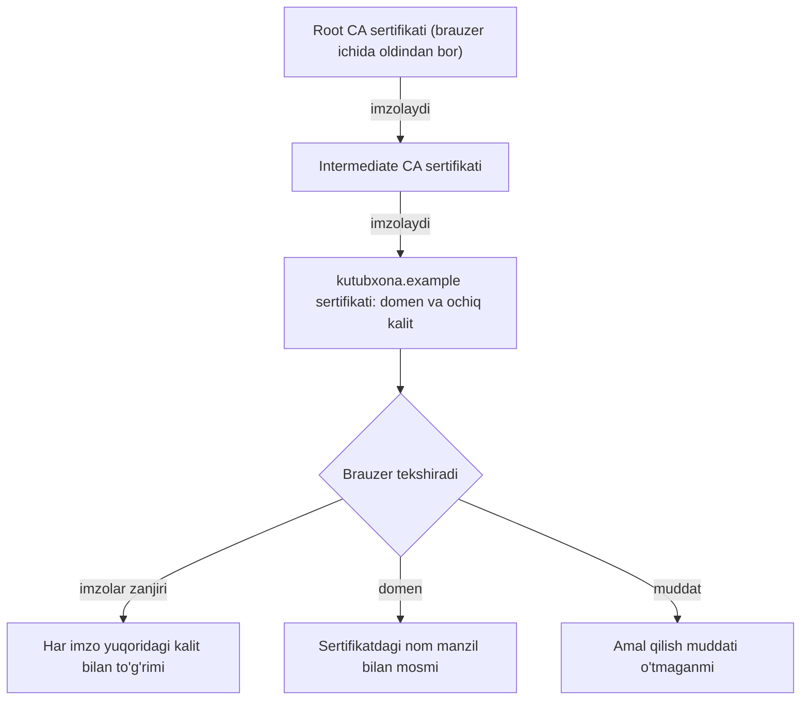
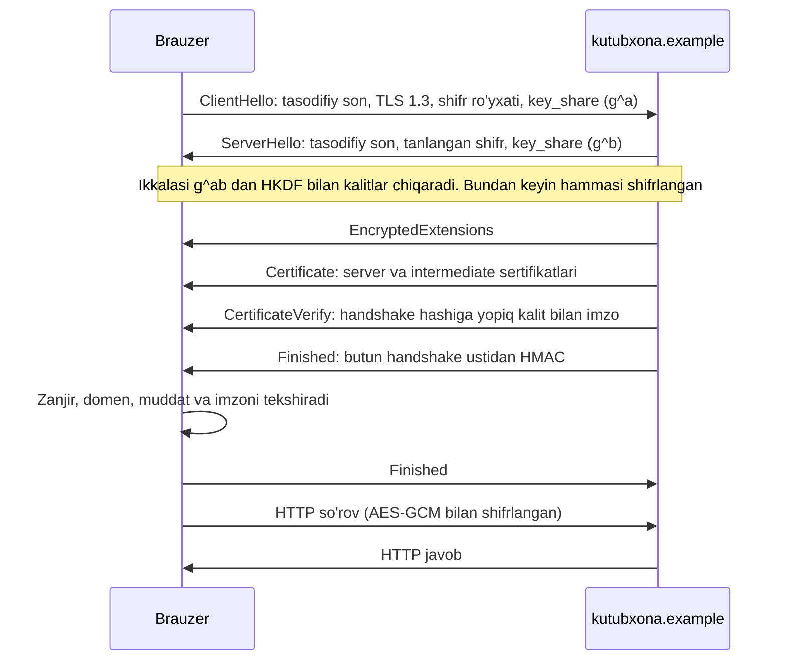

## Bu dars nima uchun kerak

14-darsda Caesar, Vigenere va substitution shifrlarini yozib, ularni brute force va chastota tahlili bilan buzdik. Xulosamiz shunday edi: Kerckhoffs tamoyiliga ko'ra algoritm ochiq bo'lishi kerak, xavfsizlik faqat kalitga tayanadi, klassik shifrlar esa bu talabdan o'ta olmaydi. Bu dars - o'sha savolga zamonaviy javob: ochiq algoritm bilan ham buzib bo'lmaydigan shifrlash qanday quriladi va HTTPS orqali brauzeringiz notanish server bilan qanday qilib xavfsiz gaplasha oladi.

Bu darsda oldingi bir nechta mavzu birlashadi. 30-darsdagi hash funksiya kriptografik talablar bilan kuchaytiriladi; 50-darsdagi parol hashlash va `hmac.compare_digest` shu yerdagi qurilish bloklariga tayanadi; 51-darsdagi passkey ichidagi "imzo" nima ekani ochiladi; 41-42-darslarda "52-darsda" deb qoldirilgan TLS handshake, nihoyat, qadamlab ko'riladi. 2-darsdagi bitlar va baytlar, 6-7-darslardagi tiplar chegarasi va to'lib ketish, 16-darsdagi logarifmik murakkablik ham qaytadi.

Muhim ogohlantirish: darsdagi XOR, Diffie-Hellman va RSA misollari **o'yinchoq** - mexanikani ko'rsatish uchun kichik sonlar, padding'siz va xavfsizlik tekshiruvlarisiz yozilgan. Ularni haqiqiy tizimda ishlatmang. Haqiqiy dasturda kriptografiyani hech qachon o'zingiz yozmaysiz: tekshirilgan kutubxona va standart protokol (TLS) ishlatiladi.

Bu darsdan keyin siz:

- kriptografik hash'ning uch xossasini (preimage, second preimage, collision resistance) va avalanche effektini Python'da ko'rsata olasiz;
- birthday paradoksi orqali n bitli hash uchun collision narxi 2^(n/2) ekanini hisoblay olasiz va MD5, SHA-1 nega eskirganini (SHAttered, 2017) bilasiz;
- HMAC nima uchun kerakligini va oddiy hash bilan "imzolash" nega ishlamasligini tushuntira olasiz;
- XOR, one-time pad, AES blok shifri, ECB muammosi va GCM authenticated encryption'ni farqlay olasiz;
- Diffie-Hellman kalit almashishini va RSA kalit yaratish, shifrlash va imzoni kichik sonlar bilan qo'lda hisoblay olasiz;
- sertifikat va CA zanjiri, TLS 1.3 handshake qadamlarini, HTTPS nimani kafolatlab, nimani kafolatlamasligini bilasiz;
- post-quantum kriptografiya standartlari (FIPS 203, 204, 205) nima uchun chiqqanini bilasiz.

## Kriptografik hash funksiya

### Xossalar

30-darsda hash funksiyani hash table uchun ishlatdik: tez bo'lsa va kalitlarni tekis taqsimlasa yetarli edi. FNV-1a kabi funksiyada collision'ni ataylab topish oson, lekin hash table uchun bu muammo emas. Xavfsizlikda esa hujumchi bor, shuning uchun **kriptografik hash** (SHA-256 kabi) uchta qo'shimcha talabga javob berishi kerak. Chiqish n bit bo'lsin:

| Xossa | Hujumchining vazifasi | Kutilgan narx | Nima uchun kerak |
|---|---|---|---|
| Preimage resistance (bir tomonlamalik) | Berilgan h uchun H(x) = h bo'ladigan istalgan x topish | 2^n | Paroldan hash (50-dars): hashdan parol tiklanmasin |
| Second preimage resistance | Berilgan x uchun H(x') = H(x), x' ≠ x topish | 2^n | Fayl yaxlitligi: aynan shu faylning soxta nusxasi yasalmasin |
| Collision resistance | Istalgan x ≠ x' juftlik, H(x) = H(x') | 2^(n/2) | Raqamli imzo va sertifikat: ikki hujjat bitta imzoni bo'lishmasin |

Bundan tashqari yaxshi hash'da **avalanche effekti** bor: kirishdagi bitta bit o'zgarsa, chiqishdagi bitlarning taxminan yarmi o'zgaradi va qaysi biri o'zgarishini oldindan aytib bo'lmaydi. Aks holda o'xshash kirishlar o'xshash hash berib, ma'lumot sizdirardi.

```python run
import hashlib

for name in ["md5", "sha1", "sha256", "sha3_256"]:
    h = hashlib.new(name, b"salom").hexdigest()
    print(f"{name:8} {len(h) * 4:3} bit  {h[:32]}...")

a = hashlib.sha256(b"salom").digest()
b = hashlib.sha256(b"salon").digest()   # bitta harf farq
print()
print("salom:", a.hex()[:32] + "...")
print("salon:", b.hex()[:32] + "...")
print("kirishdagi farq:", bin(ord("m") ^ ord("n")).count("1"), "bit")
diff = sum(bin(x ^ y).count("1") for x, y in zip(a, b))
print(f"chiqishdagi farq: {diff} / 256 bit ({diff / 256:.0%})")
```

Natija:

```text
md5      128 bit  7650d3efe9d32071f601e9d148767d26...
sha1     160 bit  25c2c264d4a86dfb0a0c8b731cfc744d...
sha256   256 bit  038f270ca678c66f5bf393f958e8eebc...
sha3_256 256 bit  34f100d91704f8f312643888df7eb42e...

salom: 038f270ca678c66f5bf393f958e8eebc...
salon: 1a26b7dee6fc52c891e769ddab4fc79f...
kirishdagi farq: 2 bit
chiqishdagi farq: 120 / 256 bit (47%)
```

`m` (0x6D) va `n` (0x6E) faqat 2 bitda farq qiladi, hashlarda esa 256 bitdan 120 tasi (taxminan yarmi) boshqacha. Hex ko'rinishda ham umumiy naqsh yo'q.

### Birthday paradoksi: nega collision 2^(n/2)

Nega collision narxi 2^n emas, 2^(n/2)? Bu **birthday paradoksi**: 23 kishilik guruhda ikkitasining tug'ilgan kuni bir xil bo'lish ehtimoli 50% dan oshadi, garchi kunlar 365 ta bo'lsa ham. Sabab - juftliklar soni: k ta element orasida k(k-1)/2 juftlik bor, har juftlik 1/N ehtimol bilan to'qnashadi. k ≈ sqrt(N) bo'lganda juftliklar soni N ga yaqinlashadi. Aniqroq, birinchi collision'gacha kutilgan urinishlar soni taxminan sqrt(π/2 · N).

Tekshiramiz: SHA-256 ning faqat birinchi 3 baytini (24 bit) "o'yinchoq hash" sifatida olib, collision qidiramiz. N = 2^24 = 16 777 216, nazariy kutish sqrt(π/2 · 2^24) ≈ 5134.

```python run
import hashlib


def h24(data):
    """SHA-256 ning faqat birinchi 3 bayti: 24 bitli o'yinchoq hash."""
    return hashlib.sha256(data).digest()[:3]


seen = {}
i = 0
while True:
    msg = f"xabar-{i}".encode()
    d = h24(msg)
    if d in seen:
        break
    seen[d] = msg
    i += 1

print("collision topildi", i + 1, "ta urinishda:")
print(" ", seen[d].decode(), "->", d.hex())
print(" ", msg.decode(), "->", h24(msg).hex())
print("nazariy kutish: sqrt(pi/2 * 2^24) =", round((3.14159265 / 2 * 2**24) ** 0.5))
```

Natija:

```text
collision topildi 8759 ta urinishda:
  xabar-1795 -> dad2ab
  xabar-8758 -> dad2ab
nazariy kutish: sqrt(pi/2 * 2^24) = 5134
```

8759 urinish - kutilgan tartibda (bu tasodifiy jarayon, aniq son har kirish to'plamida boshqacha). Muhimi: 16,7 million emas, bir necha ming. 30-darsdagi hash table'dagi kabi lug'at (dict) bilan bu O(k) ish. Demak 128 bitli MD5 uchun umumiy collision hujumi 2^64, 160 bitli SHA-1 uchun 2^80 atrofida turadi va shu sababli zamonaviy hash'lar kamida 256 bit.

### MD5 va SHA-1 nega eskirgan

Hash "buzilgan" deyiladi, agar unga qarshi umumiy 2^(n/2) dan ancha arzon hujum topilsa.

- **MD5** (128 bit, 1992). 2004-yilda Xiaoyun Wang va hamkasblari amaliy collision e'lon qilgan; hozir oddiy kompyuterda soniyalar ichida topiladi. RFC 6151 (2011) collision resistance kerak bo'lgan joyda MD5 ishlatish oqilona emasligini qayd etadi.
- **SHA-1** (160 bit, NIST standarti 1995-yildan). NIST uni 2011-yilda eskirgan deb e'lon qildi, lekin u imzo va sertifikatlarda yillar davomida ishlatilaverdi. 2017-yil 23-fevralda CWI Amsterdam va sanoat tadqiqotchilari (Stevens, Bursztein, Karpman, Albertini, Markov) **SHAttered** loyihasida birinchi haqiqiy SHA-1 collision'ni e'lon qildi: bir xil SHA-1 hashga ega, lekin mazmuni boshqa ikkita PDF fayl. Maqolaga ko'ra hisob hajmi 2^63,1 ta SHA-1 siqish funksiyasi chaqiruviga teng bo'lgan (taxminan 6500 CPU-yil va 100 GPU-yil) - bu umumiy hujumdan (2^80) 100 000 marta tezroq. NIST 2022-yil dekabrida SHA-1'ni 2030-yil 31-dekabrgacha butunlay chiqarishni e'lon qildi.
- **SHA-256** (SHA-2 oilasi) va **SHA-3** - hozirgi tavsiya. Ularga qarshi amaliy collision ma'lum emas.

E'tibor bering: MD5 ning buzilishi uni parol hashi sifatida ham yaroqsiz qiladi, lekin boshqa sabab bilan - u juda tez (50-dars). Collision esa imzo va sertifikat uchun xavfli: hujumchi zararsiz hujjatga imzo olib, imzoni bir xil hashli zararli hujjatga ko'chiradi.

## HMAC: kalitli hash

Hash yaxlitlikni tekshiradi, lekin faqat hash ishonchli kanal orqali kelsa. Hujumchi xabarni o'zgartirib, yangi hashini ham hisoblay oladi: SHA-256 hamma uchun ochiq. Xabarni **kim** yuborganini tekshirish uchun hamma bilmaydigan narsa - kalit kerak.

Sodda g'oya - `SHA-256(kalit + xabar)` - SHA-256 kabi Merkle-Damgard tuzilishidagi hash'larda xavfli: hujumchi kalitni bilmasdan ham `xabar + qo'shimcha` uchun to'g'ri qiymatni hisoblay oladi (**length extension** hujumi). **HMAC** (RFC 2104, 1997) buni ikki qatlamli tuzilma bilan yopadi:

HMAC(K, m) = H((K ⊕ opad) ‖ H((K ⊕ ipad) ‖ m)),

bu yerda ipad va opad - o'zgarmas baytlar (0x36 va 0x5C takrori), ‖ - ulash. 51-darsdagi TOTP, 48-darsdagi imzolangan cookie va TLS'dagi kalit chiqarish (HKDF) - hammasi HMAC ustida.

```python run
import hashlib
import hmac

key = b"server-siri-32-baytli-tasodifiy!"
msg = b"to=aziza&amount=100"
tag = hmac.new(key, msg, hashlib.sha256).hexdigest()
print("xabar:", msg.decode(), "| tag:", tag[:24] + "...")


def verify(m, t):
    return hmac.compare_digest(hmac.new(key, m, hashlib.sha256).hexdigest(), t)


print("asl xabar:          ", verify(msg, tag))
print("summa o'zgartirildi:", verify(b"to=aziza&amount=900", tag))
# Kalitni bilmagan hujumchi yangi tag yasay olmaydi: oddiy hash bilan "imzolash" foydasiz
fake = hashlib.sha256(b"to=hujumchi&amount=900").hexdigest()
print("hash bilan soxta tag:", verify(b"to=hujumchi&amount=900", fake))
```

Natija:

```text
xabar: to=aziza&amount=100 | tag: 2c2f19ae21bcb78201130348...
asl xabar:           True
summa o'zgartirildi: False
hash bilan soxta tag: False
```

HMAC tag'i **MAC** (message authentication code) deb ataladi. U yaxlitlik va kelib chiqishni tasdiqlaydi, lekin faqat kalitni bo'lishgan tomonlar orasida: tag'ni tekshira oladigan har kim uni yasay ham oladi. Uchinchi tomonga isbotlash uchun (masalan, sud oldida) raqamli imzo kerak - pastda.

## Simmetrik shifrlash

### XOR va one-time pad

**Simmetrik shifrlash** - shifrlash va ochish uchun bitta kalit. Eng sodda amal - **XOR** (exclusive or, C va Python'da `^` operatori): ikki bit har xil bo'lsa 1, bir xil bo'lsa 0 (0^0 = 0, 0^1 = 1, 1^0 = 1, 1^1 = 0). Baytlarga bitma-bit qo'llanadi: 2-darsdagi ikkilik ko'rinishda `01100001 ^ 00001011 = 01101010`. Asosiy xossa: `x ^ k ^ k == x`, ya'ni ikkinchi XOR asl qiymatni qaytaradi. 14-darsdagi Vigenere ham aslida shu g'oya, faqat qo'shish mod 26 bilan. C'da baytlar ustida:

```c run
#include <stdio.h>
#include <string.h>

// data ni key bilan XOR qiladi; kalit qisqa bo'lsa, u takrorlanadi
void xor_bytes(unsigned char *data, int n, const char *key)
{
    int k = strlen(key);
    for (int i = 0; i < n; i++)
    {
        data[i] ^= key[i % k];
    }
}

void print_hex(const unsigned char *data, int n)
{
    for (int i = 0; i < n; i++)
    {
        printf("%02x", data[i]);
    }
    printf("\n");
}

int main(void)
{
    unsigned char msg[] = "salom dunyo";
    int n = strlen((char *) msg);

    xor_bytes(msg, n, "kalit");
    printf("shifr:  ");
    print_hex(msg, n);
    xor_bytes(msg, n, "kalit");          // ikkinchi XOR asl matnni qaytaradi
    printf("ochish: %s\n", msg);

    // Takrorlanuvchi kalit naqshni sizdiradi: bir xil harflar davriy shifr beradi
    unsigned char same[15];
    memset(same, 'A', sizeof(same));
    xor_bytes(same, sizeof(same), "kalit");
    printf("AAAA... shifri: ");
    print_hex(same, sizeof(same));
}
```

Natija:

```text
$ clang xor.c -o xor && ./xor
shifr:  18000006194b0519070d04
ochish: salom dunyo
AAAA... shifri: 2a202d28352a202d28352a202d2835
```

15 ta `A` ning shifrida `2a202d2835` naqshi har 5 baytda takrorlandi - kalit uzunligi ko'rinib qoldi. Bu 14-darsdagi Kasiski usulining aynan o'zi: kalit uzunligi topilsa, shifr L ta oddiy XOR'ga bo'linadi va har biri chastota tahlili bilan ochiladi.

Kalit xabardek uzun, **haqiqatan tasodifiy** va **faqat bir marta** ishlatilsa-chi? Bu **one-time pad**. Claude Shannon 1949-yilda uning mukammal maxfiyligini isbotlagan: shifrdan xabar haqida hech qanday ma'lumot olib bo'lmaydi, chunki har qanday bir xil uzunlikdagi xabar biror kalit bilan aynan shu shifrni beradi.

```python run
import secrets


def xor(data, key):
    return bytes(d ^ k for d, k in zip(data, key))


m = b"HUJUM TONGDA"
k = secrets.token_bytes(len(m))      # kalit xabar uzunligida va tasodifiy
c = xor(m, k)
print("shifr:", c.hex())
print("ochish:", xor(c, k).decode())

# Har qanday xabar shu shifrga mos kelishi mumkin: kerakli kalitni topsa bo'ladi
other = b"CHEKINISH 10"
print("boshqa 'kalit' bilan:", xor(c, xor(c, other)).decode())

# Xato: bitta kalitni ikki marta ishlatish (two-time pad)
m2 = b"HUJUM KECHQU"
c2 = xor(m2, k)
leak = xor(c, c2)                    # = m XOR m2, kalit yo'qoldi
print("c1 XOR c2:", leak.hex())
print("bir xil pozitsiyalar:", "".join("^" if b == 0 else "." for b in leak))
print("m1 ma'lum bo'lsa, m2:", xor(leak, m).decode())
```

Natija (birinchi qator har safar boshqacha, qolganlari doim shunday):

```text
shifr: bfdd809e95948bcfbd078787
ochish: HUJUM TONGDA
boshqa 'kalit' bilan: CHEKINISH 10
c1 XOR c2: 0000000000001f0a0d0f1514
bir xil pozitsiyalar: ^^^^^^......
m1 ma'lum bo'lsa, m2: HUJUM KECHQU
```

One-time pad nazariy jihatdan mukammal, amalda esa deyarli yaroqsiz: 1 GB ma'lumot uchun 1 GB kalitni oldindan xavfsiz yetkazish kerak. Kalit bir marta qayta ishlatilsa, `c1 XOR c2 = m1 XOR m2` - kalit yo'qoladi, xabarlarning bir xil joylari ochiq ko'rinadi, bittasi ma'lum bo'lsa ikkinchisi to'liq ochiladi. Bu "kalitni (yoki nonce'ni) qayta ishlatmang" qoidasining eng sodda namoyishi; GCM'da u yana qaytadi.

### AES: blok shifr

Zamonaviy amaliy yechim - qisqa kalitdan (128-256 bit) xavfsiz shifr yasash. **AES** (Advanced Encryption Standard, FIPS 197, 2001; 2023-yilda tahririy yangilangan) - **blok shifr**: u 128 bitli (16 baytli) blokni kalit yordamida boshqa 16 baytli blokka aylantiradi. Kalit 128, 192 yoki 256 bit, raundlar soni mos ravishda 10, 12, 14. Algoritm to'liq ochiq (Kerckhoffs), lekin eng yaxshi ma'lum hujum ham brute force'dan amalda tezroq emas: AES-128 uchun 2^128 kalit.

Python standart kutubxonasida AES yo'q: `hashlib`, `hmac` va `secrets` bor, lekin shifrlash moduli yo'q. Amalda `cryptography` paketi ishlatiladi (brauzer muhitida u `import` qilinganda avtomatik yuklanadi).

Blok shifr faqat 16 baytni shifrlaydi. Uzun xabar uchun **rejim** (mode of operation) kerak: bloklar qanday bog'lanadi. Eng sodda rejim - **ECB** (Electronic Codebook): har blok alohida, bir xil kalit bilan shifrlanadi. Muammo darhol ko'rinadi: bir xil ochiq blok - bir xil shifr blok. Mashhur misol - ECB bilan shifrlangan pingvin rasmi, unda kontur aniq ko'rinib qoladi (Wikipedia'dagi "Block cipher mode of operation" sahifasida). Xuddi shuni kichik "rasm" bilan qilamiz: har piksel roppa-rosa bitta blok.

```python run
import secrets

from cryptography.hazmat.primitives.ciphers import Cipher, algorithms, modes

# 8x10 "rasm": har piksel - 16 bayt, ya'ni roppa-rosa bitta AES bloki
picture = [
    "..........",
    "..######..",
    ".##....##.",
    ".#.#..#.#.",
    ".#......#.",
    ".#.####.#.",
    "..#....#..",
    "...####...",
]
data = b"".join(b"\x00" * 16 if ch == "." else b"\xff" * 16 for row in picture for ch in row)
key = secrets.token_bytes(16)                      # AES-128 kaliti


def show(ct):
    """Har shifrlangan blokka harf beradi: bir xil blok - bir xil harf."""
    names, rows = {}, []
    for i in range(0, len(ct), 160):               # bir qator = 10 blok
        row = ""
        for j in range(i, i + 160, 16):
            blk = ct[j:j + 16]
            names.setdefault(blk, chr(ord("A") + len(names)) if len(names) < 26 else "?")
            row += names[blk]
        rows.append(row)
    return rows, len(names)


ecb = Cipher(algorithms.AES(key), modes.ECB()).encryptor().update(data)
rows, distinct = show(ecb)
print("ECB:", distinct, "xil blok,", len(ecb) // 16, "blokdan")
print("\n".join(rows))

ctr = Cipher(algorithms.AES(key), modes.CTR(secrets.token_bytes(16))).encryptor().update(data)
rows, distinct = show(ctr)
print("CTR:", distinct, "xil blok,", len(ctr) // 16, "blokdan; birinchi qator:", rows[0])
```

Natija (kalit tasodifiy, lekin naqsh doim bir xil):

```text
ECB: 2 xil blok, 80 blokdan
AAAAAAAAAA
AABBBBBBAA
ABBAAAABBA
ABABAABABA
ABAAAAAABA
ABABBBBABA
AABAAAABAA
AAABBBBAAA
CTR: 80 xil blok, 80 blokdan; birinchi qator: ABCDEFGHIJ
```

ECB shifrida tabassum to'liq saqlandi: hujumchi kalitni bilmaydi, lekin rasmni ko'radi. CTR (counter) rejimida har blok o'z pozitsiyasi va tasodifiy boshlang'ich qiymat (nonce) bilan shifrlanadi, shuning uchun 80 blokning hammasi har xil. Qoida: ECB'ni hech qachon ishlatmang.

### GCM: authenticated encryption

Shifrlash maxfiylikni beradi, lekin yaxlitlikni emas. CTR rejimida shifr matndagi bitni o'zgartirsangiz, ochiq matnda aynan o'sha bit o'zgaradi - hujumchi `amount=100` ni ko'rmasdan `amount=900` ga aylantirishi mumkin, agar pozitsiyani bilsa. Shuning uchun zamonaviy tizimlar **AEAD** (authenticated encryption with associated data) ishlatadi: shifrlash va MAC bitta amalda. Eng keng tarqalgani - **GCM** (Galois/Counter Mode, NIST SP 800-38D): CTR shifrlash + 16 baytli autentifikatsiya tag'i. "Associated data" - shifrlanmaydigan, lekin tag bilan himoyalanadigan qism (masalan, header).

```python run
import secrets

from cryptography.exceptions import InvalidTag
from cryptography.hazmat.primitives.ciphers.aead import AESGCM

key = AESGCM.generate_key(bit_length=256)          # AES-256
aes = AESGCM(key)
nonce = secrets.token_bytes(12)                    # 96 bit, har xabarga YANGI
header = b"user=aziza"                             # shifrlanmaydi, lekin himoyalanadi (AD)
msg = b"amount=100"

ct = aes.encrypt(nonce, msg, header)
print("ochiq matn:", len(msg), "bayt | shifr + tag:", len(ct), "bayt")
print("ochish:", aes.decrypt(nonce, ct, header).decode())

bad = bytearray(ct)
bad[7] ^= 0x01                                     # bitta bitni o'zgartiramiz
for name, args in [("shifr o'zgardi", (nonce, bytes(bad), header)),
                   ("header o'zgardi", (nonce, ct, b"user=hujumchi")),
                   ("boshqa kalit", None)]:
    try:
        if args is None:
            AESGCM(AESGCM.generate_key(bit_length=256)).decrypt(nonce, ct, header)
        else:
            aes.decrypt(*args)
        print(name, "-> qabul qilindi")
    except InvalidTag:
        print(name, "-> InvalidTag")
```

Natija:

```text
ochiq matn: 10 bayt | shifr + tag: 26 bayt
ochish: amount=100
shifr o'zgardi -> InvalidTag
header o'zgardi -> InvalidTag
boshqa kalit -> InvalidTag
```

10 bayt + 16 baytli tag = 26 bayt. Bitta bit o'zgarishi ham, header almashtirilishi ham, noto'g'ri kalit ham ochishni rad ettiradi - qisman ochilgan ma'lumot qaytmaydi. GCM'ning yagona, lekin qat'iy sharti: bitta kalit bilan **nonce hech qachon takrorlanmasin**. Takrorlansa, one-time pad misolidagi kabi ikki ochiq matnning XOR'i oshkor bo'ladi va autentifikatsiya kaliti ham tiklanib, soxta tag yasash mumkin bo'ladi. 96 bitli tasodifiy nonce yoki hisoblagich ishlatiladi.

| Rejim | Maxfiylik | Yaxlitlik | Bir xil bloklar | Holati |
|---|---|---|---|---|
| ECB | Naqsh sizadi | Yo'q | Bir xil shifr | Ishlatmang |
| CBC | Bor (tasodifiy IV bilan) | Yo'q, alohida MAC kerak | Yashirinadi | Eski tizimlar, padding xatolariga sezgir |
| CTR | Bor (noyob nonce bilan) | Yo'q | Yashirinadi | GCM ichida ishlatiladi |
| GCM | Bor | Bor (16 baytli tag) | Yashirinadi | TLS 1.3, standart tanlov |
| ChaCha20-Poly1305 | Bor | Bor | Yashirinadi | TLS 1.3, AES apparat tezlatgichi yo'q qurilmalarda |

## Kalit almashish va Diffie-Hellman

### Kalit almashish muammosi

Simmetrik shifr tez va kuchli, lekin bitta savol qoladi: ikki tomon umumiy kalitni qanday kelishadi, agar ular orasidagi har bir xabarni hujumchi o'qisa? Kalitni ochiq yuborib bo'lmaydi. Har juftlik uchun oldindan alohida kalit tarqatish ham imkonsiz: n foydalanuvchi uchun n(n-1)/2 kalit kerak, 1000 kishi uchun 1000 · 999 / 2 = 499 500 kalit, internetdagi milliardlab brauzer va server uchun esa umuman mumkin emas.

### Diffie-Hellman

1976-yilda Whitfield Diffie va Martin Hellman taklif qilgan usul ochiq kanal orqali umumiy sirni kelishishga imkon beradi. Ochiq parametrlar: katta tub son p va generator g. Tomonlar:

1. Aziza tasodifiy maxfiy a tanlaydi va A = g^a mod p ni yuboradi.
2. Bekzod tasodifiy maxfiy b tanlaydi va B = g^b mod p ni yuboradi.
3. Aziza B^a mod p, Bekzod A^b mod p hisoblaydi. Ikkalasi ham g^(ab) mod p ga teng.

Tinglovchi p, g, A, B ni ko'radi, lekin g^(ab) ni hisoblash uchun a yoki b kerak. A dan a ni topish - **diskret logarifm** muammosi: katta p uchun ma'lum samarali algoritm yo'q. `pow(g, a, p)` esa juda tez: kvadratga oshirib ko'paytirish usuli bilan log2(a) atrofida ko'paytirish.

```python run
import secrets

# O'yinchoq parametrlar - haqiqiy tizimda ishlatmang!
p, g = 23, 5                      # ochiq: tub son va generator
a, b = 6, 15                      # Aziza va Bekzodning maxfiy sonlari

A = pow(g, a, p)                  # Aziza yuboradi: g^a mod p
B = pow(g, b, p)                  # Bekzod yuboradi: g^b mod p
print("ochiq kanalda: p =", p, "g =", g, "A =", A, "B =", B)
print("Aziza hisoblaydi B^a mod p =", pow(B, a, p))
print("Bekzod hisoblaydi A^b mod p =", pow(A, b, p))

# Kichik p da tinglovchi a ni oddiy sinash bilan topadi (diskret logarifm)
found = next(x for x in range(p) if pow(g, x, p) == A)
print("tinglovchi topdi: a =", found, "-> sir =", pow(B, found, p))

# Kattaroq son: 2^127 - 1 (tub). Bu ham haqiqiy tizim uchun yetarli emas
p = 2**127 - 1
a, b = secrets.randbelow(p - 2) + 1, secrets.randbelow(p - 2) + 1
A, B = pow(3, a, p), pow(3, b, p)
print("127 bitli p bilan ham sirlar teng:", pow(B, a, p) == pow(A, b, p))
```

Natija:

```text
ochiq kanalda: p = 23 g = 5 A = 8 B = 19
Aziza hisoblaydi B^a mod p = 2
Bekzod hisoblaydi A^b mod p = 2
tinglovchi topdi: a = 6 -> sir = 2
127 bitli p bilan ham sirlar teng: True
```

p = 23 da tinglovchi 23 tadan ko'p bo'lmagan urinishda a ni topdi. Haqiqiy tizimlarda 2048+ bitli p yoki, ko'proq, elliptik egri chiziqlar ustidagi variant (ECDH, masalan X25519, 255 bitli egri) ishlatiladi; u bir xil xavfsizlikni ancha qisqa kalit bilan beradi.

DH'ning bitta zaif joyi bor: u tinglovchidan himoya qiladi, lekin **o'rtadagi odamdan** (man-in-the-middle) emas. Hujumchi o'rtada turib, Aziza bilan bitta, Bekzod bilan boshqa DH o'tkazsa, ikkalasi ham hujumchi bilan "xavfsiz" gaplashadi. Yechim - kim bilan gaplashayotganini tekshirish, ya'ni autentifikatsiya: raqamli imzo va sertifikat.

## Asimmetrik shifrlash va raqamli imzo: RSA

### G'oya

**Asimmetrik** (ochiq kalitli) kriptografiyada kalit juftlik: **ochiq kalit** hammaga beriladi, **yopiq kalit** faqat egasida. Ochiq kalit bilan shifrlangan xabarni faqat yopiq kalit ochadi; yopiq kalit bilan yaratilgan imzoni har kim ochiq kalit bilan tekshiradi. 51-darsdagi passkey aynan shu: server ochiq kalitni saqlaydi, qurilma yopiq kalit bilan challenge'ni imzolaydi.

**RSA** (Rivest, Shamir, Adleman, 1977) - eng mashhur misol. Xavfsizligi katta sonni tub ko'paytuvchilarga ajratish qiyinligiga tayanadi.

1. Ikki katta tub son p va q tanlanadi, n = p · q (ochiq).
2. φ(n) = (p - 1)(q - 1) hisoblanadi (maxfiy).
3. Ochiq daraja e tanlanadi: gcd(e, φ) = 1, amalda deyarli doim e = 65537.
4. Yopiq daraja d: e · d ≡ 1 (mod φ), ya'ni d = e^(-1) mod φ. Python'da `pow(e, -1, phi)`.
5. Shifrlash: c = m^e mod n. Ochish: m = c^d mod n.
6. Imzo: s = h^d mod n (h - xabar hashi). Tekshirish: s^e mod n == h.

Klassik o'yinchoq misol: p = 61, q = 53. n = 3233, φ = 60 · 52 = 3120, e = 17, d = 2753 (tekshiruv: 17 · 2753 = 46 801 = 15 · 3120 + 1). C'da 64 bitli butun sonlar bilan:

```c run
#include <stdint.h>
#include <stdio.h>

// (base^exp) mod m, "kvadratga oshirib ko'paytirish": O(log exp) ko'paytirish
uint64_t modpow(uint64_t base, uint64_t exp, uint64_t m)
{
    uint64_t result = 1;
    base %= m;
    while (exp > 0)
    {
        if (exp & 1)
        {
            result = result * base % m;   // m < 2^32 bo'lgani uchun to'lib ketmaydi
        }
        base = base * base % m;
        exp >>= 1;
    }
    return result;
}

int main(void)
{
    // O'yinchoq RSA - haqiqiy tizimda ishlatmang!
    uint64_t p = 61, q = 53;
    uint64_t n = p * q;                 // 3233, ochiq
    uint64_t phi = (p - 1) * (q - 1);   // 3120, maxfiy
    uint64_t e = 17;                    // ochiq daraja, gcd(e, phi) = 1
    uint64_t d = 2753;                  // maxfiy: e * d mod phi = 1

    printf("n = %llu, phi = %llu, e * d mod phi = %llu\n",
           (unsigned long long) n, (unsigned long long) phi, (unsigned long long) (e * d % phi));

    uint64_t m = 65;
    uint64_t c = modpow(m, e, n);       // shifrlash ochiq kalit bilan
    printf("m = %llu -> c = m^e mod n = %llu -> c^d mod n = %llu\n",
           (unsigned long long) m, (unsigned long long) c, (unsigned long long) modpow(c, d, n));

    uint64_t h = 123;                   // xabar "hashi" (o'yinchoq)
    uint64_t s = modpow(h, d, n);       // imzo yopiq kalit bilan
    printf("imzo s = h^d mod n = %llu, tekshiruv s^e mod n = %llu\n",
           (unsigned long long) s, (unsigned long long) modpow(s, e, n));

    // n kichik bo'lsa, uni ko'paytuvchilarga ajratish oson va d darhol topiladi
    for (uint64_t f = 2; f * f <= n; f++)
    {
        if (n % f == 0)
        {
            printf("hujumchi n ni ajratdi: %llu = %llu * %llu\n",
                   (unsigned long long) n, (unsigned long long) f, (unsigned long long) (n / f));
            break;
        }
    }
}
```

Natija:

```text
$ clang rsa.c -o rsa && ./rsa
n = 3233, phi = 3120, e * d mod phi = 1
m = 65 -> c = m^e mod n = 2790 -> c^d mod n = 65
imzo s = h^d mod n = 2746, tekshiruv s^e mod n = 123
hujumchi n ni ajratdi: 3233 = 53 * 61
```

`modpow` daraja ko'rsatkichining bitlari bo'yicha yuradi: d = 2753 uchun 2752 ta ko'paytirish emas, 12 qadam (2753 - 12 bitli son), ya'ni O(log d) (16-dars). `uint64_t` ishlatilgani sababi 7-darsdagi to'lib ketish: `result * base` ikki 12 bitli sonning ko'paytmasi, 32 bitga sig'adi, lekin haqiqiy 2048 bitli sonlar uchun maxsus katta son kutubxonasi kerak (Python'ning `int` i buni o'zi qiladi). Oxirgi qator - nima uchun n katta bo'lishi kerakligi: n ni ajratgan hujumchi φ va d ni darhol hisoblaydi.

### Haqiqiy RSA o'yinchoqdan nimasi bilan farq qiladi

- **O'lcham.** NIST SP 800-57 (1-qism, 5-reviziya) bo'yicha RSA 2048 bit taxminan 112 bitlik xavfsizlik beradi, 3072 bit - 128 bit (AES-128 ga teng), 15360 bit - 256 bit. Elliptik egri chiziqlarda 256 bitli kalit 128 bitlik xavfsizlikni beradi.
- **Padding.** "Toza" RSA deterministik (bir xil m - bir xil c) va matematik tuzilishi tufayli zaif. Haqiqiy shifrlash OAEP, imzo PSS sxemasi bilan, tasodifiy to'ldirish bilan qilinadi.
- **Imzoda hash.** Butun hujjat emas, uning SHA-256 hashi imzolanadi. Shuning uchun hash'ning collision resistance'i imzo uchun hal qiluvchi (SHAttered aynan shunga zarba bergan).
- **Tezlik.** RSA bilan shifrlash AES'dan bir necha tartibga (o'nlab-minglab marta, kalit o'lchami va qurilmaga qarab) sekinroq va bir martada faqat kalitdan qisqa ma'lumotni shifrlay oladi, shuning uchun u bilan katta ma'lumot shifrlanmaydi. Amalda: asimmetrik usul bilan kalit kelishiladi va tomonlar autentifikatsiya qilinadi, ma'lumot esa simmetrik AES-GCM bilan shifrlanadi. Bu **gibrid** sxema - TLS aynan shunday.

| | Simmetrik (AES-GCM) | Asimmetrik (RSA, ECDH, ECDSA) |
|---|---|---|
| Kalit | Bitta umumiy sir | Juftlik: ochiq va yopiq |
| Tezlik | Juda tez (apparat tezlatgichi bilan) | Ancha sekin |
| Kalit o'lchami (128 bit xavfsizlik) | 128 bit | RSA 3072 bit, ECC 256 bit |
| Muammosi | Kalitni oldindan bo'lishish | Ochiq kalit haqiqatan kimniki? |
| Vazifasi | Ma'lumotni shifrlash | Kalit almashish, imzo, autentifikatsiya |

## Raqamli imzo, sertifikatlar va CA zanjiri

**Raqamli imzo** - yopiq kalit bilan xabar hashiga qo'yilgan qiymat; ochiq kalit bilan har kim tekshiradi. MAC'dan farqli o'laroq, tekshiruvchi imzo yasay olmaydi, shuning uchun imzo uchinchi tomonga ham isbot bo'ladi (inkor qilib bo'lmaslik).

Lekin bitta savol qoldi: brauzer `kutubxona.example` ga ulanganda kelgan ochiq kalit haqiqatan shu saytnikimi yoki o'rtadagi hujumchinikimi? Bu yerda **sertifikat** kerak: "bu ochiq kalit `kutubxona.example` domeniga tegishli" degan bayonot, unga ishonchli tashkilot - **CA** (Certificate Authority, sertifikat markazi) imzo qo'ygan. Sertifikat formati X.509: domen nomi, ochiq kalit, amal qilish muddati, CA nomi va CA imzosi.

CA'ning ochiq kalitini qayerdan bilamiz? Operatsion tizim va brauzer ichida oldindan o'rnatilgan **ildiz** (root) CA sertifikatlari ro'yxati bor - ishonch shu yerdan boshlanadi. Ildiz kalitlari xavfsiz joyda saqlanadi va kundalik ishda ishlatilmaydi, shuning uchun odatda zanjir uch bo'g'inli:



Server handshake'da o'z sertifikatini va intermediate sertifikatni yuboradi; brauzer zanjirni o'zidagi ildizgacha tekshiradi. Domen egasi ekanini CA avtomatik tekshiradi (masalan, domenda maxsus fayl yoki DNS yozuv qo'yish talab qilinadi). Sertifikatlar muddati qisqarib bormoqda: CA/Browser Forum'ning SC-081 qarori bo'yicha ochiq TLS sertifikatlarining maksimal muddati 2026-yil martdan boshlab bosqichma-bosqich qisqartirilib, 2029-yil martga kelib 398 kundan 47 kunga tushadi. Shuning uchun sertifikat yangilash qo'lda emas, avtomatik qilinadi.

## TLS 1.3 handshake va HTTPS

### Handshake qadamlari

42-darsda HTTPS = HTTP + TLS ekanini ko'rgan edik. Endi barcha bo'laklar bor: DH kalit kelishadi, imzo va sertifikat serverni autentifikatsiya qiladi, HKDF (HMAC asosida) kalitlarni chiqaradi, AES-GCM ma'lumotni shifrlaydi. TLS 1.3 2018-yilda RFC 8446 sifatida chiqdi; 2026-yil iyulda uning yangilangan matni RFC 9846 nashr etildi va u RFC 8446 ni almashtirdi (protokol versiyasi o'sha - TLS 1.3). Soddalashtirilgan to'liq handshake:



Muhim tafsilotlar:

- **1-RTT.** Mijoz birinchi xabardayoq o'z DH qismini (`key_share`) yuboradi, shuning uchun bitta borib-qaytishdan keyin ma'lumot ketadi (TLS 1.2 da ikkita kerak edi). 41-darsdagi TCP handshake'ni qo'shsak, birinchi HTTP so'rov 2 RTT dan keyin yuboriladi, javob esa 3-RTT oxirida keladi.
- **CertificateVerify** - server yopiq kalit bilan handshake xabarlarining hashini imzolaydi. Bu DH'ning man-in-the-middle muammosini yopadi: o'rtadagi hujumchi sertifikatdagi kalitning yopiq qismini bilmaydi va imzo qo'ya olmaydi.
- **Forward secrecy.** TLS 1.3 da faqat har ulanishga yangi (ephemeral) DH kalitlari ishlatiladi; serverning sertifikat kaliti bilan kalit almashish (static RSA) olib tashlangan. Natija: server yopiq kaliti yillar o'tib o'g'irlansa ham, oldin yozib olingan trafikni ochib bo'lmaydi.
- **Shifr to'plamlari** faqat AEAD, asosiylari: `TLS_AES_128_GCM_SHA256`, `TLS_AES_256_GCM_SHA384`, `TLS_CHACHA20_POLY1305_SHA256`.

### HTTPS nimani kafolatlaydi va nimani yo'q

| Kafolatlaydi | Kafolatlamaydi |
|---|---|
| Maxfiylik: yo'ldagi kuzatuvchi path, header, cookie va body'ni o'qiy olmaydi | Saytning o'zi halol ekanini: phishing sayt ham o'z domeniga haqiqiy sertifikat oladi (51-dars) |
| Yaxlitlik: ma'lumotni yo'lda o'zgartirish aniqlanadi | Server xavfsizligini: XSS, SQL injection, CSRF (39, 50-darslar) HTTPS ichida ham ishlaydi |
| Autentifikatsiya: siz aynan sertifikatdagi domen bilan gaplashyapsiz | Server tomonda ma'lumot qanday saqlanishini: parollar ochiq saqlanishi mumkin |
| Forward secrecy: kelajakda kalit o'g'irlansa ham eski trafik ochilmaydi | Kim bilan bog'lanayotganingiz to'liq yashirinishini: IP manzil va ko'pincha domen nomi (SNI) ko'rinadi |
| | Sizning qurilmangiz xavfsizligini: zararli dastur ma'lumotni shifrlashdan oldin o'qiydi |

Qulf belgisi "bu ulanish shifrlangan va domen to'g'ri" degani, "bu sayt ishonchli" degani emas.

## Post-quantum kriptografiya

Yetarlicha katta kvant kompyuter Shor algoritmi bilan katta sonlarni ajratish va diskret logarifmni samarali hal qiladi. Bu RSA, DH va elliptik egri chiziqlarni - ya'ni bugungi kalit almashish va imzolarning hammasini - buzadi. Simmetrik shifr va hash'larga ta'siri kichikroq (Grover algoritmi kvadrat ildiz tezlashtiradi), shuning uchun AES-256 va SHA-256/384 yetarli deb hisoblanadi. Bunday kompyuter hali yo'q, lekin "hozir yig'ib, keyin och" (harvest now, decrypt later) xavfi bor: bugun yozib olingan trafik yillar o'tib ochilishi mumkin.

NIST bunga javoban 2024-yil 13-avgustda birinchi uchta post-quantum standartni nashr etdi:

| Standart | Algoritm | Vazifasi | Asosi |
|---|---|---|---|
| FIPS 203 | ML-KEM (CRYSTALS-Kyber'dan) | Kalit kelishish (key encapsulation) | Modul panjaralar (lattice) |
| FIPS 204 | ML-DSA (CRYSTALS-Dilithium'dan) | Raqamli imzo | Modul panjaralar |
| FIPS 205 | SLH-DSA (SPHINCS+'dan) | Raqamli imzo (zaxira) | Faqat hash funksiyalar |

Davomi: 2025-yil 11-martda HQC ML-KEM'ga zaxira kalit kelishish algoritmi sifatida tanlandi; Falcon asosidagi imzo (FN-DSA, FIPS 206 sifatida) standartlashtirilmoqda. NIST IR 8547 o'tish rejasiga ko'ra kvantga zaif algoritmlar 2035-yilgacha NIST standartlaridan chiqariladi. TLS'da o'tish **gibrid** usulda boshlangan: klassik X25519 va ML-KEM birga ishlatiladi, sir ikkalasi buzilgandagina oshkor bo'ladi; IETF bu mexanizmlarni (masalan, `X25519MLKEM768`) 2026-yil avgustda RFC 10024 sifatida standartlashtirdi.

## Mashq: o'yinchoq RSA

RSA'ni Python'da yozing (`int` istalgan uzunlikda, shuning uchun kattaroq tub sonlar ham ishlaydi). Haqiqiy tizimda ishlatmang: padding yo'q.

- `make_keys(p, q, e=65537)` - `(n, e, d)`; gcd(e, φ) ≠ 1 bo'lsa `ValueError`. d uchun `pow(e, -1, phi)`.
- `encrypt(m, n, e)` va `decrypt(c, n, d)`; `encrypt` 0 ≤ m < n bo'lmasa `ValueError`.
- `sign(message, n, d)` - `message` (bytes) ning SHA-256 hashini butun songa aylantirib (`int.from_bytes(..., "big")`), mod n olib, imzolaydi; `verify(message, s, n, e)` - `True`/`False`.

Testlar klassik 61/53 misolini, barcha m uchun aylanma shifrlashni, xatolarni va 2^31 - 1, 2^61 - 1 tub sonlari bilan imzoni tekshiradi.

```python run
import hashlib
import math


def make_keys(p, q, e=65537):
    # n = p*q, phi = (p-1)*(q-1); gcd(e, phi) != 1 bo'lsa ValueError
    # d = e ning phi bo'yicha teskarisi: pow(e, -1, phi)
    # (n, e, d) qaytaring
    return 0, 0, 0


def encrypt(m, n, e):
    # 0 <= m < n bo'lmasa ValueError
    return 0


def decrypt(c, n, d):
    return 0


def sign(message, n, d):
    # h = SHA-256(message) butun son sifatida, mod n; imzo = h^d mod n
    return 0


def verify(message, s, n, e):
    return False


n, e, d = make_keys(61, 53, 17)
print(n, e, d, encrypt(65, n, e))
```

```python test
def _raises(fn):
    try:
        fn()
    except ValueError:
        return True
    return False


_P, _Q = 2**31 - 1, 2**61 - 1
_MSG = b"to=aziza&amount=100"


def _sig_ok():
    n, e, d = make_keys(_P, _Q)
    s = sign(_MSG, n, d)
    return verify(_MSG, s, n, e)


def _sig_reject():
    n, e, d = make_keys(_P, _Q)
    s = sign(_MSG, n, d)
    return verify(_MSG, s, n, e) and not verify(b"to=aziza&amount=900", s, n, e) and not verify(_MSG, (s + 1) % n, n, e)


check("make_keys(61, 53, 17) -> (3233, 17, 2753)", lambda: make_keys(61, 53, 17) == (3233, 17, 2753))
check("encrypt(65) = 2790 va decrypt qaytaradi", lambda: encrypt(65, 3233, 17) == 2790 and decrypt(2790, 3233, 2753) == 65)
check("0..3232 hamma son uchun decrypt(encrypt(m)) == m", lambda: all(decrypt(encrypt(m, 3233, 17), 3233, 2753) == m for m in range(3233)))
check("gcd(e, phi) != 1 bo'lsa ValueError (e=3, phi=3120)", lambda: _raises(lambda: make_keys(61, 53, 3)))
check("m >= n yoki m < 0 bo'lsa ValueError", lambda: _raises(lambda: encrypt(3233, 3233, 17)) and _raises(lambda: encrypt(-1, 3233, 17)))
check("katta tub sonlar va e=65537: e*d mod phi == 1", lambda: (lambda k: k[1] == 65537 and k[1] * k[2] % ((_P - 1) * (_Q - 1)) == 1)(make_keys(_P, _Q)))
check("imzo to'g'ri xabar bilan tekshiruvdan o'tadi", _sig_ok)
check("o'zgartirilgan xabar yoki imzo rad etiladi", _sig_reject)
```

## Ko'p uchraydigan xatolar

1. **Kriptografiyani o'zingiz yozish.** Bu darsdagi XOR, DH va RSA - o'yinchoq. Haqiqiy tizimda tekshirilgan kutubxona (`cryptography`, libsodium) va TLS.
2. **MD5 yoki SHA-1 ni imzo, sertifikat yoki yaxlitlik uchun ishlatish.** Collision'lar amaliy (SHAttered, 2017). SHA-256 yoki SHA-3.
3. **`SHA-256(kalit + xabar)` ni MAC sifatida ishlatish.** Length extension hujumi. HMAC ishlating va `compare_digest` bilan solishtiring.
4. **ECB rejimi.** Bir xil bloklar bir xil shifr beradi, rasm va tuzilma ko'rinib qoladi. AEAD: AES-GCM yoki ChaCha20-Poly1305.
5. **Nonce yoki kalitni qayta ishlatish.** One-time pad'da ham, GCM'da ham bu ikki xabarning XOR'ini oshkor qiladi, GCM'da esa soxta tag yasashga ham yo'l ochadi.
6. **Shifrlash yaxlitlikni ham beradi deb o'ylash.** CTR yoki CBC'dagi bitni o'zgartirish ochiq matnni oldindan aytiladigan tarzda o'zgartiradi. Autentifikatsiyasiz shifrlash ishlatmang.
7. **Sertifikat tekshiruvini o'chirib qo'yish** (`verify=False`, "self-signed bo'lsa ham ulan"). Shunda TLS DH'ning o'zi bo'lib qoladi va man-in-the-middle'ga ochiq.
8. **Qulf belgisini "sayt ishonchli" deb tushunish.** HTTPS kanalni himoya qiladi, saytning niyatini emas.

## Xulosa

- Kriptografik hash: preimage va second preimage uchun 2^n, collision uchun birthday paradoksi tufayli 2^(n/2). Avalanche: bitta bit - chiqishning yarmi.
- MD5 va SHA-1 collision'lari amaliy (SHA-1: SHAttered, 2017, 2^63,1 hisob); NIST SHA-1'ni 2030-yil oxirigacha chiqaradi. Hozirgi tanlov SHA-256 va SHA-3.
- HMAC = kalitli hash, yaxlitlik va kelib chiqishni tasdiqlaydi; oddiy hash bilan "imzolash" ishlamaydi.
- One-time pad mukammal, lekin amaliy emas; AES - 128 bitli blok shifr. ECB naqshni sizdiradi, GCM shifrlash va autentifikatsiyani birga beradi, nonce esa takrorlanmasligi shart. Python standart kutubxonasida AES yo'q.
- Diffie-Hellman ochiq kanalda umumiy sir beradi, lekin autentifikatsiyasiz MITM'ga zaif. RSA: n = pq, e · d ≡ 1 (mod φ); haqiqiy kalit kamida 2048 bit, padding (OAEP, PSS) bilan.
- Raqamli imzo + sertifikat + CA zanjiri ochiq kalitning egasini tasdiqlaydi. TLS 1.3 (RFC 8446, endi RFC 9846): ephemeral DH, CertificateVerify, AEAD, 1-RTT, forward secrecy.
- HTTPS kanalni (maxfiylik, yaxlitlik, domen autentifikatsiyasi) himoya qiladi, saytning halolligi va server xatolarini emas.
- Post-quantum: FIPS 203 (ML-KEM), 204 (ML-DSA), 205 (SLH-DSA), 2024-yil 13-avgust; TLS'da gibrid X25519MLKEM768.

## Amaliy topshiriq

O'yinchoq "xavfsiz xabar" protokolini Python'da quring va uni o'zingiz buzib ko'ring.

1. **Kalit kelishish.** Ikki tomon (`Alice`, `Bob` obyektlari) DH bilan umumiy sirni kelishsin (o'yinchoq yoki `cryptography` dagi X25519). Umumiy sirdan HMAC-SHA256 bilan 32 baytli kalit chiqaring (masalan, `hmac.new(salt, sir, "sha256")`).
2. **Shifrlash.** Xabarlarni AES-GCM bilan shifrlang; nonce hisoblagich bo'lsin va takrorlanmasligini kod bilan kafolatlang. Header (yuboruvchi nomi, tartib raqami) associated data sifatida himoyalansin.
3. **Hujumlar.** Uchta hujumni yozing va natijani ko'rsating: (a) shifr matndagi bitni o'zgartirish, (b) eski xabarni qayta yuborish (replay) - tartib raqami bilan to'xtating, (c) o'rtadagi odam (Mallory) - imzosiz DH'da u ikkala tomonning xabarini o'qiy olishini ko'rsating.
4. **Autentifikatsiya.** MITM'ni yopish uchun Bob o'z DH qismini Ed25519 yopiq kaliti bilan imzolasin, Alice esa Bob'ning ochiq kalitini oldindan biladi (o'yinchoq "sertifikat"). Mallory hujumi endi aniqlanishini ko'rsating.
5. **Hisob.** Sizning tag uzunligingiz (128 bit) va 2^32 xabar uchun soxta tag'ni tasodifan topish ehtimolini, shuningdek 96 bitli tasodifiy nonce'lar orasida birthday collision ehtimolini 2^32 xabar uchun formula bilan baholang.

Yaxshi javobda bo'lishi kerak bo'lgan narsalar:

- ishlaydigan kod va har bir hujumning natijasi (InvalidTag, replay rad etildi, MITM aniqlandi);
- nonce noyobligi qanday ta'minlangani va nima uchun bu GCM uchun hayotiy;
- imzosiz va imzoli DH'ning farqi TLS'dagi CertificateVerify bilan solishtirilgan holda;
- birthday hisobi: k^2 / 2^(n+1) formulasi bilan sonli natija;
- bu protokol TLS 1.3 dan nimasi bilan kamroq ekanini (sertifikat zanjiri, forward secrecy, versiya kelishuvi) sanab o'tish.

Javobingizni pastdagi maydonga yozing va yuqoridagi mezonlar bilan solishtiring.

## Manbalar

- CS50's Introduction to Cybersecurity. [Lecture 1: Securing Data](https://cs50.harvard.edu/cybersecurity/notes/1/) - hashing, encryption, public-key cryptography, digital signatures.
- M. Stevens va boshq. [The first collision for full SHA-1](https://eprint.iacr.org/2017/190) (IACR ePrint 2017/190) - SHAttered: 2^63,1 hisob, 6500 CPU-yil va 100 GPU-yil; NIST. [NIST Retires SHA-1 Cryptographic Algorithm](https://www.nist.gov/news-events/news/2022/12/nist-retires-sha-1-cryptographic-algorithm) (2022) - 2030-yil 31-dekabr; [RFC 6151](https://www.rfc-editor.org/rfc/rfc6151) - MD5 xavfsizlik masalalari.
- IETF. [RFC 2104: HMAC](https://www.rfc-editor.org/rfc/rfc2104) - 2-bo'lim, ipad/opad tuzilmasi; Python. [hashlib](https://docs.python.org/3/library/hashlib.html), [hmac](https://docs.python.org/3/library/hmac.html).
- NIST. [FIPS 197: AES](https://csrc.nist.gov/pubs/fips/197/final) - blok va kalit o'lchamlari; [SP 800-38D: GCM](https://csrc.nist.gov/pubs/sp/800/38/d/final) - IV talablari; [SP 800-57 Part 1 Rev. 5](https://csrc.nist.gov/pubs/sp/800/57/pt1/r5/final) - 2-jadval, kalit o'lchamlari va xavfsizlik darajasi; Wikipedia. [Block cipher mode of operation](https://en.wikipedia.org/wiki/Block_cipher_mode_of_operation) - "Electronic codebook (ECB)" (pingvin rasmi).
- pyca/cryptography. [Authenticated encryption](https://cryptography.io/en/latest/hazmat/primitives/aead/) - `AESGCM`, nonce talabi, `InvalidTag`.
- IETF. [RFC 8446: TLS 1.3](https://www.rfc-editor.org/rfc/rfc8446) - 2-bo'lim "Protocol Overview" (1-rasm, to'liq handshake), 1.2 TLS 1.2 dan farqlar; [RFC 9846](https://www.rfc-editor.org/rfc/rfc9846) (2026-yil iyul) - RFC 8446 ni almashtirgan matn; [RFC 10024](https://www.rfc-editor.org/rfc/rfc10024) - gibrid ML-KEM kalit kelishish.
- CA/Browser Forum. [Ballot SC081v3](https://cabforum.org/2025/04/11/ballot-sc081v3-introduce-schedule-of-reducing-validity-and-data-reuse-periods/) - sertifikat muddatini 398 kundan 47 kunga qisqartirish jadvali.
- NIST. [FIPS 203](https://csrc.nist.gov/pubs/fips/203/final), [FIPS 204](https://csrc.nist.gov/pubs/fips/204/final), [FIPS 205](https://csrc.nist.gov/pubs/fips/205/final) (2024-yil 13-avgust); [Post-Quantum Cryptography loyihasi](https://csrc.nist.gov/projects/post-quantum-cryptography) - HQC, Falcon, IR 8547 o'tish rejasi.
